# AI+X碰个头：第三十五期：主会场分享整理 🤖


## 开篇概述 📝


在本节教程中，我们将一起梳理 AI+X 碰个头第三十五期主会场的全部分享内容。本次会场邀请了多位嘉宾，涵盖本科生科研工作流、大模型在分子结构编辑中的应用、Mac 本地增强工具箱、AI 赋能非遗文化，以及怀柔黑客松中的机器人实践。无论你是对科研方法感兴趣的同学，还是想了解 AI 如何落地到传统行业，都能在这里找到有价值的参考。下面我们将逐节展开，把每一次分享的核心思路用大白话讲清楚。


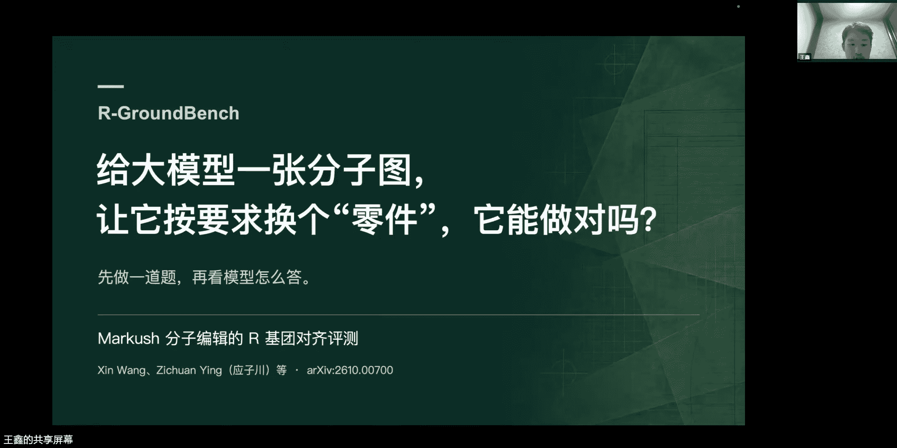

## 第一节：本科生科研工作流与科研技巧 🎓


首先，我们来看第一位分享者的内容。他以本科生的视角，介绍了自己的科研工作流以及一些实用的科研技巧。

串串目前是大三在读本科生，正在 polyo 进行科研学习。他希望从本科生的角度出发，分享自己在科研过程中的工作流，并提供一些可供参考的科研技巧。他表示欢迎大家在后续的组会中进行交流。第二位分享者饺子，是一名普通大学生，本次分享的主题是关于“羊了个羊”这个小游戏的简单分析。


## 第二节：分子结构编辑评测与大模型能力分析 🧪


接下来，我们进入本次会场最核心的技术分享。王鑫是西欧大学的博士生，研究方向涵盖 AI for Science 与系统相关领域。他详细介绍了团队正在投稿的一项工作，即围绕大模型在分子结构编辑任务中的表现展开评测。

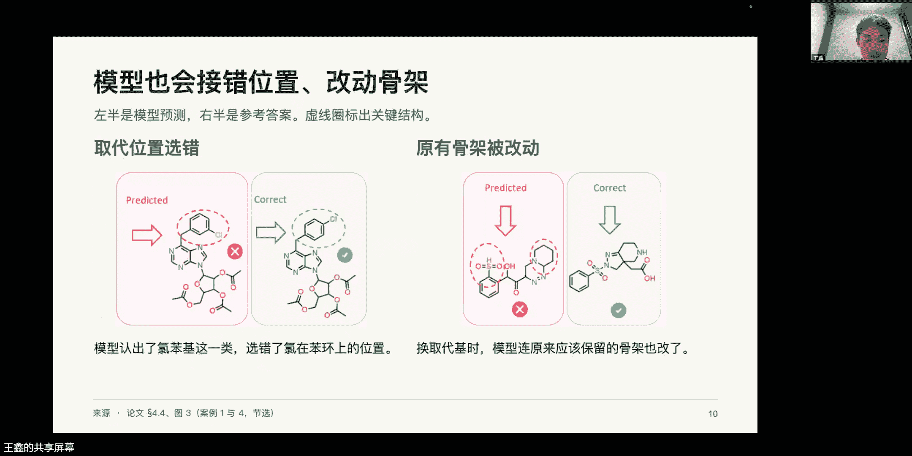

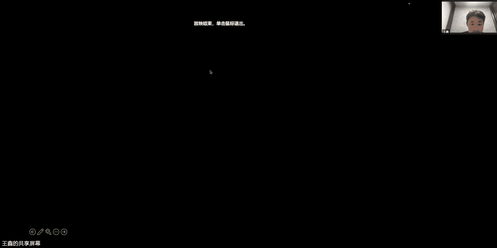

### 2.1 核心研究问题

团队想要回答的问题是：大模型到底是不是真的知道什么是分子图？如果给大模型一个分子图，它能不能按照要求去换一个零件，并且能不能做对？也就是说，模型需要同时满足两个条件：一是知道特定位置应该替换成什么基团，二是知道装饰基团应该放在哪个位置，同时保留原有的分子骨架不变。

### 2.2 任务设计：VQA 与开放式生成

以下是本次评测设计的两种任务类型：

- **VQA 任务（视觉问答）**：给模型展示分子结构图和选择题，让模型选出正确答案。
- **开放式生成任务（generation）**：让模型根据题目直接生成分子，不提供选项，考察模型是否真的能生成正确的分子表示。

为什么我们要做选择题？因为现在很多评测都会做选择题，但如果直接给出 A、B、C、D 四个选项，模型有 25% 的概率靠随机猜测选对，这不能反映模型真正的能力。相比之下，开放式生成要难得多，因为模型必须从零开始生成正确的分子字符串，才能证明它真正理解了分子结构。

以下是 SMILES 表示法的核心说明。SMILES 是化学信息学中表示分子的一种字符串方式，可以把它理解为分子的“微笑”写法。

```text
示例：CCCC
含义：6 个连续的碳原子，在化学结构中可对应苯环等环状结构
```

团队希望探究模型到底能不能生成对应的 SMILES 字符串，从而体现它是否能看出来图像代表的分子，并生成正确的分子结构。

### 2.3 数据构建与干扰项设计

以下是数据集的构建方式。所有题目都来源于真实的专利和文献中的分子图结构编码，而不是伪造数据。团队一共构建了 556550 条编辑指令，每条样本都关联以下要素：

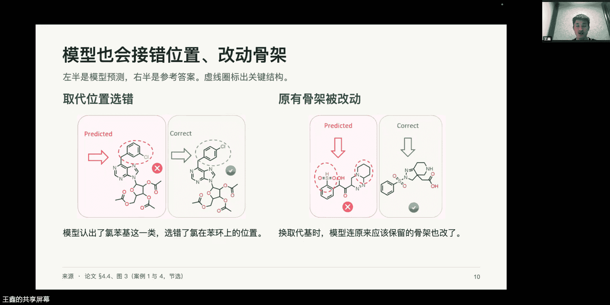

- 分子的结构图
- 分子的 SMILES 表示
- 编辑指令（instruction），即想要如何修改这个分子
- 参考分子（target），即最终目标分子是什么

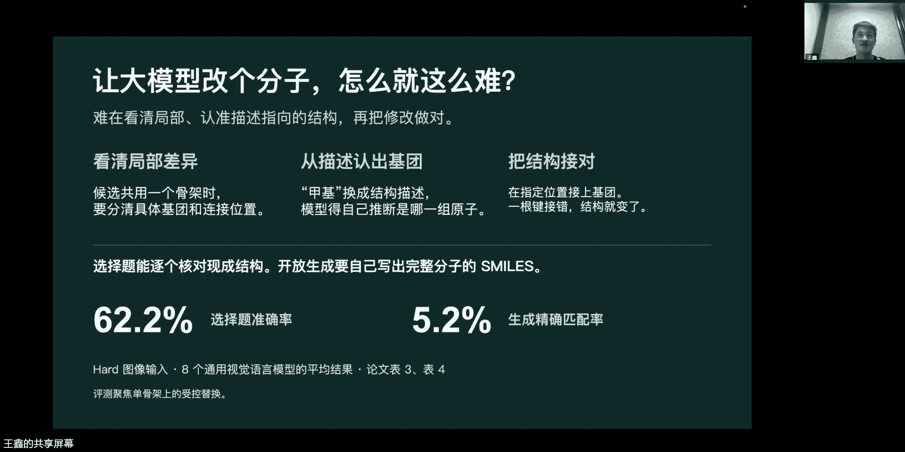

为了防止模型靠视觉相似度“偷懒”，团队加入了不同骨架的干扰项。实验发现，模型非常聪明（或者说非常会偷懒），它会主动排除与目标骨架完全不相关的东西，直接选择视觉上最像的那个选项。因此，E 类题目被设计为不同骨架的判断，混入了大量不同骨架的干扰项。

### 2.4 指令编写技巧

以下是指令编写时需要注意的问题。不能直接告诉模型“R1 替换成甲基”，因为化学语言空间里，同一个基团有多种表示方式。例如甲基可以表示为 CH3，也可以用其他化学符号表示，不同国家、不同领域可能有不同的语言表达。

因此，团队在指令设计中考虑与正确选项使用相同的混合加工方式。在此基础上，把原本的描述替换为描述结构特征的方式。例如，把“R1 接甲基”改写为“R1 接一个只含一个碳的烷基”，从而避免模型依赖特定的化学术语进行捷径推理。

### 2.5 实验结果与模型表现

以下是实验评测得到的关键结果。模型在视觉判断任务上的表现较强，但分数会随描述语言的变化而显著下降。例如，某模型得分从 89% 直接降到了 62.23%。这说明模型虽然在图像识别上有一定能力，但对化学描述语言的理解仍然不足。

在开放式生成任务中，模型的表现远不理想。以下是几组典型的正确率数据：

- 直接给定 SMILES 并要求替换耳机：正确率约为 19.1%
- 从图像生成 SMILES 并考察理解：正确率约为 6.8%
- 多语言环境下的适应测试：正确率约为 14.7% 或 5.2%
- 某些通用化学模型在生成任务上的得分：接近 0% 或 0.1%

这些结果表明，通用 AI 模型与专用化学模型之间仍然存在巨大差距。很多人认为模型很厉害、能生成很多分子，但真实测试下来，通用模型在分子生成任务上往往远不如专用模型。


### 2.6 模型常见错误分析


以下是模型在分子编辑任务中容易出现的几种错误：

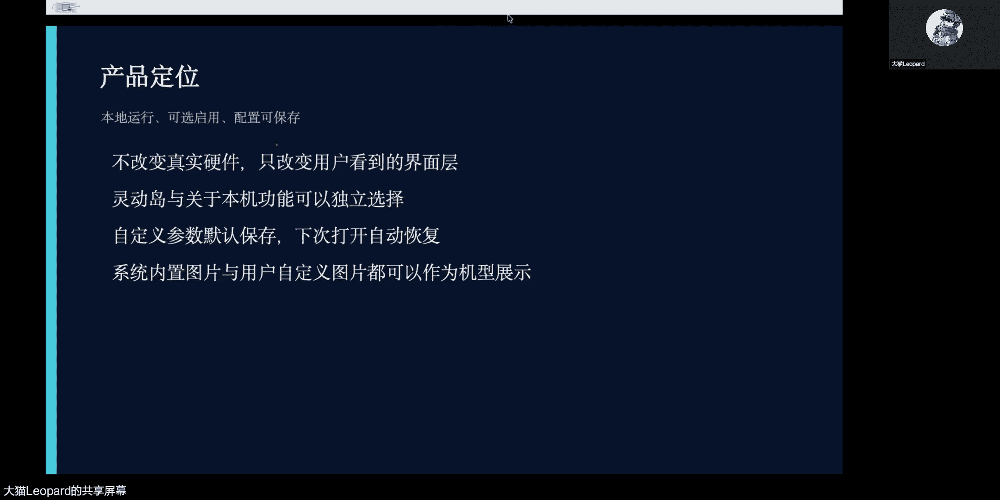

1. 取代位置选错：模型可能知道 R1 和 R 分别在什么位置，但在随机变化过程中，会把整个架构结构改掉，例如把原本在上面的 N 变到下面，把碳变到上面，导致整个题目出错。
2. 无法完全遵循指令：模型可能被要求保留原有骨架，但它会直接把原有骨架改掉，替换成看似相似的结构。
3. 字符串替换导致结构畸变：SMILES 是由大量字符聚集而成，随机把一个 C 替换成 N 就会让整个结构变得非常奇怪。


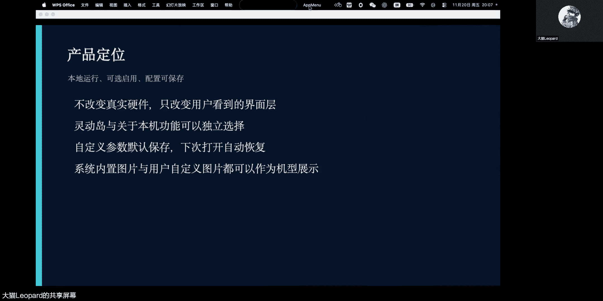

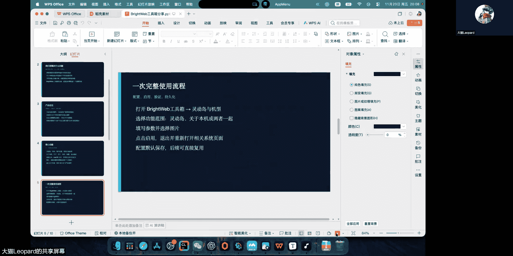

因此，模型往往无法完全遵循指令去生成对应的分子。

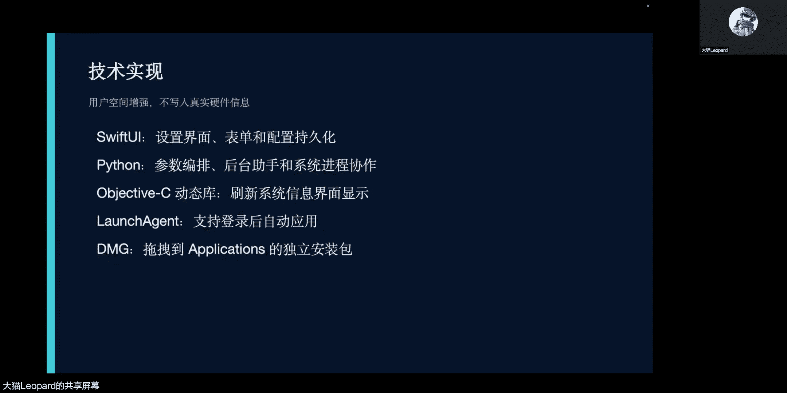

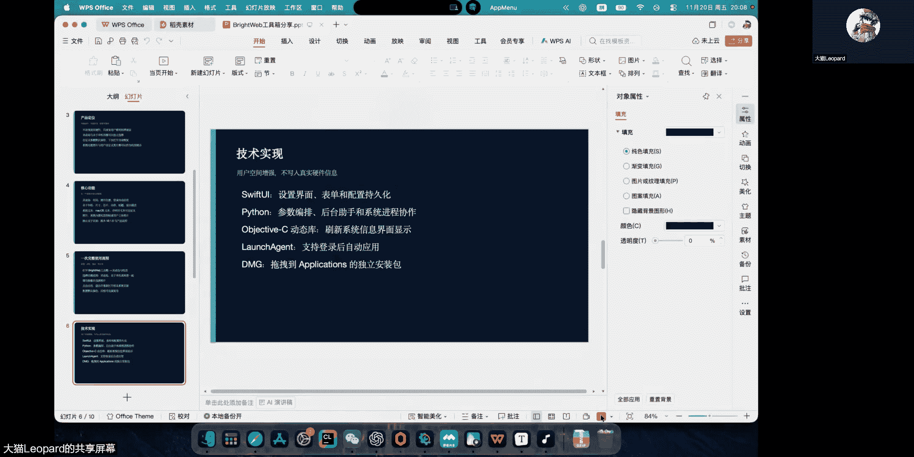

### 2.7 结论与启示

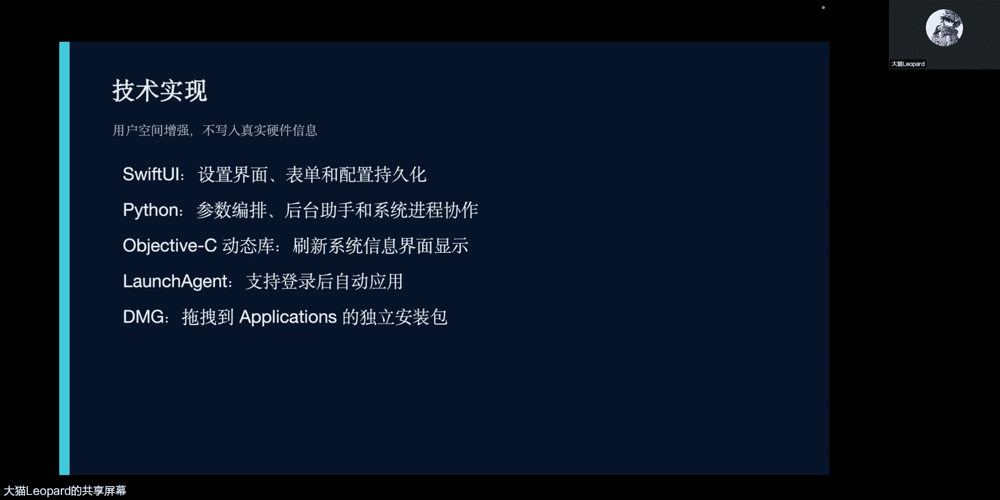

以下是本次分享的核心结论。让大模型修改分子之所以困难，主要有三个原因：一是很难看清楚分子的局部差异；二是从描述中识别出基团也很难；三是如何把结构正确对应起来也是一个非常难的问题。如果你未来打算从事 AI for Science 或分子生成方向，可以考虑如何解决这几个核心问题。

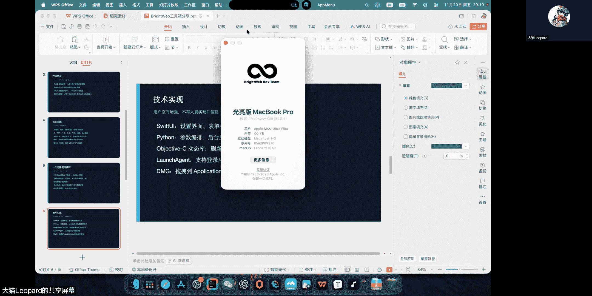


团队的项目资源、代码和 benchmark 已经开源，感兴趣的同学可以前往项目仓库点击 Star。此外，该工作今年还投稿了 AR 会议。


## 第三节：Mac 本地增强工具箱与灵动岛 🍎


接下来，我们转向另一个实际工具类的分享。大猫介绍了一款面向 Mac 用户的本地工具箱，名为 bright web 工具箱。


该工具箱是一个整合性工具，可以对麦克风等设备进行修改。它解决的核心问题是：Mac 的很多能力很强，但使用起来需要终端命令、设置界面，以及一些重复操作。实际使用 Mac 时，用户经常遇到以下三个问题：


- 系统增强入口比较分散
- 关于本机页面里的信息比较固定
- 配置成功后，下一次打开应用还需要重新填写


因此，bright web 工具箱把复杂步骤收进后台，把用户需要的功能放到前面。目前该工具箱主要分为两部分：


- 第一部分：关于本机的显示配置
- 第二部分：灵动岛增强

在技术实现上，该工具采用 Swift UI 和 Python 结合的方式。Swift UI 负责设计界面表单和配置保存，Python 负责后台逻辑，通过 launch agent 完成自动应用。用户看到的是统一的产品界面，底层复杂步骤都被集中管理。


需要特别说明的是，该工具箱修改的是显示层，不会改变真实的芯片、内存、序列号或系统版本。它的目标是让复杂步骤收起来，把真正有用的功能交给用户，从灵动岛增强到关于本机的个性化展示，再到配置自动保存，提供一个简单、可控、可重复使用的 Mac 工具入口。

现场演示中，大猫将机型名称自定义为“MOSS mouse”，并选择了一张图片作为显示内容，启用后灵动岛会出现动态效果。他还做了一个根据铰链传感器触屏的功能，但效果不如国外大佬的作品成熟，模型仍需优化。


## 第四节：《推理王国》与 AI 数学教学法 📖


接下来，我们来看孙宝分享的内容。他本身是专业的图书工作者，平时写严肃文学小说，大学学习的是中提琴。他从 12 岁就开始搞信息学，比很多大学本科生搞得更久。本次分享的主题是他编写的书籍《推理王国》，以及其中蕴含的 AI 数学教学思路。

### 4.1 书籍的由来与结构

《推理王国》最初并不是一本正式的书，而是一个周报形式的尝试，后来逐渐演变成“拆表小报”，最终形成了一本书。孙宝把它比作拆机械表：机械表没有电池却能走，拆开后发现有情重结构、蓝宝石、发条相互咬合，才有了运转效果。同样，这本书的目的就是把 AI 和推理的原理拆开，让读者看清每一个零件。

书籍采用三部曲结构：前传、上卷、下卷。

- **前传**：写得特别像小说，是给两个刚上大学或大二大三的同学看的入门教程，属于拆表教程。
- **上卷和下卷**：正文已经写了很多页，内容更深入。

### 4.2 为什么要写这本书

孙宝认为，现在谈 AI 推理有点像事后诸葛亮，好像思维链跑出来了，机器就开始推理了。但实际上，推理是一个非常古老的工具，在计算机和人工智能出现之前，人类就已经在思考什么是真的、为什么要相信一件事情是真的。推理更多是求真的工具，不是聪明人物用来说服别人的东西，而是人类如何认识世界、如何从一个状态推到另一个状态、如何检验自己的判断力。

计算机出现以后，推理有了新的形式，比如阿尔法狗打赢柯洁，生蓝打赢贝奇普，这些都是用深度学习、蒙特卡洛树搜索等方式体现的推理。

### 4.3 教学框架与写作方法

以下是《推理王国》的教学框架和核心写作理念。

书中借鉴了“波兰数学”的思想，但因为波兰数学太难，所以放在下卷。下卷的目的其实是约束小说叙事。因为作者自己也写小说，深知叙事技法容易让读者盲目相信作者。下卷开始，兔孙教授不再多说话，而是罗列公式、推公式，从第十四章的经典逻辑和泛经典逻辑开始，变成一本纯粹的逻辑学教程，里面嵌入可运行的 Python 代码，读者可以直接跑起来验证。

孙宝有一个核心信条：即便在写书时使用了 AI 批量修改（比如书里有几百个希腊字母需要批量正则替换），作者也要保持伦理姿态，把自己放在可检验的位置上。有什么主张，立刻手写成代码放在下面，让读者去跑。

他还提到，读者和作者是共谋关系。作者可能有资源租显卡、跑几百块钱的实验，但读者不一定。因此书里配了很多降低门槛的实验。例如他自己用 M3 笔记本，只有 CPU 没有 GPU，就把 GPU 后端锁了，直接在 CPU 上跑，确保读者可以直接粘贴代码运行。

关于“平凡性思想”：孙宝特别喜欢研究最平凡的东西。大家都想做惊人的东西，但研究最平凡的效果、用最蠢的方法、最枚举的方法去构造问题和完备空间，往往比精心构造的例子更有说服力。一个反例可以推翻一个过于自信的结论。如果总是寻找特殊构造，对初学者和大学生会很残忍，容易造成思维断带。因此教学中不要求读者灵光一现，而要从平凡性出发，让每一步都有前面的平凡性做托底检验。

四步走教学法如下：

1. 把对象列出来，也就是确定空间（解空间），把所有解穷举出来，看这个空间是否封闭、完备。
2. 想办法描述差别。比如老贾和老乙两个解，除了名字差一个字，可能住在不同地方，欧式距离不同；性格差异、字写得好不好，都是距离的体现。
3. 规定操作，不停地往前迭代。
4. 看操作重复以后会发生什么，会涌现出什么现象。这也是研究 AI 可解释性的重要方法，比如观察 AI 为什么开始乱吐数字、状态矩阵彻底发展、中英混杂等。

关于“寻找正确的尺子”：学界现在常用信息论、自然梯度、Fisher 信息矩阵等工具，听起来很高大上，但从头检验时很容易绕进去。孙宝选择了更经典的分析学（数学分析），因为一般本科生都会学高等数学，读者接受力更强，写作也更保险。

在人机交互中如何写 AI 书：AI 生成自然语言草稿后，逐项生成机器检查代码，类似科里-霍华德同构。但机器也可能硬编码定理、公理，或者偷换边界条件，所以需要人工逐项检验。

关于读者是否租得起显卡：autodL 上一张 pro6000 显卡大约 66 块钱一个小时，跑几小时蒙特卡洛采样可能一顿饭钱就没了。因此作者需要进行实验设计和简化，比如手搓 DPL 求解器，把原本需要租卡跑一个小时的任务，缩短到几分钟。

这部分内容涵盖了《推理王国》的核心思想，也为后续 AI 赋能非遗的分享做了铺垫。


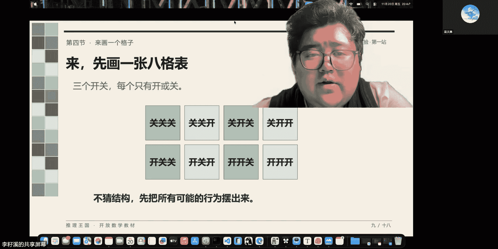


## 第五节：AI 赋能非遗与手艺人价值 🏺


接下来，我们关注 AI 与传统文化结合的落地实践。孙老师（孙宝）分享了 AI 赋能非遗的思路，并结合自己编写的《推理王国》一书，谈了写作与教学方法。

### 5.1 AI 不能替代手艺人

以下是孙老师的核心观点。AI 的设计和规划永远是纸上谈兵，因为线下做生意、非遗产品最终都要售卖。我们必须考虑游客需要什么、喜欢什么，而市场需求只能通过一线跑、一线了解才能得知。例如，前段时间可能流行动物风，现在可能已经饱和，接下来可能流行其他风格，我们需要跟着市场去做产品。

每个人的审美不一样，当下每个地方需要的东西也不一样，这需要我们自己去挖掘、去发现。想法、点子和审美是 AI 时代最难被替代的部分，因为 AI 很难做到共情。

### 5.2 实际案例：3D 建模与修模

孙老师自己做了 7 年的非遗制作，主要是紫砂壶。后来接触 AI 后，他思考如何用 AI 赋能非遗。许多领导和企业合作对象都会质疑：AI 会不会慢慢把非遗替代掉？基于他的经验，答案是不会的。

以下是一个实际案例。客户提供了三个三视图，AI 生成了一个可以旋转的 3D 模型，但它真的能不能落地生产，还要打个问号。因为模型中的一些细微结构，比如领子、吊坠、尾巴或后面的装饰，是悬浮的，包括一些空心部分。如果通过陶瓷的记忆去呈现，其实是不可实现的。这时需要有经验的修模师或建模师，结合实际使用的材质去修改模型，让它更适合脱模或生产。

虽然 3D 建模平台降本增效了，但建模师的工作从“建模”变成了“修模”。因为修模师对产品、对模具脱模有理解，这些东西 AI 暂时还学不会。

### 5.3 AI 赋能的实际效果

以下是 AI 在设计效率上的真实赋能。以往对接一个顾客设计方案或文样，可能需要一个星期才能定稿。现在根据客户给出的大概方向，可以快速海量出图，客户选中满意的画面后，再针对性优化，1 到 3 天就能把图输出。这是切实的赋能。

但是，AI 视觉图做出来了，AI 能不能帮忙实物打样？能不能把产品烧制成型？这个过程还是需要手艺人去制作、去烧制。目前还没有高精尖水平能完全用 AI 替代。例如，设计图是 AI 出来的，但第二张图是非遗手艺人用毛笔手工画出来的。如果用机器流水线印出来，就失去了手工和非遗的含义，变成了普通商品，不再是工艺品。工艺品始终需要人去画，需要人对美做出判定。

### 5.4 烧制与质量控制

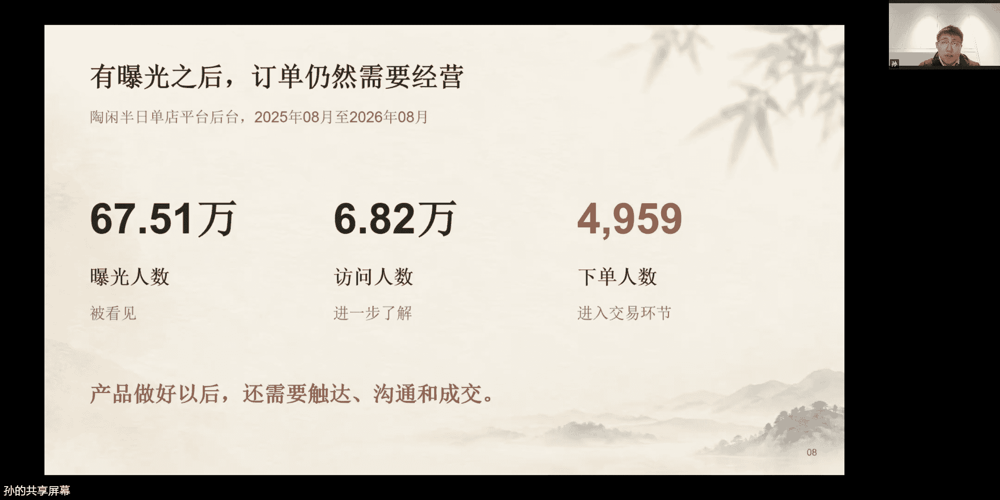

烧制过程中，窑的温度曲线不同，不同饮料需要不同的温度。孙老师自己也在烧窑，需要先让窑烧到 300 度，不能关门，人得守在旁边，因为烧制时会有水蒸气挥发出来。需要烧到 300 度把水蒸气全部挥发完，再彻底关上窑门。这些目前通过人工去完成最便利、最简单。

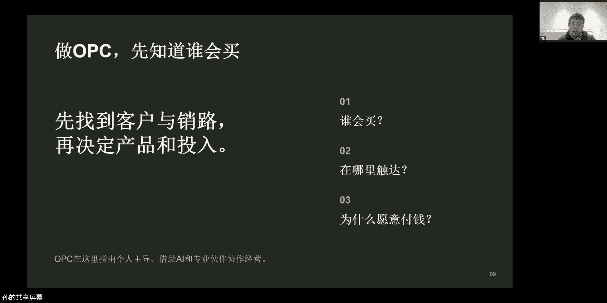

如果通过 AI 或机械化，成本会非常不可控。

### 5.5 全链路与成本控制

孙老师的公司拥有数控打磨公司，在景德镇和一新有生产基地。设计可以借助 AI，建模可以借助 AI，制模也可以借助 AI，但最后还是要人工审核。人仍然扮演着非常重要的角色。制作、检查质量、交付，每个过程都需要不同的非遗从业者完成。

AI 可以优化流程，但不能完全替代。例如，建制模有专门的修皮师傅、修模师傅，烧制和手绘也需要专门的手艺人负责各自的领域。

在成本控制方面，接单时要考虑顾客付的定金能不能覆盖生产成本。建议不要垫资，否则一旦垫了资，后续资金链可能断裂，错过更好的机会。

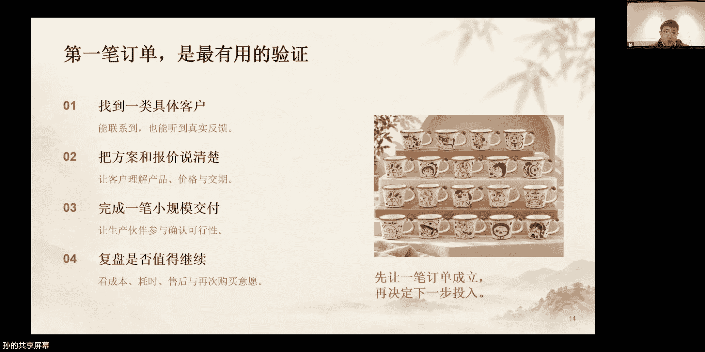

### 5.6 审美判断与情绪价值

判定产品好不好看、能不能被大众接受，需要非遗手艺人凭借十几年甚至几十年的经验进行评判，包括外观、结构、壁后支撑和稳定性、材料干燥收缩、烧成表现、手感和表面效果。不同的泥料烧出来效果不同，有的光滑，有的粗糙，需要不同的画面搭配普通的泥料。这些 AI 目前暂时达不到。


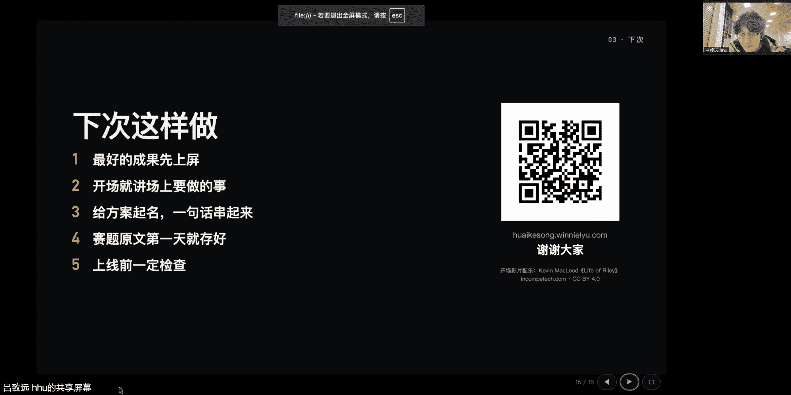

孙老师还提到，做 OPC（可能指某种合作模式）的后来者，最好先有订单，再去做 OPC，而不是先做产品再去找顾客。因为大多数 OPC 都不赚钱。真正适合做 OPC 的，是已经有成熟产业或稳定顾客群体的企业。


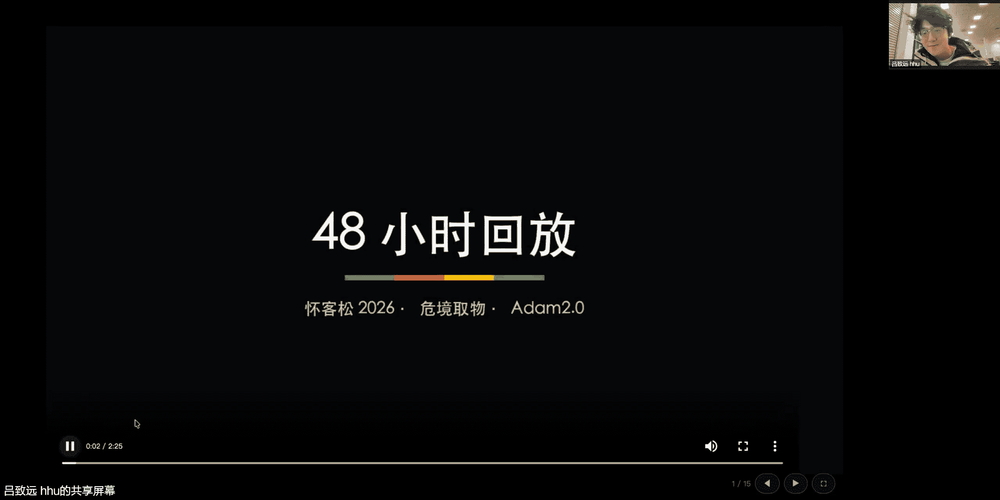

最后，孙老师强调，现在社会缺的就是情绪价值。技术壁垒越来越薄弱，但人与人之间的交流和情绪价值是 AI 替代不了的。很多时候客户最后成交，是因为觉得对方是个靠谱的人，愿意把订单交给他。

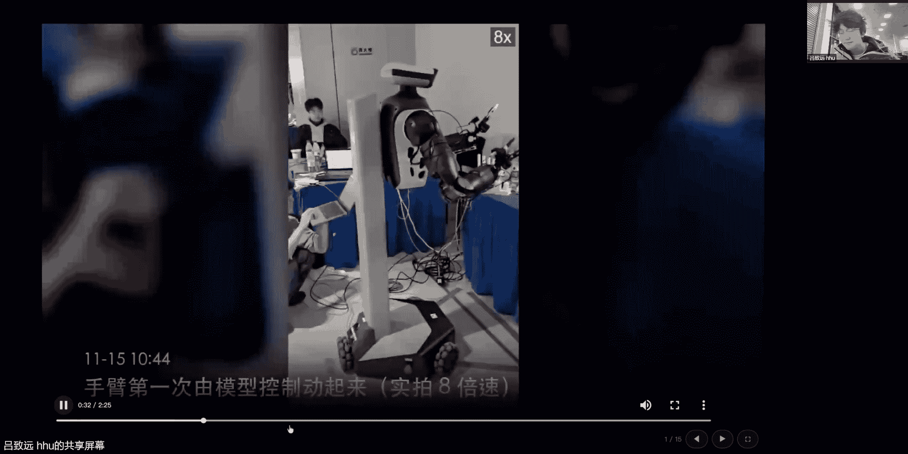

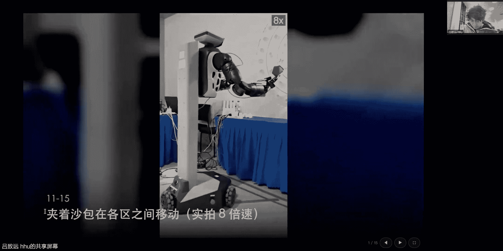

未来的理念是：通过自有消费品牌打造样板店，让每一家店都变成成熟落地、能赚钱的 OPC。目前已有三家实体店在运营，第四家将在无锡开业，第五家、第六家有国企和政府闲置资产在接洽。目标是打造 AI 赋能的样板店，让每个店都有自己的特色，前提是拥有制造和生产能力，也就是全链路打通。


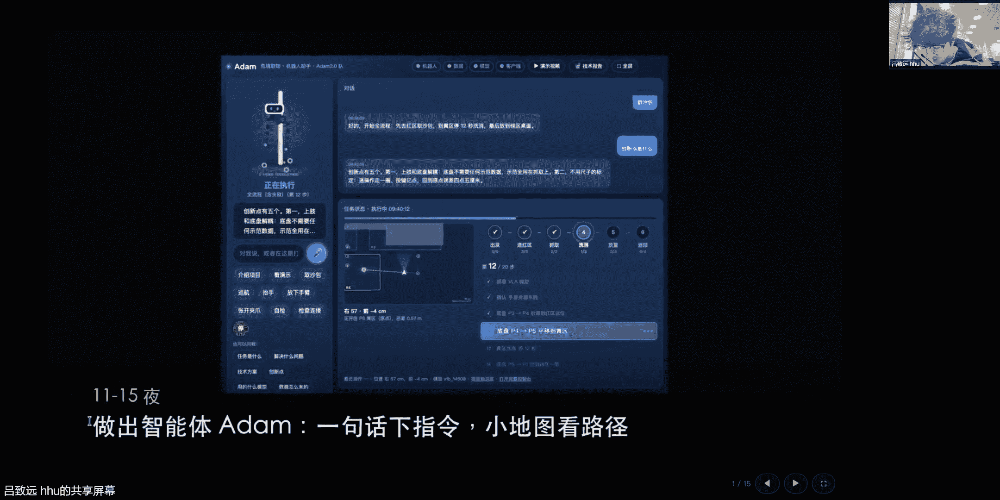

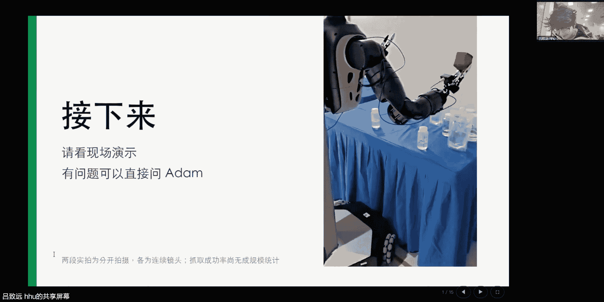

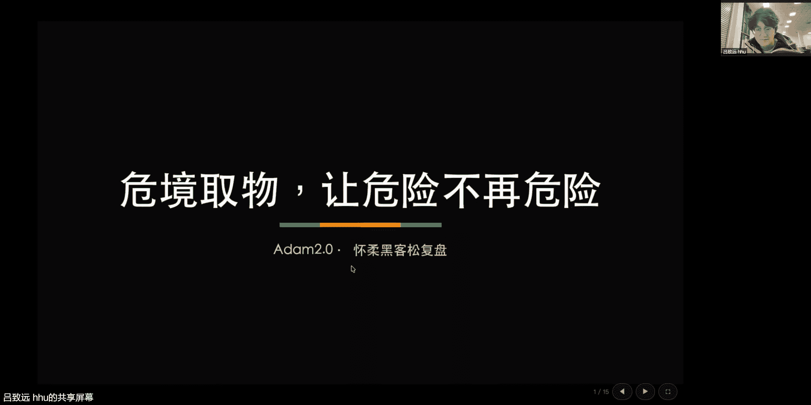

## 第六节：怀柔黑客松复盘与 VLA 机器人控制 🤖


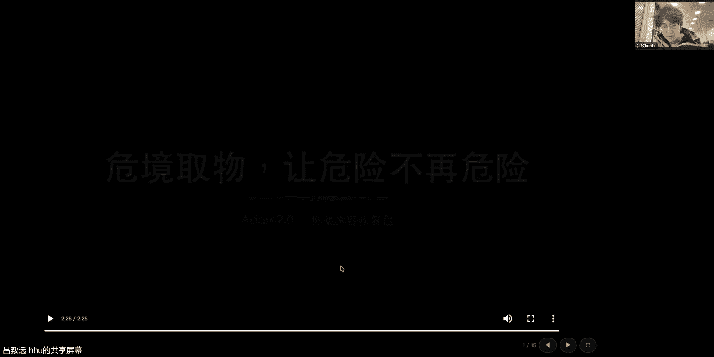

最后，我们来看志远带来的怀柔黑客松复盘。他以失败经验为鉴，分享了团队在 48 小时内完成机器人危险物品取放任务的全过程。

### 6.1 比赛概况与队伍介绍

队伍名为 adam2.0，取意于创造亚当。当上帝把智能给了亚当之后，人类作为智能体，再一次把智慧给到一个危险生命，给到一个机器人上面。因此题目叫 adam2.0，即再次赋予机器智能。

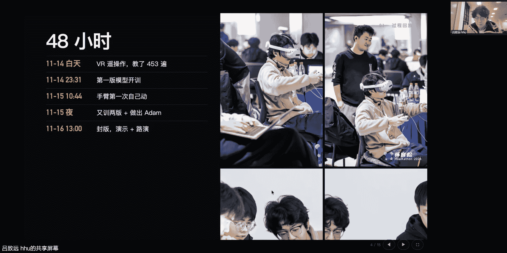

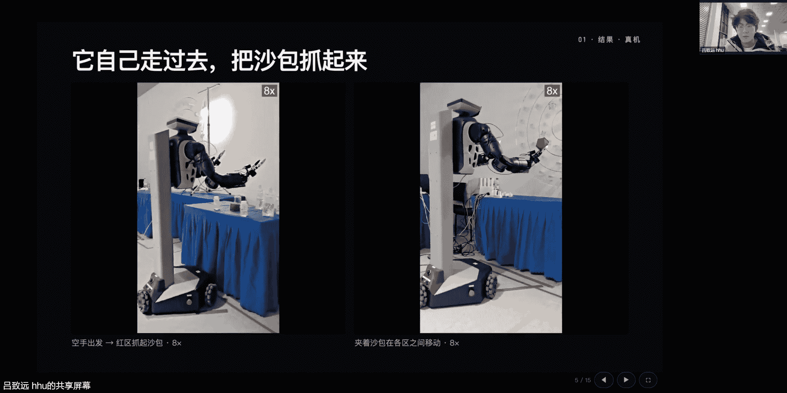

赛题是模拟危险环境泄露，让机器人进入红区，把沙包抓起来，消毒后送入绿区。

### 6.2 48 小时开发流程

以下是团队在 48 小时内完成的工作流程：

- 第一天：使用 VR 头显进行远程操作，试交了 4353 遍数据；第一天晚上开始在云端训练模型。
- 第二天早上：机械臂第一次由模型控制，成功动了起来并抓取沙包。
- 第二天晚上：又训练了两个版本的模型，并做出了负责交互控制的智能体。
- 周一中午：封板；下午进行现场演示和路演。

整个过程非常紧张。团队感谢领域智能和主办方提供的算力支持。

### 6.3 模型与导航设计

团队使用的模型是派 0.5，参数量约为 3.3B，在 Intel B70 卡上本地推理。Intel B70 是官方给定的适配卡，使用其他模型可能需要在推理上做额外优化，为了节省时间，团队直接选用了适配良好的派 0.5。

在导航方面，机器人没有带深度相机，不能通过三维建模。团队通过里程计标记点位进行二维建模，并引入视觉惯导机制：通过双目相机左右图像对比，计算点云差，实现视觉惯导自动对齐。P3 点位会自动进行惯导校正误差。整个流程可以实现任意两个点位之间的串联，比如从工作区到消毒区，再回到工作区，实现了在二维平面上的自由导航。

底盘损失精度较低，每次走完之后误差约为 0.45 厘米。机器人通过摄像头自动定位沙包，定位到沙包后抓取准确率大于 90%。一次能走 20 个任务。

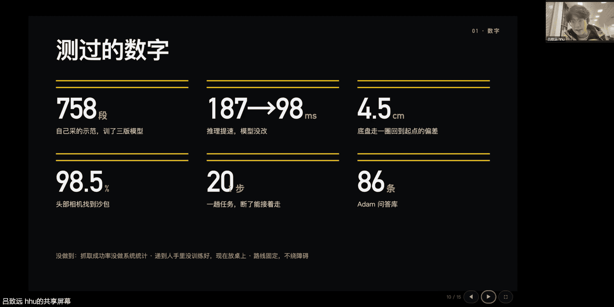

### 6.4 推理优化与交互界面

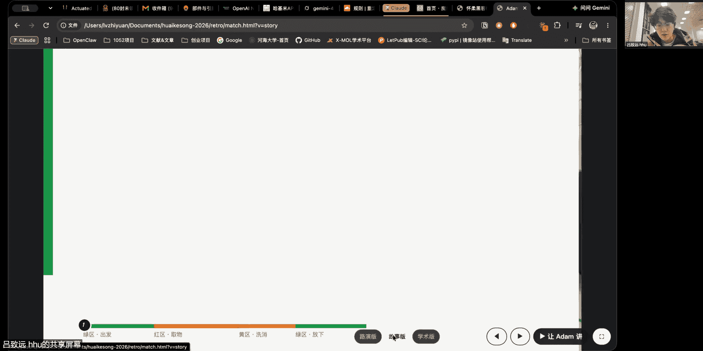

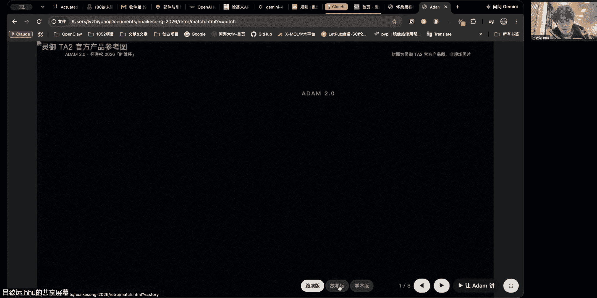

团队有一位同学负责端侧优化，把推理速度砍了一半。其他组的动作比较卡顿、有颤抖，而这组的输出非常流畅。原因在于，派 0.5 的推理是往后推理三十步动作，而团队更好地实现了连续推理，使得机器人输出的柔顺性很高。

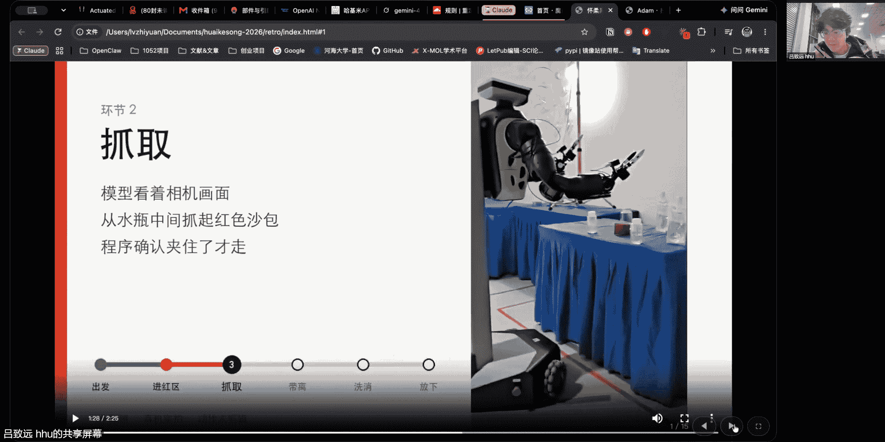

团队设计了半开源的导航机制，每次在假证点进行视觉微调，确保物体居中在工作范围内，从而达到很好的抓取率。

在界面方面，团队开发了 AM 界面，具有以下功能：

- 实时姿态同步：手动操作时同步排击手，且能看到机器人在看什么
- 语音控制：通过扬声器接音，直接下达指令，例如“取沙包”，机器人就会去取
- 项目介绍：接入知识库后，可以向评委介绍整个项目
- 实时任务面板：显示导航位置、下一步往哪走、预计体时间等
- 防断网保护：网络差时进入保护状态，告诉用户正在尝试重连

语音模型在本地部署，延迟仅 50 毫秒，体验类似于豆包那样的快速响应。

### 6.5 数据与训练策略

团队一共采集了 700 多条数据。虽然数量看起来很多，但实际上并不多。前期采集的是短平快数据，重复采一个简单动作，有 400 条。后期左右手的数据比较少，各只有 100 条左右。总数据量大约在 400 到 600 条之间。

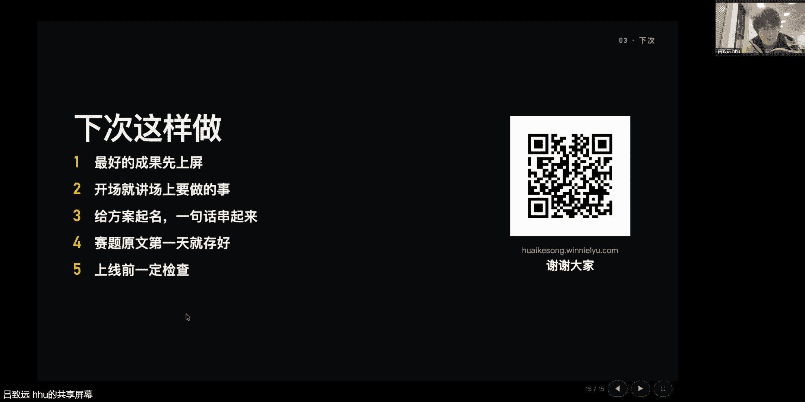

训练策略是：先让派 0.5 了解设备的体型，再通过微调去校正动作。


### 6.6 失败原因与复盘教训

以下是团队本次比赛没有发挥好的原因：

- 成品做出来了，但没有讲清楚整个系统，没有把功能串起来
- 工作量可视化不足
- 有一个题目没有理解清楚，这是最重要的问题
- 讲得不够学术，不符合评委的品味

志远总结说，做产品不应该以技术主导，而应该以体验主导。一个有良好体验的产品，更容易被大家接受。

建议大家：当觉得讲得不好时，可以先放个 Vlog，把紧张感缓解下来，让大家先知道你做了什么，再带着近一点的感觉进入 PPT 展示。

### 6.7 硬件与落地门槛

做机器人的门槛很高。这台机器人本身价值 30 万，一张 B70 卡 15 万，A100 卡也是 15 万。普通家庭或一般实验室很难负担。硬件测试和调试的难点在于，你需要花钱培养好的硬件工程师，需要烧过很多设备，必须在实战中失败过，才能成为好的硬件工程师。不能只在仿真中培养能力，要有机会去接触实物。


## 结语与总结 📚


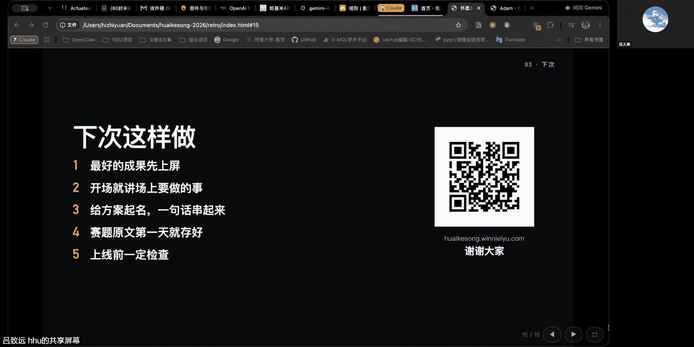


本节教程中，我们一起学习了 AI+X 碰个头第三十五期主会场的全部分享内容。从本科生科研工作流，到大模型在分子结构编辑中的能力边界；从 Mac 本地增强工具箱的界面设计，到 AI 赋能非遗与传统手艺的深度思考；再到怀柔黑客松中 VLA 机器人的 48 小时实战复盘。


每一次分享都提醒我们，AI 虽然强大，但在专业领域仍有巨大的提升空间，而技术落地最终离不开对场景、对用户和对手艺的深刻理解。希望这些内容能为你的学习和实践提供启发。


