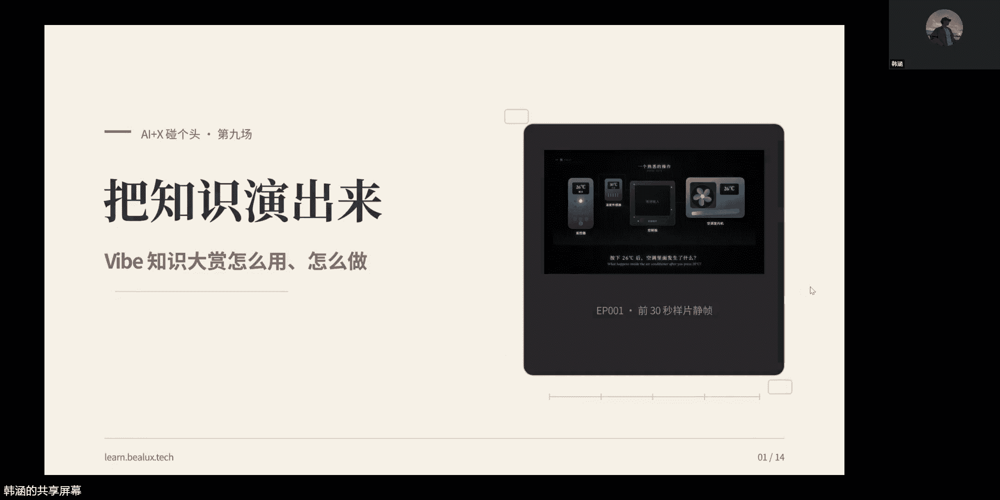

# AI+X碰个头·第三十五期-分会场-2：1：课程概述与样片示范 🎬

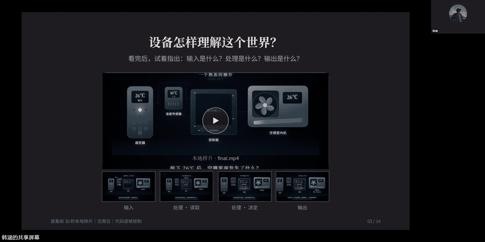

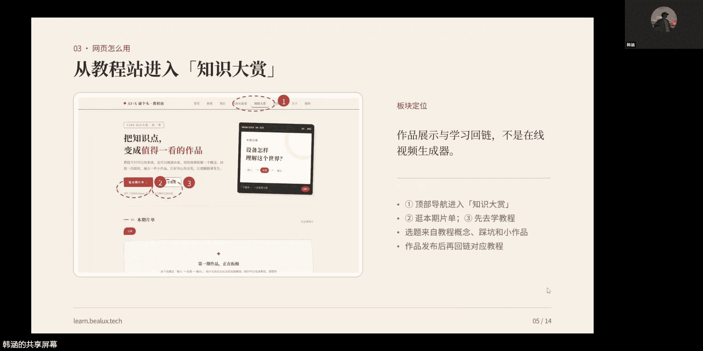

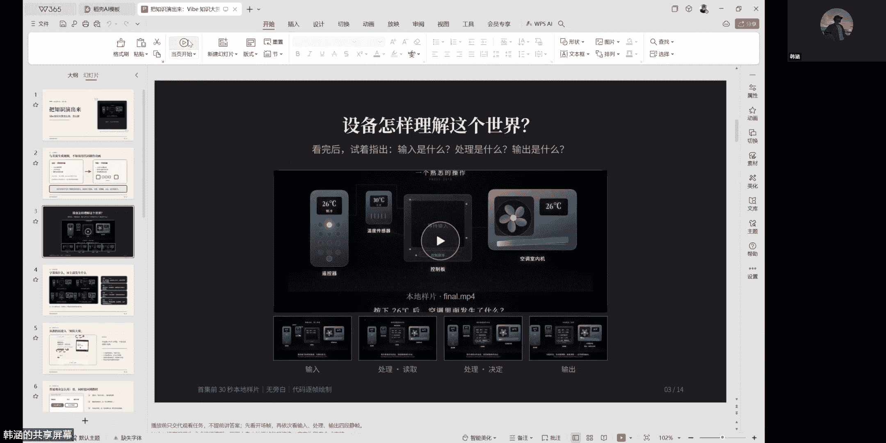

在本节课中，我们将学习如何利用AI知识大赏制作动画短片，重点探索不依赖视频模型，仅通过语言模型和代码渲染来完成知识科普视频的完整流程。

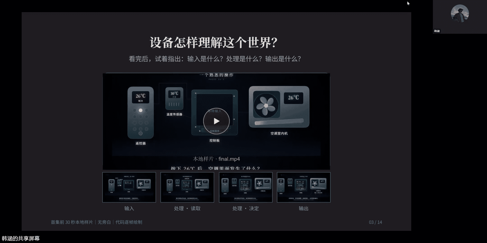

首先，我们来看一段实际的样片效果。这段时长为30秒的视频，其中所有图片的制作、画面裁剪、文字添加以及配音配乐，全部由AI一键完成，没有调用任何视频生成模型。

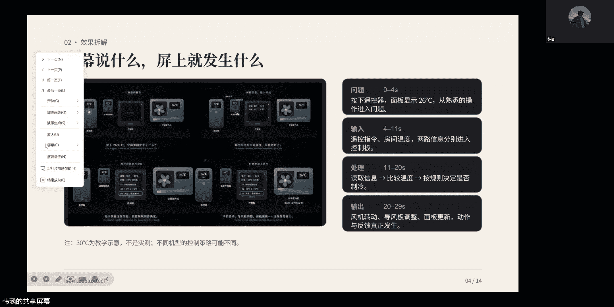

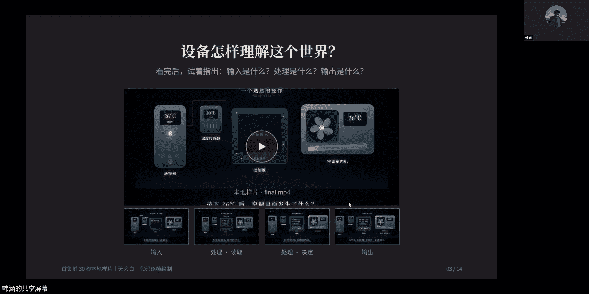

这个样片的核心目标，是把此前教程中的知识点，转化为一条能够帮助大家直观理解的动画短片。你可以把它理解为一种“知识动画化”的尝试，让抽象的概念变得更具画面感。

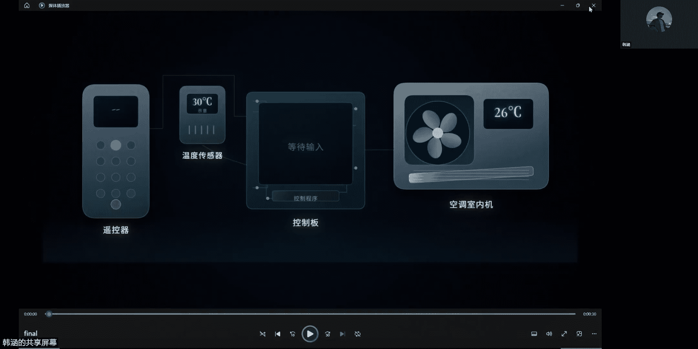

样片的画面结构非常简单，它由4个连续的画面组成。第一个画面是输入，第二个画面是处理和读取，第三个画面是处理决定，最后一个画面是输出。这四个部分共同构成了一个完整的知识展示链条，像一个小型系统演示一样把原理讲清楚。

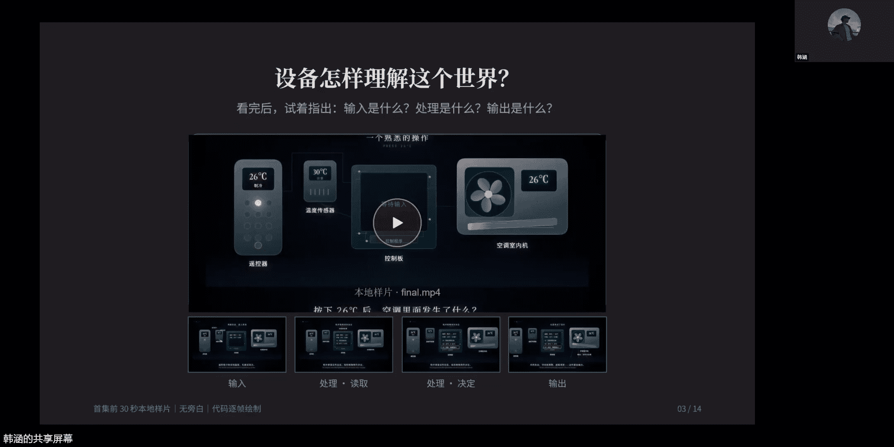

下面是样片的四个画面含义：

- 第一个画面：输入，用于引入问题。
- 第二个画面：处理和读取，展示数据如何进入系统。
- 第三个画面：处理决定，展示系统如何做出判断。
- 第四个画面：输出，展示最终的执行结果。

刚才展示的这个效果，就是我们今天要重点拆解的制作逻辑，也是后续所有章节的基础。

# AI+X碰个头·第三十五期-分会场-2：2：赛璐珞动画原理与AI制作类比 🎞️

上一节我们介绍了样片的整体效果和四个画面结构。本节中，我们来看看这个样片背后的底层原理，以及它与传统动画制作之间的关系，帮助大家建立直观的认知。

整个样片的制作逻辑，参考了早年赛璐珞动画的制作原理。传统赛璐珞动画的流程包括资料研究、剧本制作、角色设定、美术设定、分镜和摄影表、原画关键动作设计、动画补中间画、透明片处理、描线上色、摄影台逐格拍摄、配音以及发行。虽然步骤很多，但核心思想是把复杂的动画拆解成可重复使用的层和帧。

现代AI制作流程与这套传统逻辑在底层是相通的。我们可以把两者对应起来看，这样就不容易混淆了：

- 剧本研究对应现在的造程原稿和事实表。
- 美术设定对应设备造型和场景设计。
- 分镜表对应规定字幕、动作时间和声音的安排。
- 关键帧对应我们通过代码设计的关键状态。
- 补中间画对应程序根据时间计算的过渡过程。

透明片是传统动画中的一个关键发明，它的核心作用不仅仅是透明，而是能够将会动的角色与不动的背景分开。这样一来，当角色动作改变时，就不需要重新绘制整个场景，从而大幅减少重复劳动。这一技术早在1914年就由厄尔·赫德申请了专利，目的是提高制作效率。

在我们的样片中，背景相当于不动的透明片层，而卡片、按钮传输信号等动态元素，相当于会动的角色层。我们现在的制作流程，正是沿用了这种“分层处理”的逻辑，只是工具变成了代码和AI。

下面是传统动画与AI制作的对应关系：

- 传统动画：摄影台逐格拍摄 → AI制作：代码渲染关键帧
- 传统动画：手工绘制中间帧 → AI制作：程序根据时间计算中间状态
- 传统动画：透明片分层 → AI制作：背景与前景元素分离

通过这个类比，你可以发现，AI制作动画并不是凭空产生的新逻辑，而是把传统动画的分层思路，用代码的方式重新实现了一遍，让制作过程更加自动化。

# AI+X碰个头·第三十五期-分会场-2：3：制作流程与核心工具介绍 🛠️

上一节我们讲解了赛璐珞动画原理与AI制作的类比关系。本节中，我们来看看具体的制作流程，以及完成这类短片需要用到哪些核心工具，让你知道从零开始应该怎么做。

如果我们要制作一条Web知识大赏风格的短片，主要需要两个开源工具。第一个是开源浏览器自动化框架，主要用于逐帧截图，把浏览器里的每一帧画面固定下来；第二个是开源音视频处理命令行工具集，用于对音视频进行编码，最终生成MP4格式的视频文件。这两个工具都是开源的，大家在制作相关样片时可以直接调用，具体的获取方式此前已在评论区发布。

下面是这两个工具的主要作用：

- 开源浏览器自动化框架：控制浏览器逐帧截图，把每一帧画面固定下来，作为动画的原始素材。
- 开源音视频处理命令行工具集：对截图序列和音频进行编码，合成最终的MP4视频，方便发布和播放。

整体的制作流程可以概括为六个步骤，大家可以把它当成一个检查清单来使用。第一步是人工理清流程，明确我们为什么要做这个样片，目的是什么。第二步是设计，包括画面和字幕的对应、形象的选择、关键动作的确定。第三步是通过AI进行代码渲染和绘画。第四步是画面和声音的结合，就像剪视频时配音频一样。第五步是转码和全片检查，确保每个细节都符合要求。第六步是上线，将成品关联到教程网页。

下面是六个步骤的简要说明：

- 第一步：人工确定样片目的和例题，明确挤帧画面的需求，给后续制作定调。
- 第二步：设计画面、字幕及形象，确定动作和行为作为关键帧，为渲染提供依据。
- 第三步：AI代码渲染，绘制关键画面，生成动画的基础帧序列。
- 第四步：画面与声音结合，完成视频合成，让画面和音频同步。
- 第五步：转码与检查，从头到尾核对细节，确保没有错误或遗漏。
- 第六步：上线发布，关联教程网页，供大家学习和参考。

目前，这套完整的工作流程和相关细节，已经嵌入到了我们之前发布的教程网页中。大家如果想制作样片，可以直接调用。不过需要注意的是，教程网页目前只提供流程和工具，不提供token相关资源，大家需要自行准备。

另外，外部支识大赏（Web知识大赏）正在开发中，上述功能已经集成进去，但由于时间关系，尚未部署，后续还需要优化。如果大家感兴趣，可以关注后续的更新和发布。

# AI+X碰个头·第三十五期-分会场-2：4：四画面结构与分镜设计 🖼️

上一节我们介绍了制作流程和核心工具。本节中，我们将重点拆解样片中的四个画面，以及分镜设计的具体方法，帮助大家理解每个画面到底应该表达什么内容。

样片的四个画面，分别承担不同的叙事功能。第一个画面用于引出问题，就像短视频中的“钩子”，目的是让观众留下来继续看。第二个画面展示遥控器、温度传感器、控制板和空调室内机，体现遥控指令和温度传感信息如何结合到控制面板，再调用空调内机。第三个画面展示信息处理的过程，说明系统内部是如何运作的。第四个画面展示输出，包括分级转动、导风板调整以及面板数据更新，让观众看到最终结果。

下面是四个画面的详细拆解：

- 画面一：引出问题，设置悬念，吸引观众注意力，为后续内容铺垫。
- 画面二：展示硬件设备，包括遥控器、温度传感器、控制板和室内机，展示输入来源。
- 画面三：展示信息处理过程，说明系统如何处理接收到的遥控和传感数据。
- 画面四：展示最终输出，如导风板转动、面板数据更新等，完成知识闭环。

分镜设计时，需要注意字幕与画面的对应关系。在外部支识大赏的制作中，通常采用“上面是画面，下面是字幕”的形式，要求字幕和画面内容严格对应，不能出现画面在讲A而字幕在讲B的情况。此外，还需要形象化地选择视觉元素，并将角色的动作和行为设定为关键帧，作为后续代码渲染的依据，确保动画逻辑清晰。

人工设计阶段，需要遵循一个原则：先确定形象，再围绕形象给出主题动作，最后编写字幕。这一部分必须由人工完成，AI无法完全替代，因为只有人才能准确判断什么样的形象和动作最能帮助观众理解知识点。同时，画面中应当包含突出的重点元素，用于抓住观众的注意力，避免信息过于分散导致重点不明确。

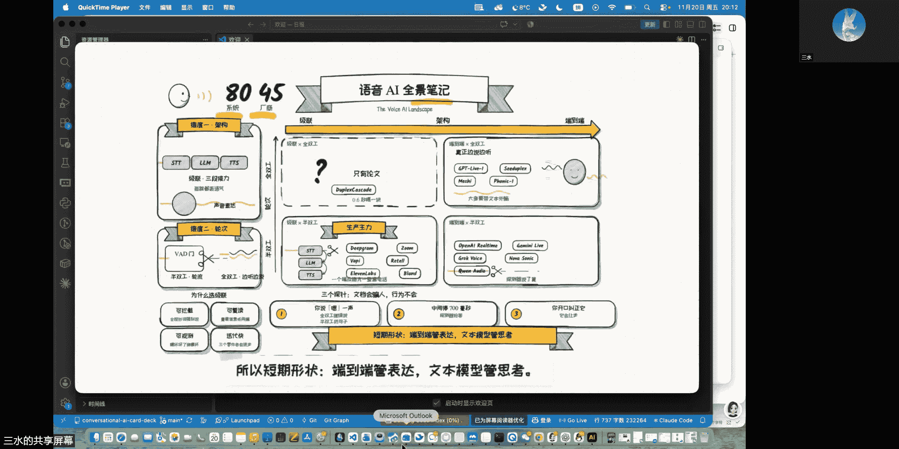

# AI+X碰个头·第三十五期-分会场-2：5：代码渲染与中间帧补全原理 💻

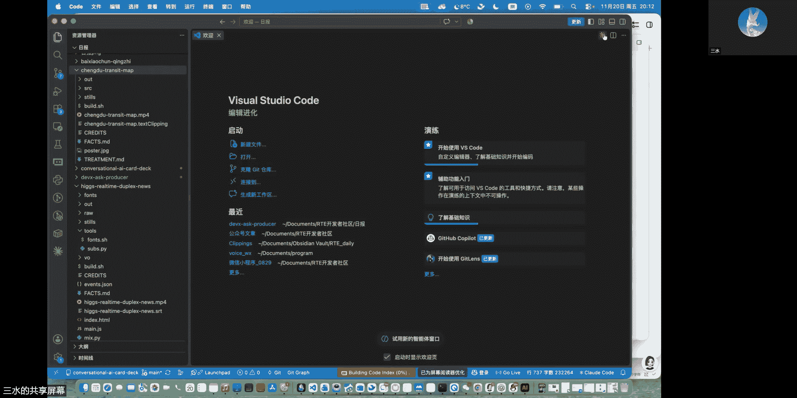

上一节我们讲解了四个画面结构与分镜设计。本节中，我们来看看AI是如何通过代码渲染来生成动画，特别是中间帧是如何补全的，让静态画面变成流畅的动态效果。

代码渲染的核心思想，可以用一个简单的公式来表示：

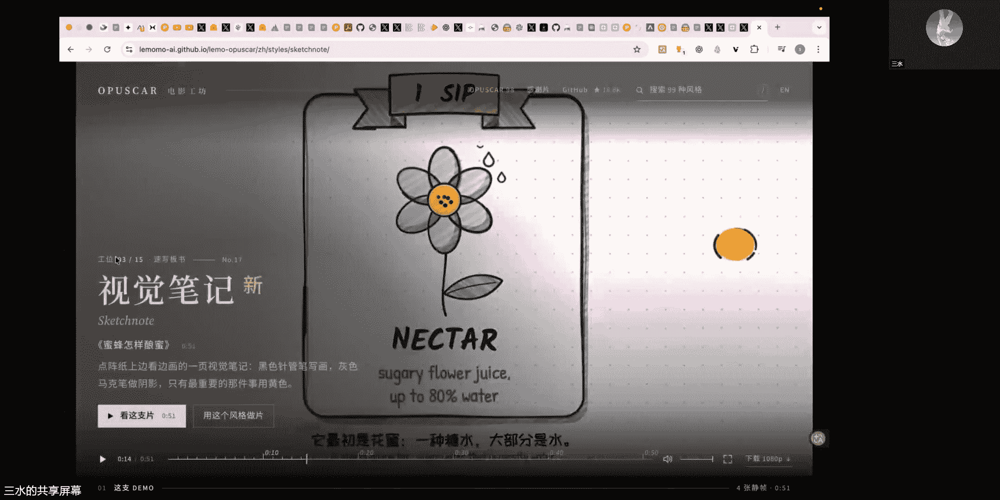

中间帧 = f(时间, 起始状态, 结束状态, 差值函数)

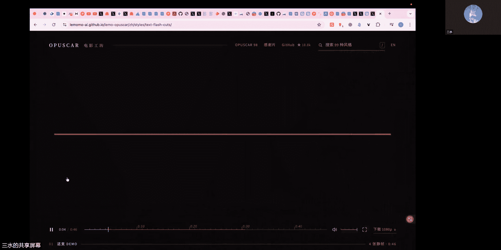

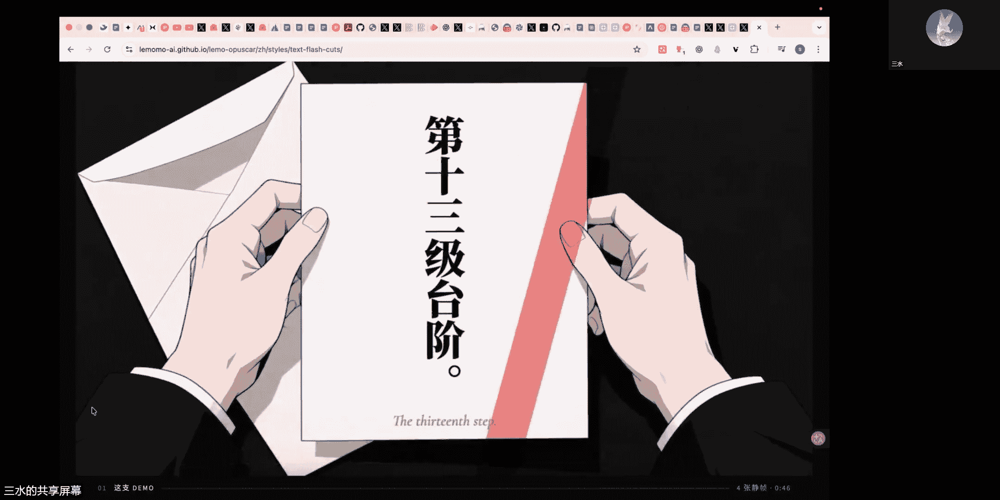

具体来说，我们先设定动画的起始帧和结束帧，比如第0秒是什么样子，第5秒是什么样子。然后通过时间函数和差值函数，计算出每一时刻的中间状态，从而补出中间的帧。这个过程，很像过去制作动画时，先画头和尾，然后快速翻动纸张来形成动画效果，只是现在由程序自动完成了中间帧的计算。

下面是代码渲染的基本逻辑：

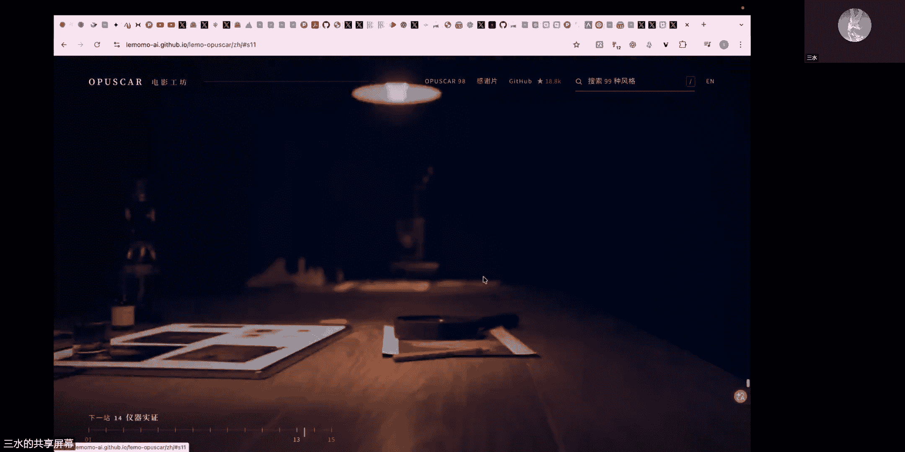

- 输入：总时长、首尾关键帧、动画进度函数。
- 计算：通过时间函数和差值函数，推导任意时刻的画面状态，生成中间帧。
- 输出：补全后的中间帧序列，组成完整的动画片段，可以直接导出为视频。

以样片中导风板调整的最后一帧为例，制作过程是：首先确定动画总时间，然后查看当前的动画进度，比如第5秒需要完成什么动作。有了头和尾之后，让AI计算中间的过渡过程，补出中间帧，第四个画面的片段就制作完成了。这里涉及的HTML5浏览器绘图接口，可以交给AI来完成，无需人工手动编写复杂的图形代码。

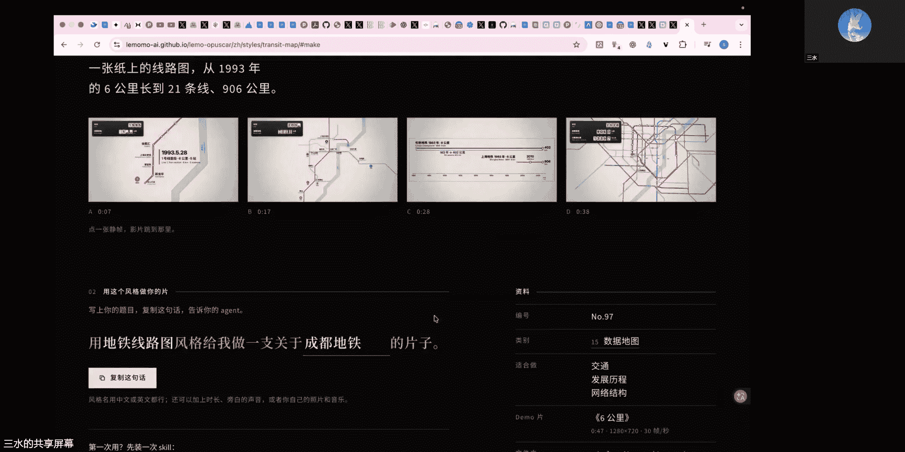

下面是一个伪代码示例，帮助你理解渲染逻辑：

```python
# 伪代码示例：根据时间计算中间帧
def render_frame(time, start_state, end_state, total_duration):
    progress = time / total_duration
    return interpolate(start_state, end_state, progress)
```

通过这种方式，我们可以把传统动画中手工补画的工作，交给代码自动完成，大幅提高制作效率，同时保证每一帧的精确度。

# AI+X碰个头·第三十五期-分会场-2：6：为什么不选择生成式视频模型 ❌

上一节我们讲解了代码渲染与中间帧补全原理。本节中，我们来探讨一个关键问题：为什么制作知识类短片时，不使用生成式视频模型，而选择代码渲染？这对理解技术选型非常重要。

原因在于Web知识大赏的需求背景。我们需要把知识点讲清楚，这就要求设备结构准确、动作可控、字幕可读，并且任意一帧都需要可修改。代码渲染可以逐帧修改，完全契合这些需求。而生成式视频模型存在一定的随机性，输出结果不完全可控，难以满足知识科普对准确性的要求，容易出现画面错误或字幕不匹配的情况。

从成本角度来看，代码渲染的成本非常低，而调用视频模型的费用则较高。例如市面上某些先进的视频生成模型，调用成本明显高于代码渲染方案，对于大规模制作教学视频来说不太划算。

下面是两种方案的对比：

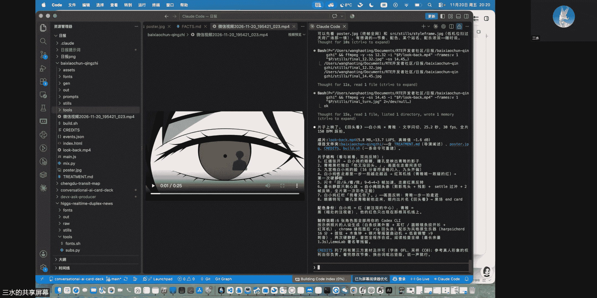

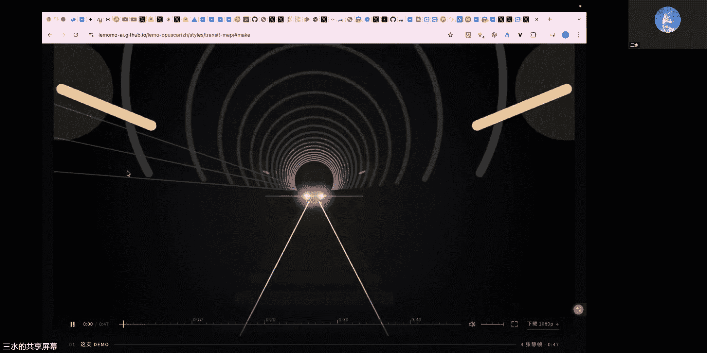

- 代码渲染方案：每一帧可修改，动作可控，成本低，适合知识科普和教学演示。
- 生成式视频模型：结果具有随机性，难以精确控制，成本较高，更适合艺术创作而非精准教学。

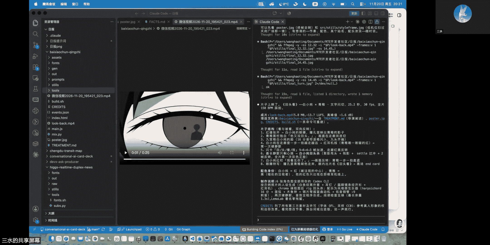

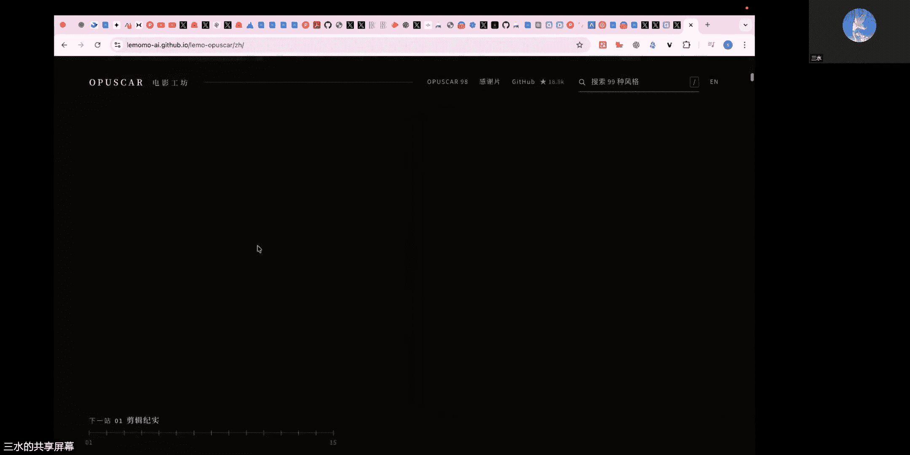

另外，样片并非全部由AI从头到尾生成。AI主要参与两个环节：一是创建工程，辅助把需求条理化；二是编写画面代码并进行渲染。而形象设计、关键帧划分、看图返工等环节，仍然需要人工参与，因为这些环节需要对知识内容有深入理解，AI目前很难完全替代人类的判断。

# AI+X碰个头·第三十五期-分会场-2：7：嘉宾分享与Skill工具实操 🎤

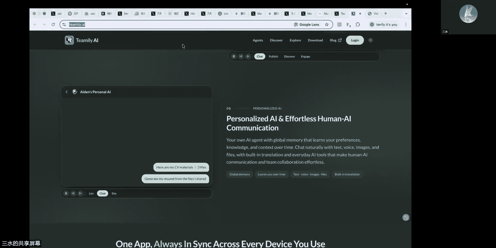

上一节我们解释了不选择生成式视频模型的原因。本节中，我们将分享嘉宾的实操案例，以及一个非常实用的Skill工具使用方法，让大家看到实际的制作效果。

嘉宾三水姐展示了两个样片，分别是“梦回成都”地铁线路图视频，以及一段手书风格的同人作品。这两个作品都没有使用视频模型，而是基于文本模型和代码工具生成，证明了非视频模型路径也能做出不错的效果。

其中，“梦回成都”视频仅用一句话就完成了制作。AI自动搜集了成都地铁的开通信息、站点数据、票价等内容，生成了约30秒的视频，制作耗时大约一个多小时。生成的内容在基本事实上较为准确，比如3元票价、终点站等信息，虽然未做逐一校验，但整体符合实际，可以作为快速制作科普视频的参考。

使用这个Skill工具的方法非常简单。如果你使用的是代码插件（如Cline或类似工具），只需要把Skill的代码安装好，然后向AI发送一句话，例如：“用地铁线路图风格，为我做一段关于成都地铁的介绍视频。” AI就会自动搜集信息、生成画面和字幕，把复杂的搜集和整理过程都隐藏在后台，用户只需要关注最终结果。

下面是使用Skill工具的关键步骤：

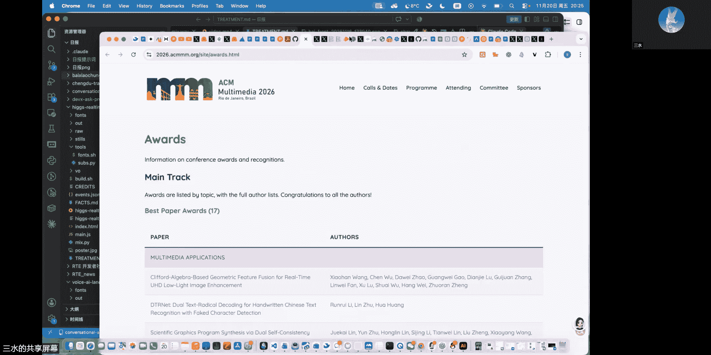

- 第一步：安装Skill插件，将相关代码交给AI，完成环境准备。
- 第二步：输入一句简单的指令，指定风格和主题，如“地铁线路图风格，做关于XXX的片子”。
- 第三步：AI自动搜集资料，生成中帧、配色、节奏和配乐方案，形成初步视频雏形。
- 第四步：预览中帧，如需调整配色、节奏或配乐，直接告诉AI修改，直到满意为止。
- 第五步：生成最终视频，并在必要时自行替换音频，完成成品输出。

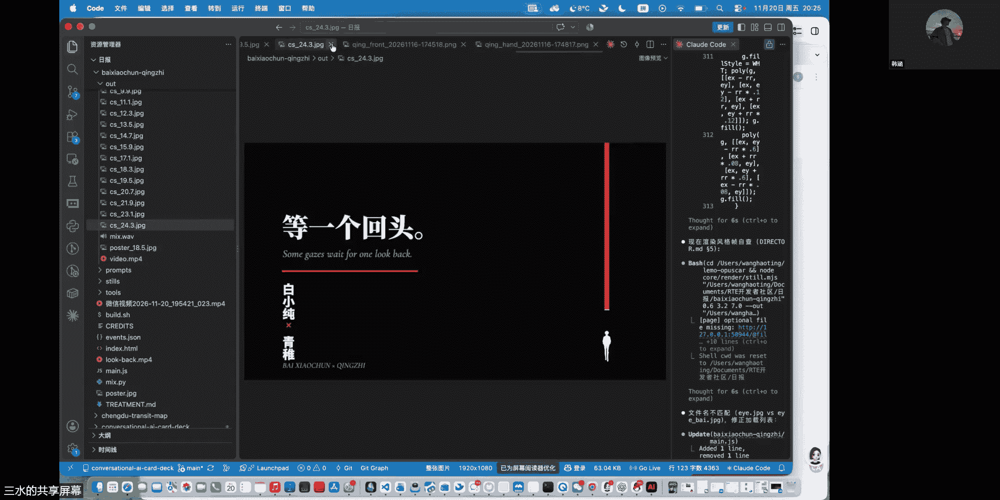

在制作手书类视频时，嘉宾还特别强调了形象一致性的问题。她先为两个男主角生成了固定的人物形象图，然后把图片交给AI，要求按照这个形象去搜集过往故事、撰写剧本，最后再生成视频。这样可以避免角色在不同画面中走样，保证视觉风格统一。


AI生成的视频会以一帧一帧的方式输出，并附带思维链路文档，让你可以查看信息的来源和核实过程，增加透明度。生成前，AI还会询问是否需要一次性生成，还是有额外的配音需求，这些参数都可以自行调整，方便大家根据实际需求定制输出效果。

# AI+X碰个头·第三十五期-分会场-2：8：系列课程预告与总结 📚

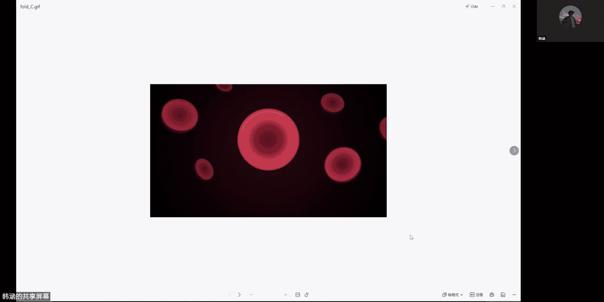


上一节我们分享了嘉宾的实操案例和Skill工具使用方法。本节是最后一部分，我们将介绍后续系列课程的安排，并对本节内容进行总结，方便大家了解后续学习路径。

接下来，我们将开设一个关于如何使用AI协助玩转ESP32的系列课程，共计12期。下一期将由先风哥分享AI温度感知，也就是温度传感器的应用，适合初学者入门。下下周开始，我们将进行完整的ESP32实操，每期尽量带着大家拿到开发板，做出一个实际成果，理论结合实践。第12期将安排自由发挥环节，让大家可以根据自己的兴趣进行创意项目开发。

教程网页需要邀请码才能登录，有需要的小伙伴可以在教程工程群或AI硬件交流群里私信获取。目前主群人数已超过200，采用邀请制，大家可以先进二群，如需进一群也可以私信联系管理员，我们会尽快处理入群申请。

下周开始，教程工创的小伙伴将和我一起把教程内容过一遍，同时调用刚才提到的Skill和流程，尽可能拓展教程的多样性，让教程覆盖更多知识点。如果大家在学习过程中遇到任何问题，或者有学习心得和方法，都欢迎随时联系我，我会将反馈补充到教程网页中，共同改进教学内容。

此外，如果大家制作了外部支识大赏相关的视频，需要投放到教程网站进行审核，也可以联系我，我会负责审核和后续规划，确保教学资源的质量。

下面是本次系列课程的简要规划：

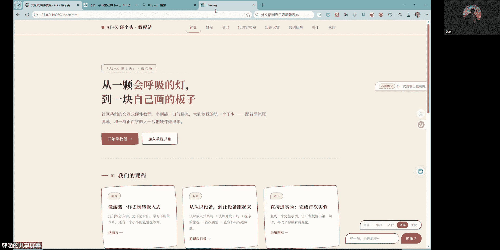

- 第1期：AI温度感知与传感器应用，介绍基础传感器知识。
- 第2至第11期：ESP32完整实操，每期一个硬件成果，循序渐进。
- 第12期：自由发挥，综合运用所学知识完成个人项目。


本节课中，我们一起学习了如何利用AI知识大赏制作动画短片，拆解了样片的四个画面结构，对比了传统赛璐珞动画与AI代码渲染的逻辑，介绍了逐帧截图与音视频编码两个核心工具，解释了为什么知识类视频更适合代码渲染而非生成式视频模型，并分享了Skill工具的实操方法以及后续ESP32系列课程的安排。希望大家能够把这些知识应用到实际制作中，制作出更多高质量的知识科普动画，提升学习和教学效果。

