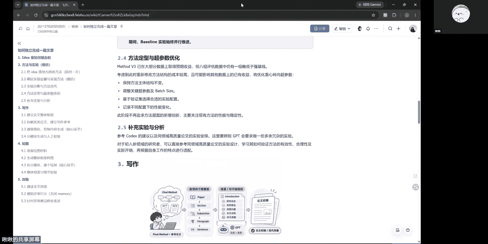
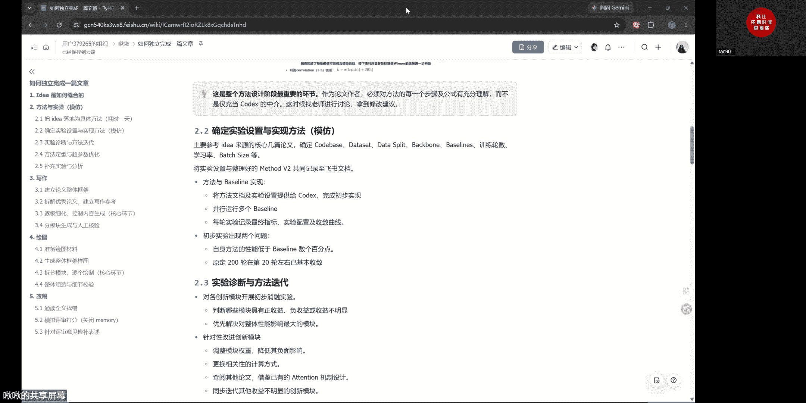
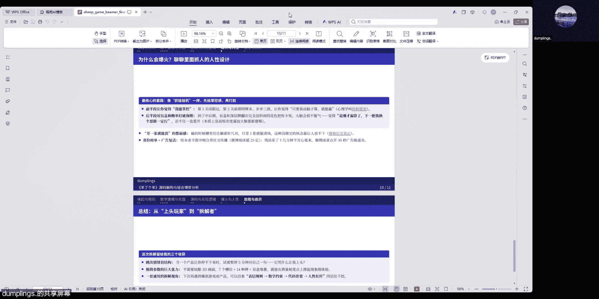
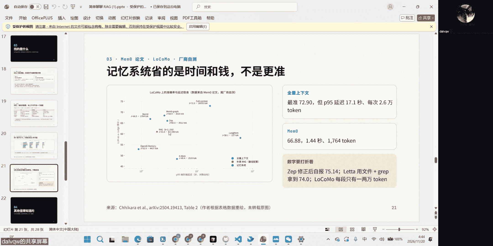
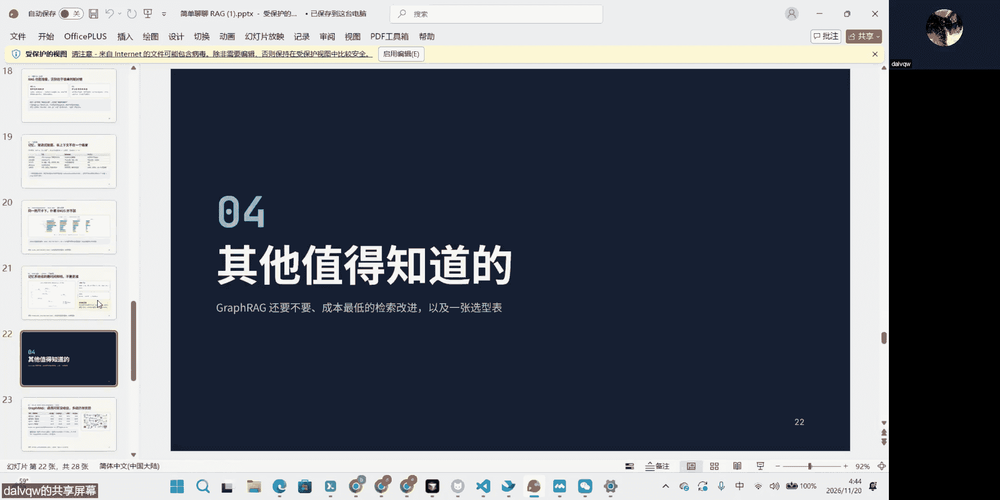
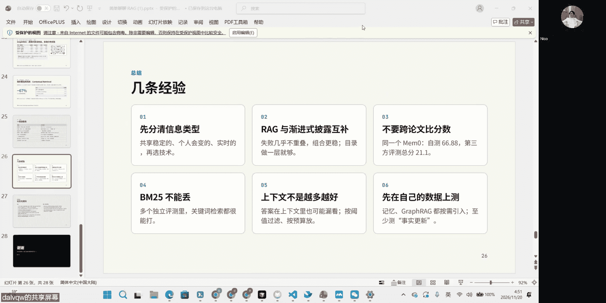

# AI+X碰个头·第三十五期：分会场-3：经验分享与技术探讨 🤖


在本节课中我们将要学习三位分享者的实践经验。第一位分享者是大三文科生，将介绍如何在不到一个月的时间里利用AI工具从零开始完成一篇科研论文。第二位分享者将围绕一款消除类小游戏，讲解游戏规则、图论建模以及爆火原因。第三位分享者将探讨RAG技术与长期记忆在AI Agent中的应用，并对比不同检索方案的优劣。内容将尽量用大白话解释，适合初学者阅读。


## 第一部分：本科视角下利用AI快速产出科研论文的实践经验 📝


上一节我们做了课程概述，本节中我们来看看第一位分享者的科研写作经验。她在po里欧实习期间接触到全新方向，导师给了几个题目并要求在一个月内完成文章。在只有不到三十天的时间压力下，她需要快速熟悉领域并产出可用成果。

以下是idea诞生的过程。导师直接把自己与GPT聊天的截图发给她，并提供几个候选题目。她从中选择了一个自己稍微涉猎过的多标签监督题目。深入调研后发现该方向已有大量研究，但某个显著性场景下的工作较少。于是她提出用西红柿炒鸡蛋与鸵鸟蛋缝合的思路，把两个既有元素结合，形成西红柿炒鸵鸟蛋的创新方向。

实验设计首先要建立文档记录idea。包括方法迭代、实验数据、实验设置等内容，方便后续汇报或交给AI运行实验。建立文档后，第一步是将idea交给GPT网页版，要求经过多轮迭代落地为具体方法。GPT初始输出通常包含大量冗余解释和加料，篇幅很长，需要人工花费较长时间进行消化与结构化梳理。

以下是梳理方法时需要明确的关键要素。
- 明确方法的输入和输出，例如输入是什么，最终要得到分类器还是其他形式的东西。
- 梳理GPT给出的创新点模块，明确各个创新点之间的关系以及对应功能。
- 每个公式的每个参数都必须清楚来源、去向和作用。

将方法梳理成清晰的模块形式是整个写作过程中最重要的一步。因为AI已经足够强大，人在其中的作用是理解和把握，这也能防止方法迭代时失控，或GPT偷偷加入未被发现的多余内容。

实验设置与实践方法参考该领域成熟优秀作者的文章。根据其代码规模、backbone划分和baseline来决定文章做法。完全小白的情况下，模仿是最好的方法。实验设置初步定好后开始实现，同时跑几组baseline。初步跑完实验时发现自己的方法比baseline低好几个百分点。在两百人的实验中，方法在第20轮已经收敛。针对这种夸张问题需要进行逐步消融实验，目的是判断哪些模块有正收益，哪些有负收益。

有趣的事情是，把第一版实验设计给老师后，老师强烈要求加入相关性模块以使故事更完整。但消融实验发现，负收益影响最大的正是这个相关性模块。向老师说明后，老师仍要求为故事完整性保留该模块。处理方式是降低该模块权重，或更新其计算方式。之后又读其他论文，借鉴天审机制，并迭代其他效果不明显的创新模块。经过大约两轮方法修改和快速实验分析，最终找到可工作的方法。与此同时，baseline始终并行运行，这是节省时间的方法。

以下是处理数据集表现略低于baseline的情况。方法主体不要变动，从参数或细节入手进行调试。经过艰难调试后，整个方法终于能work。主实验完成后，其他实验参考同领域文章安排，包括消融、召回等。也可以参考GPT建议，但需要鉴别，避免做多余和冗余的实验。

接下来进入写作部分。本次没有使用任何科研skill，全部手工完成。因为人应该站在文章创作主体，决定怎么写、按什么顺序写。GPT仅负责翻译和组织语言，使用网页版。

以下是写作操作步骤。
- 第一步，将已经验证可工作的方法和记录在文档中的内容交给GPT。
- 再结合投稿模板，让GPT搭建从整体到局部的框架，确定论文每个板块放什么内容。
- 细化到每个段落和每个句子要做什么，尽量避免废话。
- 第一版GPT生成中文版后，可以把握其语感和文风。
- 再让GPT给出每一句写作方案，并提供同领域任务相近的高质量论文，让GPT逐句模仿其文体逻辑、句式和表达技巧。

写完之后要进行检查。检查也是逐段逐句进行。写作顺序是先写方法部分，方法写完后同时开始绘图。绘图参考同领域画得清晰、表达清晰的架构图。将图和实验部分的原始文件交给AI，尽量不给PDF，因为PDF提取可能会影响层次和公式理解。第一版AI给出的样图基本不可用，唯一作用是确定每个板块在整体图中的位置和大小。随后根据色块划分，让AI逐模块生成。



实现方法比较原始，使用PPT纯手工绘制。这样可以减少AI味，增加人的理解，记忆和理解也会逐层深入，但过程痛苦。欢迎大家交流更高明的自动化架构图绘制方式。

以下是架构图制作应注意的原则。
- 首先不要出现公式。
- 文字尽可能用图形或小组件表示，不要用公式表现。


因为第一眼看到架构图的读者若看到公式，会影响阅读体验。将文字公式转化为小组件是最大的困难点。

改稿阶段，先用AI帮助改格式和表达错误。以下是好用的提示词使用方式。
- 第一个是去除AI记忆，让其仅作为打通工具，避免其知道投稿会议后故意讨好。
- 在众多意见中，只挑问题最大的weakness进行修改。

因为写作是逐行逐句完成的，基本在可控范围内，不会出现特别大纰漏，所以只需局部更改。若建议会影响整段甚至整段改变，则不采纳。

以下是关于AI运行实验时的注意事项。有学员提问，如何确保AI按真实实验设计运行，不会出现数据泄露或偷看测试集以提分的情况。分享者回复，会从实验结果倒推，若结果夸张或突飞猛进，则回去检查源代码，手动双重核验。这是目前没有更好自动化解决方式的经验之谈。




以下是总结这不到一个月极限产出文章的经验。过程潦草且浅薄，更适用于升学、毕业等快速达到量化标准的场景。如果时间充裕且不赶，仍希望慢下来深入读论文、好好设计方法。分享到此结束。


## 第二部分：消除类小游戏的机制分析与建模 🎮


上一节我们介绍了利用AI快速写论文的经验，本节中我们来看看第二位分享者的游戏机制分析。起因是朋友圈有人玩这款小游戏，出于好奇点进去尝试，失败多次后感到不服气，反复尝试后产生沉迷感。冷静后反思游戏为何让人着迷，并列出初步问题。

以下是初步问题列表。
- 为什么底部卡槽容量设定为七格？
- 如何找到必胜策略？

在百度搜索后发现这是二零二二年左右的小游戏，曾全网火爆，通关率低至零点零一百分之一。在QQ群中找到一个源码包，虽非真实源码，但可从中反推部分设计意图。

以下是游戏玩法介绍。
- 在有限卡槽内放入卡牌并消除屏幕上的卡牌。
- 规则是三张相同消除，即三消一。
- 游戏配备移出、撤回、洗牌道具，但商业化严重，卡关时使用道具需看广告。

以下是对游戏的分层理解。
- 第一层是上面显示的分层区，卡牌交错叠放，只能看到下面大概是什么。
- 第二层是盲盒区，只能看到最上面一张卡牌，完全不知道下面是什么。
- 第三层是外层，零散层数浅，看得最清楚，建议留到后期使用。

以下是基于偏异关系构建的模型。点击上一张牌才能点击下一张牌，可构建成有向无环图，记作 G = (V, E)。盲盒区构建为后进先出的栈。所有卡牌总数是三的倍数，类似拓扑排序，像安装包依赖项目时先搞定前置依赖，后面任务才能解决。

以下是回答卡槽为什么设为七格的问题。根据抽屉原理，若有 n 种卡牌，每种最多保留两张而不触发三消，则槽位容量 S 满足 S = 2n + 1 时会强制出现可消组合。第一关有三种牌，基本烂点也可以过。七格也与手机屏幕大小和七乘七网格有关。

以下是拿具体图举例子。明面上看到没有凑齐三张的组合，只有四组对子，例如树桩、玉米、青草和棉花，还有五张孤牌，没有现成可直接消除的三张组合。每点一对对会立刻占用两个槽位。必须去赌盲盒下面或其他位置。可以先削玉米，把草丛放上去，再把玉米削掉，再消掉数量，只保留一个空格。不要轻易碰两个盲盒，除非槽位宽裕，小于等于三张时才可考虑。引入新的三排榜。

以下是回答是否存在必胜策略。人肯定先想从后往前消除，但信息不完全，不掌握全部信息，没有百分百必胜法。玩几局后会有模糊策略，胜率会更大一些。

以下是从源码反推设计意图。源码并非真实游戏源码，是他人模拟，但可反推部分设计。将其分为两半，上半部分将卡牌抽象成多层二维数据网格，负一表示空位，整数编号表示不同图案。下半部分是一个循环，卡牌进入卡槽后，代码遍历七个槽位，若当前种类满足消除条件则消除，并将剩余卡牌向左对齐，继续判定。

以下是消除逻辑的伪代码描述。
```
for each slot in 7 slots:
    if current type count >= 3:
        eliminate matching cards
        shift remaining cards to left
        repeat check
```

以下是游戏爆火的原因。
- 个人投入大，沉默成本高，必须赢。
- 常出现差一张就能消的情况，引发再次尝试欲望。
- 加入榜单带来社交功能。
- 广告复活也是商业化设计，游戏结束后可看广告换取道具。



总结来看，这是一个很简单的小游戏，代码逻辑也不算难，不需要酷炫画面，只需几个条件加几种牌就能让人沉迷。分享到此结束。


以下是针对螺丝钉小游戏的建模讨论。螺丝钉游戏广告显示抽走螺丝让东西掉下只有一个空位，需要一个个移动螺丝让盘子里东西全部掉下来。目前暂无建模想法，后续具体点进去研究后再讨论。


## 第三部分：RAG与长期记忆在AI Agent中的应用与选型 🧠


上一节我们介绍了消除类小游戏的建模思路，本节中我们来看看第三位分享者的技术探讨。最近两三个月对RG技术了解不多，研究方向主要是AI科学家，即自动化做科研。组里有auto figure edit项目和对应论文，可尝试。但测试发现cloud ops5点五直接绘图效果已非常好，模型发展逐渐把项目替代。

以下是对IIT技术了解情况的介绍。如果不了解，可看ONIT项目，入门较详细，但部分库可能过时。整体上学习IT技术还行。最近很少看到IG相关推文，也有人问IG是否不再是主流方案，因此今天简单聊聊这一领域。

以下是几种与IG相关的技术。
- 长上下文，无需多说。
- 切块加向量检索，即基础IG。
- 将关键词检索融入IG工程。
- 结构化IG，例如graphIG，用于解决多跳问题。
- 自动化多轮检索，即肩体和IG。
- 利用skill方式进行渐进式披露，先给出目录，让模型先读目录，再检索所需目录信息，再基于目录查看内容。

以下是记忆与IG的耦合。AN的GE部分，记忆与IG耦合较大，因为记忆增量存取后会嵌入向量数据库，回答问题时基于向量数据库检索。记忆更新可表示为 M_{t+1} = Compress(M_t, new_memory)。

以下是对比IG与监控披露。IG是一套检索系统帮模型调内容，披露是模型自己调用工具、读取目录、挑内容。有一篇论文进行可控实验，对比建议式披露与IG方式，并在数据库量提升后观察效果。对比效果可见，一层目录效果最好，两层效果反而下降。hybridIG效果比直接把单本书塞给AI差。根据经验，这应该是没有调优的结果，因为IG有很多调优点，如切块大小、重叠、RF权重切分、topK选择、是否重排rerank、模型选用等。

论文后续将语料放大后，结果换成codeX。从派框架换成codeX后，最终结果仍显示一层建议式披露占优势。整体上，换成codeX后基础效果也较好，因为codeX检索能力在各类AI agent中较强。论文总结是建议披露节省的是上下文，而非智力。建议披露相当于把整本书分割，只把需要的部分拿给大模型读取。

以下是另一篇开源项目的对比。使用同一知识库、同一组一百八十道题、同一回答模型，比较监控披露与几种RAD效果。图中三个划线可见，RIT优势是token数明显更少，调用次数也少，整体速度更快，成本更低。虽然建议式披露准确度高一点点，但面对成本三倍差距和时间一倍差距，整体上ID更占优势。

以下是两个场景对比。客服场景和work day场景。客服场景最初用ID，后换成另一方案，人工盲测比较，第一轮ID综合评分更高。但该场景下token数优势不明显。最初skill版本是90K，所以IG更占优，后续优化降到31K。IG调优有很多参数方向，而kill调整较少。基于人工成本考虑，厂商可能选择目标导向，用建议式披露实现业务。

以下是住院病例文本场景。论文用一百个患者真实病例，按患者住院与文档三层组织测试。目录导航即监控披露效果不错，普通大量ID效果不佳，因为问题若跨多次住院，尤其未点明是哪几次住院，难以检索具体内容。即使IG加住院编号过滤也帮不上忙，这时需要模型读目录自己判断。过滤后召回效果更好，目录导航精准率高五倍。可考虑用建议式披露做目录导航，再把数据库切分，以患者或医院为目录建立向量嵌入，既利用目录精准度，又利用RIG召回优势。

以下是RIG的复子文本块方式，与今天披露方式思想类似。

以下是总结。对于语料大、零散且更新频繁的情况，IG会更舒服。虽然初始inbanding处理时间长，因要做向量嵌入，但后续使用延时较低，且token数更少。

以下是早期谷歌论文对比。长上下文对比IG的效果。直接把文本输入上下文肯定在大多数场景下占优，无论用ID还是建议式披露。但多跳推理场景衍生出graphIG等能力来应对。

以下是记忆机制问题。在AI使用过程中，记忆持续堆叠，无论效果多好，机器体量持续变大，检索空间会被占用，容易放入冗余记忆。需要记忆删减或替换机制，但目前方向缺乏好的机制和benchmark。主流benchmark考察整套系统，如locco local ban等，主要考察检索，未考察模型回答问题的最终效果，且不符合AI agent实际记忆逻辑。实际使用时，AI agent可能每天做记忆压缩总结，而非像benchmark那样把一周或一个月记忆全部统一压缩再检索评估。因此缺少能模仿真实使用体验的增量benchmark。

以下是2026年论文对比各种方案。包括记忆方案、GIG、IGBM25混合IG。在某些场景下效果尚可。另一张图是mam林local bench测试，可看到帕雷多前沿图。token数较高，完整上下文输入模型是上千token，IID只有2乘256，即448，远少于其他方案。IG效果较均衡。



以下是改进方案。在建索引前，让大模型为每个文本块生成说明，指出出自哪个文档哪一部分。理论上效果更好，但与graphIG一样，前期构建时长更长，成本更高，因为需要让大模型完整读取所有文本块进行切分。



以下是选型表。目前personal agent基本不会用IG，因为用IRT需单独维持inbanding模型业务线，且需考虑用户设备配置，若不用云端inending模型，需下发到客户端，还要考虑手机配置。因此agent主流方案是单一方案，中间穿插建议式披露，整体效果体感差不多，且调优较方便。

以下是关于离线IG模型的问答。不太确定具体场景，本地不使用IG。IT开发一般流程不会一开始就用最好模型，甚至会专门挑GPT4O或QN25等，因为需要保证最早期能力做得好。关于保质期三年，人保质期八十年，永远其实就三年，狗只有十五年，一座山一亿年，恒心也会死，文明五千年文化都会死，时间吃掉一切。

以下是基于两人国创造游戏的建议。可把两人国里的军事、规则等变成游戏，让其不断推进。可创造类似我的世界的游戏，把每天想的一切告诉AI，设定规则，AI就能做出类似东西。


## 总结与交流 📌


本节课中我们一起学习了三位分享者的经验。第一位分享了如何在不到一个月内利用AI从零完成科研论文，涵盖idea诞生、实验设计、写作流程、架构图绘制和改稿方法。第二位分享了消除类小游戏的规则、图论建模、卡槽容量原理、必胜策略讨论以及游戏爆火原因。第三位分享了RAG与长期记忆在AI Agent中的应用，对比了IG、建议式披露、长上下文等方案的优劣，并探讨了记忆机制和选型建议。




希望这些内容能为你的学习和实践提供参考。如有疑问，欢迎在课后继续交流。

