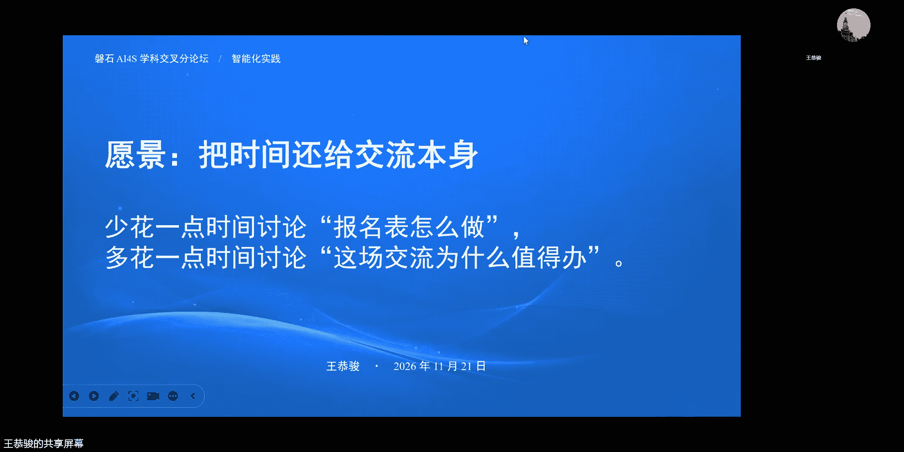
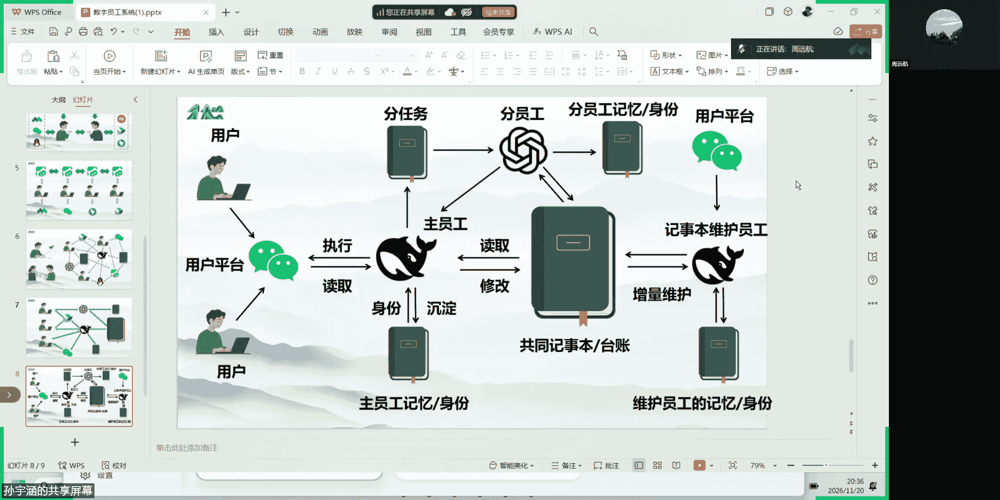

# AI+X碰个头：01：活动工作流的可进化改造 🌐

在本节课中，我们将学习如何利用人工智能技术，改造科普科教活动的组织工作流。我们会先分析传统活动筹备中重复性高的琐碎工作，再探讨如何把这些稳定的流程沉淀下来，让AI参与其中，最终实现下一次活动不再从零开始。

很多同学在参加会议或活动时，只需要点击一个报名链接就能完成报名。但是，如果你是负责组织活动的人，这个链接背后其实隐藏着一长串工作。比如，你需要把会议通知做成网页，让大家可以填表提交信息；报名结束后，会务组还要查到每个人的数据，并进行核对；等到下一场活动，主题可能已经变了，但报名、收集信息、核对数据这些步骤却又重新来过。即使你以前已经搭建过网站，踩过坑，整理过步骤，下一次是否还能直接沿用，这是摆在活动组织者面前的一个实际问题。

为了说明这个情况，我们可以看两个具体的网站例子。右边是昆明动物所实训营的网站，左边是磐石论坛的网站。作为普通参加者，一眼就能看出这两个网站风格不同、内容也不同。但是，如果你站在后台来看，它们需要完成的工作其实非常相似。首先，都是发布会议信息。原本的通知可能是按照公文顺序写的，但参加者打开网站后，常常需要先在页面上找时间、地点和报名入口。其次，是收集资料。网页上看起来可能只有姓名、单位两个输入框，但实际上，你需要考虑填完之后的信息最终要落到哪里。第三，是管理这些记录。总有人会在群里询问自己是否报名成功，你必须能够查到这条记录，并且看到他对应的所有信息。第四，是更新内容。一个活动的信息往往不能一开始就完全确定，网站上线只是报名工作的开始，后面可能会改时间、换图片、更新通知或更新嘉宾。

很多人容易把这些网站当成一次性交付品，活动结束了项目也就结束了。但是，我们可以换个角度来看。每一次活动变化的是具体内容，而相对稳定的是页面怎么组织、资料怎么收集、结果怎么核对。这些稳定的部分，可以沉淀成智能化的技术积累，并引入人工智能。

以下是活动筹备中需要重复处理的四个核心环节：
1. 发布会议的基本信息，包括时间、地点和报名入口。
2. 收集参会者的报名资料，并确定信息存储去向。
3. 管理报名记录，支持查询和核对每个人的完整信息。
4. 更新活动内容，比如调整时间、更换图片、修改通知或嘉宾名单。

那么，为什么要引入AI呢？我们可以举一个简单的例子。假设某个论坛原定于11月7日举行，后来调整到了11月21日。如果你只改了首页上最大的那个日期，这件事情就算做完了吗？对普通用户来说可能够了，但对负责维护的人来说还没有。你还需要检查首页的公告、下方的重要日期栏、资料下载页面里的会议通知，以及会前准备要发送的短信。一个日期变了，其他相关日期可能也要跟着变。而且，后端的数据格式可能并不统一，你需要明确要改什么、怎么改、去哪里找，改到什么程度才算合理。直接搜索替换字段虽然很快，但如果替换错了对象，后果会很严重。

这时候，我们可以让AI来帮忙。AI的作用是找出所有可能受影响的入口，并把它们筛选出来，然后逐个对照本次活动确认的通知，把不一样的地方列出来供你确认。这样，你就能知道到底要改哪些部分。改完一个日期之后，去哪里查、怎么判断改对了，这套方法是可以沉淀下来的，下一次还可以继续使用。这里需要说明的是，AI并不是说能同步修改所有地方，因为网页可能是一段配置，而下载页面的资料可能是一份Word文档，它们本身就不一样。对你有用的结果，是把已经对应好的内容和需要更换文件、需要人工确认的内容区分开来。

针对重复性工作，业界目前主要有三种做法。第一种做法大家都很熟悉，就是让同一个人继续做这件事。他上次哪里做错了、做漏了、哪里需要改，下一次就会格外留心。做过几次之后，这个人就会成为这项工作的熟练工，经验存在于他个人的记忆里。第二种做法，是把常用功能做成一套软件。比如中国科学院国际会议服务平台，他们开发了一个系统，用来把所有活动建站所需的信息导入进去，然后一键生成网站和对应资源，并且会对外收费。如果你的需求相对稳定，这会是一个非常合适的办法。第三种做法，就是我们在塔山协会支持的组织智能化实践项目中想尝试的。我们把已经能运行的页面站点、后端数据库平台保留下来，也把做这件事情时的所有记忆和流程留下来，用大模型去总结。比如论坛要收投稿，实训营可能要收培训费用。这样，我们就不需要每次从空白代码开始写，也不需要把未来所有活动可能出现的需求都做成按钮。

三种做法的区别在于，你下次拿到的是上次积累的个人经验，还是一套现成的软件，又或者是一套能够继续调整、足够灵活的网站和做法。我们探索的是第三种。

那么，为什么强调skill呢？如果我们直接让AI根据通知做一个论坛网站，AI通常能理解需要首页、简介、日程、表单，完全可以做出一个看起来很像会议网站的页面，也不会缺少功能。但是问题是，这句话没有告诉AI，我们说的上下文到底是什么。比如，注册到底是只注册一个账号，还是注册之后还要报名参加这个会议？我们也没有告诉AI，本场活动的页面应该是什么样的视觉基调。偏科创性的活动和偏党政性的活动，它们的视觉基调是不同的。

为了解决这个问题，我们在系统中补进了三样东西。第一是活动习惯使用的说法，第二是能够参照的视觉素材，第三是业务的具体规则。在我们实际的网站当中，右下角有两个入口，分别叫在线注册和在线投稿。这是论坛网站实际的业务。为什么要把它们分开？因为一个人如果是来听会，他是听众，不一定会做报告。这个差别对于组织者来说非常自然，但是对AI来说，他不可能预先知道这些事情。所以，我们需要把这些反复使用的上下文约定留下来。

下面是我们Skill循环的流程说明：
```python
# Skill循环核心逻辑示例
for each activity_notice:
    extract_required_fields(notice)  # 从必须字段中提取信息
    confirm_missing_info(organizer)  # 询问组织者补填或采纳建议
    select_template(resource_library)  # 从资源库选取模板
    generate_frontend_backend(ai_agent)  # AI智能体生成网站
    visual_acceptance(ai + human)  # AI视觉验收 + 人工视觉验收
    deploy_if_passed()  # 通过后上线
```

AI可以根据输入判断下一步。智能体，也就是agent，需要判断的是这个工具能否用得上。智能体agent可以读取文件，修改代码，运行检查，再查看工具返回了什么。这是流程图中循环的一部分。左边的skill文档，则是我们给AI程序员留下的一份说明书。它不会替模型思考，也不会自己运行程序，但是它会告诉AI：你要用哪份资料作为依据，用什么步骤调用工具，拿出什么样的结果才算完成？



比如，我们从一份Word文档的活动通知开始。skill会让AI先从表格中的必须字段里提取信息，并且确认有没有遗漏。不能为了做完页面而随手编一个合理的答案。再看验收部分，有了报名表，只能说明页面画出来了。实际用测试身份提交，后台查到对应记录，返回页面状态也正确，这才能说明报名流程走通了。我们把这套规则留下来的意义是，以后每次要做报名页，AI都不需要再额外问你一句：记得不要光看按钮，要去后台查一下。这正是我们想复用的经验。

下面是完整系统流程的可视化说明。一个完整的流程需要准备一份Word文档的活动通知。我们已经有一张预制的Excel信息表，它可以从字段里面直接提取通知中必须的字段。没有填写的部分，可以带着方案去问组织者，组织者可以选择补填，可以选择采纳建议，也可以选择直接省略。在确认出一个合理的建议之后，从资源库中选取本场所用的模板，这包括图片、音频以及版式。这样一来，活动事实和视觉资源都有了来源。把这两项都准备好之后，就交给中间的这个AI智能体。它会按照skill来调用工具，生成本场网站的前端和后端。


然后是验收环节。先由AI做一次视觉验收，可以帮助发现手机宽度下的按钮有没有被挤出画面，文字是否重叠。然后再由人来看一次，人判断的是人更擅长的直觉感觉，比如哪个入口才是参会者最先想要看到的。经过AI视觉验收和人工视觉验收两轮之后，可能还需要少量的人工修改，但在这之后就可以正式上线了。

以中国科学院昆明动物所实训营的网站为例，这是12月份即将开启的活动，参加者可以在这里查看培训介绍、报名信息等等。右边这个项目则是我们的拓展化尝试。使用的人，从我变成了会务工作的老师，因为他们可能需要在活动筹备之后改变活动介绍和图片。那么是不是每次要改信息都得找开发者，或者找AI重新生成一次呢？我们在这个项目里面尝试生成一个内容编辑器，会务人员可以直接使用后台的管理端编辑器，找到要更改的段落，去更改正文，替换图片，调整版式等等。先保存一个草稿，然后再打开预览检查。对会务人员来说，这有一个非常直接的好处：我可以直接看到我的改动是否正确，而且自己操作，也节约了和开发者交流的时间。

我们最终的愿景是，能够把一套系统推荐给所有非专业人士使用，让每个人都能一键搭建出自己的活动。最后，回到最开始的那个报名链接。现在如果有人问我，上次做过的工作哪些能够复用，我会说，可以复用的不止那几张网页，还有活动资料怎么整理，哪些问题需要问人，一个报名流程怎么样才算验收通过，把它们留下来，是为了下一场活动不需要再从零开始。但是，确实有一些事情，在每一场活动的时候都需要重新仔细想。比如要请哪些嘉宾来，还有两个不认识的人，能不能因为这次活动而坐起来聊一个共同的问题。这些也正是我们作为科普科教活动组织者，更愿意去投入时间准备的地方。我希望下一次筹备活动时，我们能够少花一些时间讨论如何做报名表、如何做网站，而应该多花一点时间讨论，这场交流为什么能够值得办。

本节课中，我们一起学习了如何通过AI技术改造活动工作流。我们分析了活动组织中重复性高的四个核心环节，探讨了引入AI处理信息变更的方法，对比了三种重复工作的处理方式，并重点介绍了基于skill的可进化系统构建思路，包括从Word通知提取字段、选取模板、AI生成前后端、双重视觉验收等流程，最后展望了让非专业人士一键搭建活动的愿景。

---

# AI+X碰个头：02：智能体数字员工系统架构 🤖

在本节课中，我们将学习基于智能体的可进化定制数字员工系统。我们会从工业时代到信息化时代的组织变迁说起，探讨AI如何改变人类的工作角色，最后详细介绍数字员工系统的架构设计和运作机制。

在工业时代，受限于知识传输和人才培养的成本，知识和责任都固定在特定的岗位和员工之中。层级的稳定和技术的先进是生产力的主要指标。每个员工都在自己的岗位上精益求精，管理者负责中心的统筹与调度。中心化的体制，才是工业时代稳定而有序的运转方式。

随着科技的飞速进步与多元化，信息来源于多个平台和多种身份，个人和单部门都难以处理海量式增长的信息。传统中心化的分工，已经难以解决如今高变化的社会环境和信息流问题。在信息化时代，信息的处理和交互能力成为新的生产力重要指标。社会也非常需要具有高信息处理能力的复合型人才。

人工智能的出现，弥补并提升了人的能力。AI强大的检索能力，让知识不再是壁垒。就像某些编程辅助工具产生了高效的执行能力一样，每个人都可以通过自己的AI，了解一个行业的前沿信息，从而成为该行业的精英。人逐渐从事情的执行者，变成了事情的决策者。

但是，即使AI的能力使个人的能力得到了极大提升，但每个AI之间是不互通的。AI难以与主人之外的个体，或者其他AI产生交互。这些信息，都是通过人来传递的。海量的信息从各种渠道进入个人，再通过个人进入其他渠道，人成了信息的处理器。个人会频繁面对各种信息流，比如说先接到微信通知，微信通知还没转发完，又接到了QQ、腾讯会议、钉钉的通知。然后想跟自己的AI聊一会儿，但是没法把自己AI的意思重新传达给别人，要自己重新传输为语言，不要在各种语言和身份之间切换，就会显得比较消耗精力。

为了解决这些问题，许多新型的组织也因此出现了。目前，有些产品已经可以将agent纳入个人与个人协作的范围，多个成员可以和agent围绕同一个项目进行推进。但是，这些产品都面临着人力维护成本和改动成本很高的问题。agent处于一个层级，人又处于另一个层级。AI可以处于信息不互通的平台工作，且AI容易出现幻觉，要么事情执行不对，要么事情重复执行、过度执行，或者偏离了原本的意思。难以将agent完全像一个人一样，成为一个独立可协作的个体。人需要给agent持续注入信息，而且如果业务发生变动，已经定死的项目流程可能会需要大量的人力或物力进行改动。

智能组织，是AI时代的下一个发展方向。这种组织模式打破了岗位的边界与层级的划分。agent就不需要像前面那样，通过人来进行交互了。agent可以像一个个体一样，成为一个独立可交互、可执行的个体。组织的结构，将从原本的层级状态，变成一种根据任务演化而来的关系网。不同的人，可携带着多种agent进行多元化的任务。比如说，员工甲可以调用员工乙的agent，然后和员工丁、员工丙一起，从多个平台一起执行任务。

在这种模式下，复合型人才和agent的团队，将代替传统人多层架构。人不再是agent之间的传输者。传统的岗位，就会逐渐交互到刚才提到的那种定式工作流。人不会再用在做其他重复的事情了，人的职能逐渐转向builder建造者和ser沟通者，这两大灵活决策和创新的岗位。ser负责人与人之间的沟通，根据人的体验，然后重新回来维护这个定时工作网，实现一种人在回路的可持续进化体系。

中国科学院塔山学科教叉创新协会，基于智能组织理念，孵化了可定制进化数字员工系统。让AI作为一个独立的个体，进入了人工作流程，与人协作。数字员工能根据多元化的信息，为持续推进工作事项，并将遇到的问题与人的指导沉淀为可复用的经验，实现自我进化。

我们总共设置了一个系统，设置好AI共用的共同记事本。这个记事本记录项目的状态和推进进度，以及一些通用的经验。每个数字员工，按照其身份和职能，从指定的已授权的平台获取信息和任务。他就能知道自己需要做什么了，而且也能获得这件事情的前因后果、背景等等，就能像人一样知道一件事情。通过记事本与平台的读取，能知道自己需要做什么，自己是谁。然后再把获取的信息和共同记事本的内容中对照，检查之前这个工作之前是否有做过，或者之前有没有留下未执行的工作，就避免工作做一半中断了，或者一件工作做了很多遍。然后再从记事本中读取信息，知道自己需要做什么。

在明确自己的任务之后，数字员工根据自己的任务分工和已有的信息材料进行一些任务的决策，就是在agent自己进行思考。随后通过工具执行，作为它的结果，比如说发送一个文件，然后发布一个通知等等。在这个过程中产生的材料和任务状态会进入共同记事本，让其他AI也能了解这个项目的进度与前因后果。

在每轮任务的执行完之后，数字合作员工也会核对自己是否完成了这些任务，重新去各大平台去看一看自己是否已经执行成功，有没有重复执行。这样避免了AI幻觉产生的工作错误，比如说网卡了，他就以为自己执行失败了，又再做了一遍。避免了这些重复执行或者执行中断的错误。

最后，数字员工在每一轮执行完之后都会思考一下，自己这轮工作有没有可持续沉淀的经验。如果有的话，就沉淀到共同记事本或者自己的记忆身份里。从而使员工越来越聪明，越来越根据人的需求进行一种定制型的计划进化。

下面是系统中不同角色数字员工的职责划分：
1. 主员工：负责主要的任务事项。如果事情太多，或者需要更专业的员工来进行，他就会把任务分包给分员工，以文件或其他形式下发。
2. 分员工：从主员工接受到任务之后，也有自己的记忆和身份，像一个独立个体一样，去共同记事本中寻找自己需要的信息和资源，然后自己独立执行任务，执行完之后再反馈给主员工。
3. 记事本维护员工：负责记事本的增量维护。什么是增量维护呢？比如说，有一个下午3点要发布的通知，但是突然接到任务，变成了下午2点。即使本维护员工，他并不会把原来的那条下午3点发布的信息给擦掉。他会在下午3点发布那条信息，后面再增加一条，改成了下午2点。也就是说，他的维护是只针对不删。这样就能方便在后续可以有序地找回原来的任务记录，找回原来的那个依据，找回原来的文件，都是一些可作为参考、可回滚的一种状态。

这一种系统共同维护好了，共同形成了一个闭环。人只需要负责下命令、等结果和一些指导，而不用亲自参与到各种任务的各个流程里面去。

在AI时代，科学家们不再进行依靠能力进行知识传递。AI将参与到知识获取、处理、传递的整个环节。这些知识、项目、任务不再局限于人的思维或者个人的记录，而是沉淀于大家可复用的一个平台中。无论是人或者AI，都可以通过这些可沉淀的经验，轻而易举地成为一个行业的专家，从而实行了复合型人才的创造。整个科研系统在人的指导下自主运行，并根据获取到的信息持续进化。AI将和科学家们一起探索科学，人与agent之间的沟通，或者agent与agent之间的沟通将会被打通，任务的组织模式将会被重构。人将会和AI一起发挥自己所擅长的能力。比如说AI擅长检索，人擅长思考和创造。人将会和AI一起共同服务于人的创造和发展。

本节课中，我们一起学习了智能组织和数字员工系统的核心思想。我们探讨了从工业时代到信息化时代的组织变迁，分析了AI如何将人从执行者转变为决策者，并详细介绍了数字员工系统的架构，包括共同记事本、主员工、分员工、记事本维护员工等角色的职责，最后展望了人与AI协作、持续进化的科研系统未来。

---

# AI+X碰个头：03：上下文压缩与记忆管理实践 🧠

在本节课中，我们将学习在实际构建数字员工系统时，如何解决上下文过长、记忆拥堵等核心问题。内容来源于分享结束后的问答环节，包括上下文压缩、结构化数据管理、技能沉淀等实践经验。

在实际构建数字员工系统的过程中，开发者和用户都会遇到一个共同的问题，那就是上下文过长、记忆拥堵。比如，当你运行维护一个共同的记事本，10天之后，这10天来多个agent的身份记忆和协同性已经交互了很多轮。这个时候，如果你新增了一个新的agent角色，他来额外分担其中一个新的工作，他就需要读一个很长很长的上下文和日志台账，然后才能明白自己在下一步该怎么跟这个组织协同起来。这在实际应用中是非常具有挑战性的。

针对上下文拥堵问题，我们可以从以下几个方面来思考和解决：
1. 按事项分区：给上下文分得比较清楚，主要根据事项进行分区。每个员工只会进入自己分任务分区的一个项目，不会把前面的所有事情全部读一遍。
2. 按需阅读：他会根据重要性和时间的远近，再去读这个信息和上下文，而不是全部阅读。
3. 会议场景举例：举行多人会议，再进行新的会议时，指定某个agent去读新会议的内容，可以参考以前会议在这一步做了什么，但是不会全部阅读，而是按需阅读。

除了上下文长度的问题，还有一个关于主agent如何管理子agent进化的问题。每个独立的agent员工都有自己独立的身份和记忆，并且会为他单独封装一些探索成功过的方法。主agent怎么知道子agent已经更新了他的技能记忆和身份，以便于在下一个新任务过来的时候，把活分配给这个已经进化的subagent？

解决方法是：当子员工在身份、工作方式、身份认知等方面进行迭代时，他也会在共同记事本里加一条记录。主员工在派发任务之前，会先阅读一下共同记事本台账里的这一条，就能知道自己的员工进行了一次更新。

但是，即使有了这套机制，上下文依然可能变得非常长，容易被压缩。一旦总结，就有一些关键细节信息丢失，然后agent可能会误以为某些东西，自己推理出一些误以为的幻觉。这个问题是目前行业共同面临的痛点，很多团队都在探索解决办法。

关于上下文压缩，本质上就是记忆问题。agent底层的大模型，其上下文大小是有限的。怎么把上下文压缩成一个可以复用的东西呢？一个比较粗糙的方法，是把上下文发给另外一个专门做记忆维护或上下文压缩的agent，让他来进行压缩。当然，这种方法还有很多可以细致优化的部分。

我们现在尝试的一个思路，是从编程助手agent遇到的长任务问题入手。在程序开发中，使用coding agent时，遇到长期的项目，因为一个agent的上下文是有限的，做久了就会越来越笨。针对这种长任务，对方在做代码压缩方面已经有一些方法，这也是我们想要借鉴的思路。

在实际落地时，还有一套具体的方法。就是教会personal agent或者主agent，在复盘时对这一次的任务做一个收口。具体做法是，把任务分章节做成台账，可以理解为文件目录或包，每个包里面可能有十几个markdown文件，分别对应不同的模块。分法包括：这是什么任务，用了哪些agent或AI功能，判断和取舍了哪部分，纠正了哪部分，最后效果怎么样，满意的原因是哪些，以后做的时候必须问你的，哪些是绝对不能碰的。

举个例子，做了一个个人网站，经历了一个完整的周期，周期里面的所有问题都能被分别归档成一个包。然后用这个包体丢给AI时，AI读的时候就知道，你已经把内容分门别类放好了。下次做一个新任务，不是做网站了，是做别的事情，但是可以借鉴。借鉴的时候，不是去把那个任务从头到尾全部读一遍，而是去找对应位置去读，按需阅读。这样可以把特定岗位型agent的调校进化得更好一些。

但是，无论如何绕不开一个问题：总要有一个复合度更高的脑子。手脚可以很聪明，但那个脑子还是得人来，这很麻烦。大模型的能力其实还有待进步。我们不能依赖以后大模型context容量扩大10倍或多少倍，来期待这个问题得到解决。因为背后是能源和算力的成本。我们最终要降本，要把AI真正投入到生活和工作中，让它产生经济效益，它的做事情好与坏的期望值，就不应该挂在能源和算力成本下降上面。

这就像计算机或IT刚刚发展的时候，文件压缩、节省硬盘空间，一直是一个贯穿了IT发展史始终的工程问题。感谢各位提出这个问题，这相当于是把整个行业当前的痛点都告诉大家了。我们可以私下多交流一些。

现在的AI agent员工，能进化到成为某个细分领域专家的能力是不错的。但是，怎么把它们拉在一起，以项目组的形式推进工作，这就很考验驾驭能力了。我很乐意跟大家互通有无，看看哪些东西大家也探索过。因为高校依托有很多老师，之前我们塔山团队也有已经做出来的相关项目，也有给企业做数字化转型的团队，已经开始有盈利。当然，在技术上来说，这其实还是一件有很大进一步空间的事情。

下面是关于数据处理闭环的关键步骤：
1. 原始数据存储：每次工作结束后，会沉淀出大量直接产生但尚未被下一次agent用来进化或训练的数据，称为原始数据，需要专门建立文档或数据库来存档。
2. 数据清洗与结构化：把原始数据洗清，做成结构化数据，也就是AI可用的数据，这需要人力或AI参与。
3. 技能提炼：从结构化数据中提炼经验，形成可复用的skill，比如如何快速检索到之前项目中的资料。

在设计系统架构时，我们倾向于让原始数据库、结构化数据库和skill数据库相对独立设计。这样可以避免历史数据丢失，也避免无关上下文污染当前工作。

本节课中，我们一起学习了在构建数字员工系统时，如何应对上下文过长和记忆管理的问题。我们讨论了按事项分区、按需阅读、增量记录等具体方法，介绍了通过分章节台账进行任务收口的落地实践，并探讨了原始数据、结构化数据和skill数据库的闭环设计，最后强调了不能单纯依赖模型容量扩大，而应从工程角度解决记忆压缩问题。




以上就是本次教程的全部内容。
