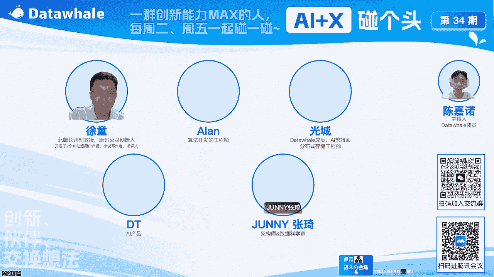
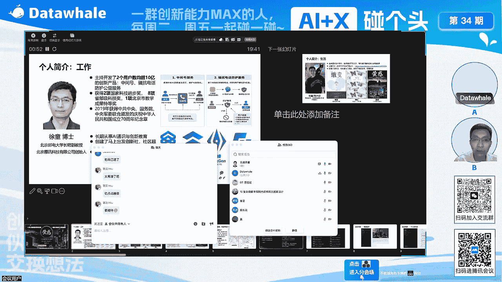
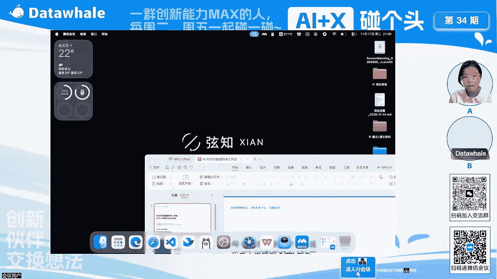
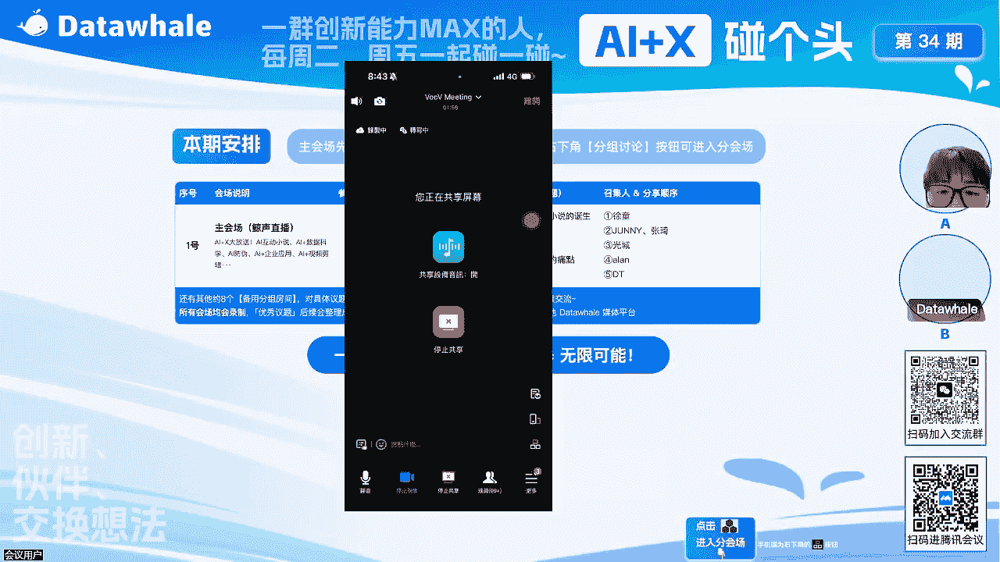
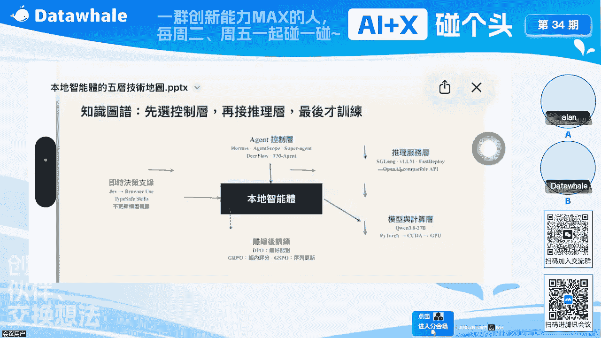
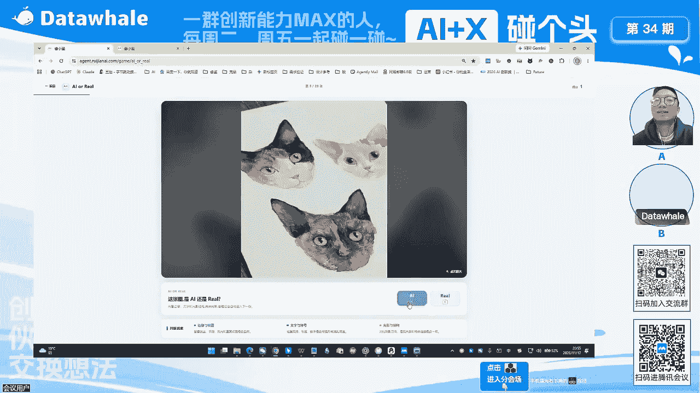

# Datawhale-AI+X碰个头第三十四期：AI应用全景分享

本次直播邀请7位嘉宾，围绕AI互动小说、K12 AI教育、多模态伪造检测、AI数据科学工作流、AI视频剪辑、企业级智能体架构、AI伪造与信任危机等主题进行分享。

---

## 01 嘉宾阵容

| 嘉宾 | 身份 | 分享主题 |
|------|------|----------|
| 徐童 | 北京邮电大学计算机学院长聘副教授，北京燕讯科技有限公司创始人 | 计算叙事学与AI互动小说 |
| 张琦 | 跨学科研究者，应用数学与数据科学研究者，K12 3D生成平台创业者 | K12 AI通识教育与3D生成平台 |
| DT田世纪 | 中科瑞建人员，主攻AI多模态检测 | AI多模态伪造检测技术与产品 / AI伪造泛滥与信任危机 |
| 珍ny | 神经科学背景，曾任加州理工脑科学研究院访问学者，现从事基础设施与模型架构研究 | AI时代的数据科学工作流 |
| 光城 | AI视频剪辑开源项目作者，项目星标超过一万 | AI视频剪辑与旅行大片制作 |
| Alan | 公司算法工程师，负责企业端智能体架构、模型调优与本地化部署 | 企业级智能体架构与模型调优 |

---

## 02 计算叙事学与AI互动小说（徐童）

### 嘉宾简介

- 职业身份：北京邮电大学计算机学院长聘副教授，北京燕讯科技有限公司创始人
- 行业经验：二十多年IT和通信领域产品经验，近五年专注创新人才培养、AI通识教育和创新实践教育
- To B产品：中间号（日调用量超一亿次，用于滴滴打车、美团外卖等隐私保护场景）；42电话防护业务（面向运营商的公益服务，用户数超十亿）
- 教育平台：指导创新团队开发四个智慧教育平台，覆盖全国五百多所院校、近十万名师生；成立马上出发创新社，社区超四千人
- 文学创作：喜欢文学和写作，每年读书并写书评；创作三部小说，发表于豆瓣阅读和微信读书
- 代表作：《赢获人生》，2015年开始构思，2020年正式写作，2023年完成，经过十版修订，小说十二万多字，写作笔记十万多字

### 叙事学实验

**双重罗生门公式**

```
双重罗生门 = 调查者身份矛盾 ∧ 被调查者陈述矛盾
```

- 罗生门源于黑泽明电影《罗生门》，改编自芥川龙之介短篇小说《竹林中》，指不同人对同一事件有相互矛盾的陈述
- 小说采用双重罗生门：调查者调查他人时，被调查者也在质疑调查者身份与动机，双方陈述均存在矛盾
- 小说分上篇和下篇，各形成一个双重罗生门结构

**对抗原叙事**

- 上篇与下篇表面为两个独立故事，上篇发生在新疆，下篇发生在北京
- 上篇声称下篇是调查者的幻想，下篇最后一章声称上篇根据主人公采访记录创作，双方均无法证明对方虚假
- 小说无唯一真相，连作者自身也未设定确定真相，真相数量取决于读者价值观与情感取向
- 宣传语：所见皆为潜在自我，所见皆为自弃谎言

### AI互动小说诞生

- 背景：2022年10月30日，ChatGPT诞生，徐童老师尝试将长篇小说改编为AI助力的全新媒体
- 传统小说：线性阅读，唯一真相由作者设定
- AI互动小说：多元化、复调、多维度，类似游戏探秘，每条路线均为正确路线，支持抄近路、绕远路、调查
- 结构：上篇五个人的访谈加最后一个中章，下篇五个人物传记加一个中章，章节顺序可打乱
- 每次访谈内部话题顺序可根据兴趣自由选择，支持自由提问

**交互路线公式**

```
交互路线 = f(章节选择, 兴趣方向, 时间顺序, 地点维度)
```

### 主界面与路线选择

- 主界面为推荐的互动阅读界面，支持从任意章节切入
- 部分章节存在解锁机制，需先从特定章节进入后逐步解锁
- 支持先看上篇或先看下篇
- 文字切分为大量碎片化片段，每个片段配大模型生成的场景图，抽卡准确率较高
- 每段文字读完后提供三个出口，支持基于兴趣选择下一环节，非传统单一出口

### 角色对话

- 读完片段后可下滑与小说角色进行对话，如与老板章节中的老板对话
- 角色回答符合身份设定且紧扣上下文，经过多轮测试未突破基本设定
- 角色具备自身细节与创新，无伤大雅
- 为读者推荐可行问题，对话可持续进行

### 全景地图

- 提供全景地图展示上篇与下篇章节，类似游戏地图
- 部分地图已打开，部分处于迷雾中，读到对应部分才发现真相
- 支持跳读，无需读完老板全部章节才能进入下一章，可进入第三章或下章
- 选择章节后进入章节地图，前期线性，随后开始分岔，支持不同话题、时间线与故事线
- 支持深度优先或广度优先漫游，可反悔并开新路线

### 多维阅读

除交互式阅读外，支持从六个维度阅读：

| 维度 | 说明 |
|------|------|
| 人物关系 | 基于人物关系图，点击人物圆圈显示相关所有段落；点击两人之间连线显示二者故事链接 |
| 重大事件 | 列出八个重大事件，下拉单中有更多事件，如某人山中归来、怀孕争议、婚前晚餐证词等 |
| 悬念疑点 | 列出八个悬念外还有更多，无标准答案，读者可独立理解并给出属于自己的真相 |
| 故事时间 | 将访谈式意识流内容按严格年代时间顺序重新整理 |
| 故事地图 | 按故事发生地点整理 |
| 思想主题 | 涉及记忆和证词、爱/占有/牺牲、欲望与利益、付出与宽恕、权利与暴力、亲情与替代身份与自我、命运与选择等 |

### 高级检索

- 位于多维阅读最下方
- 支持多个维度组合，如人物关系、人物与年代、地点、主题等综合搜索
- 进一步缩紧搜索范围

### 百科阅读

- 灵感来源于维基百科，为故事人物与重要事件建立词条与超链接
- 点击人物进入其词条，包含标准定妆图、歌单（创作该人物时反复聆听的音乐）、关联原文、故事简介

### 知识图谱

- 除百科外，还制作知识图谱，强调实体与关系
- 可视化知识图谱与百科超链接形式互补
- 进一步开发RAG，进行embedding与语义搜索，实现检索增强生成

### 原著阅读

- 展示微信读书上的原著，点击跳转至微信读书
- 原著已根据微信读书商业签约，无权限放出原文，需前往微信读书阅读原文

### 重建真相

- 读完互动小说后，读者可点击重建真相，回答核心问题与延伸问题
- 包含九个核心问题和大量延伸问题，基于读者价值观与认知作答
- 完成后生成属于该读者的独立故事真相，每个人的真相可能不同
- 可生成分享长图，发布至朋友圈

### 调查手机和路线

- 每个人在地图中漫游的路线不同，路线可导出，也可导入他人路线重温
- 漫游过程中提供调查手机，支持随时做记录、一键记录要点、标注

### 歌单

- 创作过程中为每个人物选择相应歌曲，形成通感
- 音乐主要来自B站及互联网公开免费资源
- 在QQ音乐建立了官方歌单

### 插图

- 插图约两百多个，几乎每个片段均有对应插图
- 上篇为新疆年代感强、暖色调、旧式风格；部分人物为多位演员照片合成
- 下篇为冷白色调的现代北京都市风格
- 抽卡效果较好

### 开发感受与路线图

- 10月6日开始，使用ChatGPT Plus（20美元/月），常因五小时额度耗尽而中断，进度缓慢
- 10月11日第37版，互动小说基本完成；后续增加百科、阅读、人物等更多维度
- 10月11日升级为ChatGPT Pro（100美元/月），五小时额度限制解除，总额度提升十倍，额度焦虑消除
- 第三个飞跃：使用ChatGPT新发布的Dot功能，Dot为独立线上智能体，二十四小时在线，拥有自己的电脑
- 委任Dot为产品经理加项目经理，指导项目和Codex工作，交代需求后Dot执行，效率极大提升

### 产品生命周期与AI协作

- 整个过程为完整产品生命周期：需求、方案、实施、验收、测试、验收、部署，持续改进与迭代
- 每个版本均为一次迭代，每次需进行回归测试
- AI虽强大，但人也必须足够强，人的能力需与AI匹配，越强的人越能激发AI能力
- AI偶尔偷懒，Dot等高级模型也会遗忘前文或忽略指令，需严格指责并要求制定详细规则
- 若对产品开发一窍不通，大模型可能提供光鲜亮丽但内容被掏空的作品
- 能专业指出问题，AI会立即改正；人需具备读懂AI作品并与AI平等对话、指挥AI的能力






---

## 03 K12 AI通识教育与3D生成平台（张琦）

### 嘉宾简介

- 跨学科研究者，目前从事应用数学和数据科学相关工作
- 创业方向为K12 3D生成平台，并与剑桥大学开展合作

### 平台概述

- 面向K12儿童搭建AI创作平台，开展3D生成
- 认为K12阶段是儿童最有创造力的时期，鼓励儿童做AI项目
- 提供平台及API资源

### 合作与认证

- 与剑桥大学本部、剑桥教育品牌开展合作
- 获亚马逊云服务资助
- 与剑桥大学DFI教育系、未来数字未来学习中心合作，联合打造K12儿童AI能力认证体系
- 由剑桥大学出具认证体系，本方用产品落地
- 剑桥大学在英文教育及其他领域在全球范围内领先，众多学校采用其教育体系，期望通过该网络扩散产品与资源
- 12月初计划赴海淀交流




---

## 04 AI多模态伪造检测技术与产品（DT田世纪）

### 嘉宾简介

- 中科瑞建人员，主攻AI多模态检测，识别音频、视频、文本、图像是否为AI合成

### 检测对象

- 音、视、图、文四种模态
- 最常见应用：小红书、抖音下方的AI标识，检测内容是否为AI合成后打标

### 市场需求

- 高校领域需求巨大，教师面临AI作弊问题，基本放弃防范，学生总能找到破解方式
- 论文领域：审稿时让AI检查隐藏提示词，审稿人需加入关键字，未注意者易被AI审稿识别
- 目前主要做B端业务，公检司法场景应用较多，教育是下一年重点方向

### 技术路线

- 技术路线差异不大，京度与腾讯在竞标投标中竞争激烈
- 教育领域应用前景广阔
- 开展论文查AI工作，与多所高校合作

### 产品介绍

- 中科瑞建是中科院孵化的高新技术企业，主要做数字内容合成建委
- 成立较早，主攻该方向，获奖项与专利
- 官方合作单位，包括国家反诈中心APP（AI内容建委）、学习强国、杭州本地公安
- 为全社会提供安全服务
- 抖音、小红书下方的AI标识源自该检测，虽常被吐槽判错，但系模型精度问题
- 国家强制标准：GB45438（2025），中科瑞建为核心起草单位
- 与公检司法安单位、世界五百强（华为、荣耀等）、银行等合作

### 当前存在的问题

- 肉眼难以判断，需要专业检测
- 操作门槛高，专业产品和工具窗口多、界面多，不同场景分不同模型和产品
- 反诈领域一个产品，创作者AI照片或AI文本又是另一个工具
- 各家产品（海内外）解释性做得不好，难以说明哪里有问题、问题出在哪，难以可视化
- 素材分散导致上传成本高，批量检测对普通人难以触及，多为企业使用

### 新产品：小电多模态AI检测智能体

- 统一入口，支持音视图文四种模态：图片、文本、视频、音频
- 图片领域可检测AI生成内容，并区分PS生成内容
- 支持快速检测与多维解释性分析
- 支持多轮中文与联网搜索
- 支持批量检测
- 自研大模型，参数量超过百亿
- 准确率：真正样本可达95%以上，细分领域有波动，误报率小于1%
- 识别800多种伪造方法，覆盖100多种模型版本

**检测准确率公式**

```
检测准确率 = (真正样本数 + 真负样本数) / (真正样本数 + 真负样本数 + 假正样本数 + 假负样本数)
```

### 行业案例

| 场景 | 案例说明 |
|------|----------|
| 交友场景 | 用户上传真实或未见过面对象的头像、音频，检测是否为AI生成或AI美女图像、AI虚假语音；用户愿意付费 |
| 新闻验证 | 新闻直接使用AI照片冒充事件，导致舆情压力，假照片多为AI生成，成本与门槛低 |
| 电商领域 | 用户故意用AI图将陶瓷劈碎后恶意退款；生鲜领域如榴莲腐烂后伪造检测骗取收益 |
| 电信诈骗 | 深度合成换脸、AI换脸技术成熟，多用于金融KYC领域，要求严格 |
| 学术与教育 | AI论文查处，查论文AI率及作业AI；有“瑞幸”产品专门做AI诚信学术平台 |
| 创作者领域 | 二次元圈子需求量大，愿意为检测照片付费 |
| 自媒体行业 | 真实照片被误判为AI，平台标识显示可能是AI生成，用户希望证明非AI生成 |

### 身份证件材料

- 公检司法案件及证件领域：身份证拍照、护照、学生照
- 报销领域：伪造报销凭证数字、伪造身份证等材料
- 审核领域此类材料增多，重视程度提高

---

## 05 AI时代的数据科学工作流（珍ny）

### 嘉宾简介

- 初学神经科学，曾在加州理工脑科学研究院做访问学者
- 后学习计算机和应用数学（清华方向）
- 现从事基础设施研究：模型架构与服务器架构设计，并在外部创业

### AI时代最大改变

- 信息共享从人与人之间逐步转变为研究与coding任务需与AI协作
- 需为AI设定身份（如首席科学家、资深产品经理），进行角色带入
- 反复迭代与沉淀过程中，AI承担脏活累活与重复工作，人负责验收与逻辑判断

### 手工串联四大问题

1. 与同事、协作者做活动或项目，需开很多会对齐会议内容、工程细节及整体方向
2. 涉及大量信息交接及知识综合能力
3. 数据足够多时成为数据科学问题，需建立文档、表格及其他格式文件，交给同事尝试并同步思维
4. 协作方法主要看输入输出，以及对AI或整体的验收标准，要求对AI有强约束力与强支撑力

### 协作方法

- 输入输出导向：明确对AI的输入要求和输出验收标准，建立强约束与支撑机制
- 任务示例：做报表时，需告诉AI要什么、什么时候，以及具备判断数据真伪的能力
- 费曼学习法：将知识讲给其他人，若他人能听懂，则文章或叙述逻辑成立，可继续复用

### 失败模式

- 让AI随便看看
- 把AI生成的图当结论
- 挑选异常情况
- 错误的测试直接建模

### 整体协作实现

- 最常用于coding及研究工作
- 让AI生成代码草稿，输入服务端数据、链接等，再进行测试
- AI时代更多是人进行验收，需拥有架构师思维
- 目前尚未总结出较好的经验将“架构师思维”语言化，处于摸索阶段

### 复制与测试

- 复制相对简单，如让模型做验收或生成test做冒烟测试
- 具体以项目及情况而论
- AI适合做摘要代码及解析，广度大且繁杂的工作更适合AI
- AI输出只能作为候选，工作重心从需要去写变成需要去定义问题
- 不希望上级定义过大框架，如要求读某顶刊论文、哪家机构、哪个细分领域，模型写作也会遇到此类问题

### 高保真场景

- 在高保真或高数据要求的项目中，需对AI生成输出内容做等级区分与保存
- 这是非常占用内存的设想
- 留痕很重要，因为AI生成内容大部分情况下没有用
- 研究生活中，AI生成内容98%没有用
- 每日工作从20%提升至80%，因为需处理AI生成的无用代码并判定其有效性

### AI责任主体

- AI不能作为责任的主体，只是协作工具
- 会用AI并不代表知识渊博
- 有些学识高的人也会用AI，重要的是拥有基础知识面
- 不鼓励大家只会用AI搜索或用模型进行AI赋能，会用AI与学识高低不是强关联

### 沉淀与规则库

- 沉淀最重要
- 可将AI听不懂的上下文字丢失问题，通过提质词模板解决，明确角色
- 故事可打包成skill直接放入
- 将多个project拆分模块化，建立规则库
- 规则库内容：人与机器协作、机器在project中的主要职责、需做什么、需什么权限、什么时候做、做什么test时需授权等
- 保存实验记录、版本及原始输出

### 系统搭建周期

- 搭建整个协作系统小雏形未花90天，大约两三周
- 期间每天高强度工作
- 认为这对大家帮助较大

---

## 06 AI视频剪辑与旅行大片制作（光城）

### 基本情况

- 光城老师与小伙伴共同做AI视频剪辑开源项目，星标破一万
- 主题：教大家如何剪辑旅行大片，如何抄袭别人视频并复刻到自身素材
- 分享内容为完整流程，教大家如何剪以及最终效果

### 素材准备

- 光城喜欢徒步户外爬山，有大量自行旅拍视频
- 拍摄四姑娘山到长平沟垭口，海拔4700多米，拍摄崖口等素材
- 计划将素材制作成视频
- 在B站看到参考视频，想将其抄袭到自身素材上

### 工具准备

仅需三个工具：

| 工具 | 说明 |
|------|------|
| Whisper | 语音转写工具，若无Whisper可用Z code或Clo code，模型能力越强效果越好 |
| RE video | 拆解参考视频，提取画面、每一帧、声音、镜头等内容 |
| 剪映/PR | 剪辑工具，PR为付费软件，不想付费可接入其他剪辑软件 |

**核心原理**：将素材喂给大模型，根据本地工具做相关剪辑；视频不做纹身或纹声操作，无生成操作，token消耗可控，制作快速；素材为自行实拍，整体体验额度开销低，只需开销一个TTS转换，将原参考视频音频转换为当前视频文案

### 提示词喂入

在ChatGPT中，分步骤喂入提示词：

1. 第一步：给大模型提示词，要求下载并喂入所有目录素材，同时告知剪辑需求（如用剪映或素材中的示范哑口处理方式、航拍放在前面还是后面、剪辑顺序、人像处理方式）
2. 第一个视频一般要求生成无人声版本，为原生画质及原声素材声音，无任何对应，文字较粗糙，为demo版本
3. 大模型会自行调用IEV开源项目，生成文案及拆解报告

**拆解报告包含**：

- 第一块：说明视频中哪些是拍摄的、哪些是AI生成的，比例是多少；根据每一帧截图为图片赋予标注，如只想替换某一帧照片，可让AI替换该帧照片
- 第二块：深度挖掘素材内容，如每一秒或某一时间段内讲什么内容；生成的文案可与时间对齐，无需手动对齐

传统剪辑轨道复杂（视频轨道、字幕轨道、音频轨道等），手动添加字幕需对准每个时间片段帧，使用PR可能需要一天才能出一两个视频；有了AI后，文字与视频轨道对齐等工作无需手动完成。

### 精准对齐

- 核心在于时间段与文案要高度精准对齐，替换时需非常精准
- 这是项目的核心点之一

### 音频复刻

- 第一个视频无音频，如何复刻原声
- 原视频中的音效（如搞笑音效、户外启蒙音效等）可下载下来
- 将这些音效喂给TTS转换工具或音频生成工具，生成完全一样的声音
- 这是后面配音的前提

### 视频画面衔接与转场

- 视频好不好看取决于人物表达、配文配音，以及画面衔接、转场、素材构思
- 该方面做得好，视频容易获得高赞
- 项目提供镜头转换、拍摄机位、镜头等补充内容
- 目前视频帧与帧之间的复杂片头动画效果未达到理想水平，后续可优化
- 若该部分提升，所有视频都可由AI制作，只要图够即可达到很好效果

### 视频报告

- AI拆解出的视频报告，说明无声视频内容是什么样子
- 报告同时拆解参考视频及生成视频的内容
- 原素材下方的文字被拆解到每一帧，支持后续微调
- 从第一个提示到最终成本视频，仅需约7个提示词；中间提示词都是打断，有几个是复用提示词
- 跟AI交互简单，两个提示词可能就搞定；第一个效果已达到大部分场景demo预期
- 后续做人声、背景音乐、配音；如有1个BGM，在原声中提取后克隆，克隆完进行授权，确认获得声音权限后提交，克隆出声音
- 视频之间无衔接、无转场，后续需让AI做转场、遮照等特效
- 要求更多特效时，最后视频效果更好；仅为了一个贴子，要求遮照转场、开场炫酷、画面切换丝滑
- 开场效果可对比（直接开 vs 半屏开），加入短电话效果等
- 特效由大模型自行思考添加，来源于AI拆解出的参考视频特效
- 对专业剪辑（如PR用户）而言，配合AI可做出炫酷视频

### 其他案例

- 展示已做好的其他视频，如一位UP主的视频
- 视频配文字与画面恰到好处，如“江南的风景”“适个慢慢走”等文案与慢角度画面、村子、水、桥等匹配
- 光和水等元素配合非常精准
- B站上有完整视频教程：如何把徒步素材剪成电影，即今天分享内容
- 制作了中英文双语电影版视频，自身录制并通过AI剪辑










---

## 07 企业级智能体架构与模型调优（Alan）

### 嘉宾简介

- 公司算法工程师，因治安机密问题，模型主要加密
- 显卡选择H系列，因公司预算有限，未选用更昂贵的显卡系列

### 智能体架构

- Agent架构可选择heagent、agentco或super agent
- DeepSeek最新推出super agent架构
- 对super agent有额外理解的朋友欢迎讨论，目前也在研究super agent架构是否能加快企业端Agent建立

### 架构层级

- 从上层到最底层：上层为用户层；下一层选择SGLang，做推理服务；使用marty agent架构
- 可提供很多部门的测试，加入Agent，一起做推理运算
- 让每个部门做出自己的工作流，串到本地端模型做运算
- 目前使用千问3-827B模型
- 显卡连接选择拓；为让整个显卡最大效能产出，选择Ku达平台
- 对如何破解显卡VRAM有兴趣的朋友，可在QA部分交流

### 模型调优

- 正在研究GRPO、DPO、GSPO
- GSPO为阿里优化模型权重的方式

### 企业端AI构建

- 公司在股票交易所上市，如何建立企业端AI并向客户讲解如何建立客户所需AI
- 最快速的QA：本地助理、多用户产品、本地端长时间输出
- 个人助理：推荐某个方案
- 多产品多服务、多权限、高自由度：推荐A架构
- 快速上线、仅处理简单工作流：直接用DeepSeek模型处理大部分简单工作流

### 接口与推理层

- A架构下的接口与推理应用层：SGLang、VLLM、faest
- 公司实测SGLang最好用，未选择VLLM与faest进行建构

### 决策模型

- Agent架构建立时，往往需人查看代码是否正确，需多一个判断模型
- 类型保存有最新决策模型方式，但用于Agent架构建立决策时，某个模型并不好用，不推荐该方法
- 推荐方式：在加入Agent架构以前，用DPO/GRPO/GSPO方式先对模型做量化，改完权重；将开源专家模型做后训练，训练完整后再导入Agent平台
- 更符合企业端应用，后续根据情况部署上线

### 算力与成本

- 企业端最大问题是资金不足，但要获得与更大厂商相同性能
- 采取GRPO或GSPO方式，让专家模型或量化模型更轻巧，让大模型推理更快

### 知识图谱与迭代

- 从Agent控制层到模型计算层，到推理服务层，再到离线训练
- Agent模型拆分为两种方式：Agent持续上线，但可把Agent模型调出来做后训练
- 后训练模型调优到极致后，再注入原Agent，进行迭代
- 这样公司不会停摆，Agent能持续更新

---

## 08 AI伪造泛滥与信任危机（DT田世纪）

### 信息分发理论

- 暴论：信息分发九一理论
- 目前人类产生的信息约90%，AI产生约10%
- 未来35年之后，人类可能只产生0.01%信息，AI产生99.99%信息
- 此时将造成巨大的信息验证环节，对整个社会产生特别大影响
- 人类不产生信息仅占0.01%后，整个社会将造成比较大影响

### 信任危机

- 信息分为视频、文本、图片、音频等多类
- 当全社会各种信息均由AI产生，势必带来很大信任危机
- 这是信息分发时代面临的重要问题
- 提出AI辨识度大挑战：展示20张照片，邀请一位观众随机来玩，判断照片是AI生成还是人类生成

### 检测挑战结果

- 随机测试准确率可能不到50%，可能更低
- 样本量更大时，准确率会更低
- 人类已经很难辨别AI是否生成，这是关键问题

### 生成数据规模

- AI使得生成成本特别低、门槛特别低，每个人都可用豆包直接生成假照片
- 导致诈骗等场景存在特别安全隐患
- AGI时代，伪造大数据进入零成本、零门槛、低成本阶段
- 传统伪造需学PS软件、找团队、批量制作；现在基本秒出，甚至通过工作流、提示词和AI产品，零成本或极低成本批量生产特别真实照片
- 人眼随机测试准确率不到50%，可能更低
- 生成合成内容越多，伪造信息占比攀升
- 估算：图像已生成超千亿张，充斥互联网及现实生活各方面；视频可能超过20亿张；可灵等生成用户量已破亿；极梦月活已超过1600万
- 文本领域：学生论文易生成，小红书文案可能均为AI生成，目前难以界定和判断
- 音频方面：常听到耸人听闻的诈骗，冒充声音骗取钱财等，信息充斥互联网，说明有真实案例发生
- AI生成虚假信息已位于全球风险板块第一名
- 人类对AI生成内容已难辨真假，这是特别恐怖的事情

### 行业现状

- 市面上产品很少能包揽多个方面，产品存在很多问题
- 第一：肉眼很难判断，需要专业检测
- 第二：操作门槛高，很多专业产品做了很多窗口、界面，不同场景分不同模型和产品，导致操作门槛高
- 各家产品（海内外）都调研过，很少有产品把解释性做好，很难告诉你哪里有问题、问题出在哪，很难做可视化
- 素材分散导致上传成本高，需批量检测；对普通人难以触及，可能仅企业使用

### 新产品：小电多模态AI检测智能体

- 统一入口，支持音视图文四种模态：图片、文本、视频、音频
- 图片领域能检测AI生成以及PS生成
- 支持快速检测和多维解释性分析
- 支持多轮中文和联网搜索
- 支持批量检测
- 自研大模型，参数量超过百亿
- 准确率：真正样本可达95%以上，细分领域有波动，误报率小于1%
- 识别800多种伪造方法，覆盖100多种模型版本

### 产品定价与体验

- 线上：C端用户每天免费4次，普通用户4次足够（如查4张基本完成检测）
- 企业级用户：可自行充值，按积分计费；量大时约五毛钱一张，量小时套餐约1块钱一张
- 主要与B端合作，直接接API，价格以量定
- 有特邀邀请码，可扫码领取积分试用
- 希望更多普通人能使用该产品
- 日常生活中常有困惑：父母是否会遇到有人冒充打电话，称需要钱等；此类隐患存在
- 信任危机严重，任何人都可用豆包生成伪造图片，稍微改字数、符号或数字，再请求福利
- 之前发生过改竞赛成绩并伪造付款记录的社会事件，此类事件越来越多
- 大家在AI时代应具备安全意识

---

## 09 课程总结与建议

### 本节课学习内容

1. 计算叙事学与AI互动小说：了解双重罗生门与对抗原叙事策略，学习如何将长篇小说改编为多维互动的AI小说，掌握全景地图、多维阅读、重建真相等核心功能
2. K12 AI通识教育与3D生成平台：了解如何为青少年搭建AI创作平台，并与剑桥大学开展AI能力认证合作
3. AI多模态伪造检测技术与产品：掌握音视图文四种模态的AI检测方法，了解国家标准GB45438，了解检测准确率公式与行业应用案例
4. AI时代的数据科学工作流：学习如何与AI协作完成数据科学任务，建立输入输出验收标准，积累数字资产与规则库
5. AI视频剪辑与旅行大片制作：学习如何用AI工具拆解参考视频、对齐字幕与画面、克隆声音并生成旅行大片
6. 企业级智能体架构与模型调优：了解Agent架构分层、模型量化与后训练，学习GRPO/DPO/GSPO等调优方法
7. AI伪造泛滥与信任危机：认识AI生成内容对社会信任的挑战，了解检测产品的功能定位与定价体系

### 建议

挑选一个感兴趣的方向，动手搭建简单的AI工作流或体验相关检测工具，加深对技术落地的理解。

