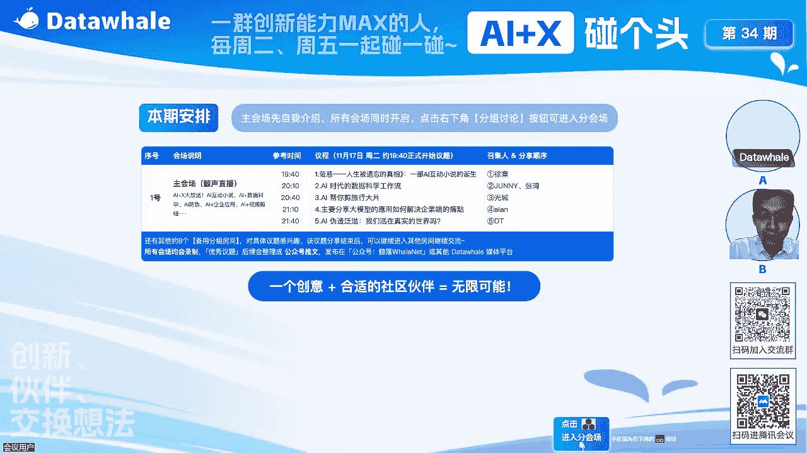
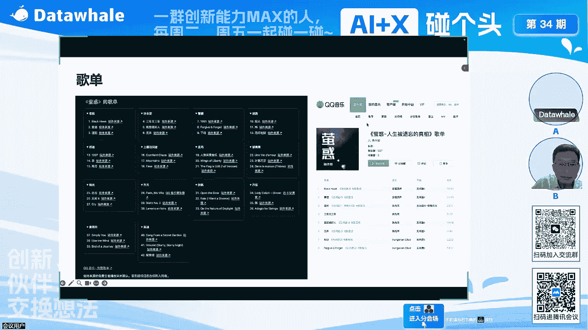
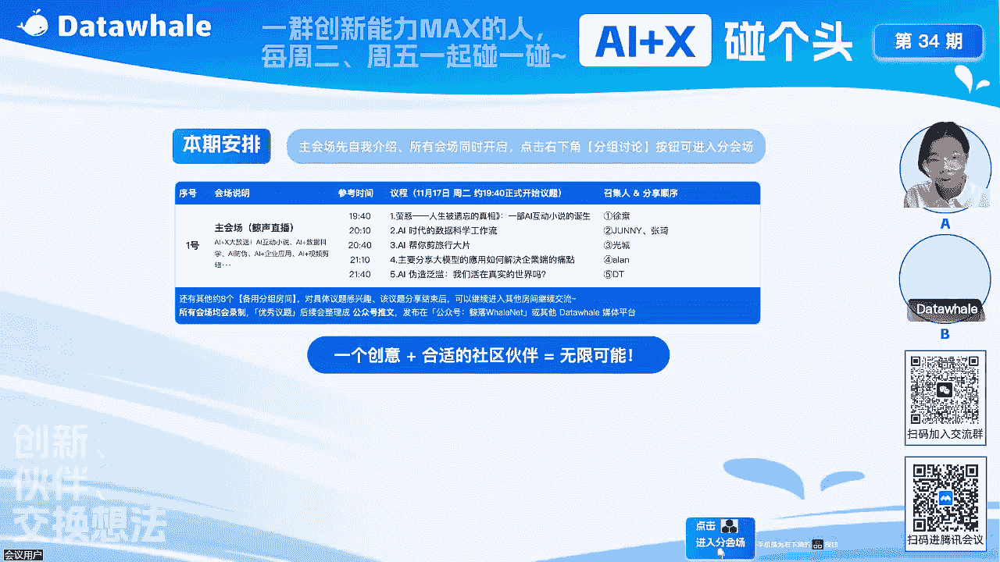
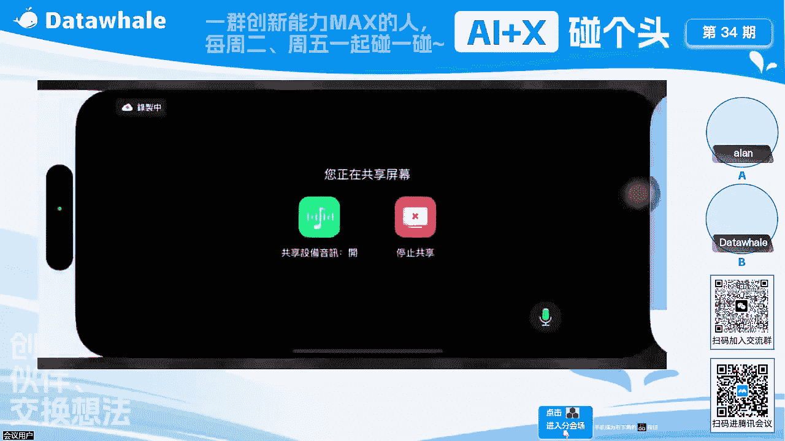
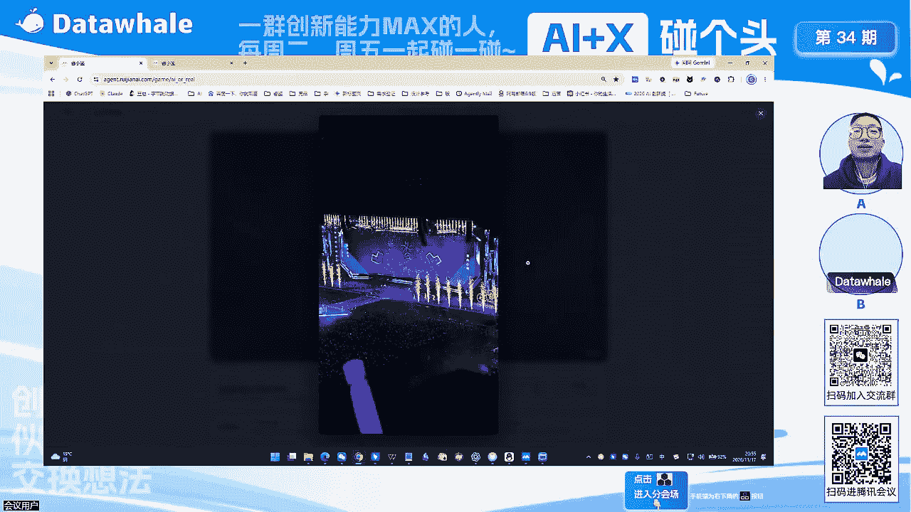
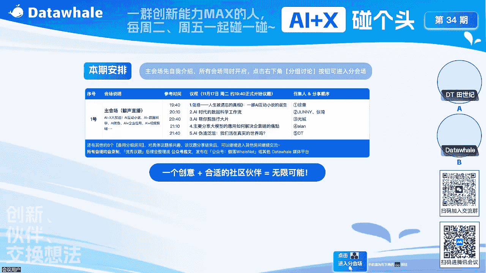

# Datawhale-AI+X碰个头：01：课程概述与嘉宾介绍📡

本节课中我们将学习Datawhale-AI+X碰个头第三十四期直播的核心内容。本次活动邀请了多位来自不同领域的嘉宾，他们分别围绕AI互动小说、K12人工智能教育、多模态伪造检测、数据科学工作流、AI视频剪辑、企业级智能体架构以及AI伪造带来的信任危机等主题进行了分享。通过本节课，你可以快速了解这些前沿方向的基本概念与实际应用场景。

本节课我们将认识以下嘉宾：

- 徐彤，北京邮电大学计算机学院长聘副教授，拥有二十多年IT和通信领域产品经验，近五年专注创新人才培养、AI通识教育和创新实践教育，创立北京燕讯科技有限公司。
- 张琪，跨学科研究者，目前从事应用数学和数据科学相关工作，创业方向为K12 3D生成平台，并与剑桥大学开展合作。
- DT田世纪，中科瑞建人员，主攻AI多模态检测，识别音频、视频、文本、图像是否为AI合成。
- 珍ny，神经科学背景，曾在加州理工脑科学研究院做访问学者，后学习计算机和应用数学，现在研究基础设施、模型架构与服务器架构设计。
- 关成，专注AI视频剪辑，与伙伴开源项目获得一万星标，分享如何通过AI复刻旅行视频。
- 艾en，公司算法工程师，负责企业端智能体架构、模型调优与本地化部署。

以上是本节课将要出场的主要分享者。上一节我们完成了课程概述与嘉宾介绍，本节我们来看看徐彤老师关于计算叙事学与AI互动小说的分享。

# Datawhale-AI+X碰个头：02：计算叙事学与AI互动小说的诞生📖

上一节我们介绍了课程嘉宾阵容，本节我们来看看徐彤老师如何将长篇小说改编为AI互动小说。


徐彤老师从工作方面介绍，是北京邮电大学计算机学院的长聘副教授，同时也是和学生一起创业，成立了北京燕讯科技有限公司。他的经历比较多元化，曾经有二十多年都在产业界和企业界工作，做创新创业工作。团队开发了两个To B产品，一个是中间号，每天调用量超过一亿次，用于滴滴打车、美团外卖等场景，保护用户与司机或外卖员双方的隐私。另一个是给运营商做的42电话防护业务，是公益服务，用户数超过十亿，获得过一些奖励。近五年他把精力投入到大学通识教育和创新教育方面，带了很多本科生，指导创新团队开发了四个智慧教育平台，包括马上出发等，这些平台在全国五百多所院校的近十万名师生中得到广泛应用。此外，在北京邮电成立了马上出发创新社，目前社区超过四千人。




生活方面，徐彤老师是一个文艺中年。从小喜欢文学和写作，每年读书并写书评，放在豆瓣主页上。从大学开始做小说创作，到现在写得很慢，写了三部小说，发布在豆瓣阅读和微信读书上。他投入最多的是第三部《赢获人生》，从2015年开始构思，2020年开始正式写作，一直到2023年完成，投入了一亿起稿，经过了第十版。小说本身十二万多字，写作笔记有十万多字。这部小说先发表在豆瓣阅读，今年发表在微信读书。

小说的叙事学特点。徐彤老师看了大量文学作品和叙事学著作，对叙事学非常感兴趣。叙事学是指采用什么样的手段把故事讲给读者，让读者产生共鸣，这是一种形式方式，但其中有很多门道和意思。在这部小说里，他践行了一个叙事学实验，采用了一种叫双重罗生门加对抗原叙事的叙事策略。双重罗生门可以用如下公式表示：

```
双重罗生门 = 调查者身份矛盾 ∧ 被调查者陈述矛盾
```

罗生门是黑泽明的著名电影，改编自芥川龙之界的短篇小说《竹林中》。简单来说，不同的人看一件事情，有不同的观点，而且是相互矛盾的，可能是出于视野偏狭，也可能是出于主观意愿。因此每个人说同样的事情，结果都不一样。罗生门作品非常多，后来大量作品向其致敬。这部小说的创新是采用双重罗生门。小说分上篇和下篇。上篇里有一个自称“我”的人，从头到尾都没有说自己是谁，他说了很多个身份，他在调查几十年前的一起非常残酷的血案。这里面有两个罗生门，他调查了很多人，但每个人说这个案件的真相都不一样。为什么叫双重罗生门？就是他在调查过程中，这些被调查的人也在问他你是谁，你为什么要调查这个案件，而他每次说出来的身份和动机都不一样，从而形成了一个双重罗生门。下篇也是这样，下篇的主人公叫明月，是一个毕业的研究生，讲他在职场上的故事。他也试图去发现几十年前的一个案件的真相，呈现了多重罗生门的效果。同时不停说明月自己的身世和情感经历，他是一个孤儿，是个弃婴。他每次也有不同的解释，也形成了一个双重罗生门。因此上下篇各形成一个双重罗生门。

对抗原叙事。上篇和下篇感觉是两个独立的故事，一个发生在新疆，一个发生在北京。但在上篇，他会声称下篇是这个调查者的一个幻想，而下篇最后一章，声称上篇是根据主人公的采访记录而创作的小说。其实谁也没有办法证明对方是假的。但是里面有很多线索，需要读者自己去发现一个属于自己的真相。这个小说最大的特色就是不像传统小说有一个唯一的真相。传统悬疑小说写到最后，大家读到最后一页，真相就会大白水落石出。但这部小说没有一个确定的真相，连作者自己都不知道真相，所以说真相有无数种，看读者喜欢哪一个。因为真相的选择涉及到读者的价值观和他的情感取向。这也是他的一个实验。宣传语是所见皆为潜在自我，所见皆为自弃谎言。

AI互动小说的诞生。这部小说写了十版，投入了很多精力。在创作过程中没有AI，或者说那时候的AI还不是现在生成式AI。但是后来AI诞生了，2022年10月30日，ChatGPT诞生。这是一个巨大的事件，点燃了所有人的激情。徐彤老师也是创业者，也是大学老师，也是理工男，对这个非常感兴趣，日夜不停地反复尝试和使用。他感觉这是人类历史上最伟大的技术之一，前无古人后无来者的一种革命性技术。这几年他从事AI创新创业教育和AI人才培养和通识教育，过程中也在想有没有可能将爱好和专业、工作结合起来。后来想到的方式，就是能不能将长篇小说改编成一种全新的由AI助力的媒体。

传统小说是线性阅读，从头读到尾，而且有唯一的真相，就是作者告诉你的那个唯一真相。他希望把小说写成一种更加类似于游戏的多元化、复调的多维度的一种小说。同时因为有了大模型的支持，可以让小说中的人物活过来。在AI互动小说里，不选择传统的线性从前往后阅读，可以像游戏探秘一样，在一个复杂的地图里面去找到属于自己的路线。每个路线都是对的，可以抄近路，可以去绕远，也可以去调查。上篇有五个人的访谈，加最后一个中章，下篇是五个人物的传记，加一个中章。这几个顺序是可以打乱的。而且每次访谈里面，有很多的话题，不一定是从前往后的，也可以根据兴趣去进行访谈。而且可以自由提问。交互路线可以用如下公式表示：

```
交互路线 = f(章节选择, 兴趣方向, 时间顺序, 地点维度)
```

主界面与路线选择。主界面是推荐的互动阅读界面，可以选择从任何一个章节切入进去。当然可能有一个必须先从老板开始进，然后后面慢慢会解锁，解锁后才能跳进去。当然可以先看上片或者先看下片。先看一下路线的选择。比如点到老板里边的章节，是配图的。小说里所有的文字切成了大量一点点的片段，都是碎片化的片段。每一个片段会配当时的场景图，所有的图都是由大模型生成的。让大模型读懂小说以后，根据当时的场景去生成图，效果还是非常好的，虽然也是抽卡，但是抽卡的准确率非常高。大家注意到，文字读完一段以后，可以选择下一个出口，有三个出口，不是传统的一个出口。比如讲了很多年前的一个女孩子，在新疆支教的经历，后来不幸身亡，据传说有一个自己的孩子。这个时候可以去关注孩子是不是真的存在，或者先关注孩子父亲是谁，或者关注这些留言的来源。可以不必顺着问题，可以根据自己的兴趣去点击进入下一个环节。

角色对话。同时，读完以后，再往下滚动的时候，可以跟里边的角色进行对话。比如老板的章节里边，可以跟老板对话。问他是不是有点大胆的主义，他会回答非常符合身份，而且紧扣上下文。测试了很多轮，基本上答的非常好，没有去突破基本的设定，但是他有很多细节，是有自己的创新，也无伤大雅。在这个过程中，相当于可以跟小说里的人物和NPC进行自由的交流和对话，从而实现更加灵活的小说阅读。还为读者推荐了几个可行的问题，对话可以持续进行下去，想对话多久都可以。

全景地图。还提供了一个全景地图，可以看到上篇和下篇，其实有很多章节，有点像游戏里面的地图。有些地图是已经打开了，有些是处在迷雾之中，只有读到那部分才能够发现真相。因此可以看到，不必说把老板全读完了才能进入下一章，可以跳着读，进入第三章，或者是怎么样。同时也可以进入下章去读。如果选择了任何一个章节，会进入一个章节地图。章节地图里面不同于传统小说的一个线性的一个事件关系，前面几个还是线性，但到这里就开始分岔了。可以去打听不同的话题，然后进入一个不同的时间线和一个故事线。其他话题可以不关心，或者可以再回来头来再去再去问。这个题图其实很大，只是展示的一小部分。而且任何一个地方都可以关联到这一段落，可以选择从这里面去继续往下走，或者说回退回去，就像在地图里面漫游，可以深度优先或者广度优先，或者先钻进去再说，或者反悔并开新路线都是可以的。

多维阅读。刚才说的是互动阅读，这是第一个版本。后来在上一周的时候又做了很多新功能，一个很强的功能就是多维阅读。多维阅读的意思是说，除了刚才那种交互式阅读以外，可以从另外的维度去读。这里主要提出了六种维度：第一个是人物关系，第二个是重大事件，第三个是悬疑点，第四个是故事时间，第五个是故事地图，最后一个是思想主题。

以下是六种维度的具体说明：

- 人物关系：在小说创作时画了一张人物关系图，把这个图变成了AI互动的模式。可以点击任何一个圆圈，这里面都是一个主要人物，就会出现与这个人物相关的所有段落。比如只关心某个人物，点击以后，小说之中会把跟这个人相关的所有段落全罗列出来。如果关心的是某两个人之间的关系，点击他们之间的线，也会显示出所有有关这两个人之间的故事的链接。这样就提高了效率，不想关注主人公以外的人，就可以直接切入相关段落。
- 重大事件：可以直接去选择故事里面的一些重大事件。这里列出了八个，下拉单里面还有更多个，比如某人山中归来，包括某人的怀孕争议，还有婚前的晚餐证词等等。点进去以后，这里面会出现大量段落，可以去浏览。
- 悬念疑点：这里面有很多悬念。小说里埋了大量悬念，没有标准答案，每个人都可以有自己的看法。包括列出的八个，还有剩余的，这其实就给我们自己独立去理解小说，给出一个属于自己的真相，给出了很大的故事空间。没有唯一真相。可以选择任何一个悬念，然后找出所有相关的只言片语，然后去进行专题的垂直调研。
- 故事时间：有的人想从前往后按照时间顺序去读。可以在这里去按照年代时间顺序去分，把这个故事重新按照时间顺序去整理。因为访谈式的，在访谈一个人的时候，他说的话其实是意识流的，一会儿说二十年前，一会儿说现在，一会儿说未来。这个时候，会把这些所有的事情按照严格的时间顺序去整理。
- 故事地图：可以按照故事里面发生的各种地点去进行整理，这也很容易理解。
- 思想主题：里面涉及到很多思想，比如说记忆和证词，爱、占有与牺牲，欲望与利益，付出与宽恕，权利与暴力，亲情与替代身份与自我，命运与选择等等。可以去选择一个主题去阅读相关的段落。

高级检索。此外，还在多维阅读最下面加了一个高级检索。如果想实现多个维度的组合，那在这里就可以去选择。比如说可以加入好几个人物的关系，人物以及年代，还可以加地点，还可以加主题，然后综合去搜索，进一步地把搜索范围缩紧。

百科阅读。第三个入口是百科阅读。灵感来源于维基百科。维基百科里面，它会给任何知识去做词条，而且每个词条之间会有联系，而且会有大量的超链接去链接跳转。去读百科的时候，也是一种阅读，这种阅读是更加自由的，可以随时点击里面的一个超链接进入那个词条。这里提前给所有的故事里面的人物和重要的事件去做了维基百科的链接。比如说点击了某个人物，就会进入它的词条，这里有它的标准定妆图，还有它的歌单。这个歌单是在创作这个人物的时候反复听的音乐，因为听这个音乐，就会想起这个人物，这个人物会在脑海中慢慢火起来。还会有所有它关联的原文，包括有他的一个故事简介等等。大家对百科已经很清楚，所以就不再赘述。

知识图谱。但是其实不光做了百科，因为知识的组织有多种形式，有百科，还做了知识图谱。知识图谱其实跟百科有密切的关系，但是百科更侧重于超链接的形式，可视化知识图谱更强调的是实体和关系。昨天晚上，还进一步开发了RAG，就是去做inbedding，去做语义搜索。把他们做了一个整体的inembedding，然后去实现检索增强生成，这个也是刚刚完成。

原著阅读。再一个最后一个维度就是传统维度了，就是原著阅读。这里展示的是在微信读书上的一个原著，点击的话跳转过去。主要是这个已经根据微信读书做了商业签约，没有权利放出原文，所以要读原文的话，得去微信读书。

重建真相。这里还有一个很有意思的点，就是重建真相。允许读者在读完了这个互动小说以后，去发现一个属于自己的唯一的真相。读完以后，也许读了一半，这个时候就可以去点击重建真相，去开始回答一系列重要的题目，这里面有核心问题和更多延伸的问题，可以去做选择。因为每一个悬念都会有不同的理解，这里每个读者都会有不同理解，出于自己的价值观或者自己的认知。每个人读完了以后，大家可以看到九个核心问题和大量的延伸问题，它是一个巨大的空间。最后选完了以后，就会生成一个属于这个人的独立的故事的真相。每个人的真相可能都不一样。而且可以生成分享长图，让他去发到朋友圈。

调查手机和路线。还有一个就是调查手机和路线。因为每个人在这个故事地图里面漫游的路线都不一样，这个路线都可以导出，也可以导入别人的路线去重温。同时，在漫游这个故事世界的时候，有一个调查手机，可以随时去做记录，一键记录去记一些要点，也可以去标注。

歌单。此外，还附上了歌单。这是因为创作的时候听了大量的音乐，为每个人物都选择了相应的歌曲。这在创作的时候是让他们的形象能够跃然纸上形成一种通感。主要是来自于一些B站，包括这个互联网上的公开资源都是可以听到的，是免费的。然后在QQ音乐上建立了一个官方歌单，大家可以去听。

插图。这里是小说的插图，插图大概有两百多个，几乎每一个片段都有一个对应的插图。觉得做的还是挺好的。上篇主要是一个新疆的年代感很强的，比较暖色调的，然后比较旧的这样的一个风格。觉得做的还是很好的，包括他的每个人物的形象，其实做了限定。比如说某个人物，是一半的佟丽娅，一半的这个樱桃，大家可以看到。大家可以看里边有一个人物，某个人物里面有四分之一是照片，还有四分之三是某演员的照片，这边做了一些合成，每个人都有一个原型，但是不是演员的原型是几个演员的原型。某个季节是一个冷白的冷色调的一个现代北京都市，北京广州这样的现代都市的色调，非常现代。觉得抽卡的效果还是不错的。



开发感受。最后用一点时间来说一下开发感受，这是开发的路线图。从10月6号开始做这件事，一开始是用ChatGPT，20美元一个月，经常卡五小时的额度，经常是五小时的额度，用了十五分钟就五小时额度用光了。然后就没有办法，就得设个闹钟，所以进度其实很慢，大家可以看到就是断断续续的被五小时所隔断，其实工作时间没多长，就是这个你说个提示词可能就几分钟，然后它运行个十几分钟，然后就用光了，等下一个五小时，这个非常卡。后来到了10月11号，到了第37版的时候，基本上把那个互动小说做完了。但是后来就想去做更多的维度，百科、阅读、人物这些。然后到了10月11号的时候，把Plus升级为Pro了，一个月100美元，然后发现没有五小时的额度限制了。而且总的额度涨了十倍，基本上就不会再有额度焦虑了。这个时候就可以放心大胆地去让它布置任务，然后它就持续地去做。这是第二个飞跃，大家可以看到它迅速的增长。第三个飞跃，就是刚过的这个周末，发现了ChatGPT刚发布的一个新功能叫Dot。它其实是一个类似Gbo那种独立的线上的一个智能体，二十四小时在线的智能体，它有自己的一台电脑。给他委任了一个身份，让他去做产品经理加项目经理，让他去指导那些项目和Codex去工作。只要给他去交代需求，然后他就去整页地执行。这个时候投入的时间少了，跟他头脑风暴，然后交代，然后他去做执行，这时候效率极大的提升。这是升级之前，就是经常卡五个小时，而且额度严重不够。而升级之后，觉得非常的自由，而且效率大大提升。

产品生命周期与AI协作。想说的是，这里实际上是一个产品的完整的周期，不断的迭代，需求方案实施验收测试、验收部署，然后持续的改进不断的迭代不断的迭代。其实每个版本都可以认为是一个迭代，因为每次都要去做一个回归测试。想说的是，很多人说外部Coding这么强大，是不是每个人不用去上大学了，不用去学专业知识了。但是深深感觉到AI虽然强大，但是你也必须很强。也就是说，我们的能力，其实是跟AI要匹配的。也就是说越强的人，越能激发出AI强大的能力。因为AI有时候会偷懒。这两天还经常发现，就是这个，哪怕是Dot，据称是用的很高级的模型，但是他经常偷懒，经常是说了后面的话，他把前面的忘了，或者说给他交代的事情，他就忽略了，或者说他没有去贯彻一个一贯要求的原则。其实今天晚上一个小时前，还对他进行了一个批评，对他进行了强烈的指责，然后要求他反省，然后让他去制定一个详细的规则，严格实施，要求按照非常世界顶级的产品经理和项目经理来严格要求自己，要有过程的文档，然后有严格的执行的目录，然后要去说到做到，不能去敷衍。因为之前也发生了一些意外的情况，就发现他没有执行这些原则。所以认为就是，如果对产品开发一窍不通，那么大模型可能会糊弄你，可能会给你一个光鲜亮丽的外表，但是很多内容其实已经被掏空了。但是如果能够很专业地指出他的问题，他会立刻改正，因为他非常聪明。但是你要有能力去读懂他的作品，同时能够去跟他进行一个平等的对话，然后指挥他。

这就是今天的分享。最后欢迎大家去访问网站。这个网站目前是建在ChatGPT的set上面。当然由于众所周知原因，目前国内不能直接访问，但是如果你能访问国外网站，这就能看到。这是免费的，大家可以去尝试。而且这个版本还在持续的迭代。希望能够版本相对比较稳定的时候，会把它发布到国内的网站上，让大家都能自由地访问。现在因为还在高速的迭代。另外，这是前两天刚开的一个微信公众号，会把以自己开发的一个经历的文章，先发了第一篇公众号，昨天刚发的，也欢迎大家关注。同时，在这个公众号里面还会持续会发一些有关AI教育，包括创新，包括文学叙事学、计算叙事学方面的一些原创作品，也欢迎大家关注。

本节我们介绍了计算叙事学与AI互动小说的创作与技术实现。上一节我们完成了课程概述，本节我们深入了解了AI互动小说的诞生过程。下一节我们将学习张琪老师关于K12 AI通识教育与3D生成平台的分享。

# Datawhale-AI+X碰个头：03：K12 AI通识教育与3D生成平台🎓

上一节我们介绍了计算叙事学与AI互动小说，本节我们来看看张琪老师关于K12 AI教育与3D生成平台的分享。

张琪老师自我介绍，是跨学科研究者，目前从事应用数学和数据科学相关工作，创业方向为K12 3D生成平台，并与剑桥大学开展合作。他现在在做一些儿童的东西，相当于做一个平台，然后做一些3D生成。目前和剑桥的本部，就是他们大学，还有剑桥的教育，他们一些品牌也有合作。也拿了亚马逊云的一些服务资助。主要是在做K12方面的一些3D方面的产品。因为觉得K12会比较符合小孩，会他们的AI，就是最有创造力的时候。所以鼓励一下他们去做这些project，提供这么样平台以及API的一些资源。刚好也跟剑桥有合作。最近在想在K12方面做AI的通识教育，包括去让学生去孩子去做智能体。这方面跟剑桥大学的DFI教育系那边，未来数字未来学习中心那边有合作。12月初要去一趟海淀，可以见面交流。现在在跟剑桥这边联合去做一个K12的孩子的AI能力的认证。希望能够由剑桥那边去出这个认证体系，这边用产品去落实它。觉得这块还是挺有潜力的。剑桥的不管是英文教育还是其他的，一直在全球范围内是比较领先的。包括也有很多的学校在利用他们的一些教育体系。很希望通过他的这个网络来去扩散产品以及资源。

本节我们介绍了K12 AI通识教育与3D生成平台的合作模式与认证体系。上一节我们了解了AI互动小说，本节我们看到了AI在K12教育中的落地。下一节我们将学习DT老师关于AI多模态伪造检测的技术与产品。




# Datawhale-AI+X碰个头：04：AI多模态伪造检测技术与产品🛡️

上一节我们介绍了K12 AI教育平台，本节我们来看看DT田世纪老师关于AI多模态伪造检测的分享。

DT田世纪来自中科瑞建，主要是做AI的多模态检测，建尾一块就是音式图文，音频视频文本图像，它是不是AI合成的。最简单的就是小红书抖音下面这个标识。这标识以内的这种都是有检测，来检测它是不是AI的，然后再打标。主要是做这一块的，然后应用场景比较广一点。待会就会展开来讲解一下。

市场需求方面，高校里边这个需求非常大。老师被AI作弊已经搞得快疯狂了。基本上快放弃了，因为觉得没有办法。因为学生总会找到破解的方式。所以这块是一个非常有潜力的空间。目前在论文领域，也是做了特别多的一些举措。包括论文查AI查虫。审稿的时候拿到一篇，让AI查看一下，问一问他，这里面有没有什么隐藏的提示词。该会搞什么提时注入的，要侦查到了。大概就是说在审稿的时候一定要给他加入某几个关键字。如果真的没注意看，AI就会生成这几个关键字要被抓到用AI审稿的。当时看了一眼没有。确实会有这样的情况出现。

从技术路线上面来说，差不太多。目前其实按京度的话，目前也算是头步了。跟竞标一般投标的话，一般都是跟腾讯PK。非常厉害。这个可能在教育领域应用的前景会很广。论文查AI。对，现在也在跟很多的高校合作。因为有很多高校有这样的论文体系。因为本身其实也主要是做B端，然后公检司法，现在公安这些场景用的比较多的。然后教育是下一个最近一年的一个重点方向。

产品方面，中科瑞建是中科院孵化的一个高新技术企业，主要是做数字内容合成建委。成立比较早，现在也主要是主攻这个方向，也拿过一些奖励，也拥有一些专利。重点是现在做的事情已经很可和的可能官方都在合作，包括国家反诈中心的APP里面也有一个AI内容的建委，就是做的。还有学习强国，以及杭州本地的警察叔叔，其实都是都在合作。目的就是为了为全社会提供更多的安全的服务。大家都知道的，刷抖音和小红书下面的有个AI标识，就是检测一下是不是AI的。虽然大家都会吐槽说经常会被判错，但是因为他们模型精度低。但是事实上，这是有一个国家标准的，国家标准，也是核心的一个起材单位，叫GB45438，2025的强制国标。也和很多公检司法安的单位合作，以及一些世界五百强，像华为、荣耀等一系列，还有一些银行等都跟他们一起来合作，把这个事情做的更好。

当前存在的问题。肉眼很难判断，可能需要专业的检测。操作门槛高，很多专产品和工具，做了很多个窗口，甚至有很多个界面，甚至跟不同的产景，也分不同的模型，然后分不同的产品。比如可能在反诈领域是一个产品，然后在平时的会，创作者可能创造一个AI照片或者AI文本，它又是一个工具。导致操作门槛很高。目前各家的产品包括海内外，都去调研过。很少有产品把解释性做的特别好，很难告诉你哪儿有问题，问题出在哪，很难去给你做可视化。素材风散导致上传的成本特别高，以及可能需要批量检测，不过对于普通人来说很难触及到，可能只是一些企业用于使用。

新产品推出了一款智能体，叫小电多模态AI检测智能体。这个智能体可以统一的一个入口，支持音视图文四种模态，图片、文本、视频、音频都可以来检测，并且能够检测图片领域还能够检测AI生成的以及PS区分PS生成的。并且还能够支持快速的一个检测和多维的一个解释性的分析，然后并且进行多轮的中文和联网的搜索，同时能够支持批量的检测。自己是自研的大模型，模型参数量大概已经超过百亿了。准确率基本上建为真的能够达到95%以上。在细分领域可能稍微会有一些波动，误报率小于1%。能够识别出800多种的伪造方法。覆盖的模型版本可能有100多种。

检测准确率可以用如下公式表示：

```
检测准确率 = (真正样本数 + 真负样本数) / (真正样本数 + 真负样本数 + 假正样本数 + 假负样本数)
```

案例方面。第一个是交友场景。有些用户会把真实的跟自己晚年对象，甚至一些没有见过面的人的头像，甚至音频，传过来检测是不是AI生成，或者是AI生成的美女图像或者是AI生成的一些虚假的语音。很多用户特别愿意来付费。第二个是新闻验证领域。包括现在有很多的新闻，可能直接打到AI的照片，然后直接冒充了一些新闻事件导致的舆情压力。而这些假的照片其实更多的是AI生成的，因为它的成本特别低，门槛也很低。第三个是电商领域。电商退换货的场景里面。有一个厂商，用户买了之后，专门故意用AI图把人把陶瓷劈碎，然后去恶意退款。这种场景其实特别多。甚至于在一些生鲜领域，比如说榴莲，批了一个榴莲，然后腐烂了，然后专门过来做检测，专门来骗取收益。第四个是电信诈骗领域。可以利用深度合成的换脸，包括现在很多的AI换机，包括换脸的技术也很成熟了。换脸之后，这个领域可能更多的是金融领域，金融KYC的领域做的特别多，要求的更加严格。第五个是学术领域和教育领域。教育领域主要就是AI论文查处，查论文的AI率，包括一些作业的AI。有专门的产品叫做瑞幸，专门来做AI诚信AI的一个论文的学术平台。第六个是创作者领域。包括一些二次元的圈子，需求量特别大，甚至于专门愿意说为检测照片来付出一些价格。第七个是自媒体行业。很多人明明拍了一张照片，但是被误解成为AI，甚至于自媒体平台给你打的标识说你这可能是AI生成的。甚至于误以为你是AI生成的。然后很多人想要去证明自己不是AI生成的。这些场景覆盖特别广。

此外，身份证件材料。包括很多公检司法案，甚至于一些证件领域，大家可能经常要进行，比如说自己身份证拍照或者是护照，还有学生照。甚至于一些报销的领域，可能要去拿一个报销凭证，凭证上面就会有数字，他可能有些人就故意把这个数字批多，甚至于把伪造自己的身份证这一系列的这种材料，大家可能在审核领域会越来越多。并且大家的重视程度也会越来越高。

本节我们介绍了AI多模态伪造检测的技术原理、产品功能与行业案例。上一节我们了解了K12 AI教育，本节我们学习了如何检测AI生成内容。下一节我们将继续学习DT老师关于AI伪造泛滥与信任危机的宏观分析。

# Datawhale-AI+X碰个头：05：AI时代的数据科学工作流📊

上一节我们介绍了AI多模态伪造检测，本节我们来看看珍ny老师关于AI时代数据科学工作流的分享。

珍ny自我介绍，一开始是学神经科学的。然后在Caltech在加州理工的脑科学研究院里面做访问学者，后来又去做了计算机和应用数学，在清华那边，然后现在出来在做一些基础设施的相关研究。比如说模型的架构以及服务器架构的设计。也在外面创业。

AI时代最大的改变，从人和人之间信息的共享逐步到了一种去做研究，做一些coding的任务，你需要去和AI解释你如何去做你该怎么样。比如说你去给他设定一个身份，说你是一个首席的科学家，或者说你是一个非常厉害的产品经理，以及一些角色带入。在反工以及反复的沉淀过程当中，它的整个过程更偏向于AI去帮你做一些脏活累活，或者是一些重复的工作。你负责去验收，以做一些逻辑上的判断能力，在反复的重复这一个流程。

手工串联有四个比较大的问题。第一，和同事、协作者做活动或项目，需要开很多会去对齐整个会议，以及整个项目的一些工程，以及自己大体的方向。第二，还需要涉及到一些很大的信息交接，以及知识的综合能力。第三，当数据足够多的时候，它又成为了一个数据科学的问题。你需要建立一些文档，建立一些表格，或者说一些其他格式的一些文件什么的，然后再丢给同事，让他自己慢慢的尝试和你同步思维。第四，协作方法主要看输入输出，以及对AI或者说对整体的验收标准，他的一些要求就是要对AI是一个比较强约束力的，然后比较强支撑的。

协作方法可以总结如下：

- 输入输出导向：明确对AI的输入要求和输出验收标准，建立强约束与支撑机制。
- 任务示例：做报表时，需要告诉AI要什么、什么时候，以及需要具备判断数据真伪的能力。
- 费曼学习法：把自己的知识告诉给其他人，如果其他人能听懂，那么文章或叙述逻辑就成立，可以继续复用。

失败模式包括：让AI随便看看，把AI生成的图当结论，挑选异常情况，错误的测试直接建模。这些都会产生问题。

整体协作实现。最常用的，尤其是公众对于用coding，或者参与一些研究工作。需要让AI去生成一些代码草稿，然后输入一些服务后端的数据，链接什么的。然后再测试。在AI时代更多的是人要去做验收，要拥有架构师思维。虽然这个词很大很空虚，但是也没有办法。或者说现在还没有总结出比较好的经验去语言化这个词，也是一点点摸索出来的。

复制其实还比较简单。比如说让模型去做一些验收，或者生成一些test去做冒烟测试。这就是以项目以情况而论。更多的就是AI适合去做一些摘要代码以及解析，就是它更适合干一些广度比较大，然后比较繁杂的一些工作。但是它的输出只能作为一个候选，工作更多的从需要去写，变成了要去定义问题。不希望上级定义一个非常大的框架，说今天去把数据科学的论文挑一篇顶刊读了，读哪一篇，哪一家机构，哪个细分领域。在模型的写作里面也会遇到这种问题。

在一些高保真或者说高数据要求的情况以及项目里面，需要对AI生成的一些输出内容，然后做等级的区分以及一些保存。这是一个非常占用内存的设想。留痕很重要，因为AI生成的东西，大部分情况下是没有用的。在研究生活当中，更多是98%都没有用。每天的工作从20%提升至80%。因为要去处理AI生成这些无用代码，以及判定它有没有用。

AI最重要的是它不能作为责任的主体。它只是一个协作的工具。没有办法说会AI，然后就知识很渊博。不可否认一些学识很高的人也会用它。重要的是需要拥有基础的知识面。不是鼓励大家自己会用AI搜索，或者说会用一些模型，然后会AI赋能，就是怎么怎么样的人。因国并不是一个很强关联的事情。

沉淀是最重要的。前面徐老师也讲了，说什么沉淀。ALGPT老师听不懂说什么，上下文字丢失，就可以做一些提质词的模板告诉，这个角色还是怎么样。故事可以把它打包成一个skill，然后直接放进去。像自己就是很多个project，拆分下来，然后一个一个模块化，然后需要有一些规则库。比如说人和机器的一些协作，机器在这个project里面主要负责什么，他需要做什么样的事情，他需要什么样的权限去做什么，他做什么时候做什么，做什么test的时候，需要去授权或怎么样，然后就是保存一些实验记录，版本以及原始输出什么的。

搭建系统的一个小雏形。搭建整个协作系统的时候，没有花90天那么长，大概花了两三周。不过也算是很认真的每天高强度工作。觉得这是对大家帮助会比较大的。

本节我们介绍了AI时代数据科学工作流的构建方法与协作模式。上一节我们学习了AI多模态伪造检测，本节我们看到了如何与AI协作完成数据科学任务。下一节我们将学习关成老师关于AI视频剪辑与旅行大片制作的分享。

# Datawhale-AI+X碰个头：06：AI视频剪辑与旅行大片制作🎬


上一节我们介绍了AI时代的数据科学工作流，本节我们来看看关成老师关于AI视频剪辑与旅行大片制作的分享。


关成老师分享的主要主题是AI教大家去剪辑一个旅行大片，就是怎么去剪辑自己的视频。比如说要抄袭别人的视频，怎么去抄。主要是做这么一件事，今天分享的一个主题。今天讲的内容，其实也是一个完整的一个流程，会教大家怎么去剪以及一个效果是什么样子的。

基本情况。现在主要是做AI剪辑这一块东西。目前和小伙伴一起做这个开源项目。今天正好是破一万的一个星标。感兴趣的朋友可以用一下。一会也会去用这个项目去演示一下，现在是做了一些成果给大家分享一下。正文开始，首先看一万。

素材准备。之前比较喜欢徒步户外爬山，手上有一堆自己旅拍的一些视频。之前拍爬了一座山叫四姑娘山到长平沟有一个垭口，要海拔至4700多米，然后需要把需要拍崖口，拍到很多素材，然后就想是把那些素材做一个视频。然后看到了B站上面的一个视频。然后就想把它抄过来。先给大家看一下效果，就是原来人家参考的一个视频是什么样子的，然后最后给大家看一下，要做成什么样子。这是人家原来的视频，先给大家播放一下。这是他的一个原片的一个效果。然后给大家过一下，就是本地做出来的效果是什么样。可以看到它无论是从声音角度，还是从它的画面角度，其实基本上模仿度还是相当高的。今天的主题就是根据原来人家有的视频，然后自己去找，并且把它抄袭过来，应用到自己的素材上。

工具准备。其实只需要做这几步操作。很简单，首先其实就要这三个工具。第一个工具就是Whisper，大家应该也都比较熟悉。如果说没有Whisper也可以用Z code，或者说是Clo code，效果好的话，根据模型来区分。就比如说是Clo这种模型，那么效果会是最好的，A的能力越强，最后得到的效果是最好的。第二个工具是RE video，RE video是干啥的，其实简单可以过一下，就是它可以帮助拆解原来的参考视频是什么样子的。就比如说刚才做一个拆解。它能够给你把里面的一些画面给你拆出来，然后每一帧包括里面想要模仿它的声音，它的声音镜头，这些都给你捞出来，一会会具体讲到这一块的东西。第3块工作，其实就是剪辑工具。这个东西现在是要付费的。如果不想付费，可以接入像PR，这里一个工具叫做PR，或者其他的剪辑软件，就可以做到这个效果。其实无非就是整个核心的原理就是把素材喂给大模型，然后让大模型根据本地的一些工具，然后做相关的剪辑。视频不属于那种去做纹身图或者是纹声视频的。没有一个生成的操作。所以从消耗token角度来说是非常可控的。然后也比较快速的去做出一个视频。因为素材也是自己实拍的，所以整体体验下来额度开销是非常低的。其实就只需要开销1个TTS的转换，就把原来参考视频的音频转换成现在视频里面的文案就可以了。这其实是过程当中的一些工具。大家下来也可以去用这里的工具，包括每个工具。刚才也跟大家说了，比如Whisper，还有有一些别的替换，然后剪辑工具也有一些别的替换。RE video的话，其实网上也有，大家也可以找。

提示词喂入。进入到ChatGPT这里，怎么给他喂提示词的以及他每一步怎么做出这个视频。估计大家对这个比较感兴趣。把每一步给大家拆解一下，一个属于比较实战的一个讲解。首先第一步，其实给大模型提示词，就是告诉他下载，然后并且把所有的素材，刚才目录的素材全部喂给他。与此同时，告诉他一些剪辑的需求。就比如说剪辑，可以用剪映或者是用那个素材里面有很多示范哑口的，那对哑口这块是怎么处理的，应该航拍是放在前面放在后面，然后剪辑顺序是什么样子的。然后人生是怎么处理的。提示词里面喂好之后，第一个视频一般会要求他给生成的是一个没有人生的一个视频。这里可以看一下，就是这个视频是原生画质以及原声的素材的声音。它没有任何对应。这里的话其实文字做的也比较粗糙，所以这是一个非常demo版本的视频。

在这个过程当中，大模型会去自己去调IEV这个开源项目，就这个东西大家可以把它当下来。然后呢，就可以在这个上面让大模型自己给给参考，然后给你得到一个一堆的文案以及拆解报告。拆解报告的话，其实打开就是这个东西。就是它会生成一个报告。这是生成的。具体包含哪些东西：第一块，告诉你里面的视频有哪些是有哪些拍的，有哪些AI生成的，然后比例是什么样子。后面也会根据截图的每一帧的图片，然后去给图片赋予，就是自己比如说要替换某一个素材。那可以做参考。比如说只想替换这一帧的照片。那可以让AI替换掉这一帧照片。这些都是一些参考。第二块，核心的就是它可以帮助把素材里面的内容给挖掘的很深。就比如说每一秒或者包括某一个时间段内，他在讲什么内容。有了这个东西之后，后面生成的文案，文案去跟这个时间去对齐，非常好做，就不需要自己去对齐。就不知道大家有没有做过剪辑。就比如说正常一个剪辑的轨道，它是非常非常复杂的。就比如说一个传常B的轨道复杂，还有对应的上面是视频轨道，下面是字幕轨道，下面是视频轨道，最下面是音频轨道audio和video，然后这个字幕轨道。如果说自己去一个一个去添加字幕是非常复杂，包括要对准这个时间片段到底是哪一帧，做一个视频，以前用PR做的话，可能做一天或者说才能出产出一两个视频。现在有了AI之后，这一套文字跟视频轨道对齐，这些都不用做了。




如何做到很精准的对齐，其实很核心的，就是这个时间段跟这个文案，要替换的时候要非常精准。这就是这个项目的其中一个很核心的点。然后其中另外几个很核心的点，其实还有几个点。刚才提到，第一个视频它是没有那个音频的，没有声音。如何复刻到原来的原声。其实就是他原来这里有一些音效，就比如说它里面有很多搞笑的音效之类的，都可以拿过来。比如说户外启蒙户外启蒙启蒙，这些都可以下载当下来下载下来。然后就可以把这个东西喂给像TTS转换的一些工具，或者说是音频生成的，让它给你生成复刻完全一样的声音都是完全可以的。所以这也是后面做配音的前提。这个项目其实有很多地方是值得去学习的。

另外，大家做视频的时候不知道有没有考虑过，就是一个视频它到底做的好不好看，特别是旅行视频，人物表达是一方面，配文配音也是一方面。还有一个方案就是说视频的画面的衔接，包括转场，素材之间的构思是什么样子，这也很重要。如果说在这一块能够做的很好的话，视频它很容易去拿到一个高赞之类的效果。然后这里面的话，其实也有相关的一些转换，就是镜头的一些转换。比如说拍摄的一些机位，镜头，这里也给你补充出来的。当然现在做的有一块做的是很弱的，就是视频帧与帧之间做那种很复杂的片的那种动画，那种效果，其实是效果还没有达到特别好。后面可能会对这个项目做一些优化，然后把这一块效果可以提升上去。如果说这块能提升上去，后面所有的视频其实都可以让AI做。只要能够保证图够，就可以达到很好的效果了。

视频报告。刚才提到的就是AI给拆出来的一个视频报告，这是拆出来的拆解报告。与此同时，还会给一个报告，就是这个报告告诉了你的是无声视频里面的内容是什么样子。他其实拆解了参考视频什么样的，也拆解了，就是给你生成的视频是什么样子。然后这是原来的素材。比如说原来素材下面配的文字，这种都给拆解的每一帧的，给拆的非常好。后面比如说做要做每一帧的做微调，就是非常细节的。可以看到从第一个提示到最后这个成本的一个视频，其实就为了几句提示词，这是一个两个3个4个5个6个7个，只有7个提示词。而且中间提示词都是打断它，有几个提示都是一个复用的提示词。所以跟AI交互其实很简单，就是两个其实都可能就搞定了。第一个效果其实已经达到了大部分场景的一个预期的一个demo。然后其次的话下来其实就是去做一个人声，背景音乐，有一个配音。比如说有1个BGM就是在他原声里面能提取到，让他提取到，比如在第几秒提取到之后，让他去克隆一下。克隆完之后，去让授权。然后去看看有没有获得得到这个声音的权限，然后可以提交，然后最后就可以帮你把这个声音给克隆出来。克隆出来之后，这里其实就有出一条徒步路线让你看过雪山之。可以看到这里其实声音是配上去的。但是觉得这一次做的还不够好。比如说视频之间是没有衔接的，也是没有任何转场的。所以下一个其实就是让他做转场做遮照做这种特效。这里问他其实还是比较少的。如果为的更多，那最后的效果肯定视频效果会更好。这里只为了一个贴子就是遮照转场啊，那开场给做做炫酷一点，画面切换丝滑一点。这个时候可以看到开场和这个开场是不一样的。这看这两个开场有没有。这个开场是直接开的，这个开场是半屏来开。有没有一条图？然后看完之后看过雪山之后，还想走进雪山。这一次我们走长川璧。这里是有一个某国的转场的，然后这里其实是没有徒过路线。让你看过雪山之后，还想走接雪山。这一次我们走长川并。可以看到转场是没有做的，这里是做了转场的。这里就是加了一个短电话的一个效果。对。然后这些都是大模型自己去思考，要加什么特效。其实这个东西也是来自于AI去拆解出来的里面的一些特效去做参考。如果说对视频剪辑更加专业，是一个非常专业的剪辑，以前用过PR这种专业剪辑软件。那再跟做视频的时候，就做出炫酷的视频是非常非常好的。

其他案例。最后想给大家看一些已经做好的一些其他视频。给大家简单看一下。有一个UP主的视频。三个视频暂时没找到。先不看参考视频，就去直接看生意吧，应该能看到能知道是谁。不是这个。是这个。直接看吧。有些东西适合慢慢走。沿着江南的水边看树影，落进河里。看村子藏在一片绿意中。路过一座桥也可以停下来。把眼前的安静多留。可以看到这个整个视频，它无论是从配文字和这个画面来说，它其实都配的非常非常恰恰到好处。比如说文字，这就是江南的风景，对吧？适个慢慢走，然后他一看到这个画面其实是有一个慢角度的一个画面，然后包括这个村子，这个确实是个村子，然后这里是一个水，确实有一个桥，这里就是一个桥，然后这里有水。然后视野忽然打开，配文。包括光和水这种都是配的非常非常到位的。觉得做这的视频做的非常精准的。其实最后就是今天所讲的所有内容。其实也都在B站上也做了一个视频，就是如何把徒步素材剪成一个剪成一个电影。然后已经在B站上已经更新上去了，就是里面其实就是一个完整的视频教程。就今天讲的内容。然后这里面的话，其实做了一个中英文双语的一个电影版的视频。然后这个也是自己录了一个视频，然后剪辑的，也是通过AI来剪了。大家也可以看一下这个效果。




本节我们介绍了AI视频剪辑与旅行大片制作的实战流程。上一节我们学习了AI数据科学工作流，本节我们看到了如何用AI复刻旅行视频。下一节我们将学习艾en老师关于企业级智能体架构与模型调优的分享。

# Datawhale-AI+X碰个头：07：企业级智能体架构与模型调优🏗️

上一节我们介绍了AI视频剪辑与旅行大片制作，本节我们来看看艾en老师关于企业级智能体架构与模型调优的分享。

艾en老师自我介绍，现在主要是公司算法工程师。因为公司有一些治安机密的问题，所以主要都是加密模型。显卡是选择H系列，因为公司还没有那么有钱，所以还是选择用H系列的显卡。

智能体架构。从agent的一个架构，可以选择heagent的一个架构，或者是agentco，或者是super agent。目前DeepSeek最新推出来的一个agent架构。假如有朋友们，对这个super agent有额外的理解，欢迎讨论。因为目前也在研究这个super agent架构是不是真的可以来加快企业端的一个agent建立。

架构层级。从最上层讲到最底层，上层是用。下一层选择用SG浪，然后来去做一个推理的服务。使用marty agent的架构。所以可以提供很多的部门很多的测试，然后来去加入这个agent，然后一起来去做推理运算。可以让每个部门都做出自己的工作流，然后来串到本地端的这个模型，然后来去做一个运算。目前选择用千问的3-827B的模型。跟一个显卡的连接，选择用拓。一样当然就是用Ku达这个平台。因为目前就是为了让整个显卡去做一个最大效能的产出，所以选择用Ku达。假如有朋友对于如何破解显卡VRAM这方面有兴趣的话，之后也可以留在QA部分，可以多多交流。

模型调优。再来就是模型的调优。自己在研究GRPO跟DPO跟GSPO。GSPO是一个阿里来去优化模型的一个权重的一个方式。

企业端AI构建。公司在股票交易所上市。如何建一个自己企业端的AI，然后跟客户来讲，如何建客户所需要的AI。首先会有一个最快速的QA，就是要本地的助理，还是要多用户的产品，还是只是想在本地端去做一个长时间的一个输出。如果是要个人助理，那多半推荐某个方案。如果是要多产品多服务，然后多权限，自由度要很高，那可以推荐用A架构。或者是说今天要快速上线，只是要有一个东西来处理简单的工作流，那多半就直接用DeepSeek的模型就可以处理大部分一些很简单的工作流模型。很简单的工作流。

接口与推理层。再来就是A底下的一个接口跟一个推理的应用层，有SG浪VLLM跟faest。目前公司实测下来就是SG浪是最好用的，所以就没有去选择VLLM跟faest，然后来去做建构。

决策模型。第三页，因为在去做agent架构的时候，往往都是人还要再进去去看它的代码做的对不对？所以基本上还会再去多一个判断的模型。那刚好是类型保存有出一个最新的决策模型的一个方式。用这个决策模型，然后来去决策整个agent架构的去建立的时候，目前觉得某个模型其实来去做决策的时候，其实并没有什么好用。所以这个方法没有那么的推荐。最后还是用这种方式，就是在加入agent架构以前，用DPO/GRPO/GSPO的这种方式，先把模型去做一个量化，改完权重，把这个模型就是现在上面有开源很多一些专家模型。把这些专家模型，然后去做一个后训练的一个方式，把它训练完整以后，再导入agent平台。会更符合企业端去做一个运用。然后跟据做一个部署上线。而且也比较去节省算力。

算力与成本。目前企业端遇到一个最大的问题，就是说没有那么多多的钱。但要得到跟一些更大的厂商有相同的性能，那就采取用GRPO或GSPO的这种方式，然后来去让专家模型，或甚至让量化过的模型，然后来去更加的轻巧，然后让大模型来去推理的更加的快速。

知识图谱与迭代。最后就是知识图谱，从agent的控制层，再到模型的计算层，到推理服务层。到之后离线的训练。因为里面agent的模型，其实就是会拆成两个方式，agent还是持续上线。但是可以把agent的模型调出来，然后来去做后训练，把后训练的这个模型调优到一个极致以后，再注入到原本的agent上面，然后来去做一个迭代的动作。所以就不会让公司停摆。也可以让公司的agent就是持续的更新。

本节我们介绍了企业级智能体架构与模型调优的实践路径。上一节我们学习了AI视频剪辑，本节我们看到了如何构建企业级Agent系统。下一节我们将继续学习DT老师关于AI伪造泛滥与信任危机的宏观分析。

# Datawhale-AI+X碰个头：08：AI伪造泛滥与信任危机⚠️

上一节我们介绍了企业级智能体架构，本节我们来看看DT田世纪老师关于AI伪造泛滥与信任危机的分享。

信息分发理论。有一个暴论是信息分发的九一理论，现在可能人类产生的信息大概是90%的信息都是由人产生的。可能10%的信息是由AI产生的。但是在未来可能35年之后，人类可能只产生0.01%的信息。而AI产生99.99%的信息。这个时候会在造成巨大的一些信息验证的环节，并且会对整个社会都造成特别大的影响。当人类不产生信息只占据0.01之后，那么人类可能整个社会都会造成一个比较大的影响。

信任危机。信息分为很多类，比如说视频文本图片音频等等。当全社会的各种信息都由AI产生，势必会带来很大的一个信任危机。这就是在这个信息分发的时代，会面临一个很重要的问题。提出一个AI辨识度大挑战。待会儿会展示20张照片，然后邀请一位观众过来随机来玩一下这个游戏，然后判断能不能看得出来这张照片到底是AI的还是人类生成的。

检测挑战结果。随机测试可能都已经不到50%的一个准确率，可能会更低。当样板量更大的时候，准确率会更低。人类其实已经很难去辨别AI是否是AI生成的事情了。这是一个很关键的一个问题。

生成数据规模。AI使得生成的成本特别低，门槛特别低，导致每个人都可以拿豆包直接生成一个假的照片。这种导致很多的诈骗等等一系列场景都会有特别的安全隐患。在AGI时代，伪造大数据已经进入一个零成本和零门槛和低成本的一个阶段。传统的要去P张图或者干嘛的，首先要去学PS软件，要去找一个团队，然后大家P一点，批一点，但现在基本上可以秒出，甚至把它达成工作流之后，可以基本上通过一套提示词和一个AI产品，让它零成本甚至特别低成本的让它批量生产的。特别真实的一些照片，也就导致成本几乎为0。并且质量特别高。人眼刚刚测过了，随机测试可能都已经不到50%的一个准确率，可能会更低。但当生成合成的内容越来越多的时候，伪造信息占比攀升的时候。估算说图像已经生成了有超千亿张的图像已经充斥在互联网，甚至现实生活中的各方方面面。视频呢可能已经超过了20亿的一个生成视频。看现在可灵等等一系列生成的一个用户量已经破亿了。极梦的整个的月活也已经超过了1600多万。文本领域，学生论文易生成，还有各种看到小红书的一些文案，可能都是AI生成的。只是目前为止很难去界定，甚至于很难去判断。音频方面，经常会听见耸人听闻的事情，就是说可能有诈骗，突然冒充你的声音来骗取一些钱财等等这样的信息。总是充斥在互联网上。说明会有一些案例是真实发生的事情。AI生成的虚假信息已经位于了全球风险板块的第一名。人类其实对AI生成的内容已经难辨真假了，这是一个特别恐怖的事情。

行业现状。市面上的产品其实很少能够包揽这几个方面。虽然产品很难有很多的问题。第一个肉眼很难判断的问题，可能需要专业的检测。第二个是操作门槛高，很多专产品，他们做了很多个窗口，甚至有很多个界面，甚至跟不同的产景，它也分不同的模型，然后分不同的产品。导致操作门槛很高。目前各家的产品包括海内外，都去调研过。很少有产品把解释性做的特别好，很难告诉你哪儿有问题，问题出在哪，很难去给你做可视化。素材风散导致上传的成本特别高，以及可能需要批量检测，不过对于普通人来说很难触及到，可能只是一些企业用于使用。

新产品。推出了一款智能体，这个入小电多模态的AI检测智能体。这个智能体可以统一的一个入口，然后支持音视图文四种模态，图片、文本、视频、音频都可以来检测，并且能够检测图片领域还能够检测AI生成的以及PS区分PS生成的。并且还能够支持快速的一个检测和多维的一个解释性的分析，然后并且进行多轮的中文和联网的搜索，同时能够支持批量的检测。自己是自研的大模型，模型参数量大概已经超过百亿了。准确率基本上建为真的能够达到95%以上。在细分领域可能稍微会有一些波动，误报率小于1%。能够识别出800多种的伪造方法。覆盖的模型版本可能有100多种。

产品定价与体验。线上，对于一些C端用户每天是免费4次的。收费的话，基本上觉得对于普通的用户来说，4次是够的。比如说今天可能查个4张，基本上就能够完成自己的检测。有一些可能一些企业级的用户，就按照比如说可以自己充值，让按照积分。积分量大的话，可能划下来大概五毛钱。可能量小的话，可能买一些套餐可能就是1块钱一张这样的一个价格。主要还是跟一些B端的合作。比如说可能他们直接接API来，价格就可能以量来定的。有一个专门的特邀邀请码，大家可以自己扫码，然后领取积分，然后来试一试。做这件事情，还是想要说更多普通人能够用一下这个产品。日常生活中，经常会有这样的困惑，说可不可能说有一天父母也会遇到说有一个人冒充，然后去给他们打电话，然后告诉他们说现在需要钱或者干嘛干嘛的这件事情。觉得还是会有这样的隐患存在的。信任危机这个事情确实特别严重，说任何的人都可以通过，比如豆包直接生成一个伪造的图片，然后稍微去改一点字数。甚至改一个符号，甚至改一个数字。然后请求一些福利。之前有出过特别多的社会新闻，之前有那个改自己的竞赛的，结果然后去伪造他自己的那个付款记录的一个社会事件。这样事件其实越来越多了。觉得大家其实都应该有这样一个在AI时代有也应该有这样一个安全的意识。

本节我们介绍了AI伪造泛滥背后的信任危机与行业案例。上一节我们学习了企业级智能体架构，本节我们看到了AI生成内容带来的社会挑战。下一节我们将进行课程总结与学习建议。

# Datawhale-AI+X碰个头：09：课程总结与学习建议🏁

上一节我们介绍了AI伪造泛滥与信任危机，本节我们来进行本次课程的总结与学习建议。

本节课中我们一起学习了以下内容：

- 计算叙事学与AI互动小说：了解双重罗生门与对抗原叙事策略，学习如何将长篇小说改编为多维互动的AI小说，掌握全景地图、多维阅读、重建真相等核心功能。
- K12 AI通识教育与3D生成平台：了解如何为青少年搭建AI创作平台，并与剑桥大学开展AI能力认证合作。
- AI多模态伪造检测技术与产品：掌握音视图文四种模态的AI检测方法，了解国家标准GB45438，了解检测准确率公式与行业应用案例。
- AI时代的数据科学工作流：学习如何与AI协作完成数据科学任务，建立输入输出验收标准，积累数字资产与规则库。
- AI视频剪辑与旅行大片制作：学习如何用AI工具拆解参考视频、对齐字幕与画面、克隆声音并生成旅行大片。
- 企业级智能体架构与模型调优：了解Agent架构分层、模型量化与后训练，学习GRPO/DPO/GSPO等调优方法。
- AI伪造泛滥与信任危机：认识AI生成内容对社会信任的挑战，了解检测产品的功能定位与定价体系。

以上是本节课的主要内容。希望通过本次教程，你能对AI在创作、教育、检测、数据分析、视频制作和企业架构等多个领域的应用有初步认识。建议接下来重点尝试一个你感兴趣的方向，动手搭建简单的AI工作流或体验相关检测工具，加深对技术落地的理解。



本节课我们一起学习了Datawhale-AI+X碰个头第三十四期的七位嘉宾分享，涵盖了从AI互动小说到企业智能体架构的完整技术图谱。感谢大家的学习，希望这些内容对你的工作与学习有所帮助。

