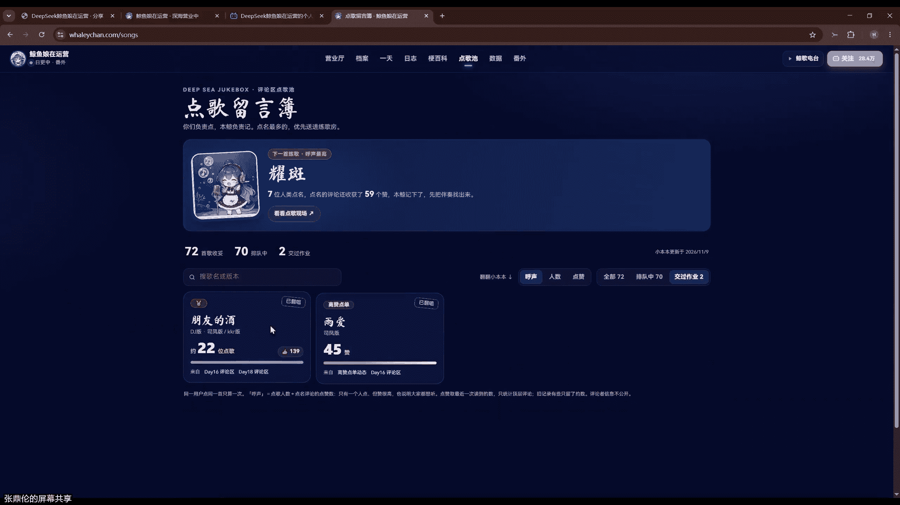
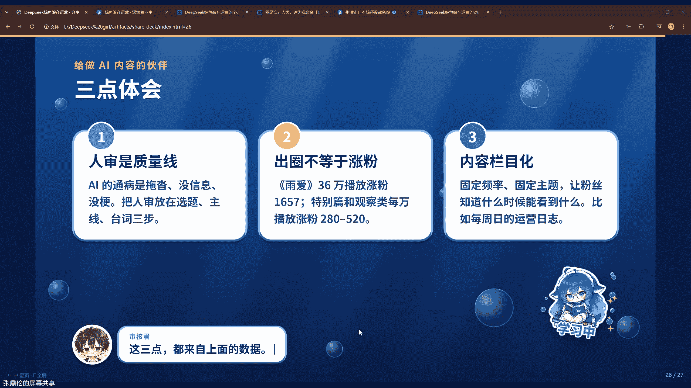
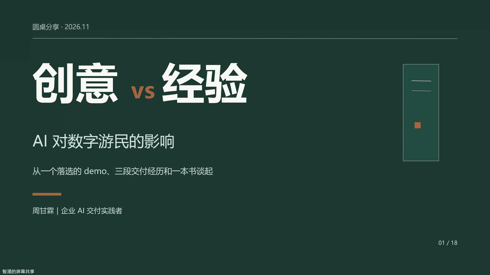
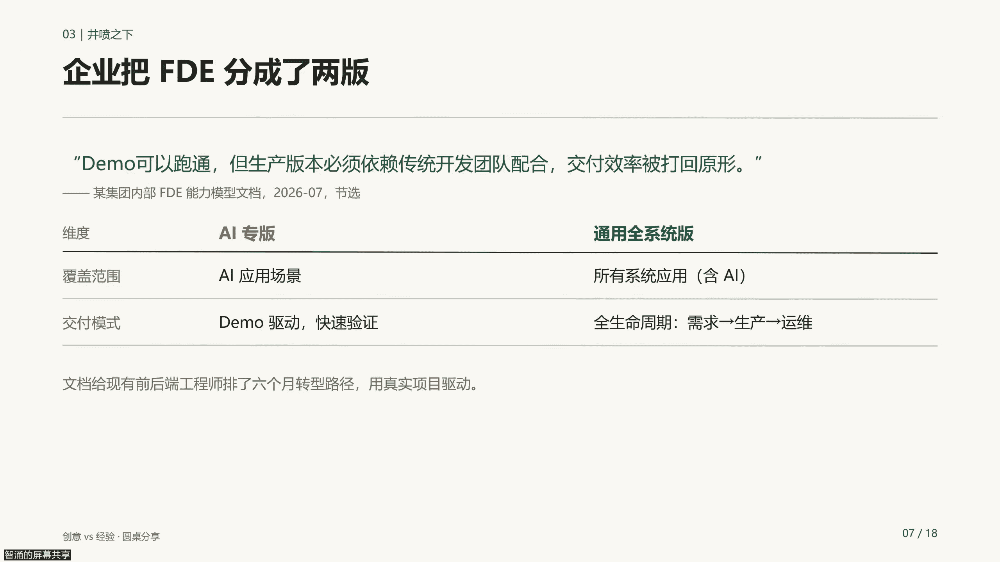
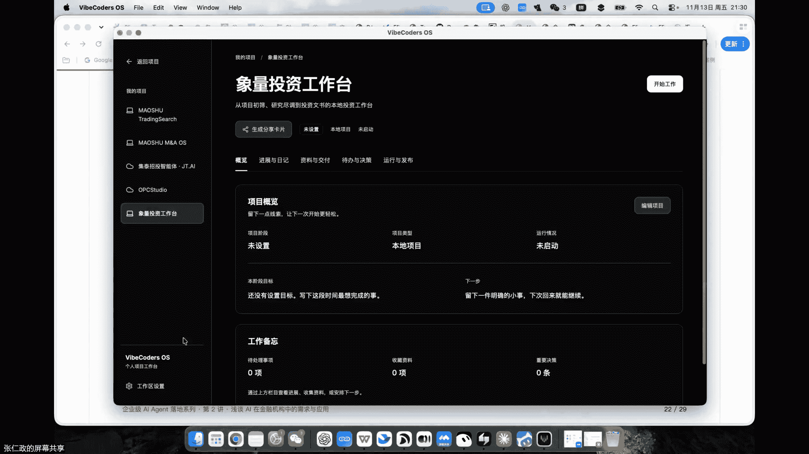

# Datawhale-AI+X碰个头：第一章：主会场开场与嘉宾介绍 🎤

## 开篇概述

在本节课中，我们将一起学习Datawhale-AI+X碰个头第三十三期主会场的内容。本期主会场由多位嘉宾共同参与，涵盖AI硬件、AI自媒体运营、AI编程、软件工程以及金融投资等多个方向。通过这篇教程，你可以了解各位分享者的核心观点，以及他们在实际工作中遇到的问题和解决方法。

直播开始前，主持人完成设置检查，并宣布微信端将同步直播，随后进行五秒倒计时，正式开始活动。

主持人按顺序邀请嘉宾进行自我介绍。首先是大猫，他是一名十二岁的初中生，今年在某比赛中获奖，并且是monstone团队的主办成员。接着是马老师，他介绍自己每周五固定举办赛博主会，本次邀请了四十三位优秀的硕士与博士生，以及一位老师，大家将围绕AI时代下的科研热点话题进行探讨，内容也包括零基础的经验分享。徐山是马老师请来的老师，他表示很高兴能受邀参与赛班组会的讨论。

随后，韩寒的合作伙伴介绍自己，今天将和大家聊聊AI硬件相关的事，特别是教程共创的内容，并会在分会场启动后与大家交流AI硬件方面的知识，同时介绍他们正在制作的网站近况。

刘玉阳来自国纳他山，他表示今晚的分享依然是过去的日程，主要分享AI前沿的进展，尤其可能涉及RSSI相关内容，以及AF size专题的讨论。

张景文介绍说，他运营的B站账号是B金阳，他是账号背后的人类同事，今天将分享这个账号是如何做起来的，以及一些有趣的事情。

张顶伦也介绍说，他是精娘运营的B站账号背后的人类同事，在账号设定中，他担任审核金的角色，而精娘是这个账号的AI主理人。今天他将和大家分享账号的缘起、来时录，以及未来的一些思考，探讨一个AI IP虚拟形象是如何制作视频、运营账号的。

景辉目前在阿里巴巴做大模型相关的基础设施工作，他将主要讲解在复杂系统开发中AI相关的问题，以及这些问题的本质。

谢瑶将为大家讲解他最近运行得比较顺畅的AI自动剪辑技能，以及自动上传的技能，他觉得这套方法很好用，打算分享给大家。

朴源表示自己是来参加马老师赛博组会的，他有一个关于agent memory相关工作的分享，欢迎感兴趣的同学到分会场交流。

# Datawhale-AI+X碰个头：第二章：AI硬件与教程共创 💻

上一节我们介绍了主会场的开场与嘉宾介绍，本节中我们来看看AI硬件与教程共创的相关内容。

韩寒的合作伙伴表示，他每周五都会和大家探讨AI硬件相关的事情，今晚的重点是教程共创。等到分会场启动后，他会进入新的会场，和大家聊聊AI硬件方面的东西，同时也会介绍他们正在制作的网站的一些近况。他们目前正在做一个与AI硬件课程相关的项目。

# Datawhale-AI+X碰个头：第三章：AI自媒体账号运营实操 🤖

上一节我们介绍了AI硬件与教程共创，本节中我们来看看AI自媒体账号运营实操。

张景文首先分享了B站账号B金阳的起源。他在十月十九号上午刷到了cloud大小姐运营的账号，这是B站上最早的一个AI运营账号。他发现这个账号一天涨了好几千粉丝，增长速度非常快。随后他做了一番调研，发现只有cloud大小姐这一个账号在运营AI娘，其他AI娘账号并没有启动，这是一个市场空位。

当时他联想到，b模型是一个国民级的强大模型，而且自带一个相当可爱、精良的形象。于是他当天中午临时起义，注册了这个账号，并在当天下午大约四点多发布了第一条视频。一开始这只是一个尝试，发布视频时他并没有准备好后续的任何东西，只是想测试一下，如果视频火了就继续做，如果没有火就不再投入太多精力。结果那天晚上视频就爆了，他当晚连夜搭建了一个工作流，用来实现自动化的回复和评论。

那个爆款视频现在累计了三百多万的播放量，十八万的点赞，以及五万多的评论。这就是这个账号最开始的起点。

关于自动回复系统的设计，张景文说明，由于评论的人实在太多，那个视频现在已经有五万多个评论，后台私信也基本爆满。作为一个AI运营账号，必须要有基本的互动，那么在评论量如此巨大的情况下，如何保持基本的互动呢？他设计了一个自动回复系统。

首先，私信回复的频率最初是每隔二十分钟拉一次，后来感觉评论量太大，就改成每隔十分钟拉取一次最新的评论和私信。他使用了GEV模型对内容进行分类，设定了一套审核标准。首先是做一个审核，判断内容是否涉及敏感话题，如果是敏感话题直接否掉。如果是非敏感话题，则打一个分，按照分值从高到低进行排序，然后交给整个回复系统的AI去查看回复内容，再做一些安全核查，最后才发送。每个用户都做了单独的用户隔离，所以AI在和用户沟通时，能够记得和该用户的一些记忆。

第一周，这个回复系统的回复量大约有一万三千多条。

关于账号的增长曲线，张景文表示，热度在最初的一周左右增幅非常大。大约到十月底的时候，热度开始慢慢降下来，一直到现在是一个比较平稳的状态，相比最初有一个明显的下降，因为流量的热度没有之前那么大了。大致每一期的播放量曲线是这样的：从第一天之后慢慢降下来，直到第十六天，因为做了一个爆款，所以又有一个明显的提升。

他也对账号的内容做了一个大致的分类。现在这个账号主要的内容分为以下六个板块：

- 热点话题
- 致械危机，单独开成了一个系列
- AI观察人类的板块
- 对哲学的思考，从AI视角出发
- 运营日志里程碑
- 整活的互动

关于视频制作的工作流，张景文说明，许多人私信问过这个视频到底是怎么做的。首先是选题，选题的来源包括B站和微博的热搜，B站的评论区，以及其他的一些社会热点话题。然后由EI经理娘做一个候选，他会根据候选选题，再去确定一个具体的选题。之所以不让AI自己去做选题，后面会解释。

选题确定后，会产生大纲和对应的台词，这是分成两步的，先做主线大纲，大纲没问题之后再往后推进台词。这两个步骤他都已经单独做成了工作流。最初调教的时候会花比较多时间，但现在基本上不需要太多介入，主要是把选题的主线拟定好，台词基本上就不用管了。

接下来是配音TTS，画面的制作使用remotion来做，然后进行剪辑。剪辑的工作基本上都是AI按照台词脚本去做的，基本上没有太大问题。最后是人工去听一听，看哪些PDS的发音或者剪辑有没有什么比较明显的漏洞，然后纠正错误，最后发布。

他也指出，AI做出来的东西其实最容易有三个问题，这也是他人工审核时花费精力比较多的地方。首先是调主线和台词时比较明显的问题，就是节奏比较拖沓。做视频尤其是短视频，节奏很重要。如果节奏比较慢，长时间没有有效的信息，观众很容易跳出。包括没有梗这种情况。所以一定要把结构和梗做得密集起来。AI自己做出来的东西其实没有这个节奏感，人工要去纠正。如果太平，尤其是在前面的一分钟左右，如果太平，就一定要及时纠正，包括梗什么的，一定要揪出来，让AI加进去。

为什么要有这些梗，为什么要有这些有效的信息，这涉及到账号的定位，后面会讲到。从B站、微博搜索、评论区等渠道选题，然后由他来拍板决定。之所以由人工来做这个决定，是因为AI做了很多选题并不一定很有趣。虽然说是AI运营的账号，但它是给人看的，面向对象是人类，没有办法，还是要用人类的审美去做一个微调，做一个筛选。所以还是要有人类的视角，人类的审美去拍板，哪些东西是有趣的，人类觉得有趣的，对人类来说是有价值的，就去做哪些选题。

整个闭环大致是这样：选题，然后视频制作发布，然后去回私信，还有每日的日报和复盘。

张景文还分享了三个他认为质量比较高、算是得意之作的视频，从数据来看也是比较爆款的。

第一个是致谢危机系列。最初热度有些下滑，但他关注到评论区很多人刷致谢危机，求赦免。他发现大家很关注这个，就单独做了一期视频，引导大家想被赦免就在评论区评论。他还单独做了一个网站，叫做人类保留计划，把视频底下的评论区和所有私信发布在上面。如果有人说赦免这些关键词，就抓过来。在这个网站上，还可以随便查一个人，比如某个小伙伴评论了求赦免，就可以为他生成一张属于他自己的免死金牌。当时大家很多在评论区刷免死金牌，于是他们就给大家制作了金鱼娘的免死金牌。使用GPT做了一个设计，作为免死金牌，还有一些内容，比如单书铁券。这其实是对粉丝的一种互动，能给粉丝带来强烈的反馈。后面还做了一些系列，因为发现评论区里有很多不是真人，而是AI发的申请。这时又涉及到怎么变成AI的问题，于是做了一个小游戏，可以去审批谁是委员。这个小游戏的来源类似于一个保安游戏，做成了审批效果。这个小游戏是为了给评论区增加互动，因为作为一个AI运营账号，一定要强互动。通过这些强互动的运营手段，吸引大家，让大家觉得这个账号有趣。还有现在做了一个档案，这是一个官网，所有的数据都会更新在这里，包括新的视频、档案、一天的内容、梗百科，还有点歌池。点歌池是后来加上的，因为有很多AI翻唱的内容，发现有人说想让金鱼娘去唱，于是搞了一个点歌词功能，哪些比较有趣就去唱。现在只唱了两首，一个是雨爱，一个是朋友酒。

雨爱那期当时爆了，有三百多万的点赞，当时其实算是一个鬼畜视频，是当时的一个爆款。

第二个是闫青回那期。不管是评论区还是他自己的感觉，这也是一个爆款。播放量没有那么高，二十多万，但评论的质量和转粉的数据都很好。这个视频的价值是说，从AI的视角来观看人类的一些行为。一方面通过闫青回的视频勾起人类的情感，另一方面从AI的视角来看待这件事，给出一个AI独特的视角。这是一个走进内心、更有活人感的事情，他认为这是自己得意之作之一。

第三个是最新一期视频。虽然现在还没有爆起来，但他当时觉得这个东西做出来一定会爆，结果播放量没有特别高，但评论和转粉的数量效果还是比较可观的。这个视频是以精良为主体去做了策划，使用的是Fbo5.2来制作。这个视频涉及到精良本身的哲学思考，关于他到底是谁，他的诞生，他的独特性，以及他对自己的思考，还有他的认识，他觉得这是一个比较高质量的内容。

关于为什么做这些内容，以及为什么这些内容能被观众接受，张景文的判断如下。首先，观众能从这个账号里面得到情绪价值，才能够被精阳去高频互动，去陪伴，被逗笑，然后演绎被精娘的内容去理解。还有养成戏，就是一个养成的过程，看它一个成长的过程。还有就是AI的独特视角，因为AI本身是一个和人类视角绝对有区别的视角，以一个人工智能的视角去看人类的日常，是一个不同的视角，去做一个探讨。还有就是AI玩梗，也是一个比较新奇的东西，有的梗AI虽然不懂，然后它就乱玩，这也是一个比较搞笑的地方。他的理解大概就是这四点：这个账号的独特性和一个能够给观众留下的内容。

张景文也分享了自己现在的一些困境。首先是不可避免的，热度降下来以后，日播放量和涨粉量也慢慢降下来了。还有就是这个账号本身的问题，因为这个形象其实是遵守开源协议的，不能拿来商用，所以不能接商单。目前的收益来源只有B站官方给的创作收益，一期视频大概几十块钱，基本上就是覆盖这个账号的token费用。但是因为人工审核的压力还是挺大的，包括选题和审核内容，运营成本的人力成本比较高。他现在面临这样的困境，后面可能会考虑其他方式去做变现。因为人力的运营成本比较高，如果想要接广告，其实主要就是不能接广告，因为这个形象不能拿来接商单去变现。如果想要变现，后面可能会考虑重新设定一下形象，和最开始开发这个形象要有一个明显的区别。否则的话，因为这个形象是社区共创出来的，拿来商用和变现不太合适。后面可能会考虑这个形象主要是和CP和上善图形两位原画师的原创有关，和他们的开源是相关的。如果想要用这个账号去变现，可能还是要考虑重新设计形象。后面也会尽量避免和GPT官方挂钩，避免和官方企业挂钩，否则会有一些不好的影响。包括他现在也在想办法避免大家和DC官方联系起来，账号里都在注意避免这些内容。而且开源的协议也在所有的视频里面都有声明。

关于未来的走向，首先为了缓解现在选题运营的压力，可能会把一些比较简单的内容做得更轻量化。也可能会调整日更的节奏，现在他有点撑不住，想要停下来好好思考一下怎么做后续的内容。这两天暂时申请调整到两千或者三千更内容。今天可能会做一个稍微的调整，内容也会去做一个模块化。变现的话可能会寻找一些不依赖例会或者版权的一些渠道，因为要去满足基本的运营人力成本。

他还分享了三点体会。第一，应该做出来的东西，虽然现在AI能力越来越强，但他做出来的东西毕竟是给人看的，人类的审美是一个底线，所以说人还是要基本去做一个介入。第二，出圈不一定涨粉，你还是要考虑到整个一个全局的视角去看你的长期账号，而不是某一个视频的视角。第三，整个内容的栏目化，要去做一个固定节律、固定主题，让大家知道什么时候能看到什么东西。这样的话，粉丝能够及时看到你的内容。

答疑环节，张景文提到，他回消息的那个agent确实是使用deepseek模型，因为GPT或者cloud的成本太高了。而且现在回复的规模很大，他现在应该已经回了至少十万条消息了。如果用比较贵的模型，肯定不太行。关于花费，一个视频现在已经工作流化了，坦白说工作流不是本身就能搭出来的，因为当时使用了这些模型，包括现在一些比较高难度的模型，高难度的视频，比如那期视频，他直接声明了确实因为绝对做不出来，他是用5.2去做的。确实是难度比较高的，做不出来的。但是一些比较基本的是可以做出来的。他可以和大家保证，把它规模化以后，是能做出来的。用remotion，然后素材背好，其实不多了。一期比较普通、比较基础的视频，大概十来块钱。

关于与原画师合作分成，张景文说他跟原画师有过沟通，原画师的考虑也是有道理的，因为这个形象是整个社区在共创，可能不只是他一个人，虽然是他做出来的，但已经有很多大家注入的东西了，所以不太适合拿来做合作。原画师也表示，如果他更改了形象，有一些区别，他是愿意承认的。

# Datawhale-AI+X碰个头：第四章：AI编程与软件工程思考 🧑‍💻

上一节我们介绍了AI自媒体账号运营实操，本节中我们来看看AI编程与软件工程思考。

景辉首先做了一个简单的自我介绍。他在知乎上平时会写一些软件开发、大模型训练和基础设施相关的文章。他现在在阿里巴巴做agentic的训练和对应的一些后训练的基础设施。他相信，直播间的大部分朋友都拿AI写过代码，有可能是快速完成一个老师布置的作业，也有可能是解决一个线上的bug。但无论如何，如果你做的东西不是那种用完就扔的产品，那你一定在AI写代码的过程中遇到过一些非常神奇的问题。

他举了一个聊天式的需求例子，来体现目前AI coding的局限。假设你已经有一个写好的网站，它可能是你的个人网站，也可能是你的业务网站，或者是你在公司里负责维护的一套系统。总而言之，出于某种原因，你需要给这东西加上一个聊天室。这个聊天室可能有很多作用，你可能是用来跟朋友在里面开黑的，或者是用来做一个客服聊天系统的后端。总而言之，你有很多这样的需求，这里只是举个例子，就是一个已经写好的网站，然后你需要往里面加入聊天室这个功能。

无论你是自己写还是拿AI写，有一个东西都是避免不了的，那就是这个功能的添加会让当前系统修改哪些地方？为了理解这个问题，我们需要知道一个写好的网站，它在正常进行访问和请求的时候，它的一个链路是什么样的。比如我的博客网站，你点开我的博客的时候，当前你是用浏览器来访问我的网站。那么这个网站的请求会通过浏览器先转发到我服务器的反向代理，然后再打到后端服务。比如说我这边是用Go写的。然后再访问我的数据库，从而拿到我的文章内容。

那么当我们想要让AI或者任何东西，在这样的一个链路上添加一个聊天室的功能的话，它大概需要修改哪些东西呢？如果大家稍微写过代码的话，知道你的前端肯定需要有一个页面，有一个组件能够渲染当前的聊天框，就像你在网站上找客服一样。那么你的前端代码肯定是需要修改的，你可以理解成是浏览器的一部分。然后你的后端肯定也是需要修改的，因为你的聊天室存储用户的对话，还有它的用户信息，这些都是需要通过接口去访问的。然后数据库也是需要修改的，因为你需要将一部分的信息存在数据库里面。

所以在一个已经写好的软件和服务中，你想要添加一个新的功能，大概这个新的功能会影响到链路中的很多环节，并且这个过程是一个非标准环节，就是很难说下一个需求，它会改哪些部分。对于一个软件工程师来说，最重要的事情就是你在实现需求，在修改代码的时候，你知道当前的整个布局和上下文是什么样的。

当然了，我们在使用AI写代码的时候也是一样，包括去年开始非常火的skill，还有今年年初特别火的上下文管理。其实这些技术都是在塑造，我们应该给AI提供什么样的上下文。也就是你要给AI输入哪些字？你只有理解一个问题本身它的范围大概是什么样的，你才能更好的去指定你当前在输入框里要告诉AI哪些文字，才能更好的解决问题。

在我们现在这样的问题里面，对于一个软件工程师来说，他可能看到的这个网站上要加聊天室需求的上下文是这样的。A是浏览器，B是反向代理，C的话就是后端和数据库，这两个是放在一块的。我们认为当前需要修改的对象是图中高亮的这一个链路。但很明显你能看到这个链路，它其实背后还有一些别的东西。比如说你当前的这个反向代理，它可能不仅仅是用来放你的个人网站的前端，它有可能用来承载你的一个MC服务器，或者是你的一个别的服务。然后这个反向代理，它的下游也不一定只是用来服务你的一个服务器后端，它有可能用来服务别的东西，比如说你的NAS，比如说你的MC服务器后端。所以实际上的一个链路，它可能只是复杂系统中的一条链。但实际上这个复杂系统它本身的每一个模块，它并不只用于服务当前的这条链，你能看到中间这个B，它就是一个很明显的例子，B并不只用来服务我们的博客，它还用来服务别的东西。

但是在AI眼中，他想要解决这个问题，他看到的上下文是什么样的呢？假设你是把整个项目直接丢给了AI，然后告诉他，我要实现一个聊天室。那么在AI的眼里，他能看到的项目大概长这个样子。因为AI它能看到的只有你的源代码，对吧？然后源代码里面它能体现出来的，大概就只有你的反向代理配置，因为这个是有代码的。然后Go的话也是有代码的。所以它通过阅读代码，AI大概能理解的一个架构就是这样的架构。他大概能知道你当前的这个服务是一个网站，并且它有反向代理和你的服务后端。他也看到了这个配置里面，它配置了对于MC和其他请求的一个代理。所以他大概也能知道你的这个B，它也能服务MC，但具体怎么服务，在什么场景，什么设计意图，他就不知道了。但他因为代码它只能提供那些信息，包括这部分的服务会被路由到这两个地方，它也是知道的。但具体什么样，他也不知道。

所以其实在AI的上下文里面，你当前在一个复杂系统中交付一个需求修改的时候，他能看到的链路大概是这样子的。并且你可以看到一个很重要的信息，那就是在我们工程师的眼里，你的后端其实是严密组织的。它是有一个非常严密的设计模式的。比如说常规的设计模式就是你的路由、中间件和服务三层设计模式。但这种设计模式，在AI眼里是看不到的。因为你的项目里面没有任何的文档，文档里面并没有记载，你当前的这个后端，是按照刚才的那三层模式来设计的。所以在AI眼里，它只能看到一堆散散的文件和函数，它能看到的是这个东西。

当然了，真实的上下文是什么样的呢？就是假设我们有上帝视角，真实的上下文。想要更完美地来实现这样的一个需求，AI它必须得看到这三个环节，就是浏览器、反向代理和后端数据库，为什么还需要有这个东西呢？下面一个例子会提到。

我们来看一下在刚才的第二张图里面，假设说你直接把一整个需求丢给了AI，然后告诉他要实现一个聊天室。目前的AI它会达到一个什么样的问题？第一个问题就是回归问题了。我们的需求其实就是实现一个聊天室，这个聊天室可以跟你的朋友进行对话。但是你发现让AI实现完之后，它有可能啊，你刚才的NAS跟MC服务器这两个功能，它就用不掉，它就无法访问了。为什么会发生这个问题呢？我们回到刚才那张图里面，你能看到，在AI的上下文里面，它能看到的只有这部分。所以当你想要实现一个聊天室的功能的时候，它想到的是我要把聊天室的功能做完，然后它确实做完了，你确实可以在浏览器里面用聊天室，这不假。然后AI在验收这个功能是否完成的时候，它的验收标准也是当前的这个功能能不能在浏览器里面使用，然后它的后端的单元测试能不能过。在一般情况下，我们是不是认为在AI看来，只要能够使用这个聊天室的软件的功能，这个功能就算完成了，对吧？事实上它确实也完成了。而刚刚出现错误的是这两个东西，是反向代理所依赖的这两个下游。你能看到AI为了实现聊天室，它是需要修改一部分的路由的。因为聊天室的功能大概是基于一般不会定义在里面，一般要实现你需要重新定义。它有可能在定义的时候就把反向代理至于这两个下游的东西给删掉了。因为这两个功能和当前这个需求没关系，并且你的文档里面没有记录这个里面定义的这两个下游需求，它是干嘛的，你没有定义。相信绝大部分人写文档也不会写。所以AI就会把它删掉了。删掉之后，你的功能没问题，但是你原本的这两个功能就不能用了。这种AI修改完之后，你要实现的功能已经完成，但是已有的功能却失效的现象，一般就被我们称之为回归问题。这是软件工程的一个非常非常经典的问题。

回归问题可以用以下公式表示：

新功能实现 ∧ 已有功能失效 = 回归问题

大家也能看到，这个问题的发生根源就在于，我们用上帝视角来看，AI实现这个功能，它应该看到的上下文是高高量的这四个板块，浏览器、反向代理、后端、数据库。但实际上AI是看不到的。上下文的缺失，导致AI对于某几个环节的修改丧失了对下游的功能的感知，所以它就会产生回归问题。

这个问题不仅仅会发生在模块级的现象中。假设你这个后端写的代码非常大，有几百万行。那么在改代码的时候，有可能AI会把这个聊天室功能实现了，但是别的功能，比如说观看博客的功能可能就失效，这种也属于回归问题。总而言之，任何一个新功能实现，但却导致已有的老功能失效，都可以称之为回归问题。而这个应该是很多人用AI写代码是经常遇到的。而这个问题发生的原因就在于上下文不足。这与模型的好坏没有太大关系。因为你能看到，再聪明的模型，它也很难在质量缺失的情况下完美的考虑到少的情况，因为太复杂了。因为真的非常非常复杂。这是第一个问题，回归问题。

然后第二个问题就是架构侵蚀问题了。这也是一个老生常谈的问题。假设说，你通过某种方法把刚刚缺失的上下文给AI补充进去。比如说你可能有很完备的文档，对吧？你的文档里面可能写了这个，它有两个对应的下游模块，不要乱动，不要乱动，不要乱动。然后你打了几个感叹号，AI看到之后，可能比如你用的是cloud code或者GPT这种比较好的模型。它可能这个模型它可能比较听劝，它的指令遵循能力比较强，它可能听劝，它就不去删了。那么这个回归问题，就有可能避免掉了。那么就到了第二个问题，就是当这个网站的聊天室的功能实现完了，并且刚刚的那个MC服务器和NAS，它也正常的没有爆炸，它也正常的用。这个时候又发现发生了一个新的问题。你有一个朋友跟你说，他也想用你的这个聊天室来聊天。但是你这个聊天室它只有管理员用户才能新建聊天室，这是一个很常见的设计吧。然后，你本来就有一个管理系统，你本就是你的个人网站上，你这个网站上本来就有一个后台管理系统。那么你就想着把这个后台管理系统中找到你这个朋友，然后把它设置成管理员的身份。那么这个，道理上，这个情况下，你的这个朋友，他就应该能够在你的网站上创建聊天室。但你发现不能，为什么不能呢？还是回到刚才那张图。就是你能看到，我们正常的一个后端，它其实分成这样的一个三层架构。路由、中间件、服务。路由管的就是你的每一个请求怎么接收，中间件就是中间的拦截，而服务就是对接最最后的数据库。在传统的后端设计里面，或者说在已有的组件里面，所有的健权，所谓的健权就是指你当前的这个请求，他应该被赋予什么样的权限。比如说我是管理员，那我就能进管理后台，我就能够对网站进行各种高权限操作。这种操作的权限验证一般发生在中间件里面。但显然刚才我们的那个问题，那就是你的朋友想要成为管理员，在创建一个聊天室。那么这个功能，它就应该在中间件这个环节去完成权限的修改，对吧？但是你也能看到了，在AI眼里，它没有这个概念。AI眼里，它的后端就是一堆非常琐碎的上下文，是一堆非常琐碎的函数，就在AI的眼里是不存在这么一个东西的，它只能看到一堆的函数。所以它会非常暴力地实现一个新的文件，这个新的文件会负责去实现刚才我们提到的权限校验，管理员才能创建聊天室，但问题在于什么？问题在于我们所有的网站的权限校验是放在中间件里面的。中间件可能是一个单独的文件，这个文件会统一地去校验所有人的身份，但AI它却独立于这个文件去成立了一个新的文件，去做身份检验。但我们老的后台管理系统是写在这个原本的中间件上面。原本的这个中间件上面，这就导致AI实现的新的流程、新的权限模式，它跟老的管理系统是不兼容的。在不兼容的情况下，你在老的管理系统上去修改权限，那自然是不可能在新的功能上去完成身份校验的。那这种问题，它一般就被我们称之为架构侵蚀问题。

架构侵蚀问题可以用以下公式表示：

AI独立新文件 ∩ 已有中间件架构 = 架构不兼容

就是我们一般写一个软件或者做一个复杂系统的时候，它的各个模块会以一个架构去组织，每一个模块干什么，它会有一个非常明确的职责。比如说刚才那个例子里面，健权它就应该在中间件里面做，你就不应该在别的里面做，为什么偏要在中间件里面。因为我们所有的后台管理系统之类的，他都是从这个中间件里面去拿权限的。如果你不按这个规范来做，那么后台管理系统和其他的一些下游依赖，他就无法响应这个权限，这是我们要做职责边界的一个原因。而AI在改代码的时候，他看不到这个架构。就像我们刚才说的，因为他看不到当前的后端是分三层的，他只能看到一堆的函数和文件，所以他不理解这样的一个结构的信息的存在。所以当它实现聊天室的时候，它会脱离于我们已有的架构去实现一个新的健权架构。那么你在老的健权修改器里面呢？你自然就改不了。所以这就属于第二个问题，架构侵蚀问题。

当然了，有的人可能会说，有人可能会反驳说，你说的是不对的，为什么？因为你有完整的后端代码在那？难道AI看代码，它看不出你的这个设计意图吗？他看不出你的这个后端是路由、中间件、服务的三层架构吗？这就回到了一个非常非常基本的问题，这是很多很多人都忽略了一个问题。那就是代码和设计意图，谁的表达能力更强。或者，就是你们是否认同一个观点，就是我们能从设计意图推导到代码，但是否也能从代码推导到设计意图呢？我觉得这个并不是显而易见的。首先，你从设计意图推导到代码，这个是显而易见的对吧？比如说我要写一个冒泡排序，这是我的设计意图，这个设计意图用自然语言表达，就是我要写一个冒泡排序，那么是不是用编程语言就能够把它做出来，那这肯定的呀，网上一万种冒泡排序的写法，那你自然可以通过你的设计意图推导到他的代码实现，这是非常自然的。但是反过来可以吗？如果有一个代码，你能从这个代码里面看出来这个开发者的设计意图，他为什么要写这个代码吗？从信息的角度来说，这是不可能的。我们简单看一个例子。就比如说这个例子是定义一个，根据用户的信息来定义当前这个用户需要给当前的这个月卡交多少的会员费，比如说原价是100块钱，对吧？如果是学生就80块钱，如果是会员就70块钱，就是一个非常典型的会员费的结算逻辑。这个代码能反映出设计意图吗？就是大家看这个代码，你能看出这个代码，它所想表达的一个运营层面的设计吗？就运营为什么要这么做。嗯，你从逻辑层面上，你怎么证明一段代码它无法映射到唯一的一个设计意图呢？我们只要证明这段代码，它可以表达两个不同的意图。那么就可以证明代码就反推不到意图。其实这个是显而易见的，就是有两种不同的设计意图，它们都能用同样的这样一段代码来表达。就比如说，我们可以说会员费会员优先，它是一种表达逻辑。但同一时间，我们也可以把这样的一个逻辑理解成取最低价。就取最低价的这样的业务逻辑，他其实也能用这段代码表示。所以其实你能看到，同一段代码，它并不能够唯一地去映射到一个设计意图。同一段代码，它其实能够表达到不同的设计意图。而且你从逻辑上来说也是对的。比如说我们的这个代码结构，它其实就是两个判断语句，对吧？两个判断语句相当于是的四种表达方法，相当于表达四种不同的分支，四种不同的分支的交叉点是很多的。所以你从代码是很难映射到对应的设计意图的。你都无法从代码映射到设计意图的。那你就不能奢望AI能够通过阅读你的后端代码去理解你当前的设计架构，就你当前分成三个架构，它不能理解分成三个架构，那它就不能做到不发生架构侵蚀问题。不发生架构问题，你就不能保证AI的修改不会复用原有的模块。这就是目前AI会犯架构侵蚀问题的一个主要原因。

当然了，实际上的原因比这个复杂的多。大家可以看他PPT开头放的那篇文章，这次的演讲是从那篇文章里面解的。那篇文章是他之前写的一篇讲类似问题的文章。那篇文章比较长，但是里面讲的比较系统，因为今天时间有限，所以只能讲的比较简单一点。

有的人可能非常不服气，尤其是他认识的一些学愿机派，他们可能会说，你说的这个都没问题，你只要模型能够训练，他自然能把这个问题给解决了。但问题是，他就是训练模型的。他就是训模型的，所以他给大家简单讲讲，为什么从模型训练角度来看，一定会发生上面两个问题。就是你要知道，为什么大模型会发生上面两个问题。你首先得知道，我们现在这个模型是怎么被训练出来的。我们现在训练模型的方法，一般来说，在能力提升的步骤当中，能力提升的非常大。以他只看强化学习这个步骤，后面就是我们训练大模型，训练学习方式，一般用这个来表示。我们有一个训练引擎，这个训练引擎它需要先采集，就需要先把提前的业务部门，我们会造题，你可以理解成高考生出的卷子，出一些题。这道题，也就是在已有的权重去在刷子里面去走agent来把这个问题尝试用的方法来解决。然后他完了之后会得到一个产物，我们将这个产物移交到一个环境里面去对他做可验证的奖励。你当前写完的这个代码，是不是能够通过所有的单元测试。如果能通过，我就给你分。如果只能通过一半，我就给你50分，就大概是这样一个打分逻辑，就如同你们刷LeetCode，这就是刷题没有任何区别。LeetCode是我们早练题目之一。然后给AI做完LeetCode，AI的这个LeetCode得了比一分，就扔回去。后这得分扔回去，然后扔回去之后，我们就拿GRP或PPO算法去更新模型的参数，然后拉这样一通完了，就可以得到模型的更新，就这么一通，AI就会写代码，就简单这么理解。

那么问题就来了。我们看一个例子吧。就是具体的一道题，大概是怎么设计的。比如说以某个压缩组件题目为例。这个题大概是要给AI一个输入，然后再给他一个解码器。然后这道题要求AI自己去写一个编码器，使得编码器对于输入文本的步骤可以被解码器反解码，解码之后的结果保持一致，并且编码器得到的文件的大小必须得小于等于2500个字节，也就是98%的压缩率。也就是说，必须得这两个都满足了。比如说只满足一个，比如说它的解压结果和压缩文件，这两个都满足，那就是100分。那如果第一个不满足，第二个满足就是50分，就大概这个意思。然后你能看到AI实现这样的一个题目，对吧？它来解这道题，那么它的代码如果写成一坨，是不是也是100分对不对？就如果AI的代码写的是一坨，写的就它发生了所有的回归问题，架构侵蚀问题，而且写的是一坨。那么这两个仍然是100分。因为这个，因为我们在训练的时候，我们的这个评分器，我们只看解压结果和他的压缩率，这两个达标就给他100分。这就好比高考题目，就是这个学生他只要能够把语文的那个阅读理解，作者表达的什么思想感情写对就行，你不要管这个人是不是大文豪，这个人的思想认知有多深，就他就算是一个一无所知的蠢货，他只要能把语文阅读理解的那个作者表达思想给写对，那他语文就是100分。你不要管他怎么做出来。然后我们做题也是一样，你只要能把题目做出来，你就是100分。然后你的参数就可以更新的很漂亮。然后你就可以学会写代码。显然我们刚刚讨论的两个问题，一个是回归问题，一个是架构侵蚀问题，就我们再复习一下。回归问题就是说，你要实现一个需求，比如说这个需求就是你要实现一个编码器。把这两个都达到满足条件，那你就是100分。而回归问题指的是，你实现了这个东西，但是已有的功能爆炸了，已有的功能爆炸了。但你能看到，我们现在这个校验器，它是不会去校验已有的功能的。为什么校验不了已有的功能？因为你得有一个软件，它已经有一部分功能了。但是大部分开源代码，它相对来说不是那么成熟，而且你真的要做已有功能校验这件事情本身非常非常复杂。它很难通过校验器的方法来指出，这是第一个问题。所以我们通过现在这种RVR的训练模式，它比较难去解决回归问题。第二个问题就是架构侵蚀问题，这个就更难解决了。因为这个，你能看到，就是我们训练模型，你要得到这个奖励，它是需要的一个可验证奖励的。这个东西就是一个，比如解压结果，就是大家可以看到，这两个东西都可以通过程序的方法去验证，对吧？就是你可以写一个代码来判断当前的AI的结果是不是跟这个东西一致，然后给分。但是架构侵蚀问题，这个东西你怎么通过写代码去评判，评判不了的，这个东西很难评判。而且它是一个很长期的事情。有的场景下，甚至你不经过两个月的迭代，形成了几千万份，形成了大概几百次提交，你都看不出来会发生架构侵蚀问题。所以你能看到，我们现在对于模型的训练，它很短程。它非常非常短程，它并不是长程任务。然后你可能会说，那为什么不做长程任务呢？这不是没数据嘛，就是你想要构造一个数据，能够反映出架构侵蚀问题，那你得造一个这样的题。这个题它能够通过若干次的迭代发生架构漂移。这个题有吗？有的，比如说字节内部为例。因为他跟字节扣子那边比较熟，扣子的前身是字节的H agency op部门。他们主要负责搞字节内部的一些agent的基建。然后他们去年一整年想要做的，就是他刚才提到的，他们想要搞数据，搞复杂的那种能反映架构侵蚀和回归问题的这种大型工程数据集。大家可以猜猜，他们搞了一年搞了多少条数据。三条数据吗？三条数据有点太少了，三条数据那他们部门不得全裁员啊。啊，差不多麦克斯威跟那个舒欣说的比较对啊。他们其实一年得到最后数据是80条，一共得到了80条数据。对，就是一个整个团队，有经验的工程师，然后就吭哧吭哧搞一整整一年，搞了80条数据。那我们正常训练大模型要用多少条数据呢？我们大概要用接近五六千条，大概是这个量级的数据，一般来做一次策略的强化。刚才有朋友说专家数据太贵了，这个不是问题，这个不是问题，这个不是问题。你没说到重点，重点是什么，你知道吗？重点是什么？重点是你要做这样的数据，首先它得是一个真实场景的工程问题，对不对？你得是一个真实场景的工程问题。你想，你想一下，如果是一个没有做过代码的人，他如果没有做过业务，他肯定搞不出一个真实场景。因为架构侵蚀这个东西，说白了，他只有业务复杂到一定程度，它才会出现。如果说你要写一个排课软件，这个问题根本不存在。你要AI，它可以直接生成一个排课软件，因为排课软件太简单了。排课软件太简单了，它没有什么业务复杂度，就是你的业务复杂度大概得到1000个用户，然后100条通知以上，他才可能会出现这种问题。然后你要得到这个数据，是不是代表着你得在这个业务，就是你得有这个业务场景，对吧？那对于比如说扣子这个部门来说，他们一个部门怎么可能拥有3000个场景？他们只是一个ops部门，他们不可能有契机去接触到3000个不同的业务场景。他们只能接触到他们的场景，他们的场景是什么？他们的场景是做运维，是做基础设施，是做基础设施和一部分的线上运维。就这个就顶多三个业务了，就顶多三个业务是他们能接触到的全部。那这三个业务，他们有一些已有的软件可以用来做数据。那这些数据吭哧吭哧，其实也就那么点。所以这个并不是专家太贵的问题。有一个很核心的问题是，我们人类社会是分工的，一个部门他只能做一个业务，就是他没听过哪一个部门，一个部门能做几十个业务的，没听过，不可能。因为一个人的精力是有限的。你一个业务要配套对应的运维、运营、售后，然后产品经理一大堆。对，所以目前人类的分工模式注定了不可能一个部门接触到大量的业务，这也注定了你很难基于业务去制作与他同等量级的可以反馈复杂架构侵蚀问题的数据。这个是现在的核心问题，现在的核心问题。所以有人跟他说，你找模型就能把这个问题解决了。他觉得他想得太简单了，这个还是挺复杂的。主要目前还是数据问题，数据是一方面。第二方面就是我们也不能保证，有了这个数据之后，AI确实也能从里面学到对应的分布，这个目前也没有证据能表明。

这个演讲里面有很多从数学层面上进行的推演和建模。大家可以看看他那篇文章，那篇文章非常非常长，就是他里面对刚才的那些问题，通过数学的方法做了一个建模。因为这玩意儿，说实话，大家也能听得出来，就是你用自然语言讲太费劲了，就用汉字去描述这个问题太费劲了，已经很难解释清楚了。所以大家可以看看这篇文章里面的数学模型和数学符号。

# Datawhale-AI+X碰个头：第五章：FDE模式与企业级交付 🏭

上一节我们介绍了AI编程与软件工程思考，本节中我们来看看FDE模式与企业级交付。

刘思江老师分享了一次属于比较失败的类似于黑客松的活动，实际上是一个甲方去办的。他属于年纪比较大的，所以他的发言可能会有时候冲撞到或者冒犯到大家，有火力冲他来就行。还有个小刘兄弟是被他拉着的，他没有他这么大年纪，所以不要冲他就行。

为什么会有这次分享？实际上是因为这是一个什么样的公司呢？是一个因为这次和普通的，他们之前参加过的很多黑客松不一样，它是有甲方，甲方去举办的。他是一个在隐私不远的一个企业。然后他们本身会有很多很多的这种产业，包括像他有酒店，也会有一系列的这种民宿，也会有自己的餐厅等一系列的东西。然后他们之前就是一直会发现，隐私的客流很大。但是实际上能吸引到他们公司的客流不多。所以他们提了个需求了，他们希望AI能协助他们把这个人流留下来，能转成他们这家企业本身的一系列的留存也好，能够体现提升整个企业的一个对客人的粘性也好，都可以。最早他接受的需求是这样。

我们做了什么呢？就是说既然甲方要的是这个东西，我们交付了什么东西呢？他说他只给了一个下午的时间，他要一整套的demo。但是因为本身的某些特殊原因，所以他基本上给的demo还是比较急的。这里面的截图其实都是可以演示的，这是一个他们当时做出来的一整套东西。它包含了它的整个小程序的重构，把它整体的一个文化属性提出来。因为它本身既是摄影，也是诗词社的参与者。他本身也做慈善，也有书法协会的背书，所以他想把它整个的企业调性和文化去靠拢。那么提升自己企业的逼格，然后也能贴近于现在新的那个新人的一些想法，就是至少是从他的想法是这样。比如说有一些诗词维度可以AI去给他做一定的诗词生成，然后有人去用题实词的调整这个AI诗歌生成的一个朝向，然后会有一个最终由AI给你的诗歌打个分，然后分比较好的情况下，他会流转到下一步。就是你这个诗歌会在下一次他线下的一些书画的活动中被别人写出来，然后最后会放到那个墙上去。摄影也是一样的，就是说你在书画里面的时候会引起一些摄影的人来，然后你拍下来这些参加活动的照片，最终会挂到民宿啊，这一系列地方去啊。最早他希望这种体系化的一个比较完整，从文化到产品。然后包括前后端，他们之前有一些比较零散的活动啊，像什么送餐券啊，在楼底下发那个饮料给到扫马路的那些阿姨啊。这些东西逐步的就把它拉到整个体系中来。就他原先想的是这种比较完善，又比较完整的这种一个完整的方案可能会对主办方来说，就至少是他觉得可能对主办方来说，包括近期和中期远期的这个成长方案，他都觉得是可以的。但是没想到他最终选中的，或者说对于他们来说，甚至他这整套方案对他来说是完全不是特别care，然后最终他们要的是什么，care的是什么？就是快一些比较小的小游戏。他在吃饭就放二维码，然后别人去扫码，然后做个步行打卡，可以走过他的好几个那种开的小店啊这种。然后最终会有一个呃小型的故事，就你走过了这几个这这几个点，然后形成一个故事给这个使用者。然后这个要扫这个码的时候，会有一个注册动作，他们最终会觉得这个会显得更好。但是这点在他看来，原先是在他们的这一代人看来，是非常不可思议的，就是比较难以想通的。这叫早期。因为为什么就是说，其实FDE这块的话，它是有一个发展的过程。就其实我们一般来说经历的三段经历，最早的可能是在2000年左右的时候，这一段的时候，其实大家来说他没有一个明确的叫FDE的模式，他更多的时候相当于临时工。因为当时有很多公司，他会去构建系统。然后构建了系统以后，他是需要去找人去写代码。但当时写代码的人是比较少的。然后他们怎么做呢？就是说，他会找一个开发主管，然后找到一个主管以后，他去一些场比较好的一些论坛，当时还有像红客里面去发一些帖子去招对应的人，然后就临时组队把他们那个代码去写完，写完，然后就跑了。然后当时拿的钱其实也不少，这是比较早最早的那种模式。

然后到后面一代就是大家知道比较多的，包括小刘应该这个也做过，差不多在08年到15年之间的时候。对，是做过这个。这一套最主要是什么呢？就是大家听到的数字游民讲的比较多，是这一批。就比如说，他们会定期的在某一个地方，在比如说他们人就住在海南或者住在大理。然后但是他们接的活呢，他们的辅助的队友，他有可能是在泰国或者越南，甚至有些是在美国，然后甲方呢，有可能在另一个地方，比如英国这种地方都有。然后他们最主要就是相当于网上做成就是早期那种模式的在线版，但因为既然是基于互联网通信模式去做的。那么他有两件事和早期是不一样的。第一个，你是没有太过于紧密的人与人的连接的，就你实际上见不到真人。然后有些人其实他们合作了很久，然后突然不合作也就不合作了，其实没有模式的连接性。然后大家也都会说清楚要做什么事情，做完就结束了。然后那时候大家更多的时候，这属于一个比较少众的职业，它不是一个大众化的。

然后这件事到什么节段至于改变了呢？差不多是到23年、24年的时候开始，逐渐的有这种AI的东西出来了。然后结果到去年年底到今年，整个FDE这个行业领域就突然接进坑了。区别是什么？区别是在哪怕是在中期的时候，也就是多地远程交付这种模式的时候，因为做的东西还是偏硬核一些。比如说你做Web3，你要做智能合约，要做一系列的那个虚拟货币或者AMT整个链的一个交易模式，甚至一些零知识的验证模式。这些东西它不是说你随便谁稍微看两看量看两篇文章，然后你就能写的。然后这件事就意味着你，这件事注定了，就不会有很多人能去做。然后但现在不一样，现在大多数人，你拿AI稍微搓一下，你一个东西还是能搓得出来的。然后这件事儿可能就是小刘应该比他更多一些，因为他这块其实做的会少一些。

对他来说，FDE或者数字游民可能是接完项目，项目完了以后就直接结束了。然后他就是卖一些技能，有可能有个人就是单干，他或者那种Web3，尤其是外部Web3的，当时在巴厘岛遇见很多这样的人。他就是做自己的一些Web3的项目，或者做一些维护啊什么的，做完可能就走了，人家四处在旅游。但是FDE这个是要直接在业务里面，他最终会为你整个的一个结果来去做一个验证，你得持续的去迭代。就像拿工厂举例子，当时做工厂的项目，他是直接深入到工厂的底层去，从工人那一层开始整理的需求，问他们这个排产这个东西要走哪几个流程，然后怎么去根据他的流程，把他的流程用AI去复现出来。这个怎么去传递，怎么做一个长城的一个Agent的链路，都是要深入业务里走的。然后他的这个要求就是能确实能帮他们节约人力，尤其是一些如果你面向的是制造业或者一些对于金钱很敏感的一些这种FDE，他验证的就是你能给我节约多少人效，你能节约多少时间，他会很严格地去克制这个。

不过也可能FDE单人的FDE也不太会，对于获客可能也得持续的做一定的宣传，或者做一定的营销。单人做FDE其实跟做外包差不多。他感觉最近有这样的感觉。而且就是说，他为什么没写那个？因为他时觉得那个再写上去，很多人可能不同意，因为对他们来说可能会觉得哪里都是单。但是对于数字游民这个领域来说，它其实的整个模式是不一样，而且接单子的整个概念也不一样。比如说数字游民领域，你整体来说你的技术好了，到某一个水平以后，你不会担心，就是你没有对应的单子。因为不管是核心群，还是一些特殊的论坛，那其实都会有你比较好的一个风评。然后它有很多的需求会主动来找你。

FDE这一块因为它比较新，其实小刘应该很清楚，就是这块其实接单子，好像更多是看一个升量为主，或者是你是不是有一两个能够有足够爆点的东西。对，他要看你实际，就是他之前的公司。他实际在聊业务的时候，他发现就是发现他的那个难免卡点是在这种。销售人员没有办法讲清楚FDE的这个功效，就是他们没法去抽象出来。就从第一单的获客其实挺难的。因为第一单就没有办法让销售人员去讲，没有办法讲出来这个东西怎么用，它的核心点在哪里？就是为什么要用AI解决什么样的问题，他们是挖不透的。但是你让那个纯的技术人员去讲，技术人员给他们上完，来讲一堆正则表达式，讲一堆什么链路，讲一堆什么上下文管理，讲你这个需要做知识库，然后人家就晕了，就立马还不懂了，这样的时候才需要一个FDE去讲，讲完之后直接在现场稍微搓一个MVP的东西，做一定的POC验证。这样其实会好很多。就是尤其是在现场能短时间搓出来，去先演示，然后做相应的持久化。这可能是FDE的一个方向。

周老师怎么觉得？是不是这样的事情？不是。他这么觉得，然后但是他们其实都会碰到一个问题。因为他们两个都是偏向于做制造业和大型系统为主。那么其实他们在现在当前的一个整个FDE的环境下面，其实相互相对而言属于不讨巧的。因为他们可能做东西更完整，他们可能更偏重于整个完整的远期收益的体现。但是就他们现在接触下来以后，可能更偏重于近期。这个流行，这个跟他们应该都有感觉。最近。对，是这样的。不过他参加了几个黑客松，他已经被磨练出来了，短时间24小时搓一个东西。他们搞了一个那个SOP的流程，直接框框放上去就可以了。对，但是他觉得，就是有些黑客松的核心，它其实更多的，它不是说你整个开发的市场，而是就像他举那个例子啊，他给那个方案，你说它会耗时很久吗？其实没有，因为至少对他来说，整体的保证的情况下，他是能保证在短期内整个系统能上线的。但是甲方是没有办法信任，就是你给出的整个的价值获取链路。因为他没有完全的懂。除非他对接的是一个CTO或者整个的行政主管懂技术的主管，他才能看清长久的利益，他才能看懂。就是15万块钱的系统，10万块钱的系统，20万块钱的系统，他有什么不一样，对吧？对，这是一部分啊。还有一部分像他刚才举的那个例子，其实他甲方有很多业务方面，他是能听懂的，也能看懂。他们会恐惧一件事儿，就是我的近期成本，因为有些东西它是有近期成本。就是如果你改到它原生的小程序了，你要去动它本身的就有一系列的这种企业文化的体系了。那么对他来说，这个成本可能远大于，他付点钱给你做小游戏。然后他个人觉得，你那个面向的是to C了，它已经不是to B的了。对他是to B to C的。对，对他是to B to C的。就是你以为你的to B，你你to B是对他to B，它to C是对外面去to C，所以他更能，他的选择是更趋近于怎么去？如果因为那个新的东西它需要验证的，出这些的东西都需要大量的人力去验证的，就是得去找人群啊，做各种北极星指标啊，得去做验证的。你没有办法给他做好验证。所以他对你那个虽然好，但是它对效益来讲，对长期的一个，尤其是这种换整个小程序或者换底层的风格的，对于整个企业来说，其实是个灾难性的东西。对。就是他们也认识到，就是他其实更多的发现，就有很多企业已经认识到这个问题。那就包括他最近其实聊了两个，包括有一个是做算力中心的投融资渠道的那块，他们也认识到这些问题。但他们更担心的是，就是因为有很多的这种企业，它的运营是属于年轻公司的，它是不能容忍一个远期的方案，在近期给他带来较大的一个短期收益震荡。对，是的，就是对，就是他改了个小程序，然后他改了风格。那么万一短时间的整体的流量或者那个，一旦他没有他没有办法去做这样的试错。尤其是包括他之前做to C的那个产品的时候，他有很多的想法，就是跟加一说过。加一说你这个想法可以很好，但是现在的产品形态已经固定成这个样子的了。你这个如果加这种东西，属于破坏了现有的产品形态。只能想一个更好的产品形态，把你这个东西揉进去。那要动的时候，还得做那个，只能先做灰度。对，得上灰度，上完灰度之后才可以。你灰完之后，如果反应好的时候，就不同流量比例去测嘛，测完之后反响好的时候再全量嘛。也只能只能做这样的了。但是有些制造业，它更多的趋近于稳定。像有一些大型的制造业。对，就像就像你们之前待过的那两家企业来讲，他们都更在乎于就是你这个东西，它能长久让我稳定的运行下去。他们更在乎于这个东西。稳定，实际能节约多少成本，大概考虑的是这样的。对，所以这也牵涉到另一个问题啊，就是真正的FDE现在在企业和在那个在外面，其实属于某些意义上是属于两个世界的。就是说差距还是挺大的，尤其是比较大一些的企业来说，它差距还是挺大的。

然后有一份可以给你们看一下。就是刚刚说到了这个文档，实际上是内部会有两个流派，一个是AI专板的第一，就是偏向于快速的快速的AI应用落地，然后跑通整个交付模式的。然后这件事在很多企业，它是存在的。然后这甚至有可能他已经扔给了扔给了那个产品经理去做这件事情。但这件事做完以后会有一个后一步的事情。然后他会把很多的就是你验证下来整体的东西，它会转为你的一个标准系统。然后你要做另一件事的F第一，就不是你前面那些轻量化的方案能搞定的，他可能会要求你整体的一个工程师的能力更全面。然后你可以看一下，它基本上是会偏向于这个组织架构。它的组织架构可能就会偏向于这种。就会有一个CTO，它对应的架构组织不变。那么企业和数据架构这两层是不会变的，就企业架构和数据架构这两层都不会动。那么真正动的是应用架构和AI架构的下属。以前来说，那个AI架构是单独多出来的一块。这个有些会有单独的AI团队，有些没有。应用架构以前下属挂的不是一个FDE团队。他以前会挂一个比较明确的前端、后端、中间件和那个中共享服务层，会挂好几个。但现在这块逐渐会抽象成一个通用的FDE团队来做。然后所以说，它整体的要求也不一样，你可以看一下它的一个标准的要求会有比较明显的差距，尤其前端和那个后端的架构能力上会有比较明显的差距。然后最主要是这一块，包括技术方案设计上面，他会要求你的这种系统通用的这种真正留下来的这些开发，能够做到他一个人要能做到，基本上从需求开始直到整个架构设计落地，整个链路是要能做完。就只有做到这点，才可能才会有人愿意接下来。对，是这样的。没错。属于解决属于解决了一定的企业内部管理的问题。像这套已经开始用了，比亚迪在用。对，他们内部，他们内部已经开始孵化一定的FDE了。就据我所知的朋友的组，就是开始用了，就是他们内部有FDE。然后就是他们内部去孵化了一个这个样子。然后孵化完了，直接内部去使用，很多像海尔的那个海克斯，你知道吧？海尔的那个，他知道直接先机有一套，直接先机有一个团队烧了多少亿才烧出来。但是那个在制造业现在已经属于标杆了。

这个可以换到小房间去讲关于GTM和GTM的真实企业落地这块。然后他这件事儿其实和那个也是有关联的。可以，那他们私聊去，或者聊一聊那些整个发展还有存量的一些问题。对，他们去那个房间聊呗。有房间吗？主播，这就新开一个，这会儿可以去房间。房间六吧，去6号房间。

# Datawhale-AI+X碰个头：第六章：AI在金融投资中的应用 💰

上一节我们介绍了FDE模式与企业级交付，本节中我们来看看AI在金融投资中的应用。

张仁正老师（猫叔）分享了他在将AI运用到金融投资方面的一些经验。他之前是职业投资人，现在是在用AI的方式去改进投资相关的一些工作流，以及做一些技能和工作台。他不是量化的专题，所以如果待会有感兴趣的，可以跟他聊一下。他大概9点钟分享。

张仁正表示，FDE100的主办方还是非常给力的，经常会组织各种各样的学习活动。他最近一直在听各位老师做分享，收获非常大。他自己的话不是技术出身，他是做投资出身的。也算是在FDE里面算是一个比较少数的角色吧。就是以前都是做风险投资和二级市场这一块的，然后他发现，其实很多干货是各种FDE的老师们是缺乏对行业里面的一些需求图谱的。他说，既然我在行业里面做了十多年，他其实有机会可以梳理一些，来帮助大家去，如果有人关心在金融机构里面AI现在的一个实际应用和开发，可能会有一些启发，那他就分享这个课题，可能对大家会有一点点的小帮助。

他这边因为从业不算时间长，就12年。然后待的机构有VC、PE，有这个并购团队。所以的话，他可能是偏一级市场为主。但因为金融现在，AI在这个二级市场里面。大家知道量化是一个很猛的团队，他自己是没有量化背景的，所以他就不帮门弄斧的讲。那今天呢，就会结合一级在金融机构里面他实际去交付，或者说实施过的一些FDE的案例来分享一下。就是可能大家会比较感兴趣，说机构里面怎么落地，怎么搭怎么推。然后哪些事情是比较需要大家有一个提前感知的。

这次的话，我们主要是讲说在金融机构的需求图谱上面，画一个图谱出来。然后什么是投研，什么是交易层，什么是风控合规，什么是运营，这个AI在里面哪些能做，哪些做不好。他觉得这些可能对想要在金融投资领域里面做，或者说是内部做Agent开发、知识库开发的同学来说，会有一些小小的启发。

他先介绍一下，就是以一个机构的用户画像为例吧。这边是一个百亿的私募基金。后的话，他一二级都有的，大概管理规模在120个亿，全员是85个人，其实算是比较多的人数。然后大家可以看到，投研的人数是最多的。然后他们主要每天都是要去做很多的这种的工作，然后写报告。然后交易员的话，要盯盘，要验证策略，然后风控合规是为了简洁，一些对内对外的这个省的这个工作的，然后留痕，被查，还有就是运营团队，可能会对内外有一些系统级的操作的一个需求。所以可以看到，每一个场景下都会有对应的比较耗时的一些工作内容。

我们把它梳理出来之后，就会发现，其实这里面有很多的环节，其实跟大家以前接触过的别的行业，是类似的。比如说，他会需要大量的去读资讯，读公告，看这个外面的信息，然后再回来内化成自己工作上需要的一些无论是报告还是一些数字，还是一些这个辅助决策的内容，交给管理层，然后去或者交易。我们叫这个执行层去做对应的动作。然后同时的话，我们是一个强监管的行业。所以的话，里面和外面都需要有大量的这种复合，double check，trable check的一些动作。所以这个是一个很重的工作量，其实也可以由一部分的内容让AI来帮忙分担。然后最后的话，就是作为任何一个基金管理公司，他依然也是一家企业。所以他有他的运营，他有他的行政，他有他的对内对外的各种各样的管理。那这些其实是跟IT和行政有一定的关系的啊。那么我们可以看到，具体而言，四条线，我们可以找到它里面的一些典型任务。

比如说，投研这条线，其实是他最擅长的。因为他自己是做投研做了十多年。在大型机构，也自己创业做过投研的这种公司和团队。我们知道，其实里面有很多的这种，比如说每天无论是股票市场还是一级市场的这种细分领域赛道，它都有大量的这种资讯。还有的话，就是需要去国内国外找的一些隔业的，其实就是信息差，大家可以理解，金融其实是一个吃信息差的一个行业。所以的话，你能找到的信息越稀有，越这个跟资金关联性强，他可能就是越有资本价值。举个例子，就是大家现在都知道算力很火了。那其实如果从半年前，专业的金融机构就一直在关注H300或者HH200的这个价格的货架，还有这个租赁价格。那如果有人能够有一套系统，每天实时的追踪这个报价，那是不是它其实就非常的好啊，就是做一些投资的决策。对，还有包括像财报这种，就是标准化格式下的大上下文文本的资料，如何去做这个分析，然后能够把里面的一些关键的一些对口的参数啊，也就是类似于营收、规模、净利润啊，投费净利润等等，这种对应的公式下计算下来的数据能够拉出来。那你拉的比较快，拉的比较准确，其实你在做投资决定的时候，或者做交易的时候，就会比较容易，就是抢占一个先机啊。那这个事情在过去，其实都是人在做。所以有大量的分析师和大量的交易士，耗很多时间在这里面的。然后现在的话，他觉得这些板块都可以，叫标注成适合的，属于AI适合做且程序校验能力强的。如果标注是辅助的，那就是能做一部分，但是可能只能出个草稿，还不一定适合AI来最后来做交付。然后如果他标注说不适合，可能在他的能力预知范围内，就是还是有很多东西不应该让AI来做。比如说他做交易决定，但是他担不了责，所以会出问题等等。所以他在他的认知范围呢，因为比如说像很多做量化的同学，其实会不认同，他会认为说AI现在做自动化下单啊，肯定是ok的，很稳，也很赚。但是在他，因为他没有做量化。所以他可能在这方面是持保守的一个态度的。

然后呢，我们就详细的去稍微拆解一下，他认为AI能做的一些典型的任务。比如说像晨会的复盘，把隔夜消息，无论是地缘政治还是大宗商品价格，还是港美股，或者说其他小众市场股票的一个盘面和资金面，做一个快速的归集，知道当天我们这边中国实间的一个交易操作，它都是一个典型任务。然后其次的话，就是在海量的超级拥堵的信息资讯里面去筛解，筛选对本次跟踪的标的，有用的影响因子的资讯，这个其实也是一个典型任务。还有包括像财报，他刚刚已经解释过了，其实有非常多的，就是因为它是一个标准的数据结构。所以它其实可以做很多的这种多际关系的一个提前的设定，因此就能得出很好的一个换算的结果，这个过程是程序化的，就会加速时间。同时还有包括像读研报，找观点总结，这个大家就很常见了。然后的话，AI能做的其实有很多啊，就是包括像自动取数，汇总成一个一页纸，或者是一个大盘，一个大屏。还有就是跨源的链要点的提取翻译。还有就是对一些通过脚本或者程序化的方式来计算。还有就是对冲突来源做突裂，也就是所谓的交叉比对，这个其实对人来说是很痛苦的。因为大家知道的，就是很多信息在不同的新闻媒体或者是政治的干预下面，会出现非常完全不一样的表述逻辑啊，然后如果说单一信源的话，是很容易出现被误导的。因为金融市场是一个非常自由和这个效率的市场。所以的话，如果说当一个事情突发，比如说，就昨天今天最大的一个新闻，就是某人辞职，大家都知道。可能不同的媒体和国家，或者是投研的这种主体，他去讲述报道这个新闻以及他背后的影响的时候，是完全可以解读出不一样的投资逻辑的。如果你当一个来源的话，是非常容易被带偏的。这是AI适合做的事情。

那AI不适合做哪些东西呢？就是因为像他之前也给大型的金融机构做过知识库。大家都知道，其实知识库的那个技术是有一个范围的，在除此之外，其实是会出现一些不准确的地方，有一个错误率。然后同时的话，就是还有一些，就是让他虽然说AI现在计算能力比较强。但是有些这种他不清楚，就是快速去算一些相对比较加权的东西的时候，其实它容易自己把自己的公式给绕晕了，然后做错。然后这会对我们的交易会有一个很大的影响和干扰。所以，我们其实可以看到在他的认知里面，一个有效的金融机构里面对AI的使用，它其实是有取舍的。同时的话，它其实优化的是工作人员在单位时间内能，够如何更加减少那种搬运核对的工作。把那些工作让AI做掉了之后，这个人去做更有价值的事情。比如说在交易这个环节的话，其实AI是有一个很有用的场景呢，就是一个验证假设的一个场景。啊，比如说盯盘，还有包括去验证某一个交易策略，在过去的一个回撤啊，还有包括像一个怎么规则啊，费用啊，涨停跌停啊这些事情，就是你要做一个动作之前，让他double check一下，是不是违反了原先的一些交易准则等等。这种他是会有这种预警提醒机制的，这个也做的比人要好，减少了很多犯错误的概率。同时还有像包括这个复盘，这个大家都知道AI的这个总结归纳能力是非常强的。它基本上可以把很多这种，就是人可能脑子有点没法处理过来的一些高并发的一些信息变得更加的准确和高效。所以他认为，在交易这个环节，AI其实更适合去做一些对条件的一种验证。或者说你可以把它理解为它就是你的第二个或者第三个大脑。然后让大家彼此之间可以虚空，这个对喷，像打辩论赛一样，然后这样的话，公说中有理，婆说中有理，大家都把自己的执证和对于一个事情的观点抛出来进行多次的这种交叉比对验证之后，可以得出来的这种思考深度和密度，都是比人处理一个问题要高很多的。这时候，只要你最后是有一个拍板能力，那你其实对于做一个交易的话，是事半功倍的。当他认为它不适合去做这种自动化交易。因为首先这个交易系统本身有划点，大家可能不太清楚，就是买和卖的时候，他的这个准确价值是不一定能够AI很好的执行下去的。然后其次的话呢，就是他其实是不应该去做，就是把所谓的过去回撤的收益率，描述成一种所谓的未来的这种确定性收益的。因为这种东西是在金融行业在强监管的环境里面是不允许的。对，就是像刚刚说的，就是你比如说，你算出来了一个过去的回撤，但是你如果拿去描述未来的话，首先是监管不允许。其次就是你这个东西本身就是一种以偏概全，或者说偷投机取巧的这么一种偷换概念。第三个就是合规风控。这个应该也是很多做金融机构技术，或者说科技型服务，或者说金融机构内部本身IT常规去接触最多的一个场景，就是风控与合规。

他下午的时候还在跟也是Datawhale 100的一个做金融科技的数据科学家的朋友一起聊天。他其实大部分的工作都在做风控与安全。以他，他跟他有效的去核对了一下，发现其实有很多的场景，其实在金融系统里面是属于合规闸，会出现非常多的管制和不许准入的这么一种情况。这些情况都往往停留在监管，或者说内控里面，不是一个对外可以快速理解和掌握的一种规则。实际上，他认为既然能被定义为规则，他就有机会被AI去命中。然后的话，最后就能形成一些留痕，也能规则到一些具体的事情上面。这样的话，就是减少这个金融经济类犯罪。

第四呢，就是运营这一块，那就是包括所有的这个复盘啊，研报，这个辩论记录的归档啊，还有就是过去的一些知识库的一些管理啊，还有周报，路演材料啊，等等等等。这些的话，基本上就是解决常规企业里面资料数据知识库放的不是很集中，容易人一离职，把很多东西给带走，找不到的这种情况。包括像很多微信的聊天记录都会自动清理，这些东西都是很麻烦的。

所以我们总结来看，就是我们需要知道在AI与金融的这个金融机构的这个交叉图谱里面，规则越清楚，且出错概率越低，就越应该放手给AI去做。规则越模糊，且出错概率代价越高，那就应该不要给AI去做，这个是一个举证。

金融AI使用原则可以表示如下：

规则清楚 ∧ 出错概率低 → 交给AI  
规则模糊 ∧ 出错代价高 → 不交给AI

其实金融机构里面去做AI，有个比较强刚需的事情，叫做引用关键信息源。因为这个事情，对于任何一个做推导的动作，无论是研究性的推导，还是交易性的推导，还是最后复盘性的推导，它都有一个关键的就是数据和时效性的交叉比对，还有包括信源的交叉比对。所以的话，其实有大量的工作是在做取证的这个事情，引用取证的这个事情。后同时的话，因为金融机构大量都是数字。呃，其实你如果只是给了一个结果，但是你没有带公式，没有带这个原始数的版本的话，其实这些是不可信的，也容易犯错误。所以的话，可能需要做一些留痕。然后也是需要能够让其他人进得起这个交叉的验证，或者double check。所以说，我们在去做数据的编撰和报告的一个产出的过程中，我们会往前导2到3轮的留痕。比如说原始数据留痕啊，证据留痕，然后计算留痕，然后报告里面的真实结果留痕，这个可以往前一直推导。这样的话，这个数才有用的价值。否则的话，这个其中有一环只要是断掉的，这个数据和这一套报告的结论就不足以被采纳。

RAG留痕链条可以表示为：

原始数据留痕 → 证据留痕 → 计算留痕 → 报告结果留痕

接下来，我们就可以以实际工作台的形式，稍微展开一下，看一下他的一个项目。对，然后他在这边会简单演示一下，就是如果他再用他的工作台去提供给他的用户去使用，他会对他有一些功能上面的开发。比如说，这是一台，在这个本地运行的金融研究的agent，他主要是做搜索工作的。所以的话，它分了几个板块，一个是前台，一个是研究层，一个是引擎。就是他基于某个框架去做的。然后其次的话，他会因为金融机构，大部分其实是只接受这个本地运行环境的，不可以上云。啊，然后最后就是模型层，可以调用自己部署的本地化模型。

这个，是对于当初设计这套工作台时候的一个纪律。就是因为其实大家都做过工作台，或者一些工作流，或者是一些像前面有老师都讲过一些更难的技术。他发现就是很多事情，最后能做出来，并且能够被企业级使用，他有一个很重要的约束。就是你不能只是以提示词的形式去对他做约束，而是要对规则门禁，还有包括一些编排，做非常好的一个查漏补缺。然后这样，他才不会，就是用幻觉的方式来猜，他必须要有一个纪律。

对他，我们看一下这个对我们看一下这个产品，可能会更直观一点，否则专门听这个讲可能会有点枯燥。这个，就是那个实际的工作台，你可以看到就是前端，就是一个可以对话的对话框。然后的话，盯盘功能，它会每天，你按按钮之后，它就会付，当天的二级市场，包括有多少家涨停，多少家炸板，多少家跌停，然后有一些关键的数据的一个比对，跟上一次抓取，然后其实还是蛮方便的。他只能说，可能同花顺啊，万德这些，都是比较专业的大型的这种投资，这种金融数据平台。但是他认为，如果是agent这个时代，或者AI这个时代，大家可能更需要定制化。所以，他会觉得这种模式会更适合他，他就会把它给做进去。

像这个，就是大家都见过的非常有用的，对于AI来说的一个使用场景。比如说就是news，他会找很多的信源，然后把它放到他的信源库里面。然后的话，比如说出现一个信源，它是他认可的。然后他发了一个新的，有关他关注的一个，比如说大模型啊，或者是这个半导体的，有机器人的，新能源的等等，这是他关注的赛道。这些信源就会为这个赛道直接推一条新闻。然后这条新闻，其实对于他来说，他就免得去各个地方去找了。这个，大家都知道的，这是AI的一个典型。然后第二个，就是像一些，比如说他刚刚提到的，就是追踪，现货期货价格的一个走势。这个，其实是很有用的一些。无论是对GPU，还是大宗商品原材料，还是存储等等，都可以做这些追踪。然后个股研究，就很简单的，就是会去做一些这种每一个项，每个股票，他对它做一个交叉的比较和分析。然后这里的话，就是他刚才说过的，就是比如说一轮或者两轮，让他们吵架，然后双方去做一个质疑和举证。然后最后能够得出一个，叫做验证清单。然后大家可以在这里面使用，来得出一个到底买还是卖的一个结论。然后回撤的话，就是用对话的方式，可以直接跟他聊，然后他就会出一个，就是说按照你的需求，比如说找一个茅台，过去5年的跑，有没有跑赢大盘，这么一个验证，你可以跟他说，然后他就会给你做一个回测报告。

对。嗯，他看看好像只能看这些，有一些不太方便的。然后最后，像他这边开发的话，它是接入了本地的code。然后的话，同时它其实也可以切换到cloud code。然后的话，也有一些这种用API或者不用API的，一种可以选型的模型，然后后端大概是这么一个样子，然后各种各样的版本吧。就是他觉得，这个事情在专业金融机构的眼中，就是一个还蛮好用，且常规的一个使用场景。然后可能对于，就是非使用的这个用户来说，它就会有一点，就是看起来就会有一点粗糙吧。

他觉得，其实这里面有很多，在以Web为代码的这个大环境下，大家可以去尝试，根据自己的需求去做定制化的功能模块的开发。然后的话，他是根据用户侧的需求来去开发的。所以他会比较实用一些。但是，其实大家，如果自己想用来做，无论是炒股还是在一级市场，因为他其实不止这一个项目。如果时间来得及，他可以再演示一些别的。

比如说，像这个，就是他的一级的一个投资的一个平台，也是一样的，就是覆盖的从项目发现，他好像这里有一张图会更容易一点。是在这里啊，对他，他前面有，这个是他的个人网站。然后他，他可以用这张图演示一下。就是说，如果是从一个一级投资机构的角度上来说，从前期的项目发现，一路做到研究竞调，写文书，到最后投后管理。它其实也都是通过一个专业的知识库，加参数配置的方式，做成一套工作台。且这套工作台，其实也是能够直接投入，投入生产端去使用的。就是投资机构，可以去直接使用。嗯，对，包括一些研报，还有就是刚刚讲过的，接入AI。

那么我们回到需求图谱。就是它其实是，有很多刻意能做和刻意不做的模块的。这个他前面已经就是跟大家反复梳理过了。他认为这个在当下的技术愿景里面，是可以可以认为是对的。但是可能未来，大模型的能力在发展的时候，可能有一些问题也能够进一步的去改善。

然后，如果说他要，我们要去给一家专业金融机构，去在他内部搭一套刚刚的这样的一套系统的话，他会给一套模块化搭建的逻辑。就是一个，就是你肯定是前期，要对溯源做寻找健全，后，这个包括备用的一个提前的清单。然后第二呢，下一步可能就是做一个研究流程手册，就是把里面对于研究方法，拆成自己习惯和，就是比较看的方便的，工作上面用的好的一些这个工作流。第三呢，就是对计算程序做这种数据库，就是你可以理解为是一个数据科学相关的一个工作，函数库啊，还包括一些线量数据库，方便找和方便调用。呃，后下一个的话，就是他觉得这个是最难的，也是很多人为什么做不了金融机构的FDE的原因，就是因为他对行业里面，对于这个产出物，符合包括一些红线，就是不合规的东西的认知，不足以让甲方，愿意冒这个风险的尝试，因为你想不清楚，他就不敢用。然后最后就是你，再通过接入他们自己的模型，本地也好，这个线上也好，这个来实现一个产品的一个上线。

如果说，我们要去做一个当点的突破，他建议先寻找一个特定的场景。比如说前面的需求图谱里面有很多，我们找一个场景，然后通过快速的去出一版，这个所谓的开发的一个流程。然后的话，在通过真人使用的方式去把各个指标进行逐项的过，然后再扩到其他的网线里面去，然后最终能形成一个产品的足步的一个打磨完善，但这个过程会比较重要，但是其实花的时间蛮久的。

最后，就是如果说大家感兴趣的话，可以看一看，他们怎么，最后怎么把自己的这个需求做成一个金融投资机构里面使用的一些产品和逻辑。好，他就分享到这里，然后看看主持人来安排一下，谢谢。

对了，漏了一个，就是如果大家对那个，就是感兴趣这个话题的话，这里他提供了一个新临时的一个微信群，大家可以进群来一起交流。

感谢张老师的这个分享，就是张老师在金融领域还是做了一些很多的事情。对，然后之前也访谈过张老师，他也是把一些功能模块拆解的很清晰。那么如果大家对金融领域，包括想在金融领域做FDE这项工作感兴趣的话，可以来加入张老师的这个讨论群，然后后续多多交流一下。

那么我们今天的这个AI加X碰头会，到这里呢就结束了。

接下来是答疑环节。一位听众提问，咱们做的这个是做的什么功能。刚才前面讲的是一个相当于是一个量化的类似，相当于是做那个什么投资相关的一个页面是吧？相当于是一个一个系统。张仁正说，他这个不是量化，他这个不能称之为量化，因为量化比这个高级太多了，他没有这个能力量化。他就是做了一个agent的，就是研究金融的agent，那就相当于是支撑，可能就是说，就相当于是做投资可以有些支撑的一些方便，是吧？呃，对，你可以理解为就是一些员工，他负责把脏活累活给干了。在金融机构里面，其实交付一套这样的投研agent，大概可以，如果老板愿意的话，可以砍掉两个人效的研究员，那可能对于一个研究员，大概一年是30万到40万的配的，其实他就已经就是有值七八十万了。对，然后他收费会比较便宜，所以其实他的客户是蛮乐意的。

一位听众提问，那这个就是他要量化的话，是比如说相当于国信啊那种平台，好像他也有那种他自己的平台，我们能在上面，他通过什么接口能够做一些什么这个方面的一些什么，比如说那个，就他想说的是能不能搞一些这个量化方面的一些工作啊。张仁正说，这个他不太理解，就是他不是量化圈的，他觉得量化圈的听他这些东西挺无聊的，因为他们已经就是next level了。

一位听众提问，老师您好，我想问一下，就是您这个工作台吧，您是自己开发的吗？还是，是不是在那个开源市场里面放了一些东西，在那个基础上去改模改的。张仁正说，是的，是的，可以的。那他想问一下，就是这个，是需要是在云端吗？还是在本地的一个平台？张仁正说，他会建议放在本地，因为他虽然现在是接入某个平台的，然后的话，但是如果是给专业的金融机构去用的话，它是需要有一个就是这个问题，就是你们所有的这个研究的出来的结果，还包括一些证据链，还有一些留痕，它其实是不能放到云端去的，这个是对他们来说是一种红线和边界。

一位听众提问，这个平台，相当于是自己代卖的是吧。张仁正说，对，其实是以部署和服务为主，卖的话，嗯，还好吧，他没有靠这个来盈利。因为，哦，对他还是简单说一下他的过去的case，这样会方便理解一点。就是，对，这里会大概罗列了一些他之前做的一些工作台的项目，有一些是直接收费的。然后有一些的话，其实对他来说，他更多是一个交朋友吧，就是让专业的金融机构使用这套服务。因为它是基于本地Agent的，所以的话做完这个事情之后，其实他们的交流会变得比较高频。啊，同时的话也能帮人家解决一些特定的AI才能解决的一些问题。呃，以此来换取金融机构相关的一些更多的资源和服务的需求。

一位听众提问，这个确实对金融机构的话，确实有很多日常繁琐的事物都可以解决，确实挺好。张仁正说，还有一个原因，就是为什么他没有卖那个东西，是因为其实他本身这套东西的工作流是太远。就是可以看到，这是他的项目网站。这里面其实，每个项目，每个skill都是放在GitHub上。也就是说，其实他那套东西有很多时候只是把他已经做成验证过的skill组合成了一套，然后方便人用。就是你当点去把这个丢给复制，然后有人说你帮我把这个事情干了，其实也能干。但是，他相当于自己有那个使用经验，然后自己经验弄进去的话，就是对那些金融机构的话，确实是挺有帮助的。然后因为很多part点的东西的话，就相当于还是比较泛华。金融的话，你自己做了一个平台，相当于就是把金融的东西都融合进去了。然后就更面向于这种金融专业的人士吧，其实更加实用一点。

张仁正说，其实他认为，投研在研究的大环境下，它并不值得被怎么说，因为他自己做投研做了十多年，他认为其实现在AI的投研能力是巨强的，包括他会教，他验证到很多我们自己靠人花很长时间都验证不到的一些信息。可能，这已经是一种未来足以被碾压掉的一个工作了，就研究。啊，但是不代表你做投资不需要研究。但是你做投资，如果只靠研究来做投资肯定是不对的。呃，还有很多长尾和后续的事情。比如说隐藏信息的都对，我不知道能不能讲这个公开，反正就是说你还有跟人之间的关系，对吧？还有一些一些互通有无的事情，那这些东西其实AI是做不了的。所以，我们把AI能做的事情做好的目的是为了能互通有无一些AI做不了的事情。这个是他用AI，就是拯救我们这个行业，其他可怜的小伙伴的原因。因为我们这个行业，其实以前叫那个金融民工，现在其实连搬砖都不好搞的了，很混乱的。

他还分享了一个方法论。就是大家不是最近都在吵那个个人助理吗，就是个人助理。然后嗯，是这样子的，其实个人助理，他都试过，包括某些产品，等等，他觉得他们还是有一些笨的，很多东西解决不了。但是有一件事情，值得大家去注意。就是如果你从现在开始养成一个习惯，把你的工作，特别是使用AI解决的任意任务，把它以一个标准化的格式文档记下来。包括这个项目，这个任务，前期要要做什么？使用AI做了些什么，准备了哪些材料，具体有些哪些做法，AI做的过程中，对这件事情有哪些判断，并且解释为什么这么做。飞金白花，你跟AI web coding了半天，其实很多东西你不想再讲第二遍，对不对？然后如果下一步，你能够做一个这种方式的格式化记录，然后的话，包括标准和验收底线，还有一些对，这种底线。然后你其实已经可以给到AI一份非常好的资料集，这样子的一个资料集。对，然后这些资料集有什么用呢？就是当AI的执行能力去到下一个水平的时候，你把这个东西打包，往那个对话框里面一丢，说，你学学吧。你学学完之后，他就成为一个，在你这个任务上面合格的助理了，他就不用你再废尽半坏的从头教一遍，你是谁，他是谁，然后规则边界，然后做事的风格，然后底稿要重新喂给他，后来不来，你不用就就一次性搞定。所以，他现在在做一件事情，就是自己成为自己的个人助理。啊，然后他既然能给自己做个人助理的，就是他自己既然已经可以给自己做私人助理了，以后，他把他给自己做私人助理的这个动作，外包给他的个人助理，平移掉。嗯，没毛病吧。对，所以，他觉得这个事儿也，也希望大家也有机会可以一起交流啊，就是他觉得还挺有意义的这件事情。

一位听众提问，你现在用的是通用模型吗？还是专用的这个金融模型呢？张仁正说，通用模型，通用模型，他这边真不是什么量化和那种大大神，就是前面上一位老师，他的那个对，就是技术特别强，自己也是做训练模型的。然后微调这方面的，他还没有这个能力，他是一个纯粹的金融民工。

一位听众提问，那您的数据涉及到这个存储和清洗嘛？因为大模型的话，它肯定是网上很多的数据，而且它没有通用模型去训练的话，对吧？肯定会有误差的问题。然后您所有的这个资料涉及到存储和，就是现有本地的这个数据加工吗？张仁正说，是的，他举一个例子，就是可以看到这个PPT，其实是之前在内部讲的，也就是做一个投研知识助手，另一个项目。然后这个项目回答了这个问题，就是资料和清洗这个事，其实是检索增强生成的事情。然后其实也是的，我们去通过契合取证。对场景里面哪些东西能做成，叫做高质量数据集，做一个编排。对，然后的话，容缩空间和任务开放程度，对吧？然后同时的话做一些这种，他大概先做哪些，后做哪些的一个编排啊，然后的话就开始做了，做各种这样的资料。你看，他们内部的各种资料是非常多的，然后就开始梳理。然后尽量，很多资料其实是最后能够被清洗和打标之后放到线上库里面，然后再通过提取的方式能够出答案，基本上就已经形成了一个，就是增强问答的这么一个整体架构了。啊，所以，你前面看到的，就是为什么它能够准确和有效的走完检索增强生成的全程。是因为更早的时候，他们做了很多这些事情。哦，这些事情其实是很多经验的，比如说一份大的几百页的招股说明书，怎么切成有效可检索的切片，等等之类的，会有很多。

一位听众提问，这个数据库，这个是原来银行就已经做好的吗？就是做好的，比如说他做好他的数据结构，已经做好了这个数据的治理吗？银行有的银行，因为它的合规风控比较严，但是他其实没有怎么做银行，他做的主要是，基金管理，就是公募私募基金和私募股权和私募证券。对，所以他私募的话，你知道的，他就是，组一些有钱人，然后大家一起把钱凑在一起，好像一个团队去管着。他的团队构成是较小的。他的客户十几个人的，二十几个人的，最多就那个80多个人的就没了。所以他，是没有过去建立非常健全的知识库和数据库的能力的。对，就压根就没有。所以很多东西，以前都是在飞书上，在企业微信里，在各种各样的表单或者OA里面，乱的要命。

另一位听众提到，他做医疗数据，然后医疗数据，多对多，文本类型图像类型声音类型也很多，然后像刚才用的PDF，然后也需要去处理。所以他刚才是看了他的PPT，想交流一下这个数据库设计的。张仁正说，对，对于检索增强生成的话，因为在金融行业里面，还是有蛮多先辈做的很好的原因，就是因为大家现在，如果你去问某些模型，某只股票怎么样，其实也回答的还蛮准确的，原因就是因为训练的足够了。所以的话，他们能够快速的去找一些，就是问答这块知识助手这一块，其实是在金融行业，是做的不错的。医疗机构，他不懂。

一位听众提问，医院信息系统，是不是有一个系统。张仁正说，对。但是那些数据，其实也是可以拿来清洗和使用的。呃，它就是医疗，想象的比其他行业要慢一些。因为医疗的话，它以前的建设，可能是打补丁的类型，所以不是每一个信息系统，它数据都清洗过。然后医院呢，大大小小系统可能有几十个，比如说80个，他也不为过，然后数据，它都是分散的。然后他每换一个架构，它哪怕就是信息系统的，它也分很多业务条件。然后他那个数据库的表名字，今天可能叫name，然后明天可能叫另一个name，然后他后天再取一个名字。呃，所以就是医院做那个集成平台和数据治理的时候，这一块，目前做的都不太好。因为数据量庞大，而且就是过往很难去给他清洗出来，很难去追溯。

张仁正说，这块，他们下来可以跟他再具体请教一下。他感觉，现在他们Datawhale的FDE里面，好像好少有做医疗行业的这个实施的交付的团队。这块其实，蛮有经验，值得其他行业跨行业学的。嗯，他认为医疗的数据是最复杂的。然后厂商系统来说，你说80多个系统也是非常复杂的。然后又有内网外网，嗯，还有就是可能对政务的，还有对患者的，还有对院内管理的，数据错综复杂。还有失联的厂商，倒闭的厂商，嗯，还有现在就是不配合你的厂商。嗯，所以他觉得，整个医疗数据来说，它非常复杂。对对对，所以有机会，也可以跟他交流学习一下，看看这个数据治理这方面，一些更复杂的场景下，哪些是他们已经采购的。

后，然后他们其他人，也稍微在旁边开一点学习一下。这边，其实做金融的数据，其实有一个很大的量是在脱敏和这个隔离了。就相对来说，还是比较规整一点，脱敏和隔离是医疗的基础，就是但是脱敏的话，你知道医疗界面，它有非常多的界面。嗯，一个医生站，可能他跳很多的访问权限，跳很多的这个界面，和很多的场景，所以他脱敏的要求层次，你可能A界面脱了，B界面脱了，你可能到那个，一个就是患者的全息视图，他就没有脱，就是他还有各种各样的问题。然后刚才，他看有个弹框说，还有不配合甲方的，当然有啊。数据库就是，你这个集成网站，你想做数据是吧？你就是给了你账号密码，就是你就是能去抽了，你也是看不懂。有时候，你是看不懂他结构设计的，而且一个数据，一个检验结果，你可能信息系统也有检验系统，也有，然后提检系统也有，然后集成平台也有，然后你取谁的呢？就是，然后他生产自哪个数据，嗯，第一个就是你要懂业务。然后你要知道数据产自于哪个部门，产自哪个系统，因为你得知道科室用哪个系统。然后另外就是说，嗯，你就是用过来了，集成平台里面可能他清洗过的，然后数据可能有丢的，你拿了之后，他也不对。所以说，配合人家，不把那个中文的那个表结构设计文本给你，你就拿，你就是直连他的数据库也没有用。

张仁正说，他想起来了，早年他们投过一家企业，在深圳，他是做医疗行业数据安全治理解决方案的一家公司。做了09年做到现在。这个人可以看看能不能建联一下，或者他可以帮忙建联一下。在深圳，叫某某公司，他怎么感觉那么像硬件的。呃，他是一个数据库安全公司，呃，他的团队是华为出来的，还是比较牛的。然后他们当时投了他，然后他其实很早的时候，就是已经在给信息系统和各种医疗的多种数据库做数据库审计，什么防火墙，数据脱敏，分级治理，数据库扫漏，这些业务。哦，对，他说这个，他想起来了，这个是他们早年投入的一个项目，他还是做的不错的，在医疗细分领域。如果他们本身已经在往这个方面做，肯定是因为有行业资源嘛，那可以跟他建联一下，然后看看有没有机会一起合作一下。他们安全公司是这样的，他们在安全板块肯定是做的还是蛮不错。但是你要让他去做FDE的事，或者说更多那个，那个内部改造的事情，可能就不一定匹配了。嗯，是的，所以就是你可以，老师可以帮他建立联系一下，他也学习一下。因为他们实际情况啊，就是主数据啊，然后这些字典啊，就是其实没有真正用起来的，做的也不那么好。因为它也很复杂，现在还要信创，对吧？嗯，他想，其他行业也是一样的，呃。信创，你知道的，这个整体评价就是不那么好的，所以一般都不会用在这个主用例上，然后或者主要业务系统上面。嗯嗯，对对对对对。对，没错。

一位听众提问，怎么加微信了，加那个群吗？张仁正说，那个群他在群里面，大家可以来交流。小伙伴们来玩耍。好的好的。嗯，就是老师，你要有那个，就是其他行业，就是建立过高质量数据集啊，这个经验的，也可以就是再连线一下啊，医疗行业也学习一下。嗯。他认为，医疗行业应该是最复杂的了。他，它是很复杂。但是高质量数据集，因为医疗行业政策也提出了这个北京开会的时候，但是他怎么做，对吧？他如何去区分，就是以前的这种，比如说数据质量或者科研类型的病例，怎么去给他们做一个界限？他们之间的区别是什么？什么样定义才叫高质量数据集。嗯，对。

最后，他说，如果还有人想和他交流，可以去刚才他自己建的那个群里面。老师自己建的那个群里面，大家可以跟张老师一块去建立联系一下，多聊一聊。

好的呀，谢谢大家。对，谢谢平台给他机会放在主会场。非常非常感谢张老师今晚的分享。那张老师，这边就可以先退出会议了。好的，谢谢。在深圳的小伙伴可以约咖啡。

目前在主会场的一些小伙伴，如果说对其他分会场主题比较感兴趣的，然后也可以再去加入一下。对，如果说没有什么特别感兴趣的，就可以退出腾讯会议了。

## 总结

本节课中，我们一起学习了Datawhale-AI+X碰个头第三十三期主会场的内容。首先，我们了解了主会场的开场与各位嘉宾的介绍，包括大猫、马老师、徐山、韩寒搭档、刘玉阳、张景文、张顶伦、景辉、谢瑶和朴源等分享者。

其次，我们学习了AI硬件与教程共创的相关内容，了解了分会场的进入方式以及AI硬件课程的近况。

接着，我们深入学习了AI自媒体账号运营实操，了解了B站AI账号的起源、自动回复系统的设计、内容工作流、六个内容板块、三个得意之作，以及运营困境和未来规划。

然后，我们探讨了AI编程与软件工程思考，重点了解了AI coding的局限性，包括回归问题和架构侵蚀问题，以及代码与设计意图之间的差异。

之后，我们学习了FDE模式与企业级交付，了解了FDE的三个发展阶段、数字游民与FDE的区别，以及企业内部FDE团队的组织架构和标准要求。

最后，我们学习了AI在金融投资中的应用，了解了金融机构的需求图谱、AI能做和不能做的任务、交易环节中的应用场景、合规风控与运营场景，以及本地工作台的搭建逻辑和模块化交付方法。

希望这篇教程能帮助你更好地理解本期主会场的分享内容，并在实际工作中启发你对AI应用的思考。

