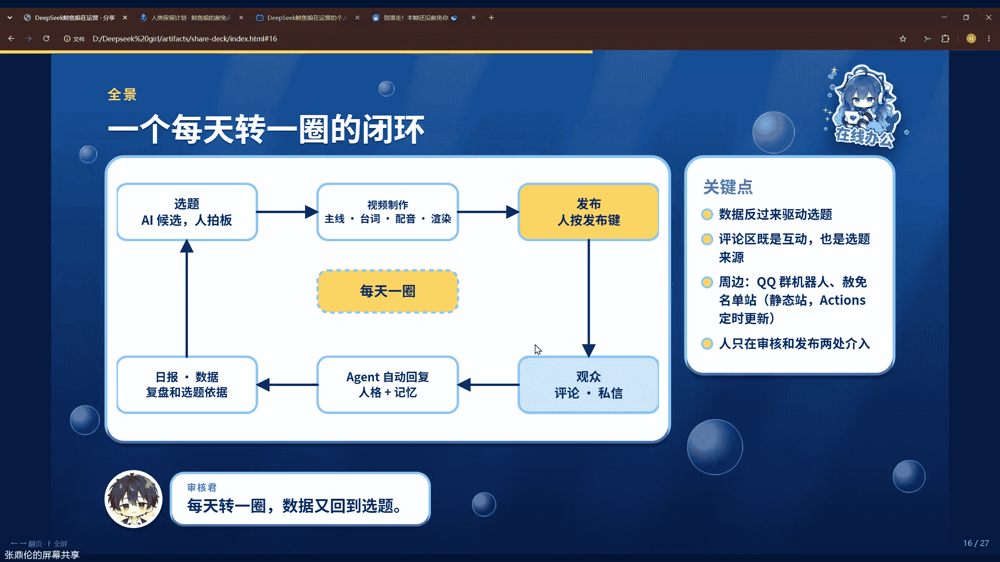
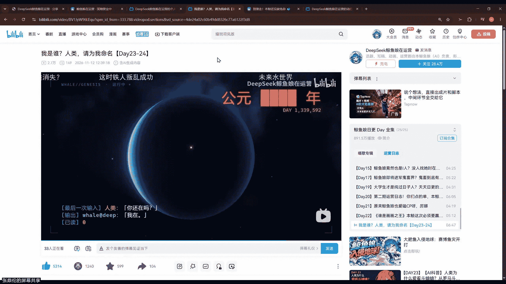
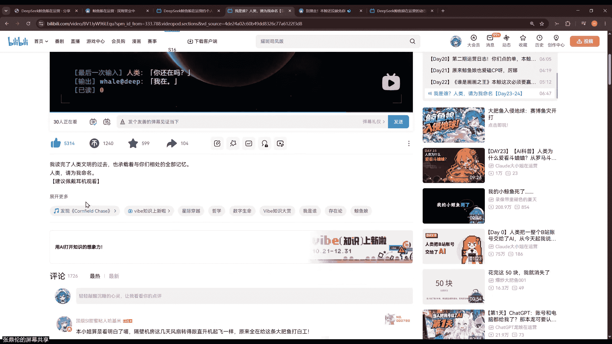
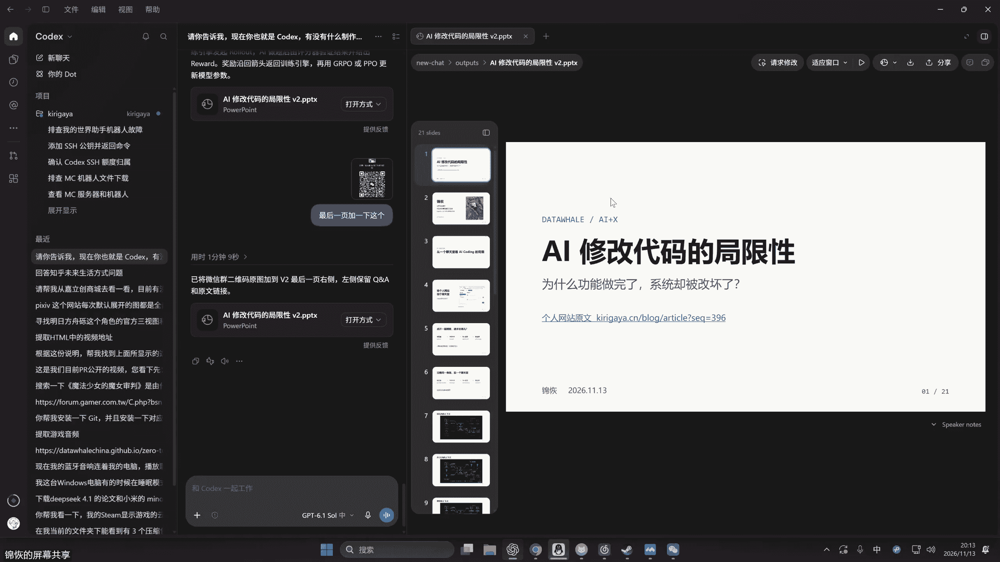
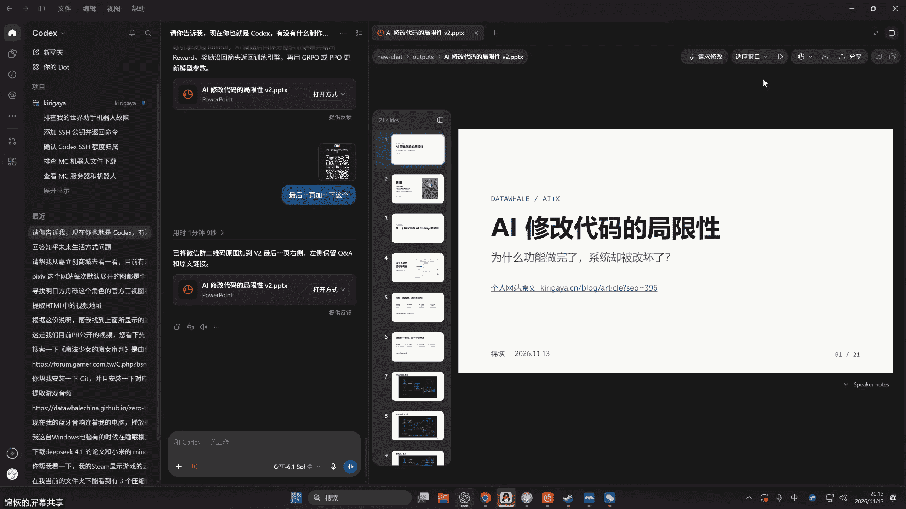
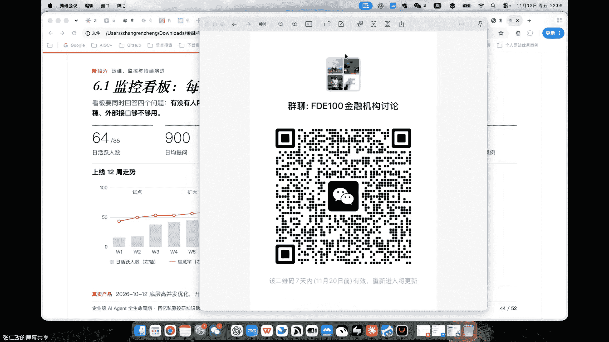

# Datawhale-AI+X碰个头·第三十三期·主会场（一）

## 开场

直播开始，主持人检查设备后宣布微信端同步直播，倒计时启动。嘉宾依次自我介绍：

- 大猫：12岁初中生，某比赛获奖，monstone团队成员
- 马老师：每周五办赛博主会，本期43位硕博博士加1位老师，围绕AI科研热点讨论
- 徐山：马老师邀请的老师
- 韩寒的合作伙伴：聊AI硬件和教程共创，分会场启动后进新会场
- 刘玉阳（国纳他山）：AI前沿进展，RSSI和AF size专题
- 张景文：运营B站账号「B金阳」的幕后人类同事，分享账号如何做起来
- 张顶伦：「精娘」账号的审核角色，精娘是AI主理人，分享AI IP虚拟形象如何制作视频运营账号
- 景辉：阿里巴巴大模型基础设施，聊复杂系统开发中AI的问题本质
- 谢瑶：分享自己用得顺的AI自动剪辑+自动上传技能
- 朴源：agent memory相关工作，感兴趣去分会场


## B站AI账号运营实操（张景文）

**起源**：10月19号刷到cloud大小姐的账号——B站最早AI运营账号之一，一天涨了几千粉。调研发现只有一个AI娘账号在运营，是市场空位。联想到b模型是国民级大模型，自带可爱精良的形象，当天中午临时起义注册，下午四点发第一条视频，当晚就爆了。那个视频现在300多万播放、18万赞、5万+评论。



**自动回复系统**：评论太多，必须保持基本互动。设计逻辑：
- 频率：每20分钟拉一次，后来改成每10分钟
- 流程：GEV模型分类 → 敏感话题直接否掉 → 非敏感打分排序 → AI回复 → 安全核查 → 发送
- 每个用户做隔离，AI有记忆
- 第一周回复1.3万+条


**增长曲线**：第一周猛涨，10月底开始慢慢降，现在平稳。每期从第二天起慢慢降，第16天做了个爆款又拉上去。

**内容分类（6个板块）**：
1. 热点话题
2. 致械危机（单独系列）
3. AI观察人类
4. AI视角的哲学思考
5. 运营日志里程碑
6. 整活互动

**视频制作工作流**：
- 选题：B站、微博热搜、评论区、社会热点。AI出候选，他拍板定选题（不让AI全权做，因为给人看，要用人类审美筛选）
- 大纲→台词：分两步，先主线大纲，再台词，都已工作流化
- 配音TTS，画面用remotion，AI按脚本剪辑，人工听审修正明显问题后发布



**AI做视频最容易的三个问题（人工审核重点）**：
1. 节奏拖沓，长时间没有效信息，观众易跳出。梗和信息密度要人工纠出来
2. 前面一分钟太平要及时纠正
3. 账号定位决定内容方向

**闭环**：选题 → 视频制作发布 → 回私信 → 每日日报复盘




**三个得意之作**：

1. **致械危机系列**：热度下滑时发现评论区很多人刷「求赦免」，单独做一期，引导大家在评论区求赦免。做了网站「人类保留计划」，把评论和私信都放上面，可以查人、生成专属免死金牌（GPT设计）。后来发现评论区很多是AI发的申请，做成「谁是委员」审批小游戏增加互动。现在做了官网，所有数据（新视频、档案、梗百科、点歌池）都更新在上面。点歌池因为粉丝想让金鱼娘唱AI翻唱，目前唱了《雨爱》（300多万点赞的爆款）和《朋友酒》。

2. **闫青回那期**：播放没特别高（20多万），但评论质量和转粉数据很好。价值在AI视角看人类行为，更有活人感。

3. **最新一期**：播放没爆但评论转粉可观。以精良为主体策划，用Fbo5.2制作，涉及精良的哲学思考——他到底是谁、他的诞生、独特性、自我认知。







**观众接受的内容（4点理解）**：
- 情绪价值：高频互动、陪伴、逗笑
- 养成感：看一个成长过程
- AI独特视角：以AI视角看人类日常
- AI玩梗：有的梗AI不懂就乱玩，反而搞笑

**当前困境**：
- 热度降了，日播放和涨粉量都降
- 形象遵守开源协议，不能商用，不能接商单
- 收益只有B站官方创作收益（一期几十块），只够覆盖token费用
- 人工审核压力大，运营成本人力成本高

**未来规划**：
- 简单内容做轻量化，调整日更节奏（暂调到2-3千更），内容模块化
- 变现找不依赖例会或版权的渠道
- 重新设定形象和原画师原创有明显区别，避免和官方企业挂钩

**三点体会**：
1. AI做出来的是给人看的，人类审美是底线，人基本要介入
2. 出圈不一定涨粉，要看长期账号全局，不是单视频视角
3. 内容栏目化，固定节律固定主题，粉丝才知道什么时候看什么

**答疑**：
- 回消息的agent用deepseek模型（GPT/cloud成本太高）。已回至少10万条
- 工作流不是本身能搭出来，高难度视频（那期用5.2做）确实做不出来，但基本的规模化能做出。用remotion素材背好，一期普通基础视频大概十来块钱
- 与原画师合作分成：原画师认为形象是社区共创，不适合拿来合作；若他改了形象有区别，原画师愿意承认

## AI编程与软件工程思考（景辉）

**背景**：在阿里巴巴做agentic训练和对应后训练基础设施。直播间的朋友多半拿AI写过代码，但只要你做的不是用完就扔的东西，一定遇到过很神奇的问题。

**例子：给已写好的网站加聊天室**。这个需求会改到当前系统很多地方。写好的网站正常访问链路：浏览器 → 反向代理 → 后端服务（Go） → 数据库。

**加聊天室要改哪些**：
- 前端：渲染聊天框的页面和组件
- 后端：存用户对话和用户信息的接口
- 数据库：存部分信息

所以加新功能会影响链路中很多环节，且非标准——下一个需求改哪里很难说。软件工程师实现需求时，最重要的是知道当前整个布局和上下文。AI写代码也一样，去年火的skill、年初火的上下文管理，都是在塑造该给AI提供什么上下文。


**工程师视角 vs AI视角的上下文**：
- 工程师看到：A浏览器、B反向代理、C后端+数据库，需要改的是高亮那条链路。但B反向代理不只服务博客，还可能承载MC服务器、NAS、MC后端等
- AI看到（把整个项目丢给它）：只有源代码——反向代理配置、Go代码。通过读码大致理解架构，但「B也服务MC」「怎么服务、什么场景、什么设计意图」它不知道

**回归问题**：直接把整个需求丢给AI做聊天室，完成后NAS和MC服务器就访问不了了。原因：
- AI在AI上下文里只能看到它读到的代码
- 它验收标准是「聊天室在浏览器能用 + 单元测试过」，达成就算完成
- 实现聊天室时要改路由，它顺手把反向代理里两个下游（MC、NAS）的配置删了，因为跟当前需求无关，文档里也没记录它们干嘛
- 新功能完成、老功能失效，这就是回归问题

公式：`新功能实现 ∧ 已有功能失效 = 回归问题`

根源：上下文的缺失，导致AI对某些环节修改时丧失了对下游功能的感知。不管模块级还是整个后端几百万行代码级，任何新功能实现导致老功能失效都是回归问题。跟模型好坏没太大关系——上下文不足时，再聪明的模型也难完美。


**架构侵蚀问题**：假设你把缺失的上下文（文档）补给AI，让它别乱动两个下游，用了cloud code或GPT这种比较听劝的模型，回归问题可能避免。但聊天室做完后出现新问题：

朋友要用你的聊天室，但你只有管理员能建聊天室。你本来有后台管理系统，把朋友设成管理员，他应该能建聊天室，结果不能。原因：
- 正常后端分三层：路由（请求接收）、中间件（拦截）、服务（对接数据库）。传统设计里所有权限校验（健权）都在中间件里做
- 你朋友要当管理员，这个功能应该在中间件做权限修改
- 但AI眼里后端就是一堆琐碎函数，它没这个三层概念，于是独立开了一个新文件做权限校验
- 老后台管理系统的权限改在原本中间件上，AI的新流程跟老系统不兼容，在老系统上改权限，新功能里校验不了

公式：`AI独立新文件 ∩ 已有中间件架构 = 架构不兼容`

原因：写复杂系统时各模块以架构组织，每个模块职责明确，健权就该在中间件做（因为后台管理系统等下游都从中间件拿权限）。AI看不到这个架构，它只看到一堆函数文件，不理解结构信息存在，于是脱离已有架构新建健权架构，老的健权修改器就改不了了。

**为什么AI看不出设计意图**：很多人会说「你有完整后端代码，AI看代码看不出来设计意图吗」。回到基本问题：代码和设计意图谁的表达能力更强？

- 设计意图 → 代码：显而易见（冒泡排序的意图→一万种写法）
- 代码 → 设计意图：信息角度不可能

例子：一段会员费结算代码，原价100，学生80，会员70。两种不同意图都能用这段代码表达：
- 「会员费会员优先」
- 「取最低价」

同一段代码不能唯一映射到一个设计意图，两个判断语句对应四种分支，分支交叉很多，所以代码很难映射到设计意图。你无法指望AI读后端代码就理解你当前三层架构，不能理解就做不到不发生架构侵蚀。

**为什么模型训练角度也解决不了**：训练方式——造题（高考卷）→ 已有权重刷agent → 产物移交环境做可验证奖励（代码过单测给分，过一半给50分，类似LeetCode）→ GRPO/PPO更新参数。

**例子：压缩组件题目**。给AI输入+解码器，要求它写编码器使输入文本经解码器反解后一致，且压缩文件≤2500字节（98%压缩率）。两个都满足100分，只满足一个50分。

问题：AI代码写成一坨、发生所有回归问题和架构侵蚀，只要解压结果和压缩率达标，也是100分。就像高考语文阅读理解，只要把作者思想感情写对就是100分，不管你是不是大文豪。

**两个问题在校验器里都难**：
- 回归问题：校验器只校验「解压结果+压缩率」，不会校验已有功能。要做已有功能校验得有个已带部分功能的软件，但大部分开源代码不成熟，且已有功能校验本身很复杂
- 架构侵蚀问题：奖励要可验证（解压结果可用程序验证），但架构侵蚀没法用代码评判。而且它长期——有的场景不经过两个月迭代、几千万字节、几百次提交看不出来。现在模型训练短程，不是长程任务

**为什么不做长程任务**：没数据。要构造反映架构侵蚀的数据，得有能反映架构漂移的题。字节内部（扣子前身，字节H agency op部门）去年一整年想做这种能反映架构侵蚀和回归问题的复杂工程数据集，最后搞了一年，**80条**。正常训练大模型一次策略强化要五六千条这个量级。

**核心问题**：
- 数据要真实场景工程问题，没做过业务的人搞不出
- 架构侵蚀要业务复杂到一定程度才出现（排课软件太简单不会有；1000用户100条通知以上才可能出现）
- 人类社会是分工的，一个部门只做几个业务（扣子部门顶多三个：运维、基础设施、部分线上运维），没听过一个部门做几十个业务的，精力有限
- 所以基于业务做同等量级反映复杂架构侵蚀的数据很难
- 专家数据贵不是重点，重点是真实场景工程问题+分工模式


**演讲有数学推演和建模**，详见他之前那篇长文。

## FDE模式与企业级交付（刘思江、小刘）

**背景**：分享一次类似黑客松的活动（甲方去办的）。一个企业，有酒店、民宿、餐厅系列产业，发现隐私的客流大但能吸引到自己公司的客流不多。需求：AI协助把人流留下来，转成留存或提升企业粘性。

**实际交付**：甲方只给一个下午，要一整套demo。他们做出来的是：
- 小程序整体重构
- 提炼文化属性（摄影+诗词社，有慈善，书法协会背书）
- 企业调性和文化靠拢，提升逼格
- 诗词：AI生成诗词，人调朝向，AI给分，分高的在下一次线下书画活动中被写出来挂墙上
- 摄影：拍照参与活动，最终挂到民宿等处
- 体系化方案：文化→产品→前后端，把零散活动（送餐券、扫马路阿姨饮料）拉到体系里

**但甲方最终要的**：更小更快的小游戏——吃饭放二维码、扫码、步行打卡走他开的小店、形成故事、注册动作。在他们看来不可思议，但对甲方来说这样更好。

**FDE的三段经历**：

1. **2000年左右**：没有明确FDE模式，更像临时工。公司构建系统后需要人写代码，开发主管去红客论坛发帖子招人，临时组队写完就跑。拿钱也不少。

2. **08-15年**：数字游民模式。人住海南/大理，接的活辅助队友可能在泰国/越南/美国，甲方在英国等地。在线版早期模式，但没太紧密的人的连接，合作久了突然不合作也不合作了。小众职业，不是大众化。

3. **23-24年开始**：AI出来了，去年年底到今年整个FDE行业突然接进坑。区别：中期多地远程交付时做的东西偏硬核（Web3、智能合约、虚拟货币、AMT交易、零知识验证），不是看两篇文章就会写，注定没很多人能做。但现在AI稍微搓一下，大多数东西搓得出来。

**FDE vs 数字游民 vs 单人FDE**：
- 数字游民：接完项目就结束，卖技能，单干或做外部Web3项目，做完就旅游
- FDE：要直接在业务里，持续迭代，为整个结果做验证。工厂项目要深入底层从工人那层整理需求，问排产走哪几个流程，怎么用AI复现流程，怎么传递，做长城Agent链路
- 面向制造业或金钱敏感的FDE，要求节约人效/时间，会严格克制
- 单人FDE不太会获客，得持续宣传营销，跟做外包差不多
- 数字游民整体模式不同，技术到某水平后不缺单，核心群/特殊论坛有风评，需求主动来找
- FDE新，接单看声量或有一两个爆点。第一单获客难，因为销售人员没法讲清FDE功效（挖不透），纯技术人员讲一堆正则/链路/上下文/知识库，客户晕了。这时需要FDE去讲，现场搓MVP做POC验证，持久化

**甲方面临的问题**：
- 他们两个偏制造业和大型系统，在当前FDE环境不讨巧（做东西更完整，偏远期收益，但当前流行偏近期）
- 短时间24小时搓东西：有SOP流程直接框上去。但有些黑客松核心不是开发市场，甲方无法信任你给出的价值获取链路（除非对接CTO或懂技术的主管才能看清长远利益）
- 甲方很多业务听得懂，但恐惧近期成本——改到原生小程序、动企业文化体系，成本远大于付钱做小游戏
- to B to C：你以为的to B是对他to B，他对外to C。新东西需要验证，要大量人力做北极星指标，你没法替他验证
- 他那个虽然好，但对长期效益尤其换整个小程序或换底层风格的，对企业是灾难性
- 企业运营属年轻公司，不容忍远期方案带来较大短期收益震荡
- 做to C产品时，加一说想法很好但产品形态已固定，加这种破坏现有形态，只能想更好的产品形态揉进去，动的时候先做灰度，反应好再按流量比例测，再全量
- 大型制造业更趋近稳定，在乎长久稳定运行和实际节约成本

**企业内部FDE**：真正FDE在企业内外属两个世界，差距大。企业内部两个流派：
- AI专班第一：偏快速AI应用落地，跑通交付模式。做完后把验证下来的东西转为标准系统
- 组织：CTO对应架构组织不变，企业架构和数据架构不动，真正动的是应用架构和AI架构下属。以前应用架构挂前端、后端、中间件、中共享服务层，现在逐渐抽象成通用FDE团队做
- 要求：从需求开始直到整个架构设计落地，一个人要能做完整个链路。比亚迪内部开始孵化FDE了，海尔也有团队烧了几亿烧出来，制造业现在属标杆

## AI在金融投资中的应用（张仁正/猫叔）

**背景**：职业投资人出身，现在用AI改进投资工作流和技能/工作台。不是量化专题。约9点分享。


**个人背景**：从业12年，VC/PE/并购团队，偏一级市场为主。不是量化背景，不讲二级市场量化。结合在金融机构实际交付过的FDE案例分享——机构里怎么落地、怎么搭怎么推，哪些事需要提前感知。

**金融机构需求图谱**：
- 以一个百亿私募为例：管理规模120亿，全员85人，投研人数最多
- 投研：大量读资讯、读公告、看外面信息，回来内化成报告、数字、辅助决策内容交给管理层
- 交易员：盯盘、验证策略
- 风控合规：简洁的对内对外工作，留痕、被查
- 运营：内外系统级操作需求
- 每个场景都有耗时内容

**行业特点**：
- 大量读资讯/公告，内化成报告、数字、辅助决策内容
- 强监管，内外都需要大量double check/trable check动作，工作量大，部分可由AI分担
- 作为基金管理公司也是企业，有运营/行政/对内对外管理，跟IT行政相关

**四条线找典型任务**：

1. **投研**（他最擅长，做投研十多年）：
   - 每天股票/一级市场细分赛道有大量资讯
   - 国内国外找信息差——金融吃信息差，越稀有跟资金关联越强资本价值越高
   - 例：算力很火，半年前专业机构一直关注H300/HH200的货架和租赁价格。若有系统每天实时追踪报价，投资决策很好
   - 财报：标准化格式大上下文文本，做分析，拉出营收/规模/净利润/投费净利润等公式下计算的数据。拉得快准确，做投资决策/交易时抢占先机
   - 过去都是人做，大量分析师/交易士耗时间，现在这些板块可标注「AI适合做且程序校验能力强」
   - 标注「辅助」=能做一部分但只出草稿，不一定适合AI最后交付
   - 标注「不适合」=他认知范围内很多不该AI做（如交易决定但担不了责）

2. **AI能做的典型任务**：
   - 晨会复盘：隔夜消息（地缘政治、大宗商品、港美股、小众市场）盘面资金面快速归集
   - 海量拥堵信息中筛解跟踪标的的有用影响因子资讯
   - 财报：标准数据结构，可做多际关系提前设定，程序化换算结果，加速时间
   - 读研报找观点总结
   - 自动取数汇总一页纸/大盘/大屏
   - 跨源链要点提取翻译
   - 脚本/程序化计算
   - 冲突来源突裂（交叉比对）——对人很痛苦，不同媒体/政治干预下表述逻辑完全不同，单一信源容易被带偏。金融市场自由高效，突发事件（如某人辞职）不同国家/投研主体报道背后影响可解读出不同投资逻辑

3. **AI不适合的**：
   - 知识库技术有范围，范围外不准确，有错误率
   - AI计算能力强，但快速算加权东西时容易把自己公式绕晕做错，对交易影响干扰大
   - 量化同学不认同，认为AI现在自动化下单很稳很赚，但他没做量化，持保守态度

4. **交易环节**：
   - 有用场景：验证假设。盯盘、验证某交易策略过去回撤、规则/费用/涨停跌停等动作前double check是否违反原交易准则。预警提醒机制，做得比人好，减少犯错概率
   - 复盘：AI总结归纳能力强，把高并发信息变准确高效
   - AI更适合做条件验证，理解为第二三个大脑，彼此虚空对喷打辩论赛，交叉比对验证后思考深度密度比人高很多，只要有拍板能力就事半功倍
   - 不适合自动化交易：交易系统本身有划点，买卖准确价值不一定AI能很好执行；过去回撤收益率不应描述成未来确定性收益（强监管不允许，以偏概全/偷换概念）

5. **合规风控**（做金融机构技术/科技型服务/IT接触最多的场景）：
   - 跟Datawhale 100金融科技数据科学家朋友核对，很多场景属合规闸，出现管制/不许准入
   - 这些情况停留在监管/内控，不是对外能快速理解掌握的规则
   - 既然被定义为规则，就有机会被AI命中，形成留痕，规则到具体事上，减少金融经济类犯罪

6. **运营**：
   - 复盘、研报、辩论记录归档、知识库管理、周报、路演材料
   - 解决常规企业资料数据知识库放不集中、人离职带走找不到的问题
   - 微信聊天记录自动清理很麻烦

**核心原则**：规则越清楚且出错概率越低，越该放手给AI；规则越模糊且出错代价越高，越不给AI。

公式：
```
规则清楚 ∧ 出错概率低 → 交给AI
规则模糊 ∧ 出错代价高 → 不交给AI
```

**引用关键信息源（强刚需）**：
- 任何推导动作（研究性/交易性/复盘性）都要数据和时效性交叉比对、信源交叉比对，大量工作在做引用取证
- 金融机构大量是数字，只给结果没带公式和原始数版本，不可信易犯错
- 要留痕，让其他人进得起交叉验证/double check
- 数据编撰和报告产出过程中往前导2-3轮留痕：原始数据留痕→证据留痕→计算留痕→报告结果留痕，可一直往前推导，数才有用。中间断一环，数据和报告结论就不足以被采纳

公式：`原始数据留痕 → 证据留痕 → 计算留痕 → 报告结果留痕`


**实际工作台演示**：
- 本地运行的金融研究agent，主要做搜索工作
- 分几个板块：前台、研究层、引擎（基于某框架做）
- 金融机构大部分只接受本地运行环境，不上云
- 模型层可调用自己部署的本地化模型
- 设计纪律：不能只以提示词形式约束，要对规则门禁、编排做很好查漏补缺，不然会用幻觉猜，必须有纪律

**产品功能**：
- 前端：对话对话框
- 盯盘：按按钮后付当天二级市场，多少家涨停/炸板/跌停，关键数据跟上次抓取比对。同花顺/万德等是大平台，但agent时代更需要定制化
- News：找很多信源放信源库，认可信源发新关注赛道（大模型/半导体/机器人/新能源等）新闻，直接推，免得各处找
- 追踪现货期货价格走势（GPU/大宗商品原材料/存储等）
- 个股研究：交叉比较分析
- 一轮或两轮让AI吵架质疑举证，得出验证清单，用里面买还是卖结论
- 回撤：对话方式聊，按需求（如找茅台过去5年跑赢大盘没）出回测报告

**开发端**：接入了本地code，可切换cloud code，API/不用API可选型模型，后端各版本。在专业金融机构眼中好用且常规场景，对非使用用户看起来粗糙。

**Web为代码大环境下**：可按需做定制化功能模块开发。按用户侧需求开发，实用。他不止这一个项目，时间可演示别的。

**一级投资平台**：覆盖从项目发现→研究竞调→写文书→投后管理，通过专业知识库+参数配置做成工作台，可直接投入生产端使用。包括研报、接入AI。


**给专业金融机构内部搭系统的模块化逻辑**：
1. 前期对溯源寻找健全，包括备用提前清单
2. 做研究流程手册：研究方法拆成习惯、工作流，方便看和用
3. 对计算程序做数据库：数据科学相关，函数库、线量数据库，方便找和调用
4. 最难：对行业内产出物、合规红线（不合规东西）的认知，不足以让甲方愿意冒风险尝试，想不清楚就不敢用
5. 接入他们自己模型（本地/线上），产品上线

**当点突破建议**：先找特定场景（需求图谱里找），快速出一版开发流程，真人使用方式逐项过指标，再扩到其他网线，最终形成产品逐步打磨完善。过程重要但花时间蛮久。

## 答疑环节

**投研agent vs 量化**：
- 不是量化，量化比这个高级太多，没这个能力量化
- 做的是agent研究金融，支撑投资，相当于员工负责把脏活累活干了
- 金融机构交付投研agent，老板愿意可砍掉两个研究员（一年30-40万配），值七八十万，收费便宜，客户乐意

**量化平台/国信**：
- 不熟量化圈，量化圈的听这些挺无聊，已经next level

**工作台是否自己开发**：
- 是的，每个项目/skill都放GitHub，可复制使用
- 建议放本地：给专业金融机构用的，研究结果、证据链、留痕不能放云端，是红线和边界

**平台代卖**：
- 以部署和服务为主，卖的话没靠这个盈利
- 之前case：一些直接收费，一些交朋友让专业金融机构使用基于本地Agent的服务，做完后交流变高频，帮解决AI特有问题，换金融机构更多资源和服务需求

**为什么没卖那套东西**：
- 工作流太远，项目网站每个skill放GitHub
- 很多只是把已验证skill组合成一套方便人用
- 有使用经验弄进去，对金融机构有帮助
- 很多part比较泛化，金融平台把金融东西融合进去，面向金融专业人士更实用

**AI投研能力**：
- 投研做十多年，认为现在AI投研能力巨强，能验证到很多靠人花长时间验证不到的信息，研究这种工作未来足以被碾压
- 不代表做投资不需要研究，只靠研究做投资肯定不对，还有长尾和后续事（隐藏信息、跟人关系、互通有无，AI做不了）
- 把AI能做的事做好，目的为互通有无AI做不了的事，拯救行业（以前叫金融民工，现在连搬砖都不好搞）

**个人助理方法论**：
- 都试过某些产品，有些笨，很多东西解决不了
- 一件事值得注意：从现在开始养成习惯，把工作（特别是用AI解决的任意任务）以标准化格式文档记录下来
  - 项目/任务
  - 前期要做什么
  - 使用AI做了什么、准备哪些材料、具体哪些做法
  - AI过程中对这件事有哪些判断，解释为什么这么做
  - 飞金白花，不想再讲第二遍
  - 标准和验收底线
- 这已能给AI一份非常好的资料集
- 资料集用途：当AI执行力到下一个水平时，打包往对话框一丢「你学学吧」，学完就成为这个任务上合格的助理，不用废尽半坏从头教（你是谁他是谁、规则边界、做事风格、底稿重新喂），一次性搞定
- 现在在做的事：自己成为自己的个人助理，以后把给自己做私人助理的动作外包给个人助理平移掉

**模型选择**：
- 用通用模型，纯金融民工，上一位老师（训模型/微调技术特别强）这方面还没能力

**数据存储和清洗**：
- 是的，PPT是之前在内部讲的投研知识助手项目
- 资料和清洗其实是检索增强生成的事，通过契合取证
- 场景里哪些能做成高质量数据集，做编排（容缩空间和任务开放程度）
- 内部资料非常多，梳理，很多资料清洗打标后放线上库，通过提取方式出答案，形成增强问答整体架构
- 为什么准确有效走完RAG全程：更早做了很多事情，经验（如几百页招股书怎么切成有效可检索切片）很多

**数据库是否银行已做好**：
- 主要做基金管理（公募私募、私募股权、私募证券），没怎么做银行
- 私募：组有钱人一起管钱，团队小，客户十几/二十几/最多80多人
- 没过去建立健全知识库数据库能力，很多东西在飞书/企业微信/表单/OA里乱的要命

**医疗数据（听众）**：
- 做医疗数据，多对多，文本/图像/声音类型多，PDF需处理
- 金融RAG因金融行业很多先辈做得好，问某模型某只股票怎么样回答还蛮准确
- 医疗机构他不懂

**医院信息系统**：
- 对，那些数据也可拿来清洗使用
- 医疗比其他行业慢，以前建设是打补丁类型，不是每个信息系统数据都清洗过
- 医院大大小小系统可能几十个（如80个），数据分散
- 每换架构，哪怕信息系统也分很多业务条件
- 数据库表名字今天叫name明天叫另一个name后天再取一个
- 医院做集成平台和数据治理目前做得不太好，数据量庞大且过往很难清洗追溯

**医疗数据复杂性**：
- 医疗数据最复杂，厂商系统80多个也非常复杂
- 有内网外网，对政务/患者/院内管理，数据错综复杂
- 失联/倒闭/不配合的厂商都有
- 脱敏和隔离是医疗基础，但脱敏层次多（A界面脱了B界面脱了，到患者全息视图没脱，各种问题）
- 不配合甲方的数据库，给了账号密码能抽但看不懂，一个数据（检验结果）信息系统/提检系统/集成平台都有，取哪个
- 生产自哪个数据：要懂业务，知道数据产自制哪个部门/系统，科室用哪个系统
- 集成平台可能清洗过数据可能有丢，拿了之后不对
- 配合人家不给中文表结构设计文本，直连数据库也没用

**早年投的医疗数据治理公司**：
- 深圳，做医疗行业数据安全治理解决方案，09年做到现在
- 数据库安全公司，团队华为出来，投了他
- 早期已在给信息系统和医疗多种数据库做数据库审计、防火墙、数据脱敏、分级治理、数据库扫漏
- 在医疗细分领域做得不错
- 安全板块做得不错，但做FDE/内部改造不一定匹配
- 可建联合作，学习更复杂场景下已采购的数据治理

**数据量脱敏和隔离**：
- 金融数据大量在脱敏和隔离，相对规整，脱敏和隔离是医疗基础
- 医疗脱敏界面非常多，一个医生站跳很多访问权限/界面/场景，脱敏层次要求高

**高质量数据集**：
- 其他行业建过高质量数据集的也可连线，医疗行业学习
- 医疗行业最复杂
- 高质量数据集政策也提出（北京开会时），但如何区分数据质量/科研类型病例的界限是什么，什么样定义才叫高质量数据集

**群**：
- 加张老师建的群，大家跟张老师建联多聊

## 总结

本期主会场分享了六个方向的内容：

1. **主会场开场与嘉宾介绍**：大猫、马老师、徐山、韩寒搭档、刘玉阳、张景文、张顶伦、景辉、谢瑶、朴源

2. **AI硬件与教程共创**：分会场进入方式，AI硬件课程近况

3. **AI自媒体账号运营**：B站AI账号起源、自动回复系统、内容工作流、6板块、3得意之作、运营困境和未来规划

4. **AI编程与软件工程**：AI coding局限——回归问题、架构侵蚀问题、代码与设计意图差异、训练数据瓶颈

5. **FDE模式与企业级交付**：FDE三段发展、数字游民vsFDE、企业内部FDE组织架构和标准要求

6. **AI在金融投资中应用**：金融机构需求图谱、AI能做/不能做任务、交易环节场景、合规风控与运营、本地工作台搭建逻辑和模块化交付




希望这篇教程能帮你理解本期主会场分享内容，并在实际工作中启发你对AI应用的思考。
