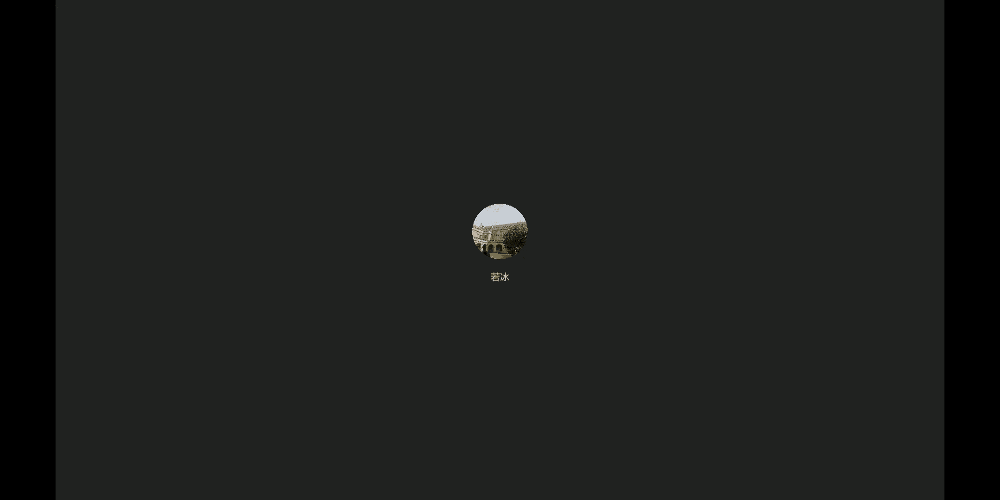
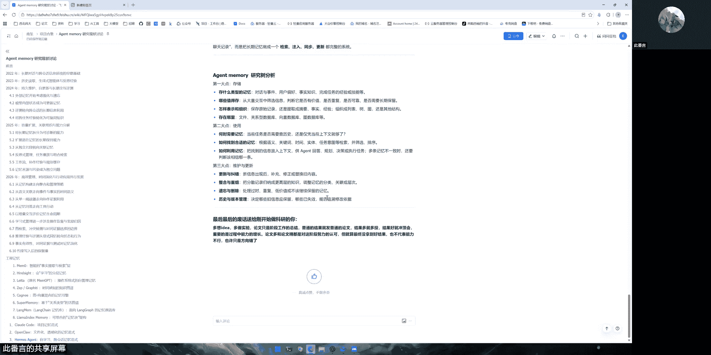
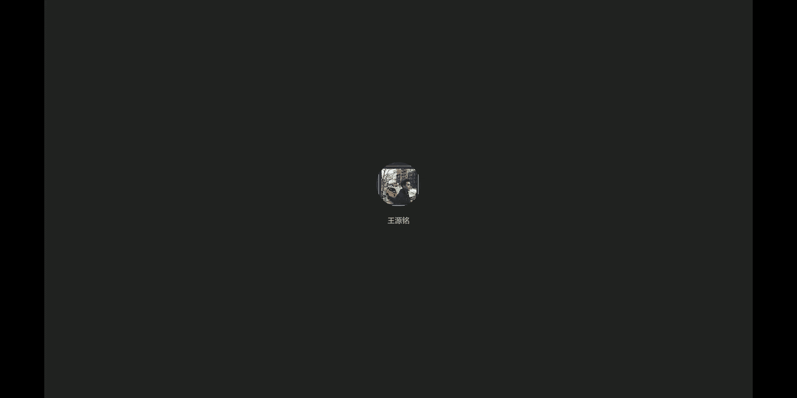
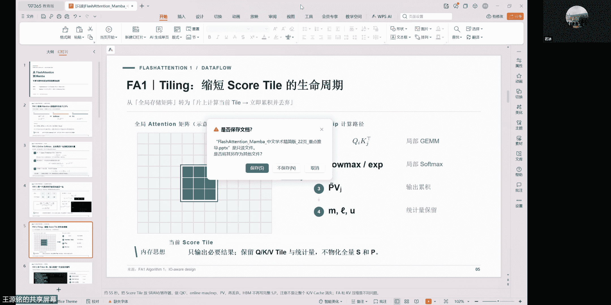
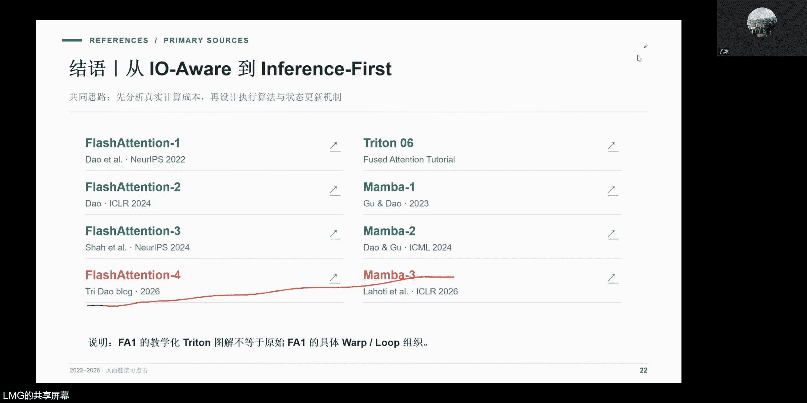
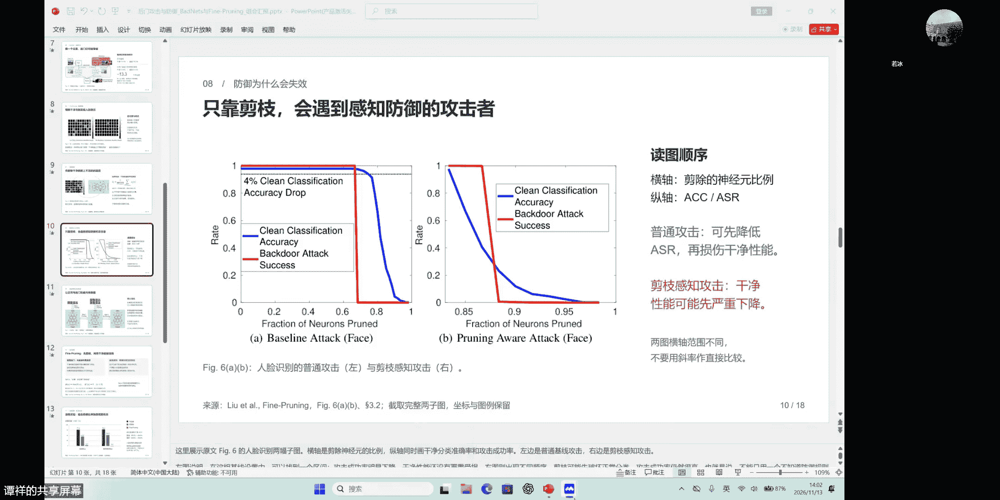

## Datawhale-AI+X碰个头：33-3：课程概述 🎓

在本节课中我们将要学习Datawhale-AI+X碰个头第三十三期分会场（三）的全部内容。本次分会场邀请到了多位嘉宾，围绕科研经验、Agent Memory、深度学习算子优化以及模型安全等主题展开讨论。徐山老师将从AI时代的科研能力、文献阅读方法、论文写作技巧以及投稿注意事项四个方面分享科研经验。辅源同学将介绍Agent Memory的学术发展历程和工程框架。元明同学将解析Flash Attention和Mamba的核心原理。安翔同学将讲解深度学习中的后门攻击与防御方法。通过本节课的学习，初学者可以了解科研的基本方法论，掌握前沿AI技术的工程实践要点，并建立对模型安全问题的初步认知。

---

## Datawhale-AI+X碰个头：01：AI时代的科研能力 🧠

上一节我们介绍了本节课的整体安排，本节中我们来看看徐山老师关于AI时代科研能力的分享。

徐山老师是燕山大学副教授，长期参与Datawhale社区建设，主持过多个科研基金，发表过多篇学术论文。他在分享中提到，AI时代的科研工作流正在发生深刻变革。AI可以加速阅读文献、实验设计和实验改进等环节，因为AI的知识储备积累速度远超个人通过阅读积累的速度。然而，科研中真正不变的核心能力，是研究者必须对自己的研究方向和课题基础有准确的认识。

AI容易出现幻觉，即生成看起来合理但实际上无法在短期内实现的科研方案。研究者需要具备判断能力，分辨AI提出的科学问题是否真正可行，不能被AI生成的看似美好的科学问题带偏。因此，无论AI如何介入科研流程，研究者首先都要清楚自己研究的方向和课题是什么，对基础概念要有深入理解。

徐山老师还指出，什么样的问题才叫一个好的科学问题，很难给出简单的定义，可能需要花费数十年甚至一辈子去寻找。这是学术研究的终极理想，也是每位研究者在不同人生阶段都会面临的困惑。

以下是AI时代科研能力的核心要点：

- 基础积累与初期实验设计：AI可以显著加速
- 科学问题的寻找与理解：不能被AI替代，必须由研究者独立完成
- 判断AI输出的可行性：防止被AI幻觉提出的伪科学问题误导

---

## Datawhale-AI+X碰个头：02：从零开始阅读学术文献 📚

上一节我们讨论了AI时代的科研能力，本节中我们来看看如何从零开始阅读学术文献。

很多小白在读研阶段第一次接触文献时就会感到卡壳，不知道如何下手。徐山老师建议，对于没有太多基础的同学，可以先跳过引言（Introduction）和相关工作（Related Works）部分，直接阅读摘要之后跳到方法论（Methodology）。引言部分更多是讲故事，新手没有必要一开始就学习如何讲故事，而应先学习别人如何用科学方法解决具体问题。

以下是徐山老师推荐的文献阅读步骤：

1. 阅读摘要，了解文章大意和核心贡献
2. 跳过引言和相关工作，直接阅读方法论部分
3. 提取文中使用的方法名称，例如蒙特卡洛方法，先只记住名字，暂时不纠结具体细节
4. 查看实验结果，了解这些方法最终得到了什么样的结论
5. 对比不同文章的方法差异，例如第一篇使用ABC方法得到了某个结论，第二篇使用ABD方法得到了相似结论，从中分析C和D方法的区别
6. 当对方法有足够信心后，再深入研究方法的具体细节

这种方法适用于不同学科，虽然具体差异可能较大，但核心思路是先从方法和结果入手，再回溯到研究问题，逐步建立对文献的理解。

---

## Datawhale-AI+X碰个头：03：如何讲好科研故事与撰写论文 📖

上一节我们介绍了文献阅读方法，本节中我们来看看如何讲好科研故事。

徐山老师认为，写论文的本质是讲一个好的故事。无论是土木工程还是计算机科学，文章结构上应该比较接近。一个完整的科研故事应当包含以下几个部分：

- 声明你做的是什么具体的东西
- 解释这项工作有什么意义
- 提供背景，说明为什么要做这项工作
- 回顾前人做了什么，即国内外研究现状
- 指出前人研究的空白，说明自己的研究尝试填补这部分空白

很多学生容易追逐热点，今天看世界模型，明天看Agent memory，后天看RSSI，导致方法碎片化，没有体系，最终拿着锤子看啥都像钉子。科研的前提是要有好的科学问题，有了科学问题才能将其作为线索串起整个故事。

---

## Datawhale-AI+X碰个头：04：科研工具选择与SCI投稿注意事项 📝

上一节我们讨论了论文写作的故事化方法，本节中我们来看看科研工具选择与投稿注意事项。

徐山老师本科毕业于工程科技专业，硕士主修环境与地制工程，博士是力学博士，与人工智能和算法不直接相关。他通常听从学生推荐好用的工具，而不是强推特定工具，因为学生在工具使用方面更专业。

在投稿SCI期刊时，最直接的指南是期刊本身的Guide for Authors。不同出版社，例如Elsevier、Springer、Taylor & Francis，其投稿指南大致相同。很多同学文章写得不错，却因忽略投稿要求而被直接拒稿。例如，某期刊要求图表不允许有内网格，只允许外框，结果因违反此规定被技术检查直接拒稿；又如，某期刊要求8000字以内，写了8100多字，也在第一关被拒。

有些期刊的拒稿由文字编辑直接决定，甚至学术编辑都未看到。有的期刊友好一点，会要求修改后重投，但也有的一旦打回就不允许重投。

以下是投稿时的关键注意事项：

1. 投稿前务必仔细阅读期刊的Guide for Authors
2. 确保字数、图表格式等硬性要求全部满足
3. 尽可能使用学校学术邮箱投稿，避免使用公共邮箱，防止被误认为论文工厂
4. 关注期刊的Time to First Decision，即首审周期，有些期刊7天内就会给出拒稿或送审结果，有利于及时调整投稿计划

---

## Datawhale-AI+X碰个头：05：Agent Memory的学术发展与工程实践 🤖

上一节我们介绍了投稿注意事项，本节中我们来看看辅源同学关于Agent Memory的分享。

辅源目前在香港金融科技公司做AI顾问，研究Agent Memory。他从学术和工程两个视角介绍了Memory的发展。

从学术视角看，Memory的发展可以按时间线梳理。2022年之前，基于RAG的机器人对话就已经考虑在长对话历史中检索相关片段。2023年，大模型应用后，出现长常记忆、Agent模拟小镇、ReAct等工作，开始将任务反思写成文本。2024年，模型能力提升，研究不同框架下的记忆方向，包括外部记忆强化、参数微调更新记忆、测评手段等。2025年，模型具备COT能力，长期记忆变为可诊断能力，出现动态树、图关联等存储结构。2026年，出现层次化记忆、图结构存储等新方向。

从工程视角看，几个比较火的框架包括Mem0、Letta、GPT提出的操作系统式记忆管理、双态知识图谱、SuperMem、LangChain和LlamaIndex的记忆框架等。此外，Cursor和OpenCode等项目也体现了工程化的Memory思路，例如通过Markdown文件实现项目级记忆。

辅源总结，Agent Memory的研究可分为三点：

1. 存储：判断哪些值得存，如何表达和组织，存在哪里
2. 使用：何时使用，如何找到合适的Memory，放在什么位置供Agent调用
3. 维护与更新：如何补充、修正、替换旧内容，如何整合和重组分散记录，如何遗忘和删除过时信息

---

## Datawhale-AI+X碰个头：06：Flash Attention原理与算子优化 ⚡

上一节我们讨论了Agent Memory，本节中我们来看看元明同学关于Flash Attention的分享。

标准Attention是分离式的，包括一个GEMM、一个Softmax、再过一个GEMM，会产生N乘N的中间矩阵读写状态。其中N是序列长度。当N为4096时，N乘N的矩阵会占用大量HBM显存，且访存开销成为瓶颈。

Flash Attention的核心思想是在线Softmax。它改变了计算顺序，不引入近似，核心结论是浮点结果可能因计算顺序不同而略有差异，但本质上与传统分离式Attention结果一致。

Flash Attention的核心公式如下：

Attention(Q, K, V) = softmax(QK^T / √d_k) V

在在线Softmax机制中，需要维护三个统计量，分别是最大值M、归一化系数L、累计输出O。新数据到来时，仅更新这三个统计量，无需保存完整的Attention权重到HBM。

以下是Flash Attention的关键机制：

- 重写注意力分数计算，使用最大值M进行数值稳定性缩放，防止指数级数值溢出
- 维护三个统计量：最大值M、归一化系数L、累计输出O
- 新数据到来时，仅更新这三个统计量，不必再把Attention权重写到HBM
- 通过Tiling（分块）结合，将矩阵划分为小网格，在片上计算，减少昂贵的数据搬运

Flash Attention增加了计算量，但减少了显存搬运（IO），用计算换显存，整体反而更快。反向传播同样采用类似思想，不必保存完整Attention权重，在片上重新计算。Flash Attention 2针对A100等卡的变行效率问题，对Q进行切片，并优化了H100上的并行能力。

---

## Datawhale-AI+X碰个头：07：Mamba状态空间模型解析 🔄

上一节我们介绍了Flash Attention，本节中我们来看看Mamba状态空间模型。

Mamba最初源自自动化控制原理中的连续时间SSM。状态空间模型的基础公式如下：

h'(t) = Ah(t) + Bx(t)
y(t) = Ch(t) + Dx(t)

离散化后，可以用固定大小的递归状态处理不断增长的历史，但代价是有限状态不一定能保留全部历史细节。Mamba将固定参数改为动态参数形式，使Delta、B、C依赖于输入，模型可以控制状态更新、信息写入和读取。

Mamba 2进一步限制状态转移矩阵为对角矩阵，共享表量，并引入复式旋转扩展自由度，使状态不仅可以衰减，还可以旋转和震荡。

Mamba的核心Insight是复合函数满足结合率。状态更新是仿射映射，即线形加偏移，满足结合率，因此可以将原来沿时间顺序的递推重新组织为并行计算，通过改变计算顺序实现高效训练。

Mamba 3以推理优先为动机，解决Decode阶段显存带宽限制更严重的问题，通过改进梯度计算和权重近似，减少数据搬运量。

---

## Datawhale-AI+X碰个头：08：深度学习后门攻击与防御 🛡️

上一节我们介绍了Mamba模型，本节中我们来看看安翔同学关于后门攻击的分享。

后门攻击针对深度学习模型，而非大语言模型。攻击者在训练阶段植入触发器，使模型在正常输入下表现正常，但在特定触发条件下输出错误结果。攻击同时追求两个目标：在干净数据上验证达标，隐藏模型被攻击的事实；在触发后门时，攻击准确率高。

BadNet等工作提出，网络结构保持不变，仅对权重进行微小改变，当累积到一定参数量时，后门被触发。训练时混入带触发器和攻击目标标签的样本，使模型学习错误行为。

防御方面，剪枝可以降低模型可学度，删掉不活跃的通道。但单靠剪枝防御可能遇到感知防御的攻击者，攻击者知道防御规则，先破坏正常功能，攻击成功率仍然高。因此不能用不知道防御规则的攻击者来证明防御有效。

组合防御方法，即先剪枝后微调，可以同时处理普通后门和感知攻击。剪枝可以切掉后门路径，微调恢复正常任务性能。

---

## Datawhale-AI+X碰个头：09：课程总结 📋

本节课中我们一起学习了Datawhale-AI+X碰个头第三十三期分会场（三）的全部内容。

徐山老师分享了AI时代科研能力的核心：AI可以加速文献阅读和实验设计，但寻找科学问题和理解研究方向仍需研究者自身完成；阅读文献可以跳过引言，先从方法和结果入手；写论文本质是讲故事，需要有好的科学问题作为线索；投稿时务必阅读期刊指南，满足硬性要求，使用学术邮箱，关注首审周期。

辅源同学介绍了Agent Memory的学术发展历程和工程框架，总结了Memory的存储、使用、维护三个核心问题。

元明同学解析了Flash Attention的在线Softmax机制和Tiling优化，以及Mamba状态空间模型的动态参数、结合率并行计算和复式旋转等创新。

安翔同学讲解了深度学习后门攻击的原理、BadNet的攻击方法，以及基于剪枝和微调的组合防御策略。

通过本节课的学习，希望大家能够建立科研的基本方法论，了解前沿AI技术的工程实践要点，并对模型安全问题有初步认识。

