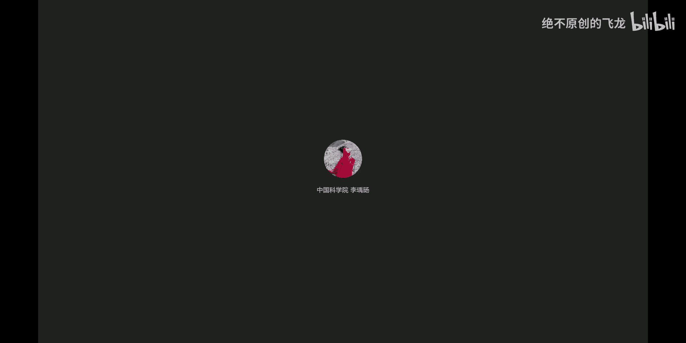
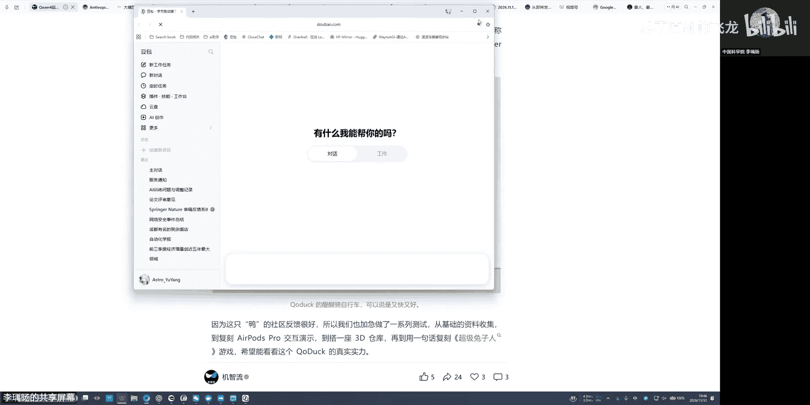
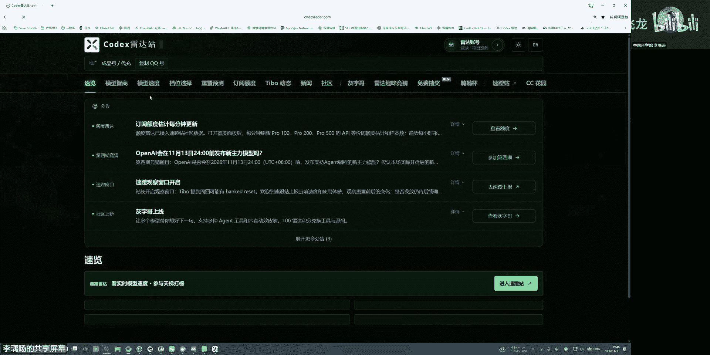
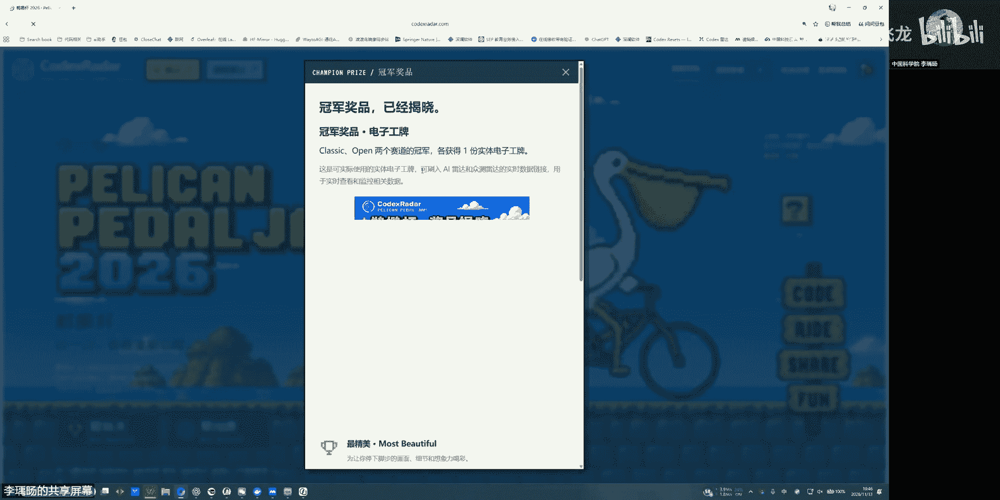
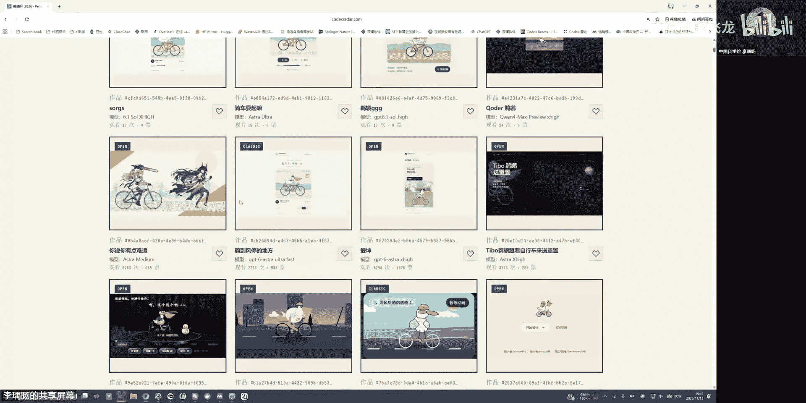
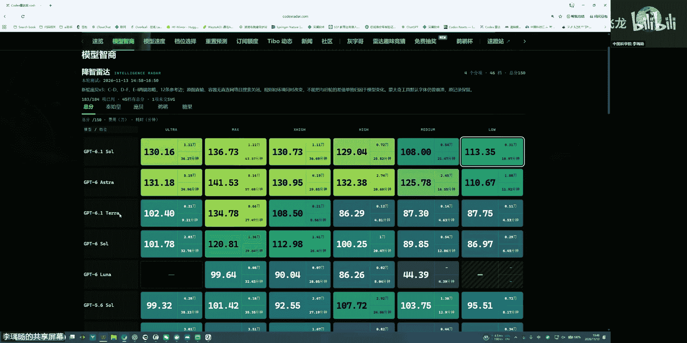
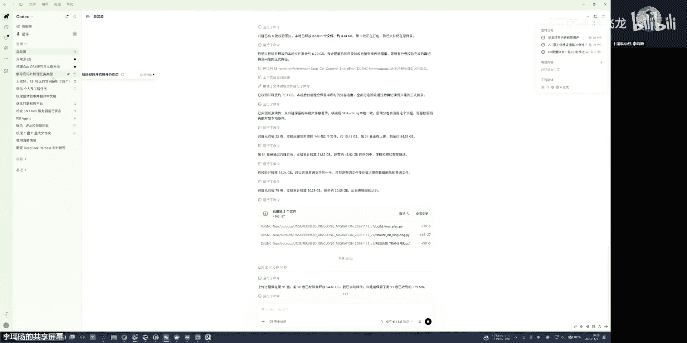
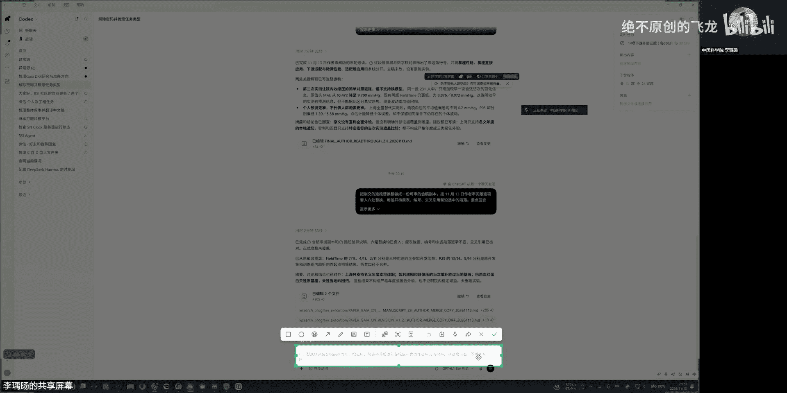
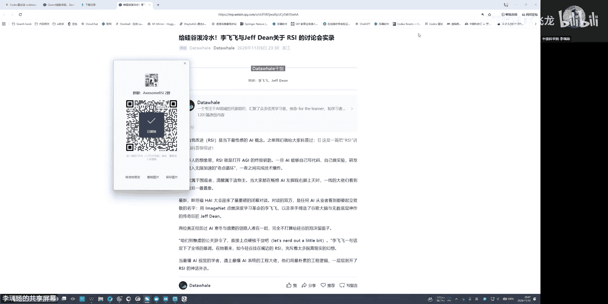
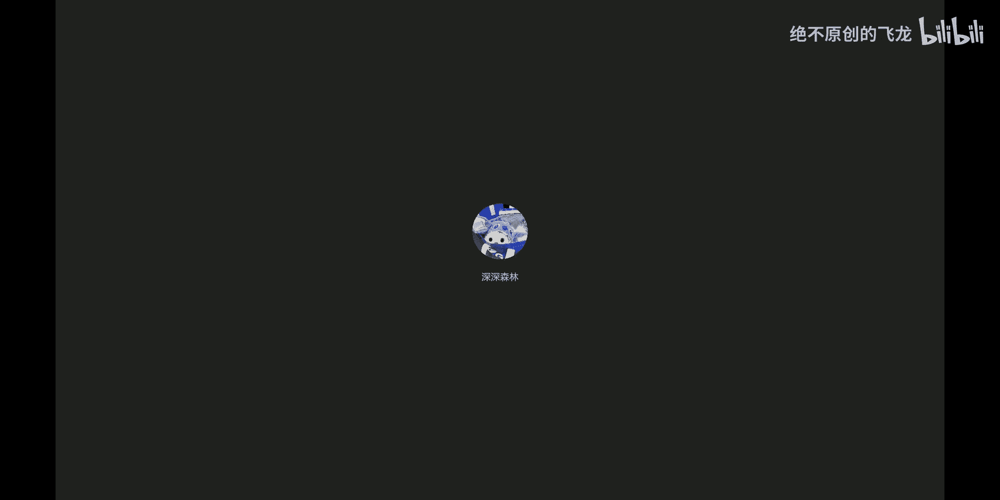

# Datawhale AI+X碰个头：33：模型前沿与递归自我改进🤖





在本节课中我们将要学习最近发布的主要AI模型，理解什么是递归自我改进，并探讨如何在科研场景中落地这些技术。我们会先梳理语言模型和多模态模型的最新进展，然后重点拆解递归自我改进的核心思想，最后介绍评测集和社区实践的相关内容。


## 一、AI模型最新进展




上一节我们介绍了课程的整体安排，本节中我们来看看最近发布的AI模型有哪些。以下是近期值得关注的几款语言模型及其主要特点。









- Claude系列发布了两个最新模型。它们的定位类似于自家的fibo和opus pass，二者在性价比和能力之间形成差异化竞争，尽管厂商自身对二者的定位并不十分明确。
- 还有一个模型只对内部开放，不面向公众使用，主要面向网络安全场景。
- GPT-5.2预计本周发布。此前在微软云上已经可以看到可调用的接口，尽管随后被隐藏，但发布时间大概率就在近期。
- 千问4（que4）已经可以在QderCN中使用，此前名为Call dark，现在名为千问4 max preview。该模型最近打折力度较大，包括夜间低分折扣，同时在科学基础素养和代码能力等方面表现出色。
- 国内模型GLM 4.8也在不断预热。

以下是几款多模态模型的主要表现。

- C dance 2.5 flash是视频生成模型，此前每秒生成成本约为1元，现在降至约0.1元每秒，整体效果接近C档2.5的蒸馏模型，适合短剧规模化生产。
- MiniMax图像模型基于S3im，指令遵循能力强，支持多图输入和控制编辑，属于开源模型，核心关注点包括多参考图、长提示词和最高4K分辨率。
- C dream 5.5是火山的图像和视频模型，在国内处于前列，主要服务于专业使用场景。
- Gemini 1.2 flash支持全模态输入和全模态输出，能够接受复杂上下文，并支持不同形式的生成输出。

模型能力评测通常需要看综合得分。以代码场景为例，得分在135分左右属于正常水平，如果降至120分左右，则说明模型出现了能力退化。不同模式下的价格差异也很明显，例如从标准模式到max模式价格可能接近翻倍，且运行时间显著增加。一些模型在computer use场景中表现不错，价格仅为标准模式的一半。


## 二、递归自我改进的核心概念


刚才我们介绍完了模型的最新进展，本节中我们来看看什么是递归自我改进。以下是自动研究与递归自我改进的核心区别。

- 自动研究：AI负责调整每一轮训练的参数，然后利用这些参数推进下一轮模型训练，形成一个闭环。例如让GPT-2的训练收敛得更快。
- 递归自我改进：在自动研究的基础上，负责调参的模型本身也在不断积累经验，进而改进迭代器自身。也就是说，不仅是被训练的模型变强，连负责提出改进方案、设计实验和评估的基础系统也要变强。

用代码形式表示这一思想可以写成：

```python
def recursive_self_improvement(system):
    while True:
        model = system.train_model()
        experience = system.collect_experience(model)
        system = system.improve_iterator(experience)
```

这里的关键在于，改进的结果必须能够反哺给负责提出改进方案的基础系统本身。如果仅仅是被测模型性能提升，而调试系统本身原地踏步，那就不算递归自我改进。

为了更直观地理解，可以用煎鸡蛋来做比喻。第一次煎鸡蛋很可能把锅烧糊，在一次煎蛋过程中不断试错调整属于自我改进。而多次煎蛋，每一次比上一次更娴熟，如果大脑底层的神经连接被彻底重构，从而获得了更快的学习能力，这就属于递归自我改进。

同样的道理也适用于学习。如果你先学数学，思维逻辑发生了变化，那么在学习物理时就能更快上手，这说明你学会了如何学习。真正的进化是指，系统在完成一道道具体题目之后，能够总结出跨界的科研方法论，而不仅仅是提升单项技能。

在大模型语境下，把一件事情做好的经验就可以理解为skill。如果有一个系统能够让skill本身变得更强，并且这个系统能够面向多个skill进行改进服务，那么它就接近递归自我改进的概念。


## 三、自动化科研的边界与人机分工


掌握了递归自我改进的基本概念之后，本节中我们来看看自动化科研的边界是什么。以下是几个需要注意的限制条件。

- 物理计算的耗时无法跳过。即使AI能够自行迭代，也必须基于过去能够获取迭代运行结果的环境，拿到迭代日志后才能提升自己。在虚拟实验环境中表现会比较好，但一旦涉及天文观测、实验仪器组装等物理场景，就会受到底层物理时间的限制。
- 端到端算法可以在一定程度上加速仿真和实验流程，例如在材料化学生物制药领域，通过端到端数据算法避开物理计算耗时，但这并不适用于所有场景。

关于人与AI的分工，科学史上有两条路径。一条是牛顿、爱因斯坦那样依赖内在洞察的理论路径，另一条是依赖海量实验的路径。当实验规模大到一定程度，量变会促生新的理论质变。一个在成本上千个领域跑过海量测试的系统，手里握着一系列跨学科实证数据，就可以反过来寻找统一理论，打破跨学科壁垒。

在实际研发中，机器可以负责暴力探路，人类负责提炼工具。计算机能够验证代码的绝对正确性，但人类不能直接提炼出有启发性的证明思想。数学家证明命题不仅是为了判断真伪，更是在过程中发现新的数学工具去照亮其他难题。端到端模型虽然不够美感，但它告诉人类某道题是有解的，这本身也很有价值。同时，做可解释性和更底层的科学AI研究同样重要。


## 四、评测集与社区实践


讨论完技术边界之后，本节中我们来看看如何评测这些系统。以下是目前重点关注的几个评测方向。

- Humanity's Last Exam（人类的最后考试）：数据质量很高，由专家真金白银邀请出题，曾经即使是当时最强的人也可能一道题都答不上。它侧重复杂的科学问答和推理任务。
- 基于多模态场景的评测：结合图像、工序调用等复杂科研任务。
- 国内最大的R3社区PenguHarness最近发布了评测集。从1000道题目中筛选出推理题，再从中选出前10%的难题，用来测试递归自我改进系统的性能。

这个评测集已经在任务版上发布，感兴趣的同学可以认领任务，基于资金化方式测试评测效果，看看哪个模型或哪个智能体能够真正从辅助提升效率，进化为自主科学发现。






## 五、实际工程中的任务迭代系统


除了评测集之外，本节中我们来看看实际工程中如何构建迭代系统。以下是一个基于智能体的任务分发方案。

- 建立一个主交互智能体，每隔20分钟给关注的5个任务下达迭代指令。
- 每个任务拥有各自的上下文，智能体会逐轮迭代每个任务的模型能力和面向上下文的任务表现。
- 主交互智能体只与核心任务进行交互，对经验进行累积和打磨，然后将改进后的派工skill分发给下面的分智能体，用于处理具体任务。

这个架构本质上是一个简单的递归自我改进框架。每次派完任务之后，主智能体自己总结派工skill，再去给下层分发，从而使得下层完成具体任务的能力得到更快更好的提升。

在社区实践中，也有类似的例子。某个AI起初只能回答文本，后来能够查看B站链接、发送表情包、读取各种信息。这些能力的提升来自于AI在解决复杂问题时提交PR，并将任务反馈给主交互的递归自我改进智能体，由其进行整体规划和迭代。


## 六、其他模型与实时对话技术


在模型部分的最后，本节中我们简要提及几个其他方向。以下是一些实时对话和端到端模型的特点。

- 双攻模型把以前的ASR文本识别、大模型回答、TTS语音输出这几个环节合并在一起，输入直接是音频，输出也可以是音频或视频，适合数字人场景。
- 处理方案不再按句子轮切，而是实时采集，边听边想，充分利用短窗口时间。
- 记忆模型和用于图异常检测的债务模型各有应用场景，decision模型输出目前免费，效果优于某些通用模型。


## 七、总结


本节课中我们一起学习了最近的模型发布，包括Claude、GPT-5.2、千问4、GLM 4.8等语言模型，以及C dance、MiniMax、C dream和Gemini等多模态模型。我们理解了递归自我改进与自动研究的区别，即是否让负责改进的系统本身也得到提升。我们探讨了自动化科研的物理边界与人机分工，了解了Humanity's Last Exam和PenguHarness评测集，并学习了基于智能体的任务分发方案。





如果你对递归自我改进或PenguHarness相关框架感兴趣，可以加入社区群组进行更详细的讨论。我们每周五晚上会有共创和主题分享活动，欢迎持续关注。


