# Datawhale-AI+X碰个头·第三十三期-分会场（五）：01：自媒体视频全自动化流程 🎬

在本节课中，我们将学习如何利用AI工具构建自媒体视频的全自动化流程。从视频拍摄到自动剪辑，再到封面生成和多平台发布，整个过程可以实现无需人工反复干预的自动运行。通过实际案例，你将了解这一套系统是如何搭建的，以及在使用过程中需要注意哪些关键问题。

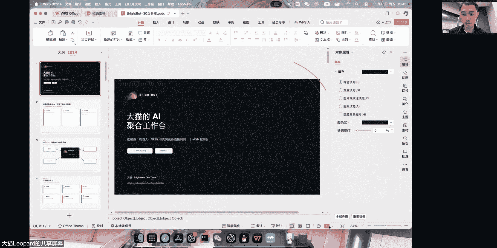

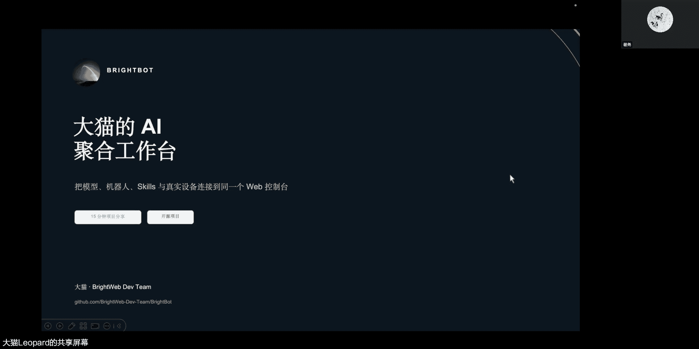

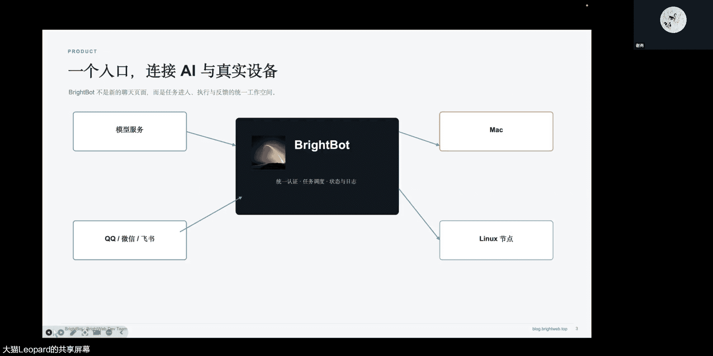

最近，很多自媒体从业者开始尝试用AI工具来提升工作效率。过去我们可能更多地关注图文内容的产出，而现在视频内容已经成为重要的发力方向。为了让视频制作变得更简单，我们需要一套能够自动完成剪辑、做封面和多平台发布的工具链。接下来，我们就来看看这套自动化流程的具体构成。

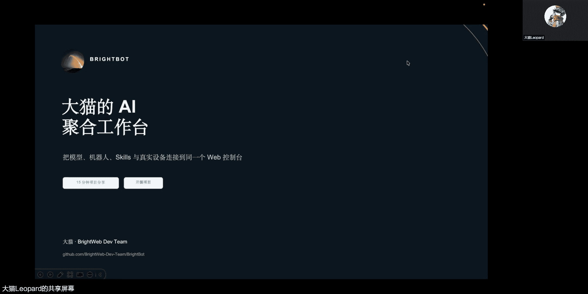

以下是该自动化流程所使用的主要工具和设备：

- 使用Pocket设备进行视频拍摄，拍摄完成后将存储卡插入读卡器。
- 使用Mac电脑作为主控终端，连接读卡器读取素材。
- 使用scale工具自动完成视频剪辑和封面生成。
- 将视频同步发布到B站、小红书、抖音和视频号四个平台。

整个流程可以用这个简单的逻辑来表示：

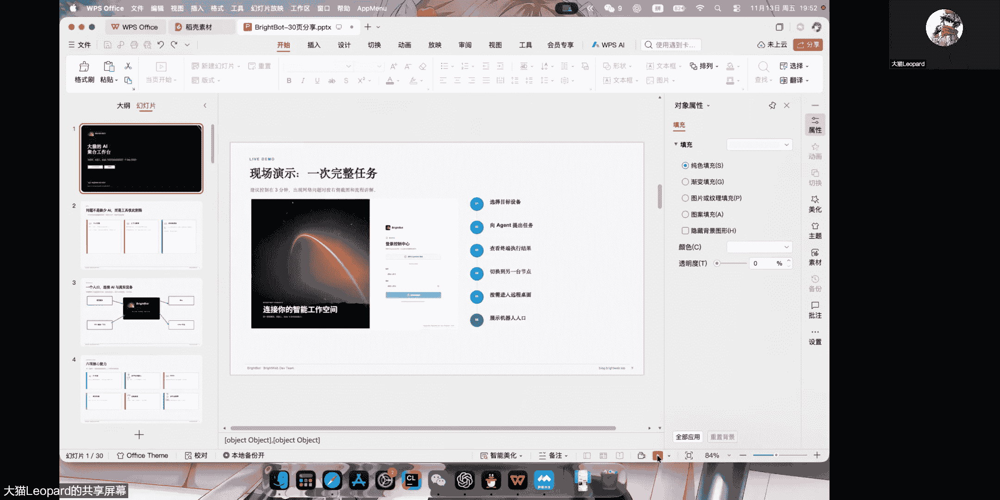


```text
Pocket拍摄 → 读卡器连接电脑 → scale自动剪辑与封面 → 四平台自动发布
```

在实际操作中，拍摄完视频后，直接把存储卡放入读卡器，再连接到电脑。此时启动自动化程序，系统会开始处理视频素材。虽然整个过程运行速度并不算很快，但它能够自动完成从剪辑到上传的全部步骤，无需人工在中间反复操作。

不过，在使用过程中也会遇到一些实际问题。其中最常见的是视频号发布偶尔失败。这是因为视频号的微信登录凭证，也就是cookies，有效期比较短。当登录过期后，系统无法自动完成发布，需要手动点击一次登录确认才能恢复。除此之外，B站平台有时也会出现误判情况，这些都需要在后续的工具打包中进行修复。

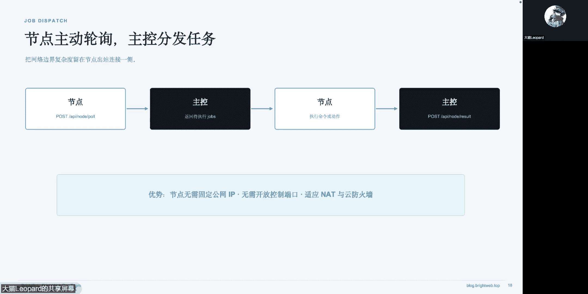

目前，这套自动化流程已经打包完成，并计划开源给大家使用。你可以下载体验，也可以根据自己的需求进行二次开发。该工具的核心价值在于帮助用户快速走完从视频剪辑、封面制作到多平台上传的完整流程，大幅节省重复操作的时间。


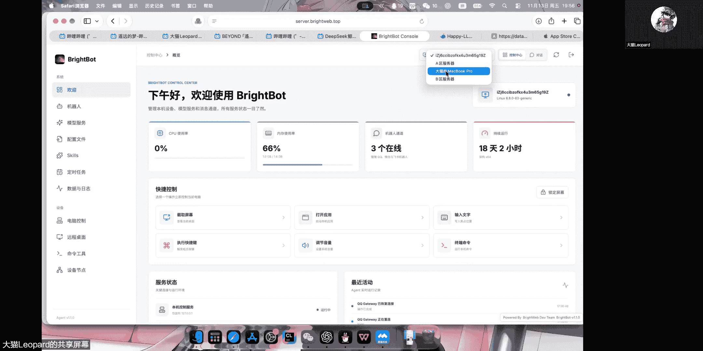


本节课中，我们一起学习了自媒体视频全自动化流程的搭建方法，包括拍摄设备、自动剪辑工具、多平台发布方式，以及在使用过程中可能遇到的登录凭证过期问题。希望这些内容能对你的自媒体工作带来实际帮助。

# Datawhale-AI+X碰个头·第三十三期-分会场（五）：02：AI聚合工作台bread web boat 🤖

在本节课中，我们将学习一个名为bread web boat的开源AI聚合工作台。这个工具的目标是将分散的AI能力整合到同一个平台中，包括模型对话、多平台机器人、技能管理、网页终端和远程桌面等功能，让用户可以从统一的入口发起任务，并让系统自动完成执行与反馈。

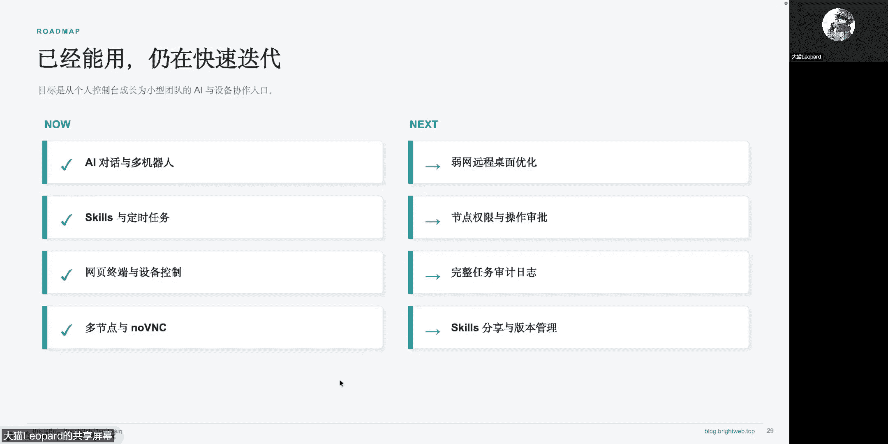

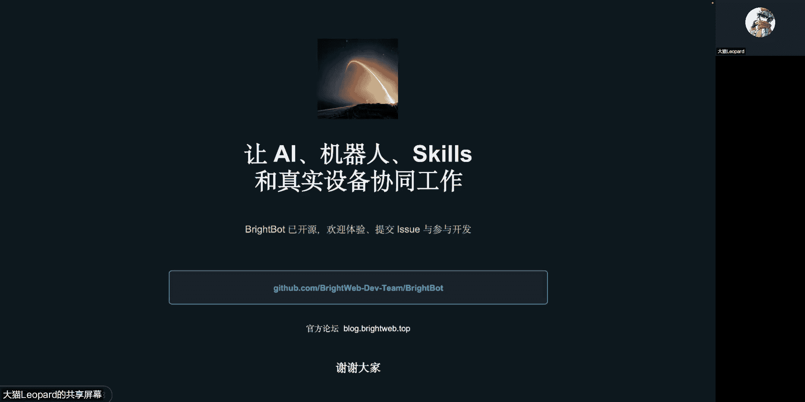


在实际使用AI工具的过程中，我们常常会面临工具割裂的问题。模型对话在一个网页里，机器人在另一个后台服务器上，执行操作又要打开终端，桌面控制还需要切换远程桌面。这样一来，AI可能知道用户想要做什么，但并不知道如何去操作具体的设备或系统。即使现在出现了一些agent，对于高危操作，仍然需要人工手动确认。而且，许多AI方案高度依赖本地化能力，难以在多台设备之间进行协同。

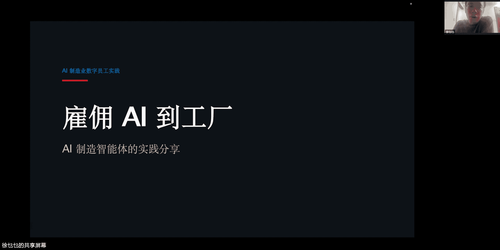

bread web boat并不是一个简单的聊天界面，而是一个从理解任务到执行反馈的完整闭环。它可以从网页或消息平台接收任务，然后自行组合模型、技能和设备资源，将任务发送到Mac或Linux节点上执行，最后把结果带回到原来的发起入口。

该系统目前具备六项核心能力，分别是对话机器人、多平台管理、技能系统、远程桌面、网页终端和多节点支持。这些能力共享同一套账号体系、设备选择器和上下文信息。这意味着用户不需要在六套不同的工具之间反复登录，也不需要在每次操作时说明自己正在操作哪台机器。

以下是系统的核心能力列表：

- 对话机器人：支持多平台消息入口，包括QQ、微信和飞书。
- 多平台管理：统一管理不同设备和平台的连接状态。
- 技能系统：封装常用系统操作，方便模型调用。
- 远程桌面：基于no VNC实现跨节点桌面访问。
- 网页终端：提供命令执行能力和原始输出查看。
- 多节点：支持主动连接的节点架构，适合家庭网络和云服务器环境。

举一个具体的例子。如果你发送一条指令，比如“检查一下当前服务器的磁盘空间，并告诉我是否需要清理”，bread web boat会根据上下文首先选择匹配的设备，然后匹配合适的终端或系统能力，调用相应的命令，最后将命令输出整理成自然语言返回给用户。对用户来说，整个过程只需要输入一句话，但背后其实完成了多设备协同的完整执行链路。

在系统架构上，bread web boat采用主控节点与主动连接节点相结合的方式：

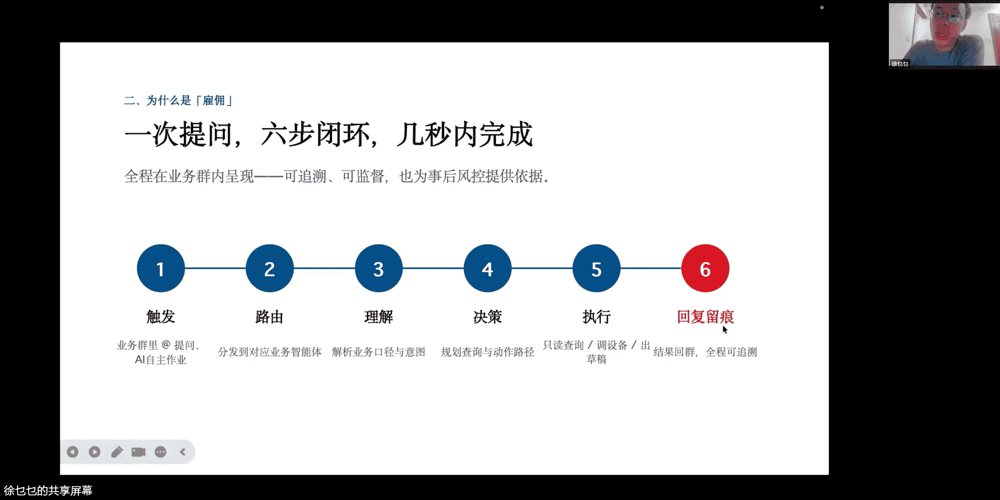

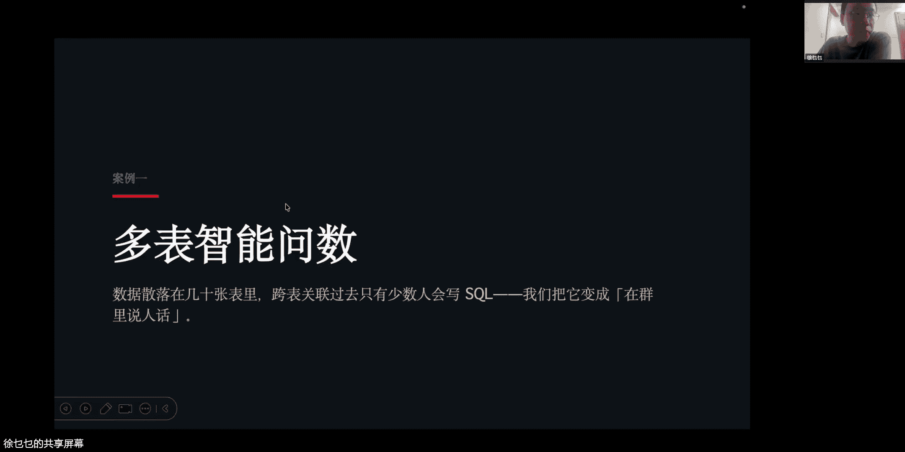

```text
用户输入 → 主控调度 → 模型理解 + 技能执行 → 节点操作 → 结果返回
```

主控节点负责外部控制台认证、模型和机器人配置、技能任务调用、日志记录以及VNC服务等。普通节点则主动向主控发起出站连接，因此不需要为每台设备开放新的公网控制端口，这使得它更适合家庭网络和云服务器环境。

关于跨节点远程桌面，浏览器通过no VNC连接到bread box主控，主控将流量路由到用户选择的节点，再由该节点连接本地的VNC服务。用户只需要使用bread web的登录状态和设备选择器，就可以在同一个页面里切换Mac和Linux节点。而且，这些端口不需要暴露到公网，提高了安全性。

在安全设置方面，系统使用高强度的共享令牌验证。VNC默认只监听本机地址，浏览器连接使用短期的一次性票据，OIDC设置了用户白名单，同时环境变量、运行数据和密钥目录都会被排除在外。后续还会完善权限分级，包括管理员、超级管理员和root等操作审批与审计日志功能。

在模型层面，系统采用兼容接口的设计，不绑定任何特定厂商。只要你的服务兼容OpenAI格式或Anthropic格式，就可以接入。模型负责理解任务，而bread web boat负责提供技能、设备状态和执行工具，两者的职责是清晰分开的。

多消息入口方面，QQ、微信和飞书共用同一套agent、技能和设备能力，它们只是三条不同的消息入口，后端没有复制三套业务逻辑。这样一来，任何新能力只需要在bread web boat中实现一次，所有渠道都可以使用。

QQ机器人使用官方的WebSocket网关接收私聊和频道消息，适合社区交流和及时指令。由于设备控制具有较高权限，QQ入口支持OpenAI白名单，只允许指定用户触发操作，同时控制台会显示连接状态，方便检查配置。

微信和飞书主要通过扫码方式降低接入门槛。用户在控制台生成二维码后，用手机确认即可建立消息连接。微信更偏向个人设备和移动使用，而飞书则更偏向团队和工作群。这两个平台收到消息后，都会进入同一套Agent处理流程。

技能系统被认为是一个非常重要的组成部分。例如，部署scalekill可以明确规定先检查某项内容，再查看某项内容，最后执行某项操作。技能可以自动匹配，也可以手动指定或停用，并且可以通过Markdown文件进行管理。

网页终端既为agent提供了执行能力，也让人类用户能够看到原始输出。它会保留当前的工作目录和命令历史，并为单条命令设置超时保护。当任务执行不准确时，可以直接查看日志，避免把系统变成一个黑盒。

节点接入非常简单，只需要同一份节点程序和几个环境变量即可。启动节点后，它会主动注册并上报，出现在控制台的设备选择器里。在控制台中，你可以看到主服务器、A区服务器、个人电脑和B区服务器等多个节点同时在线。


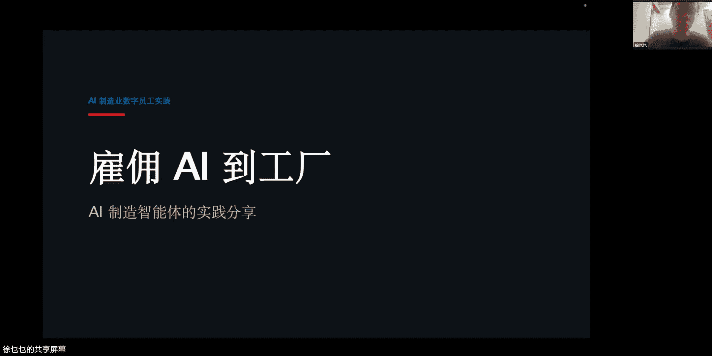

节点会从主控获取待执行任务，完成之后再将结果回传。在远程桌面实现上，选择no VNC是因为它已经比较成熟，不需要自己维护一套视频编解码方案，浏览器负责解码，cava负责渲染，键盘鼠标和剪贴板功能也已支持。bread web只负责登录认证。在macOS上，可以复用系统自带的屏幕共享服务，不需要修改桌面分辨率，也不需要额外安装桌面环境。

在图形节点部署中，最常见的问题是VNC连接异常，可能需要切换到X2，或者使用系统已经提供的VNC。对于纯终端模式的Linux系统，这是云服务器和无显示器设备最常见、资源占用最低的运行方式。

bread web boat支持OpenID Connect和本机管理员账号登录。在数据管理方面，迁移时只需备份skills的data目录，就可以保留所有运行状态。但需要注意限制文件权限，因为该目录可能包含密钥、聊天记录和设备信息。

生产环境下，建议使用Caddy或Nginx统一终止连接。bread board只监听本地或内网地址，服务使用Systemd守护进程，环境变量文件权限设置为600。防火墙一般情况下只会开放HTTPS端口，并建议定期备份data目录，这样公网边界会比较清晰。

故障排查时，需要先将认证节点、VNC等组件完全分开。节点在线不代表VNC正常，远程桌面正常也不代表模型接口和机器人连接正常，因此需要分层定位问题。

项目代码、版本历史、问题反馈、拉取请求、部署文档和许可证都放在GitHub上。项目使用的是自定义的bread web community license 1.0，允许使用、修改和分发，但需要保留许可证、版权声明和产品署名。修改后的版本，logo和商标不会因为代码许可而获得额外授权。

目前，AI对话功能已经可以正常使用。下一步计划优化弱网环境下的远程桌面体验，让bread web boat从个人工作台逐渐成长为小型团队中AI与设备协作的统一入口。


本节课中，我们一起学习了bread web boat AI聚合工作台的设计理念、核心能力、系统架构、多平台消息入口、技能与终端管理、节点接入、远程桌面、安全设置以及部署方式。希望这些内容能帮助你理解如何构建一个统一的AI设备协作平台。

# Datawhale-AI+X碰个头·第三十三期-分会场（五）：03：制造业AI数字员工与FDE落地实践 🏭

在本节课中，我们将学习如何在制造业工厂中落地AI数字员工，并通过实际案例了解如何衡量AI项目的真实业务价值。内容将围绕数据分散、设备自主工作、安全控制和财务收益核算等方面展开，适合希望在企业内部推行AI转型的同学参考。

在工厂环境下，很多AI系统目前仍停留在“接收指令、完成任务”的阶段。如果人不在场，这些系统就会停摆，无法自主工作。但制造业通常是24小时连续运作，有交替班次，工厂真正需要的是一种能够像员工一样自主上岗、主动完成工作的AI，而不是仅仅响应指令的聊天机器人。

制造业在引入AI时，最大的困难来自数据分散。生产、质量、物料、计划排产等数据分布在不同系统中，形成数据孤岛。班组长或厂长查询数据可能需要半天时间，而且不同工厂之间的数据往往不同步。此外，每天重复的导出数据、查找人员、处理事务等工作量很大。

针对这些问题，与其雇佣只能执行单一任务的机器人，不如直接雇佣一个AI制造业智能体，让它直接走进生产车间，主动完成日常工作。所谓“雇佣”，是指为AI数字员工配备合适的工位、说明书和权限限制。

以下是AI数字员工需要具备的三个基本条件：

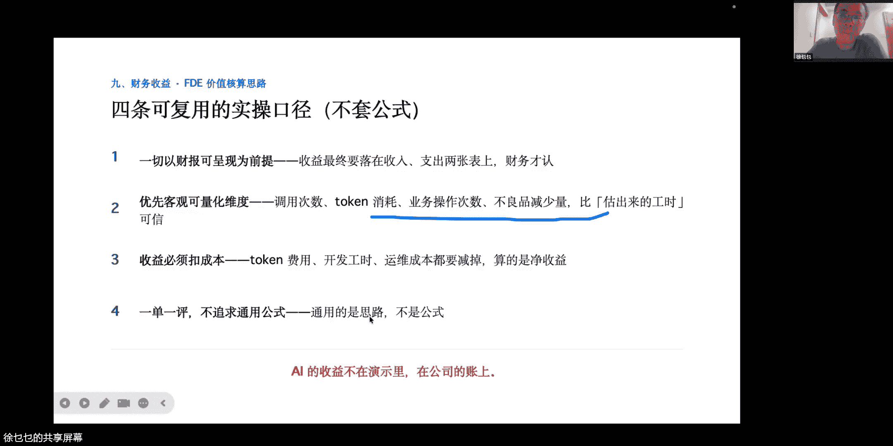

- 工位说明书：AI需要有一个业务群入口，通常是企业使用的即时通讯工具，比如飞书、企业微信或钉钉等。
- 说明书即技能库：每个AI都有自己的技能集，用于完成各自的功能。
- 受限钥匙：AI能力很强，但我们不希望它随意删除生产数据库。因此需要添加权限限制，让AI大部分操作只能是只读的。

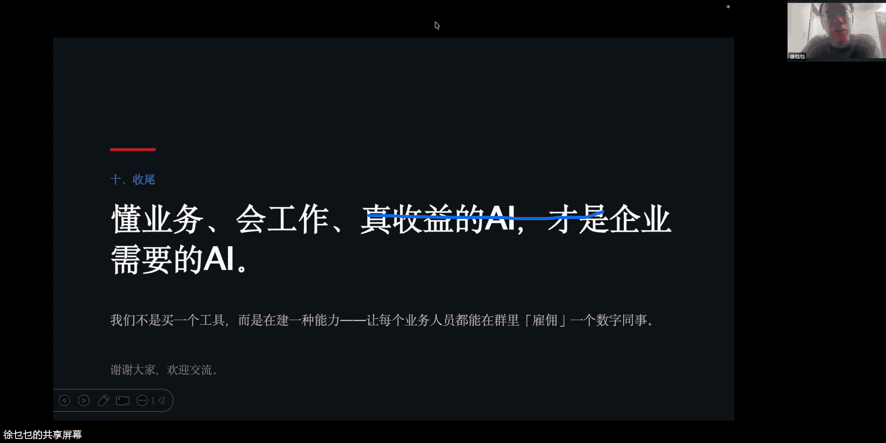


为了实现AI的自主工作，系统被设计为五层架构：


第一层是入口层，即各种即时通讯工具；
第二层是运行层，主要依赖Open Call进行本地部署；
第三层是能力层，包含各种AI能力，例如问数查数、查看摄像头、处理邮件、代码审查等；
第四层是数据库层，来源于制造业内部的所有数据库，目前统计有1000多张表；
第五层是模型层，必须使用自建模型和自建平台，这样才能监控AI工作的全流程。

AI数字员工的五层架构可以表示为：

```text
入口层(IM工具) → 运行层(Open Call) → 能力层 → 数据库层(1000+表) → 模型层(自建)
```

之所以选择Open Call作为运行层基础，是因为经过调研，它能满足制造业的几个核心需求：中心化部署、能够暴露API供其他业务系统调用、不绑定任何模型供应商、天然支持创建子智能体、以及不需要插件即可与即时通讯工具融合。虽然市场上也有其他产品，但在实际测试中都存在不足之处，因此最终选择了Open Call作为底座技术。


AI数字员工的工作遵循六步闭环：

```text
触发 → 路由 → 理解 → 决策执行 → 回复
```


首先是触发，可以通过群里@AI，也可以由AI自主开始工作；接着是路由，将任务分配到具体的子智能体；然后是理解任务内容；随后是决策与执行；最后是向用户回复结果。


接下来，我们通过三个实际案例来看看AI数字员工在工厂中的具体应用。


第一个案例是多表智能问数。这是FDE落地的第一个基础功能，也非常重要。系统架构从底层的1000多张业务表开始，汇聚到数据平台，再经过中台整理后，同步到飞书AI库。这个AI库是专门给智能体使用的只读库，确保数据安全。

在实现问数功能时，首先进行数据治理，将数据放入只读AI库，并与业务数据断联。这是为了防止AI误操作导致生产线异常运行，造成重大损失。其次是技能三件套，基于业务表划分场景，开发不同的读写数据库技能。将1000多张表分类后，每个类别对应一个技能，各自建立关联关系。把表的业务关系和查询场景输入给AI，它就能自动生成适配当前场景的技能。


不同的技能组合可以形成不同的子智能体，分别查询不同的表格。即使有1000多张表，多个智能体同时查询也不会出现混乱。目前系统使用的是内部网络模型，而非最新的商业模型，这样更加稳定。

技能开发已经从IT运维人员转变为业务人员自助完成。现在只需要搭建好智能体，告诉一线员工、数据员、组长或厂长，让他们直接跟AI对话，就能完成开发工作，无需懂技术。这大大减少了IT资源的投入。系统能够自动跨表查询，并实现秒级响应。

例如，用户可以问“昨天A产线整体的OEE是多少，和上周同比是什么”，AI会自动去数据库查询，并给出总结。将数据库对接到智能体，再将智能体对接到即时通讯工具，业务人员就可以直接在IM工具中开发、调教AI，满足日常工作需求。

在质量领域，智能体每天定时查询数据库，定位哪些产线没有工作，哪些工厂异常率较高，并自动@相关负责人。同时，它会发送飞书任务提醒对方处理。如果任务未完成，系统会上报红灯，直接告知上级领导。此外，日报和周报的生成也实现了自动化，AI会总结工作内容并生成图表，发送到微信群或飞书群，负责人只需查看部分结果即可。

看板的生成原理很简单，不是使用AI绘图，而是让AI编写一个HTML看板，然后截图发送出去。之前尝试过AI生图，虽然效果绚丽，但Token费用很高，直接套用模板既快又准。

第二个案例是安防自动巡检。在群里发送一条消息，比如“看一下东区3号车间”，AI就会自动调用摄像头获取实时截图并返回。这样，保安和安检人员的巡检频次可以降低。AI还能分析人员是否规范、机物是否拥堵、是否存在安全隐患。

例如，广东地区下雨多，工厂门口容易积水。过去需要派人过去查看，确认积水情况后才能决定是否转移物资。现在AI可以直接检测到积水，发送消息给负责人，负责人根据现场情况直接指挥，现场人员立即处理。整个过程不需要打开电脑，在手机上就能完成。

夜间和节假日可以启动定时自动巡检，AI自动巡检后将结果汇总成报告，发送给当时值班的保安。以前每两小时巡检一次，每次需要一个多小时，现在不再需要人工频繁巡检，大幅降低了巡检成本。

本质上，这个案例仍然属于智能问数，只是查询对象从数据库表变成了摄像头API。摄像头提前按工厂、车间进行了分组，AI只需要调用对应的接口即可。

第三个案例是邮件欠料处理。过去，当上下游供应商物料缺少，无法满足生产需求时，需要安排专人每天登录系统查询数据，整理成多个Excel表格，再发送给供应商。现在，智能体会在晚上自动查询数据，统一整理Excel，并在飞书妙搭系统中写入数据，告诉用户哪些需要查询、哪些需要发送，哪些发生了欠料。第二天早上只需确认即可，整个流程从原来的半天到一天，缩短到了一两个小时。

供应商回复邮件后，AI会自动跟踪、读取邮件内容，提取明确信息并执行下一步工作，完成欠料补全。如果有异常情况，会报告出来并发送给相关人员处理。风险按照P0、P3等级进行分级。整个流程中，人工只需要干涉两步，其余时间由AI每天自动完成。

除了上述三个主要案例，系统还支持定时任务。例如，自动生成日报和周报，读取飞书中的本周工作内容，自动提醒和催办任务。AI能够读取即时通讯工具中的所有上下文，自行总结工作进展。

还有一个有趣的应用是访谈自动生成。过去需要一个人约20位员工进行AI培训辅导，非常分散。现在只需告诉AI自己的时间档期，让AI以你的名义发送邀请，去约定时间。AI会自动与多人沟通，安排会议，创建会议室，并记录日志。即使对方没有回复，AI也会主动发送提醒，直到会议安排完成。

团建助手也是一个实用场景。以前团建签到需要大家在群里发大量消息，现在由AI推送签到卡片，员工在手机上点击即可完成签到。超时未签到，AI会自动与该员工聊天，询问位置，如果仍未回复，则通知领导打电话。此外，AI还能推送景区导航信息，员工可以向AI询问某个景点有什么好看的，AI会广播给所有人，组织大家一起过去。团建结束后，大家上传照片给AI，AI会整理照片墙并上传到网盘，无需专人维护。AI还能发起猜谜、点歌等游戏，活跃气氛，并自动完成团建后的问卷调查。

这些案例表明，AI不仅仅是接收指令回答问题，而是可以被分配一个岗位，自主完成一系列工作。我们只需要给它一个任务，它就能自己去做，无需人工反复干预，我们只需要查看结果。


在使用AI处理企业数据时，安全是重中之重。以下是五道安全防线：

第一，数据只读。所有接入AI的数据库都必须是只读的，防止AI修改生产数据。

第二，全程留痕。因为对接了内部部署的模型和中转平台，所有操作都会留下记录，支持风控查询。

第三，密钥隔离。所有密钥和密码都使用环境变量存储，不会写入任何技能上下文，也不会在对话中泄露。有专门的组件负责获取密钥，不会与AI放在一起。

第四，红线管控。财务数据、客户数据、价格信息、产品数据等敏感信息绝对不会提供给AI，这是明确的红线。


第五，人工把关。尽管大部分流程已实现自动化，但仍保留人工审核环节，特别是涉及财务和重要决策时。


关于AI项目的收益，必须基于财报来衡量。工时提升本身并不被财务认可。例如，如果AI让个人效率提升20%，部门整体提升20%，但这并不意味着部门工资支出会下降20%，也不会自动带来20%的额外订单。从财务角度看，如果没有在财报中体现增收或节约，那么该项目就是零收益，甚至可能因为投入了额外的Token成本而变成花架子。


目前没有通用的收益计算公式。每个AI项目的逻辑不同，企业需求也不同，无法直接套用公式来衡量。目前只有少数项目能够自动核算，其余大多需要人工逐一核算，由财务部门确认该项目带来的实际收益或节约金额。


财务真实收益可以表示为：


```text
财务真实收益 = 财报体现的增收或节约 - 开发与运维成本
```

在实践中，可以参考以下四条可复用的实操口径：

第一，一切以财报呈现为前提。如果没有财报支持，AI项目就没有真正的业务价值。很多时候，搭建一个小应用只能加速一两个人，但消耗了数千元的Token费用，半年一年才能见效，这对财报没有任何价值。

第二，优先选择客观可量化的维度。将所有可以量化的AI指标全部量化出来，最好请财务同事进行核对。在做技术或现场业务时，容易过度关注技术细节，而忽略了财务呈现是否真的对公司有用。因此，应提前量化，并与财务同事讨论，听取他们的意见。

第三，收益必须扣除成本。包括开发工时、人力投入、运维成本等，都必须从收益中扣除。


第四，不存在通用公式。每个业务场景不同，价值也不同，无法制定统一的公式，只能一单一品地进行核算。


本节课中，我们一起学习了制造业AI数字员工的落地方法，包括五层架构、六步闭环工作流、多表智能问数、安防巡检、邮件欠料处理、定时任务、团建助手等实际案例，以及安全五道防线和财务收益核算方法。希望这些内容能帮助你在企业内部构建真正有业务价值的AI数字员工。

