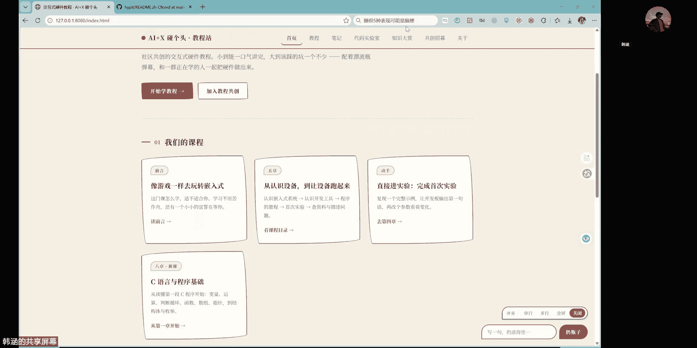

# AI硬件入门教程：33-4：教程网站与课程体系介绍 🤖


本节课中我们将要学习AI硬件教程网站的整体架构，包括网站当前包含的课程、交互功能以及学习流程。我们会先了解网站的页面结构，再看看嵌入式和C语言两门课程的具体安排，接着介绍笔记、弹幕和漂流瓶等交互方式，最后聊聊未来的项目计划和社区参与方法。

## 一、教程网站概述

今天我们主要介绍AI硬件教程网站。这个网站专门为硬件爱好者和零基础学习者搭建，目的是让大家学习硬件的过程变得更轻松。网站目前正在部署中，近期会对外开放内测学习。

目前网页里面包含两门主要课程，一门是嵌入式相关内容，另一门是C语言相关内容。除了课程之外，还提供笔记、代码实验室、漂流瓶和弹幕等功能。这些功能的设计初衷是帮助学习者在学习过程中记录痕迹，并与其他学习者交流。

网站的页面结构包括以下几个部分：
- 首页，用于展示网站的主要入口和最新动态
- 课程总览，列出所有可用的课程和章节
- 课程章节，展示每个课程的具体知识点
- 代码实验室，支持在线编辑和运行代码
- 笔记知识大赏，用于查看和整理学习笔记
- 共创招募，欢迎学习者参与内容创作
- 发展史，记录网站的建设历程和重要里程碑

## 二、课程体系与内容安排

上一节我们介绍了网站的整体页面结构，本节中我们来看看具体的课程安排。目前教程分为两个主要方向，分别是嵌入式开发和C语言编程。

嵌入式课程的内容涵盖从零基础开始的硬件认识，到后续的环境部署和程序编写。C语言课程则专注于编程语言的基础语法，适合完全没有编程经验的学习者。

代码实验室的作用如下：
- 复刻教程中的示例代码，直接运行查看结果
- 独立输入代码，进行自主探索和实验
- 通过Web编程方式尝试不同的硬件控制逻辑

教程内容的编写原则是“一次建议一份贡献”，也就是说教程不是一次性写完的，而是随着社区的反馈不断迭代和完善。每一条学习痕迹都会被保留在页面上，方便后续学习者参考。

## 三、交互功能与社区设计

刚才我们了解了课程体系，本节中我们来看看网站中的交互功能。这些功能旨在打破单人学习的孤单感，让学习变成团体活动。

笔记功能支持两种记录方式：
- 画图，适合绘制电路图或逻辑示意图
- 文字，支持选中高亮和引用，方便重点标注

弹幕功能模仿视频网站的弹幕设计，允许学习者在学习过程中的任意时刻发送想法或疑问。漂流瓶功能则用于跨时间交流，之前的学习者可以留下经验，新加入的学习者可以随时查看并回复。

以下是交互功能的具体用途：
- 笔记：保存个人学习心得，支持图文混排
- 弹幕：实时发送即时想法，增加学习趣味性
- 漂流瓶：跨时间留言，让经验在不同学习者之间流转

AI解释功能会根据学习者的专业背景和基础水平，分配不同的学习内容。由于token限制，目前该功能需要登录后才能使用。登录系统也将用于统计学习进度，帮助大家更好地上手教程。

## 四、学习流程与示例项目

介绍完交互功能后，本节中我们来看看具体的学习流程。教程采用先软件后硬件的顺序，确保学习者在接触硬件之前先掌握基础的软件知识。

学习流程可以概括为以下步骤：
1. 了解嵌入式基础概念
2. 部署开发环境
3. 学习C语言基础语法
4. 编写并运行简单程序
5. 进行硬件连接与烧录
6. 观察运行结果并查看日志

程序从源代码到固件的转化过程可以用代码块表示：

```
源代码 -> 编译 -> 汇编 -> 固件 -> 烧录到硬件 -> 启动运行
```

完整的示例项目会使用比较简单的开发板，通过最简单的代码让学习者完整操作一遍构建、烧录、启动和观察的全过程。先掌握基础流程后，再逐步过渡到更复杂的操作。

## 五、未来项目计划与发展方向

了解了基础学习流程后，本节中我们来看看未来的项目计划。团队正在筹备多个硬件项目，以项目制教学的方式推进学习。

近期计划包括温度检测项目，最终目标是制作一个自动控温的小型暖宝宝。项目材料已经采购，搬家完成后会开始编写相关教程。

另外还在探索ESP32的应用场景，例如将ESP32与游戏联动，或者用于物联网项目。ESP32的WiFi功能可以用于人体运动检测，这是之前分享过的一个方向。

未来还可能开发机械臂项目，已经有合作伙伴制作了六轴机械臂原型，团队将与其合作推出项目教程。

产品变现方面，核心思路是先让大家学到东西，再考虑通过销售材料包的方式覆盖硬件成本。材料包模式可以节约学习者的挑选成本，例如一次性提供树脂、沙子、3D打印灯塔等所需材料。

不过社区的首要目标仍然是学习和分享，商业化只是为了维持社区运营，不会成为唯一焦点。

## 六、学习方法与费曼技巧

聊完项目计划后，本节中我们来看看推荐的学习方法。有效的学习方法可以帮助大家更快掌握硬件知识。

费曼学习法的核心步骤如下：
1. 选择一个概念并学习
2. 尝试用简单语言向他人讲解
3. 在讲解过程中发现不懂的地方
4. 回到资料中补充和修正
5. 简化语言，最终能清晰表达

整体性学习法是另一种推荐方法，它的思路是基于大脑神经元的连接方式，利用已有的熟悉知识点作为桥梁，学习新的知识点。常用的桥梁包括比喻、联想、类比、图像和内在化。

根据信息类别不同，学习方法也不同。具体信息、抽象信息和实践信息（例如敲代码）分别对应不同的学习策略。

## 七、社区参与与贡献方式

最后，本节中我们来看看如何参与社区建设。社区欢迎所有对AI硬件感兴趣的伙伴，无论是在校学生还是已经毕业从业的人员。

参与方式包括以下几种：
- 在社群中提出疑问和建议
- 分享自己的硬件项目和学习经验
- 参与教程内容的共创和编写
- 协助纠错和完善教程文字

所有贡献都会被记录在网站上，你的学习足迹和项目作品都有机会被更多人看到。如果项目在市场上有一定收益，团队也会与贡献者协商分成方式。

本节课中我们一起学习了AI硬件教程网站的整体架构、课程体系、交互功能、学习流程、未来项目计划以及社区参与方式。希望大家能够通过这个网站系统地学习硬件知识，并在实践中不断进步。




网站近期将完成部署并开放内测链接，欢迎大家加入社群获取最新信息。如有任何关于AI硬件的问题，都可以在社群中随时交流。
