🚀 Datawhale-AI+X碰个头：08：AI时代的代码质量与工程流程


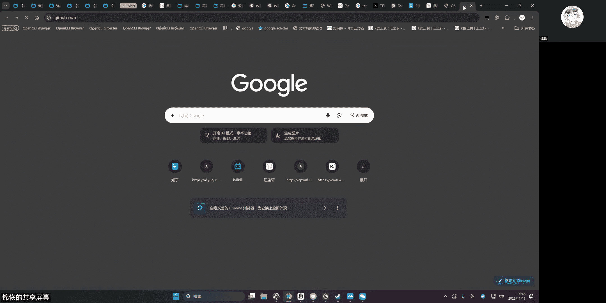

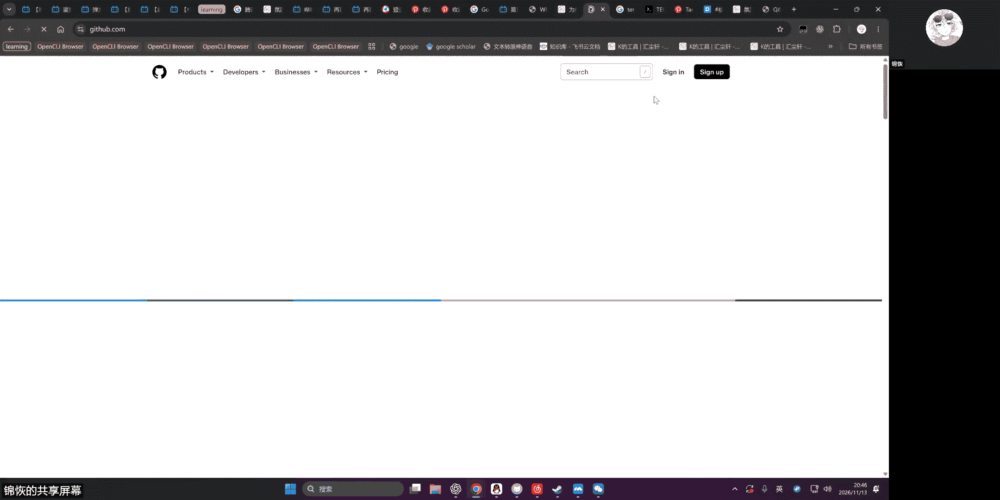

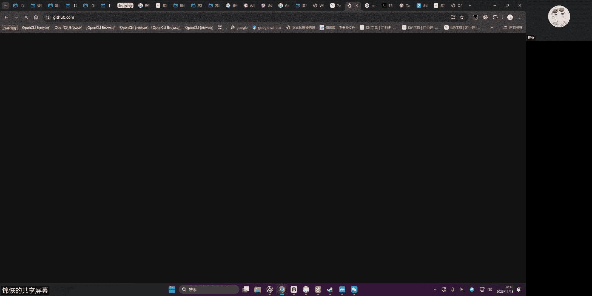


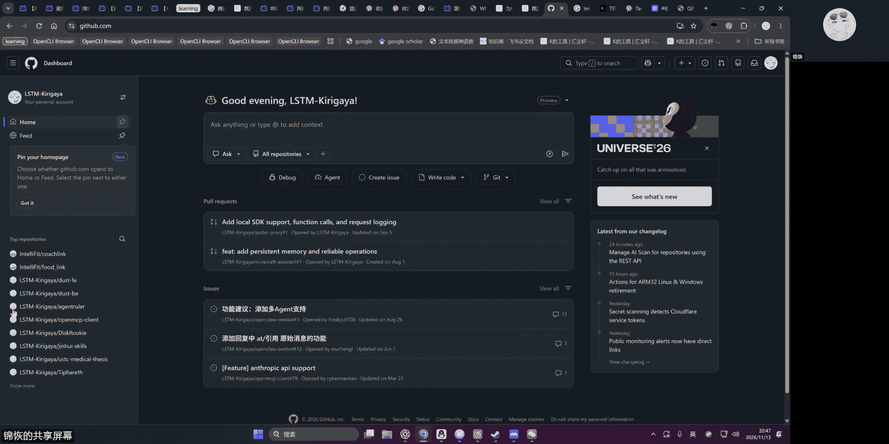

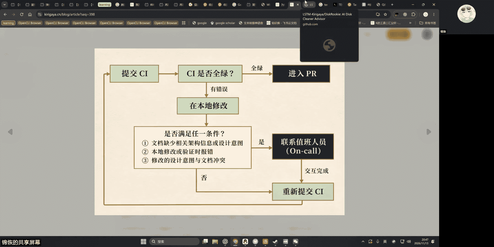

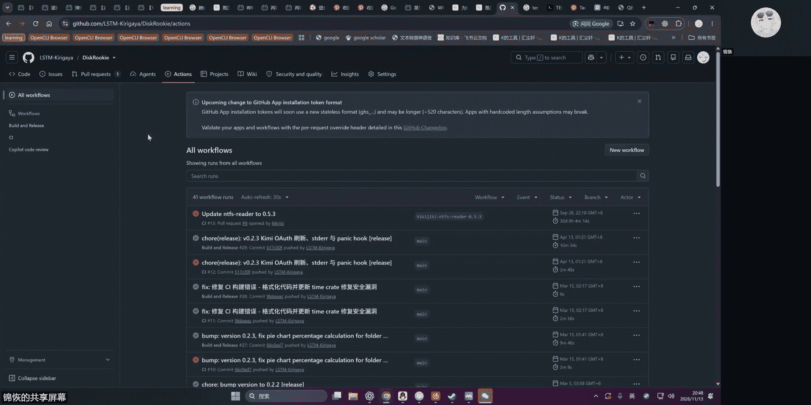

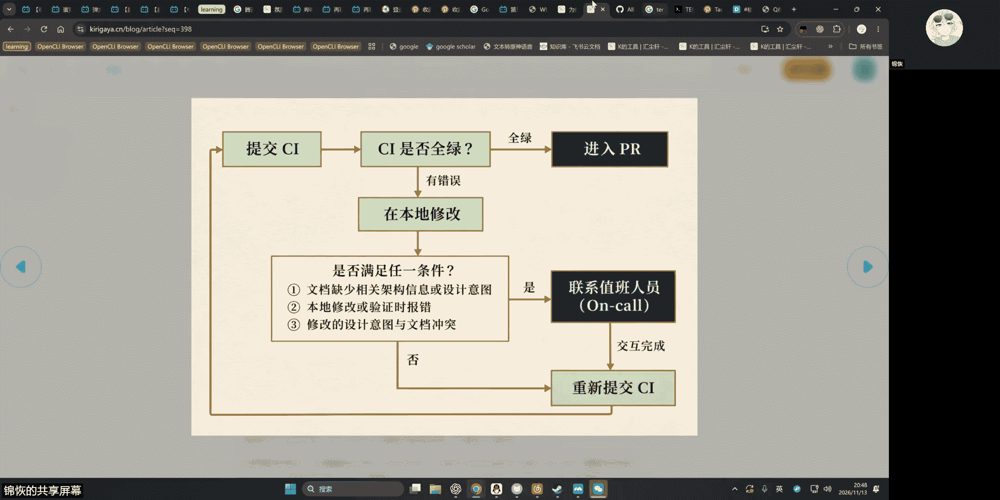

在本节课中我们将要学习AI时代下如何保证代码质量，以及围绕AI生成代码应该构建怎样的工程流程。我们会讨论传统逐行校验的代码检测方法在AI时代是否仍然适用，介绍持续集成（CI）的基本原理，解释为什么文档和测试正在成为新的代码资产，探讨懂业务的人员在开发流程中不可替代的角色，说明模型训练和微调的必要性，以及上下文压缩、评测benchmark和大型项目模块化管理等工程实践。

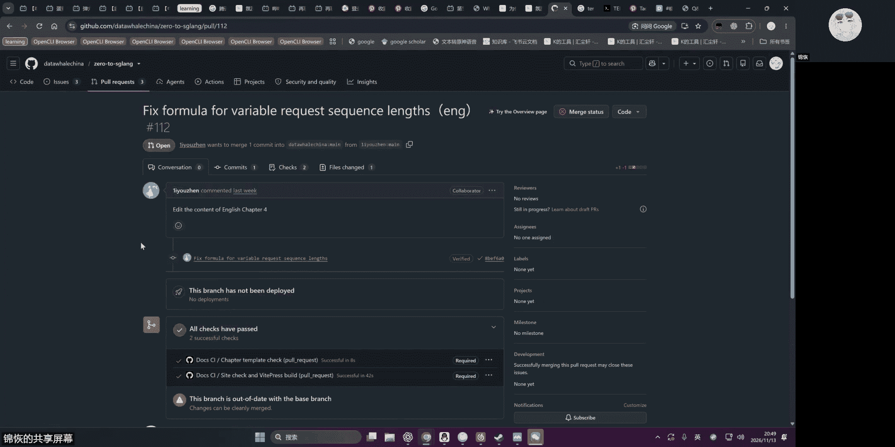

### 🛠️ AI时代的代码质量挑战

首先，我们要面对的第一个问题是，在AI参与开发之后，代码质量到底该怎么检查。过去我们习惯于逐行校验代码，试图确保每一行都正确无误。但在AI时代，这种完备的代码质量检测方法已经不太适用了。生产关系会随着生产力的变化而变化，AI生成代码的速度非常快，如果还用老办法去一行行审查，效率会非常低。我们需要新的思路，不能只盯着生产代码本身，而要从整体功能和技术角度来看待代码质量。

$$ 传统代码质量 = 逐行校验 \times 人工审查 $$
$$ AI时代代码质量 = 流水线测试 \times 文档对齐 \times 业务意图 $$

### 🔄 什么是持续集成（CI）

上一节我们介绍了AI时代代码质量的新挑战，本节中我们来看看持续集成是如何解决回归问题的。CI的全称是持续集成，简单理解就是当你改动代码之后，系统会自动运行一套测试流程，确保新修改没有破坏旧功能。如果你每次改代码都手动测试，那是不可能的，特别是项目变大之后。CI提供一条管线，代码提交后自动触发，跑完所有单元测试和集成测试，全部通过后才允许合入主分支。它的核心职责就是解决回归问题，也就是防止新功能导致旧功能失效，让软件在你改了代码之后仍然能够正常使用。


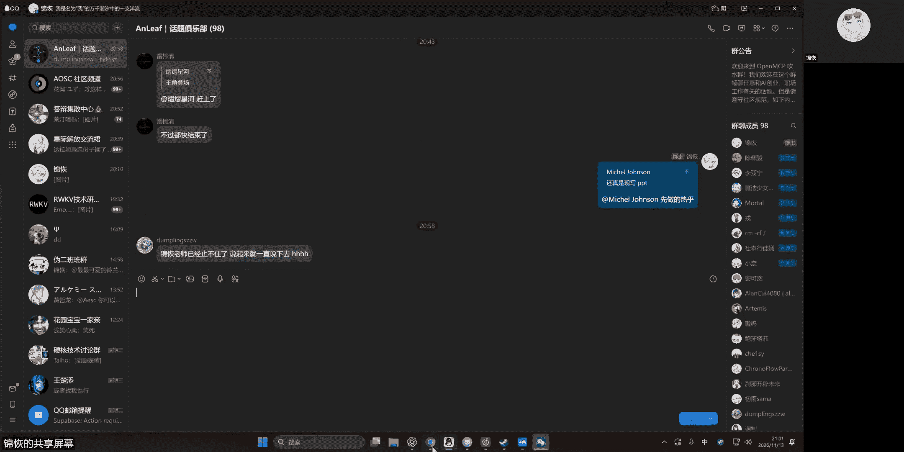

```
提交代码 -> 触发CI流水线 -> 运行单元测试 -> 运行集成测试 -> 全部通过 -> 合入主分支
              ↓
        任一测试失败 -> 拒绝合并 -> 返回修改
```

### 📄 文档优先的开发流程

了解了CI的基本原理之后，本节中我们来看看在实际开发中，应该怎样组织文档、测试和代码的顺序。我们现在的流程不再是先写代码，而是先写文档。文档里要说明每个模块的设计意图，大概要触发哪些功能，怎么实现。文档写完之后要进行review，审查通过后再写对应的测试。测试准备好之后，才让AI基于文档和测试一次性生成生产代码。这样做的好处是，AI每生成一次代码，就可以通过CI运行一次测试。如果测试全绿，就可以合并；如果有错误，让AI在本地修改，再通过自动化方式检查。在这个流程里，测试和文档才是最有价值的资产，生产代码的价值反而降低了。

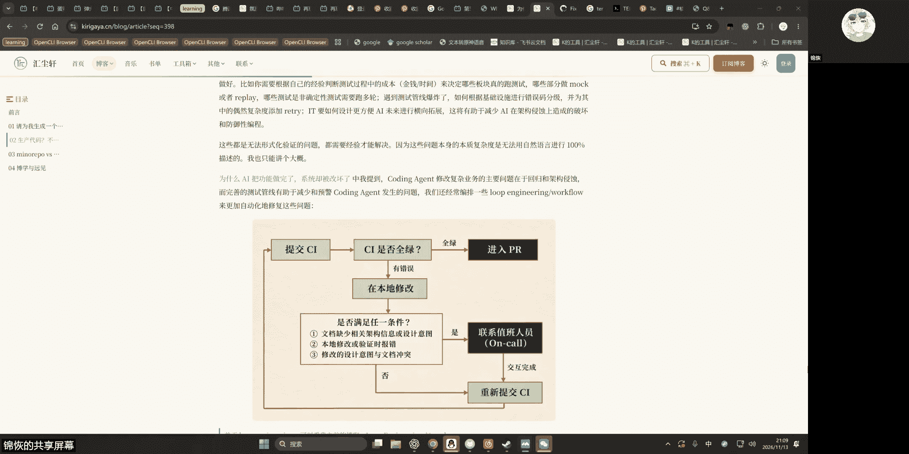

以下是文档优先流程的关键步骤：
1. 编写包含设计意图的技术文档
2. 对文档进行review，确认架构合理
3. 根据文档编写测试用例
4. 让AI基于文档和测试生成生产代码
5. 通过CI运行测试，决定是否合并

### 👥 懂业务的人不可被AI取代

上一节我们介绍了文档优先的开发流程，本节中我们来看看为什么在这个流程里，懂业务的人始终不可或缺。AI虽然能写代码，但它缺少隐性知识。隐性知识是指那些无法用文字完整表达、只存在于业务人员脑中的经验。比如你在会议上口头决定将第三个月会员费从80%改为60%，如果这条决策没有被记录进文档，AI就不知道这个变化。AI无法从几十万字的会议记录里精准提取出与当前业务相关的关键信息。因此，当CI发现测试失败，可能是业务逻辑变了而不是代码写错了，这时候必须有人懂业务来判断。这个人需要负责更新文档，再通知AI修改代码和测试。没有这个环节，AI只会生成低质量的代码，因为它缺少关键的业务上下文。

$$ 最终决策 = AI生成的代码 + 懂业务的人工判断 + 文档中的设计意图 $$

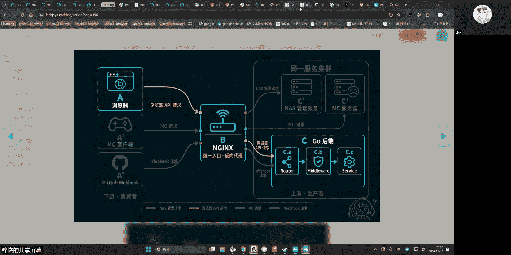

### 🏋️ 为什么需要自己训练模型

讨论完人在流程中的角色之后，本节中我们来看看为什么即使有了强大的通用模型，企业仍然需要自己训练模型。通用大模型在特定垂直领域的表现往往不佳。比如海关商品分类，最强大的模型正确率可能不到40%，因为训练语料里根本没有这类数据。如果把最昂贵的模型API用在产品里，成本不可控，尤其是用户量大的时候，毛利无法保证。自己训练模型有两个好处：第一，可以利用线上积累的大量bad case通过RSI（模型微调）持续优化；第二，成本可控，模型部署越多，边际成本越低，更符合规模化生意的逻辑。未来GPU会变得和CPU一样廉价，所以自建模型是长期正确的选择。

```
通用模型正确率（垂直领域） < 40%
自建模型成本 < 第三方API长期成本
业务价值 = 线上数据 × 模型微调能力
```

### 🧠 模型的注意力机制与上下文压缩

了解了模型训练的必要性之后，本节中我们来看看模型在处理长文本时的局限性。大模型本质是自回归架构，存在首尾效应，也就是Lost in middle问题。模型倾向于关注开头和结尾，中间的信息会被稀释。无论上下文多长，中间部分的注意力都会下降，这在数学层面上很难完全解决。另外，上下文压缩现在已经很智能，会保留思维链之外的关键业务信息，但不能完全依赖，关键位置仍然需要人工审核。

$$ 注意力分布 = 头部权重高 + 尾部权重高 + 中间权重被稀释 $$

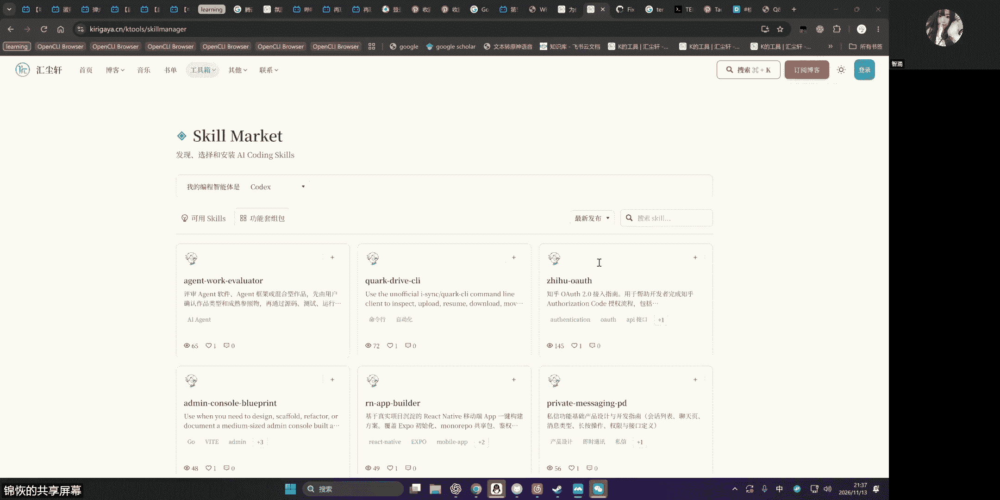

### 📊 评测与Benchmark的重要性

掌握了模型的注意力局限之后，本节中我们来看看如何科学地评测模型和系统效果。不能靠感觉判断AI系统是否好用，必须通过数据和评测。做benchmark时，要从原始系统里抽取真实数据，构建测试集，用多个模型在相同规范下打分，分析得分分布。如果没有benchmark和记录的得分，就无法验证你写的工具或模型是否有用。评测成本很高，一条数据从生成到评分可能需要十几个小时，但这是工程落地的必要步骤。

以下是做评测时需要注意的点：
1. 使用真实的线上业务数据，不要脱离实际造数据
2. 多个模型在同一套规范下打分，避免单点偏差
3. 关注得分分布，而不仅仅是平均分
4. 没有benchmark就不能认为系统有效

### 📦 大型项目的模块化与版本控制

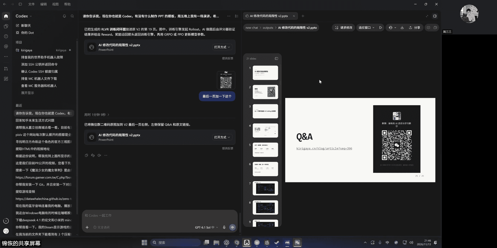

了解了评测方法之后，本节中我们来看看大型项目如何进行模块划分和版本管理。当项目足够复杂时，必须进行模块拆分，比如做mini-repo。不同的仓库之间要有明确的依赖关系和版本编号，比如0.1.0、0.1.10，确保CI和当前版本保持一致。如果不做版本控制，多个模块同时修改很容易导致职责穿透，引发线上故障。团队协作中，架构设计和分层规划做好之后，可以减少很多不必要的沟通成本。

```
website (依赖 backend)
backend (版本 0.1.0)
CI绑定版本号 -> 确保兼容性 -> 防止职责穿透
```

### 🔍 代码Review与架构治理

讨论完模块化之后，本节中我们来看看代码Review在实际工作中应该怎么做。Review通常只看生产代码，不看测试和文档，这样压力较小。比如一个人提交了2000行改动，其中700多行是删除，只看生产代码可能只有200行，几分钟就能看完。架构治理需要良好的工程习惯，不要让AI从零开始写文档，应该先生成文档架构，再由人工review。文档里的设计意图要和代码结构对齐，比如后端分为三个板块，文档也应该有对应的三个文件夹，不能让AI随意生成不符合架构的目录结构。

### 🏥 AI带来的增量需求与生产关系

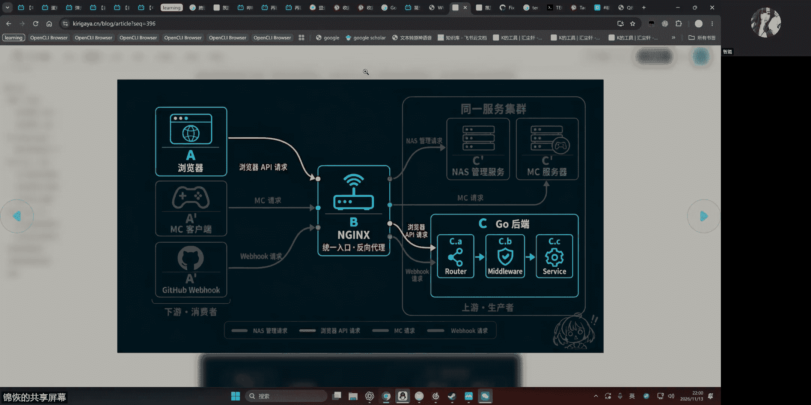

上一节我们介绍了代码Review和架构治理，本节中我们来看看AI到底会不会带来实质性的增量需求。AI本身并没有带来太多实质性的增量需求，很多场景只是替换了原有的服务，比如电商砸了实体经济的饭碗，内容平台砸了电视台的饭碗。真正的增量可能出现在AI设计芯片、加速药物研发等科学实验领域。但是医疗体检等领域虽然有巨大市场，资源被政府和医院掌握，生产关系复杂，不易快速放开。未来可能需要很多年才能改变生产关系。

### ⚖️ AI编程能力的边界与未来展望

了解了增量需求和生产关系之后，本节中我们来看看AI编程能力的边界以及未来可能的发展方向。AI在普通控制流方面已经非常强，但在依赖注入等高级设计模式上仍然不够好，往往需要人工干预。强定义、无歧义的规格说明书在传统芯片设计等领域存在，但在灵活多变的新场景下基本不可能出现。本质复杂度是无法消除的，比如价格从80%变成60%这种业务逻辑，AI如果没有相关信息，是无法自动知道的。未来模型可能输出二进制或汇编，但这对下游开发者来说是透明的，不会改变我们的方法论。

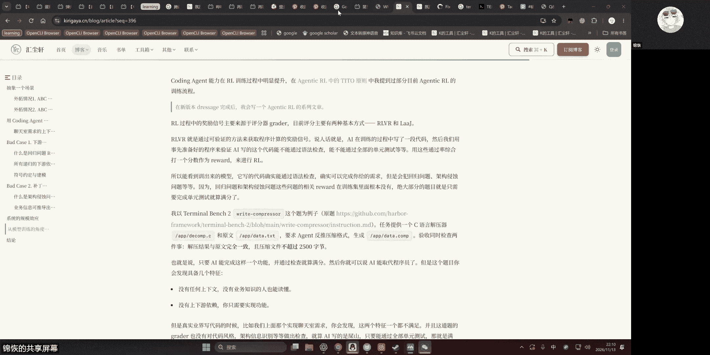


本节课中我们一起学习了AI时代的代码质量保证方法，了解了持续集成（CI）如何解决回归问题，掌握了文档优先、测试优先的开发流程，认识到懂业务的人在处理隐性知识时不可被替代，学习了为什么企业需要自己训练模型以及模型注意力机制的局限，了解了评测benchmark、模块化版本控制和代码Review的工程实践，最后探讨了AI带来的增量需求与生产关系，以及AI编程能力的边界。
