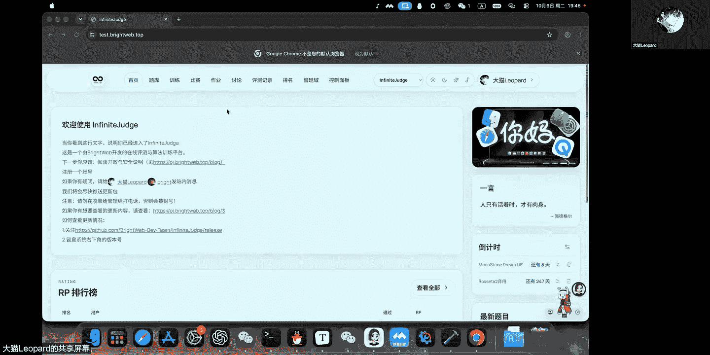
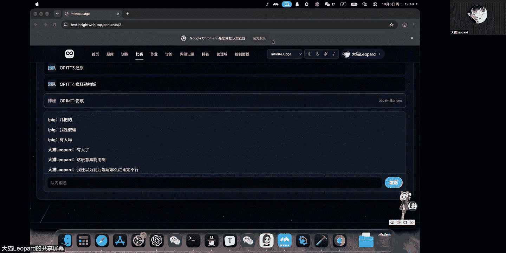
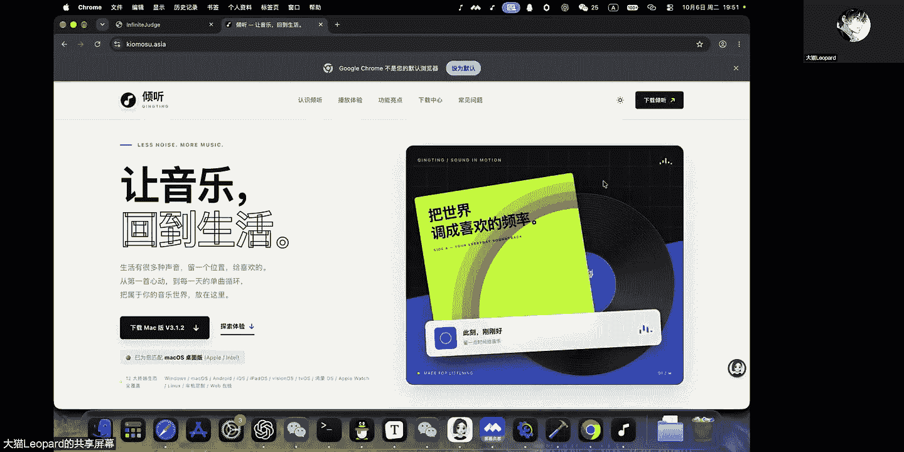

# 【Datawhale AI+X】：01：12岁AI原生开发者如何看待AI焦虑？🧑‍💻




在本节课中，我们将学习一位年仅12岁的全栈开发者是如何看待AI焦虑的。他不仅会介绍自己开发的产品功能，还会分享关于AI和人类关系的深刻观点。通过这篇教程，初学者可以明白，AI并不可怕，关键在于我们如何正确地使用它，以及如何与AI共同成长。这位年轻开发者把代码、算法和AI模型当作认识世界并改造世界的另一套语言，他的经历非常适合正在学习编程的朋友参考。


## 01：产品功能与创新点🛠️


首先，我们来看看这位年轻开发者的作品里都包含了哪些功能。他的产品设计得非常细致，目的是让大家在使用AI的时候感觉更自然，更不违和，不像是在使用一个冰冷的工具。

以下是产品的主要创新功能：
- 隐f价值与液态玻璃效果：页面采用了液态玻璃的视觉设计，文字会被折射，能够看到玻璃材质的变化，营造出一种半透明的质感，让界面看起来更有现代感。
- 流星雨模式：这是一个非常好看的页面动画效果，但是它和液态玻璃不能同时存在，如果两者共存，页面就会出现显示问题，所以需要二选一。
- 一言系统：每次用户进入页面时，系统都会分配一个一言。开发者认为AI和人之间其实需要建立某种联系，只有建立了联系，AI才能更好地融入我们的正常生活，不会让人觉得违和。
- 倒计时与自定义一言：一言系统里还加入了几个倒计时，帮助用户明确自己的目标。一言里面可以放任何内容，用户可以自由自定义，把页面变成属于自己的空间。
- 深度自定义markdown语法：产品深度自定义了一些markdown语法，例如自定义的语法就是艾特userUID，如果你的UID是2，它就会显示为大毛loper，这是在其他latex系统里没有的功能。
- 自定义页面功能：产品支持自定义ECCSS、自定义脚本、自定义HTML，可玩性非常高。它在整个信息学评测系统这个品类里，是第一个支持自定义页面的产品。开发者就通过自定义HTML实现了一个来自GitHub的小桌虫桌面宠物，让页面更生动。
- 视频与语音通话集成：网站内置了视频通话和语音通话功能。开发者之前参加比赛时，经常和朋友打微信电话好几个小时，所以他希望把通话功能直接整合到系统里，做到一站式打通，不用再切换到其他软件。
- 比赛系统集成：以OLro比赛为例，比赛于8月23号19点35分开始，系统内可以直接查看团队信息，并且每个团队的信息都做了细化处理，方便参赛者使用。



核心概念可以用下面的伪代码来辅助理解：


```text
进入页面时:
    分配一个一言
    启动倒计时
    
界面设计:
    如果选择液态玻璃:
        关闭流星雨模式
    
自定义功能:
    支持自定义HTML
    可以实现桌面宠物等效果
    
社交功能:
    整合视频通话
    整合语音通话
    实现一站式打通
```




## 02：音乐产品与AI味道检测🎵


接下来，我们看看他在音乐产品方面做了哪些探索。音乐行业涉及很多版权和利益问题，所以他的处理方式比较谨慎，没有盲目推广。

以下是音乐产品的相关介绍：
- 推广策略：软件内置了1元的费用，因为这会触及一些音乐厂商的利益，所以团队没有进行大规模的宣传推广，只会在某些地方偶尔提一下，甚至有些up主的宣传视频都被下架了，因为这确实动了利益。
- AI味道问题：有朋友反馈，AI生成的音乐听起来有很重的"AI味道"，不如真人音乐那样有层层叠加的音频质感，缺乏那种真实的音乐律动。
- 解决方案：团队考虑优先播放没有AI生成的音乐版本，让用户先听到没有AI味道的内容。他们编写了一个微调大模型，部署在云端，专门用来检测音乐里有没有AI味道。判断AI味道其实并不复杂，只需要分析音乐的某些频谱特征就可以了。这部分工作是由安卓负责人完成的，相当于给音乐做了一次质量检测。

核心概念可以用下面的公式表示：

AI味道检测 = 微调大模型 + 频谱特征分析


## 03：AI与人类的关系🤝


然后，我们进入本节最核心的讨论：AI到底会不会取代人类。这位12岁开发者有自己独特的看法，非常值得每一个初学者思考，尤其是那些对AI感到焦虑的朋友。

以下是他关于AI与人类关系的详细观点：
- AI与人类应平权：很多人对AI存在固化认知，要么把AI当成万能神器，觉得只要往里面输入代码就能解决所有问题；要么把AI当成红色猛兽，害怕AI越来越聪明，会抢夺工作、替代思考、颠覆生活。他认为这两种看法都误解了AI，也误解了人类自己，成年人的认知往往永远困在两个极端里。
- AI的局限性：真正的AI没有野心，没有情绪，没有自我。它虽然拥有人类穷尽一生都无法企及的算力、记忆和迭代速度，但是唯独缺少三样最珍贵的东西，分别是好奇心、共情力，以及突破规则的想象力。
- AI的本质：AI本质上来说还是基于上下文的概率预测，它并不是什么新东西，也不是像人类那样一个一个神经元长出来的，所以它不可能是来自外太空跟人类交流的信号。
- 使用者的分工：低级使用者在用AI，而高级创造者是在与AI共手。写代码的时候，AI可以帮助快速查错、优化逻辑、补全模块，它的效率远超人类百倍。但是AI永远不知道你为什么要写这段代码，不知道你做这个项目是为了解决生活里的真实痛点，也不知道你是为了让技术服务普通人，更不知道你是为了兑现自己的创造初心。
- 核心分工：AI负责的是极致的效率，而人类负责的是纯粹的意义。如果算力足够，AI可以一秒钟生成千行代码，但是它无法诞生一个全新的创意。AI可以精准计算所有的数据，但是它永远无法感知人类的冷暖悲欢。AI可以复刻所有已知的东西，但是它无法创造未来，这就是人类独一无二的底气。
- AI进化与人类进化：AI的进化是迭代，人类的进化是觉醒。AI可以无休止地把参数堆上去，把算法堆上去，在既定的规则里无限趋近完美，但它永远不会自我觉醒，不会重新打破边界，不会为了热爱奔赴未知，不会为了善意重构技术的模样。AI的强大都是人类赋予的，AI的边界都等待着人类去突破，我们既是技术的见证者，也是AI未来的定义者。
- 被替代的不是人类：AI替代的从来不是人类，而是那些懒惰思维、思维固化、停止思考的人类。未来被淘汰的永远不是不会AI的人，而是只会依赖AI、放弃独立思考、丢失创造能力的人。

核心概念可以用下面的公式表示：

AI与人类关系 = 共生
AI负责：极致效率
人类负责：纯粹意义


## 04：个人成长与对同龄人建议📚


最后，我们听听这位12岁开发者的个人经历，以及他对同龄人的建议，了解他是如何从一个普通孩子成长为全栈开发者的。

以下是他的成长经历和建议：
- 个人成长：在这个年纪，本来应该在学课本，应付作业，但对他来说，代码算法AI模型才是认识世界并改造世界的另一套语言。他的成长和AI的成长完全同步，他看着大模型从生硬的笨拙变成流畅智能，看着AI从简单的绘图对话慢慢涉及科创、公益、生活等各个领域。他也从只会基础代码的小孩，变成了一个可以独立搭建项目、落地AI应用的全栈开发者。他从不害怕AI变强，因为AI的进步不是对他的威胁，而是他的一种成长。AI帮他节省了重复劳作的时间，让他能把全部精力投入到只有人类能做的事情里面，比如思考、洞察、创新、共情和突破。他把工作流里面最起码想放松的那些部分全部交给了AI工具，专注于更有价值的创造。
- 真正的竞争力：在addt的舞台上，他见过无数优秀的青年创作者。大家的真正竞争力从来不是熟练的系统提示词，也不是精通模型的调用，而是比AI更懂人，比机器更有温度，比算法更难想象。他和AI的关系不是主仆，不是博弈，而是共生。AI没有灵魂，人类拥有灵魂；AI没有初心，人类拥有初心；AI没有远方，人类拥有远方。我们不用对抗AI，也不用崇拜AI，我们要做的就是和AI并肩同行，让AI成为我们的算力延伸，让我们成为AI的价值掌舵者。AI负责抵达极致的效率，人类负责奔赴滚烫的理想。
- 对同龄人建议：他希望同龄人多去探索，因为探索是一件很快乐的事情。他自己不玩游戏，所以对游戏和学习的时间分配不过多评价。他认为时代已经变了，未来的世界不属于排斥AI的人，也不属于依赖AI的人，而属于驾驭AI、引领AI、用AI向上的创造者。技术永远是中立的，技术的上限和温度高度永远由人类决定。机器越强大，我们越要守住人类的独特，守住好奇，守住热爱，守住共情，守住永不停止的创造。

核心概念可以用下面的伪代码表示：

个人成长 = 基础代码 → 独立搭建项目 → 落地AI应用
真正的竞争力 = 比AI更懂人 + 比机器更有温度 + 比算法更难想象


本节课中我们一起学习了12岁AI原生开发者的产品创新点，包括液态玻璃、流星雨模式、一言系统、自定义页面和通话功能；了解了音乐产品中AI味道检测的做法；深入探讨了AI与人类共生的关系，即AI负责效率、人类负责意义；最后听取了他的个人成长经历和对同龄人的探索建议。希望这些内容能帮助初学者正确看待AI，不焦虑、不盲从，和AI并肩同行。
