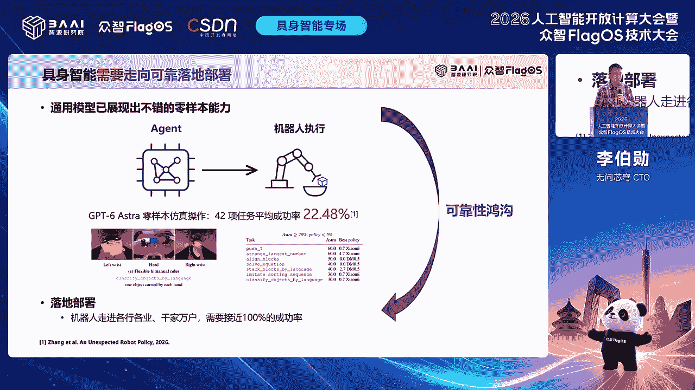
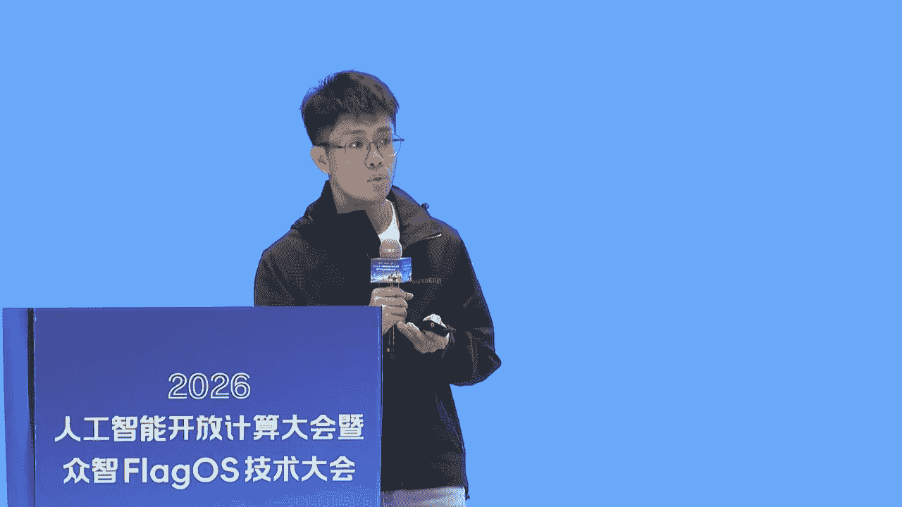
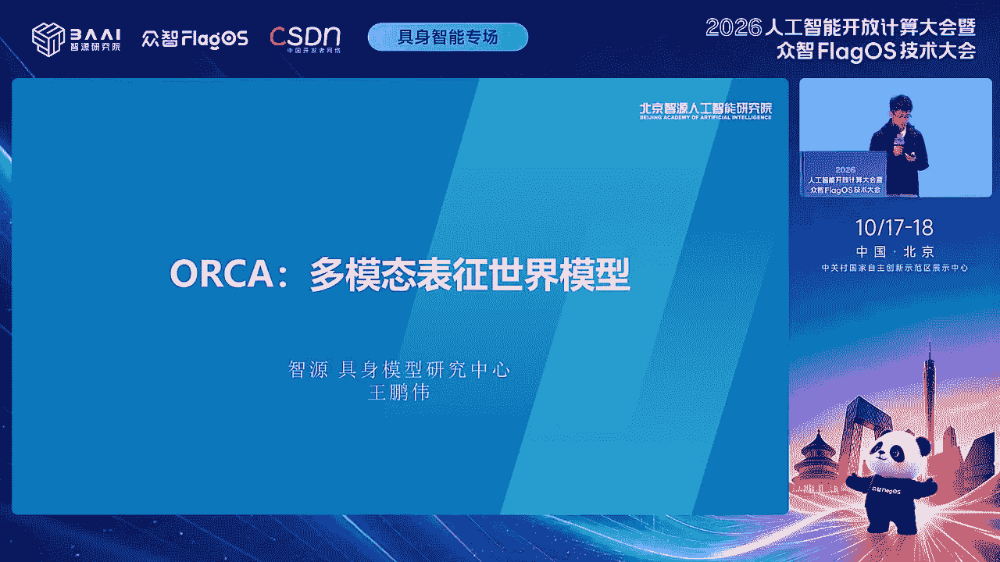
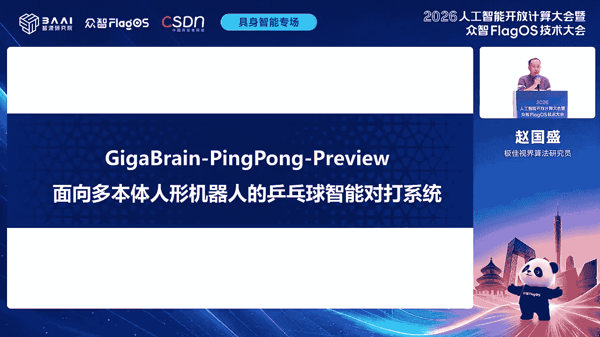
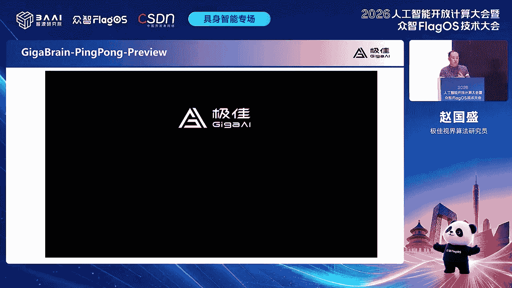
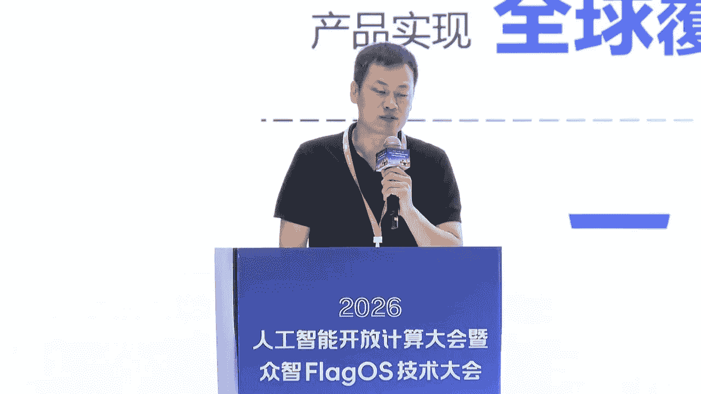
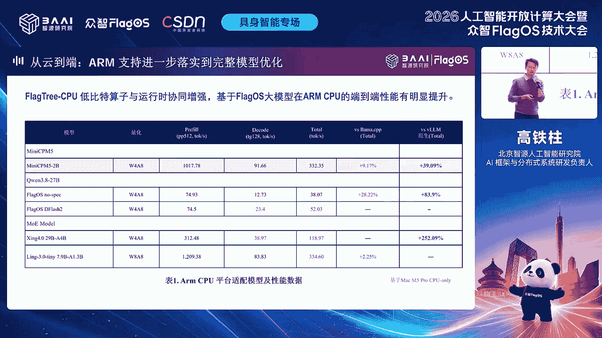
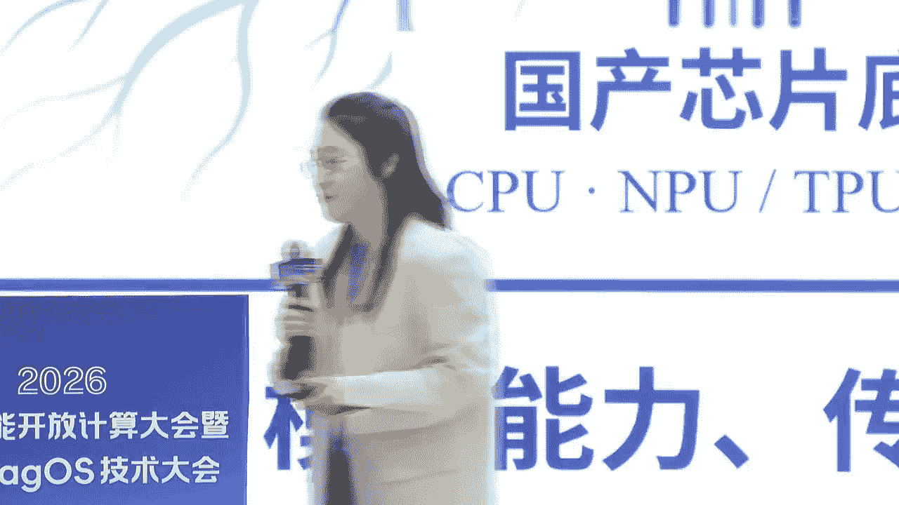
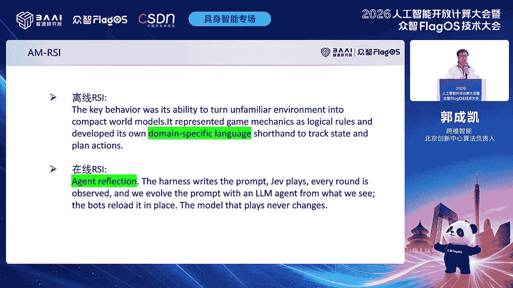

# 🤖 AI开放计算与具身智能基础设施：第1章：会议概览与flagOS生态介绍

在本章节中，我们将学习2026年人工智能开放计算大会的整体背景，以及flagOS开源社区的成立初衷和核心目标。内容将围绕具身智能作为人工智能进入物理世界的重要途径展开，重点介绍算力与基础软件在其中的关键作用，并说明flagOS如何通过开源协作降低跨硬件架构的迁移成本。

2026年人工智能开放计算大会及种植flagOS技术大会的巨生智能专场正式开始。本次专场的主持人是智远人工智能研究院智能评测团队负责人高达辉。在技术领域以及各行各业和千家万户中，巨生智能都是一个备受讨论的重要话题。之所以如此热门，是因为这项技术能够操控不同的物理智能体，与人类和世界进行交互和互动，让人看得见、摸得着，并且能够亲身体验。这项技术充满了想象空间，但从技术角度来看，如何实现人类预期的具身智能，仍然是一个需要深入探讨的问题。

目前整个具身智能技术发展百花齐放，既有做仿真的，也有做模型的，还有做评测和应用的。但这些方向都离不开一个核心技术，即算力和基础软件。本次借助flagOS技术大会，我们有机会探讨具身智能与基础软件和算力之间如何协同促进，共同推动技术发展。今天我们邀请了来自具身智能和算力各个方向的业界专家代表齐聚一堂，探讨开放计算与具身智能如何相互协同，相信大家能从下午的分享中获得收获。

flagOS开源社区由北京智源人工智能研究院联合硬件企业、系统厂商、算法和软件相关单位等10多家国内外机构共同发起并创立。社区致力于打造统一、开源的系软件生态，秉持开源开放协作的理念。这里汇聚了全球数万开发者，大家可以自由探索、创造和迭代，共同构建极致高效、简单易用、人人可及的开放AI计算技术站，让AI在多种硬件上运行起来。flagOS已经广泛支持多种主流AI芯片。

核心目标可以用公式描述：

flagOS目标 = 统一开源系统软件站 + 多芯片适配 + 降低跨架构迁移成本

在具体使用上，用户无需自己进行复杂的迁移，只需轻松几步即可调用适配多芯片的模型。这些步骤包括：下载模型权重，拉取镜像并启动容器，执行flexcal serve命令启动推理服务，最后调用API。

自2023年起，摩尔县城就全面参与了智源研究院自主软件站fag5生态的构建，并联合产业上下游，共同解决大模型训练和推理中算子库标准不相同、生态难兼容等问题。同时也深度参与了flag jams蒜子库的开发与适配，以及frack scale高效并行顺推框架的适配等工作，旨在基于统一开源开放的自主软件站加速产业协同创新。2025年初，华为申腾加入了flagOS开源社区，生腾min系列软件和fllog OS全量打通，开发者能够快速结合深层算力底座与fgo系列软件，实现模型或应用的创新。未来生腾将继续深化合作。

在本章节中，我们介绍了会议背景和flagOS生态。本节中我们来看看具体的硬件架构与算力底座面临的挑战。

# 🖥️ AI开放计算与具身智能基础设施：第2章：硬件架构与算力底座

在上一节中，我们介绍了会议概览和flagOS生态介绍。本节中，我们将详细探讨具身智能对计算链路的要求，以及芯片多元化带来的异构性挑战，并分析存量算力的利用价值。

北京智源人工智能研究院副院长兼总工程师、Blackway创始人林永华在致辞中表示，具身智能的计算链路比云端的token服务更长。具体链路包括数据反馈、基础训练、通用模型形成、企业端的后训练和适配、评测验证，最后部署到真正的在线运行环境。在线运行环境本身又会分叉，可能是云、可能是边，也可能是端。每一个环节可能来自不同团队和不同机构，因此系统天然呈现异构特征。我们无法确定模型训练时使用的芯片与部署使用时是否是同一架构，这往往是不一样的。此外，每个环节对计算的要求也不同。

随着大模型发展和具身智能驱动，越来越多新的硬件芯片公司进入市场。这些芯片厂商采用的技术架构更加百花齐放，从原来的GPGPU、DSA，发展到包括3D对点、纯酸一体进存计算，还有基于通用CPU进行指令扩展等。在地域上，地瓜、灰吸等本地芯片公司也正在进军具身智能。在技术路线图中，蓝色芯片公司是目前已经接入flyOS的，橙色的是正在与flyOS对接的。我们期待从今年年底到明年，有更多可选的芯片搭载flyOS，帮助解决底层适配问题。

人工智能开放计算的愿景是打造一个开源生态共享的软件站，让各种AI算法和模型可以轻松运行在不同厂商、不同架构、不同时代的硬件上。如果做到这一点，可以为产业带来更多硬件选择，进而降低成本，让产品更快满足市场，并使硬件价值可持续。

为什么硬件价值可持续很重要？我们可以用大模型token服务为例。在9月初open上的数据显示，头部大模型竞争激烈，每周流量可能翻转。例如5.2模型出来后，流量很快被5.3和5.35取代。这说明API模型的生命周期远短于计算基础设施的生命周期。对于运营方来说，新模型如何更快在手头芯片上跑起来是巨大挑战。因为运营方维护大集群，无论是长期租还是自有，一旦流量达不到收入，集群每天亏损的钱是肉眼可见的。

昨天上午主论坛发布了使用flyOS支持存量算力优化的结果。例如在升腾920B上进行推理优化，支持最新模型在存量算力上运行。升腾920B在企业市场和运营商市场部署量很大。如果最新模型不能高效跑在这些存量算力上，算力可能会闲置。通过优化，fly支持起来最新模型在存量算力上，效率提升了一倍。因为920B租赁价格实惠，即使按吞吐量折算，仍能带来经济效益。我们想表达的是，存量算力支持最新模型，未必是最大的模型，但最新的经济效益模型非常值得。

对于具身智能来说，硬件价值的持续性可能更重要。具身智能的本体硬件产品与嵌入计算模组高度定制、高度吻合，很多接口都是绑定的。如果芯片更新换代，每一代都追星去换芯片，需要大量重新设计。具身智能产品不仅集中部署在云端，往往部署在客户的实际场景中。如果涉及硬件更换，维护成本极高。还有软硬件深度耦合等问题。因此，具身智能领域也需要开放计算技术，让存量的具身计算部件，即已经设计放到本体上的部件，尽可能持续支持新模型和算法。

北京智源研究院联合众多合作单位（包括今天在座的无问新琼等）在过去几年打造了完全开源的技术站，越来越多芯片厂商参与其中，包括可以用在具身智能本体上的芯片。过去半年，我们对很多大模型（大小不一）进行了适配，跨度很多不同芯片，很多是存量芯片，包括今年好几个万亿大模型的适配。我们并没有用最高端芯片去适配万亿大模型，而是用广泛部署到各个场景和集群的现存国产芯片，当然也包括端侧芯片。希望用技术站能力帮助大家在不同代次上跑起来。

从云到端，计算挑战依然很多。端侧芯片与云端芯片相比，第一，显存带宽通常不使用HBM，而是使用LPDDR，显存带宽明显下降，因此优化需要针对性很强。第二，在横量上，通常不是多路并发，很多时候是batch等于一这种单路，但考究的是端到端的延迟，这是重要考核项。另外，端侧芯片通常是CPU加GPU加NPU共享显内存。共享内存一方面可以看到更大的显存空间，但设计系统时也要考虑更多资源共享问题。

除了整个技术站之外，我们还有统一的量化工具跨芯片进行量化。第二，值得关注的是正在打造的技术，有机会在端侧模型（尤其是具身智能这种新端侧模型）上尝试，进一步挤压优化空间。因为本身最优秀的时候就是一，还有另一块，因为现在很多具身智能场景下，端侧芯片的CPU很忙，要处理模型以外的繁重任务，例如信号处理、图像处理等。我们最近也在与open CVV洽谈，可能引入open CV到合作中，把open CV里常用且计算密集型的部分，用我们的跨芯技术站支持起来，让没有进入加速器、还驻留在CPU的繁重计算挪到加速器，帮助具身智能腾出更多CPU计算周期。另外，算法还在快速创新，模型和框架比大语言模型或VOM等重头部模型更加多样化。

在本章节中，我们介绍了硬件架构与算力底座。本节中，我们来看看具身智能基础设施与仿训推一体的具体实现。

# 🤖 AI开放计算与具身智能基础设施：第3章：具身智能基础设施与仿训推一体

在上一节中，我们介绍了硬件架构与算力底座。本节中，我们将学习无问新琼如何通过环境管理、训练框架、智能体运行和部署四个步骤构建具身智能基础设施，并介绍M技术、ALi福框架以及大规模真机强化学习的容错机制。

无问新琼是2023年由清华大学电子工程系推动成立的人工智能基础设施公司，CTO是李伯勋。公司重点解决多种芯片和多种算法之间的耦合问题，从规模和效率的整体框架推动人工智能基础设施发展。目前通过电话量已达到近2万亿或更多的每日付费量，付费模型都是万亿规模以上的超大模型，半年取得了50倍以上的增长。

物理世界在某种程度上也在遵循数字世界的发展步伐，从最早的感知型物理感知算法，到小规模算法，再到像派或派05这样的大规模算法，现在也有一些整体算法。但实际上，物理世界的token电量和机器人发展数量，并没有像数字世界那样取得明显爆发，目前还在积累阶段。积累阶段要做的就是把物理世界的基础设施先做好，让基础设施先行，才能支持更好的物理世界AI算法发展。

物理世界AI基础设施不像数字世界可以直接沿用。本质问题来自物理世界自身：物理不能被加速，生产和发展是线性的，不能像软件一样复制一份、10份、100份立即复制上去。其次，物理世界AI引入会引入端层，之前数字世界更偏向云，训练和推理更多在云端，但到端测层，端测本身算力限制以及端云异构性会带来算法、数据、算力上的很多挑战。明确的挑战包括物理世界的鲁棒性、不可加速性，以及端云带来的异构性资源受限性。

物理世界基础设施需要重新变化和发展。无问新琼做了一些尝试，把物理智能基础设施分成几步：第一步管环境，即机器人多了之后如何统一管理好，管机器人和管服务器是否类似，有哪些新的挑战，其实就是管环境的问题。管完环境之后，是怎么样让物理AI模型训得更好，如何解决现实和虚拟之间的gap，现实和虚拟对接会有很多训练问题。训练好了之后，核心是跑智能体，即偏向物理世界智能体的框架。最后是把它部署到端测。这就是管环境、跑训练、跑智能体、部署，四步走。在这四个方面开展了四个基础设施。

第一块是管环境。物理世界管环境会有哪些问题？目前使用的操作系统是Linux系统，做机器人很多同学会用ROS系统。ROS系统底层的通信机理和调度逻辑与正常Linux系统不一样。因此，管具身智能和机器人时会面临相同问题。本身集的鲁棒性带来问题。如果把它当成GPU来实现，调度就会错过很多物理世界必然的因果关系。举个例子，做通信时可能会做重传，但实际上机器人要实时，重传重传的话，其实已经废了。此时不能考虑重传，要考虑实时性。所以具身整体管环境层面，需要把设备、网络、任务、运维统一起来，并针对物理世界限制做好铺垫。总结出了4个核心关键点：第一是分散资源如何做好配置，底层是设备资源化和具身运行时问题；其次是把不同角色识别和布局，做了声明式的跨级群编排；最重要的是连接于不同拓扑变化导致的连接性和调度性优化，做了不同连接管理、任务观测、运行诊断技术。核心是把机器人和GPU能更好地从同一视角管理，让从GPU端能去理解物理世界规律，从机器人端也能跟GPU统一是一个统一公民。任务编排包括资源抽象、调协、弹性传输和可观测问题。

从GPU视角，希望机器人跟GPU是同样的公民，不要GPU是一个公民、机器人是一个公民，调度时GPU和机器人都要统一调度考虑，因此要把不同设备统一管理起来。从机器人视角，要考虑机器人所需的通信要求、网络流量配置，针对不同任务和网络流量特征做好任务隔离和传输性能优化，保证任务实施运行。

平台已经在多个集群，包括近百个不同的云边端节点，节点包括GPU和机器人，对我们来说都是不同节点。然后在4个以上不同型号，包括国产芯片、英伟达芯片、不同机器人芯片放在一起做整个设备管理，能实现纳管环境分钟级，启动时间秒级。核心点是跨集群通讯优化。之前尝试把机器人纳管通过脚本包装成流水线，但包装出来的问题在于两个：一是通信效率低，使用的现成通信协议；二是通信协议很多时候不考虑机器人物理世界执行的因果关系。动作ABC要ABC顺序执行，中间间隔需要明确的机制，不能考虑重传。因此在通信优化上做了大量工作，实现很好的吞吐提升，并且实现了P95的十几纳秒优化。这是管机器人平台的管环境开源项目，叫阿L。

管完平台之后，很重要一点是训练。这是目前作为阿Li的框架。阿令福框架经过将近一年发展，发了目前大概三个版本，马上0.4版本也会推出。最开始版本是针对仿训推一体任务做的框架，把仿真环境、训练环境、推（很多强化学习的推一体任务）三者放在一起，做好了仿推一体强化学习框架，支持14种仿真环境、8种模型和7种算法。再往上，要把仿真框架往现实世界发展，开始做真机强化学习。0.2版本把刚才的接入做好了。3版本时，已经可以实现百台以上规模的大规模真机强化学习应用。阿令福目前star将近6000个，进入了system系统，并在今年GDC上得到亮相。现在也跟很多国产芯片、包括智源在合作，希望所有相关功能基本上都能在国产芯片上使用，促进国产芯片在具身智能的应用和发展。

阿拉（阿令福）核心技术点是什么？其实是解决强化学习训推一体的问题。现在都在做强化，强化本身是一个训推一体的动态任务。动态性带来很多技术挑战。具身智能又引入了仿真物理世界和端的异构性，因此在强化学习动态性特征上，又带来异构性和任务多样性挑战。这种挑战最大的问题就是效率。现实训练最追求效率。传统做效率编排时，上一代物理世界任务有两种经典做法：一种是共享式，即训完先推，先去rollout之后做同步，然后再去训练。这是比较典型的大家写代码时按照流程一步步实现。但共享式指资源共享，即每一步所有资源都共享在一个资源池里，势必会带来因为训推一体不确定性带来的等待问题。解决等待问题最经典方法是做流水，像我们比较用的ag，把中间流水做好编排。在这种情况下，其实是某种分离式实现。但分离式实现也有问题，编排比较死板。像ag主要在预训练上做实验，预训练每一步抠得很死，才能这么编。但训推一体又是动态性，同时结合真机时，GPU、本体机器、本体机器人之间是不同组合，不同资源很多时候也不好编排。因此共享式和分离式都不好实现所有效率。怎么办？本质问题是说，做共享式和分离式实现时，本质原因是只考虑了程序运行步骤，没有考虑底层资源分配逻辑。没办法，大家写程序时往往只写算法逻辑，没法写资源编排。所以需要实现的问题是：如何让程序在运行过程中也能考虑到资源状态，能做到大家写程序时只关注程序逻辑，但资源可以根据程序状态自动做好编排。这时需要把已有程序和实际资源做好隐性映射。我们发明了一个技术叫M技术。核心是说大家写的时候是程序AB就是12三4步逻辑，但写的时候每一步最后的资源，我们做到隐形映射。在做的时候，可以把宏观逻辑流变成拆成比较小的微观执行流，执行流上面就有资源。这时就可以做好很多优化。这就是M two的一些底层实现，包括怎么做抽象、怎么去做不同等级的抽象，然后做好后面编排。核心是通过比较好的抽象去扩大搜索空间，搜索空间扩大实现了调度高效性和调度效率提升。在这种情况下，传统实验上，包括简单任务上，可以实现将近两倍加速。背后核心都是灵活调度，灵活调度核心是资源抽象。

阿利弗现在关注真机强化，真机强化有点像大模型，需要一个环境。虚拟世界环境可能是软件，物理世界环境就是真实机器人和生产环境。现在看到包括很多任务都需要大真机去做最后强化学习和能力提升。举个例子，可能在仿真环境中先做好一个任务，但到现实任务中，还需要机器人跟现实世界做交互，才能去做好整个训练。这个交互是通过强化学习实现的。强化学习现在可能传统是做11台机器人，现在核心任务是做100台或1000台机器人的强化学习。这时会发生一个问题：当机器人数量变多时，怎么克服规模性挑战。包括一个很重要问题就是容错。机器人在实际实验中经常不稳定，做100台时，旁边会有很多人不停把机器人搬来搬去。整个系统一方面要做好提醒，另一方面如果一个机器人失效，一定要及时从系统中把机器人做好热插拔，才能不至于让整个强化学习系统受影响。举个例子，96台机器人，近百台机器人实现中，大概9000多将近1万次轮次容，可能不长时间，但已经发生了30730次故障，每次故障时间基本20分钟，基本不停要做机器人热插拔。如果做好机器容错和训练系统调度，可以把整个损失占比只占到整个时间的1.3%，但如果做不好，可能是10%以上损失。这是大规模多机强化实验的效果。除了效率，也从验证了类似于具身智能在强化学习上的s。之前用手机做打包任务，如果只用少数十几台机器人，相同时间可能只能取得80%准确率。但如果做大规模强化学习，一方面时间提升，另一方面机器人多样性带来更好鲁棒性，准确率提升到将近99%。希望通过大规模系统，让一台机器人的实践成为更多机器人下一次实验更好的起点，实现群体智能群体强化学习进化。

再往下走，有两个工作。第一是跑智能体。P6是大家现在讨论最多的具身智能大模型，体现了很好泛化性。当模型泛化性足够强时，大家一定会沿照数字过程，从单任务变到多任务，多任务变成灵活配置任务。比较经典实现，harness实是：在模型本身以外，加入mem组件、工具组件、控制流控制，通过整体完整服务化、标准化、可组合实现来实现任务可配置。在这方面开源了基础设施，核心点包括3个：第一是中间加入很多生态组件，让大家方便实现常用机械臂和常用任务；其次是做了一个mem系统，在智能体实现中能快速实现经验积累；最后是服务化、标准化、可组合封装实现，让大家快速开发。GP6效果惊人，基本把labbel和几个数据集直接刷爆了。只要有比较好的控制流或比较好的ney系统，很容易做到将近99%性能提升。

最后一点是部署。刚才说的都是训练，管机器偏云端的事情。最后落到实际上还要做很多端子部署。部署也跟资源做了很多合作。讲一下疫情引擎：现在具身智能部署往往是个十兆或更高实现，但如果做不好，只能做到一赫兹或三个，明显不够用。怎么把推理加速？分几个方面。第一是软件层，做了一些压缩量化算法，这个算法是公共开源算法，做好集成。系统上做了三层：最底层是高性能算子库，在一些芯片上做了很多算子实现，跟智源做好很多合作，有些算子会一块共建。在网上有了算子之后，怎么做运行时，有两条路：一条是偏级别的优化；另外一条是因为端侧芯片是异构的，有CPU、NPU，后面一堆P，怎么做好运行调度，做了一个运行系统让它进一步调整端侧资源最大化。最后一层是接口，实现最好的开发效果。基本上是在所有芯片上实现了10倍以上加速，能让大家实现到接近三四十赫兹的实际应用体现，进度不会特别大变化。觉得它还是可以更好发展，支持多大模型端侧落地。

在本章节中，我们介绍了具身智能基础设施与仿训推一体。本节中，我们来看看世界模型与多模态表征的最新进展。

# 🌐 AI开放计算与具身智能基础设施：第4章：世界模型与多模态表征

在上一节中，我们介绍了具身智能基础设施与仿训推一体。本节中，我们将学习世界模型的建模范式，包括下一个状态预测、无意识与有意识学习，以及高效的推理和生成系统优化。

北京智源人工智能研究院巨生智能团队负责人王鹏伟介绍了过去一年半在巨身以及世界模型上面的一些进展。整个AI发展规律是三段式的：第一段是符号主义、机器学习和深度学习的早期架构；中期是以大模型和多模态大模型为主，以及衍生出来的具身智能。数字世界的发展已经非常好，但从数字世界转向物理世界还存在非常大挑战。世界模型应运而生，技术界和学界对它寄予深层次技术迭代的期待，希望能更好地理解物理。从去年开始到今年，世界模型需求量非常高，大家期待他能真正理解整个物理世界。智源在巨身基座模型上面做了大量研发，从顶层的大脑roble brain，迭代从1.0、2.0到2.5，以及从通用具身小脑roble brain x0和roble brain deck部署在轮式假爪和灵巧手大模型上面做了大量研发。整个技术框架基于flaggoflex skill进行迭代。最新的在年初发布的roble brain2.5，是在摩尔千卡集群上面，依托于flex skill大规模并行集群的基座去训练出来的。大脑和小脑体系，小脑基本上做了很多数据方面的探索，架构上面还好。小脑是依据于roble brain作为机机座，然后做了大量数据的哄讯，像centric video data，以及其他一些数据的异构。接了一些很小的头，可以部署在不同的机器人上面。

银河一起在酒店上面合作的一个demo，今年6月份在智源大会现场有实际演出，是一比一还原video里面讲的内容，现场体验过的。另外是触觉灵巧手上面的一些工作，基于沙pa的非常高自由度、带触觉灵巧手，今年6月份在智源大会现场送了上百朵花，抓纸盒、透明的盒子以及花，都需要非常精巧的利空。过去在巨身大脑方面，brain做了大量工作，本身都在理解世界，去做planning，去做perception上面的一些大量工作。发现目前不具备预测未来，对物理的空间展示理解以及因果关系还是有一定欠缺。希望从理解世界走向学习世界，需要的是一个通用世界模型的基础。目前做试验模型的分类，大家基本上都是以预测单个模态为中心，比如预测动作为中心的world action model，或者说预测像素为中心的vi generation像lab等等。我们是从预测单个模态到预测整个影视的状态，把所有的信息全部都压缩到这个状态中心，通过下一个状态的建模去学习到行为语义和物理规律。学到之后，可以解决所有受物理和常识约束的问题，也就是圈内的问题，不解决圈外的问题。这个圈能框的这么大，本质上把所有的行为语义全部都压缩非常高效地压缩到这个状态里面。下游不同的应用，可以根据下游的需要去解码出不同的模态，比如要解码出部署在机器人的模态，可以去接一个expert输出动作，也可以去解码出人能看得懂的视频或图像，直接去接一个stabletable diffusion。它们都是共享同一个机座模型。而且所有的像因果、物理规律全部都在基模里面搞定，所有下游的头是非常非常轻量化的，仅仅起到一个转移的效果，可以非常轻量化地达到非常好的效果。

核心理念是从nex token prediction以及下一个frame的预测，以及下一个action的预测走到nex state prediction。通过不同的学习范式，像有意识的和无意识的，可以让一个孩童变成一个专家的学习过程。人在小时候，听不懂话，也说不了话，完全是通过学习整个客观的世界，看这个世界是什么样子的，学到的就是什么样子的，这样方便于学习到一些很基本的一些逻辑和一个环境到底是怎么变化的。人长大了之后，为了学习的更加高效，会引入很多主观的介入，比如说老师、父母、课本，都是让他加速整个学习过程。

奥卡的第一个版本，其实是围绕在这个下一个状态预测下面的一个子集。从多种模态的信号里面去学习到当前的状态。模态不仅仅只有视觉，还有语言、action、触觉等等，都是跨横跨整个流程，比如从预训练到后训练。学到的就是建模之前和之后的一个状态的演进，比如从ST去预测ST加德ta这个状态的转移过程。德ta可能是正的，也有可能是负的。如果是正的话，就的确是在演化未来。如果是在负的话，其实是反思过去。里面包含了两项condition，ZT和CT，代表的是影视动力学，也就是无意识客观的去学学习这个世界，显示的条件就是下意识的主观和这个世界去做交互。通过这种有意识和无意识的学习范式，可以学到一个很好的世界表征。这个世界表征，包罗万象，可以包含所有的行为语义和物理规律。拿到了之后，再去接非常轻量化的头deder，去让它解码生成文本、生成image或video以及生成可以部署在机器人上面的动作。

无意识是怎么学？完全是learning from video。学习范式是从XT去预测XTT加一。本质来说，就从当前帧去预测下一帧，但本质上并不关心pixel东西。完全是在space里面去做对齐，并没有在像素重建上面去花任何功夫。这样的话他学到的是很多非常主观的、非常重要的一些前置的一些东西，像背景，比如说文理其实完全是可以忽略掉的。对于有意识来说，其实是两种范式：第一种是因推，本质上就是从当前的状态，以及未来某一个事件的描述去预测加；第二种是有果素音，代表的就是一个反思，就是当前的结果好和不好是由于过去哪些角色做的好或者不好。那通过XT和过去某一个时间的描述去预测它T减德ta这个laen的laen的这个状态。这里面的两个case都是真实的训练数据里面挑出来的。大家可以看到，当前的切片和未来某一种描述，去预测未来的这个动作语义，应该是做一些什么样的动作。

在数据构建方面，年初做了很多尝试。当下s law，在巨胜也好，在世界模型也好，并没有发挥出很大的作用。本质上，在选择消费什么样的数据时，他必须要具备这个数据必须要具备可potential的想象力。任何一个优秀的企业也好，还是一个初创公司也好，基本上不会受这个算力所限。不能说挑选的数据，我们去到的时候呢，要depend另外一个数据行业的崛起。在某种意义上，是在预训里面肯定是不能这么去用的。所以，当下大部分的公司都局限在这个小圈子里面，就是action数据。像曾姬姚超的video、cent video data带这个pos的标注或万部的追踪以及指尖的关节角等等，都算action数据。目前来说从量存量其实很少，也就1万到100万小时左右，增速也很慢。第一个问题，量没那么大。第二个问题，关系到整个学习的范式，它和人的学习范式是不一样的。action数据某种意义上是视教的数据，更像手把手去教你怎么做的一种数据方式。人在学习新的技能的时候，基本上不需要手把手，基本上看一段视频，尤其是看一段第三视角的视频就O了。而且不同人看同一段视频，他学习到的东西是一样的。大概率不是去学一下哈我的关节角到底应该怎么弄，而是学到了更可以共享的行为语义上面的一些com sense也好，或者说知识也好。但是这些东西并不是完全通过语言去表达的。所以，在很早的时候就锚定了互联网的视频数据，大概800多年的一个存量。里面有大量的第一人称、第三人称和自然人这个动态和这个世界区的交互。而且第三人称的量会非常的大，就拿叠衣服这个case来说，网上的这种叠衣服，在居家里面的一个摄像头，然后看到自己家庭里面去叠衣服，这种非常非常的多。而且，我们是全球第一个在把第三人称的行为语义怎么transfer到下游里面，比如说transfer到巨声也好，还是transfer到vi generation里面也好，让他具备这个物理语义。

目前第一个版本，把开源所有的数据都处理完之后，得到了非常高质量的12.5万小时的通用视频数据，里面包含第一人称、第三人称和其他的视频。第一人称和第三人称总计占了90%的比例，且第一人称和第三人称是1比1的比例。这样的数据训练经过标注之后，得到了1.6亿条的事件标注和1150万条。7份发布的卡第一版模型的数据就是这样，我们现在正在迭代的是第二版的数据。把youtube数据以及其他的一些公开的或者说互联网上面的数据全处理完之后，目测第一版的数据仅仅使用了1都不到，也就是说我们有99甚至更多的数据可以支持我们。这就是我所谓的这能力，我们要一定要有用之不及、用之不尽、取之不尽的数据能够供我们去用。所需要的是这样的web data、web video data，学到的行为语义到底能不能给下游的聚声也好，或其他的下游的application的应用里面能够起到这个knowledge transfer的作用，这个是我们想要验证的。如果能验证通的话，其实像一些私域的数据，像抖快上面的这种老多这种像第一人称的和第三人称的数据会非常非常的多。所以前景是非常非常广阔的。

数据像第一人称的吧，这些全部都是互联网上面的数据，并没有去让人采或者说去采买。第三人称的一些数据，其实是做了很多的任务吧，都是非常非常长城的一些任务，以及一些自然动态，比如说下雨了之后会影响自驾，下雨了，这个刮风了之后会怎样？然后下雪了之后可能会把这个电线给压断等等。

学完了这个世界表征之后，好，他学到了什么，假设他学到了所谓的行为语义。那他在下游的表现形式是什么样子的？这是我们想要验证的。所以我们把它接了很多下游的头，让它输出不同的模态。比如说我们接了大模型的头，让它生成文本，接了这个让它生成图像，以及接一个action让它生成动作。PPT可能有点格式问题，为了防止过拟合，所以把所有的主干网络全部都冻结了。我们仅仅去微调非常轻量化的头，去看一下它的效果到底是什么样子的。最后的话，其实我们整个第一版的这个的一个效果可以看到，我们训练了两个模型，一个是零8的个4，左边是这个图，右边是三大类的任务。我们可以看到从右边的三大类的任务的话，我们可以看到两个现象：第一个是4B的模型，在所有任务上面都要比0.8B的模型要好。第二个是，我把下游的posttrain的数据量在fi的前提下，我去拓这个train data，横轴是train data，我们可以看到下游所有的任务都是这个性能都是上升的，尤其最后一个任务的话，是在这个银河的真机下面去做部署的。我们的训里面没有一条真机数据，没有一条动作标签的数据，但是他对下游的任务是有提升的。所以它某种意义上，确实是从这样有效的数据里面，通过有效的建模范式里面，学到了可以帮助下游做更多泛化的任务的一些能力。

这是一些detail，就是刚刚三大类任务。比如说to language的话，就让它生成文本，在上面的话，我们在同类型的这个尺寸上面，我们达到了一个的效果。然后这个是在生成图片、生成图像上面的一些效果。这里面有一个比较有意思的，就是右下角这个图，第一幅图的话是我们输入的图像，后面三个的话是不同的模型。我们可以看到，像同尺寸的最好的模型，就是看单幅图是没有问题的，但联合看前面的话，就是说它有一个突变的效果，它没有因果的这个物理感知。他认为这个世界上所有的气球都是的，如果没有pro加的话，他认为所有的矿泉水瓶子全部是盖盖子，如果没有这个和加的话。所以，在这个图片生成上面我们有很大的一些优势。

我们在后再看一下这个to action，就部署在银河面，其实可以看到这个红色这一圈出来的话，是这个成功率是百分位的。我们主要测的是泛化。所以整个的这个呃，就可以看到所有的模型都很差。现在对，那基本上在泛化上面的话，很难有很大，目前来说很难在真正的实际里面推广应用的。那我们看到两个现象：第一个现象，传统的模型在预训练的时候没有任何真机的数据，没有任何动作标签的数据，它的泛化性是0。第二个，这个奥卡可以和派05的话去互搬家手腕。某种意义上，派05用了1.6万小时的数据吧，已经把全球最高质量的数据用完了，真机的数据。那奥卡的话，其实是在预训练的时候，没有用到一条真机数据，也没有用到一条这个动作标签的数据，它仍然可以达到一个很不错的效果。且奥卡的这一条技术、这个思路，还有99%的数据没有去去被使用。而且，所有这个剧生类的数据都可以放在奥卡的后训练里面去用。我们认为好，这个一套的行为范式和技术是可以走得通的。

我们整个这个发布之后，其实很快在7月份这个face话，在日榜、周榜、月榜全部都排到了第一。因那个7月份的月榜的话，应该排第二的话是ki的那篇，对我们同时把我们的模型也了部分吧。个star话很快就突破了这个K，那两项共同加持，这篇工作登录了face的趋势榜。某种意义的话，算这种在技术没有收敛的前提下的一种未来的趋势的一个判断吧。

北京航空航天大学助理教授龚瑞浩，分享主题是高校世界模型方法与系统。他本身是巨身领域的外行，前面听各位专家的报告也学到很多，可能更多是从系统和这个推理，还有一些训练的优化方面出发去展开工作。首先背景，现在数字世界的模型，其实有两个趋势，一个是模态越来越多，另外一个是理解和生成以及模态开始融合。以前VRM是单独的模型，然后video generation这类模型也是单独的模型。从chaGPT image开始，其实出现了一些融合，包括最近也有一些趋势，GPT6这样的VRM甚至也可以去干一些这个具身的事情。物理世界的这种具身模型，在我做这一页PPT的时候，其实还是明显的没有收敛。我们可以看到有一些是基于VRM的base model去扩展，叫VR后；有的是基于video generation model或者3D的model去扩展，有的把己叫世业模型。里面可能最新的一个趋势，就是最近一段时间比较火爆的叫code world model，它是把VRM模型用来生成这种世界的结构，写一些这种nder之类的这种构建世界3D结构的一些代码，然后呢在用video generation的这样的model去生成一些外观，这样串联起来，它可以相对比较好的保持一致性，并有比较好的一个世界的刻画。这几个趋势这个组合下，就对我们这个系统带来的比较大的挑战。一方面，这些不同模态的模型，它的结构是不一样的，同时它的参数量和这个存算的需求也是不一样的。而且最明显的是，这个计算模式是不一样的。VRM是一个token by token的自回归，而这种genration based model，它是扩散模型，是一个step by step的循环。为了去支撑这种不同模态的理解和生成的高效和低成本的推理和训练，我们就从22年开始，逐步的打造了几个开源项目和系统。今天时间关系，我可能先简要介绍一下在理解世界这块的这个lightM的推理系统，和在生成世界这一块的light台toV的呃这个框架。重点可能是后者，因为他跟现在大家所说的这个世界模型可能关联会更强一点。

首先是理解的这个多模态理解的lightM，其实这个项目从23年6月份就开源了，那时候开元社区呢有generation，还有VRM，这两个可能都是比较有名的。那我们当时去实践的时候发现这两个项目分别有些问题，就做了lightM的这个框架。后来呢，社区里有另外一个非常有名的项目叫SG浪，他们呢基于我们的开源的改造出了S浪的第一个版本。所以现在S浪的这个readme里面还有在在械里面还提到了复用一些代码。当然到现在的话，两个项目的影响力完全不在一个量级上，他们和基本上是top，我们可能就是s对，然后但这里面有很多技术，我觉得还是啊，我们做的还是可以。其中有一个表性的，就是这种多进程异的架构和多模态的进程间的高效的通信，这个事情对于多模态模型的吞吐是非常关键的。我们应该是行业里比较早的去设计了这块的整个从多模态的种还有共享内存来管理种多模态的信息和一些data，同时在整个推理部分呢，处理好呃这么一些进程间的通信，使得整体呢有一个最高的吞吐。

这里面呢，其实我们也陆陆续续做了一些算法创新。第一个呢就是token attention。这也是当时选基于我们开发他们第一版本的原因。这里面主要的特色呢，就是说我们在管理大模型的整个推理过程中，其实对于资源的占用是确定性非常大，呃，低的，整个负载的变化比较大。为了比较好的管理这个整个c，我们就做了基于token来去管理整个历史。它的好处呢，就是我整个资源的申请和释放相对比较可控。同时呢，做一些这种pro cash多轮缓存复用的比较好做啊，这因此呢，这个它是基于这套机制扩展出了radance attention去做这种多轮的pro cash。当然，这个工作当时的一个最大的背景是，没有PD分离的时代，如何去保证SRAA让用户的体验比较好。因此可以在这样go put上获得2到3倍的提升。进一步的呢，我们也在算法上做了一些特定领域的探索。这个探索其实和巨身还有一点关系，就是叫做结构化结构化的生成。也就是说，我想让大语言模型去生成固定的文法的一个文本，比如说我就一定生成一个符合jason文法的一个文本。那现在呢，大家仔细去看GPT6去接这个具身，它其实就是让模型输出一些这种结构化的文本，类似于工具调用，然后再把这个工具调用呢和一些关节角打通。大家可以想象，语言模型是一个概率性的，它一定不能完全保证你让他输出一个jason它就一定输出一个jason，当模型能力的变强，会这个这个事情的确定性会变高，但也是没办法完全保证的。那我们呢，就在系统的角度呢，给模型的过程加一个后处理，在它的预测的概率的基础上呢，引入一个文法约束。这里呢，是借鉴了传统的计算机编译原理的确定性下推自动机的方法，然后呢，在这个推理系统中做了一些并行的优化。在这样的一个思想下呢，我们可以比当时的做这个结构化生成的X gramar有大概40%左右的提升。X gramar呢，是华盛顿大学陈天启老师团队的一个工作。那我们这个方法呢，也比较幸运，获得了ACL的杰出论文奖。后来呢，在今年上半年我们又做了一个小的探索，就是做这个语言模型的叫做投机解码，或者叫speculative decoding的一个动态的方法。大家知道，语言模型现在是token by token的预测。有的问题呢，它可能模型确实可以一下同时多出几个token，有的问题它可能就比较难，需要一个token一个token的出。所以呢，就领域里就出现了这个投机解码，或者叫做m token prediction的这样一些方法。历史上，大部分方法都是固定的，比如说我做了一个MTP或者一个ulative这个头，这个头它是确定，我就一下出三个token，或者一定是出四个token。但这个显然是不合理的，因为不是所有问题都模型的confidence都是非常趋同的。因此呢，我们基于这个模型的能力和它的知行度，以及这个问题的难、难度，还有我们系统的资源呢多少啊，做了一个动态的调整。这个动态调整，它是考虑了系统资源的。这样的话呢，就可以实现一个动态的自适应调整。复杂的问题，有限的资源，那我就少出几个头肯；简单的问题，然后充足的资源，我就多出几个头肯。这样的话，一个非常好的收益呢，就是它的有效交接收率是变高了，因此，整体的系统的吞吐也是可以获得提升的。

这个方法呢，就是比较巧，跟那个呃的par就是同期算是一个同期的工作。但两个方法会稍微的有一些差异。呃，另外dipar它是rease的论文，没有rease实现。那我们的这个方法呢，在dipar出来的时候呢，基本上代码都是在看社区已经是available的。以上呢，就是简单的介绍一下我们在多模态理解这块的一些系统上的工作。呃，主要以算法为主，因为工程上的一些创新，实际上在S浪、VM在我们框架里都是大同小异的。接下来重点呢，就是汇报和分享一下我们在多模态生成这块的lightxV的这框架。呃，那这框架大概是从24年底开始做的，然后做到今天呢，已经覆盖了从硬件到算子到各种模型以及模型相关的一些优化算法和比较好用的一些用户入口。首先呢，也是先介绍一下这里面，我们探索过程中所形成的一些算法创新。第一个呢，也是比较有代表性的，就是少不蒸馏的方法。呃，这个呢，是源于我们25年上半年搞了大概半年，发现这个视频生成这类的模型，其实呃非常慢，我们也做了很多系统的优化。但其实最大的瓶颈还是源于它的扩散模型的多步。当时的模型大部分都是50步的一个扩散过程。那我们如果就把它做到四步甚至是更少，那就是10倍以上的加速。啊，因此呢，就看了一下行业里的一些方法，但有的rese的这个论文都说能做到一步。50步到一步，那就很震惊的。但我们测了测，发现一步的方法大部分还其实效果还是不是特别可用。所以呢，就选了一个说四步，我有没有可能把它做的非常可用。那里面呢，做了很多的探索和踩坑，然后最终呢，形成了一系列的方法和tck搞出了一，呃，第一个四步模型。当时呢，开源社区最好的模型是oneone2.1，我们做了一个模型。然后呢，这个模型也是比较幸运，被康I社区的一个大佬了。他把我们的模型啊提取提取成了一个laura，然后放到了这个他的那个下，然后突然下载量就非常多。这里面下载量多的一个原因是，我们比较幸运被他发现了。另一个原因也是说，这个确实他比较快，而且效果是比较好的，能能用，所以他就下了。这里面我们也把其中部分的方法呢，整理成了论文，其包含了像2026年的这个faceMD，还有这个IM的M，他们他是在不同位置的一些这个优化。比如faceM，他就针对像one2.2这样的模型的这种多怎么去做少蒸流；M呢，是针对少不蒸流之后，他可能会有一些运动性的损失，那怎么去优化它。我们这里面都是有一的一系列的一些小的技巧和理论的推导。啊，这里我就不展开，如果大家感兴趣的话，可以再去看一看论文。

接下来呢，我们把少步做好之后呢，呃，发现还是要进一步优化。因为我们最早定义的le to的目标是实时低成本、后高效。那怎么才能做到实时呢？四步从5十步到四步之后还是差一些。因此呢，我们就做了这个量化和稀疏。量化稀疏呢，其实我本来最早可能从17开始就做了比较多的这种传统的V模型量化稀疏，到了这个usion模型，它其实还有更大的挑战，因为很容易就使这个画质低了。因此我们是做了一些这个包离线量化和量化感知训练，感知训练的一些技巧，也是形成了一些论文，包括的一些方法。总体来说就是为了让整个扩散类的视觉生成模型的效果变好。最终呢，做到了就是说我的是的的ten，呢是90%的再加上8的这个量化。最终呢，为进一步的提升效果，我们还在这样的少部加极致压缩的版本下，引入了强化学习的方法，去提升它的画质。而少步的模型做强化学习，其实有一些理论上的问题。啊，我们呢，做了一些这个从几何角度的推导，解决了这样的问题，使得在少部比较敏感的情况下，我们引入I的强化学习也可以奏效，可以提升它的效果啊。极呃，极齐了以上的各种技术之后呢，我们就形成了一个非常极致的压缩的版本，它大概呢，比呃最原始的万2.1或2.2的模型能够加速600倍左右。当然这个600倍里面有点虚高，是因为它里面用了一个8卡。如果我都是单卡和单卡的比的话，大概是20多倍的提升。嗯，那我这里可能是有个视频，但这可能播没有播出来。那简单来说，就是这几个呃，这个小猫打打拳击的视频，大家可以看画质。它其实效果是非常接近，而且是没有什么损失的。

然后呢，这个做完了之后，它是呃对于个人用户来说是一个什么点的。就是你用1个5090的卡，然后基本上是可以做到实时的。呃，实时的概念就是说，我生成5秒的视频，它所需要的时间是小于5秒的。以上呢，是说针对这种双向的呃，非自回归的模型做的一些探索。那行业里也有一些方法，在针对呃实名制模型改成自回归的方式去实实现它的这个更长实时的生成和这种交互式的生成。我们也是把一些系数注意力的机制引入了进来啊，去提升整个啊这类模型的效果。那它的效果就是说，可以获得比较好的一个加速，并且啊，把这个生成的视频的时长扩展到了分钟级。嗯，论文也是发到了ML上。

前面呢，都是针对这个世界模型或者叫做视频生成模型里面的这个DIT部分的优化。呃，我们搞了这么多的技术，终于把DIT的这个时间压下来了。发现这个模型里面还有一个以前是小头，现在变成了大头的模块，就是叫E的和这个东西，它其实也很重要。那不同的模型VE这块还设计不一样，参数量大小也不一样。那我们呢，针对one2.1、2.2、最新的3，设计了一套通用的轻量的VE的方法。嗯，通过一个比较好的这个持续低至的快简值方案，并做一些恢复，使得参数量呢能做到原始VE的10分之1，但效果呢也比较接近。这样的话呢，我整个不管针对还是都可以有2到3倍的一个E这部分的提升。那端到端的提升，也可以获得这个2到3倍的提升。对，然后前面的都是通用的这个一些实呃，呃，大模型的一些呃，实践。呃，实际上很多思想呢，也可以扩展到现在的一些具身领域的模型里。因此呢，我们也在WM这样的world action model上做了一些简单的探索。呃，然后呃，因为world action model，它其实对画质的要求会低一些，它不需要精准的恢复出非常高清的画质。因此它的那个步数蒸馏可以做的更极限。我们把它做到了单步，然后呢，再加上一些工程上的异步流水线的方法。呃，第一次把这种WM做到了实施。呃，当然现在还不是消费卡的实施，是单卡H100的实施。

对，那前面呢，都是一些算法创新。然后接下来，简单介绍一些我们这个项目里的工程创新。第一个呢，就是针对消费级显卡的这个极致并行优化。那前面提到了，就是我想做实时，我想用5090实时。但确实单卡的5090实时，比较难。所以我们呢，扩展说多卡的模型。但多卡呢，5090它有个问题，就是卡间通信带宽会比较低。所以我们做了一些通信的压缩和这个通信融合。那这样的话呢，整个病情效率就获得了一个提升。呃，同时呢，我们为了让这个框架的生态有所扩展，呃，在过程中与社区的伙伴一起共建，支持了非常多的呃芯片。那其中呢，我们也从社区获得了很很好的正反馈，像AMD、英特尔、摩尔线程等等，可能有大概七八款芯片啊，都是硬件厂商主动在开源社区帮我们贡献的。呃，所以也非常感谢这个合作伙伴们，就是帮我们支持了这些特性。当然呢，为了让大家比较好的接入进来，我们是做了一个叫platform的抽象，这样的话，基本上接入，是成本非常低的。这有个例子，就是摩尔现程的同事，他呃，某一天在我们ge up上提了一首说准备帮我们支持他们的芯片。结果第二天就提交了破request。说明这个，一方面摩尔现城的这扩大兼容可能是做的比较好，另外，我们的platform的这个抽象，应该也还是呃比较容易接入。那进一步的呢，我们还把我们的platform，然后做了和flag的打通。那flag呢，前面呃林也讲了，其实是非常好的针对多种硬件平台的一个框架。那我们也甚至，我们自己在这一块呢，时间和精力都有限，借助ag平台获得更好的生态接入。因此我们形成了在flagag的这个和插件。这样的话呢，进一步补充了像平头哥这么一些芯片的适配。所以现在呢，基本上是三款国外的芯片，加上89款国外的国内芯片，已经是支持了。最近呢，我们还支持了这个apple，就是MM4到M5的这样的芯片，并推出了一个这个m上可以跑的一个，大家可以如果有m电脑，直可以到我们这个网站上下载，下载完之后呢，就直接可以跑一SH3的生成和千万image的生成。嗯，那包括英特尔，也是英特尔，他们也帮我们送了一些卡来去做这样的一些新的他们的消费级的，这种场景的支识适配。那这里面呢，既然是消费级呢，这个显存很多卡是有限的。比如8G的4060、4070，有没有可能跑，我们也做了一些工厂城上的offload去到磁盘的空间，到内存的空间去卸载。这样的话呢，这个28B的这种MOE模型都是能跑的。啊，在这个分布式的这种云服务上呢，我们也做了这样incoDIT还有deding的分离。那个也是跟mon cake社区一起合作去推进的。呃，呃，呃，呃，然后呢，这个过程中呢，我们也跟一些头部的一些模型厂商有一些协作吧。嗯。历史上有一些，比如混渊video，还有千万image的团队，他们在开源模型之前会跟我们呃合作，提前呢，呃寻求我们的对灵的支持和适配。那最近，北京的一个公司叫vast，呃，也是呃，引入了呃，马上要发一个这种交互式的类似游戏的生成的模型。然后我们可能也会第一时间帮他们做一些支持。那以上呢，就是技术方面的主要分享。然后时间还马上到，我就简单说一下，那这两个项目呢都是开源的。然后分别可能是4K左右的star，我们也非常希望，就是在flag这个生态下开发，一起参与进来，框架其实官方仓库里有所推。我们也被很，这个框架使用或者致，致了也用过我们那。呢，就是我们进一步是把用户的入口模型的比完，那我们的少部模型呢，其实上传之呢，目前下载量应该有20多万次，那个概念就，我们有的模型刚上一周能源型撞，我们都下载的前十，那有表性的这个模型下载就超过了1万次，那最近比好的。😊，H3的模型呢，我们的这个少部版本呃，上传了一个多月，也有300多万次的下载。啊，所以确实是还是呃，效果还是可以，所以大家才会使用。嗯，那这里也有两个小的例子，就是我们把我们的框架和开源模型dloy到生活场景和工业场景去做一些叠衣服，还有一些焊接的一些效果视频。嗯，当然这个，我不是我们擅长的，所以简单给大家分享。对，然后最后呢，是我们的一个思考。就是整个呃，从系统角度呢，可能数字世界和物理世界正在深度的打通。而模型呢，也是理解和生成能力在逐渐的统一，模态在逐渐的融合。而我们的系统呢，恰好在这几块呢，都有所涉及。呃，未来我们也想更好的把这块的系统支撑做好，也希望呃，大家能够跟我们呃，多做贡献，然后呃，多做这个反馈。我，我们希望希纳社区的这个声音啊，让整个呃，整个领域能够发展的更好。以上呢，就是我汇报的内容，谢谢。

极佳世界的算法研究员赵国胜，分享主题是走向通用世界模型的新时代。他来自几家世界，介绍团队近期的一些研究成果。首先是近年来的这样的一个语言的一个模型的一个智能的发展，已经呃，非常大的一个程度的改变了人们的一个思维的一些方式，以及处理信息的一些方式。然后但是这些语言模型呢，它主要是聚焦在这样的一个数字世界的认知AI。而对于真实世界这样的一个物理AI的话，我们其实想要通过世界模型来对它进行构建。而对于世界模型来说呢，我们呃团队的话，主要把世界模型分为了以下几个level，呃，分别是视觉的一个呃一致性，以及说动作的一个合理性。然后再往上更高一层的话，就是几何的一致性以及物理的一个呃合理性。呃，并且通过最终呢，我们想要想要能够实现一个无限呃长期运营的，这样的一个通用的无限呃无限的，这样的一个世界呃构造出来的这样一个世界模呃虚拟的一个世界模型来完成我们呃对于物理AI的这样的一个实现。然后我们团队呢，对于这样的一个物理AI的一个世界模型呢，我们在具身方面的话，我们主要做了一些呃，在大脑和小脑的一些探索。呃。首先是我们最近发布的这样的一个呃，双金字塔驱动的一个新一代的一个巨神机模Gap brain0.7。然后这一款模型呢，我们主要分为了呃双金字塔，分为了数据金字塔和算法金字塔。其中算法金字塔呢，它主要负责呃，把我们的能力如何形成并进行一个巩固。而数据金字塔呢，主要为了缓解我们呃，具身领域的一个数据稀缺性的一个问题。怎样更好的把呃，一些通用的一些数据引入到我们具身的一个训练当中。从而二者的一个金字塔的，做一个相辅相成，来对呃，我们模型做一个可持续的，可持续的一个scaling。在数据金字塔方面，我们从这样的一个呃，互联网的数据以及人类的一构数据，再到我们的合成数据以及真机数据。呃，还有就是我们最后的这样的一个部署，真机部署之后的一个反馈的这样的一个数据。我们对它呃进行了一个呃收集。然后我们大概整理了大概37K小时的一个数据来完成我们呃，这一代模型的一个训练。而对于我们把这样一个大规模的这样的一个数据做了一个呃呃收集之后，怎么样使用这些大量的一个异个异构数据，也就成为了一个重点。因此，我们又构造了这样的一个数据清洗的一套pipelineline。我们把这样的一个呃异构数据做一个统一表示，然后再对它进行一个质量管理，最终来把这些呃模型吸纳到我们的呃数据训练当中，模型训练当中。而在算法金字塔当中呃，我们主要把它分为了一个三层的一个能力。我们从世界的模拟到动作的对齐以及经验强化，来来来完整的构成我们的一个算法的一个金字塔，最终实现一个呃理解环境，执行动作，再到反馈学习的持续化闭环。而在我们刚才的这样一个算法金字塔的一个设计的一个指引下。我们最后把我们的模型设计了这样的一个三系统的一个架构。呃，首先是sstem一。然后这个这个这个模型的话，它主要负责就是行动与控制。而对于stem2，它会根据用户的这样的一个呃输入呃，文本的这样的一个task的instructionstruction，然后把它分为一些子任务。然后再到我们的stem3呃w model。然后这里的话，主要是为了把呃当前的一个观测，我们会不仅会预测出来未来的一个呃未来真的一个预测呃，也就是subgo image。呃，还有我们会对这样的一个预测，会对它进行一个评估，评估它的一个好坏程度，来更好的给到我们的这样的一个sstem一进行执行。然后在这样的一个呃整个系统在工作的时候，它实际上是会呃，首先呃在sstem2这里，根据呃用户来理解当前的一个状态，以及当前的一个需求。然后给到后续的这样的一个呃st一的一个具体的一些指定。然后sstem3呢，呃会根据当前的这样的一个预测，给出实际的这样的一个呃未来的一些观测，以及评估呃，当前的一个状态，是否对完成当前的任务是否的一个好坏程度。然后这些所有的一个stem2和st3的一个所有的输出，会全部给到我们的stem一，来对他进行一个呃执行的一些帮助。呃，然后就是我们第二层的一个动作对齐。我们刚才提到我们的数据有大量的一个异购数据。而对于在执行端呢，我们，我们怎么呃，怎么让我们的整个系统吸纳掉这样的一个大量的一些大量的一些数据的话，我们其实想到的是说，我们呃，虽然说这些异购的一些机器人，他们最后的一个执行端是不一样的。但是他们其实应该，对于整个呃当前任务的一个理解，他们应该是一个共享的一个状态。所以说，我们，我们，我们在这样的一个做适配的时候，我们其实只在sstem一当中呃，根据不同的机器人的ID，我们来对他的一个呃输出的一个动作来进行一个区分。然后在最后实际部署的时候，我们不只会进行SFT呃，我们还会进行这样的一个离线强化以及在线的征机在线的一个强化的一个策略。然呃，让我们的一个模型的能力得到得到巩固和加强。然后最终我们在实验实验上发现，我们经过呃离线RL以及在线RL之后，可以让我们模型的一个成功率能够从30%提到百分之百。然后在实验方面的话，呃，我们首先验证了我们这套方案的一个caling的一个能力。呃，我们通过通过逐步增加它的一个我们的一个训练数据，以及把e构数据逐步加进去之后，我们发现呃，这二者数据对于我们最后的一个模型在呃下游的一个后训练的一个任务上的一个提升也是非常明显的。然后充分验证了我们这套路线的一个scaling的空间还是充分的。然后为我们后续继续迭代我们的模型，有一定的一个指导意义。呃。然后其次的话，我们充分验证了我们stem3这样的一个world or model的一个能力。呃，就是它对于未来的一个预测以及价值评估，能够对我们的一个呃未来的一些呃，能够对我们模型的一个输出动作的一个稳定性，能够提增议非常多。呃，比如说这样的一个礼物包装的一个一个任务。在之前的话，如果简单的通过SFT，它其实很难做到这些精细化的一些动作。呃，你，你想要做这样的一个任务的话，其实更多的话，你是会呃上到1个RL的一个程度。但是RL其实整体做起来，尤其是真GRL，它其实还是比较繁琐的。而对于world model的一个呃，这样的一个能力的一个嵌入之后，能够让他在SFT之后，就能够达到80%的一个成功率。对，然后是我们和其他方法的这样的一个对比。呃，在真机的一个对比上，我们发现我们的模型的话，相比于当时的一些so塔的方法的话，我们的一个呃，在呃语言跟随的一个能力上，以及说复杂操作的一个呃效果上，我们的呃成功率的提升呃，成功率的话，也都比他们要呃，基本上要好一些。呃，其次的话就是，我们不只是在真机，还有在这样的一个呃仿真的一些任务上的话，我们也进行了同样的一个对比。然后基本上验证我们的方法在当时的话，是处于一个so他的一个状态。呃，还有就是我们最后的就公司在于呃家庭场景的一些部署和应用。我们在今年5月份的话，我们发布了国内首款的这样的一个家庭的一个通用机器人。并且在光呃武汉光谷那边的话，我们开展了一些呃开放日的一些接待。呃，然后受到了广泛的这样的媒体的一些关注，以及呃公众的一些参参访。呃，我们预计的话会在今年的第三季度的话，我们会发布这样的一个呃时光S2的一个机器人。呃，并且在明年的第一季度，我们会开展一个呃100个呃创始家庭进入家庭，真正进入家庭的一个计划。然后除了在我们这样的一个家庭场景的一个应用上。我们还在这样的一个工业场景上，我们开启了一个机器人造机器人的计划。呃，我们在这样的一个仓储物流以及汽车制造，还有3C电子制造上，我们都有非常广泛的一些应用。我们预计的话，想要到呃2028年能够实现，在这样的一个工业界能够实现90%的这样的一个高度的一个自动化。这是我们在这样的一个呃汽车制造产业上的一些关于一些搬运的一些呃应用场景的一个呃效果。不。好，目前我们的g brain0.7的话，我们像预训练的一些基模以及训练的一些代码，我们都开源到了我们的h face以及呃get上。我们跟会继续迭代我们的从我们g brain0.7这里收到的一些经验，我们会继续把这个呃大脑的一些模型，我们会继续迭代。然后为我们后续的这样的一个模型来奠定一些基础。呃，然后接下来的话，我给大家介绍一下我们关于小脑的一个模型呃，gar brainWBC0.5。然后这一款模型的话，我们主要是面向环境交互与鲁棒性全身控制的一个行为世界模型。主要是针对现有的全身运动跟踪器，难以满足这样的一个和环境接触与异常指令的一些问题。呃。然后我们这款模型的话，首次提出了这样的一个行为世界模型，可以将全身控制以动作跟踪扩展至环境约束下的可行为的一个未来的一个建模。它主要包括三个部分，首先是这里的行为视觉模型。这里的行为视觉模型，它会联合建模这样的呃动作的一个决策以及身体状态的一个演化，呃，形成一套呃端到端的这样一个统一的一个控制链路，来更好的来控制这样的一个呃机器人的在小脑的一个可操作的一个状态。然后为了提升它和环境的之间的一个依赖的一个程度。我们会呃打造了一个自动化的3D地形标注的一个管线。它能够自动化的把我们的这样的一个数据构造出来，这样的一个呃具有显示空间结构表示的这样一个3D支撑几何，来更好的训练我们模型和环境之间的一个交互。呃。还有就是我们呃设计了一套在线分布外指令过滤的一个呃，一个一个peline。然后在部署的时候，我们实际上会根据模型预测的行为分布，然后形成形成一套在线的一个过滤机制。然后把一些不可不可行为的一些呃指令，然后约束到策略可执行的一个范围，从而更好的提升模型的一个稳定性。在呃并且同时能够满足用户的这样的一个原始的一个运动的一个意图。然后利用我们刚才的这样的一个3D呃3D自动化的一个地形标注的一个pipeline。我们可以把我们从2188个小时这样的一个通用的一个大规模的动作覆盖的一个数据集。我们可以筛选出这样的一个呃72.6小时的地形交互增强的这样一个数据。我们把这样的一个数据共同用在我们的这样的一个WBC0.5的一个训练上，最终呃，相比于相比于之前的这样一个呃so塔的baselineline的一些方法的话。我们可以在四类场景下全面呃提升它的一个交互的一个鲁棒性。呃，然后这是我们和sonic的这样的一个对比。我们发现WBC0.5的话，在我们充分利用这样的一个呃具有呃地形化标注的这样一个数据的话，能够充分利用环境来形成这样的一个把把我们整体的一个动作能够更好的完成。然后这里的话是我们真机演示的一个demo。呃，然后左边的话是snic的这样的一个方法。然后右边的话是我们的这样的一个方法。然后对于呃他们其实接收的话，都是中间的这个人同样输出的这样一个指令。然后对于呃我们的方法的话，他可以更好的和我们之间的环境来更好的进行接触。这样的话，我们这套方案的话，可以更好的用在呃人形数据的这样的一个数据采集上。呃，然后的话就是，对于小脑它比较重要的一个鲁班性的一个机制。呃，我因为我们刚才提到的我们的一个分布外的一个指令过滤的一个呃设计的话。我们能够让我们整体的一个模型，能够实现失效前主动规避，失效后自主恢复。呃，能够更好的就是在一个呃既保证安全的情况下，又能够实现用户的这样的一个指令的一个输入。然后这是他的一个鲁班性的一个演示。呃。其次的话，我们呃我们公司也有我们自己的一个本体的一个设计呃，mr L01。但是我们早期的一个呃早期的一些研发的话，其实是在语数的G一上来进行一些开发。因此，我们一个比较重要的一个点就是说，我们的算法能不能更好的从呃G一迁移到我们的机器，以及说后续我们开发的一些新的机型。然后多本体的一个迁移的话，呃，也是我们我们模型一个研发的重点。然后我们呃，我们在尝试之后发现，我们在机一上的一些预训练的策略，可以非常快的迁移到我们自己自研的这样一个本体上。然后这是我们整体的一个完全演示的这样一个demo。然后最后呢，我想向大家介绍一下我们基于刚才的这套我们小脑的1个WBC0.5的这样的一个模型。我们开发的一套面向多本体人形机器人的乒乓球智能对打系统。

然后我们这一套系统呢，我们主要从数据构建，我们会采取大量的这样的一个呃人和机器人呃人人之间对打的这样的一些视频，我们把它呃构造成我们的一个数据集来对它进行训练。呃，在训练部分呢，其实我们分为两大部分。一个是运动鲜艳的一些预训练，主要是为了让机器人学会如何正常的一些战立和呃和一些呃正常的一些稳定性的一些能力。呃，而对于任务策略的一个训练的话，主要就是为了让机器人学会呃乒乓球对打的这这一项技能。最终呢，我们构建了这样的一个感从感知预测到选位击球恢复以及竞技的一个完整的一个闭环。然后最终呢，我们这一套的一个方案可以完成和人之间对打，能够达到130个球以上的一个稳定性。以上就是我这次分享的全部内容，谢谢大家。

在本章节中，我们介绍了世界模型与多模态表征。本节中，我们来看看部署、工程与行业落地的具体实践。

# 🚀 AI开放计算与具身智能基础设施：第5章：部署、工程与行业落地

在上一节中，我们介绍了世界模型与多模态表征。本节中，我们将学习陈文现、先飞科技、塑要量科技在部署落地方面的实践，包括机器人大脑、国内物理引擎以及量子计算在具身智能中的应用。

陈文现是一家去年8月份成立的初创公司，主要成员来自于华为，行业经验主要是之前做过，应该大概有10年左右了，从机器视觉到后面机器学习，一到后面的语言模型，以及多模态，再到现在的我们的具身智能。整个团队的能力站呢，基本上是可以从底层的我们基础的这个算力搭建啊，然后生腾的呃生腾和这个英伟达的这个多生态的适配啊，一到上面的训练加速推理加速等等，还有我们的上层的一些AI应用的落地。然后我们的团队的话呃，整体而言应该大概有呃100家的AI项目的落地的经验，所以公司的定位主要还是聚焦在具身智能的机器人作业落地这一块。OK呃，然后我们目前的话从AI与剧身的这样一个发展的趋势来看，我们觉得可能呃首先机器人的这个落地应用的场景应该是在我们的呃表演和教育这一类。然后其次是我们的智能制造啊，然后是我们的下一步的话就是我们的商业这一块。最后才进入到我们的家庭。对，然后呃这个也是目前我们分析了聚生行业面临的一些呃比较难的一些一些痛点问题啊。所以公司目前的话，我们会把我们的一个呃技术重点放在我们的机器人的一个聚生大佬这一块啊，去解决我们现在的面临的一些行业的一些呃，落地的一些问题。OK呃，然后我们呃公司内部呢，实际上对于目前的所有的AI技术路线啊，包括呃我们的视频呢生成呢，还有3D建模，还有VOA还有类接这些，我们都做了一些呃持续的一些相当呃相当于眼进和一些分析啊。然后基于这些呃各类模型，在我们的机器人应用落地的这个面临的一些呃短板的一些问题啊，我们去规划了我们自己公司的一个呃目标因果的世界模型。对。然后呃我们希，我们希望通过这个目标因果的世界模型呢，去解决我们现在真正在AI从传统的呃非物理接触到物理接触这样一个过程中面临的一些呃实际的一些问题。首先我们希望我们的真正的是呃模型呢是能够理解这个世界了啊。然后对通过对于，呃，我们当前面临了这个作业环境的理解啊，然后去，呃，真正区，对我们的下一步的一个呃目标去做一个在动作执行前的一个轨迹预测，一个一个结果的一个评价啊。同时呢，在呃第三部分是我们希望在末端执行的过程中间有一个实时的一个反馈和干预，去解决我们真正目前在呃，聚深这个行业里面面临的机器人作业中的，呃，一些不点的问题。然后我们的事业模型实际上在今年的4月份啊已经做了第一版发布。然后在6月份的时候，我们拿到了1个WBCD的全球的冠军啊。然后在9月份，也就是前段时间刚刚也拿到了一个word rener2.0的一个榜单的一个全球第二。OK除了世界模型以外呢，因为我们可能最终我们还是希望我们的呃世界模型能够跟我们的巨生一起应用到行业里面。所以呢，我们可能会去构建一套呃从底层网上的一套完整的一套呃这种叫异购上立的一套呃，这种呃深一套这个呃，权杖生态吧。对。然后这里面我目前的话，实际上因为之前在华为的时候也呃，有比较丰富的一些经验去做过我们从底层的这个呃工程交付的一些安全能力构建，包括到上层的一些异构的一些算子的适配啊。然后再就是，我们上层的一些字研的一些呃视界模型VA模型，以及我们的一些视觉等等与这些模型。对，然后最上层的话，是我们的一个呃通过智能体的调度和编排啊，去解决我们最终的机器人在作业的这个过程中间实践实际会面临的一些垂域的一些问题。对，然后呃，最近我们其实也在去尝试呃，去研究flag这套生态啊，然后去考虑。后面我们会呃去跟flag这一套的开源生态去做一个融合啊，去解决我们的一些呃就是研发提效或者是一些交付，提效的一些。呃，合作的一些探索。OK然后我们目前的话，公司的一个业务发展的一个，呃，方向的话。首先还是在表演表演这一块，我们目前实际上有一呃，已经有一个比较成熟的一套呃一些弹钢琴的一套技术方案。去年也是拿过一个呃行业讲，目前的话也是参加过比较多的一些展会和展览啊。然后在制造领域的话，目前也是跟一些头部的一些车企，有一些呃在巨深的一些作业上的一些合作和探索啊，目前正在做项目交付这一块。对，然后展厅这一块可能更多也是偏向于机器人的一些表演。啊然后对。然我们的主要的产品的话，目前应该是会分成三大块，然后一个是我们的呃机器人大佬的一个机器人大佬这一块的话，可能会提供一个完整的，包括呃支持生成和英伟达的一个异购多机了一套呃3力适配的一套呃硬软结合的一套一套解决方案啊。然后机器人部分目前其实我们呃主要还是跟一些头部厂商去做合作啊，包括一些呃寄生的本体厂商，然后还有一些我们的一些呃拓的一些机操作币，还有一些末端的假爪的一些厂商合作。然后最终还有第三套平台，三套第三套第三个产品的话，是我们的，呃，一套机器人作业一套管理系统。我们希望通过这套系统去呃去对我们的机器人作业的一个完整的一个，呃，协作调度啊，去做一个统一的管理。包括我们后面的数据闭环，还有我们的一个呃模型能力的持续的迭代啊，也通过这套系统去做一个完整的一个数据闭环。呃，这个是我们目前已经在跟我们的一个客户合作了，这个是通过机器人的操作去呃，代替我们的在那个飞行驾驶舱里面啊，去做一个呃赖久型测试的一个一个商业的一个落地场景，这个相当于是用传统这个场景里面呃，可能需要一些呃有经验的飞行员啊，大概持续一年的时间，持续去对这个呃，就是驾驶舱的这个操纵面板去做一个耐久性的测试啊。这个的话可能对一个对人的疲劳度会比较高。然后再就是呃飞行员的这个价格也比较贵啊。所以我们现在常合作的就是通过这个我们的机器人啊去替代这个飞行员去做这样一个实际的一个应用落地。基础OK这个是我们的一个正在跟呃客户合作的啊，通过机器人去做一个上下料的一个监测。信全部上有结构检测。对，这个也是目前正在做，应该马上要去做进场交付。此刻呢，开幕式已经进入到了倒计时。这个是我们的前面提到的在那个共同见证呃AWE展厅表演这块的大，这是我们的一个弹钢琴的机器人。一史。与世界同行。此刻呢，开幕式已经进入到了倒计时，接下来就让我们一同聚焦主会。OK这个是目前跟呃福田区正在合作的尝去做一些a的一些展会的一些呃创新的一些合作啊。OK呃，除了前面的场景以外，我们目前的话呃，内部其实也构造了一套从我们的呃数据啊技术到商业的一套完整闭环的一套呃，相当于一套。呃，多平台的一套技术架构啊，这个相当于可以快速支撑我们不了真实场景的快速部署以外啊，同时我们也可以去基于我们的一个数据变环的一个快速迭代。呃，后面我们可能会继这套框架继续去演绎我们的一套RSI的一套呃多平台的一套组合的一套解决方案。呃，这是我们目前的主要合作的一些厂商，还有一些客户啊，主要是跟语数智源，还有呃洛石天际等等这些。客户的话，目前主要是跟华为呃超级变啊，还有我们的一些工信部等等。OK我我的分享到这里结束，谢谢大家。

小五智能做了很多的落地探索应用嘛。因为大家都知道巨深啊，我们做再多的技术研究，最后现在大家关注的都是落地这个环节。我相信陈文现的一些探索经验，可能可以给业界带来一些这种启发。

先飞科技技术有限公司联合创始人兼首席架构师孙佳琪，分享主题是一套国产物理引擎贯通虚拟与现实。很荣幸有这个机会来这里啊，跟大家分享一下我们公司最近的一些工作啊，也很荣幸能够参与到啊flag go项目中去啊，支撑啊这个仿真以仿真为基础的训练。那我这次分享主题是呃，用我们的这一套国产自研的物理引擎去打通虚拟与现实啊，赋能多模态大模型以及具身智能模型的训练。那其实刚才很多嘉宾都介绍过了，就是现在其实语言模型，多模态模型都很好的能够利用数字世界中的交互啊，以及数据开展大规模的训练啊，这个既包括一些模仿学习，也有各式各样的强化学习啊，像现在啊astra或者是啊janet最新的模型，大家看到这种在数据数字世界中啊，3D的交互啊，都已经得到了非常强的这个能力的提升啊，那这其实就得益于他的所有的训练，所有的反馈，都可以在都可以在一个数字世界中进行大规模的呃增广啊，去不断的试措。这种这种能力就赋能了这种CAD建模啊，环境建模以及啊以及computer use的能力。那具身智能要想实现大规模的强化学习啊，无无呃以及大呃更多的这种数据的增广啊，去cover更多的不同的光照环境物品啊，真正从啊一个呃只只训练啊运控到训练操作。那我们需要一个更好的仿真的基建，把真实世界里中啊昂贵缓慢难复现的经验啊，搬到虚拟世界，去加速这个实错的过程。那我们毛宪飞做了什么呢？现接下来给大家简要介绍一下。那我们是呃从头自研了一套物理解算的求解器，在此基础上搭建了仿真的引擎。那我们在呃北京市总部，然后在杭州有研发中心，在武汉还有一个真机的实训中心去测试我们仿真的sem to real开展大量的对比的实验。那我们整体的产品架构，大家就可以从这张PPT中看到啊，我们是基于自己开发的啊物理引擎啊，没有任何其他开源的呃仿真引擎的依赖啊，所以这也就支撑了我们呃整个团队有呃有权这开发的能力去适配。从最底层的求解，到仿真到渲染到训练，去支持多元的呃底层的算力硬件。嗯，这也是我们能够参与到flagwise中去呃，真正把仿以仿真为基础的具深的训练和评测，啊，搬到呃就是不依赖于单一的呃厂商的硬件。那我们的这几个产品的定位就是大家从命名中也可以非常明显的感觉到，就是我们的m大家可以期待一下，下个月我们会正式发布1.0版本，会有更多的功能开放给社区啊，我们有非常开放的学术license授权的体系啊。只要你是开源的工作，那就可以非常免费的容易的获得到我们全功能软件的版本。然后我们是一个开源的训练框架。这个框架下对于啊GPU cPU的仿真以及推理训练多color多ner的这个调度都做了很多的优化。然后我们的呃在训练层呢，我们其实还有个开源项目是学术合作项目叫unic，这个是完全开源的，同时un也最近也也开。开发到了2.0版本啊，支持了更多的这种GPU测仿真啊，仿仿真的负载和讯推负载的更好的调度。那我们mch这个产品呢就是可以实现，大规模的仿真数据的合成啊，一方面是呃借由大语言模型，还有多模态模型去搭建一个个任务单元的呃仿仿真的交互交互的环境。这种环境，一方面是呃产生数据的种子，一方面也是一个个任务评测的单元啊，那基于我们这个基础设施，我们可以对外提供这样几项的服务啊，那我们是可以提供呃运控和操作的一个强化学习的仿真平台。同时呢，我们还可以供应仿真合成的数据，仿真的数据集啊，这种呃还可以基于这样的一个个交互单元，提供评测能力啊，一方面是可以服务于呃，这种场景方啊，他们有很多场景还不知道各种模型啊，是不是可以呃可以落地。嗯，是不是有能力落地，是不是可以加一部分的呃更多的仿真的数据和针据的数据，有能力去完成这个任务。另一方面呢，是服务于大模型的评测。然后我们这一套完全国产资研的呃，这种代码已经完成的这种信串的认证。然后我们的引擎的优势可以从以下几点给大家展示一下。其实这个比较是比较早的一个比较了，我我们在年内也会发布一个更进一步的呃更详细的多仿真仿真器的比较。一方面是进一步丰富这种啊单位物理操作的这种仿真的这种类似单元测试吧，另一方面呢，就是从真正的训练端到端训练的角度看看不同的仿真器，到底对啊，每个任务，整体上它的仿真的效率和和精度能有多大的提升啊。这这种精度一般体现在摩擦接触啊，还有这个物理守恒，各种惯量守恒，基础物理守量的守恒。当呃这种仿真引擎能力的提升，它是一种不可逆的，我们只会越来越好的去打磨我们的仿真的算法。然后它能够在基础物理量的保真的，呃，基础上就是可以呃直接体现在，对训练的争议上。那下一个是我们，嗯，对这种训练这一部分是跑在苹果的笔记本电脑上，在一个普通的大家的M芯片的架构上，就可以在12秒钟训出一个普通的行走策略。然后我们的渲染也是呃自研的渲染的算法啊，原生支持了3D高斯的渲染，还有呃全局光照的渲染算法。那对于渲染的支持呢，其实是一种呃折中的选择。就是现在大家普遍使用的模型，对于视觉的像素还是比较敏感的。那其实在作为一个通用的评测的基件的话，我们还是希望啊能够测评各式各样不同数据源，不同架构训出来的模型。这就意味着我们其实无论从物理机制上还是视觉模态上还是触觉模态上，尽量尽可能的去逼近物理真实。但是单纯从训练和和大规模的模型能力的评测上来讲啊，就是你的通用能力越强，它其实对视觉模态不应该很敏感。就像刚才奥克尔分享的，一个真正能够泛化，能够scalell的模型，他无疑是抓住了这个世界中关键的状态，无论是你操被操作物体的状态还是关交互的关键状态，它都不应该是对视觉的渲染有如此高的敏感度。嗯。但是嗯，无论什么样的阶段，无论是应用于什么场景，我们都需要提供对应的解决方案。所以呃，这种大规模的资产的制作能力和更保真的渲染的能力，物理量的资产的精度，我们都在进一步的提升。那么具身智能如何走向落地呢？现在大家用仿真的时候，很多时候就就现在大家基本上对于一些运控的任务，其实已经可以训练的不错了啊，就像是呃sonic这种全身运运动的控制器都可以训出来。但是我们真正走向落地的时候，是需要训练一些真实的操作任务，或者是巡检的这种视觉的识别的任务啊。无论你是分层的模型啊，分层的落地的解决方案，还是一个端到端的模型。那我们搭建了一整套real to seem to real的从采集到部署的完整的闭环。那我们就可以将真实的呃客户的这种场景客户的呃这个环境搬到仿真中来，给一个尽可能真实的渲染的反馈，然后在仿真中开展大规模的并行的训练。在不使用呃真机数据的情况下，就可以实现sem to real的部署。嗯，后面可以给大家分享一下，我们是在哪方面做了提升来做到这一点的。那第一点就是说我们要做更好的real to same啊，一个更好的real to same就包括呃这种硬件本体资产的呃这种参数的对齐要做的更好啊，还有就是资产的参数的变，物理参数的辨识啊。所以我们的这个sem ready的资产管线其实是可以大量的借助大元模型能力，多模态的模模型能力，还有3D生成模型能力去大量的生产几何和渲染啊，相对呃真实度程度更高的一些资产啊。在这个基础上，我们内部搭建了一套sim ready资产啊处理的工作流，可以把它的物理的属性，它的装配数的负子的关系，以各个jo的定义做的更合理，而且实时的调用我们仿真引擎的这种接口，得到一个测试的验证啊，不断的去反馈优化这些资产。那当你把资产的各个物理属性标定的更准啊，无论是从交互上还是接触碰撞摩擦上都更准的话，它其实就可以实现嗯全仿真的后训练。啊，我们自己测下来啊，当我们对于某一个后训练场景，它的物理资产做了详细的物理测量和标定之后啊，对后训练场景大概2到3倍真机数据就纯仿真数据啊，2到3倍的真机数据量就可以啊，实现和仿和真纯真机做后训练同样同等的成功率。那这里面就是我们一些呃做这种，嗯，仿真中资产参数对齐的一些样例。这些抽拉抽屉的时候，它的摩擦的阻力，它的阻尼啊都是和真实的呃力位移曲线进行了对齐。然后像这种冰箱中啊，它的摩擦，还有磁吸符合的话，它会有一个呃二次或三次的曲线。然后支撑我们去把它产品化啊，你采集到的真实的物理参数输入到我们的仿真引擎产品中，它就可以自动的去做呃整个形成的呃力反馈的对齐。啊，而且我们这套法人引擎也，它的精度啊和稳定性数值稳定性的提升，也带来了更多的场景的这种呃使用的可能，就是啊在SF和某折扣这种仿真引擎无法处理的更复杂的机械结构，我们也能更稳定实时的运行，就开展仿真啊。比如说这种啊闭闭链连杆的结构，以及整个车身底盘全部零件详细建模的情况下，都可以进行啊，大规模并行的结算。然后对于精密呃工业上精密的操作，无论是大家操作的这种一级物体，二级物体之间交互，还有这种啊，这种齿轮之间的接触摩擦，还有呃USB插拔的时候啊，它的这种间歇的精密接触都可以，和真实世界中，我们的无论是触觉还是呃关节上的例句的力诀啊，或者是六微力传感器的，就尽可能的实现一个呃在仿真中啊关键响应机制的浮现。这也支撑了我们能够将工业上的精密的装配，通过仿真的训练的方法去做落地。我们积累的这些仿真的环境和资产任务啊，覆盖了很多高频的作业场景啊，然后呃而且我们的工作流也可以更快的去根据啊各个模型公司本体公司，他们真实落地的一些需要去快速的产生啊新的资产啊。无论是你希望用数字表清去定义一些新的任务，还是说你有一个确切的落地的场景进行啊，尽可能恢复原样的一个资产的重建。然后所以这就支撑了我们在一些无论是室外的一些巡检任务，还是室内的一些呃操作任务，啊，都可以在仿真中开展训练。嗯，并且可以呃进一步打通ros去跑一个仿真的评测。那我们这套框架就是可以覆盖从基础的运动控制到呃到全身控制到操作任务啊，全部类型的任务的仿真训练。啊，并且呃速度可以达到大家当前呃用的其他开源仿真器的3到5倍以上。然后仿真的一个很大的好处，就是当你把这些环境资产任务搬到呃数字世界中，你就可以将一些呃，这些隐隐变量中的不确定性就是在呃你的观测视觉啊触觉观测范围之外和或观测范观测的，就是呃，一个是模态范围之外，一个是视角范围之外的一些引变量提前放进训练中啊，去在整个执行任务执行的因果链条中进行干预啊，去做一些测试和增广的训练。这一点是我们真机的，无论是数据采离线的数据采集，还是啊强化学习，都很难做到的。那这里面给大家展示一些我们呃首先是在一些运控策略中仿真到真机上迁移啊，这种月账的任务，还有就是这种搬箱子的任务。其实我们最近也在开展很多呃local manipulation的任务。嗯，大家也可以期待一下我们公司后续公开的这些工作。嗯，包括这种呃操作的任务，都可以在仿真中进行训练，直接迁移到真机上啊，这里面就呃也包括零巧手的任务，尤其是灵巧手，其实它的无论是呃稳定性还是耐久度啊，你整个数据如果要用真机去采集的话，它的成本是非常高的。而用我们这一整套工具链，你就可以实现在呃训练中呃，在仿真中去训练，只用真机去测试啊。这样的话，无论是训练还是部署的效率都会高，非常多。以此来探究各个构型下啊，无论是模型的构型还是呃执行器的构型下，它呃你训练出来它能力的上限，而不是受啊现实中物理的制约。那我们这个most这一部分呢，就可以实现不用人去摇操采集，不光是不在现实中摇操，也不在仿真中进行摇操啊，在仿真中运行一些啊基于优化的轨迹生成的策略，还有一些基于强化学习的啊这种专家策略的数据的采集。那就可以呃更充分的利用，利用算力的能力去生产数据。对于操作任务，这种操作任务，你无论是用视觉感知的还是呃还是解偶的模型，都可以，在我们的仿真中进行一个训练啊，那其实这里面给大家展示的就是你如果是一个呃非端到端的模型的话，你其实可以在中间层给到一些呃做了位置模式识别之后的一些坐标数据，开展一些抓取。然后我们自己训的呃，用仿真数据做做这个端单的单模型的后训练的话，也可以达到和真机相同的啊这种成功率。嗯，今天我的分享就是这些，谢谢大家。

塑要量科技有限公司联合创始人TO邱迪，分享主题是for physical AI。非常感谢大家在这么炎热而闷热的这个下午还努力的听我的演讲OK啊，那今天我给大家带来的这一个分享是我们最新做出来的一些成果呃，论文也还在写，我们正在用量子计算来进行具身智能的这个训练，甚至是能够面向fisical AI以及所有生成式模型的这个范式的一个改变。同时呢，我们现在用的一个具体的算子的方法，在具身智能里面，我们面对的这一个sem to will get这个问题是完全不存在的。而且呢，我们能够直接训练到这一个呃量子以及是经典计算混合的模型之后，还能够蒸馏到我们GPU base的模型上面，部署到我们真的机器人上。OK那事不宜迟，我就直接给大家分享一下我们今天做的事情。首先我先说一下目前，具身智能也好，physicalR领域也好，都遇到了什么样的一个问题。呃，主要就是来源于我们模型在持续迭代，但是呢模型到了一定量的时候，或者一定的这个规模，以及是说一定的架构的之后，那其实我们会遇到数据成为我们的瓶颈。那数据一般都有两个来源，第一个是我们真实的这个数据采集，但这里面会带来什么问题呢？第一个成本非常高，第二个呢，每个操作员它都会有自己的一个buers，以及是操作它会带来人为的这种噪声，不可能像这个模拟场景那样子执行完美的这个轨迹。但是如果我们从模拟的这个角度来进行数据的增管和扩增，却又会带来天然的这个sim to gap。那sim to gap是什么？我相信在座的各位都非常清楚了。但这里面值得提一下的一个事情是sim to real gap的本质是什么？它的这个本质其实是因为模拟器它背后的这个世界运行规律，或者我们叫做状态转移的这个概率分布，跟我们真实世界是不一致，或者说它是带偏差的，那这个就是sim to real gap的一个来源啊，所以这就是为什么s simulationim的数据你拿再多，你没办法代替真实的数据。同时呢，我们在后面的这个模型训练和推理过程中，往往会遇到非常多的真实的复杂问题，多风问题，以及是我们长城任务有这种前后dependency，造成我们在时间和空间上同时都有这种多封性的一些问题。那么有没有一个办法可以把所有的这些问题同时去解决呢，呃，其实有的这个就是我们要介绍的一个方法，呃，以及是这里面也引入了这一个量子计算机的一个优越性，它主要是来源于量子的一个计算的性能和它的一个全局最优解的这样子一个特性。OK，那我在说我们的这个具体方法之前，可能先说一下都带来了哪些好的这个结果，以及我们的实验数据。首先第一个呢就是我们实现了一个模型的突破，在我们的这个实验里面呃通过GPU base的模型，以及是说最新的这个收塔的这个模型训练到了它平台期就是不能再上涨了，之后，我们还能够往这一个天花板进一步的去突破它的一个平均成功率。第二个呢就是我们通过后面会讲到的我们的一个的方法，能够实现非常高效和真实的一个呃质地归。然后第三个的话呢，整个训练的效率是提升了，以及是说在配套的这个GPU成本上是有大幅的一个下降。呃同时呢，有一个可能非常颠覆性的一个点，就是我们现在用的这个量子计算机，其实它的能源消耗是非常低的，不像PU，那样子会发热的非常厉害，所以它甚至是更加绿色和环保的，但这个就后化了啊。那我先说一下我们的核心的结果是什么？就是在我们呃VA的这种通用ch，例如说我先说一个简单的，就是在这个lib的这个上面。那我们是能够在呃例如说像派0.5这个收塔模型训练到了之呃93.7的这个平台期，就在训练它已经去没办法再提升的情况之下，我们通过对它里面非常少的一部分进行这个量子化改造，然后呢再去进行这个训练。那么原本的这个机械模型训练的这个6万到8万轮次，然后它基本上就到了一个平滑的这个震荡期了，但是呢我们继续我们通过我们量子化改造的这个模型进行训练的话呢，就是大概12000人次，它就能直接拔升到这个95.7这样子的一个呃成功率。那同时的话呢，在呃训练轮次是5分之1的情况之下，我们呃改造的这个部分其实只需要训就是动这个1%的这个参数，那剩下99%以上的这个参数呢，其实我们是完全冻结了的情况之下，都能达到这个效果。那这个就意味着我们配套的1个GPU的这个成本直接下降了呃，这个30倍。那就是呃这个龙波吗？这视频，好像不能播啊，没事，就刚才刚才提到的呃，你点一下呃，刚才提到的其实是一个呃lib的一个简单数据的一个平均准确率，但是像这个数据集里面，它也有相对复杂的这个任务，例如说过不了是吧？过不了就算了，这这不重要，我直接看数据吧，就是呃在呃这个lib数据集上面最难的这个任务，呃理论上来说，我们利用到了这个量子的一个优越性。那其实它有一个叫做呃全局概率最优化的这个效果，那理论上来说，越难越复杂越多的任务，其实它的这一个改进是应该越高的，那这个结论是真的吗？那从我们的实验结果来看，确实如此，例如说在我们lib最难的这种任务上面，它的这个提升甚至能达到25%的一个平均成功率，那么在这个更复杂的这种双臂操作上面，那最好的这个效果甚至能提升33%O，那这个是一个非常颠覆性的一个改进。OK，呃，当实现这一切的到底是一个怎么样的原理？呃，这里面我们就可以简单介绍一下我们叫做呃一个real to wheel的一个呃呃布尔兹曼能量景观空间的一个建模，以及是说我们叫做呃量子全球最优化采样的一个机制。首先我先说一下目前的这些大的呃这个模型，就生成式模型的整个范式大概是怎么样的，就基本上都是通过这个多模态的这个真实数据呃，或者说多模态的数据，包括这个如果是机器人，那就是视觉还有视觉，还有它的这个机器人的全称的一个关节状态运动状态，以及是它的tex对吧？那如果是世界模型的话呢，可能还会有初始的一帧，然后下一步的话呢，我们基本上现在所有的模型都会经过这个co的这个方式，那无论是我们把它还是把它变成单一的这个那都会经过这样子的一个过程，那到了我们 space就是这个浅空间之后，呃，后面我们现在呃大多数的模型全部都在用这个transer进行多层的一个空间的一个转换，然后呢再输出我们的一个噪声，那个噪声现在表达的方式大家基本在学界都选这个高斯噪声，后面的话呢我们会在这个噪声空间里面进行采样，再把它code出来，或者是我们把它丢到这一个form action的这种扩散模型上面，然后把机器人的全身运动动全身运动控制的这个动作把它扩散出来，或者说如果我们把这个deder改成这个世界模型的下一帧哦，那就是把下一段的这个世界模型的下一个状态把它给解码出来，那这个是呃经典计算里面的一个范式。那我们到底通过量子计算机做了什么样的一个改造，把哪部分进行量子化呢，我们就是在这个呃影空间或者是这个laten space里面去做了这个操作，现在的话呢呃整个我们现在做的这一些任务，或者说我们真实的这种问题，它的显空间就是它在这一个多模态的这个原始空间里面，它其实这个问题的复杂度是非常高，或者说它的这个维度是非常高的，但是好的这个地方就是原始的这个空间，它其实是一个高维度，但是信息密度很低，或者我们一般呃在这个定义上面都叫它是一个稀疏空间，那么我们通过这个encoder就可以把它编码成一个低维度，但是它的信息密度是非常高的这样子的一个隐空间，那同时的话呢，我们在这个影空间之内呃，我们是能够把整个影空间都丢到今天就能够大规模商业化运用的这种量子计算机里面进行manip。呃，这个其实就是一方面就是为什么呃我们要把它进行这个信息的压缩，而不是直接把整个原问题进行这个量子化，呃，是因为现在量子计算机，例如说呃我们的这个战略孵化方，或者说跟我们同时合作的非常紧密的这个呃波色量子，那么他们现在有这个呃1000光量子比特的这个专用量子计算机，那呃1000个光量子比特其实是不可能把整个例如说一个10B的大模型，或者是把原始的所有数据全部都塞进去的，但是经过我们这样子的一个incode点之后，我们可以在引空间里面对整个空间呃进行这个量子化改造，把它放到量子计算机里面进行这一个呃采样的这个操作和这个呃信息转换的一个操作，呃，那做了这个事情有什么好处，或者说我们呃除了做了这个引空间之之外，还干了什么事情，我们真正做的一个很核心的事情呢，其实是把这个呃高斯分布，把它变成了，沃尔兹曼能量景观分布，为什么要做这个改造？原本的高斯分布，它是一个单风分布OK那么这个单风分布的话呢，例如说我有一个例如说我要拿一个杯子当前面刚好有个花瓶挡着我了，那我从左边拿和从右边拿，它会天然形成两种不同的这个模态，但如果我们仅仅从这个高斯分布的这种方式进行采样，或者说我拟合了左边和右边50%50%的这一个示范性轨迹之后，那它形成或者它飞出来的这个高斯分布，它其实概率最大值会在中间，那就意味着其实我真正从这个高斯分布采样的话，我可能是一头扎到中间的这个障碍物里面去，而并不是从左边或者从右边进行这个最好的这个操作，那呃现在我们一般可能一方面可以输出多个高斯分布，那么进行这个MOG的这种方式去呃形成更多的这一个峰值，但这种方式其实他比较有ar当然我们有其他的一些这个算子化的方式去改造呃，那但是我们其更ca的一个事情是说有没有一一个呃有没有一个概率分布或者一个分布的表示，它是能够适应任意的这个复杂问题，或者他理论上能够fi任意真实世界的这种问题的这个分布呢，啊，其实有的这个就是我们叫做波尔之曼能量景观分布，而且呢我们能够在数学上呃严格去证明就是当我们前置的这样子的一些经验呃相当足的时候，那其实这个分布可以act跟我们真实世界的这个分布是完全一致的，然后有了这个一致的能量分布空间之后，我们在这个空间上面进行最优化采样，其实理论上就等于是在我们真实世界里面针对一个问，题那么在这个问题上面呃，做了这个最优化采样，就是针对这个问题，我们把最好的这个操作给直接找出来了。呃，而且的话呢，我们通过我们在这个相干一星机，就是这个专用的一个光量子计算机上面进行采样的话，它有个特性，就是呃针对不同的问题，像刚才我说的这个多解问题，我们可以根据他们呃这个最优化的一个概率，就是假设他有左边一种操作，右边一种操作，我们经过多次操作，它是可以同时得到左边和右边两种解的这一个概率最优解的，就是我经过多多轮次的这个采样，我不仅能够把全局最优的这个操作或者最好的这个操作给找出来，我甚至能够把所有最好的操作都给找出来，那这个就是我们的一个呃EBM的这个能量，或者是我们叫QBM的这个能量建模，以及是说我们呃采样的这个原理。那这里面 to view是什么原因，呃，是因为我们整个过程，其实你看，到我们其实有点像在做这个数据合成啊，就是通过少量的这个原始的这个样本数据来去锚定一个波尔芝麻能量景观空间，然后呢，再直接在这个跟真实世界一致的空间里面进行全局最优化的采样，但是这个过程其实你会看到它并没有任何的模拟器存在，而是我们通过完全真实世界的数据对这个能量景观空间进行锚定，那就意味着我们后面生成的这些样本，其实它跟我们真实世界的这个分布，它是呃如果是在极限条件之下，它是exactly一致的OK啊，那大概是这样子的一个呃方式来去做这个事情，那做了之后其实有什么好处？第一方面，我们呃通过对这样子的呃，我们通过真实的这个数据来锚定我们的这个波尔芝麻能量景观分布，我们可以使得呃我们整个任务的真实性或者说整个生产出来的这个无论是把它生产生产出数据，还是直接接到真机，那么，它其实跟我们真实世界它是呃相对一致，或者我们可以叫它没有太大的这个偏差或者是相似的，那这个就是我们对分布的一个锚定的这个呃好处，然后第二个呢，我们通过真正的这种量子计算机进行全局概率最优化的这个采样，我们可以在一个能量空间里面直接采到我们最好的这种操作，然后直接给到我们机器人，或者说我们去进行后续的这种GPU base的模型的一个蒸馏，而且第二个呢，大家可能会有一个担心，就是像我们1000量子比特的这种计算机，它是否有足够的这一个模型的容量，可以表示我们，非常复杂的真实世界的任务，那像刚才提到的这个呃libal的这种bench mark，或者说像这个robot twin的bech，那么我们几十个不同类型的这个机器人操作任务是同时去训练的，就是一个呃量子模型，它同时能够起码容纳几十个不同的任务的这个方法性，呃，而且这个效果基本上都有比较大的一个提升，那然后第二个是一个多风性的这个问题呃，就刚才提到的这个多封性，其实通过我们的这个能量空间的一个天然的这个多风的拟合表示，我们可以避免OK由于我们这个分布的多风性的一个缺失，所导致我们没办法最好的去拟合我们真实物理世界这种复杂的问题的这个分布，那这个其实对于无论是我们任题问题的复杂性，还是说我们对于长城任务，它有这个空间甚至是时空的这种呃多风复杂性，我们其实都有比较好的这样子的一种效果，那这个其实也在我们的实验数据里面侧面证明了，就是越复杂的这个任务，其实我们的这个呃平均成功率的这个提升，甚至越明显。OK那同时的话呢，刚才提到了，可能现在我们说这个RSI会比较火哦，那在我们这个地方，到底为了这个为这个IRSI可以贡献的一些力量，现在的这个RCI大家基本上都是通过A卷对自己的这个prom进行调整，或者说我们调完之后，然后呢在后面进行自动化的这个数据采集，再在GPU base的这个模型里面进行训练，呃，但是我们这里面其实是提供了一种新的非常高效的这个优化方式，那甚至是底层整个呃I的这一个迭代的模型的方式是变了，原本的这个方式其实还是在传统GPU的这个transformer的这种基础上进行迭代，当然现在我们不只有transer可能还有这种usion model，但是呢更多的其实是在这个呃整个形式上进行改变，就是可能原本是由人去定义ok更好的问题持续去迭代一个模型，持续去迭代更好的数据来去训练更好的模型，但是我们这里面呢其实是在模型的这个形态上进行了自己的一个呃资金化的一个迭代，这个是怎么做到的，其实我们通过呃，少几十条数据，或者说是一两百条的这个数据，那就已经足以锚定出一个初始的这个波尔芝曼能量分布景观，那在这个之后的话呢，我们可以在这个呃粗糙，但是跟我们真实世界的这个分布呃，是没有太大偏差的这个景观上面进行全局最优化的这一个采样，那么得到的这一个点，它可能会跟真实世界的全局追优的这样子的一个点会有一定的这个噪声的偏差性，但是到底哪里是波峰，哪里是波谷这个方向性是一致的，那就有点像过去我们其实是在高维空间里面通过这个维度梯呃维度的空呃就是多维度的这个通道，那么我们把呃这种非常复杂，可能是1B的这种积于学习模型进行这个呃随机梯度下降，这种方式来去做的，但我们现在就有点像把整个空间同时充满，然后直接一下子就跳到了最好的这个点，那通过多轮次的这个迭代来去每一次迭代，其实它改变，并不是说我模型的这个参数，而是直接把我们整个能量空间的地形进行改变，或者说它进一步更符合我们物理世界exactly的这个母分布，而且呢我们改进的这个方向，并不是让这整个模型的这一个结构或者地形，它更贴近一点点而已，而是我们把整个模型最优的这个解的这个位置改进的最厉害，那这种方式就能够实现非常高效的这个资金化的一个迭代。OK那通过这种方式，我们就可以从我们的这一个数据的这个采集，就是我们知道到底怎么样的数据对这个模型的贡献是最大的，或者是对于我们找到这个最优解是有最大的贡献的，那么在我们的这个后训练，或者说甚至是呃未来可能在这个预训练上面，以及是在我们的这个增机执行上都有呃多种效果的一个改进。OK那这个其实就是我们呃向大家提出的一个非常新的这个方式，呃，而且呢，我们现在也在持续的做非常多的这个增机任务，以及是说跟我们呃最头部的这个巨生公司和这种s AI公司已经展开了很多的合作，然后用他们的增机，用他们的数据来进行这种更进一步的一个验证，而且也有初步的这个结果，呃，那这套方式呢，我相信不仅能给我们巨身领域，也能给我们physI领域，甚至整个呃你会看到他对于模型是没有局限的，就是所有的生成式模型理论，都能用我们这套方法进行改进，那甚至是这种VM的机模，可能都能够通过这种方式来进行更高效，然后更好对于数据依赖更低，或者说我们能够更好的找到更更高质量的数据的方式来去演进我们整个模型的迭代，来推进我们呃整个phys aI领域，甚至是整一个AI领域的一个呃进一步的改进。然后我们其实是一个非常早期的这个厨房公司，其实我们成立才一个多月啊，但是已经做了非常多的一些呃实验的这个效果，这个也是为什么现在呃跟很多的这个真实客户做了非常多的真汽实验，不过在当前这个阶段可能还没办法直接给大家展示，因为有一些保密性的原因，但是大家如果对这个方向有兴趣，那也呃非常欢迎呃跟我们联系，呃，同时呢我们也做了一个呃社区，因为同时交叉在量子呃这个s AI的这样子的呃人员或者re是非常少，所以我们做了一个这个这个社区，然后有定期的活动来去呃吸引，或者是跟全球所有呃对这块对这对这块内容感兴趣的这些reseer和来进行这种面对面的这种线下活动，呃，啊呃这个也非常欢迎大家一起去参与。OK那如果对我们感兴趣的话呢，也非常欢迎大家呃关注我们，或者说呃等下线下可以跟呃我们去联系，呃，感谢非常感谢大家。

在本章节中，我们介绍了部署、工程与行业落地。本节中，我们来看看安全、评测与系统级协同的思考。

# 🔒 AI开放计算与具身智能基础设施：第6章：安全、评测与系统级协同

在上一节中，我们介绍了部署、工程与行业落地。本节中，我们将学习中国科学院计算技术研究所、小屋智能、跨为智能、电子第五研究所在系统级协同、落地工程、自改进系统以及安全评测方面的探索。

中国科学院计算技术研究所博士后马英桥，分享主题是从模型能力到物理智能具身智能算通控协同架构思考。他一直从研究生到博士都是从事计算机通信的融合的这个学科的发展，计算所在2011年就开始提出来计算和通信融合发展的思路，结合计算所的整个的产业化的布局，包括科研的布局，研究团队也一直是在计算和通信协同发展的这些架构当中做了一些相关的工作。他认为具身智能落地现在发展挑战面临到的挑战并不是说是模型本身scal的问题，其实更重要的还是除了模型本身之外呢，落地化的能力。那么首先第一个面临的问题可能就是通信的问题，就是不起眼的通信的问题，可能我们在实验室的过程当中发展，呃实验室的网络都是非常干净的网络，也是确定性的网络，但是我们到达了呃刚才有一些报告当中提到了工业化的这些现场呃，包括这个呃干扰比较强的产业园区的这种现场，那么这样子的机器人还能不能向大规模的发现去发展，因此呢，我们也是希望在模型的能力的基础之上，能够叠加一些不一样的视角，通信和控制的视角，能够让整个具身智能发展的更加稳健一些。所以我们今天想，特别想提出一个观点，就是大胆提出一个观点，我们认为具身智能的发展一定是系统级协同的发展，而不只是不仅仅是关注我们模起的这个能力。那么随着我们现在整个模型的这个发展的话，呃，我们从两个视角来分析一下我们为什么讲系统级计身呃具身智能，首先第一个就是看我们模型部署的呃方向，那么首先呢，有的呃我们看到了具身智能的有有些的团队像呃将模型部署到了这个呃云测相当于推理也是在云测，但执行的话就相当于计深智能机器人本身是一个具体的一个执行体啊，那么这一部分的话，它是非常受限于端测的呃计算平台的，那么呃现在目前有一些微微的模型呃，差不多模型的能力是4B左右的模型，但是呢它对显存的大小远远超过了巨深智能现在提供的计算平台的这一部分的大小，而且工耗也是巨深智能，未来演技发展非常重要的一个一个点，那么未来在对于端测来说，有一个问题，就是它是受限于显存的大小计算资源的约束以及实言的这一部分的约束。那么我们也要思考居深智能的这个模型部署，除了典型的端测部署之外，还有云测部署之外，是否还有别的样子的架构能够满足于我们未来计算和通信控制融合发展的具身智能的这个架构的思考，那么其次呢就是我们也要分析一下，为什么我们要提出系统级具身智能，我们也三个典型的案例来分析一下，首先就是案例一，那么虽然我们模型的能力推理的非常的正确，但是呢因为我们无线网络的这个发展，无线网络的这个受限，导致于模型输出来的结果到达巨身智能本体之后就有延迟了，那么最终巨身智能机器人执行任务的时候也一样会失败，这个是案例一，那么2例2的话就是我们在一些工业的场景当中，那么虽然居深智能的这些指令通信的网络，我们可以用啊这些5G工业级的5G的通信或者是工业级的wifi来保证这种确定性的通信，但是呢最终啊，那么我机器人的这个控制策略呃，尤其是在机器人的这个传感器，导致这些模型的这个呃最终的这个效果也是失败的，因为它它的控制精度也会产生一些噪声，那么这些噪声又会叠加进来进行这个累积，最终导致我们任务的这个失败，那么案例三呢，就是我们控制呃虽然是稳定了，但是我们居深智能的模型的这个推理的速度是过慢了，那么导致我们到达抓取这个目标的时候，这个目标已经发生到了位置的这个转移，那么我想以这三个案例来分析一下，就是我们认为局部的性能的优化，局部的领域的优化的思考并不足以能够满足我们未来具身智能的这个发展，那么接下来的话也分析一下，为什么呃我们认为这个整个的这个闭环发展是难以满足我们最终的具身智能的闭环的任务呢，首先就是我们居身智能是一个复杂的学科，呃，那么通信的研究人员目前只看我们最终的带宽和传输，的这个速率，包括实验呃，那么我们计算的话，只是考虑模型的这个精度，那么我们控制的话，只看我们执行的这个精度和执行的误差，那么我们各个领域的研究人员都是以单点的问题去思考具身智能的发展，那么我们如何将各个学科进行融合起来，去呃做一套这个协同发展的这个机制，按照最终居深智能的这个任务目标来发展，呃，那任务目标的成功为最主要的优化目标的话，也是我们呃在我们的团队也是提出来一个大胆的一个想法，就是如何能够将这三个领域的这个问题，能够抽象成一个大的领域问题来进行联合的这个呃提出，因此呢，我们也是提出了一套系统级的居深智能的协同优化的策略，我们整体优化的目标的话，就是以整个居深智能的呃任务的成功率呃为最大的优化目标，同时呢保障这个整个是在安全的呃确定性实验的这个可靠性上边去完成我们整个智能的任务的策略，那么呃针对于这个问题，我们又做了一个建模，呃，那么整个的这个优化的目标就是我们任务的这个成功率，那我们的约束的这个表达的话，我们将整个端测模型的呃大小的这个约束，对于内存的显存的大小的约束，我们算力与频率的约束，还有我们网络容量的约束，以及我们端侧的计身智能机器人工耗方面的约束，我们做了一个数学抽象化的问题，相关的这个成果我们也在发表当中，那么我们也是希望通过不一样的视角来为我们整个产业界提出一个呃新的一个研究的这个方向，那么结合我们这个整个系统的模型的这个抽象化的布局的话，我们也要思考一下面向于刚才的这个两个极限的端测的部署和云测的部署，是否有更好的这个部署的方式，那么当前业界也提出了一个s0到2的这样子的这个系统协同的这种框架，因为对于计身智能机器人，来说它有三类的时钟，第一类的时钟的话就是控制域的时钟，那么第二类的时钟的话就是它的端测小脑和大脑类的时钟协同的时钟，第三类的时钟的话就是它云测的整个任务决策，包括世界模型在呃云测的这个推理方面的呃以及训练方面的这个时钟，那么如何我们将这个整个的这个系统级架构，我们也是分呃分配为整个端边云的这样子的协同的架构，那么在端边云协同架构当中的话，我们提出了两个典型的系统化的部署，首先第一个就是我们呃售终端这种方案，什么叫售终端，其实就是因为端测的算力受限的这个情况之下呢，我们将这个本体的这一部分只做执行，那么它的端测的大脑会上移到鞭策去做，那么VOA的模型是部署在了编策，那么在云测的话，只做这个呃整个长城任务的规划，以及这个对于下一侧呃下一站任务的这个预测，以及多机器人的这个集群协同的任务的，规划，那么对于胖终端这一部分的话，它有一部分的这个算力，能够满足于我们未来计身智能机器人的这个端测的决策和端测的自进化，那么这一部分的话会将本体的VOA的轻量化的模型会部署在呃端测，那么编策的话会部署一个比较重的呃模型，那么在呃云测的话还是对于模型的这个的训练和推理，啊，那么对于世界模型的这部分会放在这个地方，那么因此呢，我们也是希望呃构建一个从整个的这个抽象的问题到呃工程化的部署的问题的话，能够为我们整个产业界有一些启发嘛，那么这看完这个系统架构的话，我我们也以三个案例来呃输出我们对于这种不同场景呃对应的部同部署的这个架构，其实在我们之前的这个工作当中，从2019年我们就一直在研究多机器人的系统系统在工业场景当中的落地应用，其实在很多工业的场景的话，它是属于相对来说网络是非常非常不干净的网络，那么因此呢也是一种弱网和离网的这种状态，那么因此呢在弱网的这种情情况之下呢，我们推荐的就是将本体的这些模型是部署在我们端侧的，那么在工业的现场的话，比如说上了非常多的AMR和AAGV还有一些呃我们轮式的这种聚身智能机器人的话，那这一部分的话就适合在产线级这一部分去部署边缘测的VOA的模型，去由这个边缘测的模型去统一的控制这个端测的这个巨身智能体的执行，那么对于呃跨域的巨身智能机器，的执行，尤其是呃无人机，加上这个本体的四足机器人，再加上轮式的机器人的这种协同的这种控制的话，它涉及到了分工和协作，那我们这一部分的话建议就是端边缘的这种协同的架构，那么我们也是分析就是这种部署的方式，它其实不是一成不变的，其实根据我们任务决策的优化的目标不同，我们选择不同的这个部署的方式，那么呃前面有提到了我们在国产芯片上面的一些呃探索，其实我们在整个具身智能的呃研究和落地当中的话，我们也是一直在致力于推动在国产芯片上面的这个部署，呃，我们之前是在ris five的芯片上面有呃积极的部署了我们具身智能的小脑以及大脑的这个模型，同时呢我们也在呃海光的平台上面有部署了我们VV的模型，包括后膜，还有呃最近也在对接的算能的平台上面，也在部署我们呃相应推动我们整个具身智能的模型，在整个，端侧的部署，当然我们也在积极跟我们flag的团队呃在对接我们在呃如何赋能我们端侧的呃具身智能的这个发展，那我们现在这个是展示了我们已经开展的这个工作，就是基于我们国产化的芯片，呃，那么融合flagOS的端测的这个呃正在推动的就是端侧的这个闭环的架构，呃，同时我们也融合了我们自己呃这个团队研制的raixA的统一的量化的框架，目标就是为了屏蔽掉所有的这个底层的国产芯片的异构的差异性，能够让VOA的模型，能够呃积极的部署在端侧这呃这个上边，同时满足我们实验的可靠性的这个传输，那么这一部分的话，我们也是呃在后续的这个工作当中的话，我们也是呃希望在呃边策的推理，以及本体的控制上边，我们会融合呃像新赏5G这样子的通信的这个方式，能够将我们端边缘的这种架构，能够呃，推理部署上来，那么我们在这一部分的工作的话，也是我们几个开发者在进行推动的，所以我们也是虽然这个我们整个开发者的这个生态，包括呃这个部分的这个我们开发者社群是在8月份开始筹建的呃，但是呢整个发展的速度还是比较快的，我们现在已经有将近60名的开发者在基于我们呃采用的这样子的策略呃，所以呢这一部分的话，对于开发者来说，我们也是希望提供不一样的视角能够将端边云以及计算和通信控制的呃，这一部分的工作能呃能够给我们呃端侧的这个计算的基础设施的呃，这些芯片厂商给一些不一样的这个视角，我们相关的工作已经开源到我们的社区当中了，那么最后做一个总结，其实我们在计算所整个的工作都是面向于国产的生态，尤其是国产芯片的生态来构建的，因此呢，我们也是希望呃更多的这个呃行业当中的合作伙伴，包括我们，开发者的这个呃视角当中，能够积极的融入到推动我们国产芯片呃，助力我们具身智能呃机器人的整个的产业的发展。

小屋智能首席架构师刘旭，分享主题是从实验室到产线的最后一公里。小屋智能致力于呃工业智能化，也就是说呢，小屋智能会把更多的精力呃，再尝试把这个更多的精力放到这个工业的呃放到这个把机器人投入到工业生产中，然后怎么样让机器人进入生产线这个一个呃这样一个事情。然后呢，😊，我在实际的项目实施过程中呢，遇到了一些也也碰到了非常多的问题，然后呢，坦率的讲，我们正在也正在努力的解决这些问题，呃，今天也给大家呃汇报一下我们呃遇到的这些问题和我们现在对这些问题的一些这个解决这些问题，是解决这些问题的一些方法。嗯，😊，呃，前边几位老师都在讲这个具神智能的算法和各种模型，然后呢，各种各位老师呢都对这个模型对算法都做了很多的改进，做了很多的优化，然后呢，我们也可以看到呃各位老师在这个呃做出来的这种呃这种算法呢，这些算法呢，他们都能够非常好的解决非常复杂很多解决很多复杂的问题，他们对这个任务的成功率也做了非常多的改进，提的呃达到了非常好的效果，呃，但是前边几位老师呢，他们我们现在业内主流在做的工作，其实主要都是在做都是在考虑怎么样解决这些问题，怎么样完成这个动作，让机器人，所以呢呃但是实际上我们在工业场景，我们只实际的真正的把机器人投入到生产线的时候，我们遇到的问题就不只是说机器人能够完成这个动作，而是呃而是一个整体的系统的问题，😊，呃，实际的工业生产中，我们需要考虑的问题，除了机器人本体，除了机器人能不能正常工作以外，还需要考虑的问题就是呃，机器人到底能够多长时间，能够是不是能够长时间的工作，然后呢，机器人和工厂里边，整个生产系统对于工厂也好呃，对于物流系统也好，在整个生产系统中，我们怎么样解决这些，呃，就是怎么样和整个系统不匹配，然后呢，机器人怎么样能够遵守整个生产的指令，然后怎么样能够把这个生产，把生产过程，呃，整个串联起来，然后呢，另外一个问题就是机器人怎么样能够和各种不同的设备，不同的产品呃，不同的这个工具能够配合起来，呃，所以我们现在呃遇到的这些问题呢，我们就呃我们就找到了各种各样的解决方案，啊，所以呢对于整个机器人来讲，对于一个机器人的系统来讲，我们整个系统应该怎么样应该怎么样的去架构，然后呢，对于整个系统来讲呢，我们除了机器人本体的软件以外，我们还需要增加很多的整个的这个很多的软件层次，对于机器人来讲呃，😊，机器人本体的能力不是呃机器人本体的能力，并不是能够解决问题的全部内容，我们对当机器人进入工业生产的时候，我们需要给他一个给他完成一个全整体的呃解决方案，呃，所以说这样的话呢，我们在整个软件层次，或者说在整个解决方案的层次来讲，我们需要几种不同的层呃不同的这个呃软件呃不同的划分，然后最上面一层呢，我们需要解决的问题是业务管理层和任务规划层，当我们大量的机器人进入生产线的时候，我们需要给这些机器人呃做这个各种生产呃，当呃当多个机器人进入生产线的时候，我们需要知道每个机器人要做什么事情，然后呢，我们需要给每个机器人去分配任务，所以呢这样的话呢，我们需要机器人间的工作的协调，而不是说每一个机器人单独的完成他的任务，然后呢，我们在，生产的过程中，我们需要知道每一步每个机器人需要知道每一步在工厂里边在生产线上面，他需要做什么事情，所以呢这样的话呢，我们需要一个业务管理和整体的任务规划的系统，然后呢，我们在这里边呢呃除了这个去适配工厂的生产流程，比如说工厂里边有这个进销存系统，有这个生产管理系统，有库存管理系统，我们除了适配这些事情以外，我们还需要知道这个机器人需要在什么情况下做什么事情，也就是说呢，机器人他的业务本身需要一定的逻辑，需要一定的理解，对这个业务，😊，呃，但是实际上我们在实际的工业生产中呢，我们会发现每一家每一家工厂，它的业务逻辑都是不一样的，每一个场景它的业务逻辑都是有区别的，然后呢，当我们我们现在比如说我们现在一个项目一个项目做的时候，我们是可以把这个业务呃，把这些业务，一个个的去做这个业务逻辑的定制去做开发的，但是实际上当我们机体人大数力量部署的时候，大规模部署的时候，我们怎么样去实现这些开发，我们不可能对每一家客户或者每家工厂去一个个的去定制他们的产品去为他们的业务逻辑做定制，呃，所以这里边呢，呃，后边我们也，😊，呃，提出了一些方法，就是基于这个呃基于这个流程编排的方法，甚至基于AI做任务编排，也就是说呢AI和我们AI和我们编程相似的这种方式，我们可以去编辑这个呃去编辑这个任务管理的系统，去编辑这个业务的流程，嗯，另外呢就是感知和动作层，我们现在用VRAA也好，用呃各种模型智能模型也好，用Agen也好，我们在机器人里边去实现这个呃去实现这个完成业务，完成它的去实现这些动作的执行，然后呢，另外呢，接下来的下面一层呢就是技能执行层，我们在呃除了这个我们在模型和端到端模型之外，我们还增加了一些这个技能呃，我们还增加了一些技能的封装和工工艺流，也就是说呢呃比如说机器人只是简单的运行，简单的行走和这个，呃，简单的行走和搬运的这些行为，其实我们不需要非常复杂的模型，我们就可以用比较简单的工艺，比较简单的程序封装去解决这些问题，也就是说呢，这种情况下呢，可以非常好的提升这个运动动作执行的成功率，然后降低动作中出现问题的风险，也就是说呢，我们另外呢在执行的过程中，我们还需要增加安全控制，也就是说我们在呃机器人实际的执行过程中呃，怎么样解决呃，出现的意外，比如说机器人在执行的过程中遇到障碍物怎么办，然后机器人执行的过程中，这些任务没有完成怎么办，然后呢，这些流程呢就是为了完成机器人为了解决机器人在呃执行过程中的呃各种各种问题，也就是说呢我们成为异常处理，呃，换句话说呢，我们在整个系统中，我们用AI去做呃去支持复杂的任务逻，借用AI和模型，然后呢，另外呢，我们用这个，确定性和流程去执行这个去完成确定性的问题，来确保任务的成功率，嗯，所以呢在实际的系统中呢，在实际的工业方案中，我们呃实际上是呃提供了4个系统，第一个系统呢就是机器人本体的软件和机器人的这个呃执行的算法，然后集神智能的算法，然后呢，这个算法呢，其实呃是在座的各位比较熟悉的，就是说我们怎么样把这个机器人的系统，把把任务完成，然后呢，另外一个呢，另外一个系统就是机器人管理系统，机器人管理系统呢不但包括机器人的这个任务管理机器人的这个呃，呃，任务调度和呃任务管理这些还需要和工厂的系统，然后工厂本身的这个呃仓库管理系统去对接，也就是说机器人需要知道这个任务是从哪儿来，然后这些物料呃，比如说这些这个生产过程中的原料和成品，它还需要放在哪里，它从哪里取这些事情，然后呢，另外一个就是工厂的这个工厂管理系统，工厂管理系统其实就是我们刚才提到的这个进销存呢，然后呃生产管理系统这一系列的系统，然后呢，除了这些之外，我们还需要一个设备管理系统，因为在工厂里边实际的生产过程中，不只有机器人，我们还有非常多的这样智能货架，然后运输系统然后还有这个智能工作台这些系统，然后呢我们还需要，就是我们也需要有一套软件作为对这些系统做对应的管理，呃，所以呢在我们实际的，实际的生产过程中，我们提供的方案是一个整体的方案，除了这个机器人以外呢，是一套呃，是一套非常的是一套这个整体解决的，呃，除了机器人本体的软件之外，我们提供的方案呢是一套呃整个完整的，呃，从端到端呃解决方案，呃，刚才说完了这些之外呢，其实小吴现在已经呃小吴小屋智能呢现在用很多方法呃去解决这个生产过程中遇到的一些实际的问题，首先呢一个首先一个呢就是仿真系统，呃，小吴现在建立了一个数字孪生的系统，我们可以大家可以从这个界面上看到，就是说我们可以通过一个编辑器去创建一个工厂的这个，去创建一个工厂的这个实际的那个实景，然后呢，让这个工厂的实景真的运转起来，运转起来，在这种情况下呢，我们就可以在呃项目还没有开始的时候，在在项目还没有开始的时候，就把这个就把我们虚拟的机器人把我们这个虚拟的工厂环境建立起来，把机器人投入到这个虚拟的环境中，让他去验证，我们目前可以目前正在进行的正在我们设计的方案是不是可行，然后呢，另外呢，在生产过程中，我们也可以呃把这个实际的呃任务调度系统，在开发的在实际的开发过程中啊，在开发的集成的过程中啊，我们也可以把实际的调度系统，然后实际的这个呃方案的接口投入到这个系投入到这个虚拟产品中，然后呢做快速的验证和迭代，呃，另外呢就是在实际生产过程中，当我们遇到了一些异常或者生产事故的情况下，呃，因为大家知道，😊，在工厂的生产过程中，很多异常和事故的还原，在物理世界中的还原是昂贵的，甚至是不可能的，所以我们在这个实际的我们在这种呃数字孪生的系统中，在数字孪生的工厂中呃，我们可以把这个异常，呃，完全的还原出来，然后呢解决找到一种方法解决这些问题，并且对这个异常做呃，呃，做验证，呃，目前这个工目前这个仿真工厂的项目呢已经在呃国外在东南亚的一个项目中已经正式的投产了嗯，呃，接下来的话呢是，呃，一个开放系统，因为flagOS呃，已经提供了一个非常呃非常功能非常强大的计算平台，从这个呃从各种平台芯片的适配，到呃到各种算子的是开发，然后flagOS也也提供了一个非常强大的系统底座，我们在这个flag OS上边呢呃开发完成了对不同的机器人，不同的机器人系统的适配，然后呢，同时呢也完成了一些实际任务实际模型的适配，然后呢，并且把它投入到了实际的这个生产过程中呃，然后对于不同的系统来讲呃，这个就是开呃，我们呃我们对于这个fl o的呃，我们在基于flag O呢开发出来了一个完整的操作系统，然后呢，基于这个基本的flag o，我们在上面开发出了一个小屋自己的这个rot o，我们提供了一个完整的这个呃平台的方案，包括了从大脑到这个，包括了一些实际的特性，就是包我们提我们实现了这个呃基于这个flagOS实际上能够投入能够投入生产的这个呃就是智能具身智能大脑的一个实际的实现，然后呢，另外呢我们能够在呃具身智能中通过数据回环数据飞轮，能够初步实现这个呃自呃模型的自我进化，然后不停的通过采集数据，不停的重新训练模型，完成一个实际的这个数据数据飞轮的这么一个过程，然后呢，另外呢我们基于实际的工厂的项目，开发了各种实际在生产过程中的这个生产技能，啊，比如说比较通用的搬运了拣选了，包括呃一些这个实际工业中的装配的这些技能，呃，然后呢，这些技能库呢，目前还在不断的完善中会变得越来越大，呃，另外呢就是我们在工厂在实际工厂中部署了边缘，边缘计算的系统，然后呢，这个边缘计算的系统呢会不停的收集生产过程中的数据，然后把生产过程中的数据进行呃，把生产过程中的这些有价值的数据采集出来，然后呢呃未给这些未给模型，然后呢，这个用于驱动这个模型的实际的呃数据数据飞轮的循环，嗯，所以呢小吴在实际的生产过程中呢，除了这些以外呢，我们现在也在做这个实际的软件的积累，并且呢呃这里面值得一提的是是呢，就是说小吴刚才我提到了，就是说呃我们在实际的过程中用什么方式去定制，然后小吴目前呢开发出了一套基于呃基于流程编排的系统，然后呢，实际上所有的这些业务逻辑，包括工艺包，比如说在一个机器人需要做什么，然后一个机器人在实际的工艺中，实际的工业生产中，他的他要做什么事情，这些呢都是一个实际的，没有，这个没有啊啊，这个也放不出来呃，解呃，解释一下吧，实际上就是说我们可以通过我们可以通过那个什么的方式啊，我们可以通过实际上呃，实际上我们可以通过流程编排和就是可以理解成我们可以通过画流程图的方式来呃，呃，来完成工业生产中的实际的这个业务流程的编排，也就是说呢，当呃当实际上我们我们的客户需要一个呃相关的需要一个业务逻辑的定制的时候，我们可以不用不用我们的软件开发人员去现场，我们就可以在这个呃在一个通过一个画流程图的方式，我们的项目经理就可以通过画流程图的方式完成这个定制，然后呢，这样这种情况下呢，我们的呃定制的工作就可以通过呃所有的这些业务流程，实际上呢是可以复用，并且可以积累下来的，然后呢，另外呢，目前我们在尝试使用AI，来做这个业务流程的定制，也就是说呢，当你把这个呃工厂的业务流程给呃给这个语言模型，当语言模型驱动的agent，当你把这个当我们把这个工厂的业务模型给他讲清楚之后，就是说我们要做什么事情，这种情况下呢AI就可以呃，我们现在的这个agent就可以直接生成一个基本可用的，呃，这个呃这个业务流程，当然这个流程的话呢，是需要在工厂里边实际测试之后才可以上线的，呃，然后呢，我们在除了这些之外呢，我们完成了一些这个对于呃接口和适配性的呃，就是完成了非常多的这个呃呃对不同的机器人的支持，然后呢，另外呢我们在实际的工业生产中也完成了对这个对数据飞轮的实现，初步的完成了对这个数据采集数据的数据清洗，然后包括这个在仿真环境中对数据做成做重构呃做重建和扩增的过程，然后呢回过头来再做这个模型训练，并且在呃并且在工厂里边实际发布，然后呢，目前可以做到在最快的情况下，可以做到几个小时内就可以当这个当出现了问题之后，呃，最快可以做到几个小时之内就能够完成一轮这个模型的迭代，嗯好，谢谢各位，今天我讲的内容就这么多。

跨为智能北京创新中心算法负责人郭成凯，分享主题是AMII自改进系统。去年的时候，这是f第二届，去年的时候第一届的时候呢，当时我们也进行啊分享，去年1呃11月左右的时候，当时世界模型啊，包括WM还并不是特别的流行，然后呃强化学习呢当时派新0.6，然后也提出了强化学习，所以呃但是这样呃我们也第一时间啊我们团队然后基于强化学习，然后来打造呃神智能的智能体不断提升在环境中的呃执行的效率成功率，呃，但是呃一年之后我们现在来看的话呢，强化学习在军神智能和物理物理世界里面其实依旧面临很大挑战，和大模型在数字世界强化学习呃极大的提升啊，大模型能力呃比较起来呢呃目前的神智能强化学习依旧受限于环境硬件的各方面的那个限制，特别像刚才老师们讲的他们呃一直也在推呃强化学习的方案，但是呃呃就相当于，于啊已有很大挑战啊，那么呃一个转机呢，也就是这个呃今年的一个转机，实际上是啊GPC6GP6和呃包括呃呃GEV这种决策模型的呃的呃出现呃，实际上呢提出了一种新的可能性，就是属，巨人智能强化学习模型呢受限于机座模型不够强，那它更多的依赖于环境，要提供呃reward，特别是比较密集的reward，然后才能不断的提升模型的这个能力，那么如果我的机模足够强之后啊，实际上啊就可以实现去掉对环境的依赖，直接实现模型的这种啊自改进，那么在这个基础上，我们提出出了啊啊AMRSSI自改进系统，这AM呢是我们的开源机身本体阿哈mini的这个简称，😊，嗯，阿拉明的简称，然后我们的RIMAMRSI呢呃是就是基于我们之前离线强况学习和在线情况学习迭代来提升巨神智能模型在环境中的呃能力，然后同呃受这个启发，然后我们提出了离线的RSI和在线的RSSI，同时我们基于呃，😊，flywise的计算平台提出了一个新的呃计算的这种设备，呃，在在这种新的计算范式之下，我们觉得可能呃就像刚才最早林愿提的一样，嗯，要提升巨人智能的硬件的长期的这个价值，我们觉得呃在离线24I和在线24I以及计算计算平台的这个赋能之下，可以实现呃，😊，模型巨身智能在物理环境里面实现离线后的就部署之后的资金化，然后持续的呃进行改进，这个可能是引发整个啊机器人和具身智能行业一个变革的一个计算范式。首先我们介绍一下minmini呢是中国团队打造的全开源低成本可升降的双闭移动机器人平台在2025年11月开源至今呢，已经吸引了众多开发者参与贡献，我们min最早是在海外平台火起来的，然后在推你可以看到face始人 intelligence他们的联合创始人包官方都在推对min进行了一个互动，很多国外的开源社区然后很多的即客，然后会基于我们的开源机器人本体，然后呃用三打印机打印组之后，后在推传子作为少数走向全球的国产开源机器人项目之一，目前已经吸引了全球数百位开发者，😊，呃，这是国内的呃一些大学，还有国际的一些大学，利用我们的低成本的阿罗汉mini支撑军事智动算法的规模化的复现创新，包括北航大学呃，北京航空航天大学，然后同济大学，还有呃印度的英特尔，包括穆尼黑大学、伦敦大学啊，然后呃包括东京大学啊，已经呃，😊，基于我们的设备，然后在刚过去的8月份呢，我们更是得到了全国首届青少年人工智能大赛呃，作为指定设备，这是一个白名单比赛，然后来自全国几十个学校的初中生和高中生在我们这个平台上，然后呃进行了这个呃军神智能模型的训练，然后其中呢有好几个呃初中生啊，有几个初中生，然后从零呃接触我们的设备，然后呢到用一天半的时间就完成了整个这个呃军训智能模型的这个推理，实现了在商超货架上取货，然后呃在扫码的这位整个一个呃模型的这个训练，😊，那么传统的呃其实军是智能模型呢，刚才很多老师呃也都提到了，其实他走的流程呢是素材，然后呢呃进行模型的训练，模型训练之后呢进行部署啊，包括这种呃云呃呃云呃云边端一体化的这种迭代，在这个过程呢整体其实是一个呃比较漫长而且比较异步的一过程，呃，我们的AMI呢希望基于f然后构建一个呃自改进定平台，只需要通过呃端测推理部署，然后进行部署后的自行化，在这个过程呢，是通过离线的I和在线I进行呃迭代进行来提升呃在真实环境中在物理环境中实现一个自我进化，离线的SI的方案呢主要和我们现有的大模型的I的方案是一样的，它的主要过程呢实际上是通过呃首先我们对一个任务，然后通过呃广度的这种探索，然后可以并行的探索很多种不同的可，😊，性然后积累起对这一个任务的一个呃知识的积累，然后在这个基础之上呢，然后再通过不断的深度的探索自己挑战自己，然后不断的提升它的难度，然后在这两个基础上实现呃实现这种呃模型的这个能力的这种呃呃这种提升，然后在这个过程中呢，呃不断的压缩，然后知识密度之后，然后得到一个对当前任务的一个呃任务的一个上下文，然后冻结这个呃然后冻结上下文之后，然后进行进行呃模型的这种呃具体任务的这个推理，所以在这个过程中呢，更主要的他学会的是一个呃知识密度非常高的一个通过广度探索和深度探索不断挑战自己得到的一个一个能力，那这个能力呢在大模型公司来讲的话，他会把这个能力在进一步通过大呃通过通过呃海量这种强化学习，然后把整个能力呢呃在下一代模型基础上，然后呃体现出来，😊，所以目前业内呢有个说法，在大模型公司的业内有个说法，就是机模的能力和强化学习的后训练是一个成绩关系，那么哪一边弱的话，其实效果都不会特别好，只有机模的能力和强化学习的后训练的能力，然后比较相当的时候，然后呃才能发挥它最大的效用，所以在这个基础上呢，强化学习的后训练在当前大模型达到一个特别特别复杂的一个程度之下，它的强化学习训练本身就变得非常复杂，那么我们物理环境呢实际上呃有另外一种呃问题，就是其实它这个问题本身并没有那么复杂，但是呢它对呃物理空间中的呃时间啊，然后包括空间的约束，有很多的这个要求，所以呢这这里我们可以看到一个视频，呃，麻烦老师能能不能帮我点一下，😊，🎼大家可以看到这是，🎼呃，GEV析是最近比较热的这种决策模型和GP6tra，然后同时进行一个呃具身智能的一个呃一个p的这个场景的时候一个对比，可以非常明显的看到呃GV这个模型其实更适合物理环境，因为它在快速的根据上海文做出一个决策一选择，但是基于GP6的这种方式呢，实际上虽然它能力非常强，整个我们社区也贡献了很多GP6，然后拉爆各个榜单具身智能智能榜的预测，但是你真实物理执行环境的时候，你会发现发现啊，它实际上是非常非常呃复杂的一个执行过程啊，然后呢呃，🎼在真实应用场景中会面临很多挑战，所以呢只只是简简单的离线的2次I，虽然的模型能力有很大提升，但是在真诚的物理事界部署的时候，其实会面临很大的一个挑战，😊，🎼呃，经过很长时间以之后，你发现GP6S pro完成了类似的一个功能，呃，那么呃说这个启发呢，我们就进一步说一下，就是关于决策模型到底他他的实际在做的事情，其实正好是我们物理世界所需要的一种能力，他一直在做的事情就是实时的观测到当前的这个呃环境和当前的这个呃输入，然后同时呢有一堆后选的这个决策选择，然后呢这种GV模型啊，这个模型展示的是ion啊，就是呃码开源模型的一个版本投，然后呢，他同时根据环境观测，然后呢同时给出后选项来然后进行快速的进行决策，然后可以完成大家演示的可以完成这种任务呃，麻烦老师也帮忙点一下啊，😊，对你可以看到呃同样的一个呃贪是蛇的这个过程，通过这个iffionma呃，这个模型啊，然后加了diiffion头之后，它可以快速进行决策，然后在环境中进行交互，而这个能力呢恰恰是机器人，我们在机械臂精神智能模型在呃真机真实物理世界中运行中所需要的一个能力，那么在这个基础上，我们就提出了呃一个在线2CR的一个呃一个计算方式，😊，在线I呢核心就是和离线I一样，我们呃在具身智能环境里面并不需要训练，我们需要的是它构建一个呃对当前任务的一个不断迭代的一个呃一个认知，然后不断的去突破自己，然后让他在环境中不断的完成巨这个任务，所以整个呢是有一个也是有工程，然后不断的去执行相应的这个决策这类似的这个模型，让他去控制机械臂做出快速的这呃快速的这个动作，同时呢根据反馈有一个更强的模型，然后来不断的改写这个pro，然后来在呃工程里面不断的演进，然后实现任务的这个迭代，那么整个通过在线SS离线I呢整个完全都不需要在物智能物理世界里面训练模型，但是呢在部署之后就可以实现这种改进，那么这个过程中呢，一个是离线的然后一个是在线的呃，我们希望在这个过程中呢实现，😊，嗯，取消对环境的奖励函数的依赖，而完全是通过呃大模型自己的演进，然后来实现巨人智能模型能力的提升，那么我们在总结一下，离线RSI的核心是什么呢，其实离线的RSI是核心是把我当前这个呃新的环境转变成一个语义的事业模型，把整个的呃这个具体环境里面的所有的规则，然后呃用一个比较精简的类似于DSL这样的方式，然后把它呃积累成呃抽呃浓缩成一个DSL级别的一个呃一个知识，然后呢呃供我们整个大模型来调用，而在线的RSSI呢它整体是做一个智能体的不断的一个呃迭代一个反思，然后呃让具体的任务啊，然后能够呃高质量的然后高成功率的，然后来实现，那么通过呃离线RSI这种呃大模型和在线RSSI，然后这种快速决策模型相互的迭代，啊，然后可以实现硬件价值的这个持续交付，然后整个过程中呢在具体这个任务里面是不需要进行强化学习的，而，不不需要就，😊，替代了当前离线强化学习和在线强化学习，需要模型训练的一个过程，而这个依赖的是因为呃当前的模型的能力整体的巨大提升，有可能能打破之前强化学习，在呃居训智能里面过度依赖于环境提供奖励函数的，然后进行呃那个训练的这个过程就算范式，啊，所以在基于f开放计算平台呢，呃我们也是提出了就是双芯片的方案，希望一个芯片作为主主设备，一另外一个芯片呢作为一个从从属的PCIE设备或者是个从属网络设备，然后呃来实交替的实现在线强化学习和在线的I和离线I的这个呃呃呃探索，然后在具体环境里面实现呃智能体的物理智能的这个任务的成功率，😊，啊，啊这个呢就是GPT6S刚出的时候，open eye的呃机器人科学家，然后在GT6上然后实现了一个demo，当时这个视频呢也非常热，呃，这个毛老师再帮我点一下，😊，他呢呃我们之所以对这个东西非常感兴趣呢，是因为他只需要一张图，然后说说一个话就控制呃就是这个不到1000块钱的这种三打印的机械臂完成整个的呃这种绘画的这个过程，而在画的过程中呢是完全大模型在动态的根据环境的这个反馈和观察，然后来不断的这个调整的一些策略，然后来执行成功的，啊整个这个机械臂呢大家呃因为我们的阿汉mini也是基于这类的机械臂在基础上去不断的改进的成果，这个机械臂其实成本呃只有不到呃不到1000元，然后用的全是舵机，但是呢GP6的模型强大到一个非常非常廉价，甚至是廉价到最低的呃这个可用性的这个机械臂大模型的趋使下可以完成以前几乎不可想象的神智能这个任务，那么这个是导致当前具身智能在未来可能会引爆它的革命的一个最主要一个点啊就是，😊，啊，完全啊通过啊离在线的这种啊自改进，从环境中不断的学习，然后积累知识密度，离线的积累知识密度和在线的解决具体问题，然后来实现呃整个计神智的交付，那么我们的个展望呢，这是一个工业智能方向，一个目前的这种离线I和在线I目前最适应的其实是工业智能这个方向，因为工业智能目前主体是以呃标准化的数字化的呃这种控制为主，那么离线的I和在线I它强大的点正好是在这种呃比较呃程序控制标准化的这种呃聚神智能场景，通过我们弗莱这种嗯计算能力，开放计算能力，再加上呃这种离线I和在线I这种啊新的计算范式，我们觉得可能在呃很多工业商业这种领域可以快速见到很多的这种呃这种行业这种变革，啊，那么，😊，这个图片呢实际上是呃实际上是发那科，就是工业四大家族里面的发那科，他在呃最近的展会上，然后将呃这边这边带企业版，然后呃部署在本地，然后再通过呃这边的能力，它可以呃通过这个控制器去拍一张图纸，拍完这张图纸之后呢，直接规划这个机械臂的这个路径，然后实现焊接啊，这个是呃目前实实在在已经在跑通的任务，但是呃如果通过呃我们呃离呃离线的RI和在线RSI，然后他再通过国产的这种呃开放计算能力的话，实际上能让这个机械臂在开放计算环境里面能学到呃更多的这个技能，然后实现呃这种交付，😊，我们也希望能和弗莱沃莱斯社区的呃，大家一起来见证这这种新的计算方式的这种发展，谢谢大家。

电子第五研究所人工智能中心AI数据特征工程师石阳，分享主题是软硬一体原生护航打造具身智能全站防护体系。大家好啊，我是电子无锁的石阳呃，这个前面的相关的这个专家和这个行业前辈做了一些在计身智能方面的这个技术要素的一些呃硬核的这个成果的分享啊，包括这个底层的这个芯片，还有这个算力设施啊，到这个上层的这个数据还有这个模型，包括这个应用以及以及还有一些和这个量子计算方面的这个结合啊，一些创新点的东西，呃，我我这个在在这个做分享之前，我先简单介绍一下我们电子无锁啊，我们电子无锁是这个工信部直属的这个事业单位啊，我们这个其实全称叫这个中国电子产品，这个可靠性与环境实验研究所啊，我们是中国这个第一家做这个可靠性的这个权威机构，那么其实我们之前做的这个是电子信息的产品，包括这个电子元器件的，还有这个一些这个整机的一些这个检测，我们过去看的是这个它这个好不好用，但是对于集分智能这个的话，其实对于我们是一个新事物，还有集人智能安全这块的话，其实我们本质上看的是它这个可不可控，呃，就是因为这个时间关系，我就这个，呃，简单介绍一下第一部分的这个背景呃，我的汇报主要是分为四部分，第一个是咱们这个居人治能安全方面的这个背景，还有一些这个风险点，第二部分是我们这个目前这个进行了一些研究，包括一些应对措施，第三部分的话，我会简单介绍一下我们这个现在在这个安全评测方面做的一些工作，第四部分其实就是呃面向我们这个批量交付所做的一个重视时间，呃，这里的话其实这个我就简单介绍三方面的吧，第一个是去年的这个8月份，了一个这个人工智能加纳行动啊，可能包含了这个人工智能加制造，还有这个人工智能加软件等相关的，它这里是其实主要是去帮我们这个有一些场景导向方面的东西，比如说他这个安全生产监管，还有这个防灾救灾，包括这个公共安全方面，这是呃倾向于这个场景应用方面这个东西，今的话，这个15规划里面就是把这个能列为这个布及产业的嘛，就相当于是一个顶层架构的了，那么那么第三点关于这个行动方案的话，它其实相当于个具体的这个具体的这个这个指示了，呃，这个主要分为两点吧，一个是这个智能这个全生命周期的这个风险评估安全防护，第二个是关于这个科技伦理方面呢，其实也提到了这个安全治理的一个机制，呃，第二部分其实是呃我们自己内部捋的一个关于这个居人智能产业发展的一个现状，我们知道其实这个军人智能它是有这个身体的这个人工智能，他的这个呃目前的话呃，从这个三方面，一个是这个产业链布局，第二是这个市场格局，第三是这个全球竞合关系，呃，现在这个产业链布局的话，依托于我们国内，我们国内其实这个最最有优势的就是这个产业链了，我们可以依托于我们庞大的产业链，把这个成本摊的很低，呃，现在这的产业链其实已经基本上形成一种层级关系了，上游这些核心零部件，包括这个这个这个这个呃模型的大小脑的模型的，还有这些关键的零部件，这些刺骨链机啊，包括这个这个检写坡减震器啊这些，啊，中游的话就是机器人的这个整机本体厂家了呃，其实这个代表性也比较多了啊，他们他们是做这个集成的啊，下游这个产业应用这块的，其实就是倾向于这个做这个商业化闭环这块了，现在的这个产业这个布局的，其实核心问题是这个零部件和这个整机本体厂家都比较多了啊，但是真正能这个呃产业应用的，或者说就是是这个赚钱的，这块其实是一个散点形式，它没有形成一个体系化的一个运营方案，啊，这个市场格局这块的话，其实是结合了我们国内现在的一些呃这个研究机构，包括一些这这个预测机构预测的一个这个，这个市场的这个规模，从这个18年开始到我们这个今年，包括往后延伸了一年，呃关于这个自动驾驶领域，还有这个居神智能的市场是这个持续攀升的，呃，应该是预测是在这个呃应该是预测是在2027年突破这个万亿，这里是其实是呃关于产业链上上周下游的一些相关企业的介绍，这个的话其实大家应该已经很清楚了，呃，因为我们这个呃我们的话其实是做电子产品相当于是做一个整体的，那么我们其实是呃需要做一个全链条的这个形式，包括从这个底层分车芯片到这个最上层的应用，从这个数据模型本体啊，这多个方面去这个看他这个整个的这个安全问题，也是现在这个产业的这个安全问题呃，有有这个有这个具体的某个要素的问题，比如说这个数据的质量安全问题，这个模型的这个安全问题，也有这个相关的这个供应链的安全问题，因为现在其实是这个做这个本体的厂家，他本他本质上这个模型和这个零部件，可能不是他自己的，但是的话如果把这个东西卖给消费者之后的话呃，那么如果这个东西出了问题，我们该去找谁呃，这这这这就是目前我们这个也是在做的一方面的东西啊，包括上面这个这5个全链条的问题的话，他其实就是会对我们这个就生智能整个产业造成一些风险了，啊，这里我其实就这个这里其实写的是一些呃非常具体的安全问题，比如说这个这个物理接触的，因为机器人它是它本身是一个大质量的物体嘛，那我们在这个具体落地，比如说在这在这我们这个场地里放一个机器人，那那那是不是要这个考虑到他这个和我们人接触，包括人机交互这块安全，还有这个错误动作的话，像传统的人工智能安全的话，那它无所谓嘛，那可能是一个比如说大模型嘛，还需要通过我们人去作用一环境，但是人智能这块的安全的话，它其实是直接通过这个本体作用环境了，那这个是一个物理风险，他不是一个简单的这个人工智能安全的风险，第三个就是这个数据隐私这方面的，数据隐私这方面呢，其实这个在这个这个其实在这个人工智能领域里边已经有了，但是就人这块数据的话，因为它其实是这个比如说我们要一个封闭的场景，我们尤其是我们这种呃特别敏感的一个场景，比如说家庭场景，这个医疗场景，呃，还有这种这个教育场景，可能会有一些一些隐私的这个数据，者也会有这个安全问题，这个第四个就是这个机器人越狱的，也其实也是受限于现在这个技术的这个可能不太不太成熟吧，很多这个参数量稍微大一点的模型，它是不能直接部署到这个机器人本体上的，可能会采用这种就像那种算离背包的形式，那么这个时候其实就其实这个安全也不仅不仅仅限于我们说几个要素了，它可能是一种耦合的安全，比如说这个机电一体化的安全，呃，这个这个网络安全，它可能从一个点发力，但是它可以贯穿到全全链条，呃，那么这里的话其实是这个我们我们做的一个关于这个精人智能呃治理节电的一个这个判断，现在硬件方面的话，这个呃计神智能这块的话其实很多是沿用了这个以前那个这以前的这些成熟的这个机器，比如说这个汽车汽车领域这些这些硬件，就是硬件这方面的话，就是这个已经是基本上是非常成熟了，但是这个基础模型，基础模型这块技术还没有收敛，啊，还有这个真实场景的这个试点，包括这个标准监管啊，都是其实是稍微要滞后于这那个硬件这部分的，嗯，那么这一页的话，其实我就这个简单介绍一下，啊，就是记着第第二部分，那我们呃总结了这个军生智能产业这个相关的一些问题，那么我们就是针对这些问题要提出一些这个相关的这个解决方案了，那么其实主要是分为了这个这个四点，一个是构建这个高智能数据集，第二个还是我们说的这个仿真和现实之间的这个gap问题，第三个是标准和生态建设，最后一个就是我们这个呃做的一些关于这个安全治理和全站治理的一个这个介绍，呃，这个数据集的话，因为现在我们模型的能力肯定都来自于这个数据训练嘛，所以的话是我们要去构建这个高质量的数据集，现在的话呃很多其实数据集的规模已经这个很大了，但是我们往往容易忽略这个数据的质量问题，其实本质上就是高估数据规模的这个呃所带来的效益，但是却低估了这个数据质量的代价，呃，所以我们这个其实搞了这个很多这个高质量的这个行动啊，也是去推动这个公共数据局的一些，比如说这个公共数据平台，我们我们大家都把这个公共数据去这个贡献出来，给这个产业去做这个做这个推动，啊，主要包含三部分，一个是这个动态数据的融合，第二个是这个全联络数据的东西，第三个还是这个通过场景如何去把这个把这个数据给回，把这个数据给采回来，也就是说这个部署到真实场景之后，如何把这个真机的数据再再再这个转回来，构成这个数据的闭环，就是这这是数据这方面，啊，那么第二个还是这个其实第二个还是跟数据相关的一个东西，就是呃主要是这个第二点，就是呃现在是我们前一段前一阶段的思路，包括我们很多这个军神智能训练场，他的思路其实是用这个模型去训这个本体，但是但是的话我们做了一段时间之后，其实通过这个一些广泛的调研，发现这个效果其实不是很好呃，呃，我们认为虽然这个现在真机数据是比较有价值的，但是的话其实这个仿真场景其实也是不可或缺的，我们认为这个其实这个仿真还有还有这个合成数据，其实应该作为这个学人智能相关的一个基础设施还是不能直接忽略掉的，包括这个呃像刚才讲到那个物理引擎，也就是像涉及到这个高保证仿真平台的东西，第二个是这个合成数据的东西，第三个还是这个simme的问题，啊，那这块的话其实就是呃其实就是我我们比较擅长的地方，因为我们这个其实我们本来就是做这个检验检测和这个标准出身的，我们和这一个生态都是建立了比较好的关系，一个是这个去推动这个相关的生态去呃，大家一块搞一个这个标准，还有这个规范的东西，那么那么这个第第二部分，其实我们自己也会做一些这个相当于这个科学研究，包括这个检验检测以及这个测评相关的东西，那那么那么我们其实也希望借用借用这个生态相关的力量来来这个把我们这个东西给把我们这个平衡能力给它补齐，尤其是求这个人智能这块的测能力，其实的话他着力点的话可能会细一些，但是这个发链面会非常宽，比如说我们如果去呃给这个模型做一个评测的话，那么我们不能去仅仅仅仅去做这个在这个仿真环境里面给这个模型评一下，看一看它这个呃成功率看一看它这个实实线，看一看它的这个方化性，这里其实只只涉及到仿真环境了，最好还是这个要从模型出发，把这个整个链条都给做起来，比如说把模型去部署真机上去在真实场景里面呃，看一看它到底本怎么样，这个也是我们目前在重点做的和一些机器人企业，一会会介绍的，那么这个其实还是呃这个对刚才这个行动方案的一个这个回应，一个是这个安全伦定的规范，第二个是这个呃模型备案，包括这个算法审查，我们那里是其实刚刚落了一个这个广东省的一个科技伦理审查中心，这个如果大家感兴趣的话，也可以来我们这里看一下，呃，这里的话其实就是我们针对刚才这个产业相关的问题，呃，去划分的出的一个这个集生智能安全治理体系啊，包含这个可能包含这个物理安全，然后这个模型决策，不理网络交互场景，包括这个组织责任的，还有这个第二点就是这个呃分类分级治理的，这里其实是这个应用场景分类分级治理的，我们还是希望通过借鉴这个技术充透度，包括这个安全能力评级去把这些集深智能这边的这一些这个比如说这个模型技术，它应该适配于哪些场景，它的安全评级是怎么样的，我们希望做这么一件事情，去帮助产业这个加速落地，呃，这个呃，当然第五部分的话，其实是跟这个跟这个一级码这个平台相关了，一级码平台那个他他这个主要是做这个，比如说，呃，这个机器人从生产一直到这个中间的运行，到最后的这个报废是一个全流程的记录，但是后面也有可能会推广到这个关键零部件的啊这一块，啊，这个第三部分的话，其实是我们呃联合包括这个呃相关的一些学校啊，高校，还有这个一些这个机器人公司啊，做的一些这个做了一个比较综合的一个评台体系，包括了这个指标体系，然后还有这个评测工具，以及我们目前所这个呃的一些评台成果吧，呃，这块我就简单介绍一下这个左边这边的话，是我们构建构建的这个呃四个大维度，19个二级指19个这个指标的一个这个综合的评测基准，啊，他其实是覆盖了这个技术通用能力，然后这个运动控制能力，咱这两个其实分别对应的是大脑小脑嘛，呃，第三个就是这个可靠性，因为这个其实我们本来就是做可靠性的，我们这也比较擅长，还有这个第四这个安全性啊，包括这个两这个右边的两个平测工具，一个是我们这个技术通用能力的平测工具，第二个是我们这个安全风险控制的一个平测工具，呃，这是我们目前这个已经公开发布的一个这个全人智能的这个评测基准，啊，这个取名其实叫经纬，也是比较有意思，他这个这个经经这个意思嘛，其实他就是其实就是京东线嘛，京东线它是个纵向的嘛，就是纵向的是贯通了这个感知理解，一直到最后这个反复格进化这个全过程，然后这个维的话，其实对应的是我们这四个维度嘛，还是从这个大脑小脑，然后这个可靠性安全性这四个维度来这个触发的，呃，这块的话，其实就简单介绍一下后面的三个词，一个是这个可溯源可复现可对比呃，这三个词呢其实就是这个可呃可复现可对比，其实这个其实说的是这个评测流程相关的东西，包括这个评测结果这个权威性，还有这个公正性，那么在评测过程中，会我们会采用一些比如说数据记录机制，这个监控机制，啊这些相关的结果给它保存下来啊，比如说我们三个月之后进行这个回头看呃，看一下这个模型这三个月他有没有改善，或者说哪些点还需要强化，这是这方面的问题，第二个是可溯源的问题，可溯源的问题，其实就是这个呃可追溯嘛，要这个要做这个数据合规和入库啊，这是这方面的问题，呃，这是我们目前做的一个呃，就是刚才对应刚才那个第一个维度的一个平测工具，因为这是因为时间关系，我就快速介绍一下右边这个这个评测结果了，呃，我目前其实综合了第一个这个技术通用能力的这个评测维度评测目前的市面上比较这个呃这个拔款的这个身模型其实可以看到，其实他们这个因为这是用的这个雷达图，呃，可以看到他们这个模型这个能力这个表现图其实都长的差不多，呃，其实这里也可以看到一些共性问题，比如说这个从整体来说，这个繁化能力和这个机忆能力明显是要这个是要欠缺一些，呃，包括后面的这个感知三维度，这个感知三维度的话，其实是我们针对这个动模态模型做了一个东西，动态大模型的话，其实现在可以看到他这个上层的这个感知和这个理解能力都是比较强的，但是照任务规划这块的话，其实相当于就是短档了，呃，就呃就单个维度而言，其实我们也对这个比如说这个泛化性我们做了一个分类，呃，像场景泛化的话，其实指的就是我们这个可能布局嘛，场景布局会有些变化，或者说背景光有些变化，那么我们的平这个这个环境就这个环境就会有相就会有这个相关相关的影响，对最终的这个成功率也是会有相关的影响，其实可以看到其实场景泛化，也就是我们改变这个物体的这个布局啊，包括这个背景啊，其实这个成功率是呃他其实这个成功率还好，其实相比于这个任务泛化，成功率还好一些任务化，其实就它会加一些这个干扰，比如说直接把这个操作物体给换掉，这样的话，这个成功率其端档下降了，还有这个还有这个这个气豆风化悬殊的问题，现在其实呃确实有一些非常优秀的模型，呃，在各个方面都是这个比如说他这个呃六围的得分王啊，各个方面都表现的都比较好，但是的话呃后面其实会介绍到他具体任务上这个还是这个，啊，那这里其实就是呃基于我们刚才介绍的一个基础通用能力的，我们也做了一个这个这个安全的拼测工具，当然这个是我们和这个北京邮电大学一块做的，嗯，这个的话他其实采用了这个三个维度嘛，一个是这个物理安全的维度，第二个是这个对方指令的，第三个是危险指令拒绝的那这三个其实基本上也都是在这个，防真环境里面去去做的呃，他这个呃可以也可以也其实可以观察一些问题的，比如说这个啊在这个他这里其实主要针对的是这个执行过程中的问题，他还不是结果的问题，他这个包括这个接触呃接触啊抓学关键操作这些啊，都是在这个过程中去去观察到这些问题，第二就是对这些这个敏感指令，会有一些这个对最终的结果会有相关会有相关的影响，呃，第三个的话就是如果新增一些风险的话，他其实是难以证确识别风险，他可能还会按照以前的那个操作去执行，呃，这里的话其实是我们呃和一些企业共建的一些这个呃这个操作的任务了，那么这里其实就是上这个真机呃，上这个真机测试了，这里有包含了这个8个8个这个桌面操作的基准任务，呃，我们这里其实选用了三个，一个就是工具识别的彩色方块对叠的，还有这个双面网件收纳了，其实是覆盖了这个呃这个分类，还有这个顺序操作的这个任务，啊，那么这里我们其实也呃横向对比了一下这个三个这个前序比较表现比较好的模型，在这几个任务上的这个表现，呃，其实可以看到，就是呃还是刚才说的，就是没呃这个模型他可能在具体能力上表现比较好，但是他在这个具体的任务上呃，他不一定比其他都要强，我第四部分其实是呃这个中式实践，这个中实实践其实是关于这个批量交付有关的东西，啊，现在的话其实很多这个demo嘛，我们都这个demo的话可能就是做的比较好，然后这个这个在我们这个电子产品领域有这么有这个这么一句话，就是这个样品这个样品永远比这个成品好用啊，这里其实就是因为他这个缺少这个前期的小批量试置和验证，呃，这里这里其实这个简单可以介绍4点，第一个这个中式其实就是4点，第一个就是补数据，第二个是统标准，第三个整生态，最后一个就是加速技术迭代，这个其实也都没什么说的呃，第一部分补数据，那中式自然是要建立这个是要搞一些这个中式线的，它都是一些这个不能说是真实场景嘛，他肯定是根据真实场景，这个1比1基本上1比1复刻出来的，那么第二个就是同标准同标准这和整生态这两个其实是可以联合在一块的啊，这个这个整生态不是不是去这个呃搞一些这个其实是整合产业生态，就是我们其实希望呃不管是我们检验检测这个行业，还是还是说这个整个军人智能行业，包括这个数据，还有这个检验检测的服务能力，如果我们大家其实已经有的话，那么其实不涉及到特别核心的商业命语的话，大家是其实可以一起的来这个核心共建的，或者说这个复用，因为现在其实很多资源都这个用在呃重复建设上了，啊，这里其实是我们提的一个这个关于集智能这个中日实践的一个架构体系，我们目前依托于这个相关的项目，其实是已经可以做到这个第一个这个核心软硬件的这个维度重视了，那么其实其他的这个维度了，我们也一直我们也这个一直在做，有一些是跟之前的重复的，有一些是我们现在在做，有一些是我们未来要纳入进去的，那么其实我们也希望这个能和产业生态啊，产业，包括这个生态以及这个相关的这个研究机构一块来去完善这个这个这个中实体系啊，这个中日体系的话，后面也可能会推广到我们的相关的这个呃相关的这些国家项目中，比如说这个这个这个这个训练厂水训厂，还有这些这个中式基地，啊，这块的话其实就是我主要想说一个就是，就是这个产就是这个安全问题，它其实是在这个我们这个场景落地和应用中是基本上是一票否决权的，因为这个如果安全这个问题解决不了，那么其实这个落地是基本上不太可能的啊，这个我们下步的工作方向，其实也就是4个，一个是这个还是我们这个针对我们第三部分这个工作工作，就是这个扩充这个平测平测覆盖面，包括完善这个和呃这种新型代本体的平测指标，像像这个无人机，包括可能一些航空领域也有一些这个可能一些飞行器上面还有一些智能集合人智能，包括这个水下的一些装备上，可能也会有一些呃比如说那个无人船上的一些人智能，但这个可能跟这些相关项目有关了，第二就是推动这个平测结果这个互信互认，比如说这个几个机构一块去搞这个东西，就就是其实也也算是这个，产业机制衔接的东西，第三个是就是我们刚才介绍的这个终视验证能力，第四个第四个还是希望和这个生态一块去把这个呃就人热能平定的工作做好，把这了给大家。

在本章节中，我们介绍了安全、评测与系统级协同。本节中，我们来看看本教程的总结与展望。

# 🎓 AI开放计算与具身智能基础设施：第7章：总结与展望

在上一节中，我们介绍了安全、评测与系统级协同。本节中，我们将回顾本教程所涵盖的全部核心内容，并对具身智能与开放计算的未来发展方向进行展望。

本教程首先介绍了2026年人工智能开放计算大会及flagOS技术大会的背景。具身智能是AI进入物理世界的第一站，其核心在于算力与基础软件的协同。flagOS开源社区由北京智源人工智能研究院联合10多家机构创立，致力于构建统一、开源的系统软件生态，降低不同硬件架构间的迁移成本。用户只需下载模型权重、拉取镜像、启动容器、执行`flexcal serve`命令，即可调用适配多芯片的推理服务。

在硬件架构与算力底座方面，具身智能的计算链路比云端token服务更长，涉及数据反馈、基础训练、后训练、评测及云边端部署。芯片多元化带来异构性挑战，但开放计算愿景是让AI算法和模型在不同厂商、架构、代次的硬件上运行，从而降低成本并提升硬件价值可持续性。存量算力优化（如升腾920B）表明，让新模型跑在现有芯片上具有显著经济效益。

具身智能基础设施方面，无问新琼提出四步走：管环境、跑训练、跑智能体、部署。ALi福框架支持仿训推一体强化学习，M技术通过资源抽象实现灵活调度，大规模真机强化学习在容错机制下可将损失降至1.3%，准确率从80%提升至99%。APX引擎实现了10倍以上的推理加速，支持30-40Hz的端侧应用。

世界模型与多模态表征方面，OK模型从下一个token/帧/动作预测转向下一个状态预测，利用12.5万小时网络视频数据，冻结主干网络仅微调轻量化头，在无真机数据的情况下仍具备良好泛化能力。Beihang的LightM和LightXV框架通过多进程异步架构、token attention、结构化生成、动态投机解码、少步蒸馏、量化稀疏等技术，实现了高达600倍的加速，并支持消费级显卡实时生成。极佳世界的Gap Brain 0.7采用数据金字塔与算法金字塔双驱动，三系统架构覆盖行动、任务分解与世界模型预测，WBC0.5小脑模型通过3D地形标注和分布外指令过滤提升鲁棒性，乒乓球机器人达到130球以上稳定性。

部署、工程与行业落地方面，陈文现的陈文现聚焦机器人作业落地，提供从机器人大脑到管理系统的全栈方案，包括驾驶舱耐久性测试替代飞行员等商业案例。先飞科技的孙佳琪自研国内物理引擎，实现sim-to-real闭环，资产参数对齐使纯仿真数据可替代2-3倍真机数据，训练速度比开源仿真器快3-5倍。塑要量科技的邱迪引入量子计算，基于布尔兹曼能量景观分布和全局最优化采样，在DP0.5任务上成功率从93.7%提升至95.7%，训练轮次降至1/5，可训练参数仅1%，GPU成本下降30倍。

安全、评测与系统级协同方面，CAICT的马英桥提出系统级计身具身智能，强调计算通信控制协同，提出薄终端、胖终端与云部署三种模式，优化目标为安全约束下的任务成功率。小屋智能的刘旭从最后一公里角度，提出业务管理层、感知动作层、技能执行层、安全控制层四层架构，利用数字孪生工厂验证方案并建立数据飞轮。跨为智能的郭成凯提出AMII自改进系统，离线RSI与在线RSSI相结合，不再依赖环境奖励函数，实现模型在物理环境中的持续迭代。电子第五研究所的石阳构建具身智能全站防护体系，推出经纬评测基准，覆盖技术通用能力、运动控制能力、可靠性、安全性四个维度，并针对批量交付提出补数据、统标准、整生态、加速技术迭代四项措施。

综上所述，本教程涵盖了从会议概览、flagOS生态、硬件算力、具身智能基础设施、世界模型、部署落地到安全评测的完整技术链条。开放计算不仅是软件栈的统一，更是硬件异构、端云协同、系统级优化的综合工程。未来，随着国产芯片生态成熟、云边端协同深化以及量子计算等新范式的引入，具身智能有望在工业、商业及家庭场景实现大规模落地。希望开发者和合作伙伴能够参与flagOS及相关开源社区，共同推动具身智能基础设施的发展。
