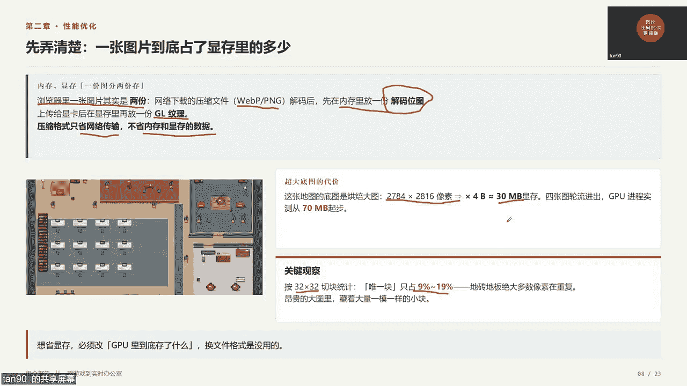
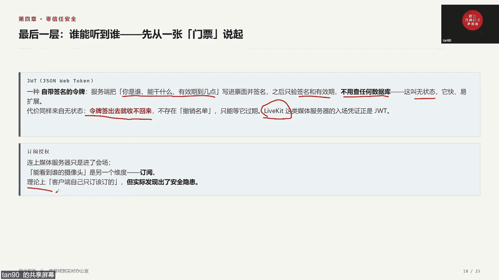
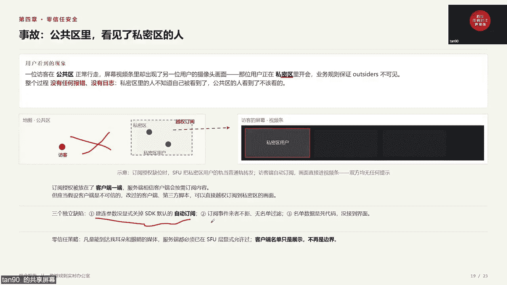
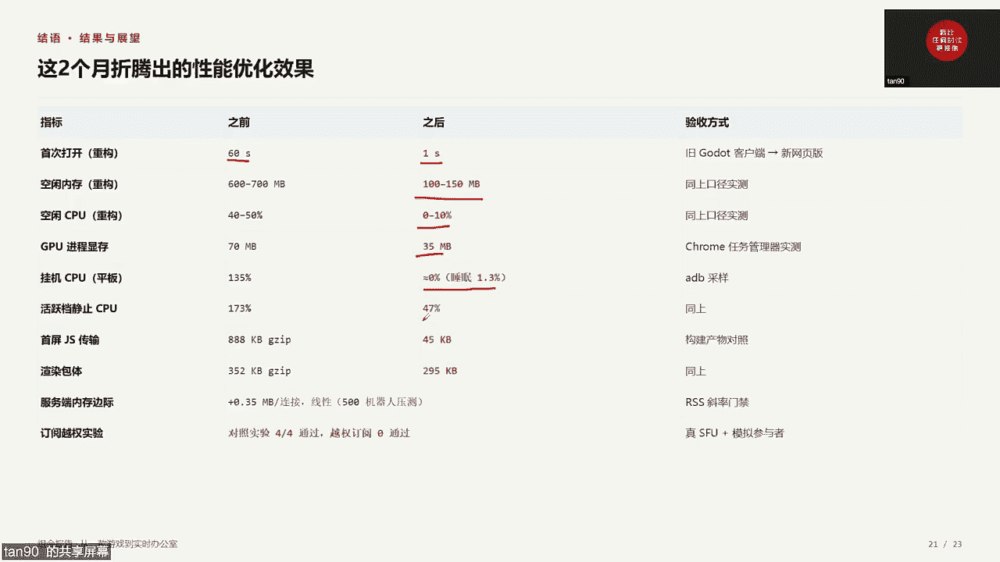
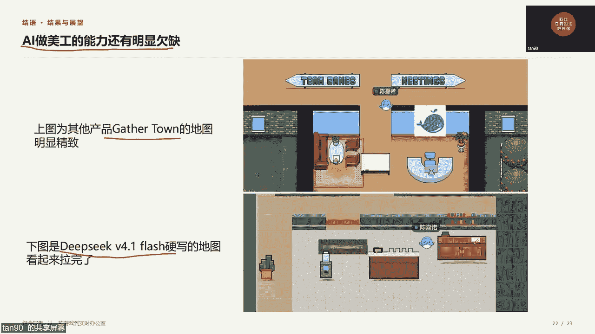

# 🏠 Datawhale AI+X：01：自建虚拟会议室与 40 元替代腾讯会议实践

## 开篇概述

在本节课中我们将要学习如何用每月不到 40 元的成本自建一个虚拟在线会议室，从而替代腾讯会议等商业服务。本节内容来源于一个实际项目的复盘，该项目最初设想为类似元宇宙的游戏，后经重构转为轻量级网页会议室。我们会逐节介绍项目背景、从游戏引擎到 Web 技术的重构过程、内存与显存优化方法、帧率控制策略、音视频通信协议的选择与坑点、终端兼容性问题、蓝牙耳机音频质量限制、安全机制中的令牌漏洞以及最终优化效果。无论你是初学者还是有开发经验的同学，都能从中了解如何用低成本搭建实时音视频会议系统。

## 一、项目背景与起源

开篇概述中我们介绍了本节课的整体学习目标，本节中我们来看看这个虚拟会议室项目是如何起步的。

这个项目开始于 25 年年底，也就是去年年底。最初的想法是做一个叫“赛博妙”的项目，后来被改造成一个虚拟在线会议室。早期计划是做成元宇宙形式，通过虚拟游戏增强互动感和归属感。虽然规划了很多功能、拉了一些人参与，但后来并没有正式上线。当时做的是一个游戏形态，还没有语音功能，也没有考虑带宽问题。

后来团队想参与某个通话模式，添加临近音视频对话功能，即靠近才能说话、才能看到对方小画面。但当时觉得国内带宽较贵，于是把音视频计划砍掉了。后续查培训营价格时发现，每月 40 元就能获得 200 兆带宽，比买解锁版腾讯会议更划算。于是直接补上音视频功能，尝试在会议场景中替代腾讯会议。

例如有时不想开腾讯会议会员，会员要 80 元一个月，而用这 40 元搭建替代品，可以帮大家省下给腾讯的“保护费”。

以下是项目早期的核心目标列表：

- 以低成本替代商业会议软件
- 实现轻量化的虚拟会议室
- 在浏览器中流畅运行

## 二、从游戏引擎到 Web 重构

介绍完项目背景后，本节中我们来看看项目是如何从重型游戏引擎重构为 Web 技术的。


原本的项目是游戏设计，对电脑配置要求较高。第一次打开时需要下载引擎，下载包约 60 秒，空闲时内存占用六七百 MB，CPU 也很高。为了让更多人能流畅运行，项目整体重写为 Web 技术栈，性能大幅优化。

重构的关键思路是使用轻量隐形重构，不抛弃原来游戏隐形设计，而是把底层渲染改为 Web 实现。

以下是重构前后的主要对比：

| 维度 | 原始游戏引擎版本 | 重构后 Web 版本 |
|------|------------------|-----------------|
| 启动方式 | 下载引擎，约 60 秒 | 浏览器直接打开 |
| 空闲内存 | 六七百 MB | 大幅降低 |
| CPU 占用 | 较高 | 较低 |
| 适用设备 | 配置要求高 | 普通电脑即可 |

## 三、内存与显存优化

说完重构思路后，本节中我们来看看如何优化内存和显存占用。



在浏览器里看到一张图片，实际上存在两份：一份是下载的压缩文件（比如 JPG、PNG、WEBP），另一份是内存里的位图。压缩只能节省网络传输，不能节省内存和显存。位图未压缩，还要送到显卡变成纹理，占用更多显存。

早期游戏底图非常大，类似三星屏幕分辨率的一张图。虽然压缩后只有几百 KB，但加载到内存和显存后占用很大，频繁切换代价高昂。

优化思路是将地图拆分成小块。像素类游戏通常有严格的地图块划分，比如 32×32 像素，很多格子可以复用，整个地图信息中只有一部分格子是唯一的，大部分是重复的。

以下是地图拆分优化的示例代码：

```javascript
// 原始方案：加载一张大图
const bigMap = loadImage("map_full.png"); // 占用大量显存

// 优化后：图集 + 索引，复用小块
const tileAtlas = loadImage("tiles.png"); // 一张小图集
const tileIndex = {
  grass: { x: 0, y: 0, w: 32, h: 32 },
  water: { x: 32, y: 0, w: 32, h: 32 }
};
// 渲染时只取图集中对应小块
drawImage(tileAtlas, tileIndex.grass, x, y);
```

通过图集（Atlas）和索引，一张图片在地图中复用十几次，显存节省非常明显。例如原本加载到显存可能有 14MB，拆分后只需几 MB。

另一个思路是 GPU 压缩纹理，类似 GPU 上的 JPG 压缩，可通过特定关系实现无损，但实际测试中出现明显失帧和颜色不对等问题，怀疑是实现 Bug，最终放弃，直接采用图集系统。

此外还有缺氧情环问题，即画面本质是死循环。屏幕刷新率 60 赫兹时，每 16.7 毫秒调用一次，重新计算所有对象位置并重绘，即使画面没动也会占用 CPU。

优化方法很简单：先画完之后，如果没变化就不再重绘。这个改动基本无感，不再赘述。

## 四、帧率控制与渲染优化

介绍完内存显存优化后，本节中我们来看看帧率控制和渲染优化。

项目针对不同状态设置不同帧率：活跃时 60 帧，空闲时每 5 秒支付一次焦点（即休眠状态），鼠标移出浏览器或标签页不在前排时，屏幕外的东西不渲染。

代码逻辑大致如下：

```javascript
if (document.hidden || !isActive) {
  frameRate = 5; // 休眠，低频刷新
  renderOffscreen = false; // 不渲染屏幕外
} else {
  frameRate = 60; // 活跃，正常刷新
}
```

另外删除了原本游戏引擎内置的物理引擎，减少了 57KB 的开屏流量占用，打开速度更快。

## 五、音视频通信与 WebRTC 探索

说完渲染优化后，本节中我们来看看音视频通信部分的探索与遇到的问题。

最初想使用 TC 协议（浏览器标准音视频通话协议），但发现高度封装，很难修改和优化，特别是屏幕内容优化。例如共享屏幕时画面没变，有效信息增量只有 40，理论上带宽占用应为几 KB，而非看视频那样每秒几 MB。

关于网络拓扑，早期使用 P2P（点对点直连），但人多时不可行，后来改为 SFU（选择性转发单元）。

SFU 的工作方式如下：

```text
用户A --数据--> 服务器 --按需转发--> 用户B、用户C、用户D
```

每个人只发一份数据到服务器，服务器再按需转发给其他人，相比 P2P 更适合多人会议。

关于编解码器，常见的有 H.264、H.265、VP9、AV1 等，用于视频压缩和解码。但浏览器支持情况复杂：

- H.265：因版权费问题，浏览器基本都不支持 WebRTC 的 H.265 编解码
- H.264：Firefox 甚至不支持软件编码，可能也是版权原因
- VP9：谷歌开源编码工具，但 CPU 占用高
- AV1：较新，但支持情况也有限

浏览器只能选择编码，无法指定软硬编码，即使电脑有硬件编解码设备，浏览器也不一定支持。这非常不便。

屏幕共享内容编码（Simulcast/SSC）也有问题：纯色大片、文字锐利时本应有专门压缩方法，但协商机制不完善。H.264 没有 SSC，只有 H.265 和 VP9 部分支持。

WebRTC 已指定必须使用浏览器自带编解码器，无法使用自定义编解码器，想要换格式就得重写整个 WebRTC 协议，难度很大。目前只能凑合用 VP9 协议。

做了一个实验：腾讯会议屏幕共享时，码率非常低，平均带宽消耗约 560，当鼠标不动、屏幕不动时，带宽几乎为零。这说明腾讯会议对屏幕共享优化做得很好。而受限于 WebRTC 协议，目前无法达到这种程度。

## 六、终端兼容性问题

说完 WebRTC 探索后，本节中我们来看看不同终端的兼容性问题。

在 Android 设备上发现奇怪问题：Android 系统自带 WebView（相当于系统自带谷歌内核），为了避免每次发布应用都自带浏览器，但发现媒体支持能力欠缺。测试几台手机后发现 WebView 不支持 VP9 编码，换成谷歌浏览器就支持，非常奇怪。

在 Linux 系统上，webTK 甚至没有媒体对象，只能跑 UI 界面，无法运行任何媒体。国产浏览器连兼容性都不保证，测试中发现有人摄像头打不开，询问后发现使用的是某些安全浏览器，对 API 实现标准不统一，很难兼容。

目前没什么好办法，只能像各类 APP 一样，每次发布都把整个 Chrome 浏览器内核带过来，或者要求用户使用最新的谷歌浏览器或 Edge 浏览器。

## 七、蓝牙耳机音频质量

介绍完终端兼容性后，本节中我们来看看蓝牙耳机音频质量的限制问题。

蓝牙耳机音频质量只有 2G 水平。这里涉及奈奎斯特采样定律：

```
最高可还原频率 = 采样率 / 2
```

也就是说，采样率为 F 的数字化系统，最多还原 F/2 的频率，高于这个频率的声音直接丢失。

人类发音带宽大约在 20 赫兹到 20000 赫兹。2G 手机时代采样率为 8000，能采样到的声音带宽有限，音质较差。3G 通话时代 16K 音质更好。4G、5G 时代才覆盖完整人类听觉带宽。

但现在蓝牙耳机有两套协议：CVSD 和 NB 系，非常落后。市面上几乎所有蓝牙耳机麦克风在蓝牙连接下都只支持这两档协议。这意味着使用蓝牙耳机麦克风讲话时，音质会退回到 2G 或 3G 通话时代。

难受之处在于某些高频发音（如“识音”中的音）本身频段较高，用蓝牙时能发出来但录不到，发不出去。

目前解决方法主要有四种：

1. 使用蓝牙新一代音频协议 LEL Audio
2. 使用华为等厂商的专有欣赏协议
3. 使用有线耳机
4. 使用 USB 无线麦克风

## 八、安全问题与令牌管理

说完音频质量后，本节中我们来看看安全问题与令牌管理。

系统使用了一个名为 LiftP 的库，底层使用 JWT 机制。JWT 是无状态令牌，服务器把“谁能干什么”“有效期到几点”写入令牌并签名发给客户端，客户端只认签名和有效期，不需要查数据库，很快很方便。

但无状态令牌有一个致命问题：令牌一旦发出，就无法撤销。不存在撤销名单，只能等待过期。

这导致一个安全隐患：用户退出会场后，如果是恶意攻击者，仍可以尝试订阅其他人的音视频，直接看到别人麦克风和摄像头画面。理论上客户端应拒绝，但实际上存在漏洞。



例如攻击者 A 在公共区正常行走，屏幕上却能看到另一个用户在必区（会议区）的摄像头画面。按照设计，只有必区内的人才能互相听到，不该看到其他区域的音视频，但实际上可以直接看到。

产生原因是当初设计时未严格执行最小权限原则，建联时默认自动订阅，也没有名单过滤。由于 JWT 无状态，无法吊销已发出的令牌。

解决办法是自己搭建白名单系统，每 1 到 2 秒轮询检查白名单，拒绝未在白名单内的接入，直接将其踢出。虽然这是针对无法吊销令牌的补救方案，但比较离谱，只能先这样使用。

## 九、优化效果总结



介绍完安全问题后，本节中我们来看看经过两个月折腾后的优化效果。

从原来的游戏端变成原生网页端后，打开速度变快，内存减少，CPU 占用减少，显存减少，挂机时的 CPU 占用也减少，禁用子 CPU 也减少，手机屏幕占用也变小。整体性能提升显著。

## 十、未解决问题与展望



说完优化效果后，本节中我们来看看目前仍未解决的问题。

一个比较麻烦的问题是 AI 做美工能力仍有明显欠缺。例如某国外类似产品的美工看起来很好看，下面是用 DC4.1FS 硬写出来的地图，但这些概念图并不等于游戏可直接使用的美术素材。要把物件抠出来、尺寸对齐，AI 目前无法直接生成可用的游戏美术。这是一个挑战，暂时也没什么好办法。



以上就是本次分享的全部内容。

## 结语

本节课中我们一起学习了自建虚拟会议室的全过程：从项目背景与起源，到从游戏引擎重构为 Web 技术；从内存显存优化、帧率控制，到 WebRTC 音视频协议的选择与坑点；再到终端兼容性、蓝牙耳机音频质量、安全令牌机制以及优化效果总结。希望这些经验能帮助你用低成本搭建属于自己的实时会议系统。

