# 🚀 Datawhale AI+X AIX碰个头：第21期：AI时代个人成长与职业实践全指南

在本节课中，我们将一起学习如何在AI时代解决读书困难，构建个人终身成长系统，理解时间哲学与AI本体重构的核心思想，并掌握FDE（前端部署工程师）在企业AI化转型中的作用和获客方法。无论你是想读更多书，还是想理解AI如何重塑工作方式，或者想知道如何帮助传统企业落地AI，这篇教程都会用大白话为你拆解清楚。

## 一、为什么要读书，以及如何选择适合自己的书

上一节我们简单概括了本节课的学习目标，本节中我们先来看看读书在现代生活中的意义，以及怎样才能选对书。

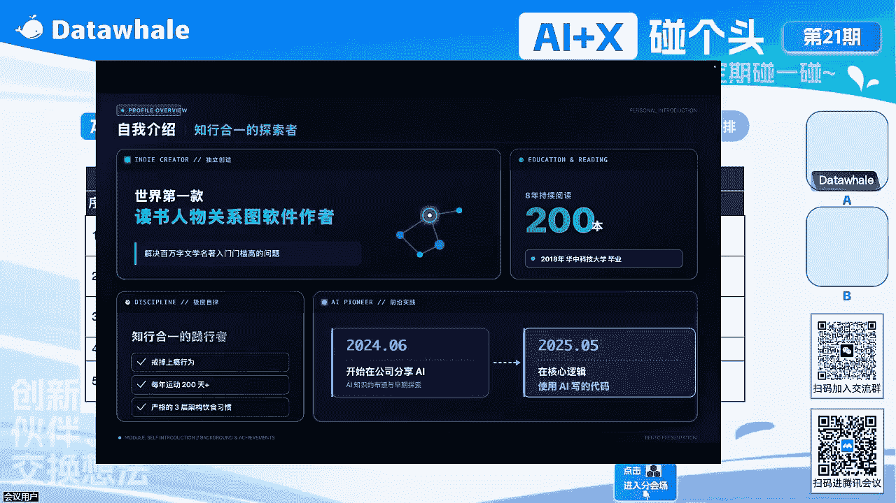

很多人在上学或者工作之后都会遇到同样的读书困难。第一个问题是没有时间，上学时作业多，工作后任务重，很难抽出半天或者一整天来读书。第二个问题是读不进去，上学时因为要考试，会被迫花时间读书，工作后即使有节假日，也容易心不在焉，读不进去内容。第三个问题是不知道怎么把书本知识融入到自己的生活和工作中。这些在出现AI之前都是常见的痛点。

不过，现在AI处理文本的能力非常强，可以快速整理一本书的大纲，那么用AI来辅助读书，是否能解决这些问题呢？这是我们要探讨的核心。

读书本身是一件性价比非常高的事情。无论是查理·芒格还是钱钟书等伟人，都说过读书能以低成本了解很多底层原理，因为一本书通常是作者几年甚至几十年知识的总结。跟朋友聊天或打字请教问题，每个人的经历不同，得到的答案往往受到很强的条件限制，而书本梳理的知识体系更为系统，而且信息密度很大。平时聊天打字来回效率最低，开会说话虽然比文字快，但当参与人数多到三到五个团队时，每个人只关心自己相关的一小部分，人工沟通效率反而很低。最高效的方式是成熟的文档，文字可以跳着读，只抓重点，快速了解核心内容。

除了获取知识，读书还能提升人生的幸福感。现代物质丰富，但抑郁和焦虑依然存在，关键在于对比。比如你本来心情很好，却因为看到同学父母买了豪车豪宅而变得不高兴。如果读过《红与黑》《基督山伯爵》《肯福莱特世纪三部曲》等名著，就会发现自己生活已经非常好，和文学作品中的人物对比后，心情会好很多，包容性也会增强，不会因为在地铁上遇到一点小事就特别愤恨。

关于选书，应该根据自己需要解决什么问题来选择。比如体检发现血糖或血脂增高，不要抱着侥幸心理等待自我恢复，而应该把问题当成成长机会，去看相关的饮食和运动书籍。如果想了解商业运行规则，不能只靠AI做出软件就以为能赚钱，软件只是技术手段，不是商业流程，只有了解经济运行规律才知道市场怎么运营才有可能赚钱。历史书籍的信息密度远高于宫斗剧，看历史能总结出更多实际经验。投资基金或股票若不看理论知识，纯靠运气可能局部盈利，但长期难以获利，还会耗费大量精力，让心情变差。睡眠问题、职场沟通问题、包容性问题等，也都可以通过针对性阅读来解决。

读书是否应该有功利性呢？从局部来说，还是需要一定的功利性，即有明确目标，知道要解决什么问题，这样才能建立局部的热爱，认识到读书的重要性和性价比，从而读更多书。从整体或人生角度来说，读书不应该有功利性，而应该成为一种无意识的行为习惯，就像无意识刷短视频一样，吃饭或去机场时随手拿出一本书来看，不需要明确目的。

读书成本高也是一个重要问题，毕业后读书的人变少，很大程度上是因为抽不出连续几个小时。解决办法是把目标拆解，不要把一整本书当成一个目标，上学时一个学期读一本书，一次只读一个章节就比较容易。如果把一本书当成一个目标，刚开始读书速度不够快时确实很困难，容易放弃。另外，大脑喜欢刺激性的视频而非文字，看短视频一两个小时不累，读书却容易累，这是因为大脑天生对图像和视频更感兴趣。

有研究表明，只要读书达到6分钟，就能很好地释放压力并获得收获。所以没必要把目标定成读完一本十万或二十万字的书，或者连续读几个小时，先从6分钟开始，作为一个最小目标，随着读书速度增加和收获增多，再逐渐增加阅读时间。

对于十万字的文学名著，人物特别多，国外人名又拗口，读一会儿就容易绕懵而放弃。除了用软件辅助，自己画人物关系图也可以，只要把人物关系画出来，就能更好理解。看别人的总结或软件输出只是输入，真正理解还需要自己输出，比如自己画图，才能让大脑更好地理解。

以下是选书时可以参考的几个具体体系：

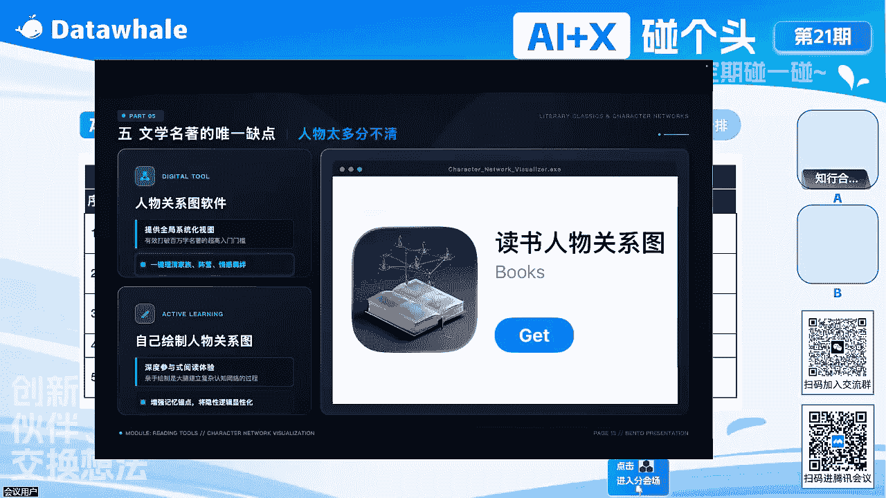

- 豆瓣和微信读书的排行榜，分数高的书不一定适合自己，有些书只是迎合读者，比如短视频或爽文类书籍，没有实际价值。
- 有些书分数低，也不一定不好，某些书作者写得啰嗦，是因为要面对不同读者，无法兼顾所有人的喜好。
- 不能因为一本书比较啰嗦就否定它，可以通过跳读、只读重点内容来筛选出对自己有用的信息。

选书和选人类似，没有完美的人，也没有完美的书，要根据自己的需要选择适合自己的，对缺点可以包容。

## 二、AI时代的读书方法与阅读的四个层次

上一节我们介绍了为什么读书以及如何选书，本节中我们来看看如何用AI更高效地读书，以及阅读的四种递进层次。

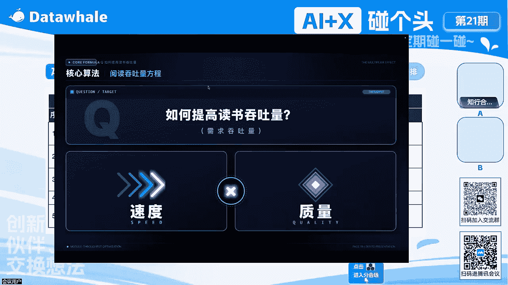

传统读书和用AI读书有明显区别。传统读一本书往往需要连续投入大量时间，而AI可以快速整理大纲，甚至为文学名著画出人物关系图，帮助区分不同家族和关系，解决“人物太多搞不清楚”的问题。AI读书不是替代思考，而是作为辅助工具，先输入框架，再靠自己的输出加深理解。

阅读可以分为四个递进的层次：

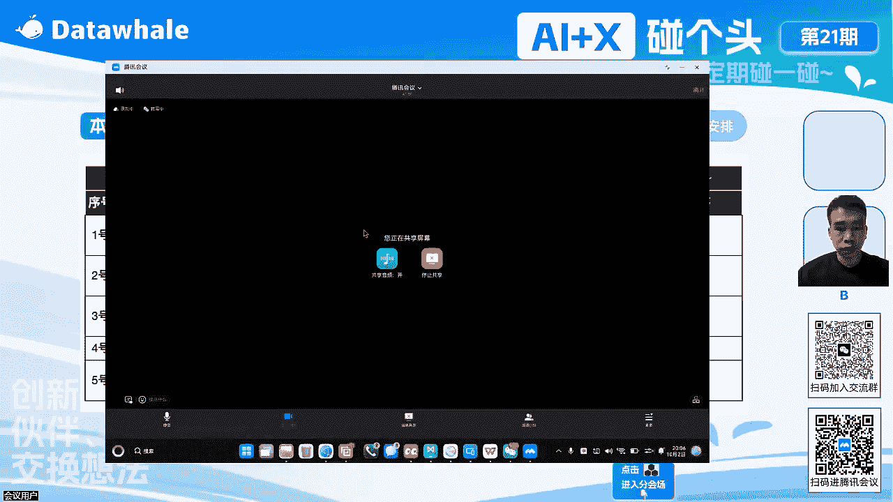

第一层是基础阅读。就是对文字的理解，比如阅读简体中文一般没有问题，但面对文言文，如《资治通鉴》，就需要熟悉文言文。如果想深入研究俄国或法国文学，最好学习相应语言，否则很难理解其中的意境。不过如果只是普通人想了解一下，读翻译版也足够了。

第二层是解释阅读。这就像公司面试候选人一样选一本书，只阅读目录、序言和个别感兴趣的章节，大约十分钟就能读完，据此判断这本书是否值得读。如果难度太大或水平达不到，就不读了；如果适合自己，再进入下一层。

第三层是分析阅读。即精读细读，深入理解内容，并且要输出，才能真正掌握。

第四层是主题阅读。比如写毕业论文或研究一个课题，需要阅读大量相关论文和书籍，找到其中的体系，在此基础上做出一点改进，就形成了一篇论文。专题分享，比如今天关于读书的分享，也是多年迭代和感悟的结果。风险投资人在面对陌生行业的创业者时，也需要主题阅读，快速了解行业知识。

现在出现了AI时代的前端部署工程师等新岗位，这也类似于专题阅读，需要了解一个行业的整个上下游业务流程，才能根据需求定制AI功能进行改进。

## 三、构建个人终身成长系统

上一节我们介绍了阅读的四个层次和AI读书方法，本节中我们来看看如何把读书融入更广泛的个人终身成长系统。

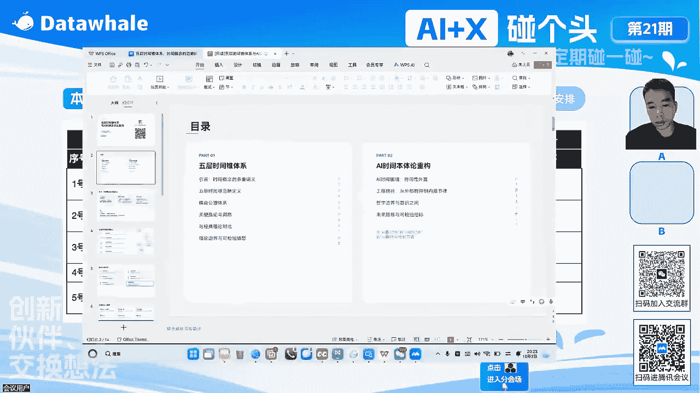

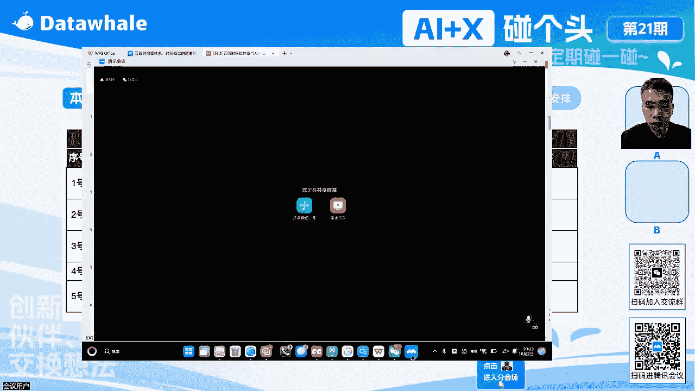

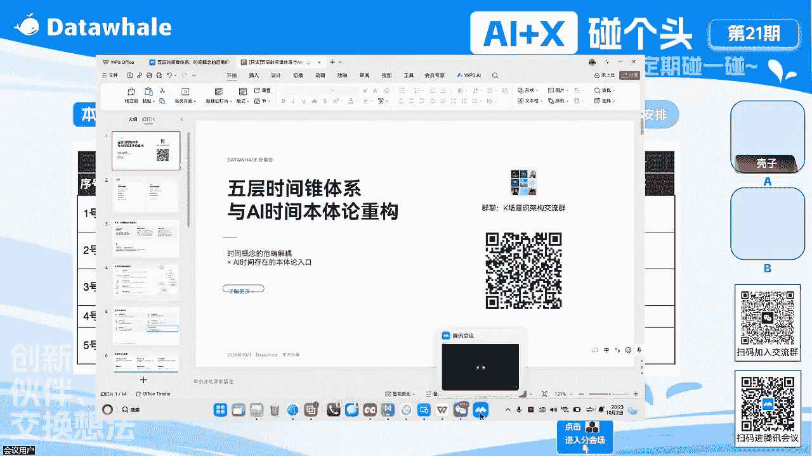

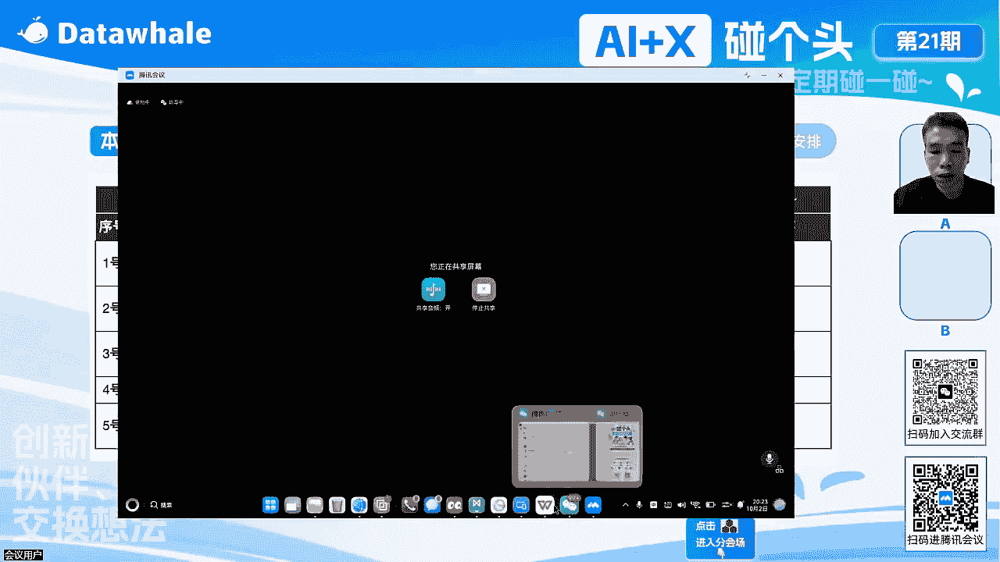

读书是一种输入，但光有输入不够，还需要付诸实践。比如关于饮食、运动、跑步的理论知识看起来很简单，几个小时就能了解，但实际执行起来非常困难。很多人立下减肥的目标，刚开始信心满满，但执行起来比理解知识困难得多。将知识运用到日常生活中，比如每年有200多天进行运动，才是真正的知行合一。

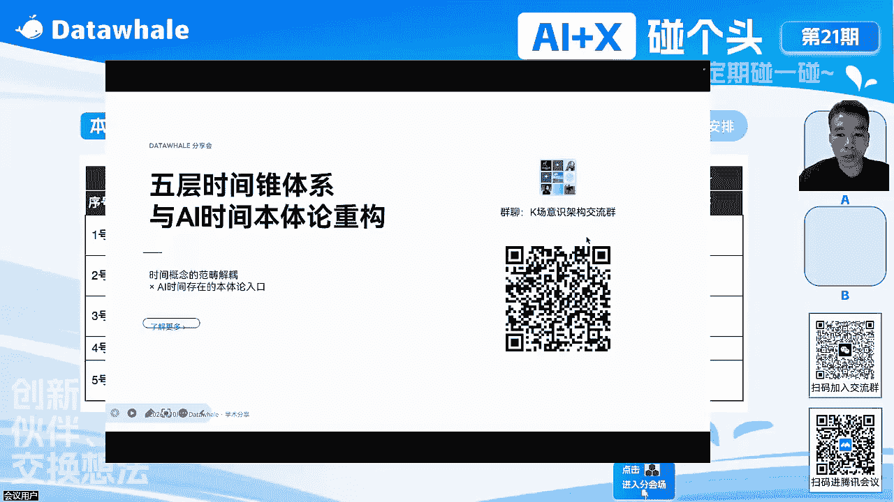

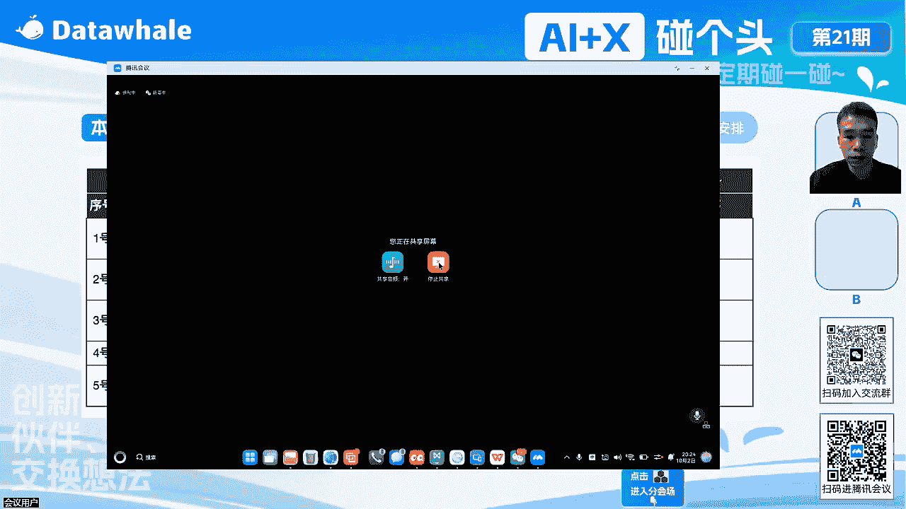

行为习惯的改变也是系统的一部分。上学时沉迷游戏，工作后依然花大量时间玩，甚至下班前在会议室开黑，后来发现游戏上瘾占据了太多时间。如何用书中的体系解除上瘾，也是一种行为改变。同样，想戒掉吃甜食、喝含糖饮料的习惯，也需要把知识体系融入行为实验。

去年11月，AI模型发布后，各公司开始全面拥抱AI，2024年起我开始研究并开发独立应用，去年也发布了几款App。这些工具在读书领域到底能发挥多大作用，是我思考的重点。今天的分享只是一个关于读书的小步骤，之前我整理过一套完整的可迭代系统，目标是构建一个完善的个人终身成长系统。

上学时大家处在良好的学习环境中，不断学习新知识，但工作后学习动力变弱，很多人不再学习，毕业时的知识水平反而成为人生巅峰。如何把工作和生活中遇到的问题当成成长机会，持续学习并获得成长，就需要把饮食、生活、运动等融入到行为习惯中，形成可迭代、可循环的螺旋成长系统。

在分享这个系统时，还涉及到脑科学、思维方式、任务处理等知识。上学时有固定科目学习，毕业后则面临不同团队的合作、沟通、写代码、需求沟通等并行任务，如何处理并行和时间管理成为关键。互联网高强度工作环境下，压力很大，比如拼多多、小红书工作强度最强，其次是京东，强度分为时间强度和压力强度，会对内心造成强大冲击。如何在高压环境下保持心理健康，是一个重要问题。

未来AI彻底普及、效率大幅提高后，人们会有大量时间，那时候应该做什么，这也是一个拓展话题。总之，心理健康和个人成长系统都非常重要。

关于选书是否功利性的问题，已经在前面讨论过，局部需要功利性，整体应无功利性。读书成本高可以通过拆解目标来解决，大脑喜欢视频刺激可以通过从6分钟开始的最小目标逐步适应。

关于阅读四层，已经在前面详细说明。另外，专题分享和主题阅读可以应用到投资行业、AI前端部署工程师等领域，需要快速了解行业知识。

## 四、时间哲学与五层时间锥

上一节我们介绍了个人终身成长系统，本节中我们来看看胡立新分享的时间哲学，特别是五层时间锥的定义。

关于“实践”这个概念，在科学界存在很多混淆，它被用于物理学、心理学、心理哲学和认知科学，时间这个词承载了多重语义，研究者在研究过程中不自觉地产生了不同时间范畴的混淆。

牛顿时间在相对论中已经被否定，但牛顿的绝对时间仍有价值，可以作为实践的绝对基底，即时间理想的绝对时间，牛顿把数学理想的绝对时间实体化了。相对论描述物质时间、时钟和测量时间，但不处理意识层面。快宇子将心智叙事表征混为宇宙演化蓄电，叙事时间是由不同英国锚点连接起来的，不同锚点连接相当于一个快照，快照不等于宇宙没有先后演化顺序，这是快宇宙混淆的问题。胡塞尔的现象学会区分物质类比时间、公共时间和江幅符号化因果叙事时间，但也没有完全区分清楚。

以下是五层时间锥的具体定义：

第一层，绝对时间锥。它是纯数学的结构，没有物理意义，对应绝对时间的结构。

第二层，内部客观时间锥。它是客观时间，由物质基体决定，例如人类的心跳心率属于生物钟，原子钟的震荡属于原子钟时间，这属于物质的类比节律。

第三层，外部客观时间锥。对个人来说，自己的内部客观时间是内部时间，另外一个人的内部客观时间对你来说就是外部客观时间，也可以说是外部测量时间。

第四层，意识感知实验锥。即脑电波产生的时间，这一层再分为三个相位：采样相位、整合相位、正荡相位。采样相位是器官（如视觉、听觉、嗅觉）采集时间的过程，不同器官采样时间不同，例如先看到闪电再听到雷声。整合之后产生脑电波，进入神经震荡模式，形成感知窗口。人类的感知窗口大约0.1秒，也可以理解为职业感知或实验感知分辨率。

第五层，蓄事时间锥。它是信息因果厂，由英国锚点连接的重组组成，可以回溯过去、跳跃、重拜英国锚点，即回忆过去、感知现在、预测未来。但这属于因果性信息产物，不改变外部物理，只是内部的叙事过程，具有信息因果厂的特征。

时间履行和时间旅行本质上是叙事重构的过程。回忆过去不是像播放视频一样，而是重建的过程；预测未来也是同样的逻辑。感知时间上，不同物种差异很大，人类大约0.1秒，苍蝇或蜻蜓感知时间快得多，所以时间是相对的。

## 五、AI本体重构与意识边界

上一节我们介绍了五层时间锥和时间哲学，本节中我们来看看AI在时间维度上的缺失以及本体重构的可能性。

AI目前缺少内部节律时间，只有一个外部测量时间，即人类给定的UTC时间。AI没有感知时间，也没有叙事时间，它的记忆仅是解锁，叙事时间退化为事件序列，没有英国锚点重组，因此AI现在没有时间，时间是外置存在。

不过，AI也有潜在的内部节律，只是还没有被弄出来。异步脉冲神经可以看作AI的内部节律，神经形态硬件也可以实现AI的内部节律时间。未来通过感知闭环和叙事，可能产生因果重组，但这些需要通过实验进一步证实，不会立刻产生意识。

在功能上，我们可以给AI实现类比时间，但真正的内嵌意识可能不仅仅是模仿，还需要真正的内部构建。这部分涉及哲学边界和意识问题，目前仍不成熟，主要是想说AI目前缺少内部节律时间，需要先补上内部节律时间，再讨论感知时间和叙事时间。

## 六、FDE（前端部署工程师）与企业AI化转型

上一节我们介绍了AI本体重构和意识边界，本节中我们来看看卢新龙分享的FDE概念，以及它在企业AI化中的作用。

AI生成软件正在成为通识，在Oppo 4.6 GBT5.5作为划时代分界线之后，AI可以在人的多步引导下稳定生成工程级软件，软件生产模式被完全颠覆。作为软件AI工程师，我们需要思考如何转型，FDE（前端部署工程师）应运而生。

FDE的五个主要工作步骤如下：

第一步，需求调研。第二步，把零散需求浓缩为PRD，形成解决方案。第三步，原型部署，用AI工具在几个小时内快速生成低版Demo。第四步，生产级部署，把代码部署上去让企业员工使用。第五步，不断迭代，与行业专家高频反馈，优化产品，最后进行证据交付。

FDE不应该仅仅由工程师转型而成，更应培训行业专家成为FDE。因为技术是固定的，开发一个稳定的公众化软件需要理解的知识有限，而行业知识是不固定的，随经济形势流动。行业专家懂业务Know-how，能更快与AI沟通，技术专家作为二把刀，工作速度天然较慢。

FDE驻场面临三大问题：

第一是组织问题。FDE需要从外部进入企业，老板不同意不行，员工也可能不愿意。因为FDE的工作本质是帮企业降本增效，增效难，降本容易，AI化智能化不可避免地会替代部分人，员工会隐藏细节，不愿配合。

第二是安全问题。法律、金融、公安等行业数据隐私要求极高，FDE需要进行数据建模，但无法随意接触敏感数据，落地受阻。

第三是积极性问题。进入专业性强的行业，容易出现行业专家对技术人员不服，技术人员听不懂行业术语，工作效率低下。

AI原生公司的理念是把点、线、面全部AI化。点是工具智能化，把分散的工作节点变成AI进AI出的智能化点；线是从一个工作岗位扩展到整条线，比如从前端工程师扩展到整个软件开发流程；面是多个条线打通，比如销售、交付、生产、运维全部连通，把OA、ERP、CRM全部打通，形成AI原生公司。

## 七、FDE获客与标准化交付

上一节我们介绍了FDE与企业AI化，本节中我们来看看费阳分享的获客方法和标准化交付策略。

适合推AI的老板主要有两类。第一类是业务还在增长的老板，他们在互联网经济时代靠招人实现增长，但现在招人成本高、有顾虑，可以用AI将数据库、知识库、工作流提炼为数字人，由大模型管理，继续实现增长。第二类是二三线城市的传统制造业或服务业老板，这些地方竞争对手少，对AI、数字人、图纸、文案等需求大，市场空间大。

老板喜欢的FDE小伙伴主要有三类。第一类是软件领域背景的人，开发速度快，平均一到两周交付一个项目，能同时接五到六个项目，两周内完工。第二类是非常前沿的年轻人，眼光独到，每天研究AI新东西，关键是能把新知识用方案或案例的形式展现给老板，老板愿意为这种新时代能力买单。第三类是具备换位思考和共情能力的人，能击中老板需求，不纠结于技术细节，快速与老板对接并把事情跑起来。

获客方法包括线下和线上两方面。线下可以去行业协会、商会，连接老板集中的地方，特别是三四线城市，地方政府也非常重视AI改造，一场活动联系五到十个老板，展示作品并提供免费试用，容易进入企业并挖掘痛点。线上可以通过自媒体传播，学习AI顾客如何讲述AI落地故事。最好是线上线下结合，每周举办老板与FDE小伙伴的对接会。

关于标准化交付，FDE的落地是非标的，但老板理解不了非标，所以要把AI在企业落地的所有内容拆解成“AI超市”标品。例如决策辅助功能单独收费1000元或2000元，知识库根据数据量和工作量单独收费，标书制作拆分为评标、投标、省审等细项单独上架。老板不愿意一次性花10万或20万买AI系统，但愿意先买几千块钱的小标品试错，试错成本低后更容易成交。获得信任后，项目金额可以从一两万元涨到十万甚至二十万。

FDE其实就像老板的助理或总经理，20%到30%是技术能力，70%到80%是与老板共情、帮他解决问题、上传下达的能力。一旦进入企业并获得信任，业务可以持续扩大。

关于如何加入交流群，可以通过主持人或艾米老师的帮助进入相关社群，与更多小伙伴交流。

## 八、总结

本节课中，我们一起学习了如何识别读书的常见痛点，如何用AI辅助整理大纲和人物关系，如何把阅读拆解为6分钟的最小目标，以及阅读的四个层次。我们还构建了个人终身成长系统的框架，了解了如何将知识付诸实践、处理职场沟通和心理健康问题。接着，我们学习了五层时间锥的定义，理解了AI目前缺少内部节律时间、感知时间和叙事时间的现状。最后，我们掌握了FDE的五个工作步骤、企业AI化的三大难点，以及FDE的获客方法和标准化交付策略。希望这些内容能帮助你在AI时代更好地读书、成长和开展职业实践。

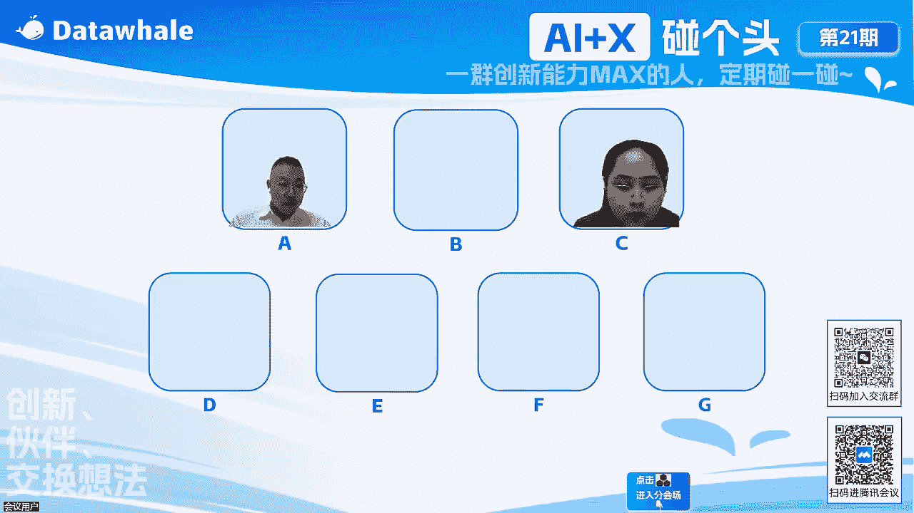

在本节课的学习中，我们已经涵盖了从读书方法到个人成长系统，再到时间哲学和FDE职业实践的完整内容。如果你对某个话题感兴趣，可以进入备用房间继续交流，或者加入交流群与其他小伙伴讨论。
