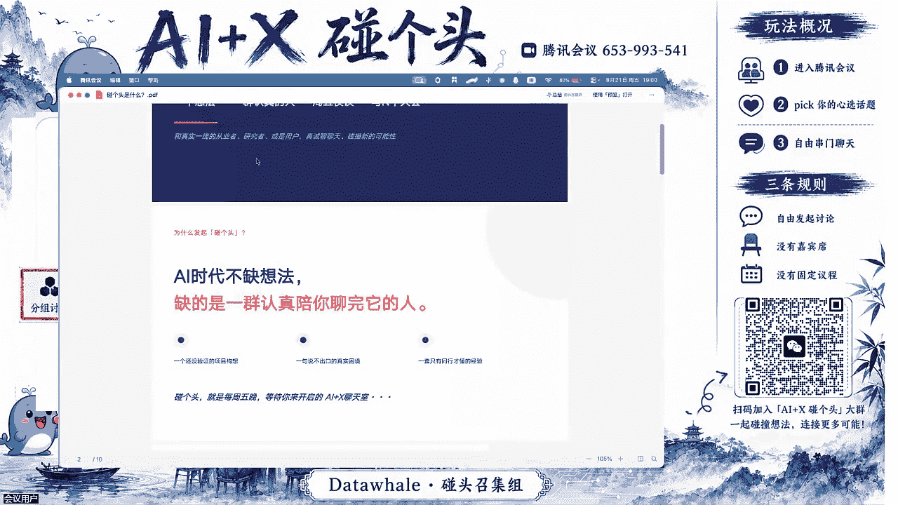
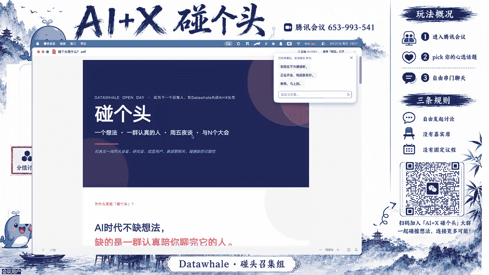
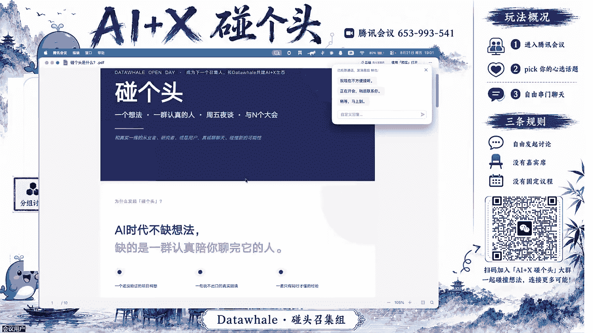
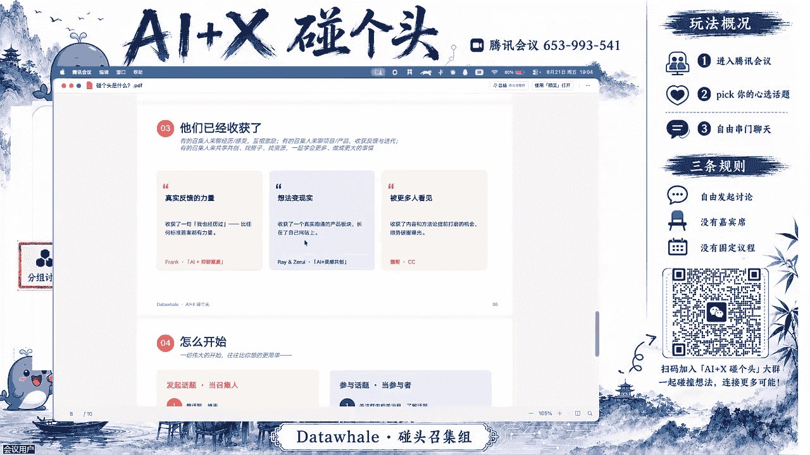
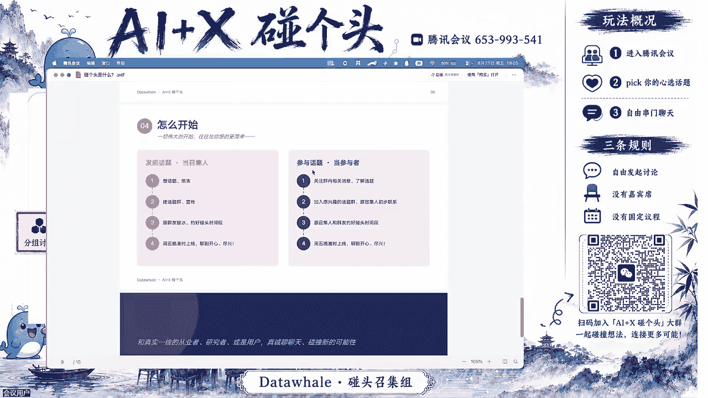
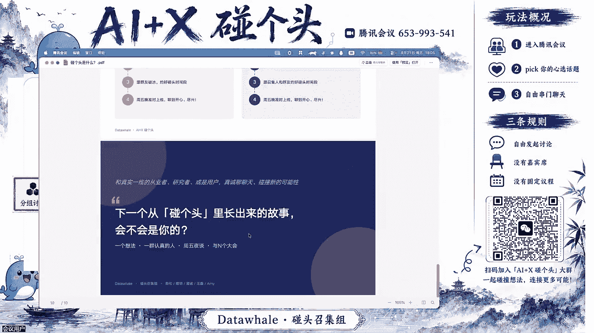

# 👋 Datawhale AI+X AIX碰个头：01：活动介绍与本期话题速览

在本节课中我们将要学习Datawhale AI+X AIX碰个头活动的基本形式、发起原因，以及本期碰个头里都开放了哪些讨论话题。你可以把这篇教程当成一次活动说明会，帮助新朋友快速搞清楚碰个头到底是干什么的，怎么参加，以及今晚可以去哪个房间听人分享。



## 什么是AIX碰个头



AIX碰个头是一个面向一线从业者、研究者和普通用户的开放式交流活动。简单来说，它就是一群对同一个AI话题感兴趣的人，围坐在一起真诚地聊天，看看能不能从对话里碰撞出一些新的可能性。你也可以去官网了解更多关于活动的内容。

活动的核心理念可以用下面这个简单公式来描述：

```text
碰个头 = 真诚聊天 + 同行碰撞 + 新想法验证
```



## 为什么会发起碰个头活动

在AI时代，好点子从来不缺，真正缺少的是一群真的对你的想法感兴趣，愿意陪你一起聊下去的人。很多人心里装着项目构想，却找不到可以讨论真实困境、碰撞同行经验的渠道。为了填补这个空白，我们发起了碰个头活动，帮助大家验证项目构想，讨论真实困境，碰撞只有同行才懂的经验。

## 活动历史与线下延伸

截至目前，碰个头已经成功举办了11期，活动每周五晚上准时进行，累计产生了129个讨论话题，有200多位召集人主动发起过各类主题。活动原本只在线上腾讯会议进行，后来也被带到了2050大会、AMD519大会、data之夜以及OPC共创等线下场景中。从线上会议到线下大会，微交流活动一直在持续发生，越来越多的人通过这种方式结识同行。

## 成功案例：老顽童的FE碰碰头

在碰个头历史上有一个很有代表性的案例，就是老顽童发起的FE碰碰头。最开始这只是他个人的一个想法，后来他在2050大会上了解到AI加X碰个头，于是带着自己对FE需求增长的观察，加入到了碰个头活动里。他连续八个周五都来参加，现在已经把这个活动成长成了一个平台，累计聚集了大约400多个AI人才，大家都专注于FE相关方向。

通过把这些人聚集在一起，创造出了更多的可能性和更深层的需求挖掘，证明了一个小想法只要有人接龙，就能变成一个真实的人才社区。



## 如何成为AIX召集人



如果你也有一个想法，可以免费申请成为AIX召集人，报名本身没有任何成本。以下是成为召集人后通常会经历的步骤：



首先，你需要申报自己想讨论的话题，然后建立专门的话题群。社群团队会帮你进行宣传和招募参与者。接下来，每周五晚上你就可以加入腾讯会议，和大家一起聊天。在活动中，你会收到来自同行的真实追问和想法拆解，了解自己的点子能否落地，也能判断面对的用户是否可靠，进而建立合作和联系。你还会获得被整个AI生态看见的机会，甚至有机会被推荐到2050等大会的舞台上分享。

用伪代码来描述召集人的完整流程：

```python
def become_convener(topic):
    register_topic(topic)           # 免费申报话题，零成本入场
    create_group(topic)             # 建立专属话题群
    promote_and_recruit(topic)      # 社群帮忙宣传和招募人员
    host_weekly_meeting()           # 每周五晚上开腾讯会议
    collect_real_feedback()         # 收集同行真实追问与想法拆解
    validate_idea_landing()         # 验证想法能否落地，用户是否可靠
    build_cooperation_links()       # 建立合作关系与联系
    get_ecosystem_exposure()        # 生态看见，机会推荐上大会舞台
    explore_co_creation()           # 产生共创可能
```

## 本期碰个头话题预览

以下是本期碰个头活动开放的所有主要话题，你可以根据自己的兴趣选择加入：

1. 赵阳发起的“多agent跨模型代码review”话题，主要讨论AI难题中多代理跨模型代码评审的问题。
2. AI加X创造节嗨库特别场，围绕ski的制作和变相展开讨论。
3. 浩远发起的“我了解的AI视频自动化有哪些”，讨论AI视频制作中的skill、cos、web形式，以及不同模型和插件对自动化视频的影响。
4. 好好先生发起的“能玩的好玩的方法论”，他做了一个游戏，分享其中的方法论思考。
5. 老顽童发起的“FDE团队共创”，本期主题是FDE如何管理客户的认知差异。
6. 志远发起的“AF for science的绿皮书”，这是一个金牌话题，已发起多期，本期围绕cloud science新闻速度、AI for research参态复盘以及致远答疑展开。

其中FDE认知差异管理的核心可以简化为：

$$认知偏差 = 老板对AI的认识 - FDE实际价值$$
$$管理目标 = \min |认知偏差|$$

## 志远的云科学分享介绍

志远是本期话题发起人之一，他位于5号房间，这是他第九次进行分享。本次他计划分享官方的一篇文章，因为官方应用实力不错，但内容太专业，他想带着大家把官方实验复现一遍，并且教大家怎么用这个软件。除了复现实验，他还打算分享自己参加比赛的经验，虽然结果并不算很成功，但可以给大家提供一个负面案例作为参考。

如果大家在使用cloud science时遇到问题，可以在志远的房间里一起讨论，他也会答疑。本周他会围绕这两个话题开展活动，感兴趣的朋友可以直接进入5号房间，准备好之后就能开始。主持人也会把录制内容发到群里供大家回顾。

## 灵感共创分会场详细介绍

除了上面列出的主会场话题，还有王瑞带来的灵感共创分会场。这个分会场是由中国科学院大学探人协会的小伙伴们成立的，主要关注AI前沿技术进展和真实需求的拆解。

本周的活动内容包含三位博士生的技术要点讲解，每个分享大约半个小时，将在8点钟开始：

第一位是中国科学院大学、中国科学院西双版纳热带植物园和自动化所联合培养的博士生陈希红，他将讲解从零开始搭建科研智能体。

第二位是中科院化学所的博士生刘子孝，他将分享如何用MCP和ki搭建自己的科研智能体，包含文献检索和数据分析。

第三位是自动化所的博士生于轩庆，他将讲解智能体系与知识库相关的内容。

感兴趣的同学可以在8点钟进入灵感共创分会场关注这些内容，主持人也会把相关内容分享到评论区，海报上面会有二维码，可以填写真实需求，并在会议过程中参与讨论和提出疑问。

## FDE团队共创分组介绍

第四号分组是由袁军介绍的FDE团队共创话题。这个话题的召集人是老班同沈老师，他主要在中技企业创融合创新委员会工作，多年从事科创企业孵化。

在这个过程中，他深刻感受到无论是创业企业还是中小型传统企业，在转型期间都必然要结合AI，未来如果没有AI参与，企业就没有前途。而FDE正是AI最终部署最后一公里的重要环节和角色，FDE的能力需要在实施和实践过程中不断增强和培养，需要综合能力很强。

借助这个平台，各方人才聚集在一起进行共创学习和个人成长。沈老师也希望大家共享资源，一同为创业企业或中小企业的转型、降本增效提供有效服务，同时体现自身价值。

今天的话题聚焦在FDE实施实践过程中经常遇到的问题上，也就是说传统企业老板对AI和FDE价值的认识，仍然存在认知偏差。基于这个偏差，大家将讨论如何在实践过程中有效地进行管理，碰撞出新的idea和解决方案。

FDE认知偏差管理的目标可以表示为：

$$FDE认知偏差管理 = 老板认知 \rightarrow FDE实际价值$$

对FDE感兴趣的小伙伴可以进入4号房间参与讨论。

## 分组讨论进入操作指南

如果你还不确定怎么进入分组讨论，可以按照主PV上面的流程操作。在腾讯会议界面的右下角有一个分组讨论按钮。手机端显示为品字型按钮，电脑端显示为蜂窝状按钮，一般位于屏幕下侧。点击进去之后，就可以选择自己感兴趣的话题并加入讨论了。

本期共有七个话题房间，你可以自由选择感兴趣的方向，直接进入对应房间开始交流。话题召集人也基本上都已经介绍过了，如果还有人想开麦简单聊聊自己的房间讨论内容，也是可以的。

## 总结

本节课中我们一起学习了AIX碰个头是什么、为什么要发起、历史数据与线下延伸、老顽童的成功案例、如何成为召集人以及完整的召集人流程，还重点预览了本期的六个主要话题，详细介绍了志远的云科学分享、灵感共创分会场的三位博士生讲座，以及袁军带来的FDE团队共创内容，最后还说明了如何进入分组讨论房间。希望这能帮助你快速找到适合自己的讨论方向，在下一次周五晚上的碰个头中收获真实的同行反馈。
