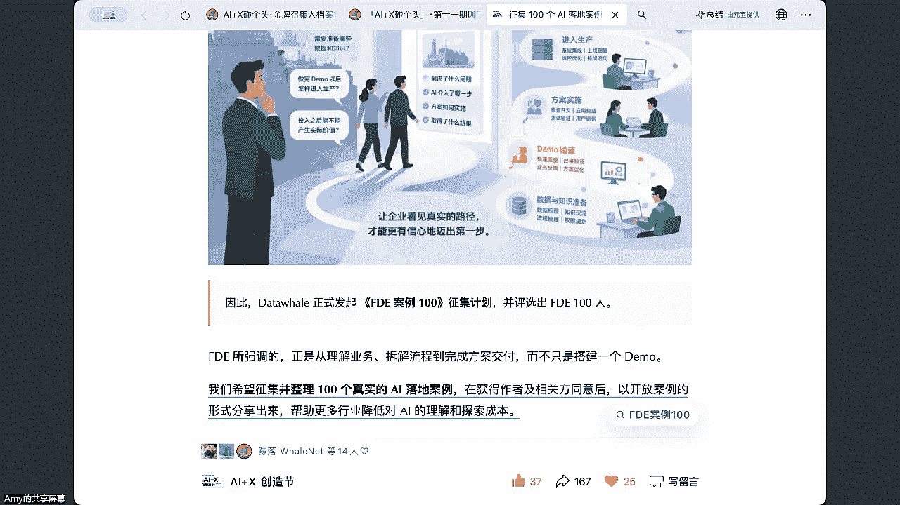
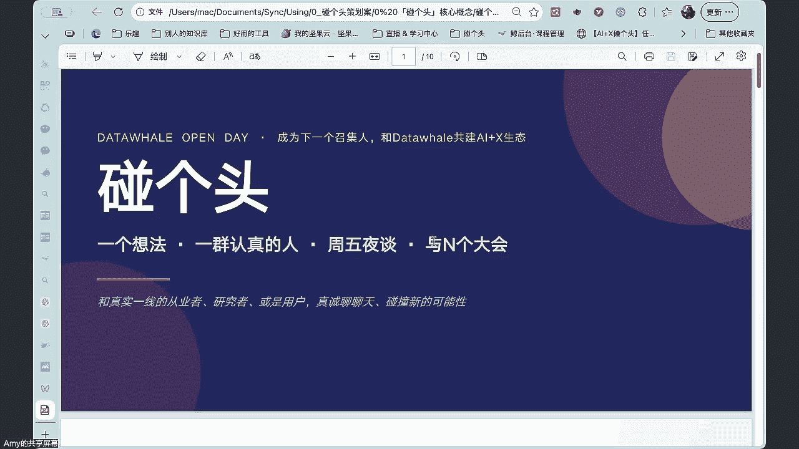
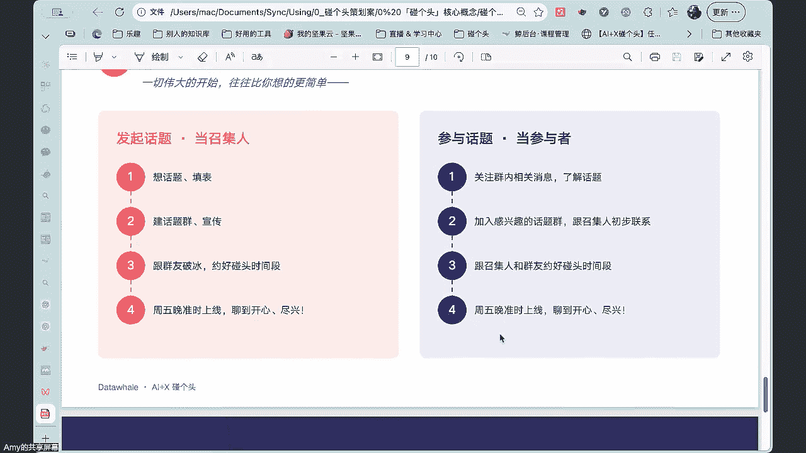
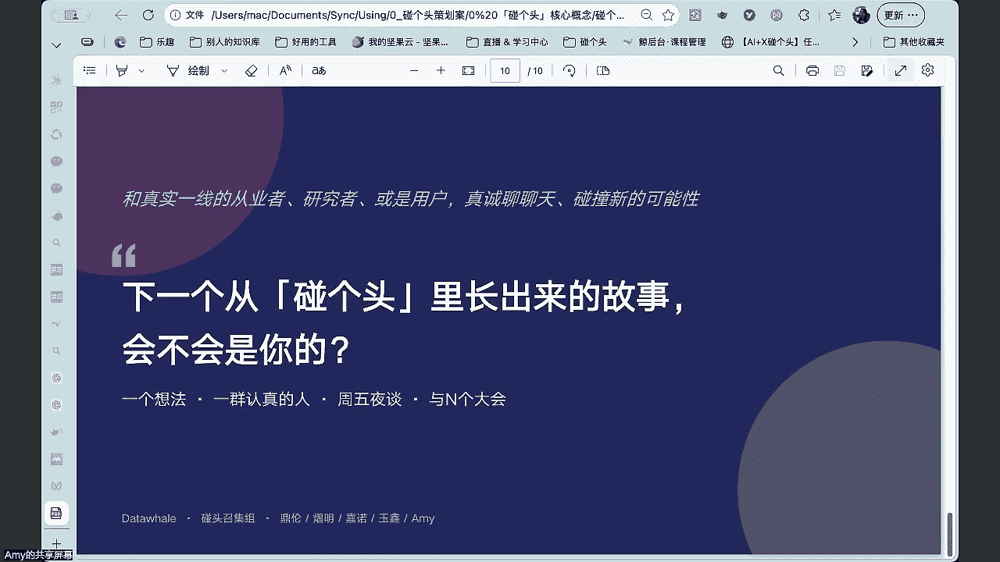

# Datawhale AI+X：01：活动概述与本期议程 📢

在本节课中我们将要学习Datawhale AI+X碰个头活动的第12期内容。你将了解到本期共有七个讨论话题，每个话题的主办人是谁，以及如何进入对应的分组房间进行交流。我们还会介绍金牌召集人是谁，他们对召集人角色有什么期待，以及上一期各个话题讨论了哪些具体内容。最后，我们会说明如何发起自己的话题，参与FD100案例征集，以及碰个头活动的整体背景和价值。下面我们先来看看本次直播的基本情况和整体流程。

Datawhale AI+X碰个头已经举办到了第12期，目前已经有9位金牌召集人。每一期大家聊的话题都非常有意思，并且会有各种延续性。今天的直播不需要过多介绍，我们先看一个金牌召集人这一期的简单例子。群里面已经发布了相关链接，用来介绍现在的金牌召集人以及第十一期的话题回顾。今天的议程大致如下。

首先是开场环节，邀请本期的几位召集人，让他们简单介绍自己的话题，并说明为什么要发起这个话题。接下来是分组讨论环节，大家可以找到对应的召集人进行交流。在后续的时间段里，主会场会简单介绍金牌召集人的档案，以及上一期碰头活动究竟聊了些什么。现在开始共享本期的话题。

欢迎大家扫码加入碰头大群，也欢迎直播间的朋友参与线上的腾讯会议，一起进行碰头和交流。今天共有七个话题可以看到，这七个话题都是往期发起过的，属于金牌和银牌话题，非常有意思。接下来我们将邀请各位召集人逐一介绍这几个话题，具体都聊什么内容。

# Datawhale AI+X：02：本期七大话题详细介绍 💬

上一节我们介绍了活动的基本议程，本节中我们来看看本期具体有哪七个话题可供选择。以下是本期七个话题的详细说明：

第一个话题是AI加灵感共创。这个话题每周五晚上都会和大家见面，本周延续之前的风格，一方面是需求拆解，另一方面是技术分享。本周收集到了三个与AI相关的拆解需求。第一个是关于团队协作的运营协作工作台，目标是解决团队共享业务的问题，包括任务进度、工艺调用，提升协作效率。第二个是希望形成一套可复用的高体系，虽然比较抽象，但目前还处于早期阶段，可以一起探讨。第三个是智能推进物理实验，与实验室工作相关，希望有一个巨人技能帮助推进实验，但这个需求会聚焦在实验课程的标准化方向上。此外，李宇阳老师每周会分享他觉得有趣的前沿进展和对大家有用的AI相关信息，并做简单讲解。讲解部分大约在8点开始，前面一个小时专注于三个需求的拆解。欢迎大家来到直播间一起讨论、探讨，也欢迎提交自己想和大家讨论的话题。这个安排将在每周五的AI检查碰个头领量工厂直播间进行。如果你对AI加灵感共创感兴趣，可以加入一号话题，点击右侧分组讨论的加入按钮即可。下面是一个截图展示，点击右下角分组讨论按钮，然后点击对应分组右侧的加入，就可以进入话题。这确实是一个值得大家关注的方向，特别是对初学者来说。

第二个话题是FDE团队共创平台。今天他们想讨论的是如何争取政策红利。老顽童会进行介绍。最近无论是OPC还是FDE都是非常热门的话题，群里的朋友主要是希望从事FDE工作的小伙伴，目标是帮助他们全面分析解读全国FDE的政策红利，看看有什么对我们有利，能薅到什么羊毛。同时也想分析政策红利到底能持续多久，并聚焦到做FDE的OPC，或者服务O比C的FDE，在政策红利下该怎么做、怎么看。今天的话题做了充分准备，欢迎大家到FD群里一起探讨。这个话题已经发起了第7次，逐渐深入，从FDE是什么概念开始，逐步形成了自己的平台和需求。他们的讨论会针对真实的需求和真实的FDE团队所面临的问题，并且会有很多自己的案例进行交流和分享。如果你对FDE话题感兴趣，也可以点击右下角分组讨论按钮，点击加入进入FDE团队共创话题。这个方向对关注产业政策和企业服务的朋友非常有帮助。

第三个话题是AIQ。一晨会参与介绍。他们之前参加了Adventure X的黑客松，基于人机协作做了一个桌宠，使用Datawhale的logo，基于在coding过程中用CodexCloud，帮助把问题做收集分类，再根据操作人等级梳理一些问题，会有互动，会有创造性或激发性的交互方式。有蓝色、粉色、红色，红温的话就会超凡你。最后的闭环是把问题分类后打包整理，检索得到的线上课程，做一个链接，大约在5天时间内完成。他们跟两个小朋友一起做了这样的产品。一会儿会把项目介绍交给其中一个小朋友，让他来演示给大家。这是三号话题，如果你对Adventure X比赛、他们的项目或者AIQ感兴趣，可以加入三号话题，点击分组讨论，点击三号话题右侧的加入进入分组讨论。这个话题非常适合对人机协作和黑客松项目感兴趣的朋友。

第四个话题是wide research知识分论文/皮书。LL（LK）会进行介绍。在过去一段时间里，Clo Code推出了一个新产品Cs，他们在过去几个月中根据C写了一本Clos的实用绿皮书。目标人群是有科研需求的人，或者在科研中被导师放养，不知道怎么做科研的，或者是在职研究生，或者有科研需求的朋友，都可以了解他们的产品。这个产品主要解决的是判断标准的问题，会讲用什么方法跑，跑完实验怎么看结果，结果怎么验证，验证完之后怎么改进方法线。今晚的讨论内容主要是一个真实的疟疾细胞案例分享，以及一个怎么用Clo Session去完成D的GO开源比赛。感兴趣的可以来房间一起讨论。这是四号话题，也是金牌话题，目前来说最接近学术的一个话题。如果你对怎么用AI做研究、AI做分析、AI做学术相关事情感兴趣，或者对Clo Science到底是什么感兴趣，可以加入四号话题，点击分组讨论按钮，然后进入四号话题的加入页面。这个话题非常适合对学术研究和AI工具感兴趣的朋友。

第五个话题是AI加vib coding游戏。韩先生会进行介绍。这也是AI加游戏的第四期，一直很高兴大家能从第一期一路走到第四期。前两期基本介绍了整个游戏开发方法论1.0版本，大家可能对灰合还有一点点概念。今天是迭代了第二版，之后会在分组讨论给大家分享。还直接回到了原游戏设计的源头，去想一个好的游戏是什么样子，迭代了一个完整的CAR技能。希望大家继续来这里分组讨论。这是五号话题，如果你对AI加游戏感兴趣，可以加入五号分组，跟韩先生一起交流，讨论怎么样更好地设计一款游戏。这个话题对游戏开发和AI结合感兴趣的朋友非常合适。

第六个话题是AI agent天方夜谭。这个话题一般会在8点钟开始，今天这一期内容非常丰富。他们会聊一些agent相关的论文，怎么样正式去做一些落地，以及怎么样去理解agent的一些工程能力和架构。今天的主要议程包括agent的热点论文，DataAg是什么，上一期开始一起来探讨和交流Teril点SH的最新进展，还会关注GitHub热榜和Product Hunter等相关的agent产品和应用。这个话题在8点钟开始，如果你感兴趣，可以8点钟来六号房间蹲守。这个话题对关注Agent工程化落地的朋友非常有价值。

第七个话题是UnavyAI到底应该记住什么。叉499Z会进行介绍。这次要分享的内容基于他们的产品，会聊一个话题，比如说现在的AI会越来越聪明，但每次跟AI聊一件新事情的时候，还是需要我们重新给AI介绍一些背景和补充资料。像我们每天聊天开会，发文件会产生很多录音纪要，还有图片、文档等信息。这些信息保存了下来，但很多人并没有把它变成一个AI可以去复用、可以长期理解和继续使用的上下文。这次碰头会基于UN的产品，跟大家聊聊AI到底应该记住什么，包括记住之后，应该怎么样才能真正帮助到我们。如果你对这个话题感兴趣，可以来七号房间。这个话题已经发起过三次，都是针对他们的产品，想要给大家带来体验优秀的效果。这个产品目前也算是比较成熟了。如果你对类似怎么做记录、怎么做AI整感兴趣，可以加入七号分组。这个话题非常适合关注AI记忆和上下文管理的朋友。

本期七个话题的介绍就结束了。接下来我们把时间交给大家，去选择自己感兴趣的分组，然后跟大家进行交流。直播间的朋友如果对交流感兴趣，可以扫码加入腾讯会议，这就是二维码。只要扫这个二维码就可以加入腾讯会议。这个二维码是碰头的大群，有任何信息，包括后续的回放录制，都会在大群里分发。后续也会有一些线上线下的活动，也会给大家介绍和播放。接下来的时间交给大家，如果对任何话题感兴趣，都可以直接进入对应的话题分组。我也把进入分组的简单说明介绍展示在页面上。待会儿大约在8点钟会结束直播。待会儿在7点半左右会开始后续的介绍，包括上一期的介绍和金牌召集人的介绍。接下来的时间交给大家去进入对应的分组，欢迎大家一起交流。

# Datawhale AI+X：03：如何加入分组讨论 🚪

了解了七个话题之后，本节中我们来看看具体该如何进入分组房间。以下是进入分组讨论的操作步骤：

在手机端，是点击三个正方形的按钮。在电脑端，是点击三个六边形的分组讨论按钮，然后再点击选择对应的房间去加入即可。这是我们今天晚上的七个房间，分别对应七个话题。下面是7点半左右开始后续内容的时间安排，包括上一期的介绍和金牌召集人的介绍。大家可以先找到自己感兴趣的话题房间，等待进入。进入分组后就可以和召集人以及其他参与者一起讨论。这个过程非常简单，不需要复杂的操作，只要找到对应的房间并点击加入就可以。下面是进入分组讨论的简单说明指引图，可以帮助大家更直观地完成操作。

# Datawhale AI+X：04：金牌召集人名单与核心能力 🏅

进入分组之后，本节中我们来看看哪些召集人获得了金牌认证，以及他们对召集人角色有什么期待。以下是金牌召集人的定义和具体介绍：

金牌召集人是根据往期11期的话题开展记录，统计发起过5次及以上话题的召集人，然后被评选为AI加X金牌召集人。本期7个话题中有4个话题是由金牌召集人发起的。他们有很多话想跟大家说，想要介绍自己的话题，也想要介绍自己是怎么理解话题召集、话题发起，以及对他们带来的一些改变。

第一位是AI加灵感共创的王瑞。他是中国科学院大学前沿交叉学科的博士生，也是AI学科交叉创新协会的会长，一起发起了灵感共创队，一起去探讨怎么样把灵感真实变成相关的AI实践、AI项目和AI产品。他们也会持续交流，持续探讨，如何帮助一个初步的想法进一步变成一个产品项目。他们认为把产品做出来并不等于把产品做对了。更希望真实理解AI原生产品应该是什么样子，应该思考什么样的问题，可能的卡点和要解决的问题是什么，给想清楚聊清楚。在发起多次话题之后，有这样几个感受。首先是原型其实很容易，但是有一个问题，有一个正确对问题的分析，它其实可能更重要。所以我们一定要更清楚地了解用户真实需要什么，而不是说把我能做什么去理解为用户所需要的东西。他们也感觉到一定要快速做出可展示可测试的最小原型，引导大家从真实的用户和具体的场景出发，去得到反馈。这是帮助大家把想法慢慢落地成真实产品所需要具备的两个重点。第一个肯定还是需要给大家一些相关的信心，第二个可能还是要面向真实，面向真实的场景，面向真实的需求去进行相应的调整，才能真实地做成最真实、能解决真实问题的作品。他们的话题现在在我们的一号话题、一号分组当中，是AI加灵感共创。另外，他们有一个共创流程，搭建了灵感共创队的一个板块，所有人都可以在页面上面提交自己的产品，提交自己的想法，AI助手也可以帮助梳理。另外会给到一些规划工具和实现路径的参考，还会积累一些代表性的作品，去更多地做直播展示，共同学习和探讨，然后收集更多潜在用户视角的真实反馈，逐渐形成灵感提交、问题定义、Demo开发、展示反馈和持续优化的共创过程。AI最重要的价值不仅仅是提高效率，是降低试错成本。这样做事情能更快得到反馈，能更真实地得到反馈，这是他们所在意的。他们希望像有想法不知道怎么开始，或者想要真实发现问题和解决问题，或者有初步产品的人，或者说想贡献经验给更多想要迈出这一步的小伙伴，这些人都可以来参与AI加X灵感共创。这需要保持开放，一起来探讨，有这样的理念和想法就可以。他们也给出了推荐什么样的人做召集人，或者说心目中的金牌召集应该长什么样子。希望能有更好的技术敏感度，有问题意识，以及能够真的去推进能力。因为他们是把碰碰头变成帮助大家辅导以及帮助大家解决问题的定位。所以具备这个方向话题的召集人，就一定要具备四个核心能力，一定要去倾听和连接，然后能够真实地把大家推下去。这里有一个核心概念可以用公式表示：最小可行原型MVP等于最小功能集加可展示加可测试，即MVP = 最小功能集 + 可展示 + 可测试。

第二位是AI加产品感共创队的发起人之一房泽瑞。他也是中国科学院大学交叉学院的博士生，也是他们的副社长，然后也在做类似的事情。他们给出的很多理解和反馈其实比较类似，简单提一下，他核心的一个洞察就是共创是一个需要持续迭代的过程。共创其实更多地给了大家更低成本的理解、感受，或者说得到各种其他的视角去解决问题的通道。他们更加希望能解决更多深层次的真实问题，然后能帮大家更好地解决问题，让自己的想法落地。这就是AI加X灵感共创的话题。

第三位是FDE团队共创平台的老顽童。他实际上是中国技术创业协会融合创新发展专业委员会的主任委员，也是一些孵化加速平台的负责人。他意识到一个点，他想孵化的这些企业如果不去拥抱AI，发展就会比较慢，可能也没有办法更好地跟上AI的时代。他就发现FDE这个方向，或者说这个岗位、这个定位，能帮助他的召集人、他的创业辅导团队们变成更好的创业方向和创业团队。他经验非常丰富，通过这些创投平台想要帮助这些企业更好地拥抱AI这个时代。他发起这个话题，就是想站在企业的视角去理解和发现，怎么样的FDE团队能帮助他们真实解决问题，帮助他们真实摸清楚、解决清楚在AI时代怎么样把自己的业务跟AI、自己的工作流跟AI更好地挂钩。他觉得FDE就是来拆除信息墙和场景墙，去解决断层问题，真正使得这些企业平稳过渡到AI时代。核心的洞察包括FDE会有一些买方视角。最开始的时候，FDE这个词是从硅谷大厂开始炒热、开始为人所知的，他们感觉FDE是想要把自己的产品卖给客户企业，所以更多的是围绕自己的产品做一些理解，或者说自己的技术栈做一些理解，更重要的目标是卖自己的产品卖自己的工具。但是因为他是想从企业真实视角出发，更希望有一些更独立、更客观、更卖方视角的方向去搭建FDE团队。其实我们也发现AI时代数据关键，最大的阻碍数据就是信息流通，或者说提升效率，处于不同信息之间可能有一些壁垒，包括数据没有那么直接能匹配，或者口径可能都非常不同。企业有非常多类似场景，怎么样把这些场景翻译成AI的需求？这是FDE最主要需要做的工作。另外早期探索还是需要很多播种者，他觉得自己不是爱首歌，而是要去播种，能把更多对FDE感兴趣、有FDE能力的人能够召集、能一起绘制。他也觉得AI加接口给了他非常多机会，能在Data World社区平台里汇聚到相关的FDE优质人才。他也希望跟更多前线BD行业专家、AI架构专家、交付专家、渠道方和硬件厂商的各种伙伴一起来构建FDE团队共创平台。心目中的金牌召集人应该激情驱动，愿意奉献，不管是对FDE还是对自己真实要做的这些事情要真正感兴趣。另外希望能更好地采放包容，只要觉得值得干，那就一起去面向价值，一起去创造价值。另外，金牌召集人需要能跟大家平等共创，一定是互相尊重、互相认可、互相一起，把事情做得更好。FDE可以理解为场景定义专家，即FDE = 场景定义专家，用于连接企业业务与AI落地。

第四位是FDE团队共创的袁军。他是30年的核心从业者，有非常多的职场经验。希望能帮助更多高度职场的年轻人能做一些规划和树立方向。他希望依托FD团队共创平台这个话题，能更多切实地帮助中小微企业解决经营痛点。另外，他发现大家在AI加插投活动中的小伙伴都对AI领域非常积极，而且能互相真实地发表建议，所以互相成长也非常快。他们也希望跟更多小伙伴一起做头脑风暴，交换想法，互相学习，一起成长。他也推荐说，只要你想了解AI技术，或者说存在FDE的一些项目需求，都可以参与到FDE团队共创平台当中。心目中的金牌召集人是要实战导向，然后开放包容，能帮大家链接资源。因为FDE这个话题更多还是希望能做一些行业落地，解决一些真实的就业问题。

第五位是AI加抑郁症康复的话题发起人frank。他发起了2KX方舟无限，也是一个康复者，特别希望能倾听他人、陪伴他人，一起重新参与到真实世界当中。所以他关注很多年轻人怎么跟真实的人、真实的生活和真实的世界产生更好的连接。所以才发起AI加抑郁症康复的话题交流，一起去探索AI能不能帮助这样的一群人，这样的一群年轻人，或者说这样的一些小伙伴们更好地发挥自我，更好地做好连接和走出这样的一些地步。他还觉得做AI加抑郁症康复不是一个简单的一个话题，而是一个可能陪伴，不是不需要很多复杂的事情就不需要很多复杂的知识传递，更多的是陪伴经验。如果你也是对这个话题感兴趣的伙伴，欢迎加入到这个话题当中。不管你是正在经历低谷，还是有过走出来的经验，或者是想要陪伴低谷期的小伙伴，都欢迎来参与。心目中的金牌召集人，是希望能有更多真实关切，且自己本身就在长期探索这样一些主题，能跟大家一起去寻找更多未知的答案，而不是过早地给到答案。他也相信开放与廉洁能更创新性、更有价值导向地去解决问题。召集人还是需要有一定的组织能力，能帮助大家控制节奏，提炼共识，更好地进入话题交流当中。

第六位是可梦AI/OPC实战派直播栏目的陈杨月。他是杭州电子科技大学的在读生，现在是做AI产品方向的运营。他发起过两类话题，第一类是自己的一些项目分享，第二类是可梦AI他们在做的一个OPC实战派的直播栏目。现在也快到8点了，8点钟AI agent天方夜谭话题也会开始开展。如果想加入AI agent天方夜谭话题的小伙伴，可以按照现在共享的画面介绍，点击右下角分组讨论，手机端是三个正方形，电脑端是三个六边形，然后选择到保利，agent天方夜谭话题是六号话题，选择六号话题，然后点击右侧加入就可以进入对应的分组，进行进一步的探讨和交流。8点钟也快到了，天方夜谭也即将开始。陈杨月觉得不管是学习还是做技术，如果真的要去做落地，还是希望他在做一个商业化，或者说可持续化，能把价值跟可持续的创造出来、可持续地发挥出去。他也感觉到了很多参与者有非常多的热情，互动体验也非常好。另外，他在做对应话题的时候，其实会面临很多限制挑战。如果说大家是陆陆续续进来的情况，可能就会比较少去进行发言，听到的可能就要轮番去进行介绍，这对于开展话题并不是很好的体验。但他还是觉得这样的活动非常有意义，能一起交流更多新的事情，互相之间激发更多新的灵感新的活力。所以他也欢迎你，如果你在做OPC或者商业化，或者说想要探讨一些AI产品相关的思考，可以加入他跟他一起碰头。

第七位是AIQ话题发起人议程。他本身是一名创业者，过去其实是很多艺术设计相关的工作室负责人，也会聚焦很多哲学方面的思考和话题。所以现在他想把艺术AI以及技术更多结合起来，反过来设计任何工作、任何关系、人自我理解。他发起AIQ话题，主要是因为他非常关注自己本身跟AI的协作度和协作能力。他也希望协作能力能帮助大家更好地评判或分析自己目前处做处的状态，能更好更高效地跟AI进行交流，去解决更多有趣的问题。他发现自己在做AIQ产品，或者说问卷的时候，话题的开放程度和问题的设计，其实比追求人数更加重要。另外，他在研究问题的过程中，经常性地会需要推翻自己的一些结论，怎么样更好地用到新的想法、新的思路、新的观点，对他来说也是一个挑战，也是一个必须要做的事情。另外他希望能在这个过程中持续提出更好的问题，其实能提出更好的问题，也代表着他对这个问题的思考，对这件事情的思考其实更深。他也希望自己能保持开放，持从容，能更好地不盲从地去介绍更多的问题，一起跟更多想要参与的人去进行共同的探索。对真理的追求比惬意更重要。他会以实验的心态去对待讨论。如果你认可他的碰头理念，欢迎跟他一起碰头。心目中的金牌召集人一定是破除幻觉，有主观能动性，允许被治愈。AIQ可以理解为人机协作能力，即AIQ = 人机协作能力。

第八位是wide research话题发起人旅志远。今天他也在发起自己的wide research话题，这也是第六次发起。他目前是河海大学的在读生，也自己在写一本Clo Science的绿皮书，或者在做一个research OS的一个形象，也有自己的一个主力自媒体账号叫何小驴。他希望能做更好的开源科研生态，然后也在持续维护这件事情。他自己维护了三个开源项目，6个内容渠道，然后每天都在自我迭代的一些知识和信息和理解。他发起wide research是因为做科研的时候一路摸黑，觉得被卡住很多很多事情，但其实都是不必要的信息差和不知道第一步怎么做。他尝过很多淋过很多雨，所以希望能给大家一起撑一把伞，能不用让更多新朋友们去做自己摸黑的事情。所以他建立了一个research知识分享，然后去写了很多绿皮书，以及把自己采购的一些坑去掰开揉碎讲清楚，一起探讨。他也觉得门槛这件事情聊着聊着就降低了，也更加知道不同背景或者不同小伙伴们可能的卡点是什么，这件事情让他在交流过程中很有收获，也很开心。所以他现在持续更新自己的Clo Science绿皮书，也非常开心能让更多零基础小伙伴们能把wide research这些事行跑通，能真实地去享受科研。另外，他自己也在这个过程中更加了解了科研的价值和意义，科研的方法和逻辑。他觉得如果你正在被科研困扰，或者说是不知道从何下手的研究的小伙伴，新的小白，都可以来到wide research，一起进行交流，一起尝试把AI融入到自己的research当中。他希望自己也能成为金牌召集人，就是有分享欲，后又有干货，能耐心地翻译给新手去介绍清楚相关的问题。wide research可以理解为AI科研助手流程，即wide research = AI + 科研方法论 + 开源工具链。

# Datawhale AI+X：05：上一期话题回顾 🔄

介绍完金牌召集人之后，本节中我们来看看上一期各个话题都聊了些什么。以下是上一期话题的详细回顾：

上一期AI加灵感共创讨论了一些AI最新进展，包括Kimi K3，千问3.8，以及很多全模态、多模态相关的进展和怎么使用，真实利用到自己的产品和项目当中。这是他们的一个话题群，如果感兴趣，也可以扫码加入到AI加灵感共创的话题群当中。相关的录制也可以在话题群以及大群里面获取。

上一期的第一个话题聊的主要是转型路径与产品共创相关的内容。上周他们聊到OPC、BGD怎么样去迈向产品型公司的一些转型，更多探讨了AI的一些价值，怎么样去量化，能更好地做好一些策略和路径的一些选择，为SDE去真实跟各种公司企业去进行沟通，所需要探讨的一些话题的一些重点介绍。他们也聊到转型的一些路径、AI的一些价值，以及怎么样去量化框架去跟大家沟通的一些思路。另外，他们也有一些主要的讨论结论。如果对他们的话题感兴趣，可以加入到今晚的2号分组讨论当中，跟他们进行进一步探讨。这是赵杰的微信，因为FDE团队共创这个话题已经有430多人，话题群只能通过召集人加入。

上一周AI加灵感共创的你想猫金牌召集人，展开了自己AI视频生成工作流以及医疗科普的应用探讨，在线上共创这样的一只科普视频。他们讨论了一些痛点，然后有什么样的方式去解决。这是他们的碰头大群，如果对这个话题感兴趣，想进一步交流，也可以在大群里面找他们。

上一周wide research也在开展第五期，第五期其实就真实进入到了一个科研场景，怎么样去做乳腺癌分类这个案例，然后去理解更多Clo Science和Clo Code的区别和更多新功能。他们有两位积极发言的小伙伴一起进行深度交流，包括怎么样去定位port science/port cold，还有乳腺癌分类的案例以及工具版本的更新。他们也有非常多主要的讨论结论。如果对这个话题感兴趣，可以加入他的话题群跟他进一步交流，也可以加入到现场现在的腾讯会议当中，去到四号分组跟他交流。

上一周AI agent天方夜谭也是长期发起的，今天也是第四期的银牌话题。他们探讨了编计委的一个新开源项目，新项目，然后深入探讨了AI整的一些设计方式，以及落地的一些实践思路。他们经常性会聊一些论文，聊一些具体的应用和项目，然后聊更多的一些案例，始终聚焦在Agent的实践落地、工程落地这件事上。有很多小伙伴在积极交流、积极发言，有非常多讨论要点，主要还是针对于AI整的一些框架，具备怎么样去在移动端交互。如果大家对AI agent天方夜谭、AI agent工程化落地相关的一个话题感兴趣，可以扫码加入他们的话题群。

上一周AI加vib coding游戏也有开展实践方法论的话题。像今天其实在我们的5号房间也在开展这个，否定的油气的设计思路的一种。他们介绍了一个新的，叫求职反诈游戏小星星做了一个开发的一个小游戏，目前还没有体验入口，在进行进一步优化和迭代。另外，他们也去聊了一些游戏设计的一些主要思路、主要流程、主要必要要素，也去介绍了怎么样能让一款游戏更加引人入胜，更加让大家愿意去玩，或者说觉得是一款好游戏，他们也在思考这样的问题。这是他们一些主要结论和接下来会进一步探讨的一些问题。如果大家对AI加vib coding游戏感兴趣，可以扫码进入他们的话题去跟进一步交流。

上一周晚上还有最后一个话题是AI产业融合下的岗位落地和个人职业焦虑，由赵雪人本身的一些经验经历，一起想跟大家探讨AI的浪潮当中，怎么样能有哪些岗位能进一步跨行，或者说转型成为AI领域的这些。涉及到了很多协同，包括求职经验，也有一些人力资源背景的小伙伴去探讨怎么样能认真做好招聘这件事情。他们也觉得AI落地的岗位现在可能还是比较稀缺，可能现在只有FBE吗？还是什么？也不太清楚，大家如果比较感兴趣，或者说有一些经验，也可以在群里进行交流。他们也有非常多协同的一些主要感受，主要体感，然后进一步学习一些交流。这是他们的一些主要结论，后续想要继续进一步探讨的一些话题。如果大家感兴趣，可以扫码进入他们的话题群跟他交流。

上周六晚上，ju也是我们的金牌召集人，他第二次发起了中医的话题，主要介绍他们的倪海夏skill工具，还邀请到了一位医师刘德义医师，一起被介绍。爱好者自学当目的一些电型疑问，然后也有非常多小伙伴加入进来，进行了积极发言。他们主要聊了倪海夏skill工具怎么样能更好更快上手，以及核心的一些资料和资源，还有一些注意事项以及中医当中可能最可行的一些要素。他们也在探讨，因为他们本身是在学习这件事情，周于这件事情。这是他们的一些主要讨论结论，进一步想去探讨的一些问题。如果大家感兴趣，想让他们进一步探讨，也可以扫码进入他们的话题群，进一步去进行碰头。

# Datawhale AI+X：06：如何发起或参与话题 ✍️

回顾完上一期内容之后，本节中我们来看看如何发起自己的话题，或者如何参加现有的话题。以下是发起和参与话题的具体方法：

成为AI加X召集人，不需要有非常多复杂的思考或者设计，其实就是想清楚一个话题，然后建好话题群，去跟大家进行交流，告诉大家想要聊这个话题，一起破冰一起聊一聊。其实，就可能有非常多很有意思的思考和思路出现，因为每一位都是真实在做AI相关的从业或是自己的一些创造。共创之后可能碰撞了一些，然后看到大家的一些想法和尝试之后，就有了更多新的思路。另外，其实也有非常多召集人，都非常优秀，力度非常大的一个人才场域，能够创造更多很有意思的创新，还有有机会一起站上更多更大的舞台。像frank、瑞，还有猫哥，他们其实都收获了非常多的一些共创经验，以及资源，自己能够一起畅聊交流的人。所以如果你想来发起一个话题的话，只要填表，然后一起来交流扩宾就好。另外是你想参与话题的话，就直接进入到我们的腾讯会议分组，每周五晚上进入到我们的腾讯会议分组当中，找到自己感兴趣的话题即可。

# Datawhale AI+X：07：FD100案例征集与实战营 📊

了解了如何发起和参与话题之后，本节中我们来看看FD100案例征集和实战营的相关安排。以下是活动的详细说明：

我们近期也发起了一个FD100的案例征集活动，如果大家感兴趣的话，也可以来加入到我们这个提交当中来。我们将在周日下午，在我们的账号里面去进行一个案例demo show的直播。如果大家想要去提交自己的SD案例，也可以提交，可以截图扫码，提交自己的案例。建议大家可以认真填写，因为这个案例征集之后会推荐到FD100的先锋榜当中，然后也会有非常多的一些线上线下的资源、讲师的机会和活动嘉宾分享的一些机会。如果大家对于成为FD100先锋感兴趣，都可以随时扫码去加入到这个活动当中来。

另外，如果你是有了自己的一些真实业务，想要去找FD去解决的话，也可以扫码去填写我们的场景征集，告诉我们你想要去解决什么样的问题。我们明天下午也会在我们的上海去开展我们第一期第一实战营的创造季，会围绕一些地产策划和咨询机构的真实业务，这是真题，就是这几个公司这几个企业给到的一些真实场景，想要通过AI的形式、AI的方法、AI的工作流去解决相关的问题。报名应该已经截止了，只是给大家介绍一下。他们会基于真实的业务去混合组队，以及了解一些基本的FD方法，去拆解，去完成真实的一个原型，并且展示成果。这是AI加X创造节第一次第二期的第一场活动，是SDE的失训营的交流。如果你想参与到后续的AI加X创造节以及FD实战营相关的一些活动，欢迎你来关注我们的AI加X创造节，然后加到我们的于城市负责人的微信，然后一起来把更多的落地的项目推荐给介绍给开源给更多更多感兴趣的伙伴，以及也可以把你的开发场景摆出来给到大家一起来共创结局，一起来把FDE真实更好的更快地落地到行业当中，赋能与行业。

# Datawhale AI+X：08：碰个头活动背景与总结 💡

最后，本节中我们来回顾碰个头活动的整体背景，并对本节课进行总结。以下是活动背景和核心价值的说明：

AI加X碰个头是Datawhale发起的线上线下的交流活动，目标是跟大家一起共建AI加X生态，让大家能够跟Datawhale一起，共同跟真实一线的从业者、研究者或者是用户真诚地聊聊天，碰撞更有新可能性。我们每周五晚上都会有这样的一个夜谈，引一群认真的人去进行交流。另外，我们也会在很多的大会上面去组织一些简单的碰头，欢迎大家也一起来和我们一起碰谈。

发起碰碰头，主要是因为发现AI时代其实更多的需要是，能够听懂你话的人，能够跟你一起简单的聊聊天，把一件事情聊清楚，聊明白。很多事情很多的伟大，最开始可能就是一个简单的聊天去引发的。往前在今天之前，我们已经开展了11期，我们是从5月14号开始，然后每周五晚上都会开展AI加X碰个头。开展了11期之后，我们有了129个话题，有了200多位的召集人一起做聊天这件事，一起来做碰头这件事，一起来把自己很多的问题、很多的经验、很多的事情跟大家交流清楚。我们在线下也有非常多的2050大会、MD、195大会、5519大会，然后Datawhale职业和OPC公共创节等等，大会和我们线下在杭州也开展过agent以及AIGC话题的碰头，一起在做一些微交流after party和线下的主题活动，持续不断的把大家的一些话题、大家的一些问题和想法，带给到更多更多的人。129个话题非常丰富，不管是疫症康复，还是计生智能，还是量化金融和学穿搭等等，其实都有非常多很有意思的召集人，他们把自己的奇思妙想和自己想要解决的问题抛出来，大家一起来探讨。线下AIGC碰头，其实有7个话题桌，也有非常多很有意思的小伙伴们，包括创业者、实习生、营销实习生，还有很多影视后期的制作者，甚至董事长、CEO之类的小伙伴都是AIGC一线在使用的伙伴。还有办公小欢醒，所以说我们也跟商汤一起合作，做了OPC能力共创能力挑战赛，非常多很有意思的优秀作品。感兴趣也可以去搜搜看。接着是一些精彩的回顾，也可以给大家简单看一下FDE的案例，就是赵杰老顽童，他在AI碰个头这个环境下，这个社区里啊，能够去抓住更多时代变革的尾巴，能够汇聚到很多很有意思，然后很有能力的AI人才。从一个想法到每周五认真碰头，到八周九周，汇聚了400多位AI人才，也对FD团队应该叫什么样子有了更深的理解，有了更多真实的需求汇集过来。其实也是希望能有更多这样的话题能够产生出来，能够复制下去，能够帮助大家更好地把自己要做的想做的这样的一些事情做的更好。成为AI加X召集人，不需要有非常多复杂的思考或者设计，其实就是想清楚一个话题，然后建好话题群，去跟大家进行交流，告诉大家想要聊这个话题，一起破冰一起聊一聊。其实，就可能有非常多很有意思的思考和思路出现，因为每一位都是真实在做AI相关的从业或是自己的一些创造。共创之后可能碰撞了一些，然后看到大家的一些想法和尝试之后，就有了更多新的思路。另外，其实也有非常多召集人，都非常优秀，力度非常大的一个人才场域，能够创造更多很有意思的创新，还有有机会一起站上更多更大的舞台。像frank、瑞，还有猫哥，他们其实都收获了非常多的一些共创经验，以及资源，自己能够一起畅聊交流的人。所以如果你想来发起一个话题的话，只要填表，然后一起来交流扩宾就好。另外是你想参与话题的话，就直接进入到我们的腾讯会议分组，每周五晚上进入到我们的腾讯会议分组当中，找到自己感兴趣的话题即可。期待大家都能来碰个头，一起创造更多有趣的话剧。

本节课我们一起学习了Datawhale AI+X碰个头第12期的完整内容。我们回顾了七个讨论话题，了解了金牌召集人是谁以及他们对召集人角色的要求，梳理了上一期各个话题的讨论重点，并说明了如何发起或参与话题、参与FD100案例征集和实战营。最后，我们回顾了碰个头活动的背景、历史和核心价值。希望这些内容能帮助你快速上手，找到感兴趣的话题，参与到AI社区的交流中去。如果你对某个话题感兴趣，欢迎直接加入对应的分组，开始你的碰头之旅。
