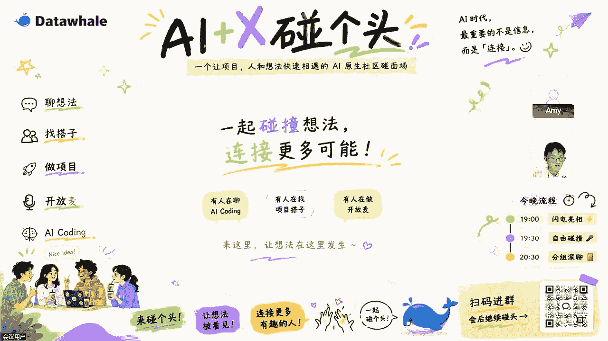
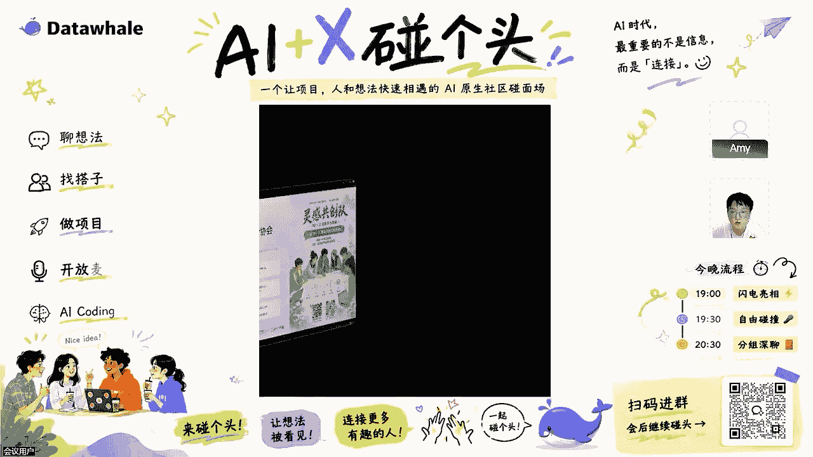
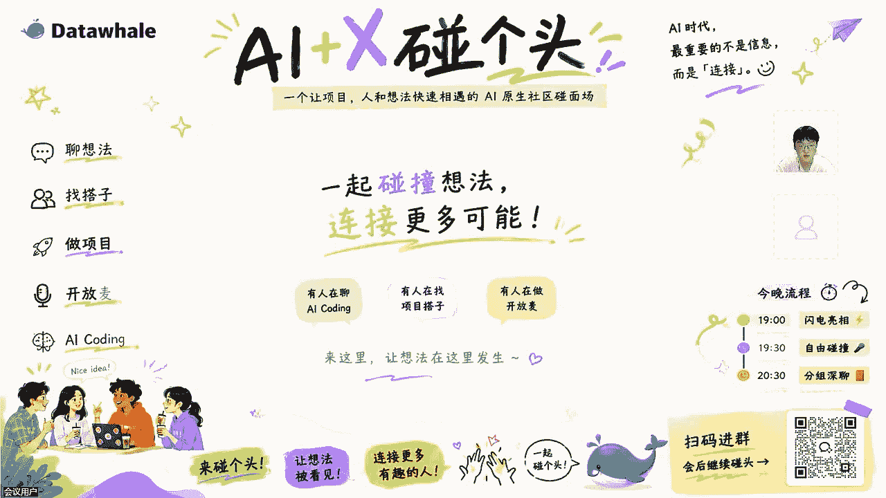

## 🎤 AI+X碰个头：01：活动介绍与参与规则

在本节课中，我们将学习AI+X碰个头活动的基本情况，包括活动形式、分组方式以及如何参与讨论，让大家清楚知道这场活动是做什么的，自己该怎么加入。

AI+X碰个头是一个低门槛、很自由的活动形式。主持人欢迎直播间和会议室里的每一位小伙伴，说明活动的核心目的就是让大家能够碰起来，把各自手头的好东西分享出来，也把自己遇到的问题抛出来。如果你有想聊的内容，就可以直接来分享；如果你有一些解决不了的问题，也可以抛出来，现场有懂行的或者更清楚的小伙伴会帮你来解决或者解答。通过这种方式，我们可以聚集群众的智慧，把多方的信息和资源汇总到一起，相信能够碰撞出一些新的火花出来。

本次活动的参与者背景非常丰富，不管是高校、产业、还是科技领域，在职人员和在校学生都有，大家感兴趣的话题也非常多。主持人会按照填报的顺序安排发言，每位话题发起人可以用三到五分钟的时间，简单聊聊自己想让大家在这个话题下讨论哪些事情。如果有投屏的材料或者海报，也可以直接投屏。发言不一定严格按照顺序，哪位召集人想直接上来讲一讲自己的话题，都可以直接上麦，不需要主持人一个一个去点名。大家在的话，就可以先上来，讲完以后，有兴趣的伙伴可以直接进入对应的分组聊天。

以下是活动参与的基本流程：
- 主持人介绍活动背景和形式
- 话题发起人简要介绍自己的讨论方向
- 大家根据兴趣进入对应的分组
- 在分组内进行自由交流和深入讨论

了解活动规则之后，我们接下来依次来看看每一个具体的话题方向。

---

## 🤖 AI+X碰个头：02：智能体团队与AI工具实践

上一节我们介绍了活动的基本规则和参与流程，本节中我们来看看第一个具体话题，即关于智能体团队和AI工具使用的讨论。

思雨发起了智能体团队这个话题。她本人经常使用各种AI工具，也经常看公众号上分享使用AI工具的经验，包括有人说自己搭建了一个智能体团队，然后全自动地运营一家公司，说得很夸张，还说自己养了很多只龙虾，消耗了上亿的token，反正就是全自动化地执行很多事情。她自己也尝试过很多AI产品，包括支持ki的I engine的产品，但是一直没有机会去和经常使用AI工具的人进行交流。

她看到那些自媒体文章，说自己养了很多只龙虾，可以全自动地帮自己去工作，但她不知道这些文章是吹牛，还是确实能够做到。所以她想借此机会聊聊这个问题。她希望如果有真正使用龙虾或者其他AI产品，可以全自动化地执行一个靠谱任务的朋友，可以来分享一下自己的经验。对这个话题感兴趣的小伙伴，可以进入智能体团队团队管理的小组，无论是有经验的还是感兴趣的，都可以进去交流。

以下是智能体团队协作的简单逻辑：
- 用户提出一个复杂任务
- 系统将任务拆解为多个子步骤
- 不同的智能体负责不同的子步骤
- 各个智能体自动执行并汇总结果

```python
# 智能体团队工作流示例
任务目标 = "全自动运营一个小项目"
子任务列表 = 拆解任务(任务目标)
智能体分配 = 根据能力匹配(子任务列表)
执行结果 = 并行执行(智能体分配)
最终产出 = 汇总结果(执行结果)
```

这个话题的核心就是想知道，网上那些全自动工作的说法到底有多少是真的，有多少是夸大宣传，希望能找到真正实践过的人一起探讨。



---

## 💡 AI+X碰个头：03：灵感共创与从想法到Demo



上一节我们了解了智能体团队的讨论方向，本节中我们来看看另一个关于从想法到Demo验证的话题。

他人学科家创新协会的王瑞和方泽瑞，发起了一个名为AI加X真实验证灵感共创团队的话题。他们在协会这边一直在推进从想法到Demo的验证工作，正好借助这个平台，希望能够把灵感共创这件事情继续往下推进。他们做了一个收集表，希望能够收集大家关于AI解决自己真实问题或者真实需求的想法，分组讨论的时候会跟大家详细交流。共创群聊在海报的右下角，大家也可以在群里面参与讨论。

他们现在的初步计划是先从线上推进，当然今天也有在物理所这边的线下会场，在做一些初步的尝试。后续他们希望能够包括但不限于学校、孵化器园区，或者大家一起约一个轻松的时间去酒吧里面聊聊，先增强一下大家的链接感。最终想要落到的点，就是希望能够通过一起讨论，把AI技术应用到真实问题和真实需求的解决过程中。

以下是灵感共创的基本步骤：
- 收集大家的真实需求和问题想法
- 在分组中详细讨论可行性
- 快速制作Demo进行验证
- 根据反馈不断完善方案

感谢主办方提供这个机会，让大家能够参与到AI加X碰头的活动里面来，稍后会移步到灵感共创的分会场去参与讨论。

---

## 🚀 AI+X碰个头：04：一人公司与超级个体闭环

上一节我们介绍了灵感共创的从想法到Demo流程，本节中我们来看看关于一人公司和超级个体的讨论。

宇洋、应南和徐哲世是协会的创始人，在技术产品方面也能和大家一起交流。他们一直在思考大模型智能体和各个潜在落地场景的交叉选择机会，机会非常多。在这个过程中，一个人如何能够跟多个智能体协同，完成一个项目的闭环，这是一个最初步的尝试。他们最近在尝试一个针对one person company的方案，也可以叫做超级个体。

超级个体的理论定义，除了通过we coding完成MV之外，实际上应该包括在AI辅助下进行背景调研，自己完成产品和项目的设计规划，再到web coding搓出一个偏向research的Demo，或者偏向实际落地场景的MVP，把需求拆得足够细。之后要把web coding的结果跟实际业务场景对接，让它产生价值。再到最后，在这个业务场景里运行起来，不断收集外界的反馈，使得它稳定运行，并且产生新的迭代灵感。这样的一个闭环，才算是一个完整的一人公司团队。

超级个体的完整闭环可以用下面的公式来表示：

超级个体闭环 = 背景调研 + 产品设计规划 + Web开发Demo + 业务场景对接 + 运行收集反馈 + 迭代优化

当然，这个只是其中一部分，后续还包括多个一人公司之间怎么协同，这些都是值得讨论的话题。刚才分享比较激动，说得比较长，就到这里。

---

## 📦 AI+X碰个头：05：AI应用快速落地

上一节我们探讨了超级个体的项目闭环，本节中我们来看看AI在具体行业中的快速落地方式。

景佳，也就是景家浩，电器方面的研究生，毕业工作两年，现在从事能源电力行业，平时对于AI也有一些研究，也担任过一些助教。他发起了AI应用快速落地的话题，并且用AI生成了一个PPT，接下来给大家介绍他的想法。

他认为AI的整体市场会越来越大。如果把AI重装成一个可去可预测可交付的确定性活动，有客户，有群体愿意为我们买单，那就完成了一个商业闭环。他分享了几个具体方向。第一个是海外电商，比如长三角地区义乌、杭州那边，不仅做国内电商，现在海外电商是一个非常新的出口。可以用AI生成视觉营销素材包，比如抖音矩阵、小红书矩阵上卖商品需要的模特图、商品图案，完全可以用AI来生成素材包，再结合公司本身的情况。

第二个方向是智能会议，比如把过往的AI总结会议内容，生成纪要，生成报告，还有文档审查、创议辅助等等。第三个方向是企业的一些具体应用，这个比较大，他放在后面再做。最后还有一些延伸方向，比如客服方向，以及对于很多同学，包括文科生、艺术生来说，以前拍霸道总裁的国内短剧，现在出口之后也很火，但竞争变大了。AI短剧里面，普通人完全可以一键生成工作流，生成视频，生成动画，介绍一本书等等，这个方面还有市场，还没有到最红火的阶段。AI教育现在还不够成熟。最重要的是如何形成一个商业闭环。

以下是AI快速落地的几个常见方向：
- 海外电商：AI生成视觉营销素材包，降低内容制作成本
- 智能会议：自动生成会议纪要、报告、文档审查
- AI短剧：一键生成视频和动画，面向普通创作者
- AI教育：尚不成熟，但有探索空间

感谢平台提供机会，一会儿有感兴趣的同学可以一起再聊。

---

## 📞 AI+X碰个头：06：智能体替代客服

上一节我们看了AI在电商和短剧中的落地案例，本节中我们来看看客服领域的智能体替代话题。

宁墩东，也就是丹尼斯，杭州微电资源的创始人，浙大博士，之前做过客服，后来又做客服机器人。他一会儿要分享自己是怎么从浙大博士到客服，后来又到做客服机器人的过程。客服机器人行业，到底会在今年到明年发生什么样的变化，未来中国五百万打字客服要何去何从，到底以什么样的技术形式会完成这次革命，一会儿会讲这些内容。

大家如果对丹尼斯提到的这个话题感兴趣，可以进入智能体替代客服的分组里面，来详聊一下。

---

## 📊 AI+X碰个头：07：项目经理的AI转型规划

上一节我们讨论了智能体在客服行业的应用，本节中我们来看看项目经理如何规划AI方向的职业发展。

有一位做了大约十一年工作的朋友，之前也做过开发，现在做项目管理，但是在AI这块比较迷茫。他想了解一下，做项目管理未来的一个职业发展路径。比如说现在大家都在用AI写代码，那在项目管理上面，AI能协助做一些哪些事情？包括未来的直接规划。他想跟大家聊聊，比如说AI产品经理，AI落地交付这一块，需要学哪些知识，从哪些点做起，然后要做一些案例，或者有实际的应用场景，都可以聊这一块。

大家如果对AI方向的行业规划、职业规划感兴趣，可以进入项目经理AI转型转行规划的小组里面去进行详谈。

项目经理转型AI的关注点可以总结如下：
- AI在项目管理中的协助场景
- AI产品经理需要掌握的知识
- AI落地交付的实施步骤
- 实际案例和应用场景

---

## 🧠 AI+X碰个头：08：大模型加深度学习开发实战

上一节我们聊了项目经理的AI转型路径，本节中我们来看看如何用大模型和深度学习加速应用开发。

王一鸣分享大模型加深度学习开发的话题。他把这次当作吐槽会，想分享一些技术上的东西。如果大家对技术感兴趣，对技术落地感兴趣，而不是搞一些OPC这些可能对学习者来说比较远的概念，那就聊一些实际有价值的东西。主题是微博coding怎么加速应用开发，你做完应用开发之后，想升级成深度学习的应用，想加一些比较好的创新点思路，看这个东西怎么做。

他以自身为例，给大家举两个例子。第一个是可控核聚变，最近的AF science比赛，他怎么让一分钟搞定这件事情。可控核聚变对他来说，就是托卡马克装置，是一个完全陌生的概念。他怎么把AF science这个课题跑通，然后能上一点分，给大家分享一下。第二个例子是ESP32系列开发板，结合一些摄像头，做视觉，做了一个安全类的项目，就是工地安全检测。他会分享把这两个项目做成的经验，然后可以和大家再讨论。

以下是深度学习应用升级的简单思路：
- 完成基础的应用开发
- 确定需要引入深度学习的环节
- 选择合适的模型和开发板
- 收集数据并训练模型
- 将模型集成到应用中

感兴趣的同学可以加入到大模型加深度学习开发的分组里面，听一下详细的演示和介绍。

---

## 😊 AI+X碰个头：09：幸福驿站与自我探索

上一节我们学习了大模型与深度学习的实战案例，本节中我们来看看一个关于幸福记录的产品想法。

魏博凯来自中国信息通信研究院，现在在职，也是一个九岁男孩的爸爸。他今天分享的产品叫幸福驿站，网上已经有类似树冻的产品上线了。他之所以要分享这个，是因为在人工智能的浪潮下，我们一直在follow最新进展，但是作为一个人，如何在这个浪潮下自处？如果在这个时代之下，你做的事情不是你的热爱，也不是你的专长，基本上未来的发展路径就会比较暗淡，大家都会比较焦虑。作为已经在职场的人，会比较焦虑，没有毕业的同学，在就业之前也会考虑这个问题。

他自己思考之后发现，作为一个人，感受幸福和快乐的能力非常重要，在不确定的时代当下，有点像茫茫沙漠中的指南针。所以他准备锻炼这方面的能力，产生了这么一个需求：有没有可能有一个工具，通过这个工具，把感受到的幸福快乐记录下来，并且给更多的引导。

幸福驿站的第一个功能，是记录日常生活中这些幸福或者快乐瞬间。这是一件很个人的事情，你可能觉得这个东西很好吃，他可能觉得天气特别好，另一个人觉得某个景色特别好看。可以记在纸上，可以用手机拍下来，可以在脑子里记下来，也可以有其他办法。但基于他半年以来和大模型、Agent对话的经历，他觉得让AI充当一个职场训练教练或者心理咨询辅导师，帮我们把零散的信息记录下来，在对话过程中，基于发现到的快乐和幸福，去找寻自己内心的火花。第一个功能就是先记录下来，并且通过Agent做一些梳理。

第二个功能是一个虚拟的公共空间，跟正常社交软件功能类似，但会有一些不同。会把幸福和快乐传递给和你能够同频共振的一些人，可能是最亲密的现实朋友，也可能是网络中、异地、全球各地的朋友，也可能是A to A，或者通过Agent之间做交互。服务端会有一些模型规则或算法。他希望大家能够交换想法，稍后在分组讨论中，可以分享今天最简单感受到的快乐和幸福，聊聊产品未来怎么落地。

以下是幸福驿站的两个核心功能：
- 个人幸福记录：用AI整理零散的快乐瞬间，寻找内心火花
- 虚拟公共空间：将幸福传递给同频共振的人，支持人与Agent交互

自我探索感兴趣的同学可以加入到快乐记录分享工具的分组里面去讨论。

---

## 🎓 AI+X碰个头：10：学生团队活动组织与赞助沟通

上一节我们介绍了幸福驿站产品的构思，本节中我们来看看学生团队如何组织活动和对接赞助。

苏狐，也就是苏红，是沃城市成员。他发起了一个普通学生团队如何稳妥办好一场活动的话题。因为经历过一场活动，他发现同学们组织能力还是有点欠缺。他担心如何设计一个好的组织架构，或者好的分配方式，让每个成员能更好地各司其职，不会到现场就一团乱麻。他想请教有经验的组织者或者前辈，包括后面来的新人，如何通过这个架构能快速成长起来，这是他现在想考虑的事情，包括和团队成员之间交流，最需要做什么。

另外还有一个问题，就是找赞助有一点羞耻感，这个羞耻感如何以平常心去面对。作为在校生，如何和社会上的一些资源有一个平常心去对接。这就是他想分享的主题。

以下是学生团队活动组织需要关注的问题：
- 如何设计合理的组织架构
- 如何分配任务让每个成员各司其职
- 新人如何快速成长
- 如何以平常心面对找赞助的羞耻感
- 如何与社会资源对接

搜狐提到的问题，很多大学生组织的活动，不管是NI相关的，还是其他任何活动，都可能遇到类似问题。想针对这个问题展开聊聊的同学，可以进入学生AI活动组织的小组里面，提出问题，也可以来回答和分享。

---

## 🐕‍🦺 AI+X碰个头：11：盲人触感科技与机械狗导盲

上一节我们聊了学生团队活动组织问题，本节中我们来看看基于机械狗的盲人辅助方案。

子明发起了一个和机器人相关的话题，标题原来是叫盲人摸象在手不在象。他想表达，盲人失去了85%的视觉之后，就只能依靠触觉来感知世界。传统上来说，盲人出行大多数方式依靠导盲证，如果要灵动一点，就是导盲犬，但是导盲犬不仅稀少，而且对盲人的引导只有拖拽这一个单一功能。后来AI发展之后，拟身智能机器人概念提出，大家就在努力用机械狗来替代导盲犬。

子明在想，既然用机械狗做导盲，为什么要去单纯的平替？它明明已经是一个机械狗，已经是一个人造物了，那它对盲人的反馈是不是也可以更多元一些，更实用一些，来针对盲人手上的触觉来做感知服务。盲人手上只拿一个像遥控器一样的东西，然后跟机械狗进行实时传输。机械狗将路况通过触觉和特定的符号标识，特定符号性的触觉来反馈给盲人，告诉他什么时候该低头走，什么时候前面要开始上坡，什么时候前面开始有楼梯，前面大概几步之后要往左拐。通过震动、震荡或者滑动，来给盲人通过触觉告诉他后面的路该怎么走，前面有什么障碍物该怎样避免。甚至可以让盲人跟机械狗有一个交互，比如在复杂车流里面，没有红绿灯也没有规定，可能需要用人肉身去挡住某辆车，然后再让其他人通过，机械狗在特定情况下挡住那辆车，发指令告诉盲人赶紧通过，盲人过去之后，机械狗跟他一起走。这样盲人就可以像正常人一样正常走动，机械狗只做辅助作用。

机械狗跟传统导盲犬的区别，不仅在可复制性和数量上，还在于可以进入宠物不友好的室内场所，应用场景更广泛，服务更多元，限制更少。

子明是大三在校生，主修产品设计辅修法学，这个idea本来是用来骗项目经费的，后来有个老师跟北方做机械狗的公司有合作，觉得想法很好，让他们去做，今年七八月份安排跟企业对接，决定把想法拉到公众视角，让大家评价，看看有什么问题，还有什么可以设计的点，还应当考虑什么，大家有什么资源可以交流。

以下是机械狗导盲的核心优势：
- 可复制性强，数量不受限
- 可进入宠物不友好的室内场所
- 反馈方式多元，基于触觉和符号
- 支持盲人与机械狗的实时交互

感兴趣的同学可以进入盲人触感科技的分组里面来讨论。

---

## 🧬 AI+X碰个头：12：AI与长寿抗衰

上一节我们了解了盲人触感科技方案，本节中我们来看看AI在长寿抗衰领域的应用探讨。

冯后，从事长寿抗衰方面的研究和创业。他想跟大家讨论两个方面。一个是讲一下长寿抗衰这一块跟AI目前结合的情况，中间的化学作用有哪些。另一个是想看大家对长寿跟抗衰有什么样的需求，这些需求里面有哪些可能是可以用AI帮我们快速实现，或者说满足的。主要就是这两个方面。他自己做了一个产品，算是AI外pro的产品，但是现在用户需求还不是很确定，清楚到底是不是真的，也是想跟大家展示展示一下，顺便去看看。

大家如果对AI能否解决长寿抗衰这个问题感兴趣，或者想提一些概念、提一些问题建议，或者想聊这个话题，欢迎进入AI加抗长寿抗衰的话题分组里面去进行进一步的分享和聊天。

AI与长寿抗衰结合的两个讨论方向：
- 长寿抗衰与AI目前的结合现状及化学作用
- 长寿抗衰需求中哪些可以由AI快速实现

---

## 🏉 AI+X碰个头：13：AI在体育运动中的应用

上一节我们讨论了AI与长寿抗衰，本节中我们来看看AI在体育运动中的应用。

老齐发起了关于AI在基建运动中的应用话题。实际上也是一个大的应用领域，讨论过冰壶、冰球这种相对小众的运动。大家一方面喜欢看，但另一方面不太懂规则。想做一个基于视频的AI识别，把运动规则融合进去，能够实时解析出来。比如看直播，除了能看到画面，听到主持人解说之外，还能实时在画面上展示，甚至在慢动作回放的时候直接标注出来，这样体验会更好，特别是看小众运动时。

他们想从基建角度来做，基建分为花件重件和配件，总体来讲配件规则比较简单，想从配件入手。目前没有特别好的办法，因为本身不是做计算机和AI出身的，只是觉得这是一个很好的需求。如果把技术做好了，既可以用于实况转播，也可以用于运动员训练，当然还可以用在现场裁判，目前可能是辅助，后面可能代替真人裁判。

AI在体育运动中的应用场景包括：
- 实时视频规则识别与画面标注
- 直播中辅助观众理解小众运动规则
- 运动员训练的技术辅助
- 现场裁判辅助，未来可能代替真人

大家如果感兴趣，可以加入到AI基建技术应用的分组里面来，给出技术建议，或者随便聊聊也都欢迎。

---

## 🔮 AI+X碰个头：14：AI塔罗与自我认知

上一节我们看了AI在体育运动中的应用，本节中我们来看看一个结合塔罗与AI的心理产品。

泽岩和丽丽是学服装设计的，正在负责一个大创项目，跨专业一起做了一个玄学家心理AI产品。为什么想做这个产品？因为以他们为中心，发现身边很多朋友对玄学一直是半信半疑的态度，但是心里其实是有问题的，有事的，只是想寻找一个出口。市面上的传统玄学和AI算命产品，大部分要么吓唬大家，说下个月有坎，需要破财消灾，要么进行引导式消费，要么贴上一堆标签。他们就在想，有没有可能做一个产品，不算命，也不去定义你，只是像镜子一样帮助你看清当下到底是什么状态，去提升自我认知。

基于这个想法，他们做了关己项目。关己表面上是一个以塔罗抽牌为形式，但是内核完全不同。不追求给你一个答案，给你一个未来预测，更专注于像镜子一样映照你当下的状态。你亲手抽牌，将选择的牌面匹配到预设的推演结构当中，AI会分层帮助你分析这张牌象征着什么，和这张牌相互之间如何作用，如何影响你的当下和现在状态，最后给到一个共识命名。长期看来，不同阶段的共识命名会形成一个可视化趋势，帮助你更好地理解自己，感受自己。整个项目过程是一个慢的、安静的，不会评判你，不会操控你，专注认真有逻辑地帮你梳理。这是市面上一个非常大的空白。

以下是关己AI塔罗产品的核心设计：
- 形式：塔罗抽牌
- 内核：镜子式自我映照，而非未来预测
- AI功能：分层分析牌义、牌与牌的作用、对当下状态的影响
- 输出：共识命名并形成可视化趋势

他们已经制作了Demo，非常希望有感兴趣的同学建立小组。分组编号是18组，大家对这个话题感兴趣的，可以记一下，然后进入18号分组里面来讨论，体验Demo，通过问卷给真实反馈，帮助完善项目。



---

## 📝 AI+X碰个头：15：分组讨论与活动总结

上一节我们介绍了关己AI塔罗项目，本节中我们来看看活动的分组安排和总结。

活动时间快到八点了，直播间还没有开麦分享过自己话题的，可以现在来分享一下。如果没有，一会儿到八点，就把公共麦暂时停掉。大家感兴趣的可以进入各个分组里面来，如果今天没有讨论成的，也可以延期到下一次进行开放麦讨论。

主持人把所有项目的大集合放到看板里面，大家可以看到，对哪个话题感兴趣，可以进入对应的看板。前16号直播间都已经展示了，有一些比如7号或者9号，今天还没有来得及上来讲的，大家感兴趣可以直接进入对应分组里面聊。电商话题的发起人没有在线，也没有上来分享，但是电商话题和第一个思雨的话题比较类似，都是说AI怎么帮我们做什么，包括cloud code的小龙虾，或者promise这些。如果感兴趣，可以进入对应的分组里面来，也可以进入第一个分组里面去聊。虽然各个分组里面，话题发起人可能不在，但是如果大家对话题比较感兴趣，也可以自己把分组利用起来，加进来，两个以上就可以开始聊起来。2.0设计板块的话题发起人还没有上来讲，大家感兴趣的话，可以先进入分组讨论里面，看看有没有其他小伙伴感兴趣一起聊。

直播间的各位小伙伴，如果对AI加X碰头活动感兴趣，可以扫描直播间右下角的二维码，进入群里面，也可以通过群里的会议链接，进入腾讯会议参与对应讨论。现在大家都已经进入分组里面进行讨论了，直播就先到这里结束。

感谢大家今天在直播间的参与，下期再见，欢迎大家扫码加入群，进到同一会议里面，和其他小伙伴一起聊起来。下期再见，拜拜。

---

在本节课中，我们一起学习了AI+X碰个头活动的全过程，包括活动的基本规则、参与方式，以及每一位发起人带来的话题方向。我们了解了智能体团队与AI工具实践、灵感共创从想法到Demo、一人公司与超级个体闭环、AI应用快速落地、智能体替代客服、项目经理AI转型规划、大模型加深度学习开发实战、幸福驿站与自我探索、学生团队活动组织与赞助沟通、盲人触感科技与机械狗导盲、AI与长寿抗衰、AI在体育运动中的应用、AI塔罗与自我认知，最后是分组讨论的安排。希望大家能找到感兴趣的方向，进入对应的分组继续交流，碰撞出更多新的火花。

