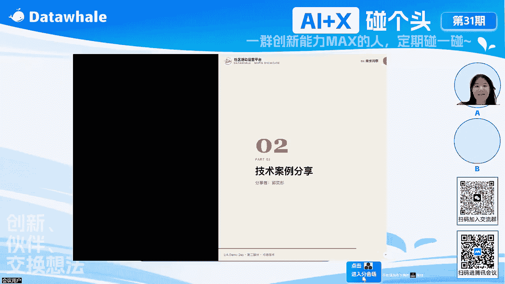
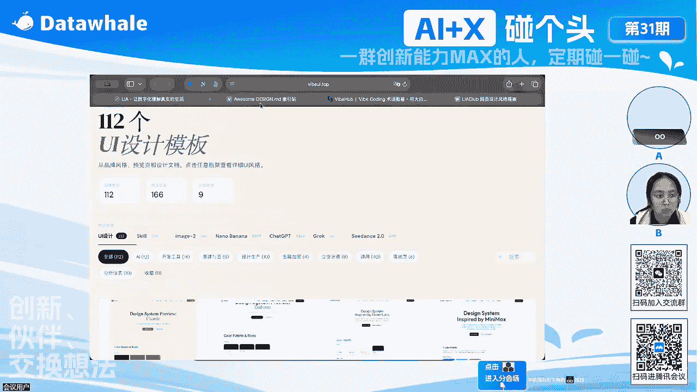
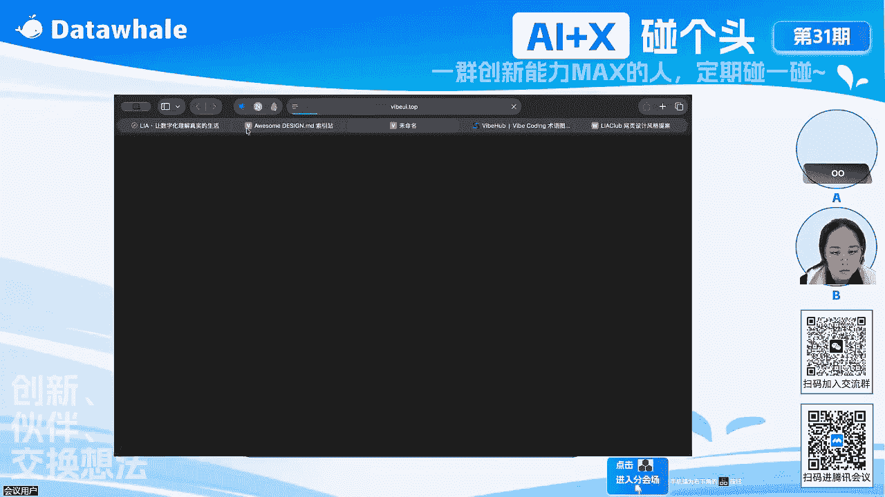
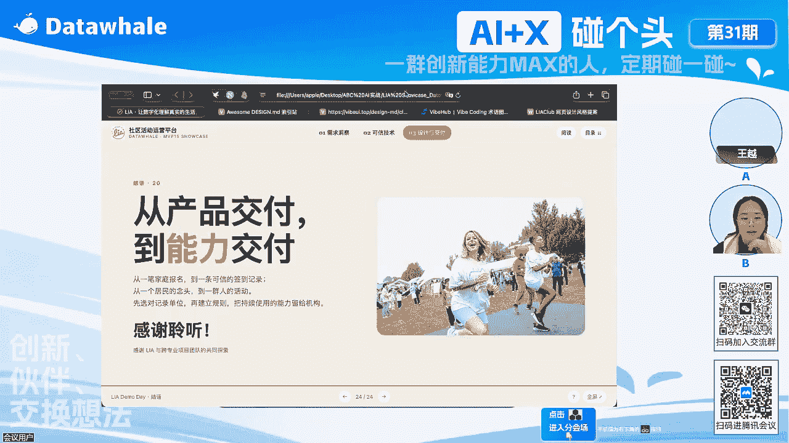
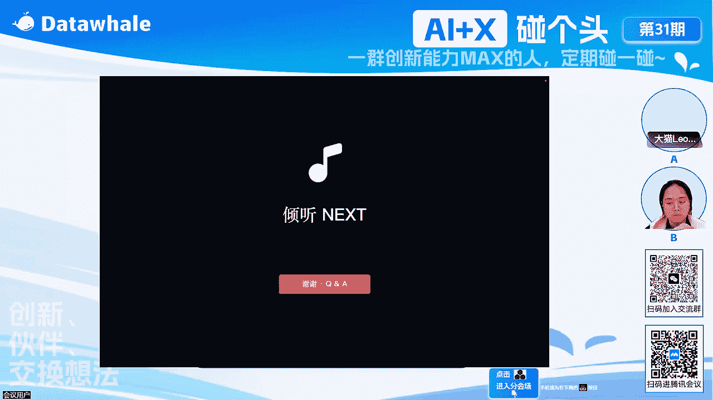
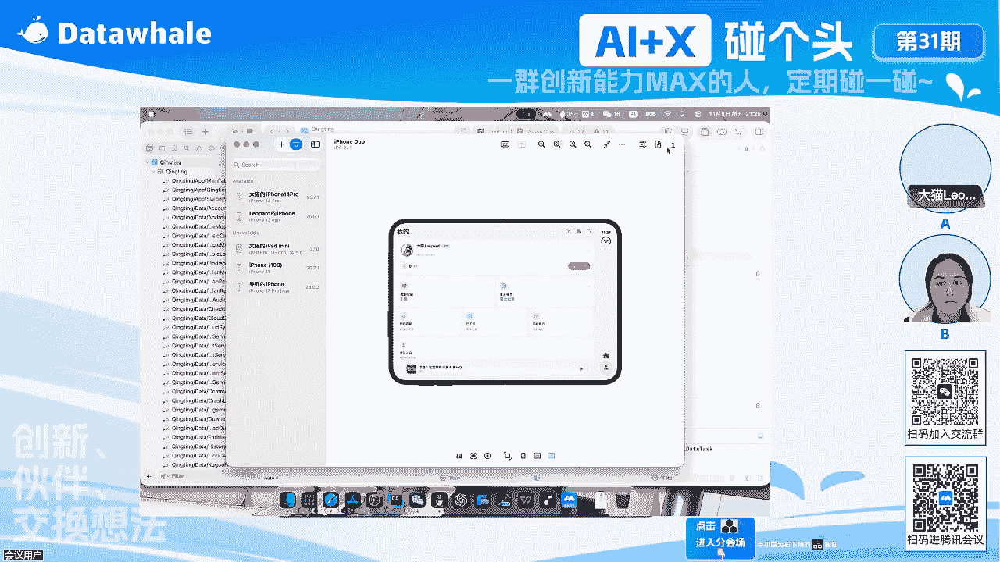

# Datawhale AI+X碰个头：00：课程概述 📋

在本节课中，我们将一起学习Datawhale AI+X碰个头活动中的多个分享内容。这些内容包括活动运营平台的产品设计与技术实现、Robotis101机器人课程的架构与教学设计、蜻蜓Next多源音乐APP的实现原理，以及AI硬件项目的从0到1落地经验。通过这些案例，初学者可以了解如何从零基础出发，利用AI工具构建真实产品，并掌握数据模型、权限体系、跨平台适配等核心概念。

---

# Datawhale AI+X碰个头：01：活动运营平台：从需求挖掘到技术实现 🎯

本节我们将学习一个面向社区公益组织的活动运营平台。该平台的设计团队来自人文社科背景，成员最初没有编程经验，但在AI辅助编程的帮助下，完成了从需求挖掘到产品交付的全流程。

以下是平台对接的公益组织基本情况。组织名为Love is Around，中文意思是爱在身边，位于北京顺义。该组织希望从举办大型草地音乐节，转型为在社区中开展日常化、不同主题的活动，让居民重新聚集在一起，感受真实的互动。

以下是该组织面临的核心挑战。首先是人力极度有限，全职管理人员仅有一位，志愿者主要来自社区居民。其次是活动工具缺失，报名依赖微信群接龙，到场统计使用纸质表格，收支记录没有统一工具，无法按月统计活动数量和金额。再次是社区人群多元化，涉及中外居民和亲子家庭，活动需要强调开放与包容。

以下是产品的核心定位。平台以活动为中心，作为运营中枢，将报名、到场、收支和内容变成可核查、可复用的记录。系统需要支持家庭同行报名，现场签到，以及社区共创等功能。

以下是需求挖掘的一个具体案例。负责人最初提出的直接需求是希望用二维码代替纸质签到表，将表格电子化。如果直接按此需求实现，可能只会做成一个电子版报名统计表。但通过社会学视角的访谈，团队发现真实场景中，常常是一个家长带着几个小孩共同出行。这意味着报名单位不应是个人，而应是家庭。系统需要支持一笔报名对应多个参与者，并允许在报名前后增减同行人。现场签到时，工作人员应只勾选实际到场的人数。

以下是数据模型的设计思路。第一版模型假设一个手机号对应一个参与者，这在技术上简单，但无法区分报名人和实际参与人。迭代后，模型拆分为四部分。第一部分是Registration，代表一笔报名行为，不是自然人。第二部分是Participant，代表一位实际参与者，拥有独立的参与者ID，手机号仅作为联系方式，不再作为数据库主键。第三部分是RegistrationParticipant，将一笔报名与多个参与者关联起来。第四部分是CheckIn，是个人级的活动级独立事件，谁到场就记录谁。

代码示例说明数据模型关系如下：

```text
Registration (一笔报名行为)
  └── RegistrationParticipant (关联表)
        └── Participant (实际参与者，独立ID)
              └── CheckIn (个人级签到记录)
```

以下是签到逻辑的核心原则。系统规定，报名成功不等于到场。报名意味着用户计划参加，系统为其留位；签到成功才说明到场经过了审核。这是两件完全不同的事情。基于此原则，设计了两条签到路径。第一条是工作人员现场核验，出示报名凭证二维码或签到码，工作人员找到该笔报名，查看所有参与者，只勾选当天真正到场的人再确认。第二条是居民现场自助签到，工作人员在现场展示活动专属二维码，居民扫码后，系统验证二维码凭证并结合居民报名码完成签到。这相当于需要两把钥匙，一把证明有报名资格，另一把证明处于活动现场。只有自报名码不足以在家里完成签到。

以下是收费活动的业务规则。对于收费活动，如果付款状态不是已付款，系统不允许写入新的签到记录。工作人员必须先核对付款记录或到账情况，确认金额后才能继续。原因是报名时显示的应收金额不等于机构实际收到的钱。收入统计模块只使用已经确认的交易记录，不直接用报名人数乘以单价进行计算。

以下是两条重要的工程原则。第一条是操作要有前置条件，没有现场核验就不能接入签到，收费活动没有确认付款不能走正常签到流程。第二条是关键规则必须在服务端进行检查。前端可以将按钮置灰或弹出提醒，但页面限制可以被绕过。如果有人绕过前端直接向后台发送签到请求，后台也必须再次检查。只有付款状态在数据库中被真实写为已付款，才允许创建签到记录，否则拒绝操作。这就是服务端校验，从系统真正写入数据的地方，确保不符合条件的操作无法执行。

以下是权限体系的设计思路。很多系统会给用户打上全职身份标签，在整个平台永久生效，但在社区活动场景中这会带来不可控风险。同一个用户在活动A中可以是主理人，在活动B中可能只是志愿者，在活动C中可能只是普通居民。每一份权限的边界都严格锁定在单场活动之中。授权链路包含明显约束，先由申请人提交权限申请，再由平台管理员人工审核，审核过后生成绑定event ID的授权记录。后续每一次管理操作发起时，都必须在服务端完成权限校验。前端页面可以隐藏按钮控制交互，但不能作为权限的安全边界。

以下是AI导入功能的设计思路。公益组织的活动资料分散在Word文档、PDF、公众号文章和内部策划稿中。为减少重复录入，团队开发了Activity Import Skill，帮助工作人员将资料整理成平台可导入的结构化数据。该Skill设置了三条处理原则。第一条是一份来源不等于一场活动，一份材料里的三场工作坊要拆成三条，同一场的预告和回顾要合并成一条。第二条是不确定地方要保留不确定，例如策划稿写11月中旬，不可以擅自补成15号，日期留空。第三条是Skill本身不能写入正式数据库，Skill负责提取和整理，输出JSON或CSV格式，再由工作人员检验确认后导入。

以下是AI自动化与人工确认的关系总结。AI擅长汲取、归纳和整理，但不知道哪个版本是机构最终确认的。项目坚持的原则是，AI帮工作人员减少重复劳动，但不能让工作人员失去对信息准确性的控制。尤其是签到、权限去重和财务等设计确定性业务规则的环节，不能简单交给大语言模型自行判断。自动化提高效率不一定要追求输入到入库全程无人参与，关键节点保留简单的人工确认，反而能让系统更可靠。错误处理不仅是让程序不崩溃，更要防止系统给用户提供错误反馈，引发新的错误操作。

以下是本节的核心结论。数据库里每一条记录都需要有一个能够解释清楚的来源，一笔报名、一次到场、一笔收入都是各自的事实。AI整理资料、程序检查规则，但真实业务记录最终确认权限时，需要有明确的人来负责。

---

# Datawhale AI+X碰个头：02：Robotis101机器人课程：从仿真到策略训练 🤖

在上一节我们介绍了活动运营平台的需求与技术实现，本节我们来看看另一个完全不同的领域，即机器人仿真与学习。Robotis101是一门面向具备基础编程能力但从未接触过机器人的学习者设计的基础课程，也适合想了解机器人物理底层引擎能力的学习者。

以下是课程的基本定位。课程基于物理仿真引擎，采用手搓方式，搭建机器人控制、训练和仿真管线。学习者可以从物理层面看到整个机器人的动作和训练效果。整个流程不限于手上是否有真实机器人硬件，非常适合刚起步的同学。希望通过这门课程，让学习者建立对机器人技术的直觉，之后可以在流程的某个环节上向上生长，使用更现代或更高层的技术方案进行替代。

以下是课程的章节结构。课程共十四讲，从L01到L14。前十三讲是串联的循序渐进过程，第十四讲是可选部分，内容包含与蚂蚁金服凌波实验室的Robotin大赛相关的微调训练内容。对于没有机器和显卡的同学，课程提供了一些算力资源和一键启动的Notebook部署模板，方便大家避免自己搭环境。

以下是课程的四个学习阶段。第一阶段是第一课到第三课，目标是让学习者理解仿真世界。不讲复杂理论，只做环境诊断和最小Mo Test。把物理世界的场景、实体、仿真生命周期中的场景构建以及步进等拆开来看。提供钢体物理稳定仿真，主要用物理接触、穿透和摩擦实验，解释仿真涉及的概念，让大家知道什么是物理仿真。

第二阶段是第四课到第七课，目标是让机器人真正可控。前面完成仿真后，将Franca机器人放入仿真环境。讲解Franca的自由度、关节映射、关节控制，以及正向运动学和逆向运动学、机器人位姿和相机相关内容。然后讲解并行仿真，利用GPU进行大规模并行批量仿真。第七课结合前面所有内容，手搓一个抓取任务场景。

第三阶段是第八课到第十一课，主要讲数据。第八课讲演示数据或Robot数据的采集方法，介绍当前主流采集方法，但避免依赖硬件和设备，直接用基础的脚本化专家建立数据感，之后可以逐步替换为其他方案。第九课和第十课讲数据合成，以及数据的协议和约定。第十一课讲对数据进行域随机化，通过随机化让数据更加泛化，让机器人在更多未见过的场景中真正学到技能。

第四阶段是第十二课到第十三课，在数据准备好之后，进入策略训练、仿真和评估。使用ACT和SMoR等经典模型作为入门，虽然模型简单，但希望通过这些经典模型让希望了解机器人技术的同学进入这个世界。课程环境提供一张48GB显存的显卡，对于训练来说，使用更多数据也没有问题。

以下是仿真过程中的一个关键数学概念。仿真过程在数学意义上，不可能让机器人百分之百严格到达某个位置，它只能无限地接近那个位置。这个概念在仿真中非常关键，学习者必须理解。在配套的Notebook中，可以看到实际测试数据和图表，发现它永远是一个数学逼近概念。机器人不断步进，关节会越来越接近目标，但并不是百分之百能到达指定位置。

以下是并行仿真的性能考量。在并行与不并行的情况下，物理引擎能达到的并发度能带来多大效率提升，这是物理引擎性能的重要一点。

以下是数据层面的核心框架。课程使用Hugging Face的Robot Training机器人训练框架。在这一章中，会了解数据集里的观察和行动是怎么对齐的，数据集分哪些层，加载时怎么训练，怎么并行使用这些数据。

以下是训练模型的简要说明。课程会对ACT模型的架构、训练路径和原理做一些解释和说明，对SMoR VLA也会有针对性说明，但只点到为止，不深入。因为这不是模型算法课。学习者可以之后再去了解更先进的模型架构和整个模型发展路径。在第十二课的配套Notebook中，会启动训练，使用少量数据进行小规模训练，也可以修改代码进行全量训练。

以下是闭环评估的说明。这部分没有涉及真机，因为课程不对真机有依赖。但闭环评估是把刚刚训练好的模型用来做推理，然后把推理结果用来真正控制仿真环境里的机器人，这也是一种闭环评估。



---

# Datawhale AI+X碰个头：03：蜻蜓Next多源音乐APP：架构与统一模型 🎵

在上一节我们介绍了机器人课程的教学设计与仿真流程，本节我们来看看一个面向音乐播放的跨平台客户端。蜻蜓Next是一款多音源音乐APP，整合了酷我、网易云、QQ音乐、酷狗等不同音乐平台的数据和服务，提供流畅的使用体验。本节不重点放在具体代码上，而是通过流程图和实际案例，解释各个模块如何相互配合。

以下是产品定位的核心观点。蜻蜓Next不是网页套壳，而是直接连接多个音乐服务的聚合客户端。项目最重要的能力不是请求到了多少接口，而是能不能把平台的变化控制在有效范围内。后面所有的设计，包括统一模型、适配器和状态管理，都是围绕这个目标展开的。

以下是系统分层架构。为了控制复杂度，将系统分成四层。第一层是界面层，包括搜索页、首页、歌单、播放器和歌词页，只关心当前状态，不了解每个平台JSON里的字段叫什么。第二层是业务层，负责播放队列、收藏和下载任务、搜索状态和用户操作。第三层是平台适配层，处理酷我、网易云、酷狗、QQ等平台的请求和响应。最下面是基础设施层，包括网络、数据库、图片缓存、音频引擎和系统媒体控制。

代码示例说明分层架构如下：

```text
界面层 (UI)
  ↓ 调用
业务层 (业务逻辑与状态)
  ↓ 调用
平台适配层 (酷我/网易云/酷狗/QQ适配器)
  ↓ 调用
基础设施层 (网络/数据库/缓存/音频引擎)
```

这种分层最主要的意义是限制变化范围。假设酷狗把封面字段从image改成onion cover，理想情况下只需修改酷狗的适配器，搜索界面和播放器列表都不用改。如果直接处理原始JSON，一个字段调整就可能影响搜索、歌单、播放器和下载多个界面。架构不是为了让代码看起来复杂，而是为了让外部变化发生时，内部保持稳定。

以下是统一数据模型的设计。统一模型可以理解为应用内部对一首歌的标准定义，包含歌曲ID、名称、歌手、专辑封面、时长、来源、MV标识和音质信息。所有平台的数据集合之后，最终都输出一个标准记录。搜索列表只读取名称、艺术家和封面URL，播放器根据歌曲选择播放解析器，数据库保存相同结构。收藏、历史、下载和云同步也围绕这个模型工作。

代码示例说明统一模型结构如下：

```text
SongRecord {
  songId: 标准化歌曲ID
  name: 歌曲名称
  artists: 歌手列表
  album: 专辑名
  coverUrl: 封面URL
  duration: 时长 (毫秒)
  source: 来源平台标识
  mediaId: 平台媒体ID
  quality: 音质信息
}
```

需要注意，统一并不代表丢掉原始特征，source必须保留。因为相同的数字ID在不同平台可能代表不同歌曲。某些平台还需要mediaId、MV hash或audio ID才能解析。统一模型目标不是把所有平台压成最小公倍数，而是提供一个稳定的公共字段。这就是适配模式的价值，外部模式可以多样，内部保持统一。

以下是搜索流程的六个步骤。第一步，用户输入关键词。第二步，读取当前选择的音源。第三步，统一的Search Service把source分发给对应的客户端，例如酷我或网易云。第四步，客户端构造该平台需要的URL。第五步，转换成标准SongRecord。第六步，更新状态，SwiftUI或Compose根据新状态重新生成列表。Search Service更像是一个路由器，不负责理解每个平台的细节，而是把每个平台处理自己的协议交给正确的实现。这种拆分也方便测试，可以给某个解析器一段固定JSON，验证它是否产生了预期的标准记录，而不用启动完整页面去访问网络。

以下是播放地址解析的说明。搜索结果一般只包含原数据，不一定包含可以直接播放的音频。用户点击音频后，MusicLibrary或播放控制器先把歌曲放入队列，然后根据source选择解析器。解析器需要歌曲ID、hash、音质、登录状态和设备参数等。不把播放URL永久存入数据库，因为很多地址带有过期时间，或与账号、音质和地区状态有关。今天解析成功的地址，明天可能就失效。因此，数据库长期保存歌曲源数据，播放URL按序解析。这也是为什么搜索成功不代表播放一定成功。搜索接口、播放解析接口和实际媒体CDN是三条不同的链路，每一条都可能有独立的错误。





以下是播放器状态机的设计。播放器不只是一个简单的播放按钮，它更接近一个状态机。最初处于IDLE，用户点击歌曲后进入RESOLVING，表示正在解析播放地址。拿到地址之后进入BUFFERING，播放器准备好足够数据后进入PLAYING。用户暂停时进入PAUSED。发生错误时需要记录错误，并决定是否重试或跳过。把状态机和队列规则从界面中抽离出来有两个好处。第一，规则可以单独测试。第二，无论操作来自屏幕按钮、蓝牙耳机还是小组件，最终行为都保持一致。

代码示例说明播放器状态机如下：

```text
IDLE → RESOLVING → BUFFERING → PLAYING
       ↑              ↓
    PAUSED ←─────────┘
       ↓
   ERROR (重试/跳过)
```

以下是歌词系统的实现原理。第一步是把文本转化为结构化的时间轴。普通LRC每一行都有时间，例如12秒500毫秒，解析器需要把分钟、秒和小数统一转换成毫秒。逐字歌词更复杂，一行中的每个字还有自己的开始和持续时间，界面需要根据当前时间计算高亮比例，同时保持滚动位置稳定。性能上不能每一毫秒都重绘整页，通常播放器以合理频率发布进度，界面用差值和动画形成连续效果。歌词系统本质上是时间解析、状态选择和视觉动画三部分的结合。

以下是封面加载的性能优化。搜索列表中的封面只能显示为56点左右，但平台经常返回800乘800的WebP压缩文件。文件可能不大，但一旦解码成位图，按每像素四字节计算，一张图片就有2.4兆。原来的图片加载器被放在主线程上，网络下载完成后触发图片解码，容易被误判为网络慢。网络慢通常只会让图片晚出现，解码卡死才会影响手指跟随感。定位性能问题时，需要区分下载、解码、布局和绘图分别发生在哪个线程。

优化后的目标很明确，主线程只负责显示，不负责解码。网络请求下载原始图片数据后，下载完成之后，数据交给后台任务。后台使用Image IO创建缩略图，生成缩略图后放入缓存，缓存键同时包含URL和目标尺寸。这样主线程只需要接收解码好的UIImage并更新界面。

以下是本地持久化的数据分类。应用关闭后，收藏歌单、历史和下载任务不能消失，需要本地持久化。数据大致分成四类。第一类是歌曲源数据，第二类是用户行为，第三类是关系数据，第四类是任务状态。数据库保存的是可以恢复业务状态的数据。应用下次启动时，可以重新构造歌单、收藏、播放历史和未完成任务。有的东西不适合长期保存，例如URL，有的东西必须保存，例如下载临时文件路径。设计数据库时，还要区分长期事实和临时存储结果，否则会出现恢复后数据看似存在，但实际上已经失效的问题。



以下是云同步的流程。假设安卓收藏了一首歌，同时在iPhone删除一个歌单，两台设备都离线，稍后再次联网。服务端必须知道哪些记录发生了变化，哪次修改更新，删除是否应该覆盖旧数据。同步流程一般是先上传本地变化，再拉取服务端增量，比较版本并合并，最后清除已经确认的修改标记。重点不是让所有设备都上传数据库，而是让每一次变化都可以可靠传播。

以下是双端开发的一致性要求。Android使用Kotlin，iOS使用Swift，两边没有必要逐行共享界面代码，因为平台构建生命周期和系统能力不同。但有一点，业务规则必须一致。例如source标识、歌曲主键、封面字段和优先级、队列导航、时长单位、同步协议和错误语义。双端一致的目标不是代码长得一样，而是同一个用户操作在两个平台上可以得到相同的结果，同时各自遵循平台习惯。

以下是功能全景说明。统一模型建立之后，搜索发现歌曲，首页推荐歌曲，歌单整理，播放器处理队列和音质，歌词负责时间同步，MV进入视频解析，下载把在线资源转成离线文件。这些功能不是独立的小岛，搜索结果点击后进入播放器，收藏后进入歌单，下载后仍需保存原始source和song ID，云同步需要把这些关系传到另一台设备。SongRecord贯穿整个过程。模型一旦设计不完整，问题会在后续多个模块放大。反过来，一个稳定的模型可以显著降低新增平台和新增功能的成本。

以下是数据转换的真实结构示例。网易云新版搜索把歌曲放在resources标签里，每项的base info才是真正的歌曲ID。适配器先进入base info，再从AL中取得专辑与封面，把HTTP地址升级为HTTPS。转换后的标准记录不再暴露resources、AR和AL这些平台术语，界面上只能看到标准字段。这个过程包含字段重命名、切换展开、类型统一、单位转换和URL规范化。

以下是搜索界面的状态管理。搜索界面不仅是一个结果列表，它至少有6种状态：初始、输入中、加载中、成功、空结果和失败。状态驱动页面渲染，每种页面都有明确表现，而不是依赖很多布尔值临时拼凑页面。

以下是系统媒体控制的集成。音乐APP必须走出APP自己的界面。iOS的锁屏控制中心、灵动岛和小组件，都可以显示歌曲名称、歌手、封面、总时长和当前进度。Playback System Bridge就像它的名字一样，把内部播放器转换成系统原始数据，同时把系统命令转回MusicLibrary，是一个桥梁。这样无论用户点击APP按钮、锁屏按钮还是耳机按键，都会经过统一的一套播放和导航逻辑。系统调节层负责连接，没有重复实现业务规则。

---

# Datawhale AI+X碰个头：04：AI硬件与社区组会：从0到1落地与赛博主会 🔧

在上一节我们介绍了多源音乐APP的架构设计与实现细节，本节我们来看看AI硬件项目的落地经验，以及社区组会的运作方式。

以下是AI硬件分享的核心内容。团队以外接coding键盘作为具体切入点，以小见大，看看如何从具体问题出发，挖掘需求和痛点，再上升到用户的魅力属性，逐步达到产品产出和市场阶段。分享包括整体推进流程和进度，从一个AI小硬件开始，教大家如何从0到1跑通。内容涵盖桌面调研、原型机开发、试场等整个阶段。

以下是面向创业者的讨论邀请。如果在座的朋友正在尝试硬科技创业，或者在做AI硬件产品，都非常欢迎来到这个分组讨论。今天晚上的核心内容是讲硬科技创业从头到尾，产品量产的整个环节大概有哪些，以及其中简单的一些坑。坑非常多，可以跟大家一起交流。

以下是赛博组会的背景。组织者注意到全世界范围内，不光是中国，还有美国、欧洲，大量本硕博同学因为缺乏导师指导。因此召集大家成立了本硕博学生之间的互帮互助群。作为群主，每周五晚上在这里召开赛博主会。每周五的赛博主会会邀请全世界各地的优秀硕士生、博士生，以及一些在做工作的优秀本科生，聊聊自己的科研工作进展和想法。

以下是本次论坛的定位。整个论坛以学术前沿、前沿阵地和理论性质的工作展开，与其他更偏工程、实操或侧重基础小白的分论坛不同，这个阵地相对更前沿。欢迎大家一起来聊聊，或者来指导、交流、提点建议。也非常欢迎在读硕士、博士以及有科研需求的本科生联系，希望能和大家建立更加密切的科研合作。



以下是AI+X碰个头社区的活动节奏。这是发起的每周二、每周五晚上开启的社区AI开放麦。只要大家有觉得值得跟大家分享的经验或想法，都欢迎参与。右下角可以进入直播所在的腾讯会议，也可以加入交流大群，有任何线上线下活动信息，包括所有录制和后续文章，都会在群里分享。

---

# Datawhale AI+X碰个头：05：课程总结与下一步建议 📚



本节课我们一起学习了活动运营平台的产品设计与技术实现，掌握了Registration与Participant分离的数据模型、报名不等于签到的业务原则、服务端权限校验以及人机协作的AI导入流程。我们还学习了Robotis101机器人课程的四个阶段，理解了仿真中无限逼近的数学概念、并行仿真的性能优势，以及ACT和SMoR等经典模型的入门方法。在蜻蜓Next音乐APP部分，我们了解了四层分层架构、统一SongRecord数据模型、播放器状态机、封面解码优化、本地持久化与云同步机制。最后，我们简要回顾了AI硬件项目的从0到1落地思路，以及赛博组会的社区运作模式。

希望这些内容能为初学者提供直观的参考，帮助大家从零基础出发，利用AI工具构建真实产品。如果对具体分会场话题感兴趣，欢迎加入对应的讨论群，继续交流与探索。
