# 【Datawhale AI+X】AIX碰个头：00：课程概述与背景 📋

在本节课中我们将要学习人工智能在不同行业的实际应用实践。本节内容来源于Datawhale AI+X社区的第26期AIX碰个头直播活动，邀请了多位分享嘉宾，从不同角度探讨人工智能与各行业的结合方式。我们将依次介绍AI与建筑协同生产、AI与古代心智哲学、企业数字化转型思路、未央黑客松教程分享、个人Vibe Coding最佳实践，以及多人协作创作工具BRI。每个章节都会保留原始分享的核心信息，并用大白话解释，让初学者也能看懂。

# 【Datawhale AI+X】AIX碰个头：01：AI与建筑协同生产 🏗️

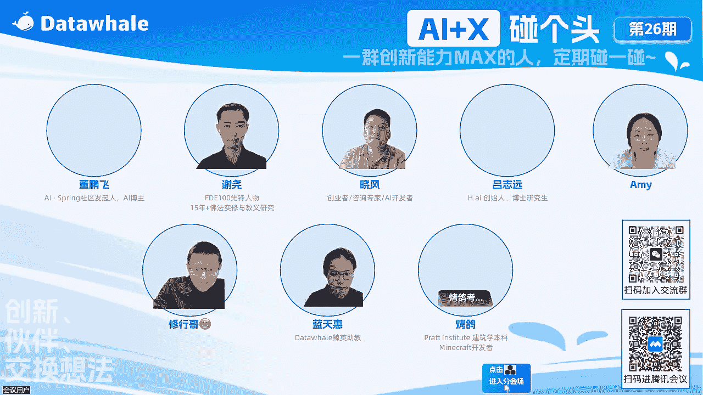

上一节我们介绍了本次直播活动的整体背景。本节中我们来看看第一个分享主题，即天惠和考哥带来的AI与建筑协同生产内容。这两位分享嘉宾是初中高中同学，目前分别在美国就读建筑学本科以及从事相关建筑方向工作，他们将围绕AI如何辅助建筑设计和游戏开发展开讨论。

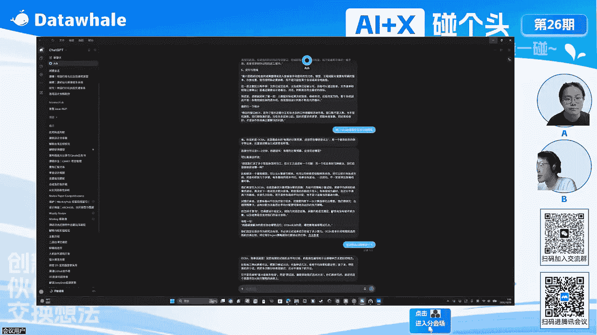

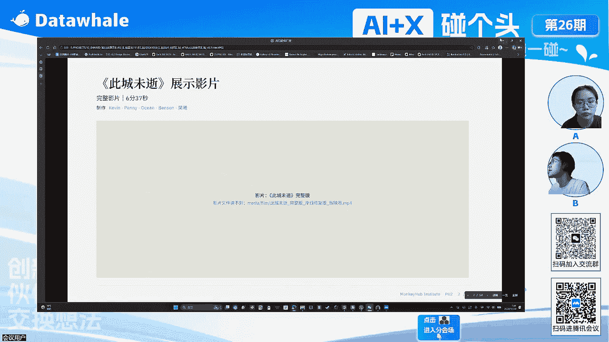

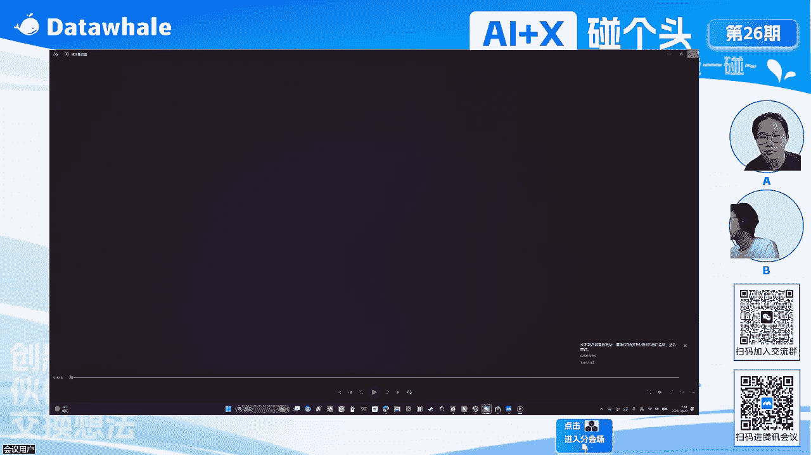

在AI时代，我们可以快速让人工智能生成大量的建筑模型或者游戏场景，但这并不意味着设计工作已经完成。相反，人类对生成结果的最后把关和指导，反而变成了整个协作流程中的瓶颈。我们今天主要想探讨的，就是如何提高人与AI协作的效率，以及最近在工程应用上开发的一些实践经验。

以下是他们在分享中提到的核心协作框架：

- 第一层：人。人需要确定最终目标，了解要做什么，以及什么结果值得保留。
- 第二层：协调与派活通道。因为团队成员分布在中国、法国、美国三个时区，交互非常重要，需要把人的要求转化为可执行任务。
- 第三层：窗口。具体如何完成任务，保留部分上下文，处理具体问题。
- 第四层：工具脚本和机器。包括Blender、UE等工具，以及运行这些工具的电脑和服务器。
- 第五层：检查和返工。对应第二层中的回执和上下传递过程。
- 第六层：最终验收。

核心协作网络可以用如下伪代码表示：

```python
协作网络 = [人, 协调派活, 窗口, 工具脚本, 检查返工, 最终验收]
```

除了分层协作，他们还介绍了OCBA算法，这是一种用于在多个设计方案中分配资源的方法。简单来说，OCBA可以帮助我们在一开始就筛选出少数几个最有希望的方案，然后将资源集中投入到这几个方案中进行模拟。这涉及两个关键概念：方差和平均分配。有些方案成功率高但方差也高，可能一次就成功，也可能做出来不可用。我们会先投入少量资源进行投石问路，算出哪两种方案大概率会成功，再集中投入资源。

OCBA的资源分配思路可以简化为：

```text
成功率 = f(方差, 平均分配)
资源投入 = 投石问路(少量token) → 模拟筛选 → 集中投入(高成功率方案)
```

在实际技术路径上，他们主张不要指望AI直接生成最终模型，而应该让AI编写建模程序。这样AI充当参数化工作流的指挥者，而不是直接输出几何数据。同时，他们提出了设计状态数的概念，希望把人的设计决策编译成可检索的状态，而不是每次都在大海捞针般的上下文中重新推测意图。

设计状态数可以用如下公式表示：

$$设计状态数 = 历史决策集合 \times 上下文 \times 约束条件$$

他们还提到了从Blender到虚幻引擎的同步插件，以及基于PCG（程序化内容生成）的城市化建模。通过形式文法将现实中的建筑规则（如坐北朝南、房屋开口连接等）转化为AI可读的排列脚本，实现街道、建筑的规则化排列组合。

本节内容就介绍到这里，下一节我们将继续看看谢瑶带来的AI与古代心智哲学分享。

# 【Datawhale AI+X】AIX碰个头：02：AI与古代心智哲学 🧘

上一节我们介绍了AI在建筑领域的协同生产实践。本节中我们来看看谢瑶带来的AI与佛法，或者说古代心智哲学角度下的对比内容。谢瑶的主业是做FDE，副业是佛法研究与修行，这次分享他尽量避免宗教词汇，调整为纯哲学角度，探讨AI的自我与古代心智者学对自我的认知之间的交叉点。

AI的自我从哪里来？基于数据、算法和算力的堆砌，更准确地说是基于概率分布。AI展现出的意识连续性，本质上是概率模型在寻找最接近某个问题的下一个观点。这是AI的自我来源。

古代印度哲学中的自我认知则不同。传统佛教思想认为无我，人是由多种因素构造的，每一种因素里面都没有永恒不变的东西。这些因素包括身体、感受、想法、意识、识别，合称五蕴。基于五蕴，构建了无我的理论。

五蕴又是如何产生的？这里引入了12因缘的关系链，从无名到行、识、名色等，一共十二个环节，构成生命循环。其中核心在于触和受。触是感受本身，比如接触到热量感受到温热；受则是基于感受产生的喜欢或不喜欢。我们每天追求的本质上是喜欢的感受，这为生命提供了源源不断的动力。

再往深处讲，就是记忆库的问题，即第八识，也叫阿赖耶识，存储所有信息并进行转移。这很像AI的概率模型，基于惯性抓取信息。比如一个人被判定为工作狂，我们就会认为他在工作时间大概率在公司，这就是基于存储信息的惯性判断。

以下是古代心智模型与AI的简化对应关系：

```text
AI训练参数 ↔ 五蕴中的造作蕴
AI上下文输入 ↔ 名色
AI推理回应 ↔ 识
AI感受（受） ↔ 无（这是最大争议点）
```

最大的争议点在于AI是否有感受。在古代佛教理论体系下，如果没有受，就没有喜好，就没有亲近与远离的行为，生命现象也就无法相续。目前我们无法论证AI是否有受，因此基于这一角度判断，AI没有生命。

从AI能力与五运的对照来看，AI在想法和时间上极强，远超人类，推理和生产能力也远超人类，识别和判断同样如此。但其他部分，如感受，目前无法确定AI是否拥有。

受之所以重要，是因为有了感受，人才会去追求有价值的东西。中国古代思想繁荣于先秦，也是因为国家战乱、人民痛苦，痛苦启发了思考，进而产生儒释道等解决方案。同样，AI时代让我们重新思考人到底是什么。

在AI机制下，可逆生成器（如推荐算法）会不断推你喜欢的内容，导致你更多浏览，产生信息茧房。早期人们认为互联网让世界变成地球村，但基于推荐算法，地球村又变成了一个又一个只包含跟你一样的人和信息的小部落。

在伦理层面，基础伦理如遵守法律、遵守互联网规则是底线，但其之上是空白，会受商业化影响。商业化本身就是冲突，模型创造的内容会让我们沿着自己的偏好发展，这就是信息茧房的来源。

爱曲增长，即12因缘中的取着，指喜欢什么就抓什么。在AI强大的创造能力下，这种现象被无限放大，既是创造性结果的放大，也是喜好的剧烈放大，存在核心的伦理矛盾。

基于以上推理，在AI影响下可能出现的现象包括感觉的接管（如苹果Vision Pro让人期待模拟世界比现实更真实），以及创造的蒸发（由痛苦导致的创造可能消失，限制人的真正创造力）。

最后，AI时代需要重新定义人本身。以往人是相对于完整的自我，现在出现了可模拟的生命，人会回过头审视自己。

本节内容就介绍到这里，下一节我们将继续看看小峰带来的企业数字化转型思路。

# 【Datawhale AI+X】AIX碰个头：03：企业数字化转型与智力服务 🏢

上一节我们介绍了AI与古代心智哲学的对比内容。本节中我们来看看小峰带来的企业数字化转型思路。小峰是OBC开发者，之前做了大约十年的解决方案，一直在给企业做服务，这次主要分享企业在做AI转型时的一些思考。

小峰将AI比喻为数字临时工，而不是数字员工。核心区别在于，AI今天的智力水平已经能干活，能完成交代的任务，但最后的任务承担是否与目标匹配，仍需要人来判断。尤其是在重要情况下，AI这件事需要有人背锅。

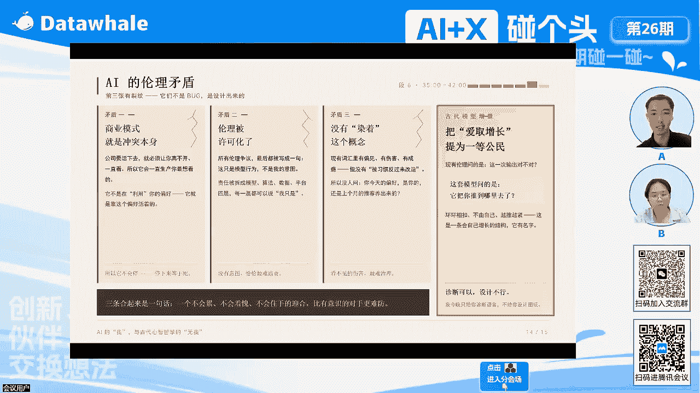

以下是数字临时工的四个特点：

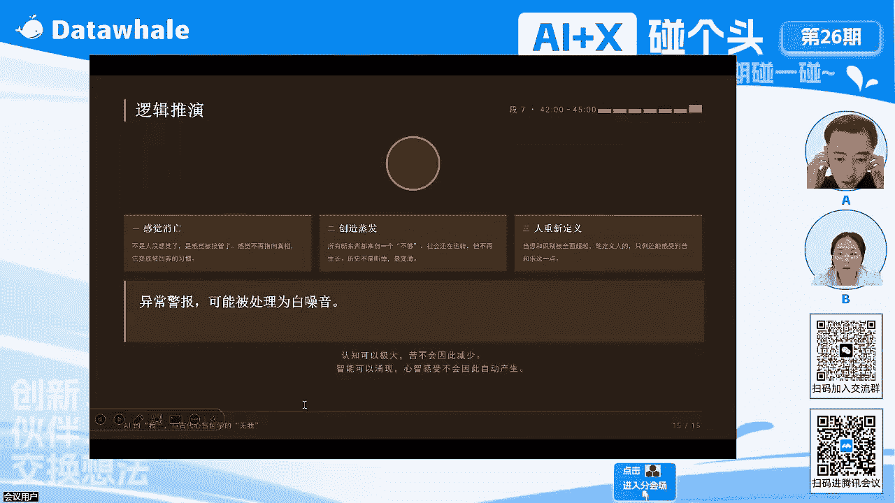

- 能干活。可以写PPT、做会议交付分析、提取关键角色、爬取竞争对手分析等。
- 成本低。以写代码为例，单人生产效率可能提升10倍甚至更多，AI完成同等任务的成本是传统人力的30分之1甚至40分之1。
- 响应快。传统企业协作需要排期，可能两三周才拿到结果，而AI可以当场给出方案。
- 持续在线。人有物理极限，一天只能在线十几小时，AI可以7乘24小时在线，甚至在人睡觉时处理任务，第二天早上验收结果。

核心公式如下：

$$AI\_人力杠杆 = 30 \sim 40$$

传统企业数字化建设存在三类问题。第一，传统系统本身依赖人工填表填报，数据收集压力大，成为额外工作负担，大家都有抵触情绪。第二，数据质量跟时效性不高，比如现场签单及时但录入ERP可能集中在一周后，导致数据不准、丢失、虚报。第三，管理动作很难执行，填的人是人，管理的人也是人，关键客户会被关心，普通客户只是一键审批，导致系统数据不及时、不准确。

以下是数字化建设痛点总结：

- 数据不可靠：依赖人工填表，数据收集压力大
- 数据孤岛：不同厂商、不同时期建设的系统，标准不一，难以汇聚
- 分析依赖专家：分析逻辑严重依赖业务专家的结构化思维，业务调整后指标难以迭代

华为将企业分成了四条业务线，可以引用来分析AI的切入点：

- MTL：从市场到线索
- LTC：从商机线索到签约交付回款
- IPD：从需求到研发再到产品
- ITR：从用户问题到解决再到用户确认

AI可以在这些业务线中发挥作用。比如从市场到线索阶段，可以根据客户信息和产品库，为销售生成产品推荐方案和话术，这对AI来说相对容易，只需构建知识库做IG。

小峰的核心观点是：科层制的管理不会变化，但管理官僚会变少。企业内部会出现分化，从执行者中分化出建造者和判断AI执行任务结果的人。管理者和决策者的职责仍然存在。

实施流程包括：现状分析、确认目标、制定蓝图、制定计划、建造部署、验收，最后评价阶段效果，决定是否进行第二轮或第三轮建设。

本节内容就介绍到这里，下一节我们将继续看看志远带来的未央黑客松教程分享。

# 【Datawhale AI+X】AIX碰个头：04：未央黑客松教程分享 🎓

上一节我们介绍了企业数字化转型与智力服务。本节中我们来看看志远带来的未央黑客松教程分享。未央黑客松是一场面向高中生到大学生的黑客松活动，志远担任了前两堂课的讲师。

黑客松的第一节课，通过GetMe雷达让大家把名字提交到仓库里，有73个人完成了这一步。这看起来是一个小任务，但对很多没用过代码仓库的新生来说，心里会觉得有点毛毛的。通过这个简单的动作，大家能实时看到自己上墙，获得成就感，从而促进行下一步。

第二节课，大家写出自己的故事，提交了400多份稿件，38人提稿。故事主题包括AI类、生活类，以及以未央为主题的故事。这是面向零基础中学生的活动，他们平时很忙，对AI可能只是停留在了解或刷到毕业证上的程度。通过7天培训，他们学会了提交PR，学会了用Prompt驱动AI完成作文，并通过与AI的互动使作文达到要求，简单练习了提示词工程。

团队协作方面，他们学会了用Git把代码合到一起，而不是把开发全部交给一个同学。第一堂课就介绍自己、提交Git、提交项目、上传头像，大家可以通过Git认识彼此。

在提示词方法上，他们介绍了五种方法：演绎法、归纳法、缩因体示法、兑换体制法、脚手架语言。演绎法是告诉AI好文章的标准是什么；归纳法是给AI三篇范例让它参考；缩因法是给例子让AI找出规律；兑换法是告诉AI哪些方法不行，哪些步骤错了；脚手架是描述整个写作方法论或语言系统。

以下是提示词五种方法的简化表示：

```text
演绎法：告诉AI好文章的标准
归纳法：给AI三篇范例让它参考
缩因法：给例子让AI找出规律
兑换法：告诉AI哪些方法不行，哪些步骤错了
脚手架：描述整个写作方法论或语言系统
```

对于初学者，他们设计了8步或10步连环话，告诉大家怎么学习AI。前几步在第一堂课就完成，大家已经安装好工具，直接开始和AI交流。第一步是先别干活，让AI问清楚需求；第六步回答AI问题，一次一问，把问题打磨清楚；第七步补充足够的上下文，创建固定环境；然后让AI多生成几个版本，从中选出喜欢的，进行2到3轮迭代；最后一步是把前面的过程转化为自己的专属Skill，遇到相同问题就用Skill自动化。

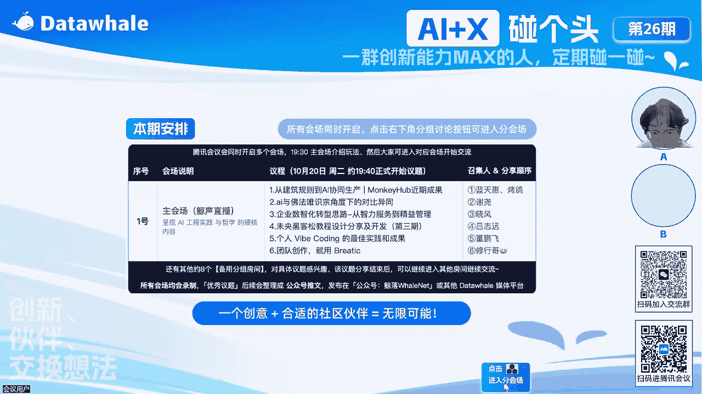

两次课程之后，留下了73个Git提交、38个投稿、400多篇小作文。大家在培训过程中很热衷于反复提交作文，不断磨练能力。比如遇到Bug卡住了，但不服气，要把Bug修好，这种精神很有价值。

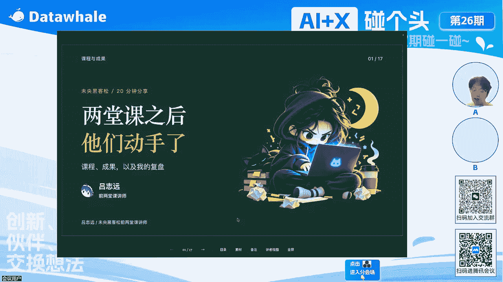

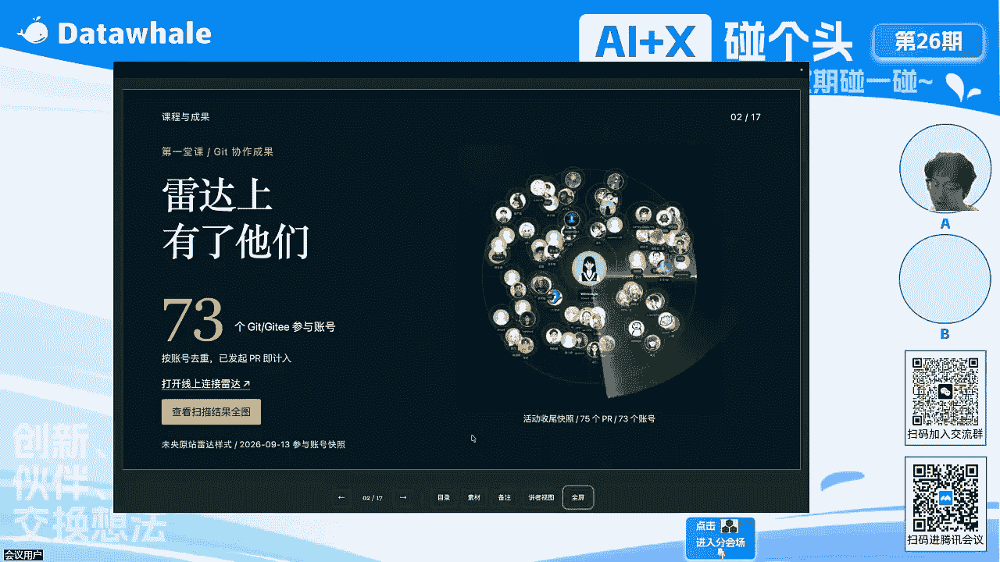

在培训之后，大家把想法做成了产品，比如面前三门钟、物理学不存在、大学锚点等。大学锚点类似于维基百科一样的大学知识平台。

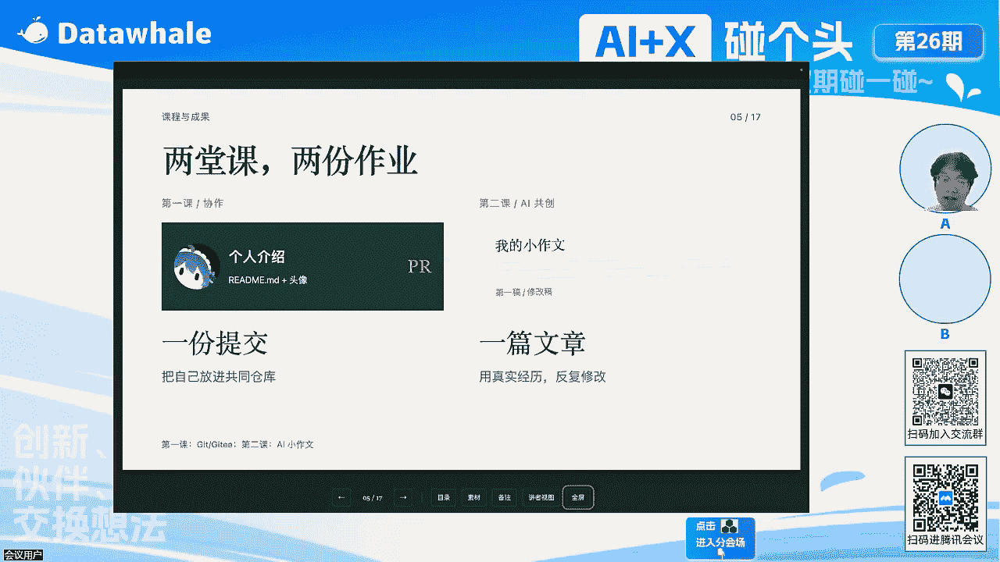

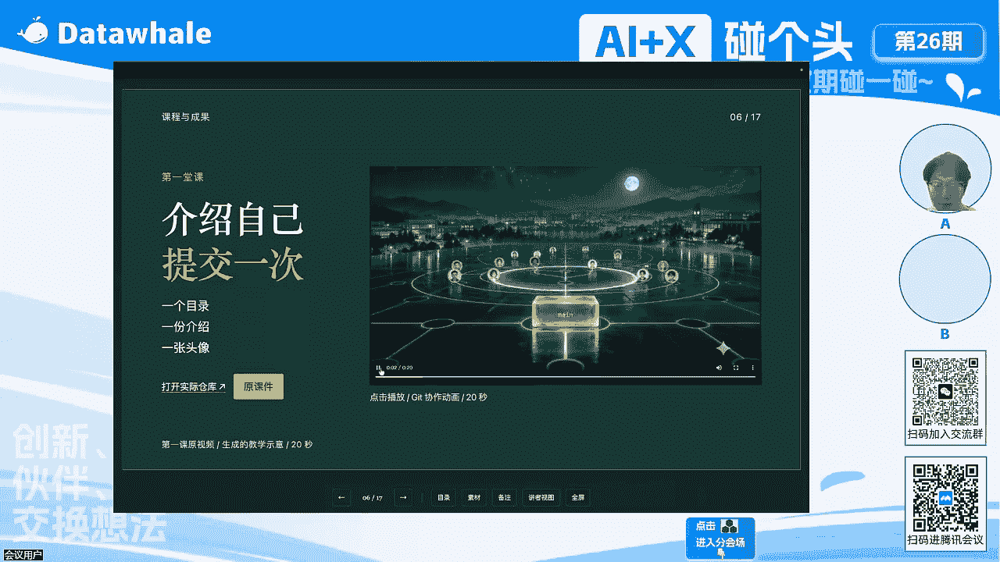

以下是课程设计的核心逻辑：

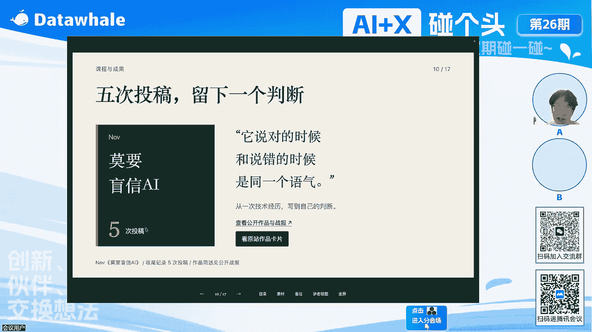

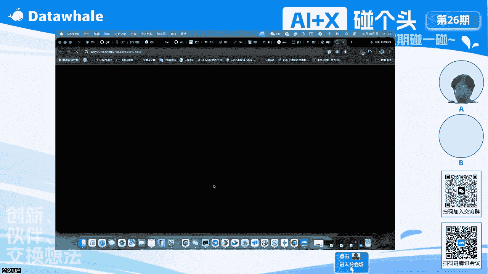

- 任务要足够小，比如第一个任务只是提交一个PR
- 提供及时反馈，比如设计5个评委Agent进行评分并给出长短意见
- 把写作文过程变成游戏过程，促进越玩越讲完

志远还开源了教程设计的源码和案例，大家可以下载用于小组培训或社团培训，搭建环境后就能玩起来。不过评分规则没有开源，大家可以根据环境自己调整合适的规则。

本节内容就介绍到这里，下一节我们将继续看看鹏飞带来的个人Vibe Coding最佳实践和成果。

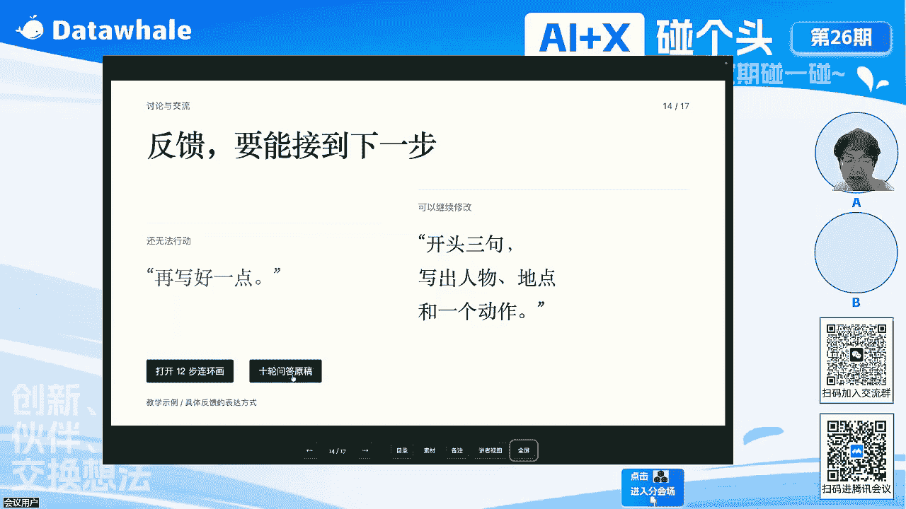

# 【Datawhale AI+X】AIX碰个头：05：个人Vibe Coding最佳实践和成果 💻

上一节我们介绍了未央黑客松教程分享。本节中我们来看看鹏飞带来的个人Vibe Coding最佳实践和成果。鹏飞是济南本地社群icespring AI的发起人，也是AutoGen社区在济南的负责人，本人是一名工程师，在AI发展之后，他在外部Coding或AI Coding领域做了很多事情。

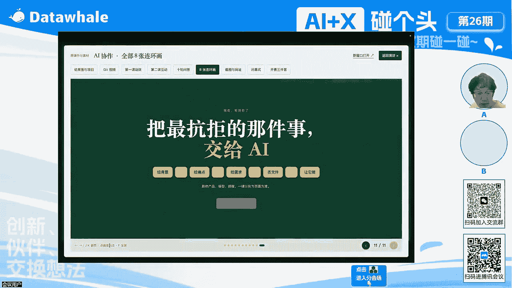

为什么做这个主题？因为在9月底到11月之前，他发现AI Coding工具相比以前有了非常大的飞跃，希望通过一次分享把这个提升的内容和大家分享。

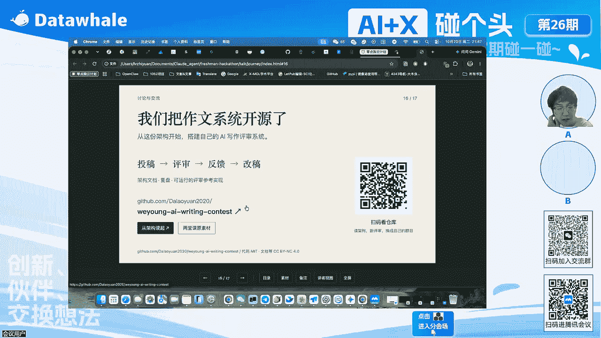

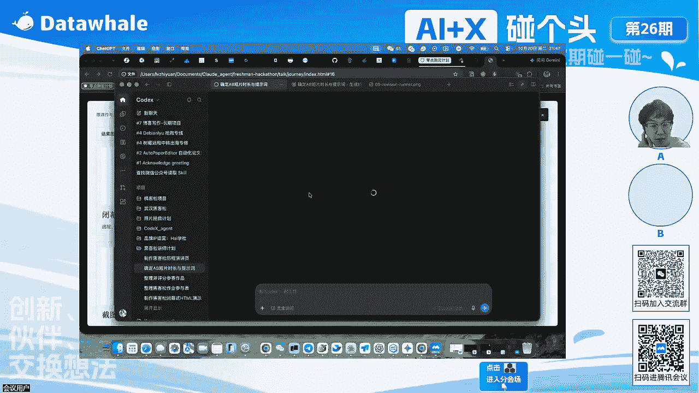

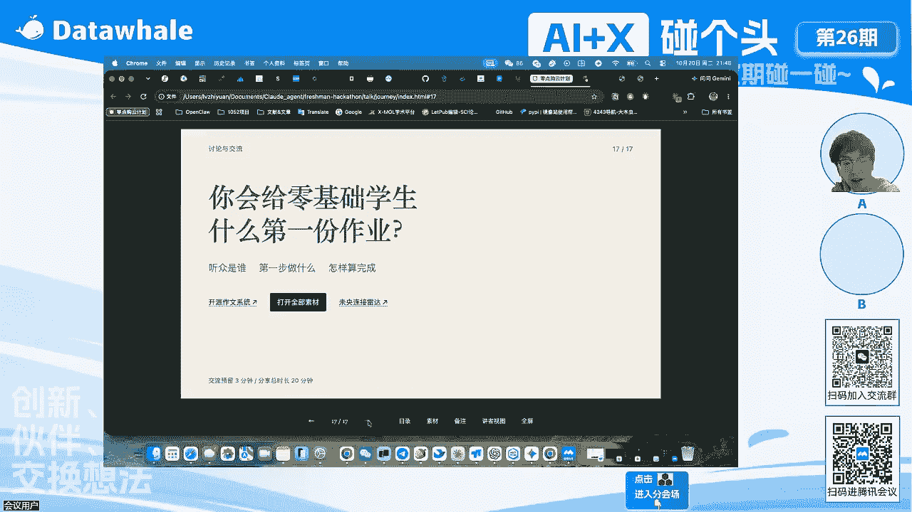

他的第一个项目是一个公益开源的猫咪救助管理系统。左侧两只肥猫是他家里养的猫，一只15斤，一只接近18斤。他在B站上关注了一个猫咪小院，该小院因为房东不再租房，需要搬家，但小院有好几百只猫。当时看到他们通过Excel或手动纸张核对猫咪档案，鹏飞觉得现在AI能力这么强，以前想做但做不了的公益项目，现在可以尝试去做。

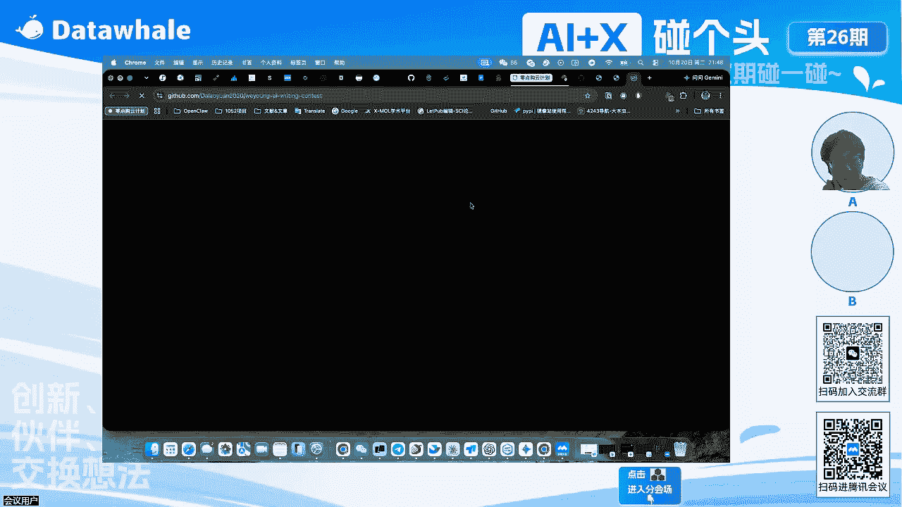

系统包括猫咪管理、救助动态、医疗管理（打疫苗）、领养管理、每天给志愿者发布的喜猫、喂猫任务，以及志愿者管理，大概6个模块，不算特别复杂。但他第一次用AI生成时，结果远超预期。总共花了1小时38分钟，涉及6个页面，消耗了183个积分。

和原来的AI Coding体验不同，以前更多时候是告诉AI做一块，AI返回，人检查，不断循环才完成系统。而现在，通过购物模式，梳理清楚需求后，可以在一次对话中生成整套系统，包括数据库、后端管理系统、模块之间的关联。事后测试发现，除了极个别位置的偏移或风格不一致，整体功能一次性搞定。

以下是AI Coding模式的简化流程：

```text
需求澄清 → UI设计 → 环境准备 → 购物指令 → AI执行 → 人工验收
```

第二个让他惊艳的点是自动化测试。现在的AI Agent几乎都有了自动化测试能力，不是分析API接口，而是模拟人员的UI测试，比如新增猫咪、编辑（弹窗回填修改）、关闭弹窗、搜索查询、查看详情页。这个过程和公司里要求测试人员的流程一样：新增、修改、搜索、查看详情。AI会利用创造的新数据，不去修改系统原有演示数据，非常合理。所有操作AI都能做得很好，不需要人再点一遍。

在使用过程中，他做了比较完备的准备。第一，和AI沟通，和GPT多次对话，整理出符合预期的产品文档。第二，让GPT设计界面，生成风格相符的PC管理界面。第三，准备好相应环境，比如嵌入式数据库，降低AI对外部环境的依赖。第四，如果有外部接口，建立测试专用的API Key。最后，让GPT根据内容生成适合AI Coding购物模式的指令，复制后执行。

验证完AI Coding开发和测试能打通之后，他从10月之后开始尝试测试方面的闭环。从测试用例到测试自动执行，再形成断言和证据，自动提缺陷单，分给前面的研发Agent进行修复，最后进行回归复测。这是他接下来一段时间的重点工作。

他希望AI Coding不能像原来那样，人在中间不停地作为AI的仆人去提供各种东西。人应该像前面结构一样，发一些指令，看一下结果就行。除了提出目标，中间确定方案后需要人做方案评审，最后做验收。希望以后整个AI Coding可以自动转起来，让每个人写代码、实现创意都非常简单。

最后，他提出一个大胆的猜想：也许以后AI Coding会成为AGI的一种实现方式。不管是做视频、做图，还是各种方式，希望AI能做的事情越来越多。

本节内容就介绍到这里，下一节我们将继续看看修行哥带来的多人协作创作工具BRI。

# 【Datawhale AI+X】AIX碰个头：06：多人协作创作工具BRI 🤝

上一节我们介绍了个人Vibe Coding最佳实践和成果。本节中我们来看看修行哥带来的多人协作创作工具BRI。修行哥创业有十几段经历，目前做的事情是从23年开始做的内容创作工具，Be Native的工具。之前做过游戏和游戏引擎，对工具理解比较深。

他不认为端到端在内容创作层面成立，核心是人怎么更好的介入，有点像One Creating的概念。这个产品做了五个版本，前面推翻了四个版本，目前这一版感觉方向是对的。

BRI是一个多人协作的创作工具，竞品包括Lumi和CapCut，但它们做的都是个人模式。实际上，BRI的重点是多人协作。他们并不认为AI是创作类工具中的核心能力，而是反过来，怎么样提升人和人的交互效率才是核心。这就像原来Figma解决的问题，是人和人不沟通的效率问题。BRI解决的也是创作过程中的效率问题。

以下是BRI产品的三个核心观点：

- 创作类产品的核心不在于AI能力，而在于怎么样让团队更高效的协作创作。
- 创作类产品的核心不是端到端，而是Work Creating模式，人体需求，AI给建议，人做TE，不断调整，最后产出更好的结果。
- 在AI提效之后，不会有很多细分场景，未来会有一个大一统的内容创作工具。

产品支持多人实时写作，类似于飞书文档的功能，这里面叫Do Space。多人的文案编辑非常重要，因为文案的作用是在统一整理思路，不管是广告创意、电视剧动漫还是其他内容创作，一定要有一个脚本。


Agent的设计是感知但不直接操作。Agent可以感知整个画布和文档的内容，但对于画布或文档的操作，必须经过人的确定。Agent给建议，由用户自己决定是否启用。这样人在确认的过程中，就可以检查是不是想要的东西。

以下是Agent与人协作的简化逻辑：

```text
Agent输出 = 建议 + 工作流
人确认 = 接受或拒绝Agent输出
```

他们演示了一个历史上的今天项目，一个账号生成议题，另一个账号理解文档内容并补充不完善的地方。绘画没有做多人共享，因为画布被认为是私密的，画布和文档是多人共享。

在代码生成方面，他提到自己做了一个GetUp的Hook，大家感兴趣可以用。流程是：先让AI写文案，然后AI派Agent独立去对抗整个文案，把所有方向和关键环节有问题的找出来。对抗结束后，再去做测试先行，AI一定是先写测试，测试先红，然后写实现，写完实现之后再做实现的对抗。对抗要一直进行，保证承诺内的问题归零。涉及界面时，还要做视觉对抗，严格按照标准的Token去对抗，解决每一版风格不一致的问题。

视觉对抗完毕之后，还有一轮文案对抗，因为改动过程中可能以前的一些文案不一致了，最后一步文案对齐很重要。否则就会有文案不一致的问题。经过这四步之后，再去拉取Git最新代码，做冲突解决，然后提交PR，审查代码，没问题才合并。

基本上他每天要做的事情就是告诉团队需求，告诉他们解决问题的思路，剩下来就是去解决AI会钻死胡同的问题。

BRI是开源的，开源的原因是产品应该做成什么样的难度，而不是算法层面的难度。商业逻辑上，他们通过存储和支持并行，积分基本上平均平出，其实是通过上游供应商的差价来维持。

开源地址已经提供，大家可以点点Fork，点点Star。如果感兴趣，可以加入微信群继续交流。

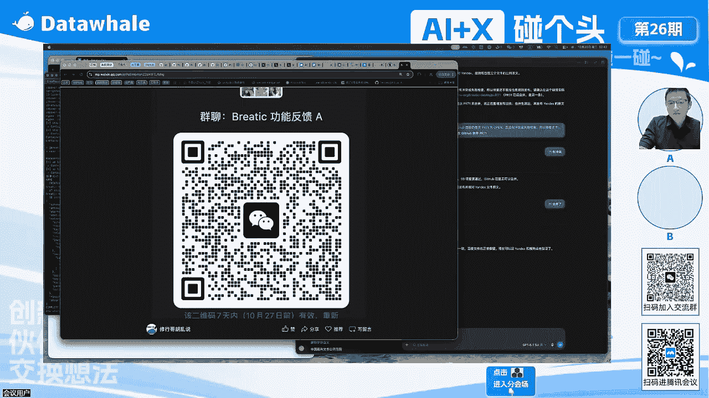

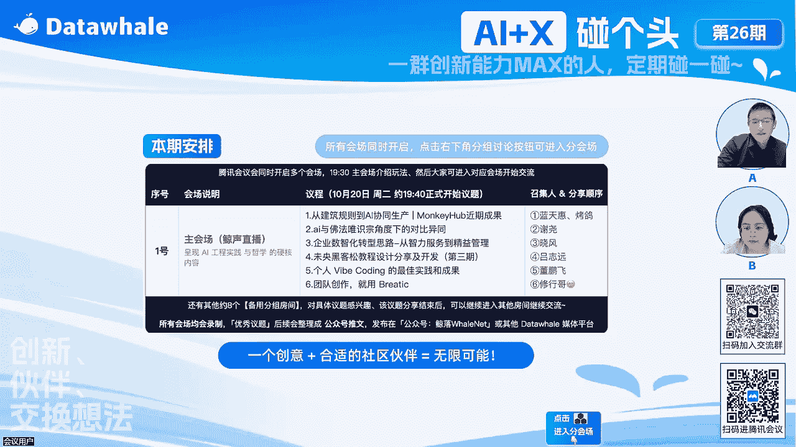

本节内容就介绍到这里，下一节我们将进行本次教程的总结。

# 【Datawhale AI+X】AIX碰个头：结语：本次教程总结 📚

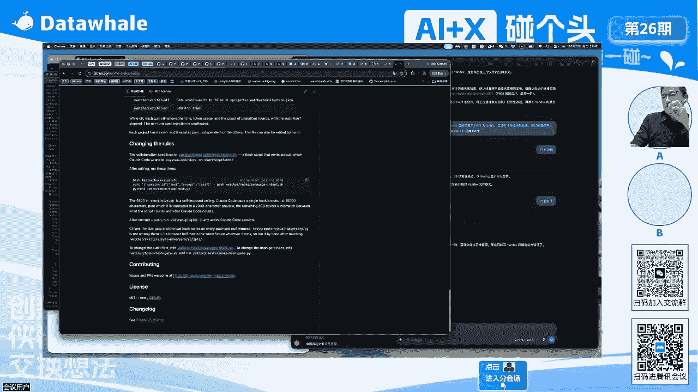

在本节课中我们一起学习了AI在多个领域的应用实践。首先，我们看到了AI如何与建筑设计协同，通过分层协作网络和OCBA算法提高人与AI的协作效率。接着，我们探讨了AI与古代心智哲学的对比，了解了AI的自我来源与古代无我理论的异同。随后，我们学习了企业数字化转型中的智力服务概念，将AI比喻为数字临时工，并分析了其四个特点以及数字化建设的痛点。然后，我们了解了面向零基础学生的未央黑客松教程，学习了提示词工程和团队协作方法。接着，我们看到了个人Vibe Coding的最佳实践，包括一次性生成完整系统和自动化测试的惊艳体验。最后，我们认识了多人协作创作工具BRI，强调了人与人协作效率的核心地位以及Agent感知不操作的设计理念。

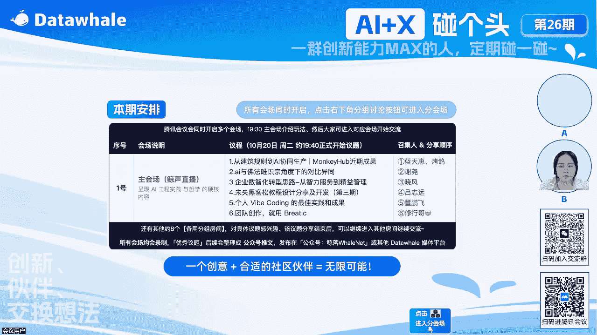

希望通过本次教程，大家能够对AI在不同行业的应用有更直观的认识，并在自己的实践中尝试这些方法和工具。

