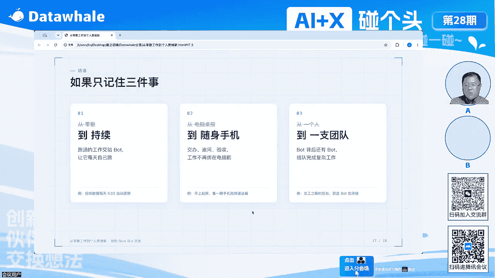
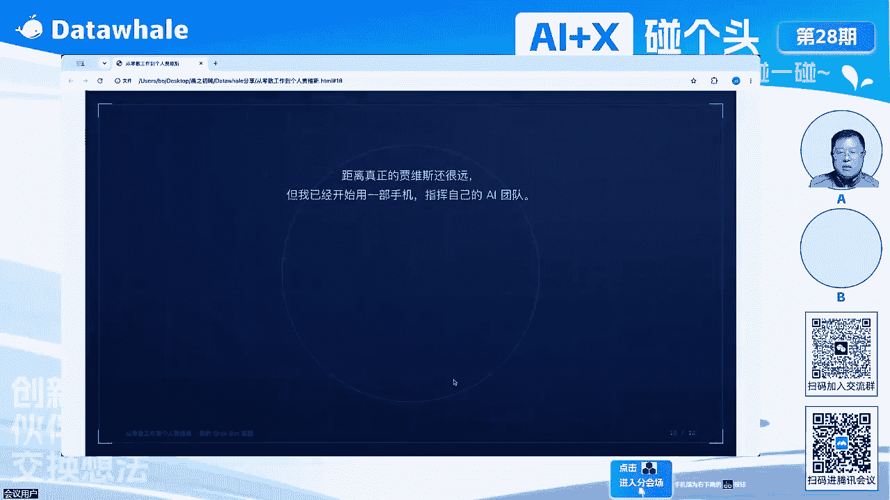
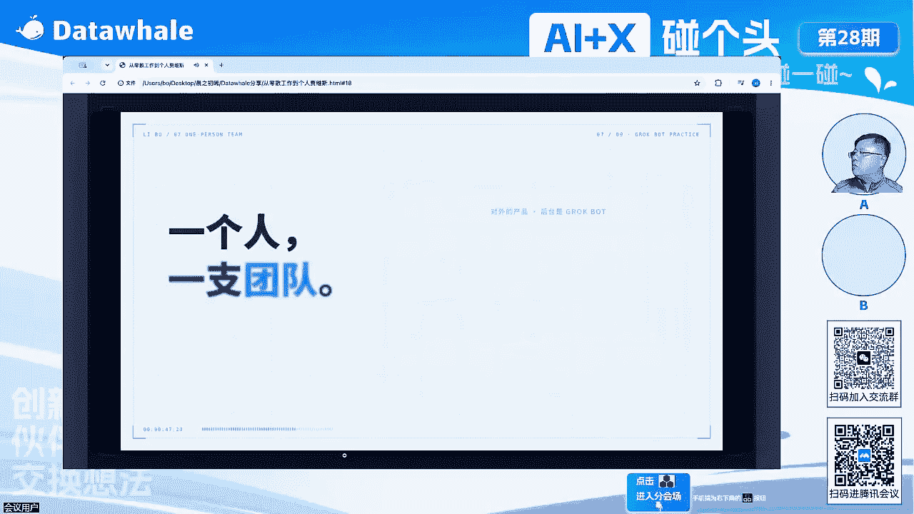
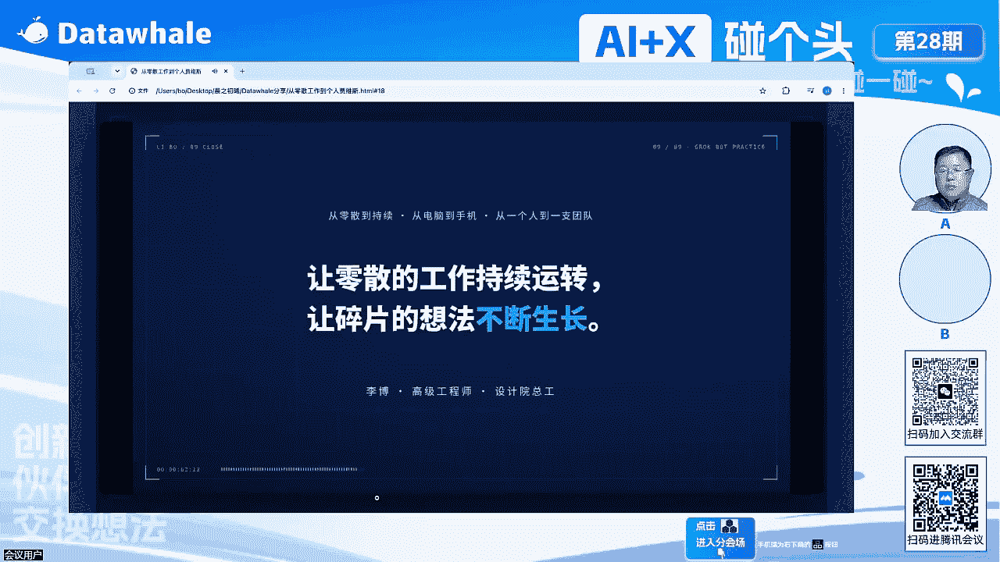
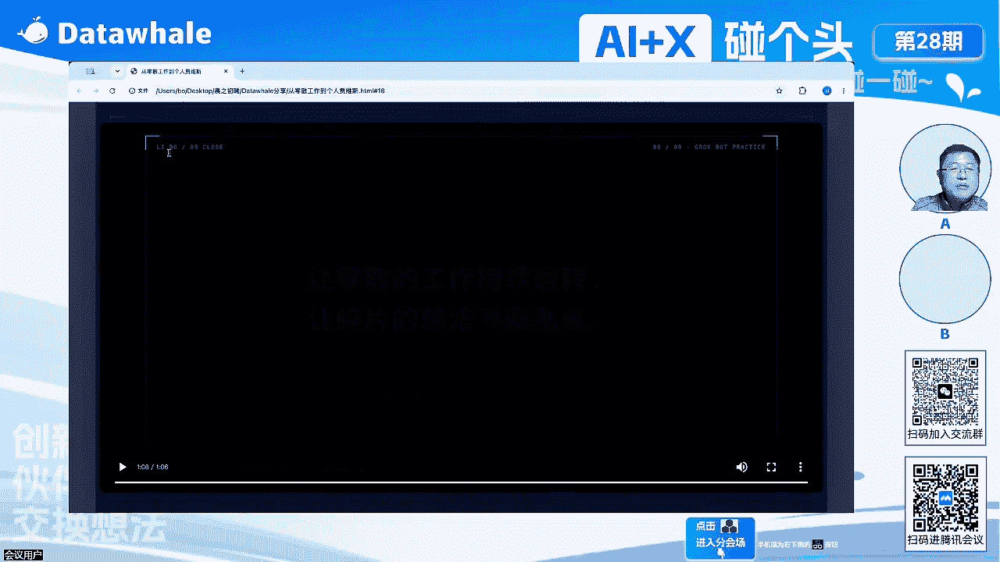
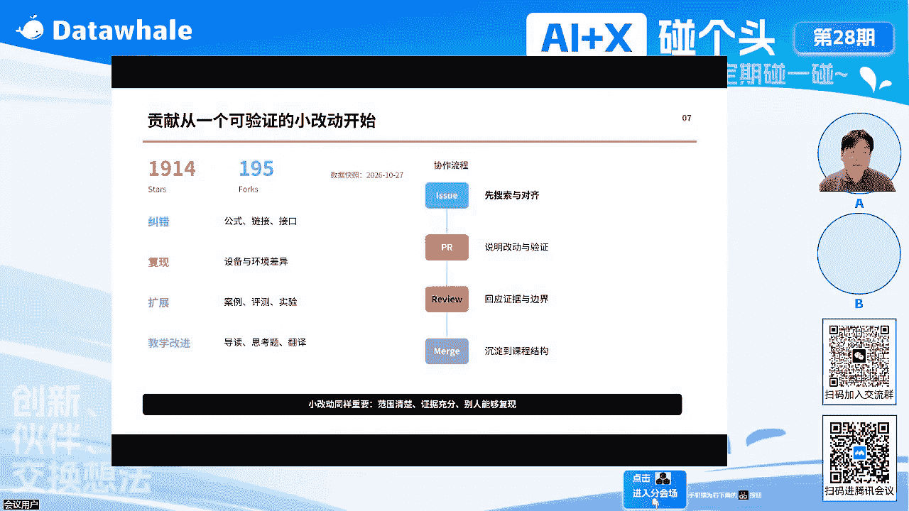
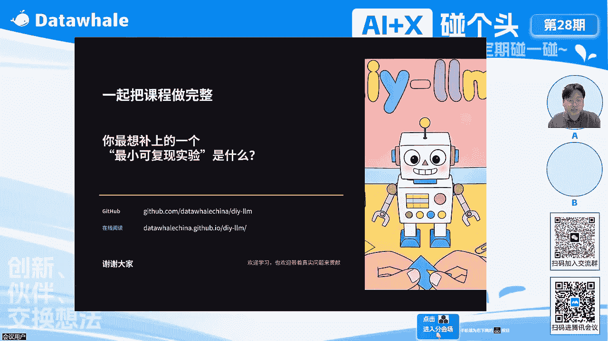
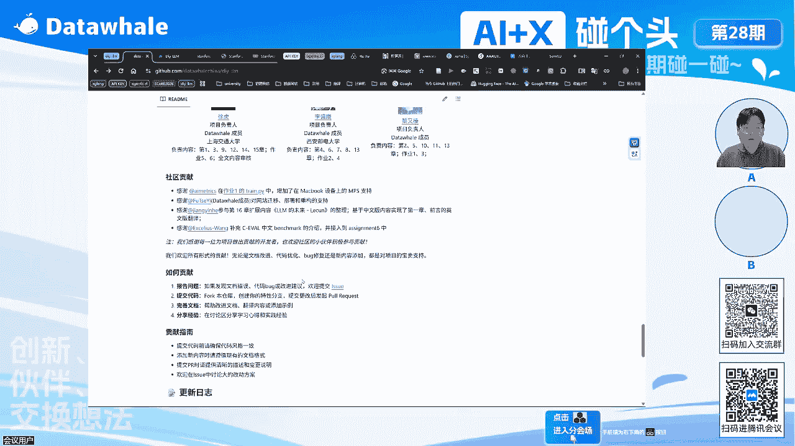
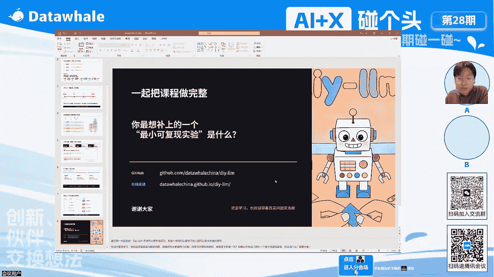
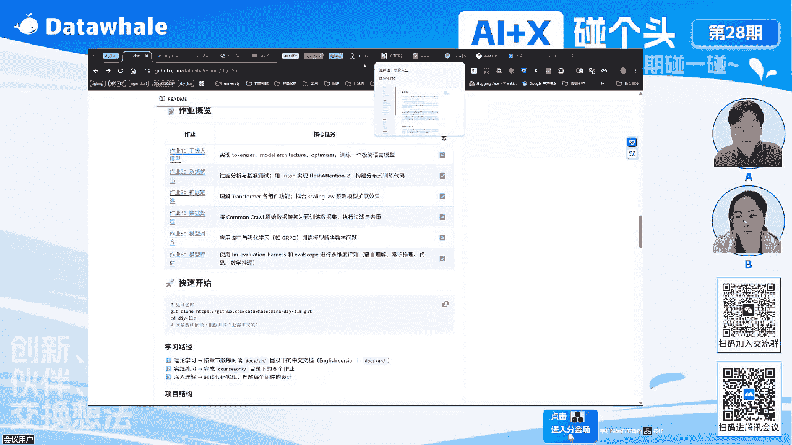

AI+X碰头会教程：第1节：直播活动概述与嘉宾介绍📢

本节课中我们将要学习数据魔人AI+X碰头会的整体活动情况，以及本期活动的全部嘉宾和分享主题。通过本节内容，你可以快速了解本次碰头会涵盖的八个议题，并知道哪些内容适合你当前的学习需求。

在本次第28期AI+X碰头活动中，主办方安排了固定的每周二和周五晚上的腾讯会议，让大家能够在线上围绕感兴趣的AI议题展开交流。如果你想持续参与，可以扫描右下角的二维码加入交流群，或者直接加入当前的腾讯会议房间。

本次活动共安排了八个分享话题，并分成两个分会场进行。主会场将邀请赵波、李博、小熊和徐虎四位嘉宾，分别围绕企业智能体、个人AI助手、开源教程和大模型训练展开分享。分会场则会有Jason、查理、娜姐和志远等嘉宾，主要聊聊黑客松相关经验。

以下是本次活动的全部嘉宾及其分享方向：
- 赵波：企业级Agent实践，新书分享，智能体网关架构
- 李博：基于Globo的个人AI助手搭建，多智能体协作
- 小熊：Mini WorkBody开源项目，AgentCo教程编写
- 徐虎：DIYLLM开源大模型训练教程，基于斯坦福CS336课程

除了主会场分享，活动还特别安排了分组讨论环节。你可以点击腾讯会议右下角的分组讨论按钮，进入对应的分会场与嘉宾深入交流。电脑端显示为三个六边形图标，手机端显示为三个正方形图标。

本节内容就介绍到这里，我们已经初步认识了本次碰头会的基本安排和所有嘉宾。下一节我们将重点进入赵波的分享，看看企业级智能体与个人智能体有什么核心区别。

AI+X碰头会教程：第2节：企业级Agent与智能体网关🤖

上一节我们介绍了碰头会的整体概况和嘉宾阵容，本节中我们来看看赵波关于企业级Agent的核心分享内容。赵波最近出版了一本新书，书中系统梳理了他在企业服务中的智能体实践经验。

个人智能体和企业级智能体在使用方式上有本质区别。个人使用时，通常是通过对话框进行问答，偶尔使用一次即可。但企业场景下，智能体需要作为后端API被调用，可能一天要运行一千次、一万次甚至几十万次。这种高频、稳定的调用模式决定了企业级Agent不能仅仅停留在对话层面。

代码示例可以帮助理解这种差异：

# 个人智能体调用方式（交互式）
response = agent.chat("帮我分析一下今天的财务数据")

# 企业级智能体调用方式（API后端）
result = call_agent_api(agent_id="finance_analyst", input=data, callback=webhook)

在企业级场景中，赵波团队构建了一个智能体网关（Agent Gateway）。这个网关就像一个中转站，前端应用不需要知道后端具体使用哪个模型，只需要调用统一的网关接口。网关会根据任务类型自动路由到合适的智能体或模型。

以下是智能体网关的核心逻辑：

class AgentGateway:
    def route(self, task_type, input_data):
        if task_type == "financial_analysis":
            return deep_seek_agent.process(input_data)
        elif task_type == "customer_segmentation":
            return kimi_agent.process(input_data)
        else:
            return default_agent.process(input_data)

除了模型路由，企业级Agent还需要考虑可观测性、人工介入环路以及7乘24小时的自动运行能力。赵波演示了一个带按钮的手动触发界面，也演示了完全无人值守的后台自动任务。这两种形式分别对应不同的业务场景：有按钮的形式适合运营人员主动触发，无按钮的形式适合定时自动跑批任务。

智能体与应用层的解耦是企业级架构的关键。通过Agent Gateway，应用层页面可以保持不变，而后端的智能体API可以灵活替换。这意味着你可以把同一套前端页面复制到教育、电商、制造等不同行业，只需要更换后端的Agent配置。

以下是企业级Agent的四层架构概括：

1. 应用层：使用智能体，底层可以是Dify、百炼或自研平台
2. 开发层：AI Coding + SDD（指令驱动开发）
3. 交付层：FDE（功能交付工程师）负责落地
4. 管理层：AI项目管理流程

赵波还提到，现在的技术更新非常快，学不过来反而不焦虑，但彻底不学又不行。技术学得慢其实没关系，等一段时间可能就被新技术跳过了。不过作为企业开发者，仍然需要持续学习核心能力。

最后，赵波展示了如何将智能体封装为VS Code插件，方便在开发环境中直接进行多智能体编排。这种做法可以让客户先看到具体成果，再讲背后的故事，效果更直观。

本节我们学习了企业级Agent与个人智能体的核心区别，掌握了智能体网关的基本概念和四层架构。下一节我们将进入李博的分享，看看他是如何用Globo打造个人AI助手团队的。

AI+X碰头会教程：第3节：个人AI助手与多智能体协作👨‍💼

上一节我们介绍了企业级Agent的架构与网关设计，本节中我们来看看李博关于个人AI助手的实践经验。李博是设计院的设计师，工作二十年左右，他通过业余时间构建了自己的个人AI团队，号称“贾维斯”。

李博的核心观点是，零散的工作可以通过多个智能体持续运行，而不需要一直坐在电脑前。他使用Globo平台搭建了大约十几个不同角色的Bot，覆盖学习、设计、企业OA、智慧园区等多个场景。

以下是他搭建的主要智能体场景列表：
- 学习助手：每天抓取Twitter动态，根据兴趣关键词筛选信息
- 设计总监：工程设计审图，生成方案更新
- 招标助手：每天早上5点自动抓取招标数据并进行AI分析
- 企业OA：协助设计院同事进行方案设计和施工图设计
- 智慧园区：接入传感器和设备，实现设备监控与运维

多智能体协作是李博分享的重点。传统的单个助手很难满足复杂需求，而多个Bot可以组成团队，相互交流、相互修正。例如在设计工作室中，植物总工、水电总工、建筑总工可以通过多智能体方式交叉讨论，最终得出正确的设计意见。

代码逻辑上可以简单理解为多个Agent实例的消息队列：

# 多智能体协作示例
bot_team = [PlantExpert(), ElectricalExpert(), ArchitectureExpert()]
for bot in bot_team:
    suggestion = bot.review(design_plan)
    feedback_pool.append(suggestion)
final_opinion = synthesize(feedback_pool)

李博特别强调，Globo的一个优势是不需要挂代理即可使用，且手机端体验良好，支持随时随地与AI团队沟通。这让他从电脑前解脱出来，用手机就能管理后台所有Bot。

他的分享中还提到，他用Cloude编写PPT文案，用Globo进行配音和配乐剪辑，几乎没有人工干预。这体现了AI时代“尽量用AI做，不想自己动手”的理念。

关于费用，李博提到使用较老版本的Globo订阅额度对个人来说足够，但如果是公司使用，可能需要购买更高限额的套餐，比如每月200美元的版本。不过相比招聘四五个人的人力成本，这个费用仍然很低。

本节我们了解了个人如何通过多智能体协作构建AI助手团队，以及Globo在跨平台使用上的优势。下一节我们将进入小熊的分享，看看如何从零开始编写适合初学者的Agent教程。

AI+X碰头会教程：第4节：Mini WorkBody与AgentCo教程🧑‍🏫

上一节我们介绍了个人AI助手与多智能体协作，本节中我们来看看小熊关于Mini WorkBody开源项目和AgentCo教程的分享。小熊的项目旨在帮助初学者理解Agent开发的核心思想，而不仅仅是复制代码。

Mini WorkBody项目最初是受WorkBody产品启发，目标是复刻一个类似的媒体工作流工具。但在开发过程中，团队发现直接讲框架API对初学者意义不大，因为成熟的项目文档已经足够AI解释清楚。因此他们调整了方向，决定通过WorkBody这个对象，让学习者带着理念回去自己改造。

项目设计遵循“克制”原则：内容简洁，不希望课程过长，让学习者痛苦。从Agent开场到React循环调用，再到权限模式和工作区拼装，每一部分都只讲清楚核心思想，不展开冗长的代码细节。

以下是项目涵盖的核心模块列表：
- Agent启动与入口设计
- React循环调用机制
- 权限模式与工作区管理
- 前端界面简单拼装
- 多步骤闯关式学习路径

小熊在选择教程技术栈时，对比了LangChain、LangGraph和AgentCo。他认为LangChain和LangGraph在2026年下半年后，企业内部项目已经逐渐减少使用，因为生态绑定太深，后期扩展性和性价比不高。而AgentCo是阿里设计的框架，与企业真实需求更贴近，适合国内复杂的Agent业务场景。

对于初学者，直接上手改造LangGraph等成熟项目难度较大，因为需要先理解深层的设计理念。AgentCo则更适合从零开始构建认知，让学习者在掌握核心概念后再决定如何扩展。

以下是简单的AgentCo执行伪代码，帮助理解其基本运作：

class SimpleAgent:
    def __init__(self, tools, memory):
        self.tools = tools
        self.memory = memory
    
    def run(self, task):
        while not task.completed:
            action = self.plan(task)
            result = self.tools.execute(action)
            self.memory.store(result)
            task.update(result)
        return task.output

小熊还提到，简历中出现大量LangChain项目已经失去区分度，面试官更希望看到候选人对核心设计理念的理解，而不是仅仅会调用AI写代码。代码可以AI生成，但核心设计必须人自己掌控。

关于本地部署模型，他建议初学者只使用DeepSeek模型，因为便宜且额度大，学完整个课程成本大概只有几块钱，相当于一杯奶茶钱。项目提供了一键运行的源码，无脑运行即可看到结果，感兴趣的学习者可以自行改造。

沙箱机制在企业级Agent中非常重要。因为Agent可能7乘24小时在后台运行，人无法实时介入审批，因此需要制定严格的权限策略，拦截危险操作。教程中虽然没有深入展开，但已涉及相关概念。

本节我们学习了Mini WorkBody项目的设计初衷、技术选型逻辑以及适合初学者的学习路径。下一节我们将进入徐虎的分享，看看如何从零开始训练一个大语言模型。

AI+X碰头会教程：第5节：DIYLLM大模型训练全流程🔧

上一节我们介绍了Mini WorkBody与AgentCo教程，本节中我们来看看徐虎关于DIYLLM开源项目的分享。这个项目基于斯坦福CS336课程，旨在把复杂的大模型训练拆分成初学者也能DIY的步骤。

DIYLLM项目的初衷是回答几个核心问题：大模型到底是怎么训练出来的？部署7B或32B模型需要多大显存？为什么显存会爆掉？训练数据如何清洗和评估？项目把这些问题整理成一门可读、可跑、可DIY的课程。

项目最初参考斯坦福CS336，但这门课对国内学习者有三个挑战：知识跨度大（涉及显存计算、浮点数、分布式通信等）、环境差异（国内网络和算力生态与国外不同）、缺乏代码与知识的配套（只讲结论不讲实现）。因此DIYLLM对课程进行了重构，保留技术深度的同时补齐了前置知识。

以下是课程的十六个章节模块列表：
- 第1-5章：基础工具、实验工具、分词器、显存核算、语言模型架构、混合专家模型
- 第6-8章：系统层，GPU基础知识、FlashAttention、分布式训练
- 第9-12章：规模数据、大模型推理与评估
- 第13-15章：从头训练模型，预训练、SFT、DPO、RLHF、可解释性强化学习
- 第16章：多模态内容，千问系列及多模态大模型系统

以下是六个作业的具体内容：
- 作业一：从分词器和模型优化器开始，手搓一个GPT-2大小的小型语言模型
- 作业二：系统优化，进行Profiling，实现FlashAttention和分布式训练
- 作业三：通过简单实验验证Scaling Law规律
- 作业四：清洗预训练数据，以Con数据集为例
- 作业五：后训练，提高大模型数学推理能力，使用SFT专家迭代和GRPO等方法
- 作业六：模型评测，从识别、推理、数学、代码等多维度进行评估

关于硬件资源，训练一个千万级别到亿级别的小型语言模型（类似GPT-2），单卡A100 80GB显存或两张左右的显卡即可。如果进一步缩小数据和模型层数，甚至可以用一张5090勉强跑起来。这只是为了让学习者体验语言模型如何根据可控数据生成token，不是为了训出商业级大模型。

SFT和GRPO训练基本上80GB显存就够了，模型评估则不需要多少资源，普通电脑运行GPT-2规模模型即可完成评估体验。

项目后续规划分为三个方向：扩展第16章的前沿内容（注意力机制、模型推理、多模态、DPO/PD等）；可复现性工作，提供显卡和平台差异的排错过程；社区协作，增加国产中心案例、不同平台的测评、小数据集和训练实验等。

欢迎社区成员参与贡献，包括修复公式错误、错别字、过时接口，以及提交作业运行环境的差异记录和排错经验。

本节我们了解了DIYLLM项目的课程结构、六个作业内容以及硬件资源要求。下一节我们将总结整个碰头会的内容，并介绍如何继续参与社区交流。

AI+X碰头会教程：第6节：社区参与与课程总结🎓

上一节我们介绍了DIYLLM大模型训练全流程，本节中我们来总结整个AI+X碰头会教程，并说明如何继续参与社区活动。

本次第28期碰头会共涵盖八个议题，分为主会场和分会场。主会场邀请了赵波、李博、小熊和徐虎四位嘉宾，分别从企业智能体、个人AI助手、开源教程和大模型训练四个维度，展示了AI在不同场景下的实际应用。

以下是本次教程的全部核心知识点回顾：
- 企业级Agent需要作为后端API运行，支持高频调用和7x24小时自动任务
- 智能体网关实现模型与应用的解耦，支持自动路由和多模型切换
- 个人可通过多智能体协作构建“贾维斯”团队，使用手机随时管理后台Bot
- Mini WorkBody与AgentCo教程适合初学者，强调核心思想而非代码复制
- DIYLLM项目把大模型训练拆分为十六章和六个作业，降低自建模型的门槛

如果你对赵波的企业Agent话题感兴趣，可以进入备用房间三与他继续交流。如果你对李博的Globo实践有疑问，也可以进入对应的分组房间。对小熊的Mini WorkBody项目感兴趣的同学，可以扫描内测群二维码参与。对DIYLLM项目想要贡献代码或文档的同学，可以访问项目GitHub主页提交PR。

社区持续更新开源项目，最近也有西湖大学和小熊团队的项目发布新版本。你可以关注数据魔人公众号，了解线上线下的碰头交流活动，比如本周日南京的OPC碰头线下活动。

本节课中我们一起学习了AI+X碰头会的全部八个分享议题，掌握了企业智能体网关、个人多智能体助手、AgentCo教程设计以及DIYLLM大模型训练流程等核心内容。希望这些知识能对你的AI学习和实践有所帮助，欢迎继续关注后续的碰头会活动。

