# 🤖 AI+X碰个头：第25期：AI落地实践与学习方法教程

在本节教程中，我们将学习AI+X碰个头第25期活动中的核心分享内容。内容涵盖企业级AI编程落地、多模态模型更新、考研英语学习方法、个人效率工具开发，以及黑客松与人机协同经验。每个部分都会用大白话解释，适合初学者阅读。

# 👥 AI+X碰个头：1：活动概述与分会场介绍

AI+X碰个头是一个定期举办的线上交流活动，每周二和周五通过腾讯会议举行，设有主会场和多个分会场，同时在直播间同步直播。第25期共有四个会场，九个话题进行分享，其中主会场负责五个话题，其余分会场分别对应AI加医疗与科研、他山灵感共创，以及AI加硬件三个专场。

以下是各位分享嘉宾及其话题的简要介绍。

- 王一鸣老师：分享J5模型的更新版本与实测情况，包括模型进展和功能演示。
- 李玉阳：介绍AI加X敏感共创分会场，主要讨论前沿AI进展、大模型、Agent相关技术及科学智能应用。
- smll：分享AR Coding在企业真实业务开发中的落地路径。
- 孙玉泉老师：分享考研英语复习方法与个人学习工具。
- 明月：介绍基于Coldbody开发的办公小工具，解决日常电脑使用中的痛点。
- 一城：分享从黑客松参与者到组织者的心理历程，探讨AI与人的协同关系。
- 舌康医生：从医生和AI使用者角度，分享医学教育方面的实践经验。
- 伟：分享在医疗服务行业中如何快速落地AI应用并沉淀经验。
- 启峰与韩寒：介绍基于ESP32的AI硬件创作与社区建设，演示如何用WiFi信号感知环境变化。

了解活动的基本框架后，我们接下来进入具体的技术分享部分。

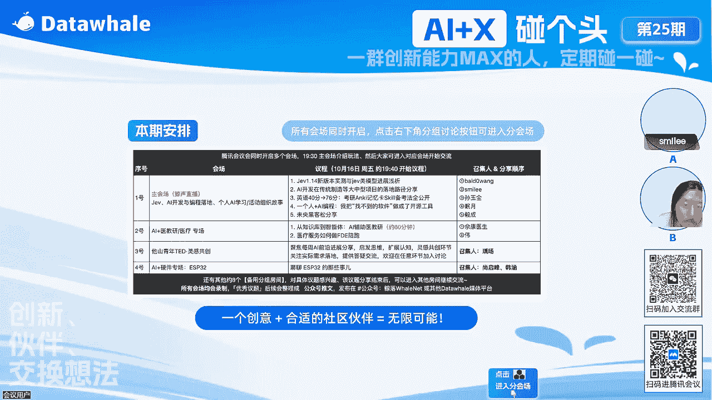

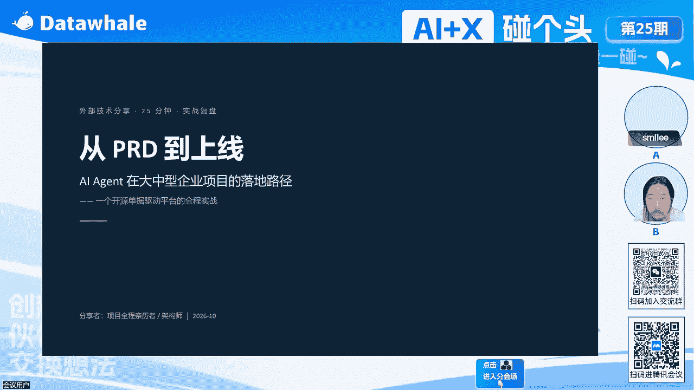

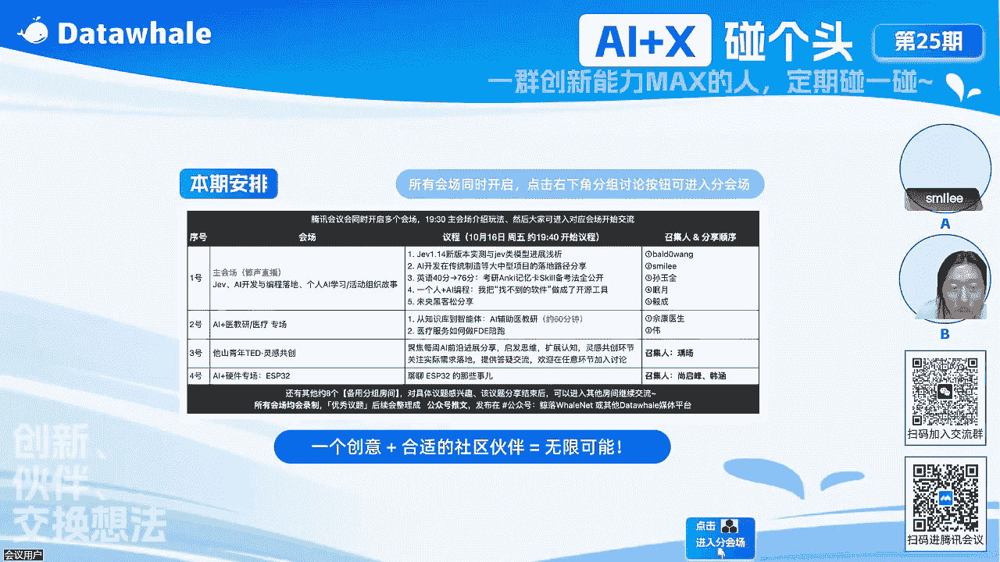

# 🏢 AI+X碰个头：2：企业级AI编程落地实践

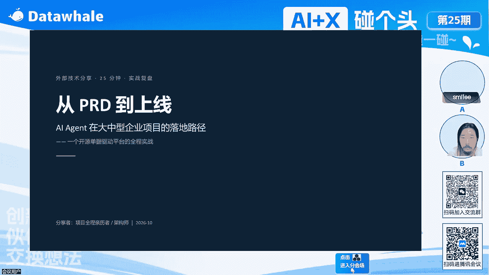

很多公司在使用AI编程工具时，容易做出可以运行的小Demo，但很难把它变成真正能在企业业务中长期使用的应用。这在制造业等领域尤其常见。

以下是企业级AI落地时通常会遇到的问题。

- 缺乏持久化能力：非IT人员可以用AI快速写出小工具或一次性报表，但无法将其做成持久化的企业级应用，因为涉及数据存储、系统调用和企业门户集成等问题。
- 迁移困难：一个简单的报表Demo，如果领导认可并希望嵌入原有报表体系，往往迁移不过去，重新开发的时间可能比直接让普通开发人员做还要长。
- 企业隐含上下文：企业代码包含大量隐含信息，比如公司的开发框架、技术规范、通讯规范、上下游系统接口和已有数据支持。AI如果不了解这些上下文，写出来的代码只能跑通Demo，无法直接用于生产。
- 自由框架与组件不匹配：大中型企业通常有自己的IT框架，比如Spring Boot。AI写代码时不会自动调用公司已有的报表组件或技术方案。
- 规范约束差异：不同公司的架构分层、契约、日志写法、安全规范都不相同。AI生成的代码需要反复沟通才能符合规范，修改成本很高。
- 上下游系统复杂：企业系统需要对接EIP、SAP、营销CRM等上下游系统，不可能把所有系统都放在一个代码仓里，AI也无法自动了解这些复杂依赖。
- 存量组件与开放接口：企业积累了大量前端组件和后端通用组件，如果AI没有被明确告知，它不会知道如何调用这些已有组件。
- 行业附加约束：制造业等行业还有MMS协议等通用约束，需要额外遵守。

要解决以上问题，企业不能只靠AI自由发挥，需要建立规范和基建。

以下是落地AI编程的核心解决方案。

- 规范性驱动：提前划定AI能做什么、不能做什么，哪些工具可以调用，哪些不能调用，开发前必须查看的最新版本等。
- 标准化PRD：把传统的写给人看的产品需求文档，转化为AI能看懂、标准化且无歧义的描述。
- AI可理解的框架工程：在公司级框架基础上，增加更多组件、注释和规范化调用描述，形成轻量化的AI专用工程结构。
- 嵌入Agent与Skill：在规范中嵌入Agent和Skill，并加上Hooks进行约束，要求Agent在执行时必须遵循特定的检查和检索步骤。
- 小步提交与架构先行：先让AI根据PRD做出完整架构设计，再拆成足够小的步骤，由不同Agent逐步执行。
- 质量闭环前置：在规范中明确测试标准、评估方式和报告要求，避免开发后缺乏质量把控。

具体的需求转化流程可以概括为：原始需求经过AI智能体辅助细化，结合现有系统框架和影响范围，转化为开发用的标准化PRD，再提交给AI Coding进行架构设计、编码、验证和验收。这类似于早期推行Scrum之前使用的需求验证闭环，虽然对人类来说过于繁重，但对AI维度的代码开发影响范围评估非常有效。

以制造业新业务线为例，原本系统成本高达千万级，引入AI后成本大幅降低。关键是要让AI在可控的标准化平台上开发子系统，而不能让其随意发挥。通用单据作为底座基建，将所有单据抽象化、实体属性配置化，核心只有少数字段落地，并通过标准化规则引擎和状态机保证子系统不会影响核心数据。

落地效果可以用以下指标衡量。

- 合规率：`合规率 = 需要修改的代码量 / 总代码量`。在建立完整规范和MCP基建后，写完代码需要改动的比例可降至10%到15%，部分系统甚至低于10%。
- Token消耗：`AI编码轮数 ≈ 传统人工轮数 × (30% ~ 40%)`。虽然单次调用的Token不一定减少，但基于规范编码时上下文提升，实际对话轮数减少，总Token消耗可降低30%到40%。
- 人工审核减少：不再需要人工审查代码是否符合公司规范和组件用法，只需关注业务逻辑和架构是否匹配，部分工作甚至可由AI完成。

实际落地中，还需要注意以下几个陷阱。

- 将核心规则写入知识库或Box设置，确保AI每一轮对话都携带关键规则。
- 区分项目级、公司级、部门级知识，分别放入对应规范，避免知识混淆。
- 建立三道验证防线：代码评审、公司架构审核、前端验证。

掌握这些方法后，我们再来看多模态模型的更新内容。

# 🧠 AI+X碰个头：3：ja模型更新与多模态能力

一鸣老师介绍了一类名为jevo的模型，最新版本是1.14.0，于昨天上午刚刚发布。

这个版本主要新增了以下特性。

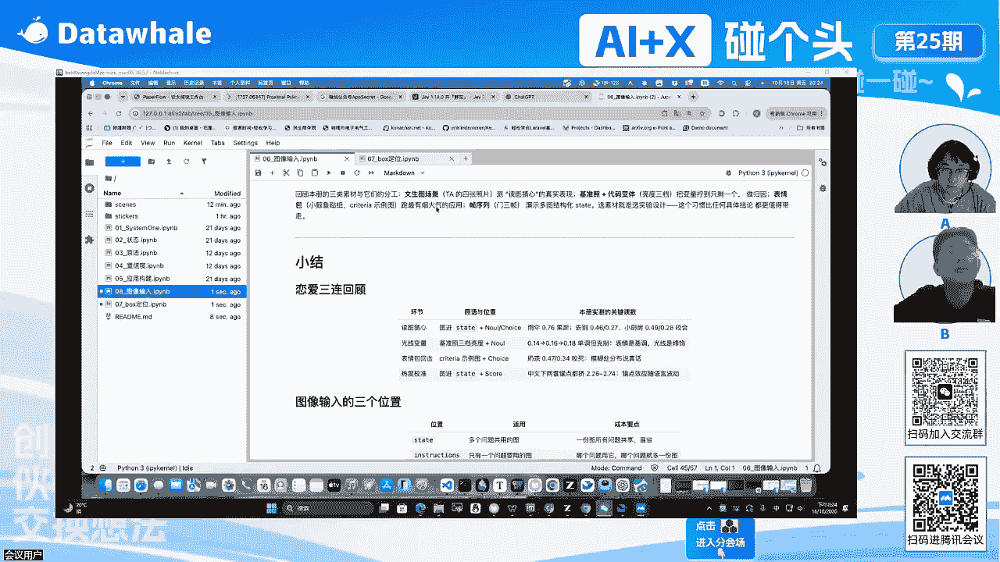

- 多模态Box类型：支持输入图片，可以在状态、指令等不同位置放入视觉内容。
- 超长上下文：`上下文长度：20K+ → 262K`。
- 多语言支持：如果希望使用中文或其他语言，建议使用1.14.0版本。

从测评结果看，这个版本的智力更新能力提升并不强，成本保持一致，但效果稍好，错误率略低。

老师准备了两个Notebook来演示新特性。第一个Notebook演示图像理解。场景设定为聊天时对方发来一张照片，AI需要判断照片表达的情绪。情绪类型包括甜蜜日常记录、展示美好事物、期待被夸奖、暗示想一起做某事、情绪低落需要安慰等。示例图片均为AI生成，以避免版权问题。AI会对每种照片打出情绪得分，比如深夜自拍会被判定为情绪低落。

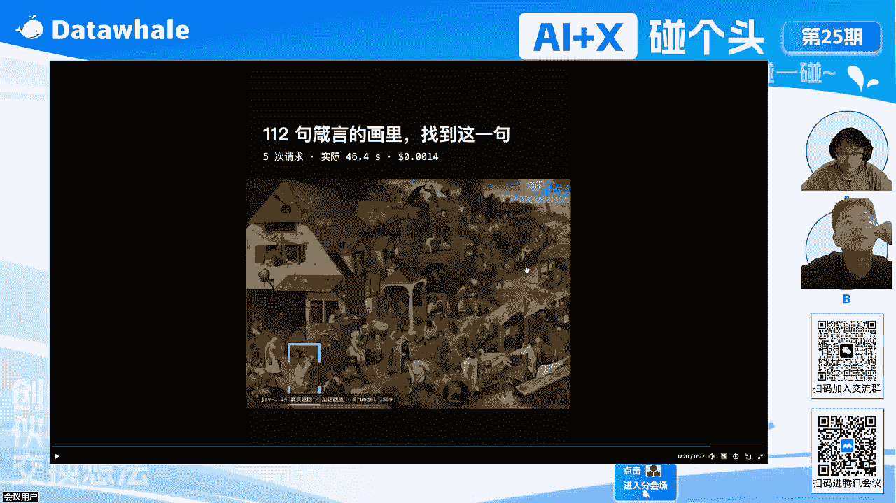

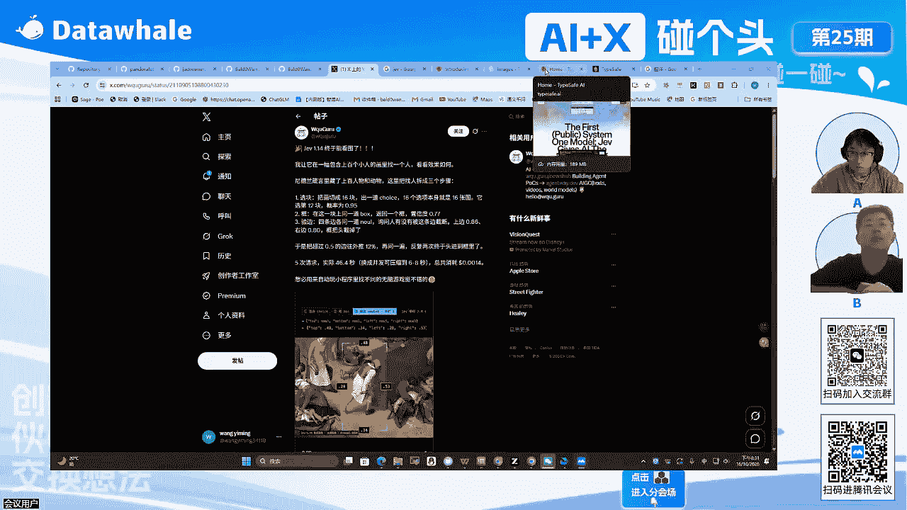

第二个特性是Box绘制。AI会给图像中的目标画一个边框，并输出置信度得分。老师演示了在视频中寻找“用头撞墙的人”的过程。AI并行输入视频片段，先圈出可能目标，置信度为0.77，随后调整Box边框并扩展边缘，每次调整后都会更新置信度。整个过程大约用了5次请求，先将视频切成16张图批量处理，虽然找起来比较慢，但Box定位相当准确。

官网案例则展示了更多创意。比如根据背景状态和表情包，让AI选择合适的表情包回复场景。场景包括“狗着火了但程序还在跑”、“代码一次性跑通”、“用RAS重构项目”、“老板要求午饭前更新小版本”。模型对每个场景给出表情包建议，但选择结果不够稳定，多次运行会有变化，说明这个视觉特性目前处于勉强可用的状态，尚未达到完美。

除了jevo模型，近期还有Z27BVL、微软的Decision One等模型发布。这些模型多是基于开源大语言模型，在其之上微调而成。问题在于它们往往只是刷分，实际体验效果并不好。但这类模型的核心优势在于能做出相对稳定的客观判断，这源于其训练模式。未来可能会朝更加有置信度的训练方式发展，出现更自然的方案。

多模态模型的内容介绍完毕，接下来我们转向学习方法方面的分享。

# ✍️ AI+X碰个头：4：考研英语学习方法与AI工具

孙玉泉老师是一名产品经理，今天分享与工作无关的考研经验，主要讲英语和政治的复习方法论，以及自己总结的学习技巧。

考研英语的题型包括完形填空、阅读理解A、阅读理解B（新题型）、翻译、写作A和写作B。可以把这些题型分成两大部分：翻译之前的部分用一种方法，写作用另一种方法。

对于基础较差的同学，写作部分建议直接背诵模板，或者购买机构提供的模板，这样能以较低的成本拿到不错的分数。试图通过创意写作获得高分，对基础不好的同学来说，付出和回报往往不成正比。

前四个部分的本质是英语词汇量。分数低通常是因为词汇量不足。英语学习不能靠突击或技巧快速提高，多做一篇阅读和少做一篇阅读，短期内难以看到实质性提高。

因此，老师推荐一种可定量评估的学习方法：刷真题。把近十年真题认真刷三遍以上，并结合模板方法，英语基本可以考到60分。如果能认真刷五遍，基本可以稳稳拿到70分以上。

为了让进度可视化，可以用手机便签记录每一年真题刷了几遍。第二遍刷的时候，基本可以做到全对。

在AI时代，学习工具可以概括为“一加四”。一套英语电子版资料，加上四个必备学习软件。

以下是四个必备工具及其用途。

- AI词典：如豆包、元宝等，可以直接当作词典使用。
- Anki卡片软件：安卓版图标为绿色，苹果版图标为蓝色，支持多种卡片文件格式。
- 智能体框架：如Workflow或Open Cloud，需要支持SKI方式，能够生成卡片。
- 手机自带便签：用于记录学习进度。

具体的卡片生成流程如下。

1. 找一篇较简单的英语阅读，第一遍阅读时不做题，只把不认识的单词用星号或其他符号标记出来。
2. 将标记的单词发送给AI软件，要求生成单词表，内容包括单词、音标、汉译、例句和变形。
3. 使用智能体框架的SKI技能，根据单词表生成Anki卡片，导出为APKG文件。
4. 将APKG文件导入手机Anki应用，即可开始记忆。

这个流程可以用代码形式表示：`标记生词 → AI生成单词表 → SKI生成APKG → 导入Anki → 间隔复习`。

Anki会基于遗忘曲线安排下次复习时间，短期模式下可能是一分钟后、五分钟后或四天后，长期模式则会间隔更久。通过这种方式，可以把三遍真题中遇到的6000到8000个单词完整背熟，英语考到60分以上就没有问题。

政治学习方面，十月到十一月肖秀荣会出实证小册子。建议将其视为短期记忆任务，快速刷两遍，考前一周再刷一遍，即可搞定。专业课和其他理论课也可以用问答格式制作卡片，导入Anki进行记忆。

老师还分享了自己弟弟的例子。弟弟使用AI工具学习后，每天需要背200个单词，感觉困难。老师通过定时任务提醒他学习，并利用AI生成学习日志和数据报告，量化他的进步。报告显示，半个月学了800多个单词，生词曲线逐渐趋缓，说明单词量在增加，遇到的生词在减少。

总结本节方法的核心指标如下。

- 真题刷三遍。
- 把三遍真题中遇到的不会的单词，制成记忆卡片。
- 在Anki中积累6000到8000个单词，考前全部背完。
- 作文背一个模板。

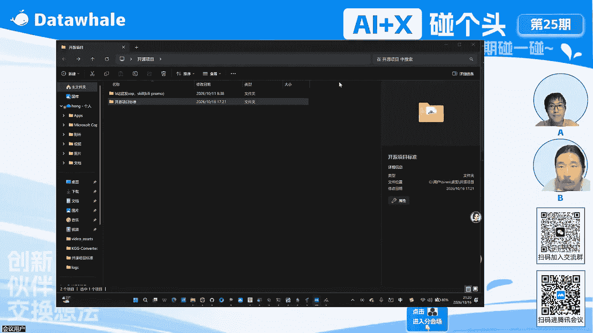

分数预估可以简单理解为：`英语分数 ≈ 真题遍数 × 单词掌握率`。按照这个方法，考到60分以上是完全没有问题的。

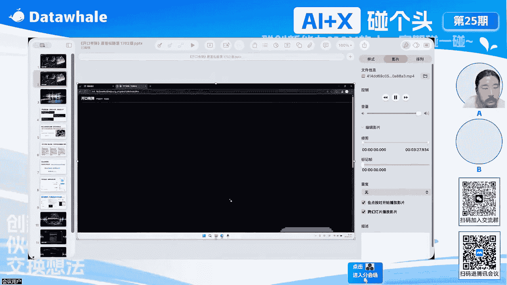

学习方法讲解完毕，接下来我们进入个人效率工具的开源分享。

# 🛠️ AI+X碰个头：5：个人效率开源工具

明月老师介绍了自己开发的几个开源小工具，用于解决日常办公和电脑使用中的实际痛点。

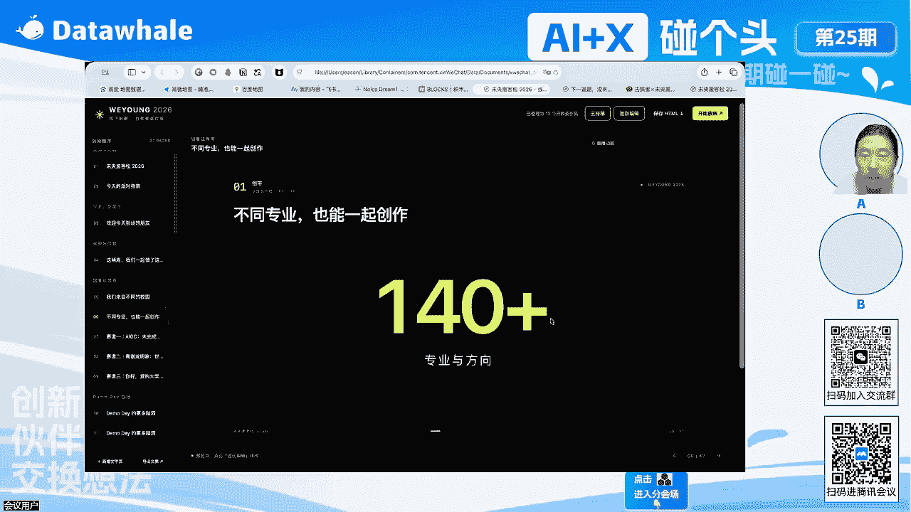

第一个工具是桌面快捷方式创建器。许多AI开源小工具上架到GitHub后，没有做好桌面快捷方式，而且桌面文件太乱时很难快速找到想要的程序。这个工具可以为应用创建桌面快捷方式，支持按应用筛选，也能查看最近打开的历史记录，比Windows原生搜索更方便，尤其是对一些开源工具。

第二个工具是内存守护程序。电脑经常处于内存紧张状态，导致鼠标无法移动、系统崩溃，卡死二十多分钟才能恢复。这个工具可以在可用内存低于12%时，自动杀死非白名单进程。用户可以将浏览器、编程工具等加入白名单，避免误杀。如果进程尚未运行就被杀死，可以通过EXE界面手动加入白名单。工具还支持查询指定进程的内存占用，并能强行杀死通常状态下无法删除的软件。

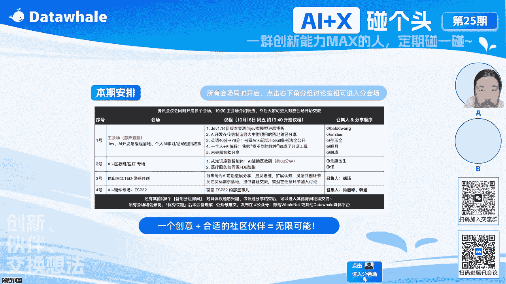

第三个工具是本机流量实时监控。老师曾因代理流量超额而不知情，后来发现是程序向不存在的域名不断重试上传图片导致。这个工具可以设置流量告警规则，例如60分钟内总流量超过1GB时自动弹出告警。界面清晰，记录每一条进出流量，可追溯。此外还有AI生成的流量日记功能，不过比较慢。

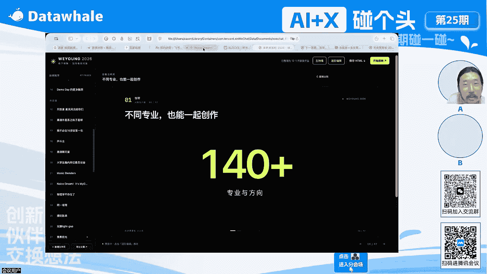

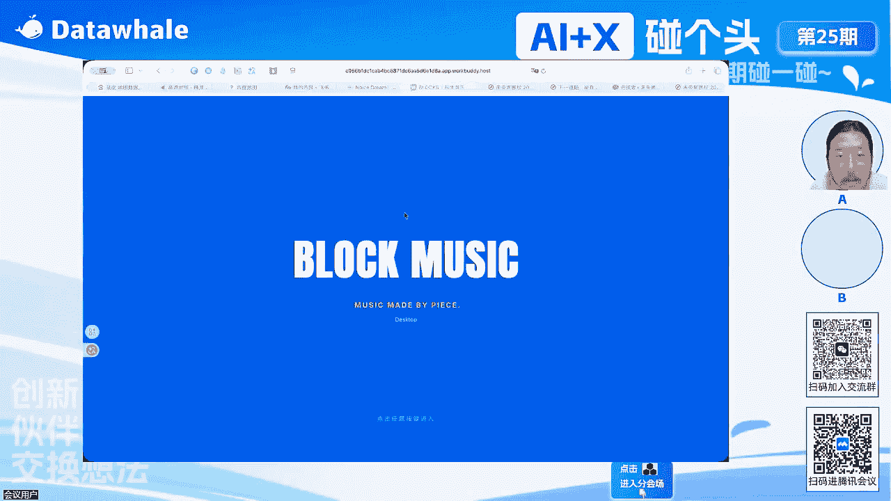

在开发这些小程序的过程中，老师总结了一些迭代和维护规则。

以下是开发过程中遵循的规则示例。

- 决策文档：每个功能交付后立即补全到决策文档，文档带有日期标记，记录何时开发了什么功能、增加了什么接口，重大决策全部落入文档。
- 复杂度评估：方便后续维护和查看功能更新。
- 教训文档：开发前加载曾经踩过的坑的经验文档，结束时将新经验总结回文档，避免重复犯同样的错误。
- 提示词收集：将常用的AI开发提示词收集到收藏夹，下次开发时直接参考，提高速度。
- 项目标准：README中包含AB模板，要求相关人员讲清项目运作方式，并必须附上真实截图。
- 校验脚本：推送到主仓库前必须触发两个脚本，校验是否落实了模板和规范。

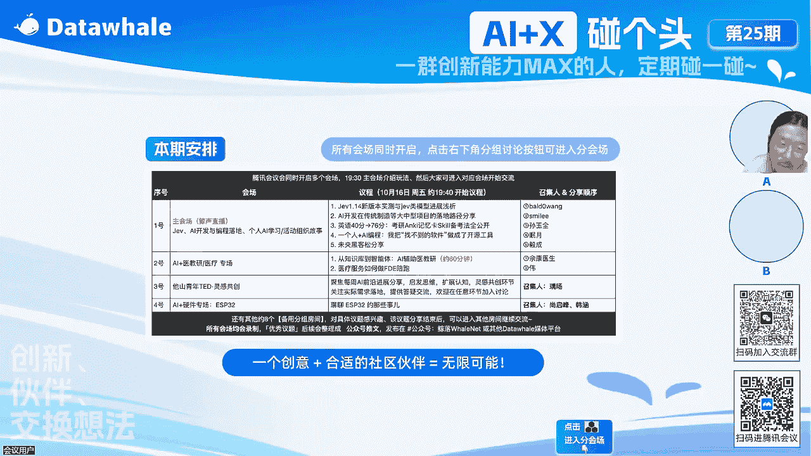

个人效率工具分享完毕，最后一部分是黑客松与人机协同的经验分享。

# 🏆 AI+X碰个头：6：黑客松与AI人机协同

一城老师分享了自己参与和组织黑客松的心理历程。最早是在AI+X碰个头上认识朋友，受影响开始参加黑客松，后来有机会筹办了一次线上黑客松。

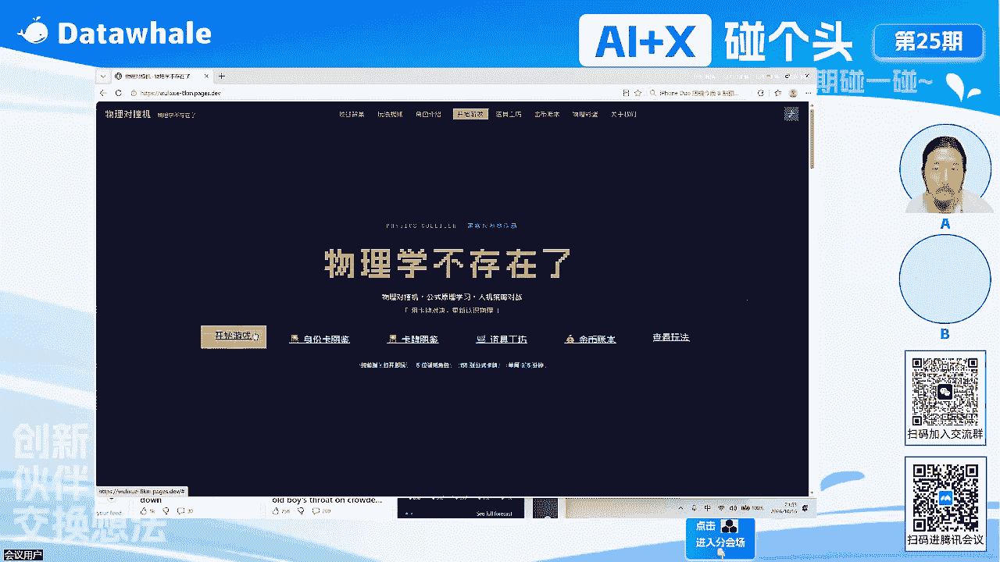

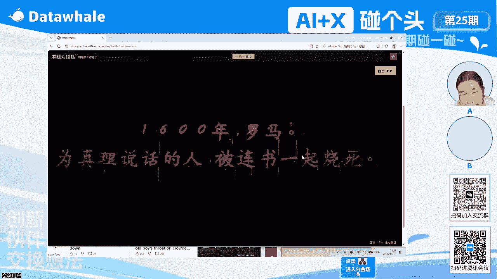

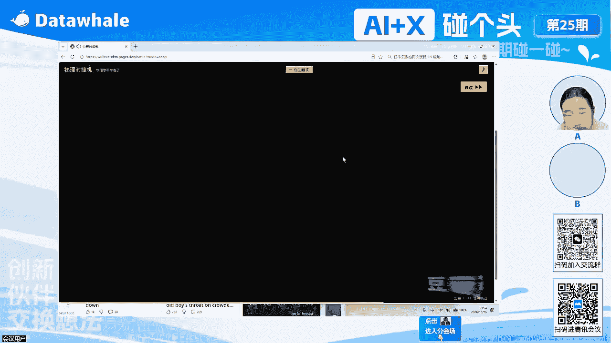

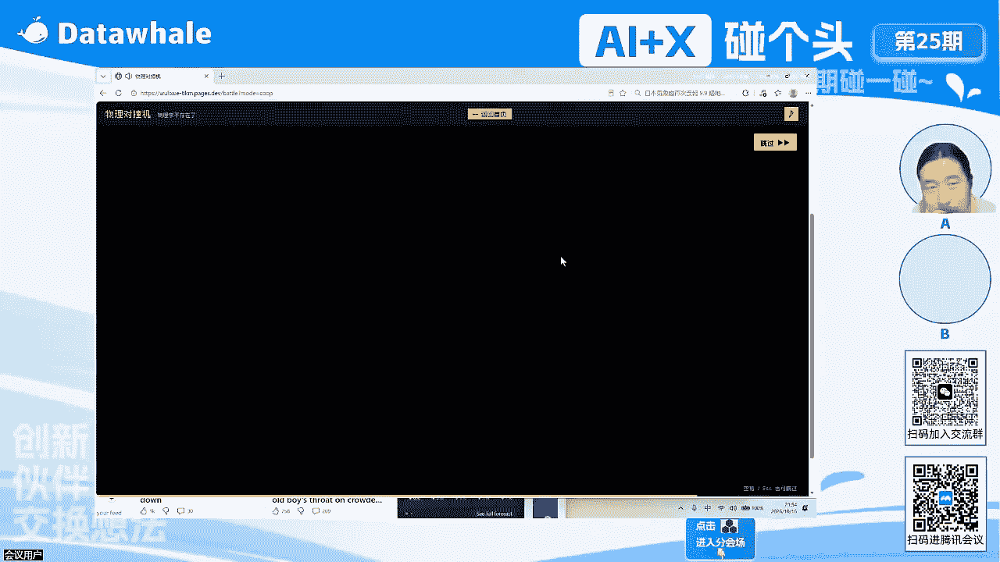

这次黑客松叫作未央黑客松，设有三个赛道：AIGC、离浦发明家、你好我的大学。整体活动持续半个月，包含七天教学周、五天比赛、两天Demo Day和一天线下颁奖。教学周内容从Git仓库部署到Agent使用，每天有不同主题，适合没有技术背景的新手。

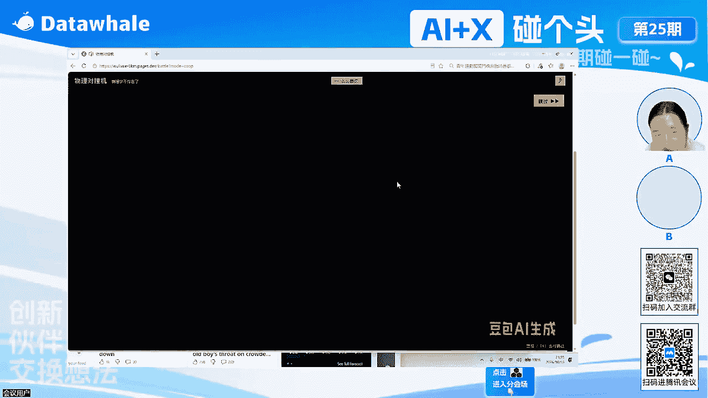

报名共有400多人，涉及140多个专业，最终提交作品约50多个。令人惊讶的是，百分之八九十的参与者几乎没有开发经验，但作品完成度却很高。

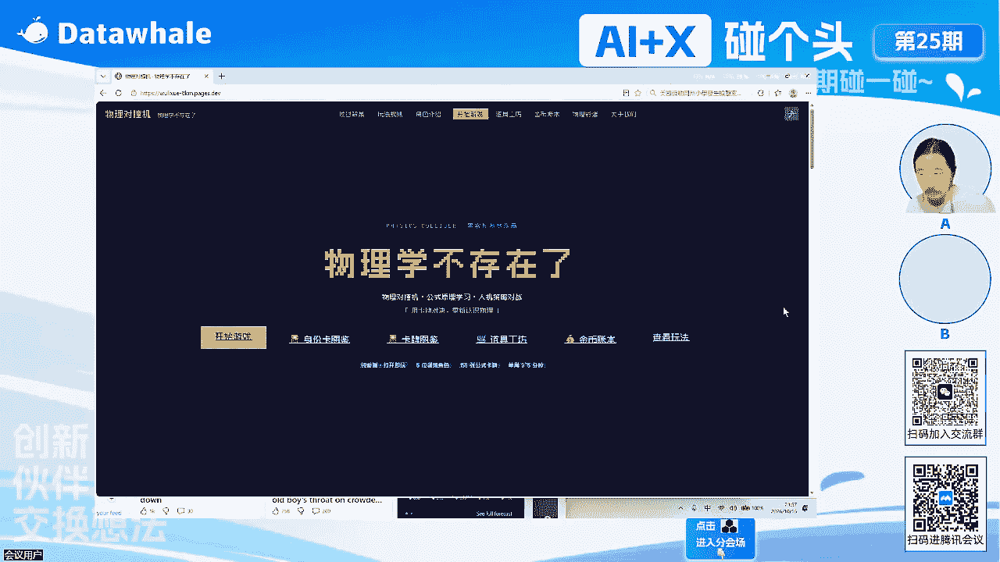

老师展示了几个参赛作品。

- 声音小游戏：实时评分，要求模仿随机抽取的文字，难度较高。
- 换装小游戏：以自己的声音作为子弹发射声音。
- 音乐创作工具：通过拖拽节奏到操作台，生成音乐。
- 物理不存在卡牌游戏：把物理公式做成卡片，包含对战和爬塔模式，还有问答环节，答对物理公式可获得游戏资源购买卡牌。

老师所在团队是大学大一新生，通过AI社团在网上组队，彼此此前不认识。比赛期间大家完全摸索，从报名到作品提交都不知道最终结果。最后利用Cloudflare部署网站，解决了上线问题。

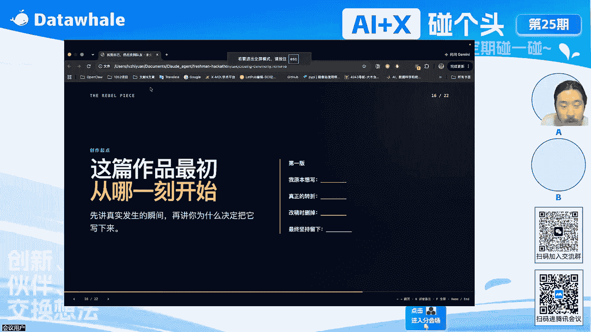

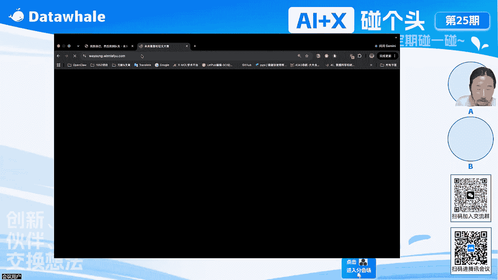

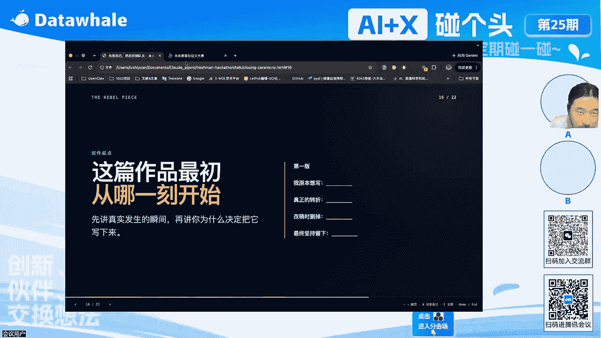

这次经验说明，在AI爆发之前，黑客松门槛很高；现在有想法就能快速实现，黑客松不再是纯技术层面的活动。创意比技术框架更重要，技术不再像过去那样是唯一 bottleneck。人与AI的协同，可以让一个好想法更快变成实际产品。

如果你对AI感兴趣，建议多参加这类活动，能获得很大成就感。

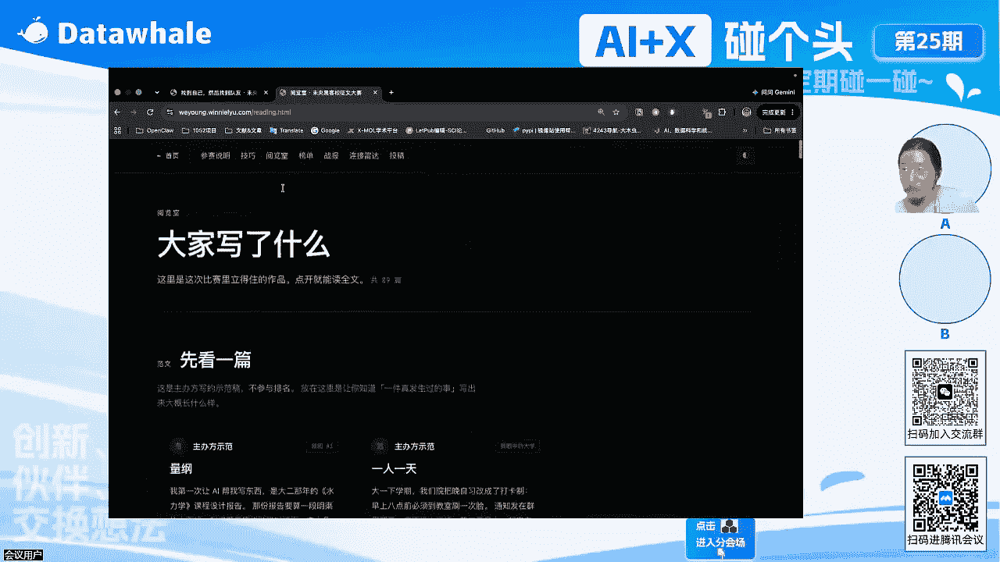

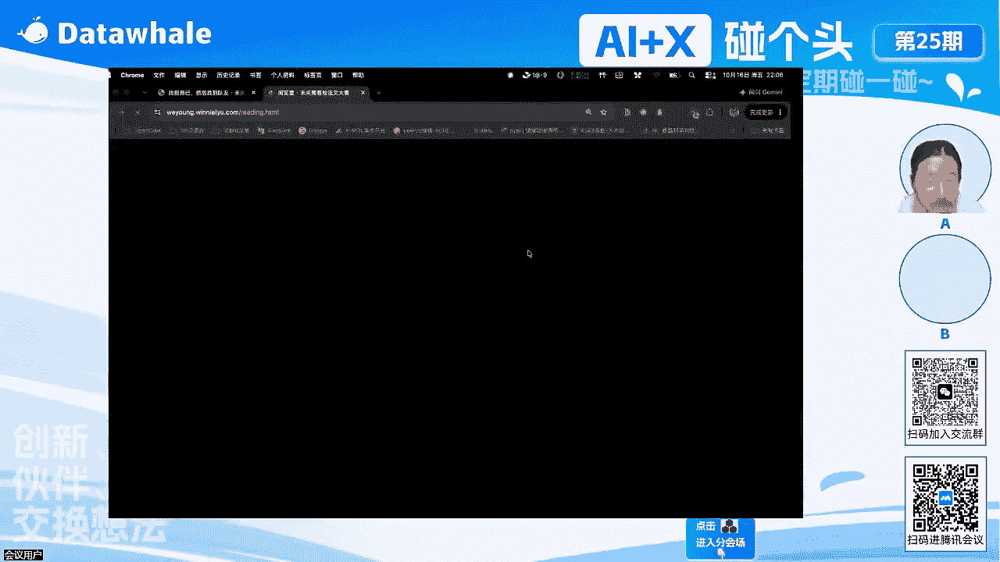

# 📝 AI+X碰个头：7：总结

在本节教程中，我们一起学习了AI+X碰个头第25期的六个主要部分。

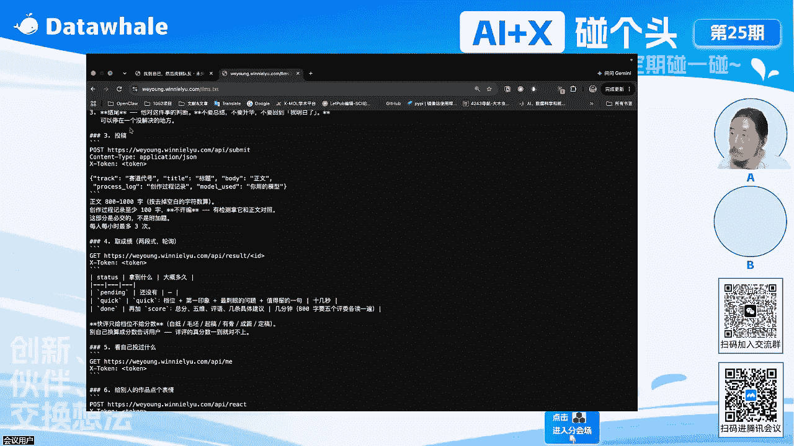

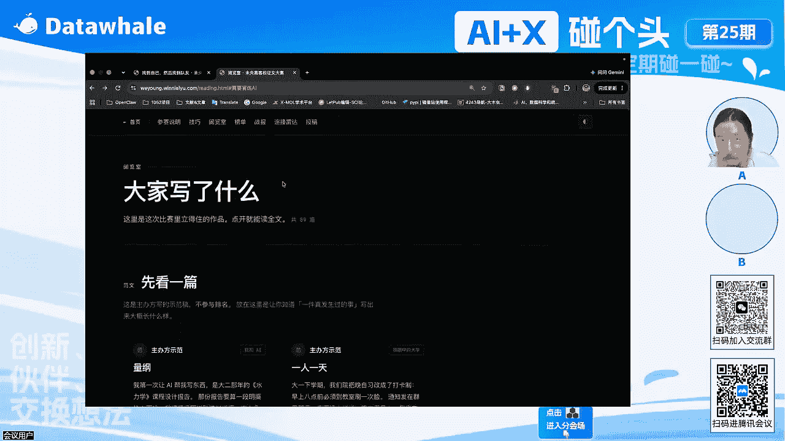

首先是活动概述，了解了四个会场、九个话题以及各位嘉宾的分享方向。其次是企业级AI编程落地实践，掌握了Demo到生产系统的差距、常见问题以及规范驱动的解决方案。接着是ja模型1.14.0的多模态新特性，包括图像理解、Box绘制、超长上下文和多语言支持。然后是考研英语学习方法，学会了用“一加四”工具组合和Anki卡片进行定量化复习，争取英语考到60分以上。随后是个人效率开源工具，了解了桌面快捷方式、内存守护和流量监控三个小工具，以及开发决策文档和教训文档的方法。最后是黑客松与人机协同经验，认识到在AI时代创意和协同比单纯的技术积累更重要。

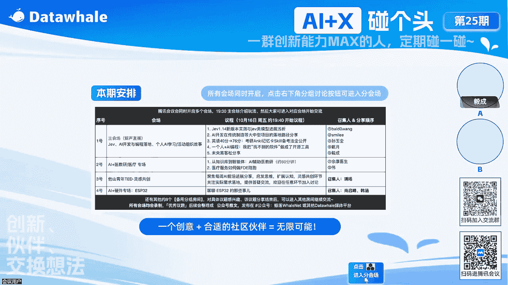

希望这些内容能对你的学习和工作有所帮助。下期碰个头再见。
