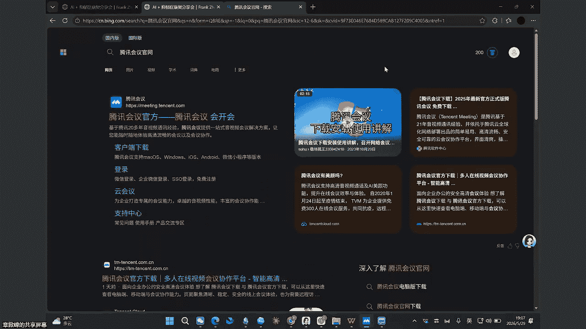
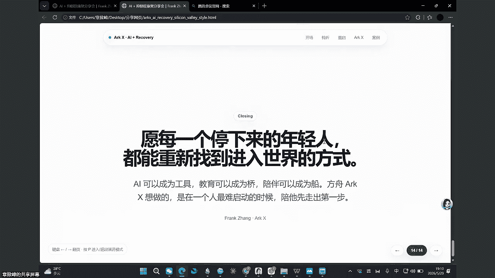
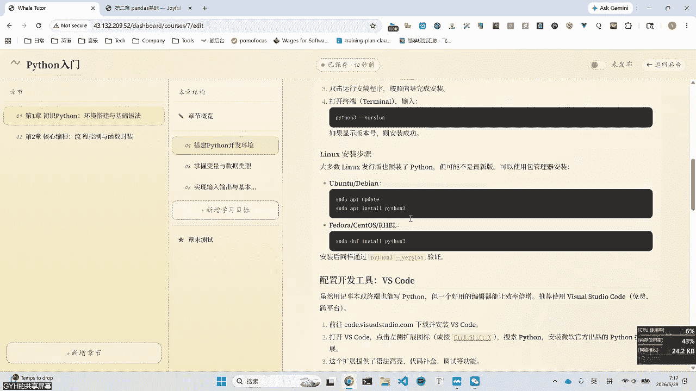

# 🚀 Datawhale AI+X 项目碰头会：01：活动概述与参与流程

在本节课中，我们将学习AI加X碰个头活动的整体流程，搞清楚主会场和分会场是怎么切换的，也会了解到本期活动里一共有哪些项目可以参与。活动的目的是把大家想发起的话题或者想分享的项目组织到台上来，先做快闪式的简要介绍，介绍完之后，大家再进入对应的分组讨论区深入交流。

主持人先说明，碰个头这个活动，主要就是给大家提供一个展示项目和寻找同路人的机会。每个项目发起人先上来简单介绍自己的想法，介绍完之后，对这个项目感兴趣的小伙伴就可以进入对应的分会场继续聊。主会场大概在晚上8点左右结束，结束之后，所有人都可以自由进到自己感兴趣的分组里面去，想听哪个就去听哪个，也可以串门去多个分组看看。

以下是参加活动的基本步骤：

- 先在主会场听取各个项目的快闪分享
- 找到自己感兴趣的项目
- 进入对应的分组讨论区
- 在分组里面和发起人详细交流

如果你用电脑端参加会议，可以在应用界面里找到分组讨论的按钮，点进去之后选择对应的分组加入。如果你用手机端参加，手机腾讯会议的下方会有一个品字型的按钮，点一下就能看到所有分组列表，然后选择自己感兴趣的分组进入。主持人已经提前把这些分组打开了，大家应该都能在列表里看到。

本期活动里，一共有多个项目发起人准备了分享，涵盖了个人AI操作系统、AI加抑郁症康复、AI驱动课程设计平台、AI加应用商业化落地、AI加灵感共创、AI绘画与系统共创、AI加家庭情绪守护、推理优化与降本增效、对话认知资产、八字命理穿搭应用、AI语言编程能力提升等方向。下面我们就依次来看看这些项目的具体内容。

---

# 💻 Datawhale AI+X 项目碰头会：02：个人AI操作系统项目介绍

上一节我们介绍了活动的整体流程和分组进入方法，本节中我们来看看第一个项目，也就是一位17岁高中生发起的个人AI操作系统。



这位发起人自我介绍说自己是高中生，在今年2月份左右启动了10OS这个项目。项目的目标是打造个人优先的AI操作系统，已经发布在某个视频平台上，目前取得了70多个新指标的成就，用户群里面大约有148个人，用户反馈也比较好。如果对这个项目感兴趣，可以进入对应的分组讨论和他详聊，也可以向他索要GitHub地址去体验。

核心概念可以用下面的伪代码来描述个人AI操作系统的设计思路：

```python
class PersonalAIOS:
    def __init__(self, user):
        self.user = user
        self.preferences = {}
        self.tasks = []
    
    def prioritize_task(self, task):
        # 个人优先级排序
        return self.ai_model.rank(task, self.user.preferences)
    
    def run(self):
        while True:
            task = self.get_next_task()
            self.execute(task)
```

下面是这个项目发起人的基本情况列表：

- 发起人身份：17岁高中生
- 项目启动时间：今年2月份左右
- 项目名称：10OS
- 项目目标：打造个人优先的AI操作系统
- 发布平台：某视频平台UP主
- 当前成就：70多个新指标
- 用户规模：大约148人
- 用户反馈：普遍较好

大家如果对个人AI操作系统感兴趣，可以直接进到对应的分会场，和这位高中生发起人一起交流，也可以索要项目的GitHub地址进行体验。

---




# 🧠 Datawhale AI+X 项目碰头会：03：AI加抑郁症康复项目介绍

上一节我们介绍了个人AI操作系统项目，本节中我们来看看第二个项目，也就是关于AI加抑郁症康复的分享。

这个项目的发起人名字叫Frank，他本身是一个重度抑郁症患者。他在分享中提到，自己在高中时经历过重度抑郁，后来走出来了，现在正在做一件帮助其他低能量行动人一起经历抑郁症的事情。他制作了一个网页版的分享文件，内容比较长，所以建议想听详细内容的小伙伴去他的分会场，不要占用主会场太多时间。

Frank的分享框架大概包括：从高中开始讲起，解释自己为什么会得抑郁症，为什么是一个人经历这些事情，怎么从低谷里走出来，然后进入大学，在大学里经历了很多丰富有趣的事情，再到工作以及离职之后做了什么。离职之后，他开始做一个自己平台，名字叫方舟X。在这个平台上，他帮助其他小伙伴走出目前低能量的状态，理清人生困惑，用某种形式带领大家去寻找有意义的人生。

核心概念可以用下面的公式来表示这个康复平台的作用：

```
用户当前状态 = 低能量 + 人生困惑
平台介入 = 像方舟X一样的陪伴 + 情绪引导 + 意义寻找
目标状态 = 走出低能量 + 找到有意义的人生方向
```

以下是Frank项目分享的主要内容结构：

- 发起人：Frank
- 个人背景：重度抑郁症患者，高中时经历抑郁并走出来
- 现有平台：方舟X
- 平台功能：帮助低能量行动人走出低能量状态
- 服务内容：理清人生困惑，寻找有意义的人生
- 分享形式：网页版分享文件，详细内容在分会场讲解

如果大家对AI加抑郁症康复这个话题感兴趣，欢迎加入对应的分会场，和Frank详细聊聊他的经历和方舟X平台的具体做法。

---

# 📚 Datawhale AI+X 项目碰头会：04：AI驱动课程设计平台项目介绍

上一节我们介绍了AI加抑郁症康复项目，本节中我们来看看第三个项目，也就是关于AI驱动课程设计平台的介绍。

这个项目的发起人叫耿远浩，之前是社区里面《Pandas数据处理与分析》一书的作者，现在在头条开源社区贡献一些项目。他之前是官网课程编辑平台的核心贡献者之一。现在他想给这个编辑平台引入一些新的AI功能，因为以前的编辑器纯粹是一个副文本编辑器，在平台上写课程不太方便，所以想探索怎么结合AI来改进。

耿远浩演示了一个简单的示范。作为课程设计者，新建一个课程后，可以让AI生成大纲。以前生成大纲要自己做课程设计，涉及内容布局、知识点调整、课程习题设计，比较麻烦。现在有了AI辅助，生成大纲之后可以直接编辑，细调完之后进入编辑界面。在具体章节里面，可以让AI说明这个章节大概写什么，或者让AI生成需求，也可以自己写需求，或者使用平台预先设定的场景。



核心概念可以用下面的伪代码来表示AI辅助课程设计的流程：


```python
def generate_course_outline(topic):
    outline = ai_model.generate_outline(topic)
    return outline.edit_by_user()

def generate_chapter_content(chapter):
    content = ai_model.write_content(chapter.description)
    return content

def generate_exercises(learning_objectives):
    exercises = []
    for objective in learning_objectives:
        exercises.extend(ai_model.create_questions(objective, count=3))
    return exercises
```

以下是AI驱动课程设计平台的功能列表：

- AI生成课程大纲
- AI生成章节内容
- 设定学习目标，每个目标配套练习题
- 学习者端渲染内容，逻辑与官网课程制作渲染一致
- 智能出题，支持手动添加或修改习题
- 学习成果记录
- 对旧课进行迭代优化
- 支持读写学习场景和现有活动支持

耿远浩还提到，生成完结构化题目和结构化内容之后，还要能够灵活调整，根据自己的需求修改。生成完之后，学习者那边可以渲染出内容，这个逻辑和现在官网上的课程制作和渲染逻辑是一样的，主要区别是现在有了AI参与。如果对这个课程设计平台感兴趣，欢迎进入第13个分会场，也就是Well Tu课程设计平台分组，详细探讨这种形式有哪些可以优化的点，还有现有平台的功能是否难以使用。

---

# 💼 Datawhale AI+X 项目碰头会：05：AI加应用商业化落地项目介绍

上一节我们介绍了AI驱动课程设计平台，本节中我们来看看第四个项目，也就是关于AI加应用的商业化落地分享。

这个发起人说这是他第二次发起AI加话题了。他之前做这个项目的时候，觉得AI跟我们每个人的关系都很大，不仅仅用于聊天和学习。很多人在想，AI到底能跟我们个人的生活该如何切入进去呢。他就想到了AI加应用的落地，之后会讲到关于教育、电商、短剧、企业办公、个人知识库这些比较火的方向，大概会讲这几个维度，都是与我们个人很相关，如何将AI进行商业化跑通的过程。

他还提到，之前有一些学习者探讨过AI教育和自己的孩子共建了一个类似于新的教育世界一样的话题，这些话题非常有意思。他很希望能跟大家一起聊一聊，聊的是一个叫做最后一公里的问题，也就是如何把AI赋能于我们各自身处的赛道。他会先讲到这里，不占用大家太多时间，之后会在第三个会场继续聊天。

核心概念可以用下面的公式来表示AI加应用的落地逻辑：

```
AI落地效果 = AI技术 × 个人赛道 × 商业化闭环
个人赛道 ∈ {教育, 电商, 短剧, 企业办公, 个人知识库}
```

以下是AI加应用分享涵盖的方向列表：

- 教育
- 电商
- 短剧
- 企业办公
- 个人知识库
- AI教育和孩子共建新教育世界

如果对AI加应用这个话题感兴趣，欢迎进入对应的分组，也就是第三个分会场，和这位发起人一起讨论如何把AI赋能到各自的赛道里面。

---

# 🌟 Datawhale AI+X 项目碰头会：06：AI加灵感共创项目介绍

上一节我们介绍了AI加应用项目，本节中我们来看看第五个项目，也就是关于AI加灵感共创的介绍。

这个项目由来自中国科技大学开展协会的王瑞和泽瑞发起，他们举办的是灵感工创队的分会场。希望能够跟大家一起提出想法，然后现场来做拆解，最好能现场制作一个能跑的Demo。到目前为止，他们收集了31个线索。今天想要在分会场跟大家分享的内容包括：一个是已经做出Demo的同学，去给大家分享做Demo的过程和经验；另外是从31个线索里面出来的一个深度陪跑案例，也想跟大家进一步交流。这个项目从第一期开始就跟了三期，最近刚好打完一个比赛，想跟大家进一步探讨怎么落地。

核心概念可以用下面的伪代码来表示灵感共创的流程：

```python
def inspiration_co_creation():
    ideas = collect_ideas()  # 收集31个线索
    for idea in ideas:
        demo = build_demo(idea)  # 现场制作Demo
        experience = share_experience(demo)  # 分享做Demo经验
        case = deep_mentoring(idea)  # 深度陪跑案例
    return ideas, demos, cases
```

以下是灵感共创项目的基本信息列表：

- 发起单位：中国科技大学开展协会
- 发起人：王瑞、泽瑞
- 项目名称：灵感工创队
- 已收集线索：31个
- 活动形式：提出想法，现场拆解，制作Demo
- 分享内容：Demo做法经验分享，深度陪跑案例交流
- 后续安排：每周五晚上7点做拆解

如果大家对灵感共创感兴趣，欢迎进入第6个分会场，也就是AI加灵感共创的分组，里面可以留下大家的需求，也可以了解更多可跑的案例，从Demo到落地的过程。

---

# 🎨 Datawhale AI+X 项目碰头会：07：AI绘画与系统共创项目介绍

上一节我们介绍了AI加灵感共创项目，本节中我们来看看第七个项目，也就是关于AI绘画和AI共创系统的介绍。

这个发起人是7号，他本身是个设计师。今天在群里头发了一个频道的海报，有小朋友问到他能不能分享海报，所以他今天就加一个分享。他共享了屏幕，展示了今天生成的这个海报。从设计师的角度，他大致讲一下海报怎么做，或者图形怎么做，做一个分享。这是图形方面的一些概念，因为他以前做图形做得比较多，目前用Image Two或者香蕉，以前用I或者SD都用得比较多。

他还分享了一个关于Harness系统的东西。就是说非程序员能不能做稍微复杂一点的系统，他做了一个测试，相当于是边学边做，做了一个脑海中的Harness系统应该是什么样的，就是通过什么样的节点，怎么样帮你办事。迭代了很多次，实际上在龙虾之前就已经有这个想法并开始做了。目的不是为了替代龙虾，是为了学习，所以说跟大家一起聊。这种Web Coding的时代，普通人或者非编程的人员能不能打造一个稍微复杂一点的系统，从什么角度打造，什么逻辑，怎么学，他想跟大家分享一个做出来的东西。现在还在迭代，目的是学习，可能对一些人有用，已经放到GitHub上了。

核心概念可以用下面的公式来表示非程序员构建复杂系统的思路：

```
普通人构建系统 = 可视化节点编辑 + 低代码逻辑编排 + AI辅助生成
系统复杂度 = 节点数量 × 节点间连接逻辑 × 自动化程度
```

以下是这个项目分享的主要内容列表：

- 发起人身份：设计师
- 分享主题：AI绘画海报制作，以及非程序员如何构建复杂系统
- 工具使用：Image Two、香蕉、I、SD等AI绘画工具
- 系统名称：Harness系统
- 系统目的：学习而非替代现有工具
- 代码托管：GitHub
- 适合人群：普通人，非编程人员

如果大家对AI绘画或者和AI共创系统感兴趣，欢迎加入第7个分会场，也就是你AI不行还是我不行的这个话题分组，里面可以一起讨论怎么学习AI，如何打造复杂系统。

---

# 👨‍👩‍👧‍👦 Datawhale AI+X 项目碰头会：08：AI加家庭情绪守护项目介绍

上一节我们介绍了AI绘画与系统共创项目，本节中我们来看看第10个项目，也就是关于AI加家庭情绪守护的介绍。

这个项目的发起人是李雷，10号房间的发起人。他们想做的是一款关于家庭情绪健康的AI工具，核心的话是要解决两个问题。第一个是情绪知识匮乏，有时候在家可能跟朋友、伴侣或者家人不知道聊什么，或者说不敢聊，没人聊。还有一个问题是家庭互动缺失，可能大家各忙各的，感受不到彼此。

他们目前的AI工具已经有了Demo，在今年3月的时候入围了AI的清华大学甚至研究院的复赛。目的是想要在现有的工具里面去新增一个靠近感知情绪画像的功能。如果说大家对情绪守护，还有家庭情绪健康这块感兴趣，可以到10号房间来，详细聊一聊。

核心概念可以用下面的公式来表示家庭情绪健康工具的目标：

```
家庭情绪健康 = 情绪知识普及 + 家庭互动修复 + 情绪画像感知
现有问题 = 情绪知识匮乏 + 家庭互动缺失
解决方案 = AI工具 + Demo产品 + 清华AI复赛验证
```

以下是AI加家庭情绪守护项目的基本信息列表：

- 发起人：李雷
- 房间编号：10号房间
- 项目目标：解决情绪知识匮乏和家庭互动缺失
- 产品状态：已有Demo
- 荣誉：2024年3月入围清华大学甚至研究院AI复赛
- 新增功能：靠近感知情绪画像
- 适合人群：关注家庭情绪健康的用户

如果大家对AI和家庭情绪守护的场景感兴趣，欢迎加入到他们的这个话题分会场里面来，详细聊聊家庭情绪健康的AI工具。

---

# ⚡ Datawhale AI+X 项目碰头会：09：推理优化与降本增效项目介绍

上一节我们介绍了AI加家庭情绪守护项目，本节中我们来看看第五个话题，也就是关于加速推理效率、降低推理成本的介绍。

这个话题的发起人是李雷老师。他主要讲的是，随着AI应用的普及，toB和toC两个方向，不管是企业还是个人，现在都在用AI。用AI的时候，toB直接用或者是用云上的，实际的推理都是在机房或者千卡万卡的机型上做的。大模型分成两个阶段，目前咱们用的模型都是预训练模型。预训练包括整理数据、前期训练、SFT、强化学习等等各种训练，训练完以后打包成权重文件和配置文件，布到服务器上面，然后去做推理。咱们日常人使用其实都是用的推理，用不到训练。

本地部署的不管是toB还是toC，用它本身也有一些加速的推理加速框架，比如V啊之类的，然后会有各种各样的加速框架。但这些框架本身也是基于英伟达这些框架，对本身做一些分页，做一些算力优化，调内存减碎片，从软件方面提高GPU显存使用率或者计算速度。但是目前所有的模型，咱们跟传统的信息化不一样的一点就在哪？只是说它数据量太大了。不管是训练的数据量还是最后训练完这个权重，权重文件分成小块小块的，但是整个也得几个甚几十个。权重就通用大模型当然也有量化，也有INT4等等的量化，但压缩完了其实也是很大的。大家也知道，数量越大，它会越精准，参数越多，整个效果会越好生成的。

核心概念可以用下面的公式来表示大模型推理的基本逻辑：

```
推理过程 = 权重文件 × 输入Token × 前向传播 × 注意力机制 × 概率分布采样
推理成本 = 模型参数量 × 推理次数 × 硬件单位成本 × 排队等待时间
优化目标 = 降低推理成本 + 提高推理吞吐量 + 减少用户等待
```

以下是推理优化与降本增效项目的主要内容列表：

- 发起人：李雷老师
- 讨论主题：如何加速推理效率，降低推理成本
- 技术背景：预训练模型 vs 推理模型，权重文件，本地部署
- 加速框架：基于英伟达的推理加速框架
- 优化方向：软件优化，硬件变便宜，基础设施成熟，费用降下来
- 适用场景：应用开发者，硬件部署，降本增效

如果大家对李雷老师发起的这个话题感兴趣，欢迎进入到他的第五个分组里面去，这个话题的分组名称就叫如何加速推理效率，降低推理成本。大家可以在这个话题里面去详细探讨。

---

# 💬 Datawhale AI+X 项目碰头会：10：对话认知资产项目介绍

上一节我们介绍了推理优化与降本增效项目，本节中我们来看看第12个项目，也就是关于对话认知资产的介绍。

这个项目是一个团队，现在正在做软件，就是去读懂每一场对话，然后成为懂有懂行的AI伙伴。他们在做UN之前发现一个很现实的问题，就是很多重要信息，不是写在文档里的，反而是像日常这样的一场场对话里，包括会议、腾讯会议、访谈、客户沟通，甚至语音备忘，甚至可能是自己作为学生，有时候和AI的来回交流。他们觉得真正有价值的东西就是藏在这些对话中的，比如说一个人的真实诉求，或者是一个项目的风险，包括去做一次次背后的判断。但是这种问题经常会流失，会后可能有一份会议纪要，但是像现在的一些主流软件，只是记录发生了什么，如果想要去问他为什么重要，或者哪里有变化，甚至下一步该做什么，就会有一些阻力。

他们自己UN想做的事情，不仅仅是去做录音转写，或者是生成会议纪要，就是希望AI能够真正读懂对话，然后去把每一场沟通变成我们自己的可追问的、可行动的认知资产。在软件里，左边有一个工作空间的集成，或者中间能看到像连接微信助手什么的。第一步的话就是先把这些对话来源都打通，不管是录音、会议录音，也好，或者是现在用的这种硬件也好，都可以进入同一个分析系统。接下来会从原始的语音、从文本中去提炼出人物的观点，包括一些代办事项去生成洞察。最后你可以跟大家说，记住这些对话，UN会持续理解，就是每个人的工作方式，包括你关注的领域，然后你的项目，或者你自身的这种判断偏好。下次再打开会议的时候，AI就不是从零开始，就是带着过去的上下文去帮助个人。

核心概念可以用下面的伪代码来表示对话认知资产的构建流程：

```python
def build_cognitive_asset(conversations):
    assets = []
    for conv in conversations:
        transcript = speech_to_text(conv.audio)
        insights = extract_insights(transcript)
        points_of_view = extract_viewpoints(transcript)
        todos = extract_todos(transcript)
        asset = CognitiveAsset(
            user_id=conv.user_id,
            context=conv.context,
            viewpoints=points_of_view,
            todos=todos,
            insights=insights
        )
        assets.append(asset)
    return assets
```

以下是UN对话认知资产项目的功能列表：

- 读懂每一场对话，成为AI伙伴
- 支持会议、访谈、客户沟通、语音备忘等多种来源
- 录音转写与会议纪要之上的可追问认知资产
- 连接微信助手等多种输入端
- 从原始语音和文本中提炼人物观点、代办事项、洞察
- 持续理解每个人的工作方式、关注领域、项目、判断偏好
- 下次会议带上过去的上下文，不再从零开始
- 有社群二维码，媒体人、投资人、创业者、社群主理人和普通用户都在

如果大家对这个应用感兴趣，欢迎进入到第12个话题的分组，也就是UN的这个话题里面，可以详细聊一下他们的应用是一个什么样的应用，怎么去使用，有哪些建议。大家想加他们的群的话，也可以进入会议的这个分组里面，然后去加入他们的群。

---

# 👗 Datawhale AI+X 项目碰头会：11：八字命理穿搭应用项目介绍

上一节我们介绍了对话认知资产项目，本节中我们来看看最后一个分组，也就是第14号分组，关于AI加运势加穿搭的介绍。

这个项目的发起人是33，一个作为Gen的算法工程师，平时关注一些摄影、AI，还有八字命理、传统审美。他有一天跟朋友突发奇想，要说做一个比较Fashion的应用，就是结合传统的八字命理和一个星盘的一些内容，来去确定当天的这种穿搭的风格。他看有一些软件也已经在做了，像一些测测呀，还有什么一种星盘的软件，它上面也有做，但是他做的比较简单，没有去深度的融合，没有去结合一定的自己的命理方式。

主要他们的这个设计的这个应用的想法，就是随着运而穿嘛。每个人都有一定的运，就是他有一个当下的状态，一个当下的流逝，一个当下的一种气场，或者说能量，今天想比如说当天的状态。我要去求职面试，或者说我要开一个重要的会议，或者我要见一个重要的人。我今天不太知道想穿什么，觉得有可能就随意随着想找一个穿搭方式，但是自己也不知道自己要穿什么更合适，然后就会去。结合一定的命理嘛。当天每天都有大运，我们其实是有大运和流年的这个东西存在的。每个人都有，每天有不同的时运和当天的天运。于是呢我们就可以去把这些运结合我们自身的一个八字和一定的星盘，我们可以把它做成一个新的穿搭的模式。比如说我们可以把那个五行，如果我们属木的话，那它有可能是生长，我们有可能穿绿色的。然后这样的衣服，或者说我们属火，我们本身是火的，然后这种火可以去用木生火、金生水，然后我们可以用相应的生扶来助我们去完成我们这样的一个风格。包括加入一些星盘，例如火象星座、土象星座、风象星座、水象星座这些星盘的一些跟我们传统的命理做一个融合，改成一个中西结合的一种穿搭方式。

核心概念可以用下面的公式来表示八字命理穿搭建议的生成逻辑：

```
今日穿搭建议 = 用户八字 + 今日天运 + 今日大运 + 星盘属性 + 场景偏好 + 颜色偏好
五行对应 = 木 → 绿色，火 → 红色，土 → 黄色，金 → 白色，水 → 黑色
中西融合 = 八字五行 × 星盘元素 × 时尚风格
```

以下是八字命理穿搭应用的功能列表：

- 结合八字命理和星盘确定当天穿搭风格
- 根据当天运势、气场、能量给出建议
- 支持求职面试、重要会议、见重要人等场景选择
- 五行属性对应颜色建议
- 中西结合的穿搭方式，融合星盘元素
- 用户可选倾向，职业、休闲、约会、面试等场景
- 排除不喜欢的颜色和风格
- 生成灵感小人，展示当天运势、八字、五行

如果大家对AI加运势加穿搭感兴趣，欢迎加入到最后一个分组，也就是14号分组，进入到这个分会场里面，可以去讨论一下这个项目的开发或者是给他们的建议。

---

# 🌐 Datawhale AI+X 项目碰头会：12：AI语言编程能力提升项目介绍

上一节我们介绍了八字命理穿搭应用项目，本节中我们来看看第8号分组，也就是关于AI语言编程能力提升的介绍。

这个项目的发起人是一纯，他本身是一个外语学习爱好者，同时也是一个Coding爱好者。他在思考如何做一个从原语言，什么叫原语言，就是语言的语言，就是从底层第一性来解析一些语言的本质，包括我们其实是有语言学理论的。然后呢就是通过这样的一些打字练习，这是自然语言，因为语音是最最基础的一个语言学习的层面。然后在编程语言层面的话，我们会进行就是词汇，然后是形态，这个词汇这是形态嘛，然后是句法和语音语用的方面的拆分来构来进行一些语言的学习。编程语言和自然语言。

核心概念可以用下面的伪代码来表示语言学习系统的拆分维度：

```python
class LanguageLearningSystem:
    def __init__(self, language_type):
        self.language_type = language_type  # 自然语言或编程语言
    
    def natural_language_modules(self):
        return ["语音", "词汇", "形态", "句法", "语用"]
    
    def programming_language_modules(self):
        return ["词汇", "形态", "句法", "语音语用"]
    
    def practice_typing(self, content):
        # 打字练习作为基础训练
        return self.evaluate_input(content)
```

以下是AI语言编程能力提升项目的基本信息列表：

- 发起人：一纯
- 房间编号：第8个分组
- 发起人背景：外语学习爱好者，Coding爱好者
- 项目核心：从底层第一性解析语言本质，结合语言学理论
- 学习维度：自然语言的语音、词汇、形态、句法、语用；编程语言的词汇、形态、句法、语音语用
- 练习方式：打字练习
- 现有成果：外语方面的安装包，分组群里有知识库，编程语言语义OJ初步版本已部署

如果大家对依纯开发的这个软件感兴趣，或者是对AI加编程，加上这个语言学习的话题感兴趣，都可以进入到这个第8号的这个分组里面，和依纯一起聊一下。分组的名称叫LongMaster，用AI做一个语言、编程语言能力的提升的这个名称。

---

# 📱 Datawhale AI+X 项目碰头会：13：后续交流与社群加入

上一节我们介绍了AI语言编程能力提升项目，本节中我们来看看活动的后续安排，以及如何继续参与到AI加X碰头会的社群中。

主持人说明，主会场的小伙伴可以先选择自己感兴趣的话题，然后进入到我们的分会上面先聊着。待会儿如果还有其他的话题的发起人来这边分享，大家可以再听一下，或者现在就先去选择感兴趣的话题，然后串到其他的分会场里面都是可以的。今天晚上大概有14个话题给大家可以聊。

如果大家想要进一步交流，在今天腾讯会议讨论之后，也欢迎扫描主会场下面的二维码，然后加入到微信群里面，可以跟进后面的第四期以及以后的碰头。后面大概每周五都会发起一次，像今天这样的碰头活动。大家感兴趣的话可以持续关注。

直播间的小伙伴可以直接进入我们的腾讯会议里面来，然后和我们各个话题的发起人直接面对面线上的沟通。腾讯会议号会发到直播间的评论区里面给到大家，然后大家可以直接进入。主会场是帮助大家来了解有哪些话题的，然后大家进入到可以先进入到主会场，然后跳转到对应的分会场里面来，对自己感兴趣的话题可以点进去。

以下是加入后续社群的方式列表：

- 扫描主会场下方的二维码加入微信群
- 关注后续每周五的碰头会活动
- 通过直播间评论区获取腾讯会议号
- 在腾讯会议中自由切换到感兴趣的分组
- 在分组里面与发起人和其他小伙伴持续交流

直播间的各位小伙伴，我们这个直播就先到这儿就结束了。然后大家可以感兴趣的话，进入到我们这个腾讯会议里面对应的这个分组去参与讨论就好了。我们今晚的直播就到此结束了。也欢迎大家继续持续关注我们的碰头会的直播。那么我们下期再见，大家拜拜。

---


# 📘 本节总结

本节课中，我们一起学习了AI加X碰头会的整体流程，包括如何从主会场进入各个分组讨论，电脑端和手机端进入分组的具体方法，以及主会场结束后大家如何自由选择感兴趣的话题继续交流。我们依次回顾了本期活动里全部14个项目的分享内容，涵盖了个人AI操作系统、AI加抑郁症康复、AI驱动课程设计平台、AI加应用商业化落地、AI加灵感共创、AI绘画与系统共创、AI加家庭情绪守护、推理优化与降本增效、对话认知资产、八字命理穿搭应用、AI语言编程能力提升等多个方向。每个项目都有明确的发起人、房间编号和核心功能，大家可以根据自己的兴趣进入对应的分会场深入探讨。同时，我们也了解到了如何通过腾讯会议号和微信群二维码加入后续的社群，持续关注每周五的碰头会活动。希望这些内容能帮助大家快速找到志同道合的小伙伴，把想法碰撞出更多火花。

