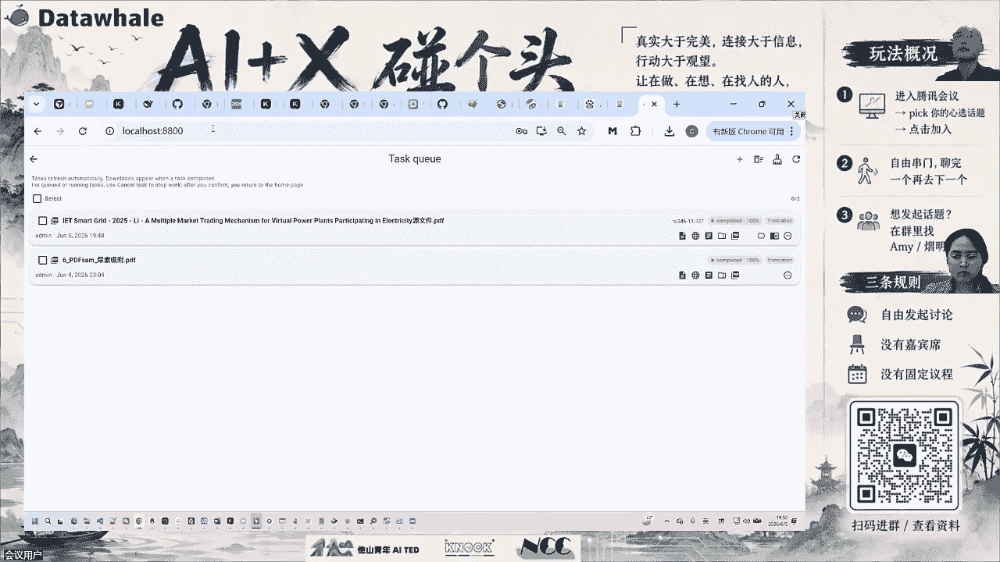
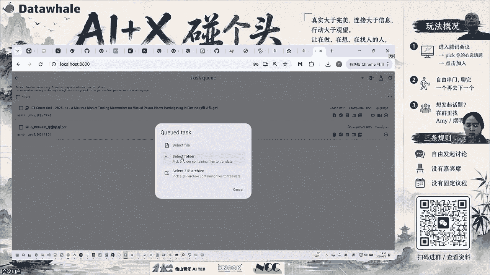
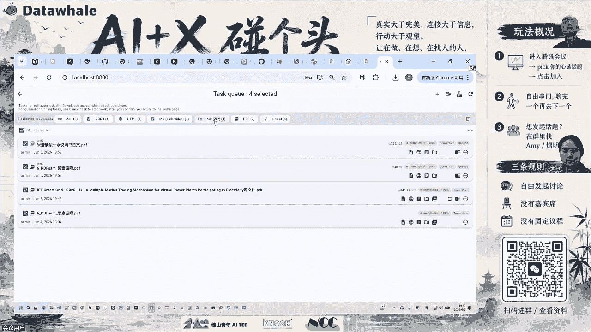
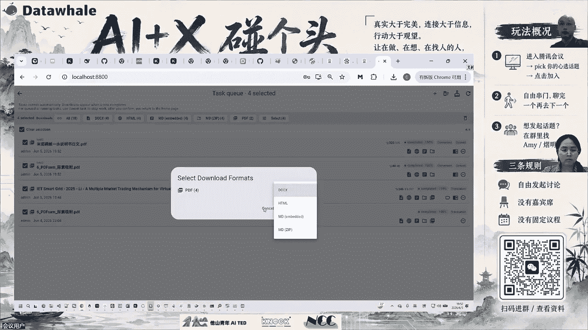
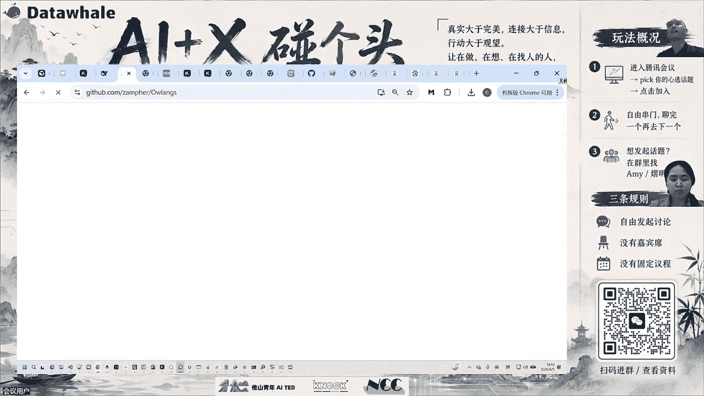

# 🤖 AI+X 碰个头参与指南：01：活动概述与分组加入流程

在本节教程中，我们将学习 Datawhale 发起的 AI+X 碰个头活动是如何运作的，以及新手该如何进入腾讯会议并加入自己感兴趣的话题分组。本次活动已经是第四期，固定在每周五晚上举行，目的是围绕人工智能与各行各业的交叉话题，让大家自愿交流、思想碰撞。

活动的核心规则非常清晰。每个话题都需要一位召集人自愿发起，召集人必须提前想清楚自己想讨论什么话题，想达成什么目标，以及希望吸引什么样的人参与。所有主会场和分组讨论的内容都会被录制，录制文件仅分享到碰头群中。如果你还没有入群，可以扫描腾讯会议右下角的二维码进入碰头群，之后所有资料和信息都会在群里统一分享。

关于如何进入分组，具体操作流程如下。首先你需要保持在腾讯会议主会场，不要提前退出。如果你使用手机端，请点击右下角由三个正方形组成的图标；如果你使用电脑端，请点击名为“分组讨论”的按钮。点击之后，系统会显示当前可用的所有分组房间，你只需按照话题序号进入对应房间，然后点击“加入”按钮，即可完成入组。

以下是进入分组讨论的操作步骤总结。

- 第一步：保持在腾讯会议主会场，不要提前退出。
- 第二步：根据设备类型，手机端点击三个正方形图标，电脑端点击“分组讨论”按钮。
- 第三步：在弹出的房间列表中，找到你感兴趣的话题对应的序号。
- 第四步：点击该序号旁边的“加入”按钮，即可进入对应的话题分组。

入组的逻辑可以用一个简单的公式表示。

```
入组成功 = 点击分组讨论按钮 + 选择对应序号 + 点击加入
```

通过上述步骤，你就能从主会场进入具体的话题房间，与召集人和其他参与者开始交流。

## 📋 02：各分组话题与召集人介绍

上一节我们介绍了活动的基本规则和分组加入方法，本节中我们来看看本次活动一共有哪些话题，以及每个话题的召集人分别想聊些什么。

本次活动共开放了 12 个话题分组，每个话题都有不同的侧重点和目标人群。以下是各话题的详细介绍。

1. 话题一：数据建模遇上大模型。召集人杨老师关注的是 AI 时代下的数据建模问题。他指出，当前公开网络数据已经被大规模使用，数据正在成为瓶颈。他希望从传统 Web 2.0 时代的数据建模方法，过渡到未来 AI 时代的数据建模思路。他的项目名为 achieve，核心思路是把平时与 AI 的零散对话转化为结构化数据，作为模型微调的语料。这项工作涉及对齐映射和语义标准，适合有技术背景的朋友参与。其核心可以用公式表示为：

```
结构化训练语料 = 分散对话 × 对齐映射 × 语义标准
```

2. 话题二：AI 与教育、科研及微信小程序搭建。召集人王瑞来自博科大他山学科交叉创新协会，这是一个自第一期活动以来每期都会开展的金牌话题。线下场地位于北京五道口奇迹，每周五有线下碰头。话题内容涵盖教育场景需求、科研文献数据处理，以及如何从零开始搭建微信小程序和申请域名等实际问题。

3. 话题三：AI 与抑郁症康复。召集人 Frank 本人是重度抑郁症康复者，他连续三期带领同一个话题。核心主题是“AI 虽然不懂爱，但会教会我们如何去爱”。他正在搭建一个名为“一对一”的亲密关系复盘陪伴 AI，涉及场景搭建、提示词设计、评分器、多轮推进等环节。他希望将 AI 做得像贾维斯一样能够真正陪伴聊天，而不仅是分析总结。AI 陪伴的关键能力可以简化为：

```
AI 陪伴能力 = 语音识别 + 语音生成 + 实时视频交互
```

4. 话题四：AI 与义乌信息差及数字游民生活。召集人 Melody 目前在义乌，发现一线城市信息渠道广而义乌缺乏相应社群，因此希望联系线上小伙伴一起探讨如何在义乌建立线下联系，以及涉及出海、非遗出海、文创产品和艺人公司等话题。她强调这个分组不是给标准答案的过程，而是拥抱不确定性和无限可能性的场域。

5. 话题五：AI 与游戏及黑客松经验分享。召集人杨月最近参加线下黑客松，制作了一个 AI 小游戏，这是她第一次接触相关命题。她想分享在黑客松过程中的想法、观察和小技巧，并探讨 AI 如何介入游戏机制、AI 角色扮演以及内容生成等新玩法。欢迎对她的游戏提出建议。

6. 话题六：AI 出海与增长实战。召集人崔莹在互联网公司做数据产品，平时运营增长方向社群。她邀请了一位在 AI 出海方面有实战落地经验的朋友，分享今年的干货内容。适合关注 AI 产品出海和增长玩法的朋友。

7. 话题七：AI 伴侣的持续探索与 Pere 项目。召集人王翔是算法工程师，也在探索投资和创业。他关注 AI 伴侣，即虚拟男友或虚拟女友，以应对现代人普遍存在的孤独感。该项目包含语音识别、语音生成、实时视频等技术，未来考虑做成 APP 或小程序进行商业变现，同时也在招募开发者伙伴，走开源路线。

8. 话题八：FDE 团队与企业 AI 落地。召集人沈林从事创业科创企业孵化服务。他发现许多企业不知道如何把 AI 工具植入实际业务场景，因此希望通过平台寻找答案，并组建 FDE 团队帮助孵化企业实现 AI 落地。这个话题既有需求方，也有技术服务方，适合开放式讨论。

9. 话题九：中老年人群的 AI 生活应用。召集人李想猫（小猫）是 70 后，已经连续三次发起同一个话题，是金牌召集人。她希望分享 AI 如何帮助中老年人学习、生活、工作和与朋友互动，包括替代重复劳动、处理家庭疑问等。首次分组讨论曾聊到午夜 12 点以后，是当晚讨论最久的房间。

10. 话题十：一人公司时代如何寻找合作伙伴。召集人新亮是 NCC 主力成员，围绕 OPC（一人公司）概念展开。他制作了一款合作画像分析产品，能在 5 到 10 秒内预测两人之间可能的合作项目，大幅缩短传统破冰时间。适合想讨论合作利益保障、避坑指南以及市场交换价值的朋友。

11. 话题十一：原计划由赵杰发起，但该召集人未能到场，因此该话题未能正常开展。

12. 话题十二：AI 是工具还是协作作者。召集人赵杰一成基于 AI 流利度课程，制作了一个问答形式的小产品，用于评估用户在不同阶段如何判断 AI 对实际问题的解决能力，包括任务复杂度拆解和上下文组织能力。他将演示 Demo，并随后在群里分享供大家测试。其技术思路是：

```
AI 能力评估 = 大语言模型 + 算法协同 + 细节问题抽取
```

活动后期还会开放“自由麦”环节，时间开放到 20 点 30 分，每位分享者大约 10 分钟。如果没有更多的开放麦诉求，直播可能会在 20 点整准时结束。进入交流群的朋友，可以根据群公告中的腾讯会议号加入当前会议。

## 🎤 03：开放麦环节与后续社区安排





上一节我们详细介绍了 12 个分组话题及其召集人，本节中我们来看看活动结束后的开放麦安排以及下一步如何继续参与社区。







自由麦环节允许任何有话题、项目或想法的朋友直接开麦分享，主持人会尽量保障大家的交流体验。主持人也会再次展示分组进入的操作指引，方便还没有进入分组的朋友自行选择话题房间。

关于社区后续安排，下周三将发布 6 月份组队学习的招募推文，可以在 Datawhale 公众号查看，招募名额通常很快抢完。另外也可以关注“跟老马组队学”公众号，那里会招募领学员并带领大家学习有趣的 AI 主题，也可以在公众号私聊许愿。

本次活动的核心价值观可以概括为以下公式。

```
真正的价值 = 真实 × 连接 × 行动
```

活动主持人希望大家不要犹豫，不要担心自己不够完美或能力不足。只要你想做某件事，在行动的路上就能遇到志同道合的人。勇敢发出真实的声音，就能被更多人看到和接纳，从而碰撞出更多的可能性，获得更快乐的生活状态。

---

本节教程到此结束。在本节课中，我们一起学习了 AI+X 碰个头活动的基本规则、腾讯会议分组的加入方法、全部 12 个话题分组的内容与召集人介绍，以及开放麦环节和后续社区招募信息。希望这些内容能帮助你快速上手，找到适合的话题分组，与志同道合的伙伴展开深度交流与协作。

