# 🤖 AI产品路径：01：课程概述与财务AI落地背景

在本节课中我们将要学习如何在企业财务场景中落地AI产品，核心思路是先让系统可用，再逐步追求工程完善。这堂课适合刚开始接触AI产品落地的初学者，我们会用大白话把复杂的财务业务和AI技术结合起来讲清楚。

这个案例来源于最近在金融领域企业开展的FDE相关工作。该企业内部主要使用Workbody工具，财务岗位经理、管理人员以及执行同学都参与了需求交流。通过这些交流，梳理出了财务部门在日常工作中面临的典型问题，并将其抽象成一个可供大家讨论的案例。

以下是该企业财务团队日常主要的三块业务内容：

- 第一块是查单，也就是查询各类业务单据的状态和详情。
- 第二块是对账，包括每月和每季度的对账工作。
- 第三块是对账完成后与业务部门沟通，将对账内容在OA系统中对齐，并把系统细节反馈给财务人员。

整个流程相当于完成了从查单到对账，再到与业务部门交流，最后完成查账的完整闭环。在实际沟通中，我们发现需求收集阶段存在一些值得深入探讨的问题，这也将是后续章节重点讨论的内容。

## 本节总结

本节我们介绍了课程的整体背景，说明了AI产品在财务领域落地的基本思路，并梳理了企业财务团队的三块核心业务。

---

# 📋 AI产品路径：02：需求收集阶段与业务价值边界

上一节我们介绍了课程背景和财务核心业务，本节中我们来看看在需求收集阶段，产品经理应该如何与业务部门沟通，以及如何判断业务价值和实施条件的边界。

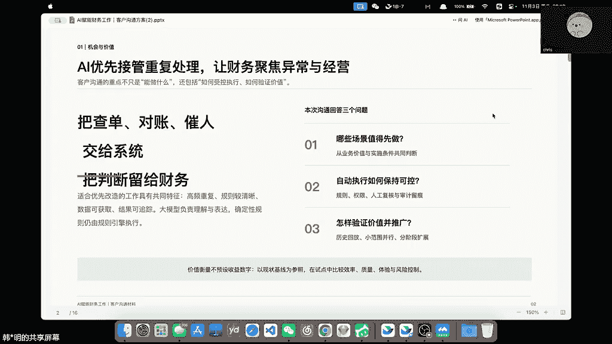

在to B领域，收集业务需求就像产品经理去客户现场调研一样。在这个案例中，我们与财务团队频繁开会，两天时间里每天抽出一个小时来采集具体的业务case。这种高频的短时沟通方式，有助于快速了解业务细节，避免信息传递失真。

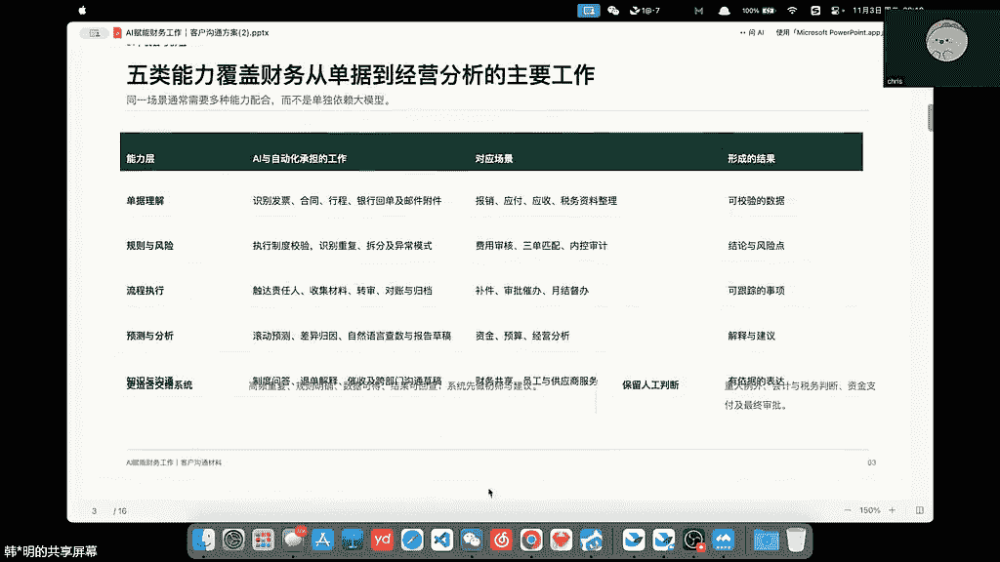

在沟通过程中，我们整理出了以下几个关键问题，供大家重点思考：

- 第一是如何判断业务价值与实施条件的边界，也就是哪些需求值得做，哪些暂时不适合用AI解决。
- 第二是多部门领导共同开会时，如何快速收集并确定优先级，因为每个部门都有自己的优先顺序。
- 第三是自动执行如何保证可控，涉及复杂的业务逻辑、规则权限、人工复合以及审计留痕等细节。

优先级的判断是一个非常值得讨论的话题，因为部门领导、业务负责人和财务负责人都会坐在同一张会议桌上，每个人心中都有不同的权重。如何在短时间内达成一致，直接影响后续项目的推进速度。

自动执行的可控性同样重要，财务领域的业务逻辑非常复杂，不仅涉及系统交互，还涉及人工审核和审计追踪，不能简单地完全交给AI处理，必须保留人工干预的关键节点。

## 本节总结

本节我们学习了需求收集的具体做法，了解了如何判断业务价值边界，以及在多部门协作中如何确定优先级，同时初步探讨了自动执行的可控性问题。

---

# 🧩 AI产品路径：03：财务业务五层拆解法

上一节我们聊了需求收集和优先级判断，本节中我们来看看如何把复杂的财务业务场景拆解成五层，以便更清晰地理解AI可以在哪些环节发挥作用。

把业务拆成五层，是为了让我们在面对繁琐的财务工作时，不至于被细节淹没。每一层都有明确的边界，AI可以介入的地方也会变得显而易见。

以下是财务业务五层的具体拆解内容：

- 第一层是单据抽象和梳理。涉及发票、合同、行程单、银行回单、邮件等各类基础票据，再将这些单据对应到报销、应付应收、税务资料等实际业务场景，形成基础数据和数据模型。
- 第二层是业务规则。也就是可执行的制度和章程，例如发票报销的审批流程、上级审批路径、OA系统流程、校对制度、异常处理方式、费用单据审核以及内控审计要求。这些规则最终会汇总成结论和风险点。
- 第三层是执行流程。拆解每个环节的触达人员、材料收集方式、转审流程、对账归档、补件处理、催审催办、月结以及督办等内容。这部分在FDE执行过程中，需要与企业现有流程进行调整和嵌入，并且要求全程可追踪。
- 第四层是预测和分析。在AI自动化完成前三层工作并沉淀了足够数据之后，可以进行滚动预测，例如基于3到4个月的数据，预测差旅损耗、费用项目变化，并进行差异归因和异常值洞察。
- 第五层是自然语言阐述和报告草稿。业务部门通过Agent查到数据后，可以直接生成汇报报告、周报、月报以及经营分析，形成可解释的经营决策建议。

第五层还延伸到了制度问答，例如财务部门每天的值班电话，原来需要人工回答四面八方的问题，现在可以尝试用AI来替代，提高效率并节省人力。同时，跨部门沟通协作、催收、财务数据共享以及对员工和供应商的服务支持，也都可以纳入这一层来考虑。

不过需要注意的是，即使引入了AI，一些关键的人工判断依据仍然需要保留，不能完全依赖机器做所有决定。

## 本节总结

本节我们掌握了财务业务五层拆解法，从单据抽象到自然语言报告，每一层都明确了AI的介入边界，并强调了保留人工判断的重要性。

---

# 🤖 AI产品路径：04：AI Agent落地与系统集成挑战

上一节我们拆解了财务业务的五层结构，本节中我们来看看如何把这些拆解后的能力，落地成具体的AI Agent，以及在系统集成过程中会遇到什么挑战。

落地Agent并不是简单地套用一个模型，而是需要把业务能力打包成可复用的技能。在这个案例中，我们将梳理好的业务抽象成Skill和Agent，并在飞书上配置了一个智能体，可以直接与财务同学协作，回答从购房到执行层面的各类问题，极大提升了协同效率。

然而，在金融财务领域落地AI Agent，面临以下几个主要挑战：

- 第一是系统老旧。企业内部使用的财务系统类似于传统的ERP系统，AI化程度不高，界面和交互都比较落后。
- 第二是系统封闭。现有的AI工具，比如带有Computer Use功能的软件，无法直接进入对方的业务系统采集数据，这在合规和技术上都不可行。
- 第三是自动执行的可控性。业务逻辑复杂，涉及规则权限、人工复合、审计留痕，不能随意让AI直接操作真实业务系统。

在实际操作中，我们发现AI不能简单地替代人工去跑老旧系统，而应该先在应用层提效。例如让员工在飞书上把单据发给Bot，Bot像助理一样匹配差旅流程并代填表单，将原来提交一张发票需要一小时的工作，缩短到五分钟完成。这种做法并没有改造OA系统本身，而是从应用层解决了体验复杂和冗余的问题。

同时，财务角色本身也有大量重复性工作，可以把票据汇集、对账、问题反向沟通等环节抽象成结构化的Skill，从而提升整体效率。

## 本节总结

本节我们学习了AI Agent的落地方式，了解了老旧系统和封闭系统带来的集成挑战，并通过具体案例看到了应用层提效的实际效果。

---

# 📈 AI产品路径：05：从自动化到预测分析的能力演进

上一节我们讨论了Agent落地与系统集成的挑战，本节中我们来看看AI能力如何从简单的自动化工程，逐步演进到预测分析和经营决策支持。

在财务场景中，AI的前三层工作主要是承担自动化和重复性工程，而当数据沉淀到一定程度后，第四层和第五层的价值才会真正显现出来。

以下是能力演进的几个关键方向：

- 第四层是预测和分析。基于已经沉淀的3到4个月数据，可以为经营决策部门提供滚动预测，例如预测接下来的差旅费用、业务场景损耗以及各项费用项目的变化趋势，并进行差异归因和异常值洞察。
- 第五层是自然语言报告生成。业务部门不再需要手动写Circle来做经营判断，而是可以直接用自然语言向大模型提问，获取可追溯的分析结论，并下钻到单据层的底层数据。

预测分析的核心在于数据的准确性。前面做得越扎实，数据模型越精准，给到企业的收益就越大。同时，模型的可解释性也会更强，能够帮助经营决策者解释以前存在的问题，从收入结构到成本再到特殊事项，每一层都能说得清清楚楚。

从技术选型角度来看，企业通常更倾向于使用已经跑通的稳定方案，比如RAG，而不是追求最新但不够稳定的技术。因为对于企业来说，成本可控、能快速落地才是第一步基础分数。

## 本节总结

本节我们梳理了AI能力从自动化到预测分析的演进路径，明确了数据沉淀对预测分析的重要性，并讨论了企业在技术选型上的实际考量。

---

# 📝 AI产品路径：06：自然语言报告与制度问答应用

上一节我们讲了能力演进和预测分析，本节中我们来看看自然语言报告和制度问答在财务场景中的具体应用。

在实际企业工作中，业务部门经常需要查数据、写周报、月报和做经营分析。以前这些工作需要花费大量时间对齐数据口径，而现在可以通过Agent直接查询基础原始数据，用自然语言生成报告草稿，大大节省了时间。

以下是制度问答和报告生成的典型场景：

- 首先是经营分析报告。业务部门通过Agent获取数据后，可以直接形成汇报报告，为上级和跨部门沟通提供经营决策建议和可解释性内容。
- 第二是财务制度问答。财务部门每天的值班电话需要回答大量来自四面八方的问题，工作量非常重。引入AI后，可以尝试用智能体替代部分值班工作，沉淀相关数据，提高回答效率。
- 第三是跨部门沟通与协作。包括催收、财务数据共享，以及对员工和供应商的服务支持，都可以通过AI来辅助处理。

需要强调的是，在制度问答场景中，AI可以承担大量重复性回答，但关键的人工判断依据仍然要保留，避免完全依赖机器做出最终决定。

这些应用看起来比较重，但也是比较核心的业务场景。当AI把财务单据到经营分析的主要工作梳理清楚后，会发现其中错综复杂的逻辑变得非常清晰，这为后续的深入应用打下了基础。

## 本节总结

本节我们了解了自然语言报告和制度问答的具体应用场景，认识到AI在减轻财务人员重复性工作方面的价值，并明确了保留人工判断的必要性。

---

# 🚧 AI产品路径：07：AI产品边界与技术选型思考

上一节我们探讨了报告生成和制度问答，本节中我们来看看AI产品的边界到底在哪里，以及在落地时如何做技术选型。

很多同学会问，我们是直接给企业建Agent，还是只是用AI帮他们梳理流程？在这个案例中，我们给出的是一个全局解决方案。Agent部分目前是一个Demo，还没有完全落地，而是先从单据梳理开始，以知识库形式梳理了几个场景，预测分析部分之后再上Agent。

以下是关于AI产品边界和技术选型的几个关键思考：

- 第一是Skill还是代码开发。有些同学问，为什么不直接用代码设计OA平台完成这件事？如果用代码修改，可能只需要改一个小部分；但如果修改整个Skill或其范围，难度可能会更大。不过，代码方案往往面对复杂且冗余的OA系统，用户体验不好，比如提交一张发票需要填很多表单，耗时一小时。
- 第二是效率对比。通过Skill方式，员工在飞书上把单据发给Bot，Bot像助理一样匹配流程并代填表单，效率从原来的一小时提升到五分钟。这属于应用层提效，不需要改造OA系统本身。
- 第三是技术栈选择。关于知识库，是用RAG、2AG、WIKI还是GEV？根据经验，企业内部更倾向于使用已经稳定跑通的RAG，因为新技术太新、一直在变化，部门领导和同事可能会犹豫，不敢推广。

技术选型不仅要看技术本身，还要看组织接受度。好的东西最终会有好的实践，应该被大家应用和看到，但推广过程需要考虑成本和稳定性。

## 本节总结

本节我们讨论了AI产品的边界，对比了Skill与代码开发的优劣，并梳理了企业在技术选型时的实际考量因素。

---

# 🏢 AI产品路径：08：企业内部推行与优先级排序

上一节我们聊了技术选型和产品边界，本节中我们来看看如何在企业内部推行AI项目，以及如何科学地排序优先级。

在to B方向，每家企业的实际情况和内部组织遇到的问题看似一样又不尽相同。如何快速拿到结果是关键。如果老板立项了，一到两周都没有结论，显然是不合格的。

以下是推行AI项目的建议步骤：

- 第一步是先做高频的标准场景，看到快速结果后再扩展到跨部门和协同场景，最后再去做预测分析。
- 第二步是使用象限表，将业务价值与实施复杂度放在同一张表里，面向公司各个角色展示，让大家一目了然，然后举手投票确定优先级。
- 第三步是基于优先级做共同的校准和校验，目前更多是在标准场景里做提效。

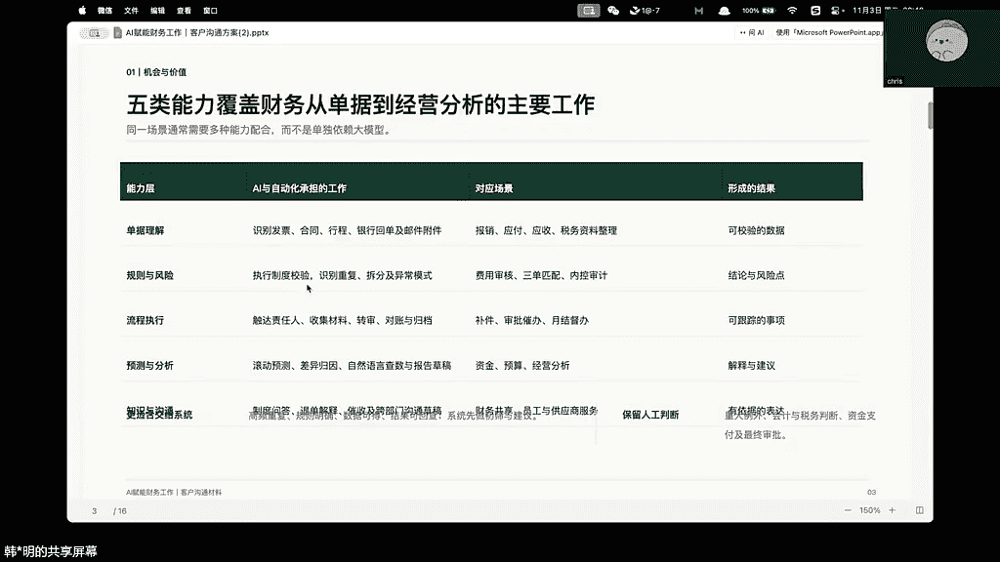

在推行过程中，经常会遇到一种误解，即部门老板觉得这不就是把之前的Circle从A系统挪到B系统吗？为了避免这种理解偏差，我们可以把各个部门的问题以全部上下文的形式呈现，让AI学习企业知识库，然后把所有问题拿出来，与不同角色的人对话，让他们看到这不仅仅是系统迁移，而是对企业整体的一次体检，并输出相应的报告。

这种体检视角能帮助不同部门理解AI项目的真正价值，避免将其简单等同于系统搬家。

## 本节总结

本节我们学习了在企业内部推行AI项目的步骤，掌握了象限表优先级排序方法，并了解了如何避免“系统搬家”的误解。

---

# 🎯 AI产品路径：09：典型落地场景实战

上一节我们讲了推行策略和优先级排序，本节中我们来看看几个典型的财务落地场景，具体是如何用AI提效的。

通过实际案例可以看出，AI在财务领域的应用已经不再是抽象的概念，而是能够解决具体痛点的工具。

以下是几个典型场景的核心要点：

- 第一是报销审核。以一笔上海差旅报销为例，系统读取事前申请、预算和附件，完成报销校验，发现缺失信息后通知补件。员工不需要再学习复杂的OA流程，直接用对话方式与Agent沟通即可。制度审核标准只需在关键节点保证信息可查、风险可识别，其余由AI负责理解和解释。这就像在羊肠小道上建高架桥，把不通的部分用智能化形式打通，串起各个部门。
- 第二是采购到付款，也就是三单差异对比。涉及采购方、收货方和供应方的发票，单价、数量、金额的差异由AI发现并生成工单，人工只在关键节点确认信息并与外部系统或真人交互。货物收到后，拆货、发票确认、仓库录入、换票确认等环节，人工做价值判断，AI自动进入系统，价值提升明显。
- 第三是应收回款、对账、争议和催收。三方可以放在同一个事项中一起推进，不再切分到特别细节的环节，决策链路变短，效率变高。例如华东客户A、华南客户B、华北客户C，都在同一个节点上确认事项并推进。
- 第四是月结管理。事前沟通变成了主动出发、催审和催收的流程，避免工作积压到月底。完成度和适宜度提高，与银行对账和往来核对的效率也随之提升。

这些场景还带来了一些隐形的提效。例如通过主动沟通提醒，减少员工拖延报销，从而减轻后续部门的工作量。财务朋友以前月底和季度底常常睡在公司，现在有了AI辅助，工作幸福感也随之提升。

## 本节总结

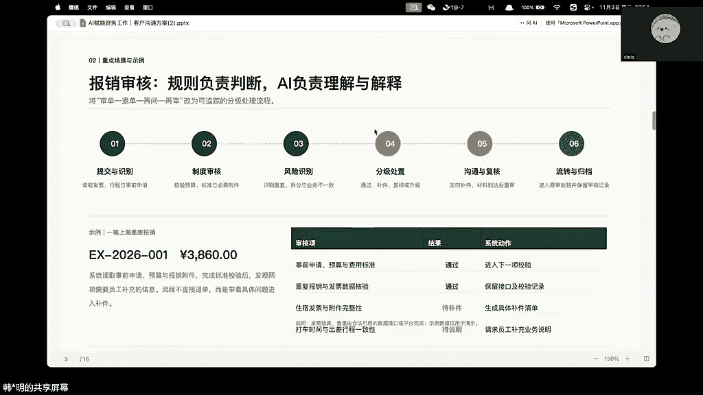

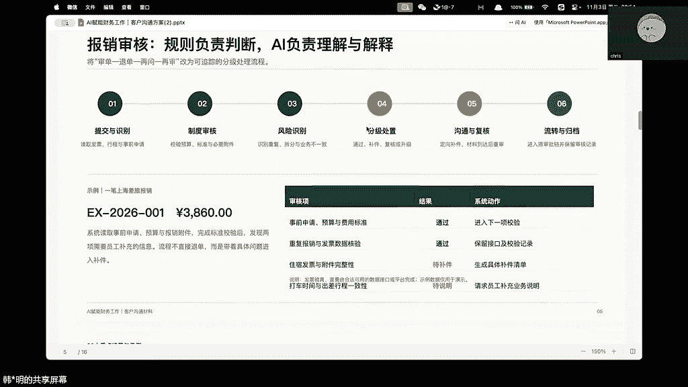

本节我们通过报销审核、采购付款、应收回款和月结管理四个典型场景，直观地了解了AI在财务领域的实际落地效果。

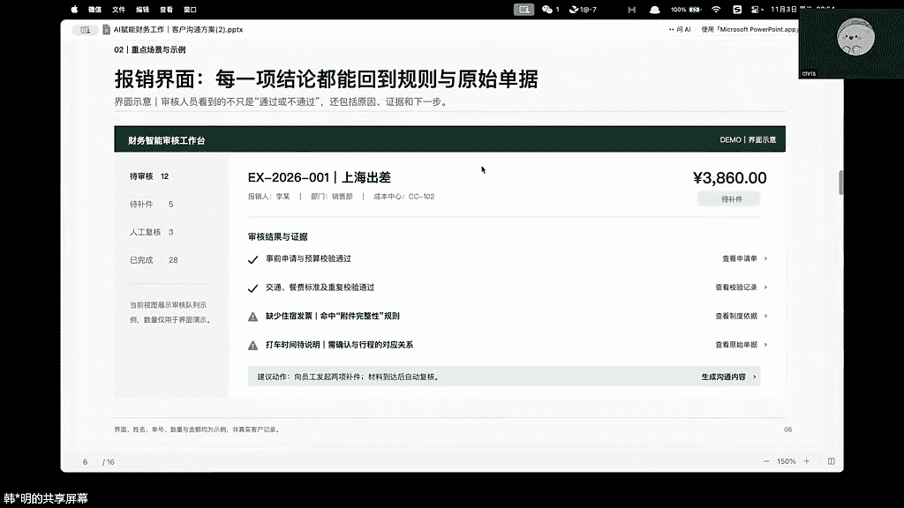

---

# 🔮 AI产品路径：10：预测分析与经营决策支持

上一节我们看了典型落地场景，本节中我们来深入探讨预测分析如何支持企业经营决策。

当系统里沉淀了足够多的数据和历史上下文之后，预测分析的价值才会被释放出来。例如有了前三周的具体数据后，第四周和第五周就可以产生基础数据，帮助经营决策者明确接下来应该投放多少预算，或者采取什么样的应用策略。

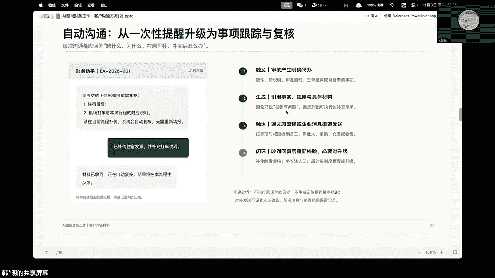

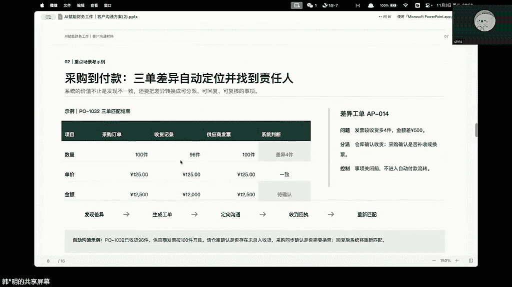

以下是预测分析在经营决策中的应用维度：

- 第一是预算与策略判断。基于数据可以判断业务目标能否达成，如果不能达成，分析原因是什么，差异来自于哪里，是否可以提前预判，是否可以加其他策略或能力来弥补。
- 第二是经营分析口径统一。以前做经营分析需要写Circle，不同业务口径不一致，光对齐口径就可能花掉半个月，等决策出来时可能已经失效。现在使用大模型直接取基础原始数据，用自然语言提问，结论可追溯，可以下钻到指标层、维度层和单据层的底层数据。
- 第三是经营决策的理性支持。财务数据能直接反映企业经营决策，结合外部数据后，可以分析公司下一季度应该怎么做，例如人力经营决策、出海业务决策等。AI的逻辑判断是绝对理性的，一旦底层规则写清楚，经营决策的账本就能快速算出结果，甚至可以预测明年下半年的大概情况。

这种基于数据的理性判断，可以帮助企业避免人为的主观偏见，为裁员、调岗、扩招等重大决策提供依据。

## 本节总结

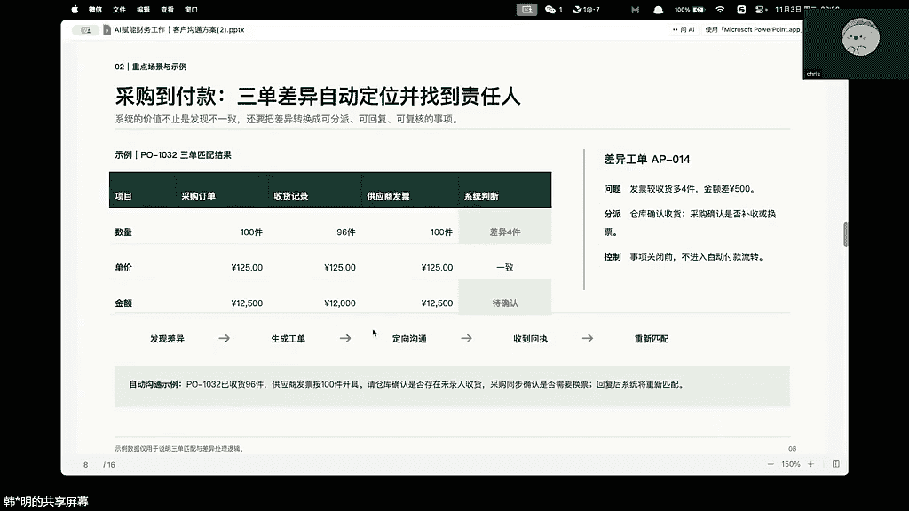

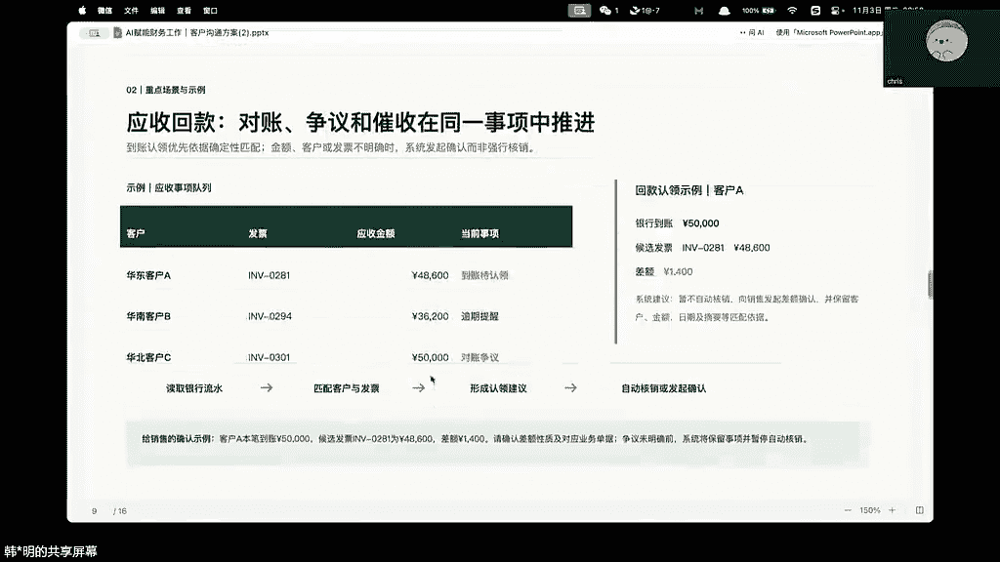

本节我们探讨了预测分析在经营决策中的具体应用，了解了数据沉淀对决策支持的重要性，并认识到AI在提供理性经营判断方面的优势。

---

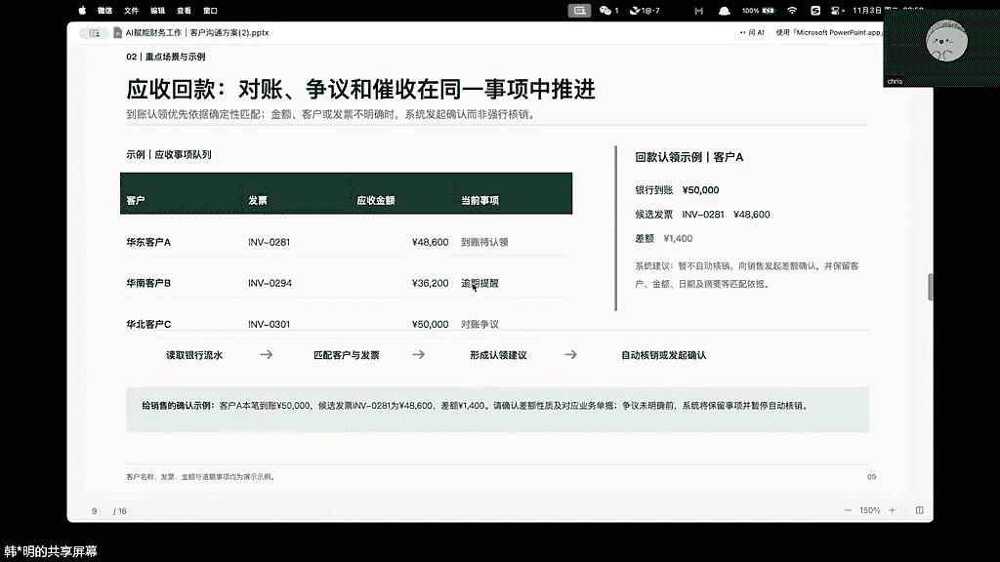

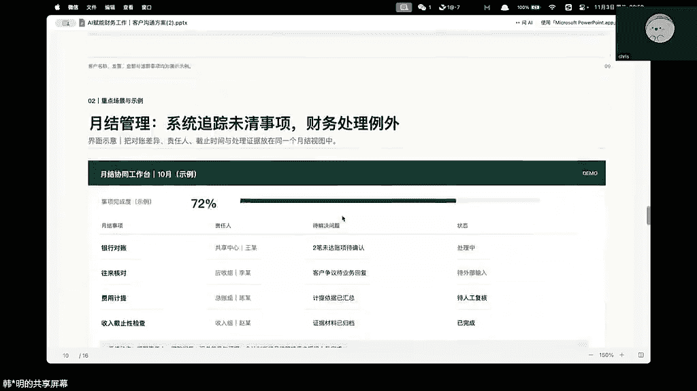

# 🛡️ AI产品路径：11：内审内控与技术架构设计

上一节我们讲了预测分析和经营决策，本节中我们来看看内审内控、审计以及技术架构设计的相关内容。

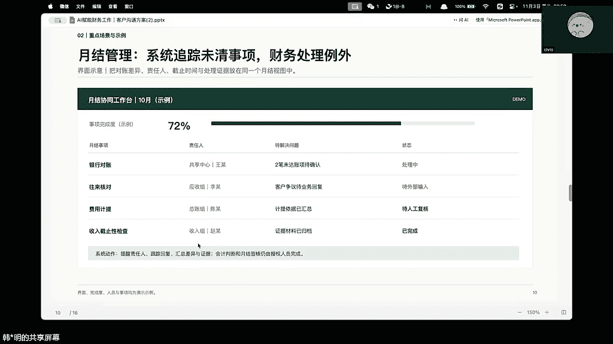

当企业的全流程和单据都已经记录到业务系统，模型和规则制定清楚之后，内审内控的价值就能充分体现。风险问题可以很快暴露出来，验证的数据包可以直接通过模型进行判断，各个部门可以看到各自的优点和不足，再通过人工复审来提前规避风险或建立新的规则。

以下是内审内控和技术架构的关键点：

- 第一是风险暴露与规则调整。当有足够数据时，企业出现的问题会被快速暴露，通过人工复审，可以提前建立新的规则和制度，对流程进行调整。
- 第二是技术架构设计。大模型不仅仅是其中的一层，它的执行必须受到控制。需要实施权限最小化访问，并保留人工复审环节。因为当模型能力越来越强，给到它的数据和能力可能会影响人的决策判断，人的判断仍然需要被尊重和保留。

内审内控不仅是事后审计，更是事中事前的风险防控。通过AI和人工的结合，可以建立更可靠的财务管理体系。

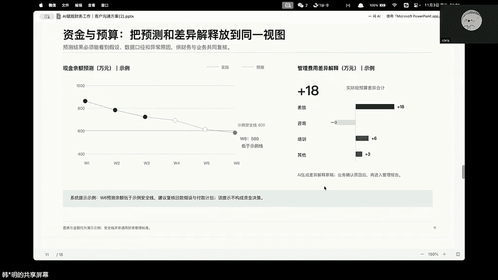

## 本节总结

本节我们学习了内审内控在AI系统中的作用，了解了技术架构设计中的权限控制和人工复审原则，强调了人机协作在风险管理中的重要性。

---

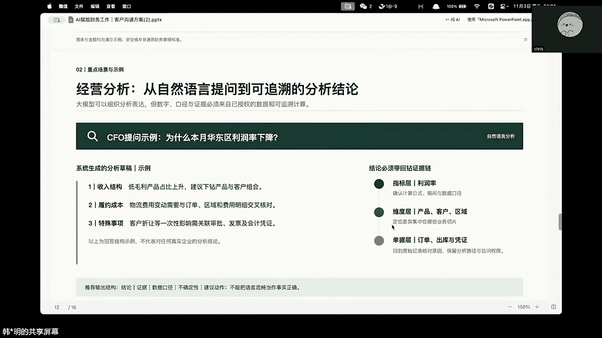

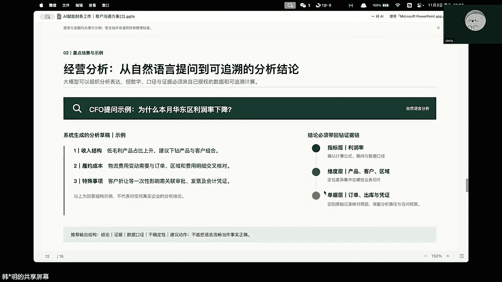

# 📚 AI产品路径：12：课程总结

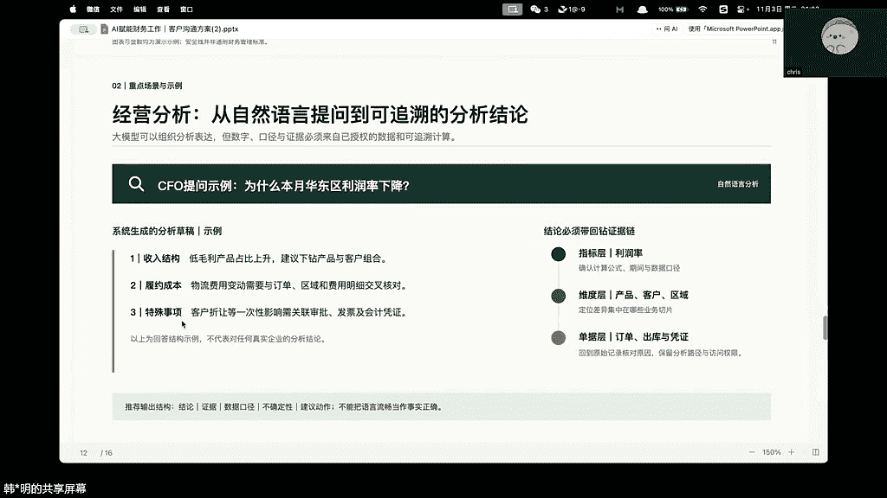

本节课中我们一起学习了如何在企业财务场景中落地AI产品，核心思路是先可用，再追求工程完善。

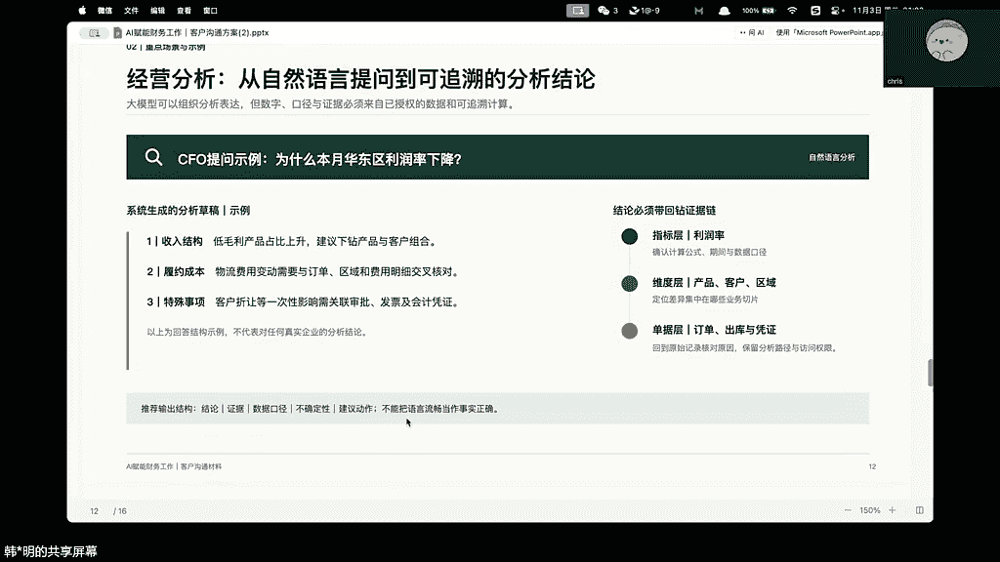

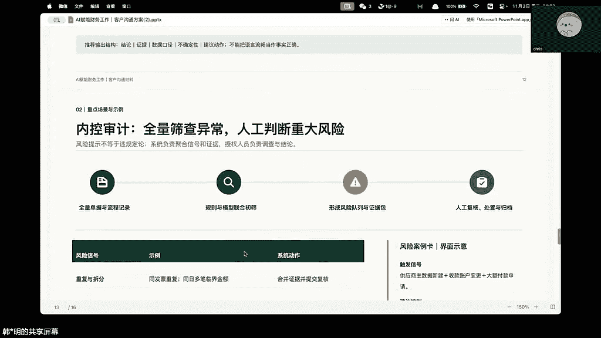

回顾整个教程，我们首先介绍了课程背景和财务核心业务，然后学习了需求收集阶段如何判断业务价值边界，接着掌握了财务业务五层拆解法，从单据抽象到自然语言报告，逐层理解AI的介入空间。我们还讨论了AI Agent的落地与系统集成挑战，尤其是面对老旧和封闭系统时的应对方法。

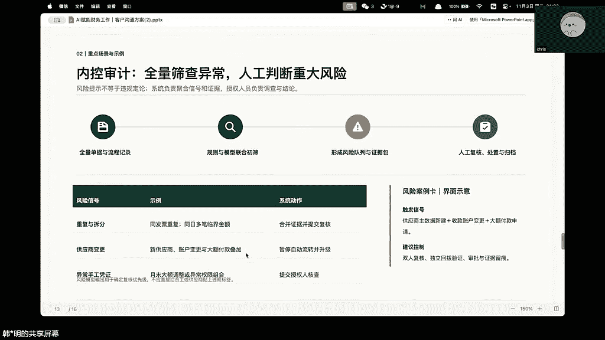

在能力演进方面，我们了解了如何从自动化工程过渡到预测分析和经营决策支持，并探讨了自然语言报告与制度问答的实际应用。关于产品边界与技术选型，我们对比了Skill与代码开发的优劣，并梳理了企业在技术选型时的实际考量。在企业内部推行中，我们学习了象限表优先级排序方法，避免了将AI项目简单等同于系统搬家的误解。

通过报销审核、采购付款、应收回款和月结管理等典型场景，我们看到了AI在财务领域的实际提效效果。最后，我们深入探讨了预测分析如何支持经营决策，以及内审内控和技术架构设计中的关键原则。

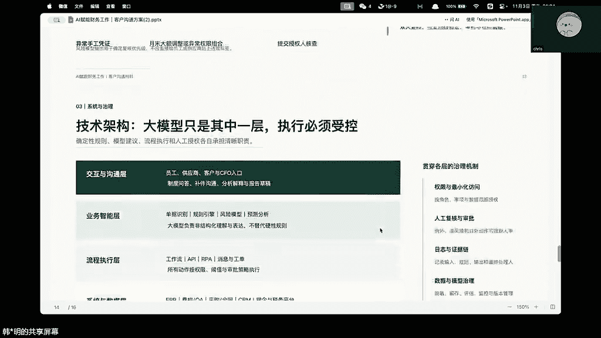

希望这篇教程能帮助初学者直观地理解AI产品在财务领域的落地路径，并在实际工作中能够先跑通，再逐步完善。

本节总结

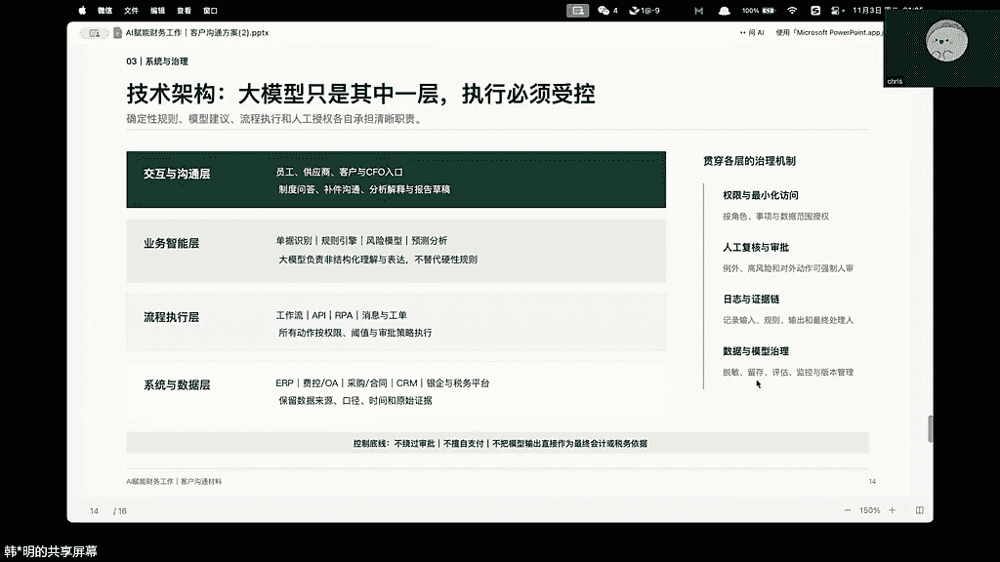

本节课中我们一起学习了AI产品在财务领域的落地思路、业务拆解方法、Agent落地挑战、能力演进路径、产品边界与技术选型、企业内部推行策略、典型场景实战、预测分析应用，以及内审内控与技术架构设计。

