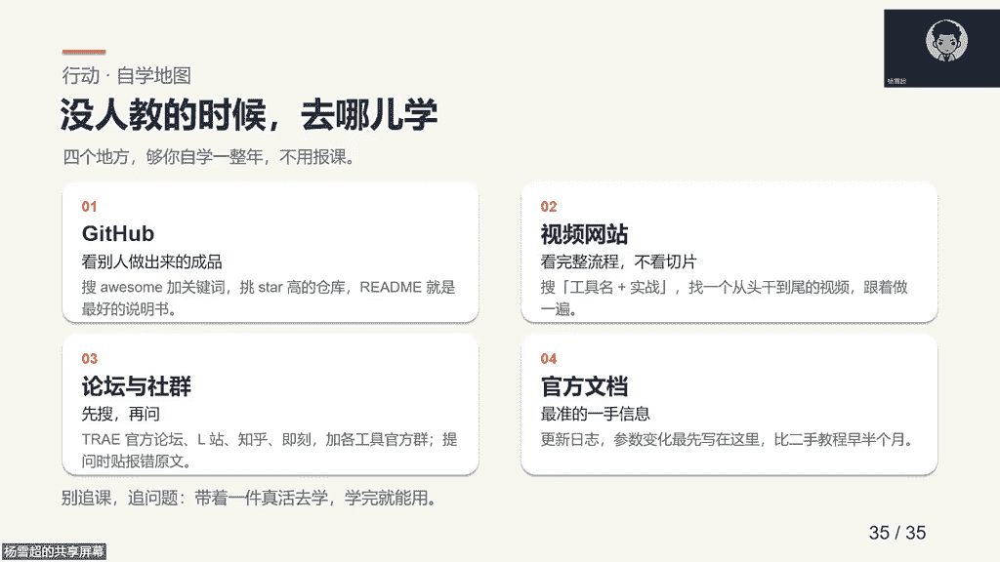
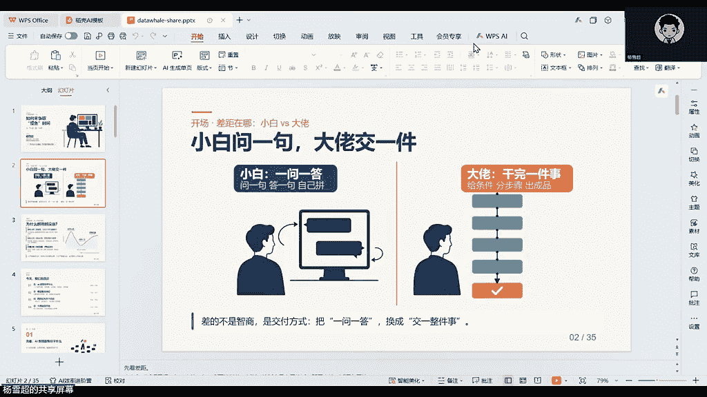

# AI办公技巧：01：AI办公场景与边界全解析 🤖

在本节教程中，我们将学习如何在日常办公中使用人工智能工具。内容涵盖AI认知曲线的基本原理，多个具体办公场景的实操方法，AI的使用边界，以及如何向AI提问以获得更好的回答。无论你是行政人员、技术人员还是管理人员，都能从中找到适合自己的应用方式，提升日常工作效率。

## AI认知曲线：从初次接触到合理应用

在接触AI工具的过程中，很多人的认知会经历一个明显的变化过程。最初接触时，往往会觉得AI无所不能，仿佛打开了一片蓝海，什么事情都能做。随着使用深入，会发现AI也有做不到的地方，产生失望情绪，觉得AI什么都不能做。经过日积月累，以及各类MCP工具逐渐增多，对AI的认知和使用技能会慢慢加深，最终达到合理应用的阶段。这个过程可以用下面的公式来描述。

```
AI认知曲线 = 初次接触AI → 认为AI无所不能 → 发现AI存在局限 → 产生失望情绪 → 持续使用并积累经验 → 认知逐渐加深 → 达到合理应用阶段
```

这个模型在很多场合都有介绍，帮助我们理解为什么有人对AI评价极高，而有人又觉得它毫无用处。了解这个曲线后，我们就能更平和地看待AI在办公中的作用。

## 场景一：电脑C盘清理与日常故障排查

上一节我们介绍了AI认知曲线，本节我们来看看第一个实际办公场景，即电脑C盘清理与日常故障排查。

在公司职能部门培训时，曾遇到一位女同事反映电脑C盘已满。她不方便找男同事求助，又觉得找女同事大家可能都不会处理。此时可以使用公司内部开发的基于TP的桌面云客户端，也就是智能体客户端。具体操作是先下载该客户端，然后对智能体说：“我的电脑C盘快满了，请帮我整理C盘。”智能体会分析C盘里的内容，列出哪些文件占用空间，哪些可以删除，哪些不可以删除，并给出详细说明。如果对某些文件不了解，或者有疑问，因为删除文件是比较严肃的操作，可以复制文件路径，继续在对话框中提问，例如：“这个文件里面有哪些内容，我是不是可以删除？”AI可以一直追问，直到用户确认可以删除，然后执行删除；如果不可以删除，就把该项忽略，只删除指定的文件。

这个场景对技术人员来说很简单，但对行政人员来说，电脑完全是一个黑盒，只知道微信聊天和简单的Office操作。因此AI带来的价值非常大。同理，电脑卡顿、没有声音等常见故障，也可以用同样的方式处理。唯一的限制是，如果电脑连不上网，无法联网，那么AI无法远程解决这个问题。

以下是C盘清理的具体操作步骤。
1. 打开公司内部的桌面云客户端。
2. 输入指令：我的电脑C盘快满了，请帮我整理C盘。
3. 查看AI分析出的文件列表，区分可以删除和不可以删除的文件。
4. 对不确定的文件，复制文件路径，在对话框中继续提问：这个文件包含什么内容，是否可以删除。
5. 根据AI回答决定删除或保留。

## 场景二：体检机构智能选型

我们刚刚完成了电脑故障排查场景，接下来看看第二个场景，即体检机构的智能选择。

以往选择体检机构，通常依据两个标准：一是认为医院体检比较专业，二是离家比较近。现在有了AI加持，可以将体检机构的相关材料放入项目中，并描述个人信息，让AI分析哪个机构更适合。例如在6到7个体检机构中，AI可能会推荐安徽医科大学第一附属医院，给出最高评分，并列出具体原因和优势，最终得出选择该医院的结论。这个结果可以作为准确的参考。如果觉得条件不够准确，可以修改提示词，直到觉得条件非常贴切，再使用该结论。

以下是体检机构选型的操作要点。
1. 将体检机构的相关材料上传到AI项目中。
2. 描述个人身体状况和体检需求。
3. 要求AI根据条件分析最适合的机构，并列出理由与优势。
4. 如果结果不够准确，修改提示词并重新生成，直到条件贴切。
5. 将AI结论作为参考，最终自行决定。

## 场景三：简历智能筛选与人力资源管理

体检场景演示了AI如何辅助个人决策，本节我们进入第三个场景，即人力资源部门的简历筛选。

人力资源部门筛选简历的标准比外部复杂。除了学历和专业，还包括学历背景细分条件，如本科、研究生、博士、学士等，专业对口与相近专业，高校本身的学科及等次，权重分数不同。还涉及QS全球排名和国内排名等计算规则。如果一个人每天收到2200到3000份简历，仅靠网站筛选只能筛出皮毛，筛选完后还有200到300份简历需要人工处理，工作量非常大。熟练人员最快需要上午的时间处理一两百份简历，新手可能需要一周左右。

针对这个场景，可以将筛选材料整理后制作成skill，进行训练和收敛，使算出的分数符合预期。验证通过后，可以随机抓取三份不同条件的简历进行测试，AI会给出三个分数。通常设定阈值为100分，满足条件的人留下来。在测试的三个人中，可能只有第一个人符合。如果100分的阈值筛选不够，可以调整为120分，快速筛选出20个人。这项工作对HR来说，原本需要一上午，现在只需要20分钟，剩余时间可以用于其他任务。

以下是简历筛选的实施流程。
1. 整理简历筛选的评分规则，包括学历、专业、高校等次、全球排名与国内排名等维度。
2. 将规则材料整理后上传，制作对应的skill并进行训练，使输出分数与预期一致。
3. 验证skill后，随机抽取简历进行测试，AI会给出对应分数。
4. 设定分数阈值，例如100分或120分，筛选出符合条件的候选人。
5. 将筛选时间从数小时缩短至二十分钟左右，剩余时间可用于其他工作。

## 场景四：公众号长文自动生成与流量获取

简历筛选展示了AI在行政审核中的效率优势，接下来我们看看第四个场景，即公众号文章的自动生成。

此前在抖音平台长文功能内测期间，平台会给予相关激励，每篇长文大约有200个加币，每天可以写5篇，封顶10000元。国庆节期间活动持续了几个月，作者大约做了两个月。作为技术和管理人员，没有太多时间写文字，也不擅长写作。因此将这个场景也制作成了一个skill，让它定点抓取新闻或视频内容，将视频内容转换成文本，甚至配图也一并生成。早期模型尚未支持多模态，因此使用另一个平台生成图片，再与文本组合。每次整理成一段一段的文本，效率很快，每天写两到三篇都非常快，选择合适的一篇直接发布到抖音平台。每天五篇的产量对作者来说非常快，不需要担心产量问题。

另一个优势是，自己吭哧吭哧认真写的文章，未必符合抖音算法；而用这种方式写出的文章，更符合抖音算法，因此更容易获得平台流量，出现了很多几十万浏览量的文章。按照这种方式做了两个月，基本每天不落地拿到激励，文章也有好多篇，流量不错。这也是定点抓取新闻这一特点的一个场景。类似的需求在销售、采购部门也很常见，需要从央国企或大型互联网平台抓取数据，传统方式是人工点击查看，现在完全可以用AI方式替代，效率会有明显提升。

以下是公众号长文生成的操作方法。
1. 选定感兴趣的视频内容，将其视频文本化。
2. 使用AI skill把视频内容转换成结构化的文本，并配置相应图片。
3. 由于早期模型尚未支持多模态，可使用另一平台生成图片，再与文本组合。
4. 每日产出两到三篇文章，选择合适的一篇发布到公众号。
5. 这种方式生成的内容更符合平台推荐算法，更容易获得较高阅读量。

## 场景五：儿童教育短视频制作

公众号内容生成解决了文字创作问题，本节我们进入第五个场景，即针对小朋友的教育短视频制作。

家里小朋友会问一些成人看来很幼稚的问题，但不能用成人的方式描述。可以在scale里生成专业的提示词，然后在智能体中生成一段小视频。例如关于月亮的科普视频，大约一分钟，画面卡哇伊，适合小朋友接受。这种视频类似于识字类平台里的小视频，也可以用来做识字、颜色认知、拼音学习等内容。这里提到了remotion，本质上也是靠代码驱动视频，原理与前面介绍的平台不同，此处不再延伸。

以下是儿童教育短视频的制作要点。
1. 确定儿童想了解的话题，避免使用成人化的表达方式。
2. 在智能体中生成专业的提示词，描述所需的视频内容与风格。
3. 生成大约一分钟的短视频，画面风格应卡通可爱，适合低龄儿童接受。
4. 可以扩展为识字、颜色认知、拼音学习等不同主题。
5. 此类视频的制作逻辑与代码驱动的动画工具类似，此处不再延伸。

## 场景六：AI生成PPT

教育短视频演示了AI在多媒体内容生产中的应用，接下来我们看看第六个场景，即利用AI生成PPT。

此次分享的PPT也是用AI制作的。首先了解听众基础需求，原来主要是办公场景，因此整理好框架，放入飞书文档列出提纲，审阅哪些地方符合，哪些地方有问题，及时修改。确认提纲没问题后，制作对应案例，比如前面提到的截图，这些是事后补充的，不是现场指导时制作的。案例图片命名好后，基于这些案例，通过开源的PPT工具进行绑定，让AI生成演示文稿。核心点其实不多，技术含量不高，但使用的skill效果很好。生成后配了一个生图模型，具体做法可以详细了解或交流。输入内容后，AI会进行苏格拉底式提问，问到没有问题时，才开始生成PPT。

以下是AI生成PPT的步骤。
1. 根据听众需求构思分享内容，整理大纲并放入飞书文档。
2. 审阅大纲，及时修改不合适的部分。
3. 制作相关案例截图并命名保存。
4. 基于案例与开源PPT工具进行绑定，让AI生成演示文稿。
5. 生成过程中会进行苏格拉底式提问，确认无误后开始生成，并可配套生图模型制作插图。

## 场景七：超级个体与OPC概念

PPT生成展示了AI在文档制作中的便利，本节我们进入第七个场景，即超级个体与OPC概念讨论。

AI流行时出现了一个新角色，大家比较了解的是FDE。在此基础上，具备相应能力的人都可以成为超级个体。又衍生出一个新名字叫OPC，字面直接翻译过来。在没有AI之前，超级个体完全靠个人实力；现在的超级个体是把所有东西都用好，AI的各种镜头都用好。个人觉得OPC完全是给灵活就业盖了一个冠冕堂皇的帽子，大家都在大众创业、万众创新，失业人员也可以通过此方式参与其中。

以下是关于超级个体与OPC的核心观点。
1. AI流行后出现了新的角色，通常称为超级个体。
2. 拥有相应能力的人可以将AI工具全部用好，形成个人作战优势。
3. 衍生出OPC这一新名称，字面即为以其他方式组织的个人工作单元。
4. OPC在某种程度上也为灵活就业提供了体面的表述。
5. 大众创业、万众创新背景下，失业人员可通过此方式重新参与经济活动。

## 场景八：课程表图片转日历文件

超级个体概念讨论了个人能力的释放，接下来我们看看第八个场景，即课程表转日历。

每次看MBA课程表时，都要在手机里找下周上什么课。现在可以拍一张课程表照片，生成一个ICS格式的文件，导入手机日历或备忘录。第二天早上上什么课，系统可以提前半小时通知，避免迟到。手机会像闹钟一样提醒今天是什么课，几点到什么教室，哪个老师的课。这个场景很简单，但大家可能没有把这些东西串联起来，这就是现场演示的效果。

以下是课程表转日历的操作方法。
1. 将MBA课程表拍摄成照片。
2. 使用AI生成ICS格式的日历文件。
3. 将文件导入手机日历或备忘录。
4. 设定提前三十分钟提醒，避免迟到。
5. 手机会像闹钟一样提示当天课程、教室和任课老师。

## AI使用边界：哪些任务可以交给AI

我们已经介绍了多个实际办公场景，本节我们来讨论AI的使用边界，明确哪些任务适合交给AI处理。

首先，隐私性不强、安全性不强、没有涉密文件的内容，可以放心交给AI做。如果涉及这类内容，就需要斟酌。如果公司有内部的智能体或大模型，可以使用内部的去做。其次，AI本身的边界，即什么能做，什么做不到。例如有图纸时，AI很多方面能处理，但有些场景图纸识别不了；AI绘图可以生成图片，但局部修改目前如果通过传统绘图模式是改不了的，虽然有其他模式可以尝试。

以下是可以交给AI处理的任务类型。
1. 隐私性较低、安全性较低、不涉及涉密信息的文件。
2. 公司内部已部署的智能体或大模型可以处理的业务内容。
3. 需要快速分析、整理或生成常规文本的工作。

以下是需要谨慎处理或不适合交给AI的任务类型。
1. 涉及商业机密、个人隐私或国家秘密的文件。
2. 无法联网的环境下需要联网才能完成的任务，例如电脑无法上网时的故障排查。
3. 目前AI无法识别或生成的复杂图纸与局部图像修改内容。

## 提问公式：如何让AI回答更好

了解了使用边界后，我们还需掌握如何向AI提问，才能获得更好的回答。本节介绍一个简单的提问公式。

```
提问公式 = 角色设定 + 具体任务 + 详细需求 + 输出格式
```

举个例子。如果只说“帮我推荐个篮球”，AI不知道你是谁，是篮球教练、学生家长，还是篮球爱好者，推荐会比较宽泛。这样的回答没有错，但需要再问。如果避免这种情况，要把角色身份明确说出来。例如：“我是一个学生家长，我家小孩三年级，现在想给他买一个篮球带到学校里面。”然后再加上需求：“请找10个性价比较高的篮球，并且说明一下优点在哪里。”这样AI就会以学生家长的身份回答，不会推荐篮球运动员用的专业篮球，也不会推荐专业性很强的篮球，回答会更专业。

刚才举的例子已经把这个套路包含进去了，是一个常见的问题模板。

## 行动与实践：只有动手才能掌握细节

提问公式解决了如何沟通的问题，但光有理论还不够，本节我们来谈谈行动与实践的重要性。

包括web coding、agent和其他一些工作流，听起来都很简单，但如果不去做，第一次做的时候就会觉得复杂。很多东西讲给你听时，你去做的时候感受不到。只有在自己做的过程中，潜移默化才会摸到那些比较细的东西。有些东西并不是大家讲的那样。现在知识比较平权，大家都能在网上找到这些东西。有的人讲的和大部分人一样，有些人讲的有一点点不一样，可能是因为他用得比较多，而且用的模型和大家不一样。你用得多了，会发现同样的东西，在不同模型之间也有差距。模型自己纵向对比也会有差距，这是因为Transformer原理所在，肯定会有一些差别。如果差距很大，那可能就是问的问题了。

## 学习资源平台：GitHub、视频网站与官方文档

实践中遇到问题时，需要可靠的学习资源。本节介绍几个常用平台。

以下是推荐的学习资源平台。
1. GitHub：研发人员常用的代码托管平台，适合查找开源项目与技术方案。
2. 视频网站：包括B站等平台，适合观看教程与操作演示。
3. 官方文档：所有技术的最新、最好、解决方案最多的来源，搞技术时应优先查阅。




## 总结




本节教程中，我们一起学习了AI认知曲线的基本原理，掌握了电脑C盘清理、体检机构选型、简历筛选、公众号写作、儿童视频制作、PPT生成、课程表转日历等多个实际办公场景。我们还明确了AI的使用边界，学习了角色设定与任务描述的提问公式，并认识到行动实践比单纯听课更重要。最后，我们介绍了GitHub、视频网站与官方文档等学习资源。希望你能将这些方法应用到日常工作中，提升办公效率。
