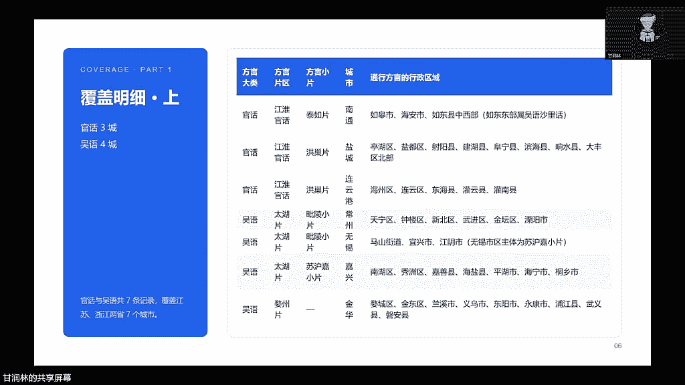

# AI方言能力：01：垂类方言数据采集与模型训练流程 📊

在本节课中，我们将学习什么是垂类方言数据，数据是如何从采集端流入模型训练的，以及为什么 AI 对方言的理解能力仍然有限。我们还会了解数据公司与模型公司的分工，并看到普通同学如何参与方言数据的采集与标注工作。如果你家里说方言，或者对语言数据感兴趣，这节课会对你有所帮助。这里我们先不急着深入技术细节，先把大致的脉搏理清楚。

---

### 学员提问：非标准方言能否参与采集

在课程开始前，有一位同学提出了一个典型问题。他说自己家是广东的，会说粤语但不太标准，想知道这种非标准的方言说话人能否加入采集计划。分享者给出了肯定的答复，表示这类人群完全可以参与，后续可以加入联系方式进一步沟通。

---

## 1：公司背景与项目来源

上一节我们做了简单的概述，本节中我们先来看看这门课的背景，以及负责这个项目的公司是做什么的。

这门课的分享者来自杭州汇智云图数据技术有限公司。这家公司主要专注于数据的采集与标注工作，业务涵盖大规模通用数据和方言数据两个方向。他们现在主要对接的人工智能厂商包括阿里云和数据堂等，其中数据堂是该公司最大的客户之一。分享者本人负责方言数据相关项目，项目团队中有好几位项目经理共同推进。

因为项目需要大量人员参与采集工作，团队想到了一个比较实际的思路，即从大学生群体中寻找合适的人选。大学是一个比较特殊的地方，不同省份、不同地区的学生在这里聚集，天然具备方言采集的地域优势。所以如果班级群里有大学生，值得重点关注这个项目。

分享者表示整个演示只需要三页幻灯片，讲解很快就会结束，希望大家先简单听一下，对整体项目有一个感性认识。

---

## 2：方言数据采集的完整流程

上一节我们了解了公司背景，本节中我们来看看方言数据是如何一步步进入模型训练的。

一个语言模型在训练之前，可能既需要普通话数据，也需要方言数据。比如说有些模型对方言的说话能力比较强，这背后依赖于前期的数据准备工作。在项目启动阶段，通常会安排数据外包商到全国各个省份、各个区县去采集本地的方言语音。采集完成后，这些分散的数据会汇聚到汇智云图这边，进行项目的集中管理和质量控制。

随后，汇聚好的数据会再次分发给各个模型厂商。汇智云图在其中承担质检和转写的工作，也就是把方言语音转化成文字，然后交给模型进行预训练。



以下是数据的流转公式：

```
方言语音采集 → 地区汇聚 → 质检与转写 → 方言文本 → 模型预训练
```

如果你对数据采集、标注、质检，或者语言类的兼职工作感兴趣，或者希望积累相关的项目经验，都可以联系分享者。后续他会提供联系方式，屏幕上的二维码可以直接添加。任何关于方言数据的问题，都可以随时咨询。

---

## 3：方言的地域差异与解决方法

上一节我们梳理了数据的整体流向，本节中我们来讨论方言采集中比较棘手的地域差异问题。

方言有一个普遍现象，叫做百里不同音。即使都说粤语，广州地区和江门地区的发音也可能完全不同，有时候本地人去隔壁县城的店铺都听不懂对方在说什么。再比如吴语主要集中在华东地区，往下还能分出金华话、温州话等更细的分支。如果不加以区分，直接把所有粤语或吴语混在一起采集，会导致数据质量很差，模型也学不到准确的发音规律。

针对这个问题，公司主要采取两种方法。第一，与当地的高校合作。高校的学生通常具备较强的采集和标注能力，而且来自不同地方，方便覆盖多个方言区。第二，与当地的语言研究院或方言研究院对接。每个省份基本上都有自己的方言研究机构，那里的人员可以帮助完成细微的转写工作，并对区域进行更精确的划分，然后再开展针对性的数据采集。

以下是处理方言差异的两个主要步骤：

- 与当地高校合作，利用学生资源完成方言采集与标注。
- 与当地方言研究院对接，进行专业转写与区域细分，再开展采集。

---

## 4：AI 对方言识别的现状与垂类数据的必要性

上一节我们讨论了方言的地域差异，本节中我们来看看 AI 目前对方言识别的实际能力，以及为什么还需要垂类数据。

市面上现在的 AI 系统对方言的转写能力还很有限。拿本地方言举例，系统可能只能识别出一句话里的几个字，剩下的字经常识别错误。如果想让 AI 的方言能力向前进一步，就需要大量更细微、更垂直的方言数据去训练模型，这正是公司目前主要解决的部分。

为了更直观地理解，可以把数据分为两类。一类是通用非垂类数据，比如英语和中文之间的转换，这类数据比较容易获得，但属于大面的通用能力。另一类是垂类方言数据，比如某个县城、某个村庄特有的说话方式，这类数据非常难获取，但却是提升 AI 方言能力的关键。

有同学提出过一个类比问题。他记得以前用英语训练的模型在中文上也有一定效果，想知道方言模型是否也能这样，即在一种方言上训练好的模型，能否直接用到另一种方言上。分享者的回答是，英语和中文之间的转换属于大面的通用非垂类数据，容易获得，但两种不同的方言之间并不一样。方言数据具有很强的垂直性，不能简单通用，必须针对每个细分区域收集专门的数据。

用大白话解释，AI 学习语言就像一个人学外语。如果你只学过普通话，从来没接触过某个方言，那你听到那个方言时完全不知道在说什么。有些方言可能只在某个村庄里流传，用户说话时 AI 识别不出来，结果就会把整句话都理解错。

AI 方言能力可以用下面的简单公式来表示：

```
AI 方言识别能力 ≈ 通用语言基础 + 垂类方言数据量
```

---

## 5：数据公司与模型公司的区别

上一节我们分析了 AI 对方言识别的局限性，本节中我们来对比数据公司和模型公司的不同角色。

有些同学可能会把汇智云图和科大讯飞混淆。讯飞在语音领域起步较早，技术积累也很深，很多人第一反应会以为这是讯飞的项目。但实际上，讯飞是一家模型公司，或者说全链路公司，他们需要数据来训练自己的模型。而汇智云图是一家数据公司，专门做数据采集和标注，然后把更垂类的数据提供给数据平台，再由平台提供给 AI 公司。数据堂就是这样一个专门为 AI 公司提供数据的平台，汇智云图是数据堂的提供商之一。

从业务侧重来看，汇智云图更偏向于数据采集环节。讯飞虽然也有采集能力，但它是全链路布局，拥有各地方言和各种小语种的数据，基本上覆盖全球主要语种。汇智云图则专注于把细分的方言数据做深、做精。

另外，对 AI 模型厂商来说，数据是最贵的资源，而且各厂商的数据不会公开。如果一家公司拿到了某份数据，是不可能拿出来对外出售的。其他公司如果想用这份数据训练模型，仍然需要依靠数据提供商。讯飞在 AI 时代之前就已经积累了大量数据，但即便是这样，在 AI 时代数据依然像石油一样珍贵。

---

## 6：如何参与与联系方式

上一节我们对比了数据公司与模型公司，本节中我们来看看普通同学如何参与到方言数据工作中来。

如果你对方言数据采集、标注、质检，或者语言类的兼职岗位感兴趣，或者希望通过这个方向积累项目经验，都可以联系分享者。屏幕上的二维码可以直接添加他的联系方式。关于方言数据的任何问题，都可以随时咨询。

公司除了汇智云图负责的方言项目外，也有关联的数据业务，如果大家对数据堂相关的项目感兴趣，也可以通过分享者进行了解。后续如果有机会，团队还会带来更详细的预测数据讲解。

以下是可以参与的工作方向：

- 方言数据采集
- 数据标注与转写
- 质检工作
- 语言类兼职岗位
- 项目经验积累

---


本节课中，我们一起学习了垂类方言数据的采集流程，了解了方言地域差异的处理方法，认识了 AI 对方言识别的局限性，并明确了数据公司与模型公司的不同职责。希望大家对方言数据的价值有了初步认识，如果感兴趣可以通过联系方式参与其中。

