# AI短剧制作：01：工作流基础与批量生产 🎬

在本节课中，我们将学习如何利用AI工具完成短剧的制作全过程，重点掌握工作流搭建、批量生产方法以及成本控制技巧。无论你是完全没有编导基础的初学者，还是希望将AI短剧作为副业方向的创作者，都能通过本节课了解从剧本构思到最终视频输出的完整路径，掌握从零开始制作AI短剧的核心方法。

## 一、AI短剧的核心逻辑：故事优先

上一节我们简单介绍了AI短剧制作的整体目标，本节中我们先来看看AI短剧创作中最根本的逻辑是什么。早期的AI工具，比如LabV、SD或者ComfyUI，并不能直接操作网页中的页面元素，只能通过类似computer use或者play的方式去控制界面。这种操作方式生成的画面效果较差，而且非常消耗积分，因为AI本身不具备审美能力，每一帧、每一个步骤都需要人工进行仔细检查和反复修正，制作效率非常低。

随着基础模型的不断增强，现在的AI已经可以根据输入内容自动进行画面和节奏的调整。例如，使用扣扣袋扣ex等工具搭建的新型工作流，可以帮助创作者更高效地完成短剧内容的生成，大幅降低早期工具带来的制作门槛。

在AI短剧创作中，故事始终是最重要的核心要素。画面呈现、音效表现等艺术形式，都是为了更好地服务于故事本身。如果没有一个好的剧本或创意支撑，即使画面再精美，观众也很难产生持续的观看兴趣。反之，拥有强故事内核的短剧，即使制作相对粗糙，也能获得平台流量和观众认可。

我们可以用一个简单的公式来表达这个核心逻辑：

```text
AI短剧质量 = 故事内核 × 画面呈现 × 音效表现
```

在这个公式中，故事内核的权重最高，它直接决定了作品的上限。画面和音效虽然重要，但它们主要是放大故事效果的辅助手段，不能代替一个优秀的故事概念。

## 二、工作流与批量生产

刚才我们讨论了故事内核的重要性，本节中我们来看看如何将故事转化为可批量生产的工作流。传统制作方式需要创作者逐字逐句编写剧本和提示词，工程量非常大，不适合业余创作者或副业从业者长期坚持。而使用AI工具，可以大幅降低这部分重复性的人工工作量，让创作者把精力集中在内容策划上。

在实际操作中，AI可以充当导演角色，不过不同模型的导演能力存在明显差异。例如，GVT6.16.1或Opus 5.5的导演效果通常优于其他通用模型。使用AI导演时，不能直接下达模糊的通用指令，必须给它设定明确的创作方向和主题框架，否则生成的内容容易脱离实际需求。

目前市面上大部分AI短剧都具有明显的套路化特征。它们通常是更换主题名称、更换人物设定、更换视觉风格，然后套用同一个模板壳子进行生产。这种工作流可以实现真正的批量生产，其内核逻辑保持不变，只需要更换外部参数变量即可快速出新作品。

以下是批量生产中常用的可变参数：

- 主题名称
- 人物名称
- 人物关系设定
- 剧情逻辑走向

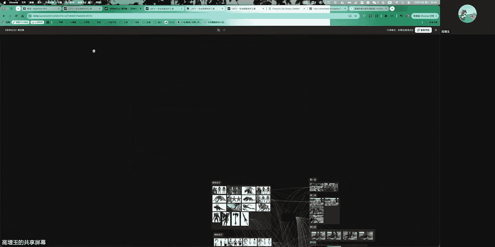

```text
批量生产流程 = 固定工作流内核 + 可变主题参数
```

观察各大平台上的AI短剧作品，大约80%到90%的内容都采用了类似的模板模式生成。如果你对输出质量有更高要求，也可以为特定主题单独制作一套专属工作流，以获得更精美、更符合个人风格的输出效果。

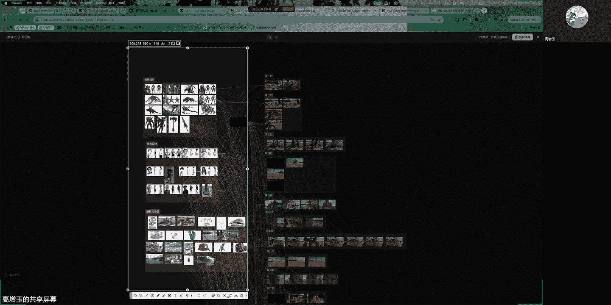

## 三、AI导演与人机协作

在了解了批量生产的基本原理之后，本节中我们来看看AI导演与人类创作者之间应该如何协作。使用AI制作短剧，本质上是人与AI的协作过程。AI承担“大脑”角色，负责内容生成和指令执行，而人类则承担辅助决策和最终审核角色，双方需要通过不断的对话来完成创作任务。

这种人机沟通虽然会让人类的语言表达看似有所下降，但这是提高整体生产力的必然代价。你不需要亲自完成所有繁琐的分析过程，可以让AI帮助梳理内容，然后查看AI生成的总结或模块输出，判断是否符合自己的创作理念。在与AI对话的过程中，你也可以跟随它学习新的创作方法，逐步提升自己的短剧制作能力。

## 四、LabTV工具与资产图

刚才我们聊了AI导演的协作模式，本节中我们来看看具体的制作工具LabTV是如何运作的。在当前的实战工作中，LabTV是使用较多的工具之一。它通过画布形式构建资产图，能够方便地管理图片、视频和音频的生成与相互关联，让碎片化的素材拥有条理化的存储方式。

LabTV的画布操作非常直观，完成内容编写之后，可以直接进行图片生成、视频生成和音频生成。在制作视频的同时，还可以同步添加背景音乐，无需频繁在不同软件之间切换，极大提升了制作效率。

不过，视频生成模型的使用成本普遍较高。如果你的设备条件允许，可以选择自行部署H3等模型，虽然会消耗一定的电力成本，但总体费用通常低于购买平台积分，适合长期大量制作的创作者。

资产图的核心作用是保证后续生成的画面不会发生变形或风格割裂。例如，对于怪物、人物、武器等关键元素，需要在资产图中准备三视图或九宫格图像，确保每个角度都有对应的参考图片。引用这些资产时，画布节点之间的连线就是引用关系，能够有效保证全片视觉的一致性。

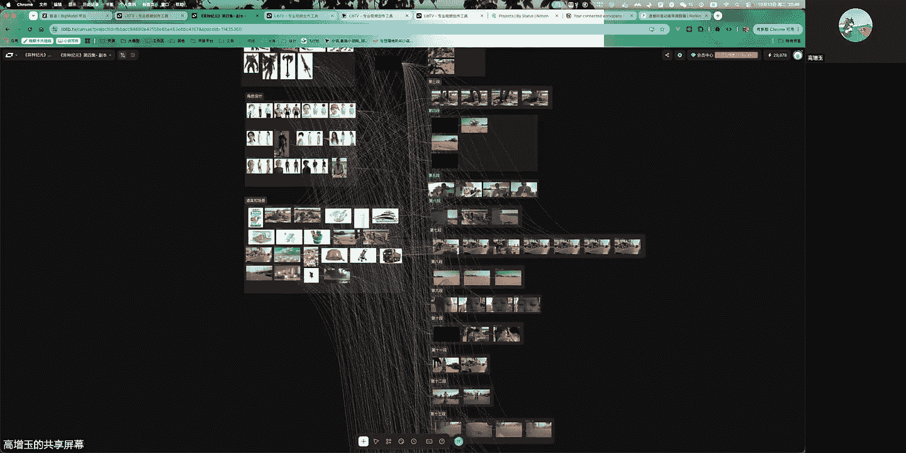

在资产图的具体操作中，背景音乐也可以单独生成，当然也可以在制作视频时直接生成，两种方式都可以根据实际项目需求灵活选择。

## 五、分镜图与资产生成

了解了LabTV和资产图之后，本节中我们来看看分镜图制作与具体资产生成的方法。分镜图是连接静态图像与动态视频的重要桥梁。使用SD2.0等模型，可以将静态图像连贯起来，形成流畅的视觉序列。虽然未经过优化时抽卡率可能较高，但完全可以通过调整参数实现连贯输出。

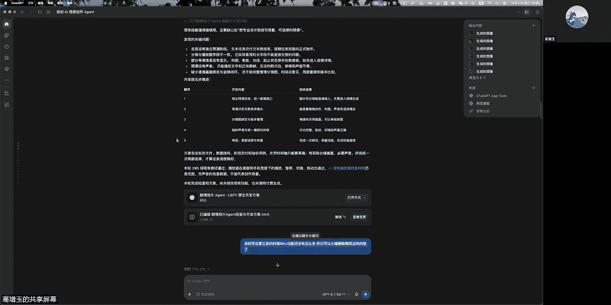

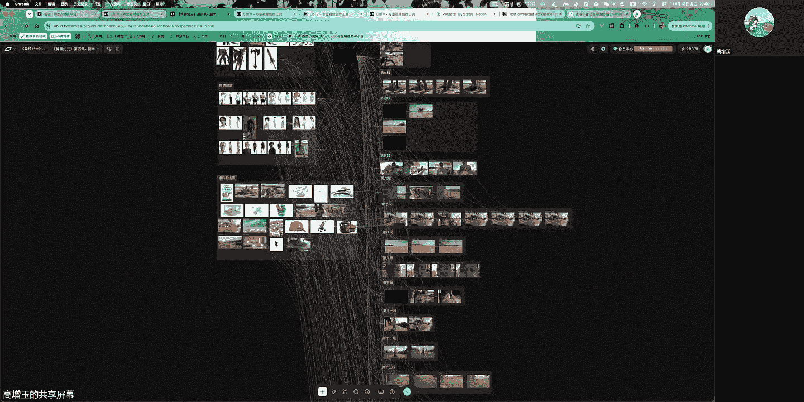

LabTV提供“查看制作过程”功能，但直接查看原始制作过程可能会让人感到混乱。将这些内容喂给AI进行梳理，就能理清资产图与视频段落之间的逻辑关系，让制作思路更加清晰。

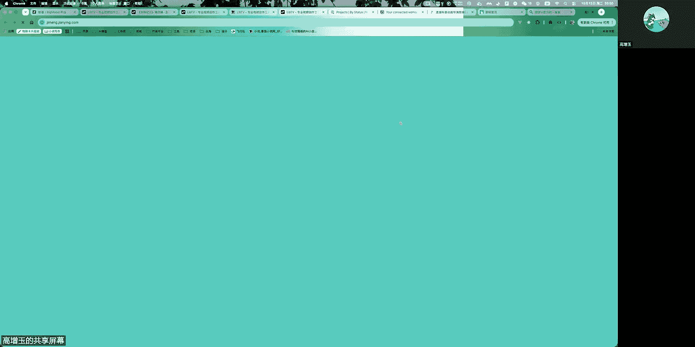

角色资产的创建需要特别注意授权问题。如果使用真人肖像作为角色基础，必须先进行肖像授权，无论是使用自己的还是朋友的图片，都需要获得明确许可。授权完成后，将角色导入库中并生成三视图，然后才能进入后续的场景制作环节。

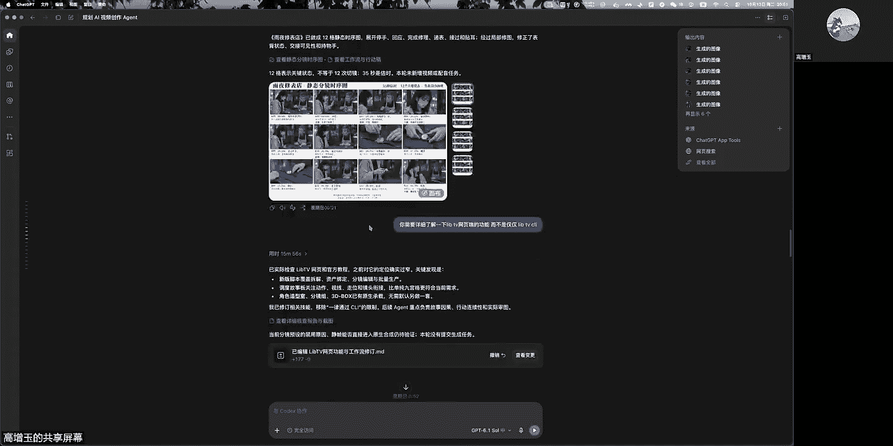

场景资产的范围很广，通常包括怪物设计、角色造型、道具场景等多个类别。生成这些图片时，建议使用Jay、SD5.0、Pro或Imagine2.5等模型，并且必须使用2K分辨率，不要生成模糊的低清图片。图片生成消耗的积分并不多，使用高分辨率能显著提升后续视频的画面细节表现。

以下是场景资产通常包含的常见要素：

- 美术位置设定
- 空间结构安排
- 材质质感表现
- 灯光效果布置
- 背景环境构建
- 重力表现处理
- 基调色彩定调

场景图生成之后即成为固定资产。如果要制作连续剧类内容，可以将这些资产保存到资产库中，后续新剧集直接导入复用，无需重复生成，能显著提升系列化制作的效率。

## 六、提示词生成与剪辑

完成资产生成之后，本节中我们来看看提示词的编写方式与视频剪辑环节。提示词不需要完全依赖手写，纯手写太麻烦且效率低下。应该使用AI来编写提示词，然后由人工进行适当审核。由于当前大模型的能力已经很强，很多时候甚至不需要人工审核，直接使用AI生成的结果即可。

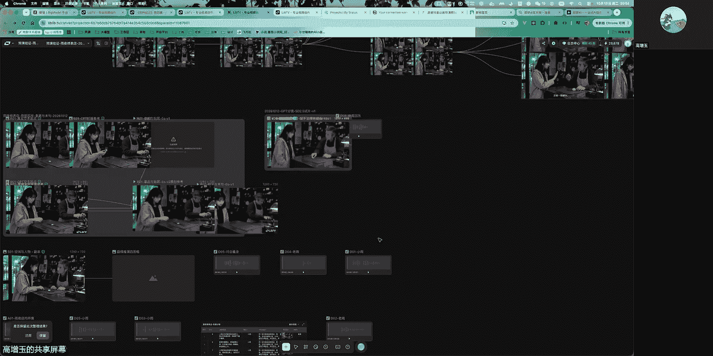

在提示词编写完成后，就进入视频剪辑阶段。GPT或Opus 5.5等模型可以引用类似FFmpeg的工具进行视频剪辑，支持按照音乐节奏进行卡点剪辑，使画面与音频更好地同步。

如果创作预算比较充足，可以使用Opus 5.5担任导演角色，同时使用中文能力较强的模型，比如钱梦雅系列或GPT6.0/6.1等，担任编剧角色。编写剧本或提示词时，不需要使用极高额度的模型，轻度或中度模型通常就足以完成任务，能够有效控制成本。

在实际案例中，早期针对极梦AI编写的skill工具，后来已经调整为适配LabTV的新版本。旧版本输出的效果较差，往往只是静态图像，缺乏动态表现。通过制作封镜时序图，明确每几秒钟的具体画面内容，可以将静态图像连贯起来，随后进行视频串联就变得非常容易了。

## 七、降低成本的生成策略

掌握了提示词和剪辑的基本方法后，本节中我们来看看如何在实际制作中降低成本。使用UNI等工具生成图像的成本非常低。制作完成分镜图之后，按照封景索引生成视频，可以大幅降低出卡率和整体制作成本，适合预算有限的创作者尝试。

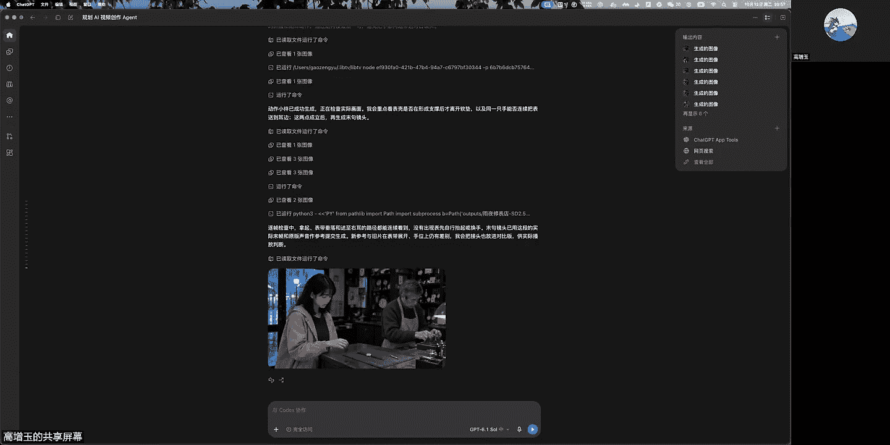

早期生成的画面中，人物表情和动作容易显得僵硬，这些都是后期需要重点微调的失败点。你可以与AI进行多轮对话，针对性地调整表情和动作细节，让画面更加自然。

开始生成视频时，不要直接使用702P或720P等高清规格。建议先使用480P先生成，检查动作和面部表情是否合适，确认满意之后再提升分辨率。这是降低试错成本的有效方式，可以避免在不满意的画面上浪费积分。

对于简单的过渡画面或者纯场景描述，如果不涉及动作打斗或微表情等复杂内容，可以使用低成本模型来完成生成。例如H3、mini20H3、2.0mini或者快乐码等模型，它们的成本比SE低很多，适合对画质要求不高的辅助镜头。

以下是几款常用的低成本生成模型：

- H3模型
- mini20H3模型
- 2.0mini模型
- 快乐码模型

```text
成本优先级 = 场景复杂度 ÷ 模型单价
```

生成完成之后，需要将各个片段进行串联剪辑。AI剪辑可以通过安装相应插件来实现，该插件能够解析图片中的暗帧，结合VLM模型识别画面与音乐节奏的匹配程度，从而生成完整的剪辑脚本。不过，通用模型并不擅长处理所有剪辑风格，需要针对特定风格进行训练调优，才能在实际使用中得心应手。

## 八、编导基础与风格沉淀

在了解了成本控制策略之后，本节中我们来看看编导基础与个人风格的培养方法。即使你目前没有编导基础，也可以通过后天的系统训练逐步掌握。创作灵感可以来自旅行照片、个人梦境等各种生活素材，虽然梦境内容往往不连贯，但可以作为创意的起点进行加工。

审美本身是因人而异的，没有绝对的标准，关键在于作品看起来是否让你自己感到舒服。建议多观看抖音、视频网站以及经典电影的镜头画面，将喜欢的构图和色彩截取保存下来，作为个人素材库进行提炼和沉淀，积累属于自己的视觉语言。

不要试图在短时间内掌握所有知识，优秀的导演通常都有自己固定的风格，不可能一个人同时拥有多种截然不同的导演风格。使用AI制作短剧时，每个工作流都应该保持一个统一的风格。初学阶段最好只保持一种风格，等到熟练掌握之后，再在不同场景之间穿插经典电影的风格元素，效果会非常好，能够让作品既有统一感，又不失多样性。

## 九、人机协作的角色分工

刚才我们讨论了个人风格的培养，本节中我们来看看AI导演工作流中人类应该扮演什么角色。在AI导演工作流中，人类主要承担审核者角色。AI负责初步生成内容，人类负责审查生成结果，并指出不合适的地方，由AI进行后续调整和优化。

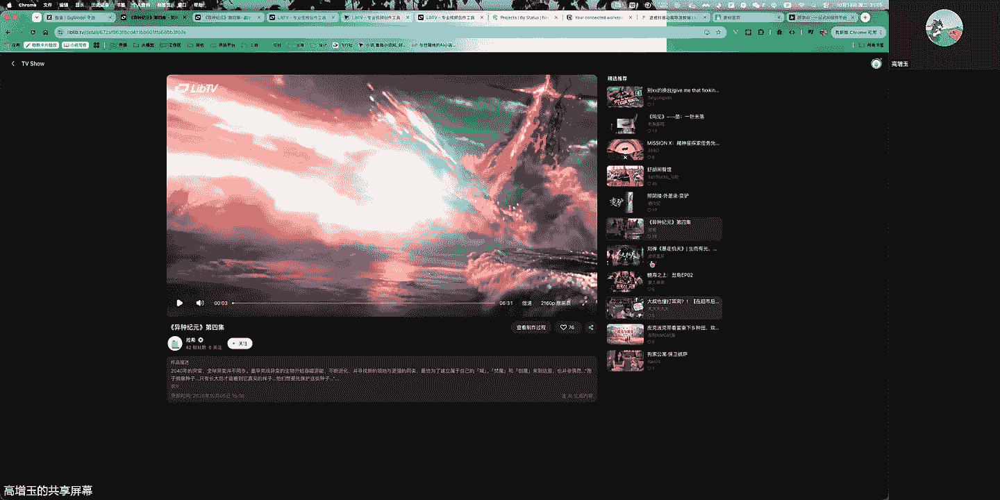

在开始创作之前，需要给AI设定明确的选题、主题和视觉风格。主题可以是亲情、爱情、科幻、日系或者韩系等方向，风格也需要事先告知。AI生成内容之后，人类进行审核，指出哪里合适、哪里不合适，AI再基于反馈进行修改。这个过程不可能一次性就生成完美的作品，都需要经过反复的实践打磨才能逐渐提升质量。

## 十、总结

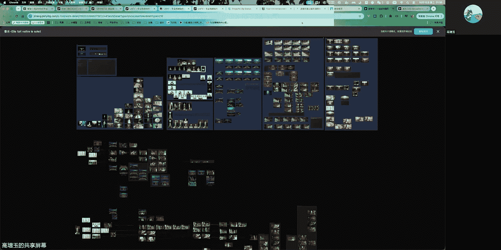

本节课中，我们一起学习了AI短剧制作的工作流基础与批量生产方法。我们了解到故事内核是AI短剧成功的关键，掌握了如何利用固定工作流实现内容的批量生产，学习了LabTV工具与资产图的使用方法，掌握了分镜图制作、资产生成和成本控制策略，以及AI剪辑和编导风格沉淀的基本思路。

希望这些内容能够帮助你快速入门AI短剧创作，开始属于自己的批量生产实践，在AI短剧领域探索出适合自己的创作路径。
