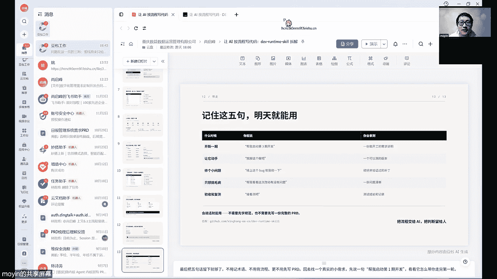
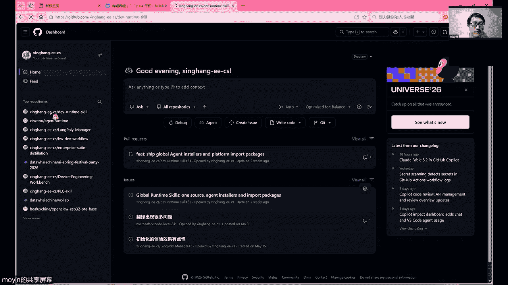
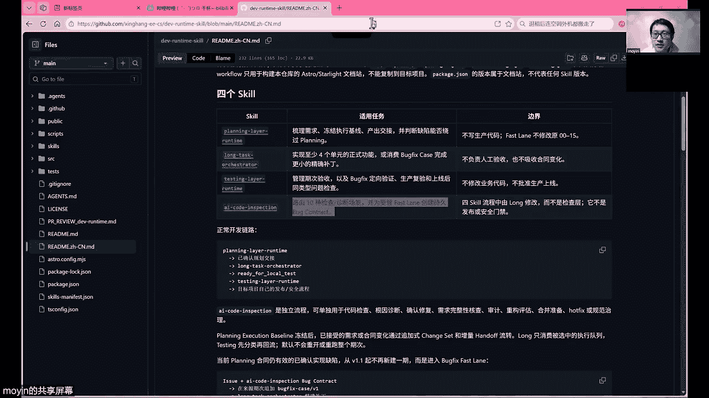
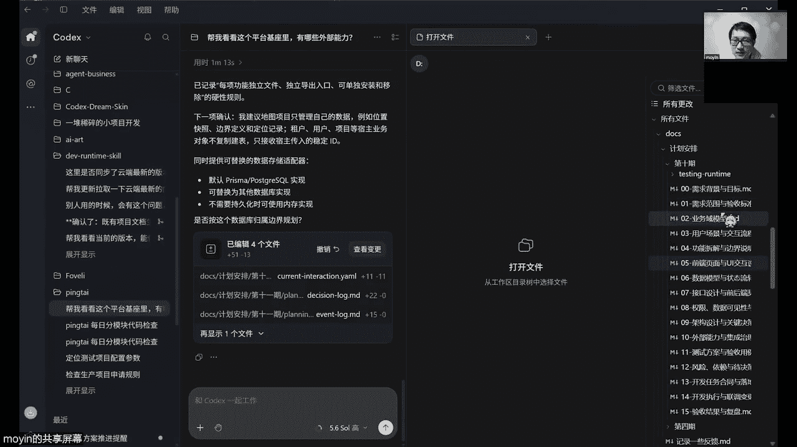

# 📚 Datawhale AI+X AI编程实践：01：课程概述与核心痛点

在本节课中，我们将要学习为什么很多AI编程项目会失败，以及如何通过构建一个专门的Skill来解决需求不准、AI不可控、维护困难这三个核心问题。本节课适合初学者，不需要你具备深厚的编程基础，只需要理解软件开发的基本流程即可。

在实际工作中，很多人尝试用AI来写代码，结果往往不是很理想。最常见的情况是，我们对着AI说了一大段需求，AI生成了一堆代码，但是最后跑出来的效果跟我们心里想的差得很远。或者代码跑通了，但是过了两周要改东西的时候，发现根本看不懂AI写了什么，更没有办法快速修复。这时候项目就容易夭折，或者变成一个无法维护的烂尾工程。

为了让你更直观地理解AI编程失败的原因，我们可以用一个简单的公式来描述：

```text
项目失败风险 = 需求模糊程度 × AI不可控程度 ÷ 文档记录完整度
```

这个公式的意思是，当需求越不清楚，AI跑得越随意，记录越少，项目失败的概率就越高。反过来，如果我们能把需求说清楚，能够掌控AI的进度，并且把每一步都记录下来，那么项目成功的几率就会大大增加。

接下来，我们进入下一节，重点看看这个专门设计的Skill是如何解决上述问题的。

# 🛠️ Datawhale AI+X AI编程实践：02：Skill的核心设计与三大问题

上一节我们介绍了AI编程失败的核心原因，本节中我们来看看Skill是如何解决这三个问题的。这个Skill本身是用来解决一个人负责需求梳理、代码执行、测试以及部署上线整个全流程的问题。如果只有一个人，单纯使用纯粹的AI，可能会出现各种疏漏，做完项目后也无法复盘，也无法衔接下一个环节。

因此，这个Skill被专门设计出来，主要解决以下三个问题。

第一个问题是目标问题。很多用户不需要了解什么专业的PRD，可以通过不断和AI沟通的方式，让AI来追问你，从而把需求完善，把边界明确。大部分软件失败的核心点，就是最初的需求没有给准确，这个环节就是去解决这个问题。

以下是需求阶段的主要目标：

- 通过多轮对话明确需求边界
- 无需用户掌握专业PRD编写技巧
- 让AI根据用户意图逐步逼近真实需求

解决了需求不准之后，我们还要面对另一个让人头疼的问题，就是AI在开发过程中让人感觉不可控。

第二个问题是可控性问题。我们不知道AI跑到了哪里，写的代码是什么样子，对于AI是不可控的。这个Skill会让开发全流程和当前阶段都有非常明确、清晰、量化的结果，不会有AI在往前跑但我不知道跑到哪里的恐慌感，你会有一定的掌控感。

以下是可控性保障的具体表现：

- 每个开发阶段都有量化结果
- 当前开发阶段清晰可见
- 全流程进度可追溯

有了掌控感之后，最后一个需要解决的问题，是关于项目后期维护和迭代的问题。

第三个问题是维护和迭代问题。AI跑完一遍，东西上线了，很好，但后续维护时，AI又要花大量精力和时间重新读一遍原来的代码，还要花很多时间让AI回顾重温，没有办法拿到能够复合、确认、承接甚至迭代的东西。这个Skill每一次迭代、每一次落地，都会有非常明确的说明、记录、日志以及复合的结果，交付给我们后续迭代时，就会花更少的精力，让软件更像我们想要的方向去发展。

以下是迭代友好性的关键点：

- 每次迭代都有说明和记录
- 保留日志和复合结果
- 降低后续维护的时间成本

# 📦 Datawhale AI+X AI编程实践：03：安装与文件结构

好了，三个核心问题介绍完了。本节中我们来看看这个Skill到底在哪里，以及安装之后会生成哪些文件。

这是我在GitHub上做了开源分享的，大家随时都可以安装。安装指令就是一句话，大家也可以拿来参考。比如说你有这样的一个地址，直接告诉AI帮我直接装一下，就这个time scale就可以了。

这里面也做了多端适配，我主要核心是用在Colex这个环境里面。比如说大家用在Clo Pilot等等的，虽然这里面没有写，但是AI现在变得很聪明了，比如说在使用它的一些DSH，这些Agent，你也可以让他来帮你把这一个环境部署到你当下需要的地方。

好了，他也会去检查我们整个的东西，我对这个Skill做了一个版本控制。所以后续如果大家有一些想法，说这个里面还并没有完善地帮到自己在某一个环节上，想要提交一些PR，是可以的。如果后续迭代确实有价值，我们就把它放到我们的Skill里面去，迭代我们的版本。对于安装了我们这个Skill软件的伙伴们，也不会因为新东西带来干扰。

后续安装，可能会有一些更新之后，也可以去使用到大家的一些东西。好了，这个里面我们整个Skill是跟代码不会有一些相关的参考代码，也没有一些模板，后续如果有需要的话，我也可以去加，但目前是没有的，主要核心还是一些操作规范以及一些相关的东西。

目前装完的话，它总共会有这么几个文件。一个是这个runtime skillruntime skills skills，这个东西就是跟我们这个Skill相关的一些运行的一些内容。包括这个Skill里面，它还包含了一个我们自己的表达的一些习惯，还有一些东西，就相当于装了一个之前比较火的Open Cloud的那个人格，或者说对于用户的性格的一个判断。

这样的话有一个好处，就是我们后续在不断使用这个Skill的过程中，在开发软件的过程中，它可能会逐渐了解你说话方式和习惯。那么他在需求层面，在这个需求阶段上，就能够更好的提供一些支持，或者说提供一些建议。

以下是安装后的主要文件说明：

- runtime skillruntime skills skills：与Skill运行相关的内容
- 用户表达习惯文件：记录用户说话方式和偏好
- 人格性格判断文件：类似Open Cloud的人格设定

文件结构清楚之后，我们接下来看看这个Skill平时都会说哪些话，也就是它具体是如何工作的。

# 🗣️ Datawhale AI+X AI编程实践：04：四大技能包与常用话术

上一节我们看了安装和文件结构，本节中我们来看看这个Skill经常使用的哪些话，总共是这么几个，5个话。

以下是这5个常用话术的简要介绍。

第一个话主要是用来启动我们的Plan，就是我们总共是有4个Scale的技能包。第一个就主要是启动我们的Plan计划，也就是我们这个需求阶段的环节。启动之后，比如说我们是分期的，会有第一期、第二期、第三期，我们可能第一次的时候就是第一期的开发，然后我们把需求告诉他们之后，AI就会根据我们的需求，不断梳理，不断引导我们去问，就是他觉得是不是这个样子，跟我们来做一个交互。在做交互的过程中，一方面我们对需求会变得更加具体，另一方面也是让AI真正跟我们的想法逐渐靠近的过程。当这个环节真正全部落地下来之后，AI所能做到的最终产品跟我们所设想的就会非常非常非常相近了。

第二个话就是很简单，就是按这个做吧，然后他经常会用在我的Plan阶段，就是我的需求阶段已经落实差不多了，我觉得AI已经懂我的意思了，他已经拥有了能够执行的程度。我就告诉他说，你就按我这个方式去做，然后把它做好。这个时候AI就会自己去跑整套的执行流程，然后会严格按照需求时规定的一些内容，然后把它跑完。

这里面还有包括了线上的Bug，我们经常会遇到临时线上会有一些Bug，或者说出现一些问题。对于非专业软件开发的伙伴们来说，有时候会很头疼，比如赶时间，不然线上网站可能带来的损失会越来越大。我们有时候会给别人做服务。这个就很好用，我们给到之后，他因为有了已有的计划和需求落下来的内容，可以快速知道Bug在哪里，并且能快速去修复，并且能够提上去，如果不提上去，然后去快速让新版本上线起来。这个是专门在这个场景上去用到的。

然后还有这个，帮我看看这次改动有没有问题。其实我们大部分的时候，以及AI在开发过程中经常性的会出现一个问题，就是他可能自己开发过程是外观上是OK的，没有什么风险，但是他的风险都藏在了底下。那么我们就可以通过这样的一些话，还有内容，让他在对自己的这些代码和执行流程做一次审查。说不定有时候有一些非常隐秘的问题，就有可能会被AI给挑出来，就让他专门挑毛病。挑出来之后去给他做解决，那么我们整个代码或者网页的风险就会进一步降低。这对于非专业者来说，会是这样的效果。

接着测吧，这个就是在我们测试的环节，就是我们整个开发的流程分为了需求，以及代码的开发执行，以及到代码的测试。那么在整个环节里面，其实更重要的除了需求阶段非常重要之外，其实也就是一个测试阶段，尤其是有AI的环节中。我们要让AI去更充分地测试它AI的整个流程。这样的话我们也心里有底，用起来也相对比较稳定一些。同时在整个测试的环节里面，就是平时像我们用AI去交流的时候，AI我告诉AI到底要怎么去测，来帮我执行这个事情，或者说我问AI，AI告诉我哪里建议可以测一测，是这样的一个交互方式。有了我们这个Skill之后，我们就变了，我们可以告诉他一个接着测的指令之后，他会主动地把一些测试的一些节点，比如说要测试哪一个环节，拿出来给到我们。如果是需要我们来辅助的，比如说在这个页面上去点击操作这种交互的一个流程，那么它是可以直接实现的。然后他会告诉我整个流程，我来按照他的方式，无脑的去给他操作一遍是OK的。然后如果是他自己要去解决的话，他自己会处理，就不需要我们去关心，就相当于有点无脑化的一个流程吧。

# 🎬 Datawhale AI+X AI编程实践：05：真实开发场景演示

刚才介绍了常用话术，本节中我们来看一个真实的开发场景，看看这些话是怎么在实际项目中用的。

就比如说我最开始的时候，我就可以说帮我启动一下第三期的开发。那么他的话就会去开始摸我们这样的一个开发需求，如果是第三期，那么他已经有了第一期和第二期的一些经验，他在做第三期的时候，他就会去重温，但是重温的时候，这个时候Token会花的少一些，因为我们已经有了一些成果，有一些日志，那么他就可以去看那些文档，然后来了解我们到底到了什么阶段，然后呢，他现在我们可能需要的是什么样的需求。但是后面他也会问我们，在这个环节中不断地去交互。

比如他会问我一些说有哪些功能，然后这些功能要去做到哪，做到什么样情况，他会问我们，我们来告诉他。我比如要做一个运营的相关的一些报表的一个处理，然后他大概是要做到什么样的情况。然后他就会把这个需求给整理起来，并且会形成一个非常严谨的文档。我记得是我列了0到15个，也就是基本上16个文档。

以下是需求到文档的转化流程：

1. 用户提出模糊需求
2. AI多轮追问，明确功能和边界
3. AI生成0-15个严谨文档（约16个）
4. 需求转化为标准PRD
5. 输出可直接开工的说明或列表

它会一步步地把我们的一些需求变成一个非常标准、非常严格的PRD的流程，然后最终落到真正的可以被实现的环节中。那么最终我们所能拿到的那个文档，或者是那个内容，它是一个直接能够开工的说明或者列表，而不是一些提问的记录，或者一些内容。那我们也很清晰，这个东西我们要后续复查的时候，查哪里的问题的时候也很清晰，很容易。

这个是刚刚说到的那个需求到执行的环节。然后我们就可以告诉AI接着去做这个事。那么他会做的一些细节，就是包括他会把一些就像一个大块的活，我们可能有一些活它是非常大的，一个完整的一个需求，那他会拆，把它拆成好多个一些细节，他会去安排这样的事情，比如说先做哪件事，然后后做哪个事，以及如果我们这个Agent他本身是有一个Agent，这个子代理的这样的东西的话，那他也可以去驱动这个子代理，然后来并行的来加速我们整个执行的流程。基本上如果我们是一个大的完整的一个开发板块或者开发需求的话，他的执行基本上两个小时，甚至就能够解决掉了。这还是非常快的一个环节。

然后他做完之后他就会结束，就可以去测试，他能告诉我们，然后我们就会严格地去进入到下一个环节，就是所谓的测试的一个环节。

真实场景演示完了，接下来我们看看在修Bug和测试环节，Skill有哪些特别的处理方式。

# 🐛 Datawhale AI+X AI编程实践：06：Bug修复特例与测试流程

上一节我们看了真实开发场景，本节中我们来看看修Bug和测试时的特殊流程。

因为我们在用AI的时候，它会有一个一个平衡，可以这么理解。就是一方面我们要严格按照一个流程化的东西，它能够保障我们代码的质量足够高，但是另一方面它也意味着我们走完完整的一个流程，会导致它的开发时间变得时间成本会很高。因此我们这边也做了一个特例，然后在解决一些Bug的时候，它不要把所有的流程又走一遍，然后它会有一个单独的一个小单，然后去把我们的需求把我们这个Bug快速去解决掉，然后快速上线，来不影响到我们整个上线的一个进程。

以下是Bug修复的快速流程：

- 跳过完整开发流程
- 使用单独小单处理Bug
- 快速修复并上线，不影响整体进度

这个的话是我那个Skill里面的其中一个，然后它是涵盖了总共这么10个场景。这10个场景是在什么时候用的，我们的主线是从需求，然后到我们整个的开发，然后再到了我们整个的测试，然后测试完之后上线，这是我们的整个网页的一个开发流程。那么在这个环节中可能会穿插了非常多的一些细节化的东西，包括了架构是不是要去审核一下，然后我们的内容是不是要去做一些整体的检查，就像这个整个项目做一个体检，或者说我对某一个模块做一个体检。这样的方式就能够在我们主流程往前跑的过程中，能更好的去把控它的某一些风险，或者降低这个AI写出来，我们人类不了解，然后导致的一些未知的风险，它会越来越低，越来越低。包括其他的一些，包括规范逐条检查，这个就是我们能够让他通过一套非常标准的规范或者范式，然后去得到这个代码，或者带到这些东西。那么后续如果我们要复查，我们要去看这个整个代码的话，它不是真正的AI生成之后的那种，非常多非常多的代码量，看的我们想吐的那种状态，它反而是会有一些条理，会有一些结构，会有一些规范。然后哪怕我们人来去核查，它也会有非常好的一个体验。

大概是这么的一个情况。接下来是关于测试相关的一些内容。基本上他会给我们一条一条一条的操作。我为什么会做这个东西呢？是因为有时候比如说我在处理其他的一些业务上的问题，或者说一些情况的时候，人还是会很累的。我要一方面在做这个开发，另一方面我还有我自己的其他的组织的工作，那么我为了让我的大脑切换，切换上下文会变得更加容易一些。那么我希望我这边做开发的这个环节，除了需求阶段，我要用我的大脑去想清楚这个需求，明明白白整个的流程之外，其他的环节尽可能的简单，然后让他来引导着我去把整个的流程做完，我可以无脑去做，所以他就会去一步步的去练每一个环节，要去测的按钮，要怎么去按，非常无脑的一种方式。然后我根据这样的他的操作，我就去点击对应的一些按钮，然后如果测试完毕，我给了他截图，他觉得OK没问题，那么我们的测试其实就通过了，它随着一步步的全部测试完之后，OK那我就直接去上线就好了。一般情况下不会有特别大的问题。对我基本上测试没怎么翻车过，至少。我感觉还是可以的。

# 🔄 Datawhale AI+X AI编程实践：07：版本控制与持续迭代





测试流程介绍完了，本节中我们来看看版本控制和持续迭代是怎么做的。

这个就是我们刚刚提到，我们最开始提到的一个，就是它会更新。我也希望我们的这个Skill它能够持续的长期的更新。根据大家的一些需求和一些情况，不同的情况，还有一些无法完善的一些点，它能够不断的更新，把这些给兼容进来，然后但是兼容进来之后，每一个Skill它都会遇到一个问题，就是我的旧Skill和我的新Skill会产生一个冲突，它所生成的内容可能会有一些变化，那么我们就用这种版本控制的方式，然后来确保就是大家所能够安装到的，它一直都是可使用的一套组合。并且呢，如果有新的版本的进来，那它也能够对旧版本所带来的一些文档，还有一些格式化的流程，都能做一个适配。这样的话，我们的AI，我们的整个ScaleKi也是在跟着我们一起成长，然后一起去把它跑通。

以下是版本控制的核心逻辑：

```text
新旧版本兼容 = 版本号适配 + 旧文档迁移 + 流程格式统一
```

然后我们的整个流程，或者说我们整个的业务网页的开发的内容，以及它的迭代，后续的迭代，第一期、第二期、第三期、第四期的迭代，那么它都会变得越来越成熟，越来越好用。后续呢我们真的就可以做到一方面我们在开发我们的一款产品或者是一番一款软件，另一方面，我们又不耽误我们的组织工作，我们边做着工作的过程中，就有可能会产出我们自己的东西了。

然后这里面有一些严格的边界，就相当于给他做了一个限制，就是他不会去主动的去写一些我们业务，就是不存在的业务代码，然后他也不会主动的去做一些部署，或者是上线的一些操作，除非我们要求他们这样去做。这样一个好处，就是它会相对的比较安全。然后再加上我们每一个环节都会有一个猛禁，就是第一个环节如果做检查没有通过，他不会快速跳到第二个，那么我们最终产出来的质量，它很难在某一个环节中就会某一个环节，因为跳过啊，这样产生了这种，这种叫做什么技术债，那么我们就会不会有太多的这样的一个问题。那么只要按照这个流程去推，基本上都是一个能够上线，并且能够稳定运行的一个应用了。

# 💡 Datawhale AI+X AI编程实践：08：设计初衷与前端生成



版本控制讲完了，本节中我们来看看这个Skill的设计初衷，以及它是如何辅助前端生成的。

这个是反反反过来的哈，就是我们整个的这个大概能说哪些话。然后我们这个Skill它本身的一个初衷呢，就是我不希望有一个专业的一种术语来和AI对话，才能够解决这些事，反而能够用我最熟悉的最习惯的一些语言的表达，能够让AI就能帮我解决一些问题，把专业留给Skill。因为我们这个Skill的本质的初心，就是为了给那些我可能不懂AI不懂代码，我可能没有精力去写自己的整个网站的伙伴们来使用的。那么由AI或者说有我们这套Skill来控制整个的开发流程，让我们更多的精力呢去留在我们日常生活中，包括我们的家庭，包括生活，包括我们的主要的其他的工作，而不是把它真的聚焦在开发本身这件事上。主要是这样的一个期望。

然后我再跟大家去分享个什么呢？我看看我能不能打开一下我的那个Colax。然后看看大家有没有一些想要了解或者想要问的一些东西。也可以来直接问一问。这边我有一个这个项目，这个项目是我跑了好久的一个项目。然后这个项目也是陪伴着我的S的一个迭代和变化吧，带来的一个效果。然后我可以跟大家去分享一下这个S。出来之后，他的一些一些一些中间态吧，他的结果的话，这个这个这个开起来有点麻烦，那我就暂时先先不做这样的一个一个展示了。

好了，我的这个界面。好了，那大致是这样的一个样子。然后基本上到11期的时候，我这个Skill其实配置第十期，差不多第九第1期的时候就相对稳定了。然后它大概会有一些文档，这些文件都不需要大家去看的，我们整个执行的过程中，他都会跟你去确认。那么确认的时候，他就会帮你来总结，就是这个里面有哪些哪些内容，有哪一些信息，然后我们通过那些信息呢来去确认这个内容就好了。然后他会相对的比较严谨，就是每一个每一个环节，它所依赖的哪些东西，以及整个本期范围，我们这一期的时候，它主要去开发的某一个环节到底是什么东西，都会在这里面去做确认，从这个需求背景目标，然后到这个范围验收标准一步步的把它细化掉，包括整个的业务域模型，这些东西，这些对于我们如果不是非专业的伙伴，或者说其他的都可以不去考虑它，只需要去看他给你的内容，跟我的是否一致就可以。



然后这里面呢，我也也加了一个前端，我们有很多的时候会去做这个整个有个完整页面的网站。那么我这边呢，也也有一个什么呢？就是这个网站里面你也可以直接问他，你就也可以问他说根据这个这个文档，或者说这里面的内容来帮来给我这个Pro，他这里面会写很多的就是他有需要的呃整个设计，UI设计的这个Pro，以及他也会生成出整个UX，就是所谓的交互交互设计的一些Pro，那么通过这些Pro，然后我们把它喂到比如T，或者说其他的带一些生图模型的，这些AI里面去。那么他们就可以通过这些Pro来生成一些直观的图片，然后我们可可以看这个图片是否符合我们的需求，如果符合需求的话，我们又可以反馈给我们的AI，就是这里面发给他，然后他会把我们的这些已经生成的图片，还有交互逻辑的图，全部会保存在这个里面去。然后后续他在执行开发的过程中的时候，他会严格去按按照这个前端的这个布局，然后去实现我们的东西。那么它的可控性就会大幅的提高。

然后包括这里面还有一些架构设计，还有一些其他的东西，他也会根据就是咱们这边的一个能力，我到底是专业到什么程度，我对哪方面的经验会更多一些来不同程度的来提供一些专一专业术语，或者说一些表达方式。然后让不同程度的人都能够更好的去把控整个的AI的流程。

# 📋 Datawhale AI+X AI编程实践：09：课程总结与展望

前面的内容介绍完了，最后本节中我们来做一个总结，看看这一节课我们一起学到了什么。

今天的分享就主要是这些东西了。非常感谢大家的一个观看。我们这边如果大家真的很感兴趣的话，可以把这个发在我们的聊天里面去。如果大家觉得确实对自己有用，那非常欢迎大家给我们点一个Star。大家有没有什么想讨论的呀。

本节课中，我们一起学习了AI编程失败的核心原因，Skill的设计思路，四大技能包与常用话术，真实开发场景演示，Bug修复特例，版本控制，以及前端UI/UX生成等内容。希望通过本节课，你能明白需求不准才是AI编程的头号杀手，并学会如何使用Skill来规范开发流程，降低风险，提高效率。

