🚀 Datawhale AI+X：Claude Code 魔搭部署与云端使用：01：课程概述与 Token 基础

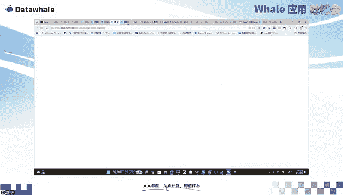

在本节课中，我们将学习如何使用 Claude Code 配合智谱 GLM 和 Minimax 模型，在云端服务器和手机端实现随时随地编程。内容包括环境搭建、API 配置、项目部署，以及 Skills、Sub Agent、Hook 等进阶概念。本次分享的核心思路是，先解决 Token 和模型接入的问题，再搭建可以随时随地使用的开发环境，最后介绍一些自动化工具让编程更高效。

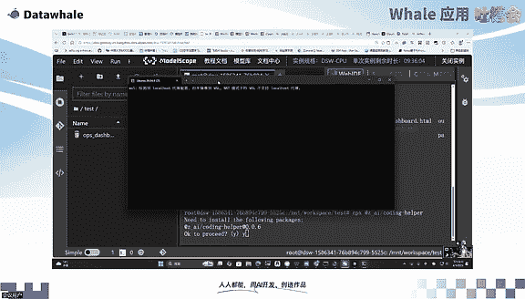

🚀 Datawhale AI+X：Claude Code 魔搭部署与云端使用：02：Web Coding 新范式与模型选择

首先，我们来看看为什么选择这套工具组合。本次分享主要围绕 Claude Code 展开。目前主流的云端 API 厂商有两个，分别是智谱 GLM 和 Minimax。本次教程以 GLM 为主，Minimax 作为补充，后续会提供相关教程。

为什么把 Token 放在第一位？因为无论做什么大模型相关的开发，Token 都是基石。所有功能都建立在 Token 之上。如果没有 Token，模型选择、费用管理都会变得非常麻烦。公式可以表示为：开发能力 ∝ 可用 Token 数量。

国产模型方面，GLM 4.5 和 Minimax 两款模型已经进入开源模型报告的前十。根据实际体验，效果不错。因此本次以 GLM 和 Claude Code 的配置为例进行介绍。目前来看，这套配置比之前的版本更新，体验也更好。

GOM 平台的活动会送免费奶茶，以及两张 7 天的 AI 编程体验卡。大家如果想体验，可以扫码领取，先到先得。另外，社区有群友反馈沪上阿姨的广告打到了代码里面，这种干扰会影响心情，希望以后能避免。Minimax 还有一个特点是多模态能力很强，和海螺 AI 是一家公司，视频生成和语音生成表现不错。如果做多模态的用户，可以推荐使用这个配合 Cloud Code 的方案。微刃的 44.6 模型也可以做一些微调任务，在开发功能上相对 Minimax 会好一点。MCP 工具有 100 个，目前主要用 GitHub 那个工具。

🚀 Datawhale AI+X：Claude Code 魔搭部署与云端使用：03：环境准备与安装

接下来，我们看看如何准备运行环境。为了快速实验，不用担心本地项目配置问题，可以使用摩达社区的 Notebook 平台。登录后，左侧有一个 Notebook 入口，可以打开一个 CPU 服务器直接使用。这个方法也可以让你快速去实验，不用担心项目配不好。

如果是本地安装，Windows 用户建议使用 WSL；Linux 和 Mac 用户可以直接在电脑上安装 Cloud Code。除了 Cloud Code，也可以使用 Code X、Open Open Code 等其他 IDE 工具，Cloud Code 只是代表。

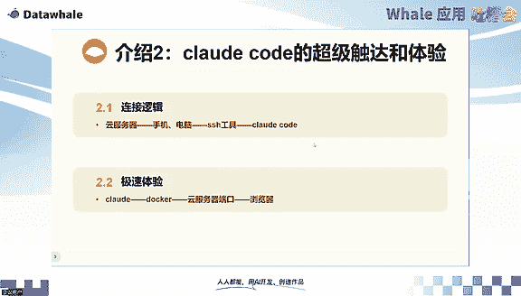

以下是安装步骤：
1. 在 GOM 平台获取安装命令，如果平台无法打开，可以直接复制命令进行演示。
2. 安装智谱专门编写的工具，相比之前配置更简单。
3. 启动工具后，会出现引导界面，可选择中英文和中国版。
4. 输入 API Key，从平台创建的 Key 中复制并粘贴。
5. 选择 Cloud Code，保持默认配置即可。
6. 启动 Cloud Code，安装速度很快，在服务器上即可完成。

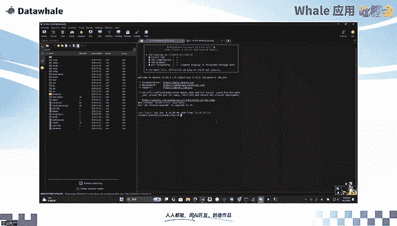

如果是 Minimax 版本，操作也类似，但需要粘贴 Token，稍微麻烦一点。如果是本地配置，有时会提示当前地区不可用。此时需要在脚本末尾添加一行配置：`hass_compare_onboarding=false`，加到最后位置即可。

🚀 Datawhale AI+X：Claude Code 魔搭部署与云端使用：04：API Key 配置与费用说明

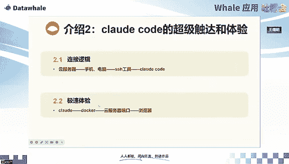

获取 API Key 的方式是进入平台，创建一个 Key，然后复制到安装工具中。关于费用，Minimax 最近有活动，10 元一个月可以使用。关于 Promote 的误解：不是给了 40 个 Promote，而是每个 Promote 约 15 次模型调用，即 40 × 15 = 600 次。对大多数用户来说，5 小时 600 次使用已经足够。

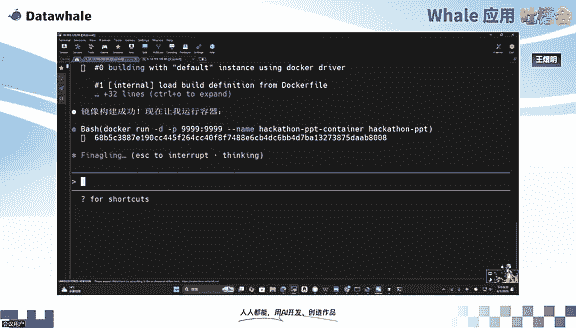

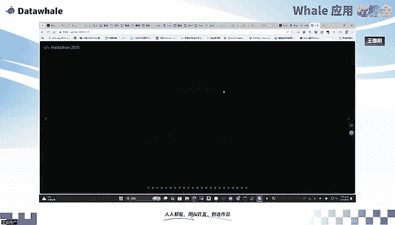

如果觉得 Cloud Code 比较陌生，可以在 Web Code 里安装插件，使用方式与 Cursor 很像。另外，国内两个模型完成 80% 的任务没有问题，对于难一点的任务，可以用其他模型（如学生会员或 Cursor）修补一下。


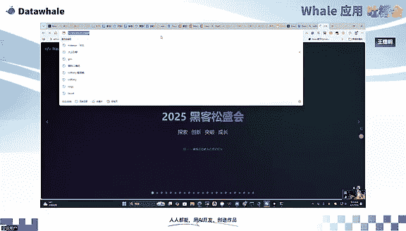

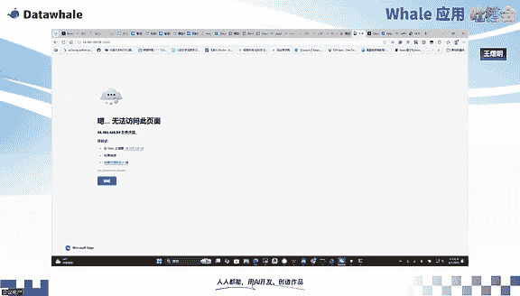

🚀 Datawhale AI+X：Claude Code 魔搭部署与云端使用：05：随时随地编程的闭环工作流

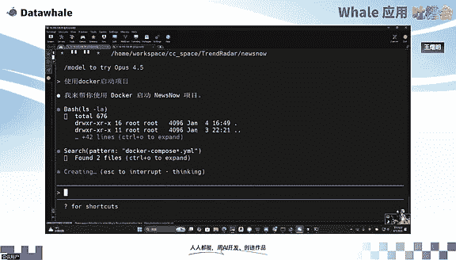

有了环境和模型配置，我们就可以开始实际编程了。拥有充足 Token 后，就可以像“拥有无限子弹”一样，随时随地开始编程，不用太担心成本。

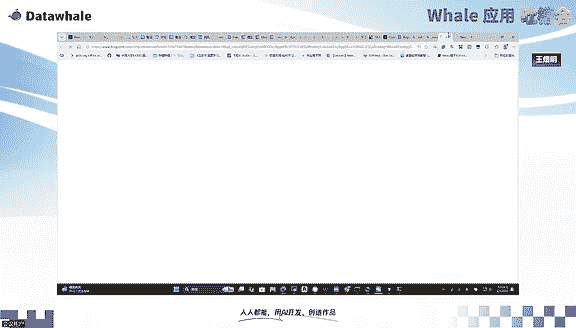

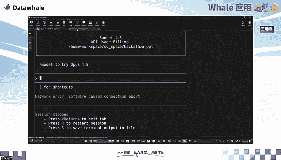

我的个人工作流是闭环的：首先准备一台云服务器，然后通过手机 SSH 工具连接到 Cloud Code，进行编程和反馈。完成项目后，使用 Docker 部署到云服务器端口，通过浏览器在任何地点访问。这实现了“任何地点编程”和“任何地点体验”两个闭环。

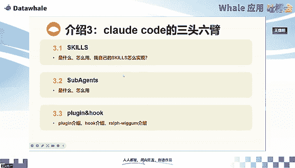

实际案例：之前在飞机上，项目反映 API 速度太慢。为了保证性能，我使用了 DeepSeek 模型，回答效果最好，但响应太慢。于是将模型改为 no-think 模式，重新部署发布，然后用手机连接 Cloud Code 完成发布。

云服务器选择：火山云当时有活动，2 核 2G 一年 29 元，4 核 4G 一年 99 元，新用户可以抢购。也可以选择阿里云、腾讯云、华为云、京东云。

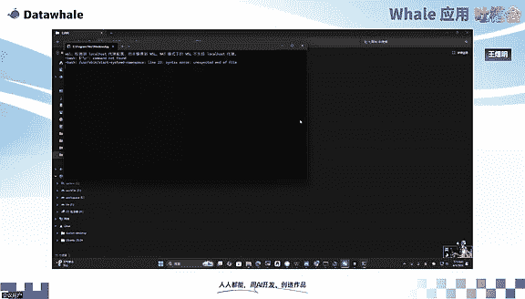

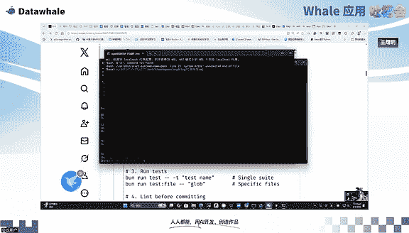

手机操作：下载一个 SSH 工具（如 Termix），登录后连接服务器，连上之后打开 Cloud Code 即可。链路是：Termix APP 登录 → SSH 连接服务器 → 打开 Cloud Code → 开始打字编程。

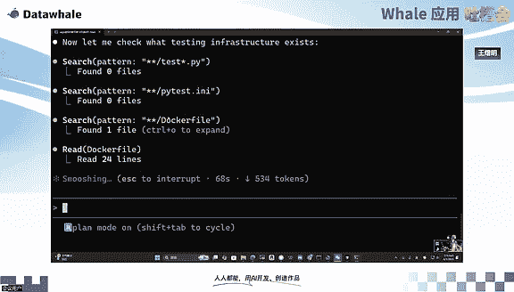

🚀 Datawhale AI+X：Claude Code 魔搭部署与云端使用：06：项目部署与云端发布

编程完成后，需要将项目部署上线。部署部分直接看例子。使用 Docker，对外映射一个端口（例如 9999 或 10000），容器启动后，找到云服务器的 VIP，即可通过手机或其他设备访问。

这意味着完全不需要电脑，只凭手机和联网设备，就能完成从产品到实现再到发布的全过程，且所有内容都在自己可控的服务器上。演示中可能遇到网络不稳定导致端口断开，可以使用 `docker compose` 重新启动。

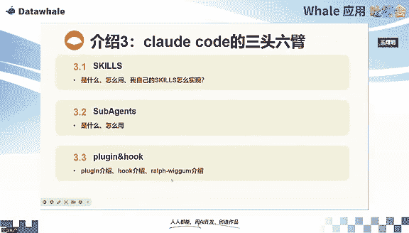

另外，有一个资讯类项目登上 GitHub Trending 榜单，可以提供各种平台的原始流量和最新信息，适合做舆情分析或金融相关应用，也可以通过 API 调用。

🚀 Datawhale AI+X：Claude Code 魔搭部署与云端使用：07：核心概念 Skills 与 Sub Agent

掌握基础操作后，我们进入 Cloud Code 的进阶概念。Skills 是 Cloud Code 中的技能概念，最小单元是一个 MD 文档。只要有一个 skills.md 文件，就可以理解为一个 Skills，也可以把它当成一个 Prompt 来使用。

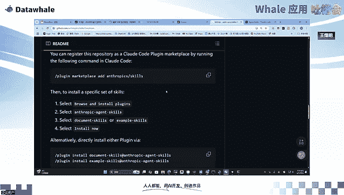

以下是 Skills 的基本结构：
- 名称
- 描述
- 详细介绍
- 示例
- 脚本（用于调用时执行）
- reference、example、help 等脚本文件


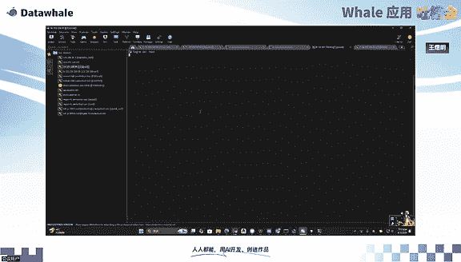

代码示例：
```markdown
# skills.md
name: xxx
description: xxx
```

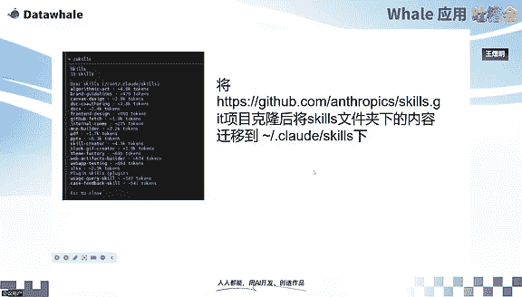

如果国内用户无法通过官方方式安装 Skills（可能有网络问题），可以使用简单方法：直接将命令发送到 Cloud Code，克隆到 skills 文件夹下，手动完成全局 Skills 安装。如果要写自己的 Skills，可以参考项目结构，写好后迁移到对应目录下。查看已安装的 Skills 时，输入命令即可。

Sub Agent 是子智能体，有自己的上下文窗口，可以使用特定工具，有明确的目的和专业领域。与 Skills 的区别在于，Sub Agent 可以调用 Skills，并且更偏向于完成具体任务。它的最大特点是异步并行执行，适合处理很多需要异步处理的任务。

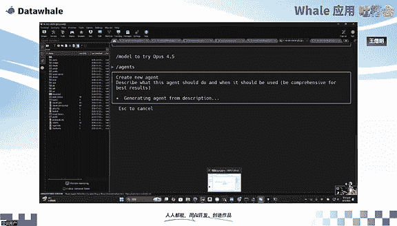

创建 Sub Agent 时，可以选择全局或本地（当前项目），使用对话形式或精细化配置。输入你想让它做的事情即可生成。

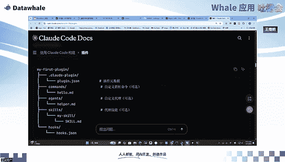

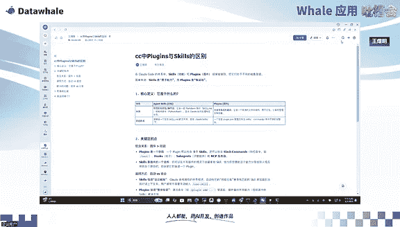

🚀 Datawhale AI+X：Claude Code 魔搭部署与云端使用：08：高级特性 Hook 与 Pegaw 插件

在 Skills 和 Sub Agent 之上，还有一个更高级的概念叫 Pegaw。Pegaw 是一个插件，可以理解为工具箱，而 Skills 是菜谱，Sub Agent 是厨师。如果你只是完成简单任务，直接创建 Skills 即可；如果需要创建一整套工具供大家使用，建议将各种文档配置进去，写一个 Pegaw 并发布。

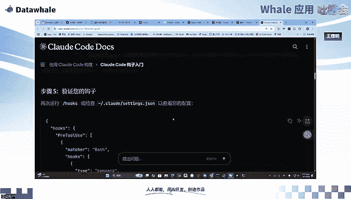

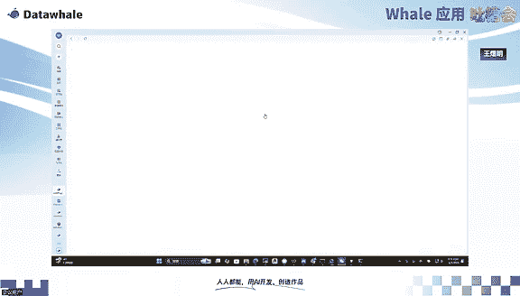

Pegaw 与 Skills 的区别：Skills 针对原子能力，主要是 Python 脚本和 MD 文档；Pegaw 是集装箱，既包含 Sub Agent，也包含命令、Skills 以及 MCP 服务，是一个复杂的多元化单元。

Pegaw 有三个指令：帮助、中断循环、开始循环。开始循环时，输入提示词和最大循环次数 N，直到大模型觉得满意或达到次数上限为止。每次停止时会加一个 Hook，再次启动任务，适合不想一直盯着屏幕点确认命令的场景。

Hook 是钩子函数，可以在特定时间点执行自动化任务。例如，当 Cloud Code 在工具调用前、工具调用后、用户提交指令后、所有任务结束停止时，都可以插入 Hook 内容。常用于格式化代码等自动化场景。

Ralph Wiggum 插件用于实现无限循环执行。它的作用是让任务一直运行直到结束，适合复杂的大型项目，不需要一直盯着屏幕点点点。

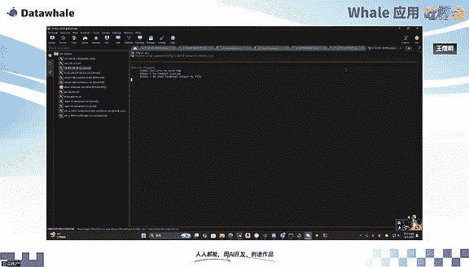

🚀 Datawhale AI+X：Claude Code 魔搭部署与云端使用：09：团队协作与其他触发方式

除了个人开发，团队协作也需要规范。在团队项目中，模块多容易搞混，可以使用一套共同维护的 Cloud Code MD，将 UI 设计、页面布局、API 交互、数据库规范、流程管理和数据流转全部放进去。这样不同成员的 Cloud Code 都能看懂项目规范。

Cloud Code 的触发方式有很多种，除了 SSH，还可以用飞猪机器人、邮件触发。如果有本地服务器，可以用花生壳做内网穿透，把本地电脑部署到互联网上，使 IP 能被外部访问。这套方案的思路与云服务器方案一致。

另外，Open Spec 项目可以配合 Cloud Code 使用，让代码更规范，感兴趣的同学可以在 GitHub 搜索。模型切换可以使用 Cloud Code Rotor 或 CC Switch 这两个项目。关于项目价值，现在项目抄袭门槛很低，除非做很难的项目有私有化数据，否则软件外包的价值已经不高了，程序开发存在一定泡沫。

🚀 Datawhale AI+X：Claude Code 魔搭部署与云端使用：10：总结与学习建议

在本节课中，我们一起学习了 Claude Code 在云端服务器和手机端的部署与使用，掌握了 Token 基础、环境搭建、API 配置、随时随地编程工作流、Docker 部署，以及 Skills、Sub Agent、Hook、Pegaw 等进阶概念。

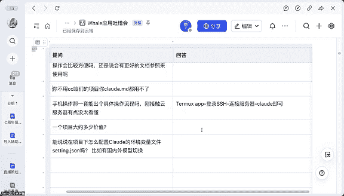

程序员写代码的方式可能会发生变化，但终身学习的心态仍然很重要。即使是顶级大佬，三个月不学习也可能回归原始。建议平时多看别人的东西，实际使用中才能体会到价值。如果有疑问，可以在编程群里提问，或者关注相关的开源项目。
