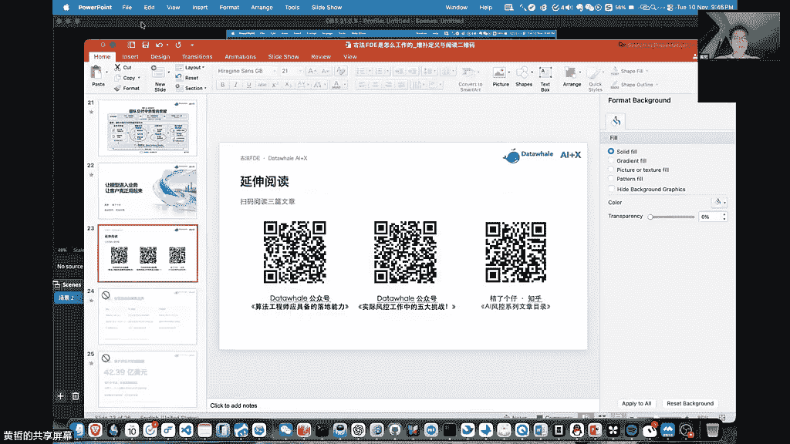
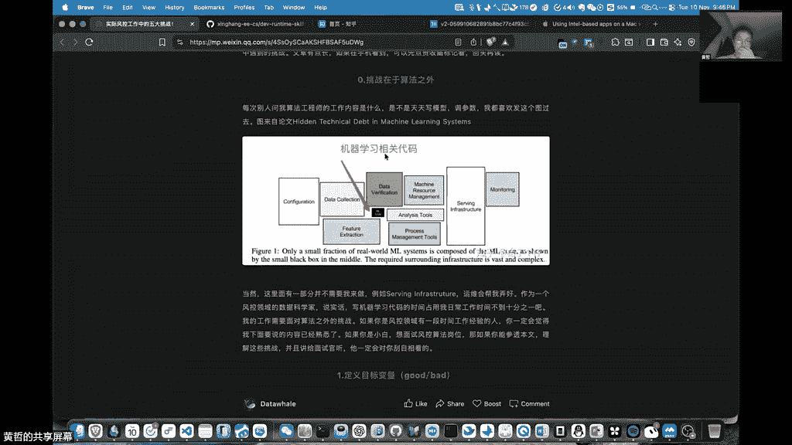
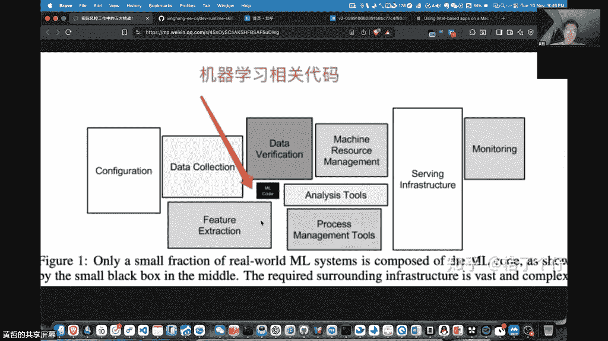
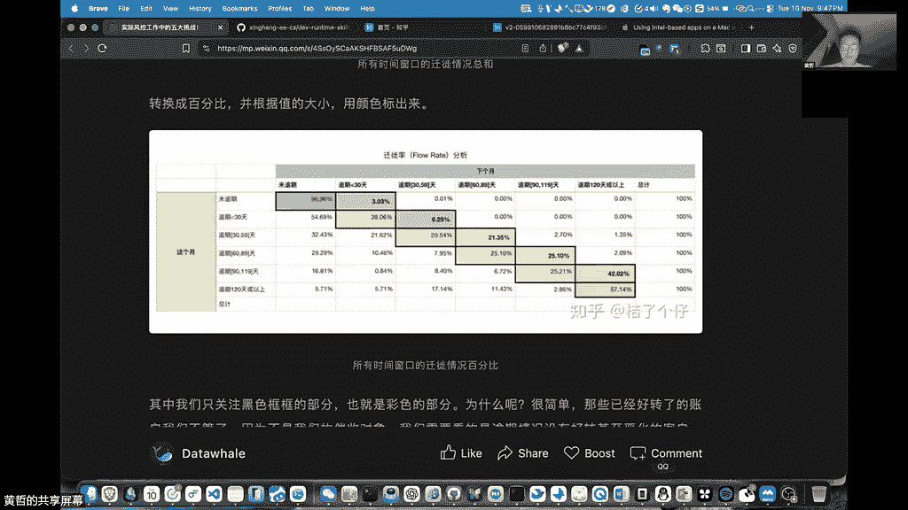
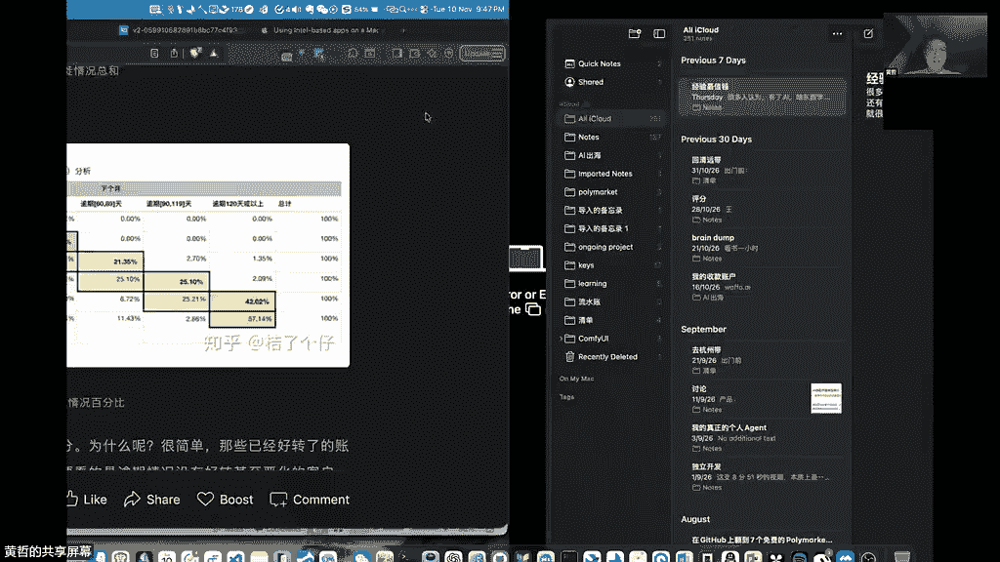

# 🚀【Datawhale AI+X】FDE古法编程：从客户需求到现场方案：01：古法FDE工作流程与实战案例

## 概述

在本节教程中，我们将学习古法FDE（前沿部署工程师）是如何工作的。我们会从讲师的个人经历出发，回顾2017年至2021年没有大模型辅助的AI交付全过程，包括数据清洗、特征工程、模型训练以及POC、SIT、生产上线三个阶段。随后，我们会通过反洗钱和信贷风控两个具体案例，了解古法FDE如何解决真实业务问题。最后，我们会对比古法FDE与现代FDE的核心差异，让你理解大模型如何改变了AI交付的工作方式。

## 一、讲师背景与FDE概念介绍

首先我们来看看这位讲师的背景，以及什么是FDE。讲师最早从事游戏开发，之后在新加坡读书并转向AI领域，当时的职位叫数据科学家。后来换工作时，职位名称变成了算法工程师、机器学习工程师等，但本质上都离不开与数据打交道，需要处理数据账户、数据清洗和模型训练等工作。因此，讲师可以算得上是早期的古法FDE实践者之一。讲师目前也是一名AI开发者，正在创业，并在知乎上撰写AI科普文章，最早的一篇机器学习入门路线文章已经获得了6000多个赞和几万次收藏。

以下是关于FDE概念的核心定义：

```text
FDE = Front Deploy Engineer / For Deploy Engineer
     = 前沿部署工程师
     = 将AI方案部署到客户现场的工程师
```

FDE的工作本质是：你有一套AI方案，需要把它带到客户现场进行部署。简单来说，就是你作为工程师，去客户所在的现场落地AI方案。

## 二、古法FDE与现代FDE的整体理念

接下来，我们讨论古法FDE的整体工作理念。无论是古法FDE还是现代FDE，核心理念都是一致的：从客户需求出发，将通用能力改造成现场可用的方案，并跟进直到上线。

不过，古法FDE与现代做法有一个关键区别：在模型的前后，都有非常长且繁琐的准备工作。我们可以用下面这个简单的公式来表示古法FDE的工作量分布：

古法FDE总工作量 = 数据理解与清洗 + 特征工程 + 模型训练与验证 + 部署与运维

相比之下，现代FDE在大模型的加持下，很多手工工作可以被自动化，从而大幅释放生产力。

## 三、古法FDE的数据准备工作

在2017年到2021年期间，大模型尚未普及，AI从业者需要手动完成大量数据处理工作。首先，你需要理解客户目标，盘点客户拥有哪些数据，然后对标签进行定义，并对样本进行切分。以下是数据准备阶段需要完成的主要任务：

- 把数据说清楚，明确每一行数据代表什么
- 检查组件与表之间的关系
- 检查重复数据和关联丢失问题
- 统一格式和业务口径，例如日期、时区、币种、单位、类别编码等
- 处理缺失值和异常值

处理完缺失值和异常值之后，你需要把处理规则写成代码。这样做的目的是确保下次遇到类似问题时，可以重复执行相同的逻辑，避免每次都从头开始。

## 四、探索性数据分析与特征工程

数据清洗完成之后，下一步是探索性数据分析，通常缩写为EDA。EDA的目的是在数据上找问题、形成假设，例如检查数据覆盖是否合理、标签是否靠谱、数据分布是否发生变化，以及是否存在新出现的异常模式。

这里我们可以把EDA的目标用一个简单的表达式来描述：

EDA输出 = 数据分布洞察 + 数据质量假设 + 特征构建方向

接下来是结构化与非结构化数据的转化。对于机器学习模型来说，JSON文件虽然看起来是结构化的，但仍然属于非结构化数据。真正的结构化数据应该是类似CSV、数据表或数据库的形式，具有明确的key-value对应关系。如果数据是文档、扫描件、备注等非结构化形式，或者是地址这类异常字符串，都需要先转化成模型可接受的格式。

机器学习模型只能处理数值。如果你有类别特征，比如男或女，需要转换成0或1。如果是多类别特征，比如一年级到六年级，可以使用独热编码。以下是常见的编码示例：

```python
# 示例：二分类特征编码
gender_mapping = {'男': 0, '女': 1}

# 示例：多类别特征独热编码（伪代码）
grade_one_hot = {
    '一年级': [1, 0, 0, 0, 0, 0],
    '二年级': [0, 1, 0, 0, 0, 0],
    # 以此类推
}
```

此外，还可以使用TF-IDF等传统机器学习手段对文本特征进行处理。

特征工程的核心是根据业务理解构建特征。以金融风控为例，账户逾期金额是一个特征，工作收入也是一个特征。在构建特征时，还需要控制预测的时间节点。假设数据覆盖2020年到2026年，训练时可能使用2020年到2024年的数据，而验证时必须使用2024年之后的数据。绝对不能使用未来的结果作为当前的特征，否则会出现数据泄漏问题。

数据泄漏可以用下面这个逻辑来表示：

如果 特征包含未来信息 → 模型评估结果虚高 → 上线后效果大打折扣

## 五、模型训练与验证

特征准备完成之后，就可以把数据输入机器学习模型进行训练，并调整各种超参数。当时人们把这种工作戏称为“天炼当”或“调娼霞”，其实就是对大量重复性调参工作的自嘲。

模型训练需要设定评估指标。不同的业务场景侧重点不同，有的看重精确率，有的看重召回率。你需要根据场景设置合适的指标，使模型在训练过程中尽可能降低损失函数。训练完成后，还需要检查错误和人群差异等问题。

可以用下面的公式来概括训练目标：

模型最优参数 = argmin(损失函数 + 正则化项)

## 六、部署阶段：POC、SIT与生产上线

模型训练完成之后，交付给客户是一个逐步的过程，通常分为三个阶段：POC阶段、SIT阶段和生产环境阶段。以下是每个阶段的详细介绍：

1. POC阶段（概念验证）：确立目标和基准，使用限定范围的数据验证业务可行性，评估项目价值。
2. SIT阶段（系统集成测试）：在客户环境中运行训练好的模型，检查是否能达到预期效果，并与客户现有系统进行集成，联调接口。
3. 生产上线阶段：模型和系统集成都没问题后，正式上线。上线之后还需要建立监控系统，制定问题回滚方案，进行运维工作，并陪护培训客户，跟踪模型效果。

## 七、实战案例一：反洗钱系统

为了让你更直观地理解古法FDE的工作方式，我们来看两个具体的业务案例。第一个案例是反洗钱系统。反洗钱主要需要解答三个问题：

- 交易监测：这笔交易是否异常？例如，有人可能通过多笔拆分资金的方式转移不合法资金，交易记录中会出现异常的频次、金额等，并可能触发告警。
- 姓名审查：比如“萨达姆”这类高风险名字，一旦匹配就会触发告警，通知调查员进行核查。
- 客户风险评分：根据客户背景、地域、业务和交易行为进行风险分层。例如，来自伊朗且从事石油或军事相关业务的客户，在银行中通常被视为高风险客户。

传统的反洗钱方案基于规则，误判率非常高，可高达90%，人工核验压力大且审核资源有限。讲师团队提供的方案基于机器学习，大幅降低了误判率。

具体做法是：利用长期调查过程中积累的标签数据，将安全的交易标记为0，将可疑的交易标记为1。有了这些带标签的数据后，就可以进行监督式学习。

监督式学习可以用下面这个简单的流程表示：

带标签数据 → 输入机器学习模型 → 模型学习权重 → 效果稳定 → 输出风险评分 → 按优先级排序 → 合规人员优先调查高风险交易

这个模型是与新加坡一家大型银行合作开发的，效果显著：交易误报减少了50%，个人姓名审查误报减少了70%，高优先级类别命中率高达96%。

## 八、实战案例二：信贷风控

第二个案例是信贷风控。银行发放信用卡和贷款后，部分客户未按期还款导致账户逾期。现在需要解决的问题是：应该优先跟进哪些账户？



原来的规则方法粒度较粗，风险识别不够准确，而且人力有限，难以覆盖所有账户。讲师团队设计的机器学习方案是：获取各类记录，进行数据清洗和特征工程，输入机器学习模型，进行风险分层和策略推荐。银行团队优先处理高风险部分，从而用更少的人力达到更好的催收效果。



效果方面，滚动账户的滚动率降低了50%。所谓滚动，是指客户逾期几天，一个月后是否继续逾期。如果下个月仍未还款，就称为滚动。根据两个上线地区的账户情况和资产规模，估计为银行挽回了200万美元以上的损失。



## 九、古法FDE总结与延伸阅读

总结一下，古法FDE的工作流程包括：概念验证、系统集成、生产上线。当时这是一个大团队的工作，讲师主要负责数据清洗、部署和客户主导等方面。





如果你想深入了解机器学习系统中的工程细节，可以阅读名为《hidden technical debt in machine learning systems》的文章。这篇文章详细说明了除了模型代码本身，FDE还需要处理数据验证、特征工程、监控等大量复杂工作。


## 十、古法FDE与现代FDE的核心差异

最后，我们来对比古法FDE与现代FDE的核心差异。在大模型出现之前，很多工作需要手工完成，比如写PRD文档、编写代码、处理数据等，这些工作既累又繁琐。

有了大模型之后，工作模式发生了变化。以前的FDE更多时间泡在现场与数据打交道，而现在的FDE可以把更多时间花在客户身上，倾听客户想法、挖掘客户需求。以前的产品经理可能花半天写PRD，现在AI可以生成，产品经理可以把时间用于开会或研究客户洞察。以前的程序员花所有时间写代码，现在可以研究系统架构和新产品。

总结来说，古法FDE不仅涉及模型训练，更重要的是大量的手工数据处理与现场部署工作；而现代FDE在AI辅助下，可以将精力从繁琐的手工劳动中解放出来，更加专注于业务价值和客户交付。

## 结语

本节教程中，我们一起学习了古法FDE的工作方式，包括讲师背景、FDE概念、数据准备、探索性数据分析、特征工程、模型训练与验证、POC/SIT/生产上线流程，以及反洗钱和信贷风控两个实战案例。最后，我们对比了古法FDE与现代FDE的差异，了解了大模型如何改变AI交付工作。希望通过本节内容，你能对古法FDE有一个直观的认识，并理解现代AI工程师工作方式的演进。

