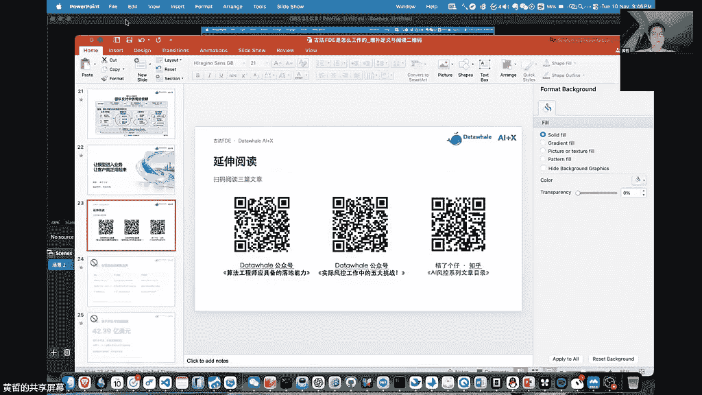
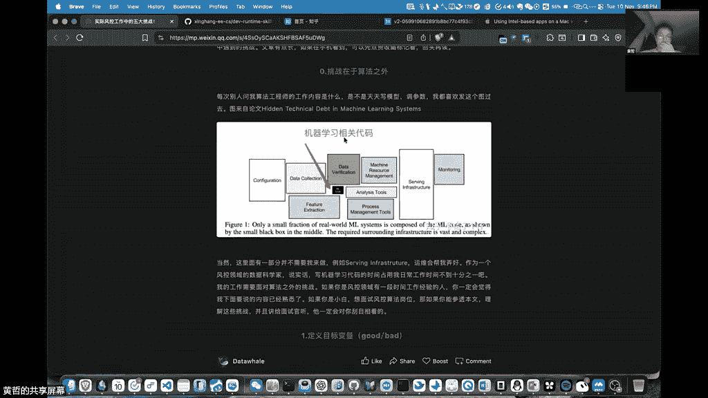
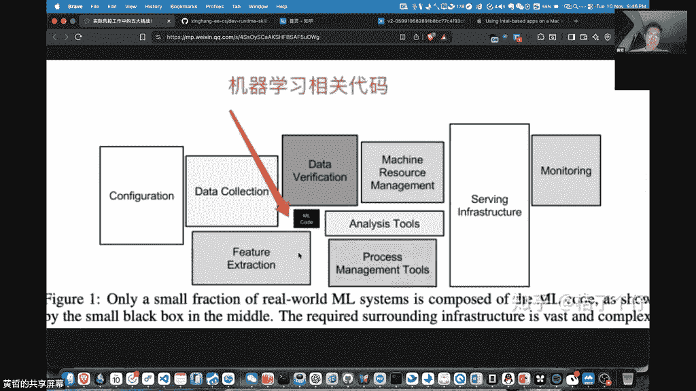
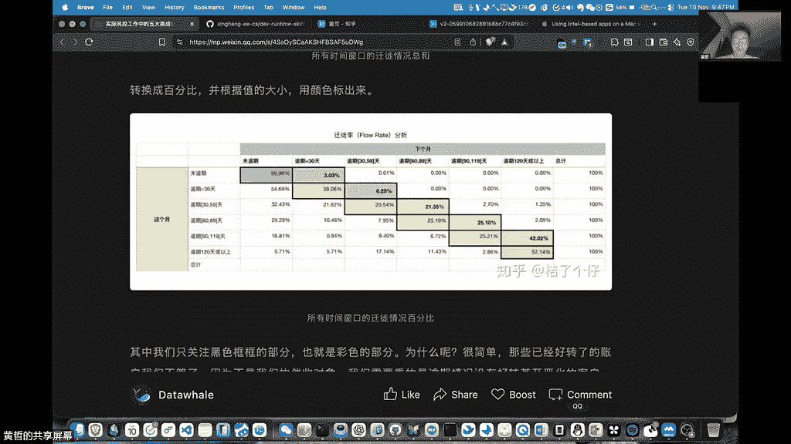
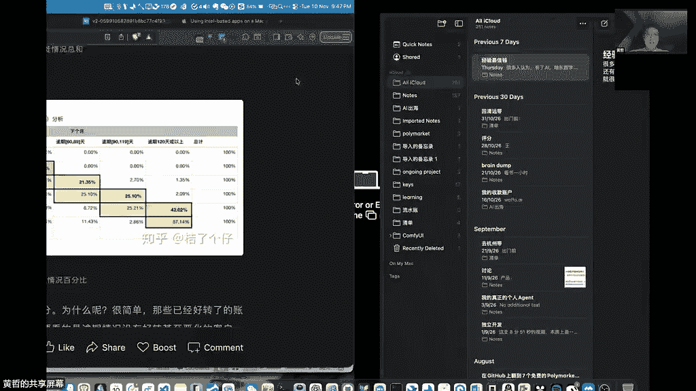

🛠️ Datawhale AI+X：FDE古法编程：1：从客户需求到现场方案

在本节课中，我们将一起学习什么是古法FDE，以及它是如何从客户需求出发，最终落地到现场方案的。内容将包括FDE的基本定义、古法FDE与现代FDE的核心区别、数据清洗与特征工程的具体步骤、模型训练与交付的完整流程，最后还会通过反洗钱和信贷风控两个真实案例来讲解。即使你是完全的初学者，也不需要有编程基础，只要能理解数据是什么意思，就能听懂其中的核心逻辑。


### 一、什么是FDE，以及古法FDE的由来

接下来我们先来看看FDE到底是什么，以及为什么会有古法FDE这个说法。

FDE是一个比较新的职业概念，它的全称可以理解为现场部署工程师。简单来说，就是你有一套AI方案，需要把它部署到客户的现场，完成从方案到实际上线的全过程。FDE本质上依然是一个工程师，区别在于工作重点放在客户现场的落地上。

公式描述如下：

```
FDE = 现场部署工程师
核心职责 = 将AI方案交付到客户现场并完成部署
```

讲到古法FDE，我们需要回到几年前的AI发展历程。从2017年开始从事AI工作时，当时的AI主要指代机器学习和深度学习这类模型。那时候的职位名称经常变化，有数据科学家、算法工程师、机器学习工程师等等，但本质上没有太大区别，都是需要跟数据打交道，处理数据中的各种问题。

在2018年到2021年期间，我在新加坡一家金融科技创业公司工作，所属部门叫客户成功，职责是帮助客户取得成功。这与现在的FDE定义基本一致。后来回国后，我也参与过一些AIGC应用和AI开发工作。基于这些经历，我把之前那种没有大模型辅助的工作方式，称为古法FDE。

如果按照现在的FDE理解，通常是有一套可复用的本体，再根据客户要求定制，最后交付并投入生产。古法FDE的理念也是一样的，即从客户需求出发，把通用能力改造成现场能用的方案，并且跟进到上线。不过古法FDE和现在的做法有一个显著不同，那就是模型前后都有非常长的一段工作，那时候还没有大模型可以帮忙处理。


### 二、古法FDE的核心工作流程

接着我们来看看古法FDE具体的工作流程是怎样的。

古法FDE并不是直接拿到模型就能交付，而是包含从理解客户需求到最终上线的一整套步骤。以下是它的核心流程：

- 第一步：理解客户目标，盘点客户有哪些数据，给数据做标签定义，进行样本切分。
- 第二步：把原始资料清洗并转换成特征，这是最繁琐的部分。
- 第三步：将整理好的数据放入机器学习模型进行训练，并调整超参数。
- 第四步：经过概念验证、系统集成和生产上线，最后持续跟踪反馈。

可以看到，整个过程远比人们想象的要复杂得多，尤其是在没有大模型的年代，很多工作都需要靠人工完成。


### 三、第一步：理解业务与盘点数据

在正式处理数据之前，首先需要把业务和数据说清楚。

这一步的主要工作包括三部分。第一，跟客户沟通，明确他最终想要达成什么目标。第二，盘点客户手中有哪些数据，这些数据存储在什么地方。第三，给数据定义标签，决定哪些样本用于训练，哪些样本用于验证。这些工作在现在依然需要做，但古法FDE做起来更加繁琐，因为那时候没有现代工具可以辅助。


### 四、第二步：将原始资料变成特征

接下来是古法FDE中最费时费力的一步，即把原始资料变成机器学习模型可以使用的特征。

数据清理是基础工作。客户提供的数据往往不是结构化的，可能采集不规范，记录不完整，或者出现异常值。我们需要手动处理缺失值、异常值，统一日期、时区、币种、单位和类别编码等格式。处理完成后，还要把规则写成代码，这样以后遇到类似问题可以直接重复执行。

代码描述如下：

```python
# 伪代码示例：统一日期格式并处理缺失值
df['日期'] = pd.to_datetime(df['日期'], errors='coerce')
df['金额'] = df['金额'].fillna(0)
df = df.drop_duplicates()
```

接着是探索性数据分析，简称EDA。

```
EDA = 探索性数据分析
目的 = 对数据的每一列进行分析，找出分布、异常和业务含义
结果 = 得出数据洞察（Insight）
```

EDA需要分析每一列数据的分布，判断它大概代表什么意思，以及数据覆盖的标签是否靠谱，分布是否发生变化，是否存在新模式。这一步也非常繁琐。

然后还要处理结构化数据与非结构化数据的区别。比如JSON文件本身是结构化文件，但对于机器学习模型来说，它依然属于非结构化数据。古法FDE定义的结构化数据通常是CSV表格、数据表或数据库，要求有key，每个key对应一个值，并把不同的数据放在一起。

对于机器学习模型来说，它只能处理数值。如果是类别特征，比如男或女，需要转换成0或1。如果是多类别，比如一年级到六年级，可以使用独热编码。

代码描述如下：

```python
# 独热编码示例
gender_map = {'男': 1, '女': 0}
grade_map = {
    '一年级': [1,0,0,0,0,0],
    '二年级': [0,1,0,0,0,0],
    # ... 以此类推
}
```

除了这些，还有更加非结构化的数据，比如文档、扫描件、备注、地址字符串等，都需要转换成数值才能输入模型。整个过程相当繁琐。


### 五、第三步：特征工程与模型训练

数据准备好之后，就要进入特征工程和模型训练阶段。

特征工程是根据对业务的理解，构建模型需要的特征。比如在金融风控场景下，账户逾期金额是一个特征，工作收入也是一个特征。我们需要把行为聚合成变量，把类别文本转成模型可以接受的输入，还要进行编码、TF-IDF等处理。

同时要控制预测的时间节点。假设数据覆盖2020年到2026年，训练时可能使用2020年到2024年的数据，验证时使用2024年之后的数据。不能使用未来的结果作为当前的特征，否则会出现数据泄漏。

公式描述如下：

```
训练时间区间 < 验证时间区间
禁止：未来数据 -> 当前特征
后果 = data leak（数据泄漏）
```

完成特征选择并固化计算逻辑后，就可以把数据放入机器学习模型训练。训练过程中需要调整各种超参数，那时候大家自称“炼丹师”或“调参师”，这其实是对苦活累活的一种自嘲。

模型效果需要用评价指标来判断，不同场景侧重点不同，有的看重精确率，有的看重召回率。需要根据场景设置合适的指标，让模型在训练过程中不断降低损失函数。

损失函数的直观含义如下：

```
模型目标 = 最小化 Loss
Loss = 预测值与真实值之间的误差
```

训练完成后，还需要检查错误和人群差异，确保模型在不同人群上的表现稳定。


### 六、第四步：模型交付与上线阶段

模型训练好之后，还需要经历概念验证、系统集成和生产上线三个阶段。

以下是古法FDE交付的三个主要阶段：

- POC阶段：概念验证。确立目标和基准，用有限范围的数据验证业务可行性。
- SIT阶段：系统集成。在客户环境中运行训练方案，与客户现有系统联调接口，确认模型能否部署。
- 生产上线阶段：模型和系统都没问题后正式上线。上线后还需要设置监控系统，处理回滚、运维问题，并陪护培训客户，持续跟踪效果。


### 七、案例一：反洗钱系统

为了让你更直观地理解，下面通过两个真实案例来讲解。

第一个案例是反洗钱系统。反洗钱主要需要解答三个问题。第一是交易监测，判断一笔交易是否异常，比如有人通过多笔拆分非法资金，会在交易记录中出现异常频次和金额。第二是交易模式和关系网络分析，可能触发告警。第三是姓名审查，比如“萨达姆”这类高危名字匹配后会触发告警，告诉调查员去核查。

不过传统规则系统的误判率非常高，高达90%。人工调查员资源有限，很难覆盖所有情况。

我们给客户的方案是基于机器学习的，用于识别高风险交易、核准身份名单，并进行客户风险分层。原来的方案是基于规则的，产生了非常高的误判。我们拿到客户的告警规则后，进行数据清洗和特征提取。在长期调查过程中，客户已经积累了标签，即某笔交易调查后是安全的，标记为0；存在可疑洗钱行为，标记为1。

有了带标签的数据后，就可以进行监督式学习。

监督式学习的公式描述如下：

```
数据集 = {(x_i, y_i)}, i = 1 到 N
y_i ∈ {0, 1}，其中0表示安全，1表示可疑
模型目标 = 根据标签学习映射关系，最小化损失函数
```



训练完成后，模型会对交易进行评分，并按优先级排序，把高风险的排在前面，让合规人员先调查。我们和新加坡一家大型银行合作，效果非常好：交易误报减少了50%，个人姓名审查误报减少了70%，高优先级类别命中率高达96%。






### 八、案例二：信贷风控

第二个案例是信贷风控，也是一个古法FDE项目。

银行发放信用卡和贷款后，有些客户没有按期还款，导致账户逾期。现在需要解决的问题是，优先跟进哪些账户。原来的基于规则的方法比较粗糙，风险识别不够准，而且人力不足，难以覆盖所有账户。





我们为银行设计了机器学习方案。拿到各类记录后，进行数据清洗和特征工程，放入模型中。然后做风险分层和策略推荐，银行团队优先处理高风险部分。这样用更少的人力，就能达到更好的催收效果。

效果测试显示，滚动账户的滚动率降低了50%。所谓滚动，是指客户逾期几天，一个月后是否继续逾期。如果下个月还没还上，就称为滚动。根据两个上线地区的账户情况和资产规模，估计每月为银行挽回了200万美元以上的损失。


### 九、古法FDE与现代FDE的差异

最后，我们来看看古法FDE和现代FDE的主要区别。

古法FDE的工作非常依赖人工，大量时间花在数据清洗、特征工程和现场调试上。现代FDE有了大模型和AI辅助后，很多手工活可以交给AI完成，工作模式发生了变化。

以前产品经理可能花半天写PRD，现在AI可以生成，产品经理可以腾出时间去研究客户洞察。以前程序员可能花所有时间写代码，现在可以研究系统架构和新产品。古法FDE之前更多泡在现场跟数据打交道，而新时代的FDE可以把更多时间花在客户身上，听清客户想法，挖掘客户需求，效率大幅提升。


扩展阅读方面，有两篇文章可以参考。一篇是我在2021年发布的AI风控系列文章，详细讲解了相关原理。另一篇是Datawhale的文章，可以帮助大家快速了解。另外，有一篇名为《机器学习系统中的隐藏技术负债》的文章，里面有一张图展示了机器学习相关代码其实很小，而FDE要做的数据验证、特征工程、监控等部分非常复杂，建议有兴趣的读者查阅。


在本节课中，我们一起学习了古法FDE的定义、从数据清洗到模型交付的完整流程、POC、SIT和生产上线三个阶段，以及反洗钱和信贷风控两个落地案例。希望通过这些内容，你能对古法FDE是如何工作的有一个直观的认识。
