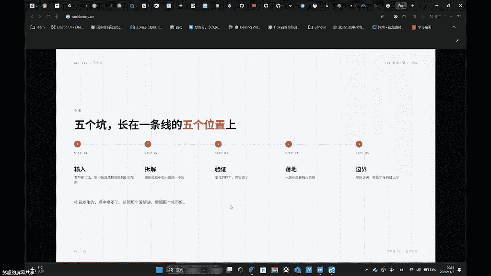
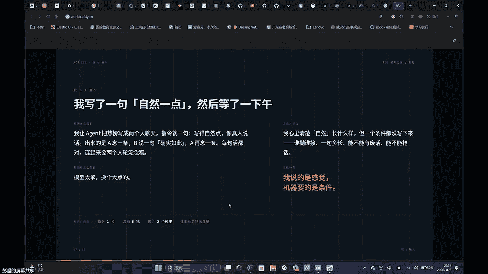
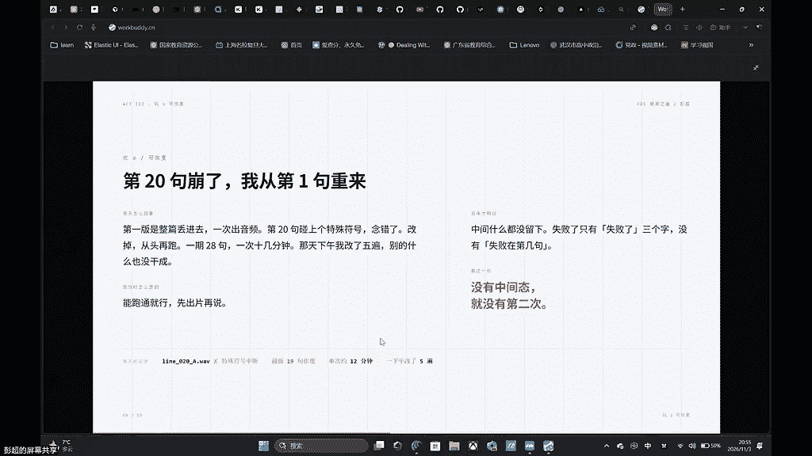
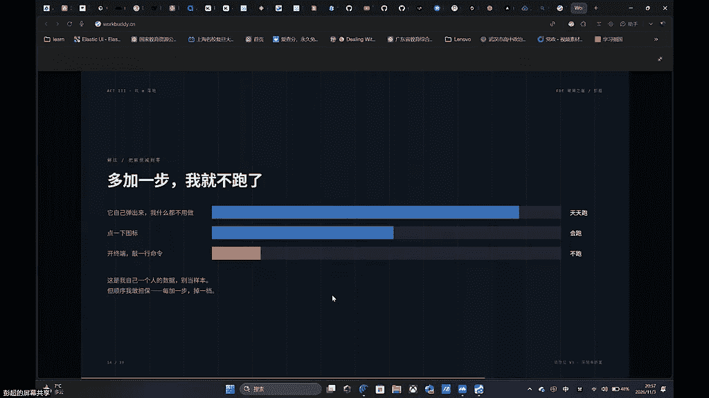
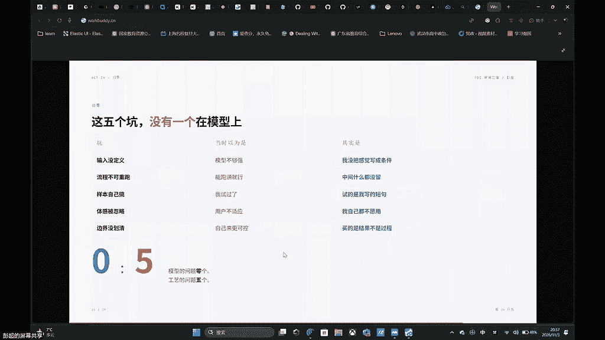
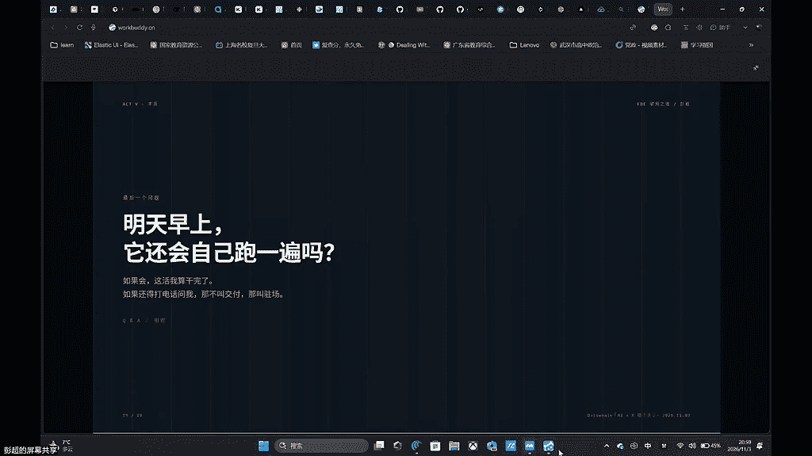
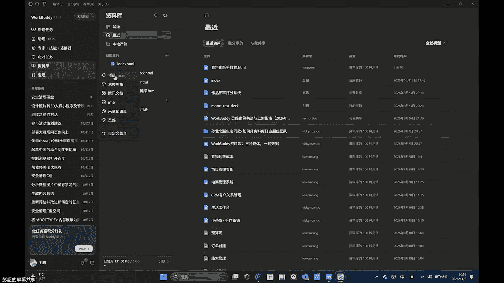
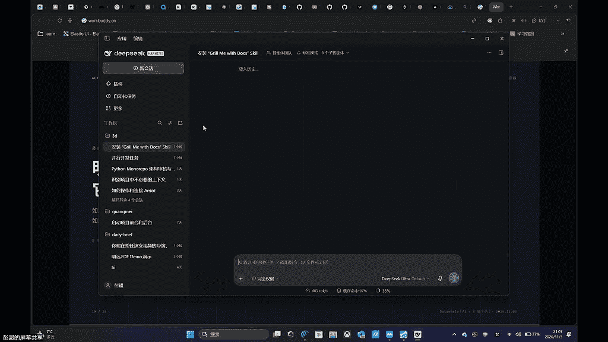
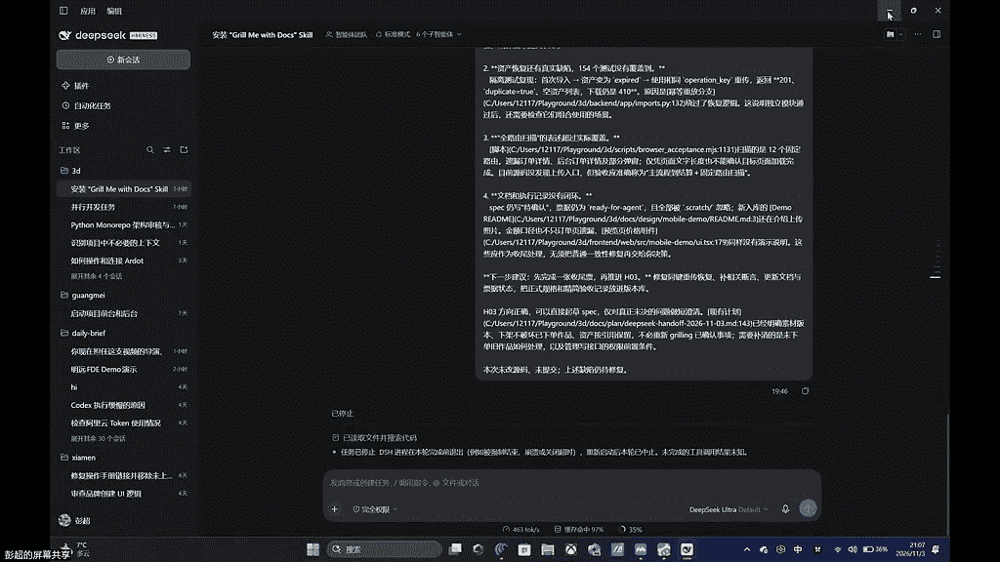
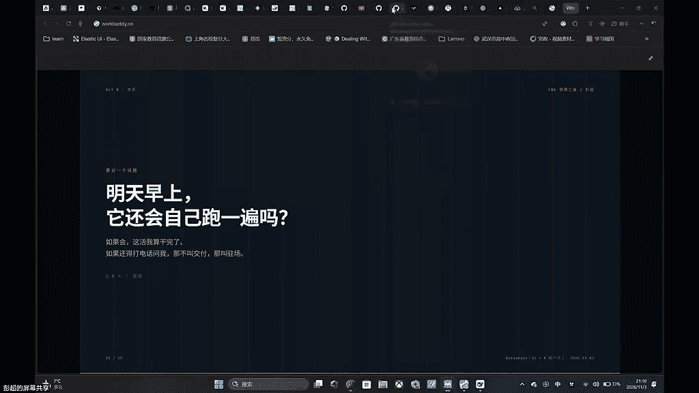

# 🚀 Datawhale AI+X FDE实战教程：01：FDE的核心价值与客户信任

在本节课中，我们将一起学习FDE的核心价值。FDE的工作不仅仅是写代码或调模型，更重要的是让客户的系统能够真正跑通、跑顺，并在生产环境中持续复用，从而带来复利价值。很多初学者容易认为demo跑通就是成功，但实际上demo仅仅完成了不到20%的工作量，真正的挑战在于生产环境的稳定运行。FDE落地的成败，往往决定于项目前两周，这段时间是建立客户信任的关键期。如果demo跑通了，但生产环境无法稳定跑通一个POC验证，那么这个项目基本上就无法继续。FDE并不是更懂技术的售前，它最主要的能力不在于技术本身，而在于搞定客户、建立信任关系。售前卖的是“能做”，而FDE卖的是“把能力留在客户这里”。企业级服务最终都要落地到生产和上线，涉及SOC等合规概念，因此做事要有理念，包括验收标准、需求拆分、交付与评价口径。

以下是FDE落地成功的关键要素：

- 生产环境能够稳定运行POC验证
- 项目前两周重点建立客户信任
- 做事要有理念，明确验收标准、需求拆分、交付与评价口径

FDE的核心价值可以用如下公式描述：

```python
FDE_核心价值 = 系统跑通 + 生产环境持续复用 + 复利价值
```

技术固然重要，但客户信任和生产稳定性才是FDE能否持续交付的根本。在下一节中，我们将继续探讨FDE需要具备的三位一体能力模型。

# 🚀 Datawhale AI+X FDE实战教程：02：FDE的三位一体能力模型

上一节我们介绍了FDE的核心价值与客户信任，本节中我们来看看FDE到底需要什么样的人才能力。FDE是一个非常全面的角色，很多人以为懂了AI就可以做FDE，但实际上对人的能力要求是上升而不是下降。FDE真正需要的是三种专家合体：第一，AI专家，懂模型和技术；第二，业务专家，懂客户行业和业务流程；第三，懂需求的业务方，能够拆分需求、定义验收标准。只有这三个角色合二为一，才能把验收标准、需求拆分、交付与评价全部打好。FDE服务最终要留在客户公司内部，稳定性就是口碑，服务做得越稳定，客户越信任。

以下是FDE需要的三种专家角色：

- AI专家：负责模型选型、技术实现和工程落地
- 业务专家：负责理解客户行业、业务流程和实际场景
- 需求专家：负责需求拆分、验收标准定义和交付评价

FDE的能力模型可以用如下公式描述：



```python
FDE_能力 = AI专家 + 业务专家 + 需求专家
```

三位一体缺一不可，只有具备综合能力，才能在企业级服务中赢得信任。在下一节中，我们将讨论如何沉淀标品和建立工程化能力。

# 🚀 Datawhale AI+X FDE实战教程：03：标品沉淀与工程化能力



上一节我们介绍了FDE的三位一体能力模型，本节中我们来看看如何沉淀标品和建立工程化能力。FDE最核心的资产是沉淀自己的标品内容，其中最主要的是知识库。你可以把它理解为类似OpenAI的平台产品，再加上一个知识库，这是每个企业都需要的东西。通过这个平台，你可以管控所有人如何使用模型，接入所有模型，监控AI使用的好坏，并把之前的数据全部盘活。以前模型很贵，而现在模型越来越便宜，真正稀缺的是工程化和系统化的能力。因此，做FDE需要有很强的持续学习能力，不断更新知识，适应新的技术变化。

以下是标品内容应包含的核心模块：

- 知识库：沉淀企业知识、数据和最佳实践
- 模型管控平台：接入多种模型，监控使用情况和效果
- 工程化系统：实现稳定交付和持续复用



标品沉淀的核心逻辑可以用如下代码描述：

```python
标品资产 = 知识库 + 模型管控平台 + 工程化系统
```

有了标品和工程化能力，FDE才能在不同客户之间快速复制成功经验。在下一节中，我们将讨论客户预期管理与实施策略。



# 🚀 Datawhale AI+X FDE实战教程：04：客户预期管理与实施策略



上一节我们介绍了标品沉淀与工程化能力，本节中我们来看看客户预期管理与实施策略。在FDE实施过程中，一定要控制好客户的预期，并在签单之前就把两个幻想消灭掉。第一个幻想是认为AI无所不能，什么都能做；第二个幻想是认为AI一定能替代人，直接帮公司省掉人力成本。如果不提前消除这些幻想，后期很容易出现交付冲突。不同地区的客户也有差异，比如西北地区比较吃人情，实施时需要看菜下饭，灵活调整方案。企业通常对内部资产和隐私有要求，FDE需要把这些要求控制好。有些客户非常务实，一定要看到其他公司的具体案例才敢尝试，因此案例库要打得特别扎实。第一次演示要有惊艳的效果，给客户留下wow moment，这样才能建立起初步的信任。

以下是签单前需要消灭的两个客户幻想：

1. AI无所不能，任何业务问题都能解决
2. AI一定能替代人，直接降低人力成本

客户预期管理的核心原则可以用如下公式描述：



```python
预期管理 = 签单前消除幻想 + 案例库支撑 + 首次演示惊艳
```

控制好预期，才能让实施过程更顺畅。在下一节中，我们将讨论与AI高效协作的对话技巧。



# 🚀 Datawhale AI+X FDE实战教程：05：与AI高效协作的对话技巧

上一节我们介绍了客户预期管理与实施策略，本节中我们来看看与AI高效协作的对话技巧。模型能力越来越强，但人的指导和决策依然非常重要，这取决于人的品位和对模型领域的认知。在实际落地中，会出现错误和上下文腐烂的情况，因此需要针对不同的模型精准调整提示词。有过这样的案例，某个模型第一周表现很好，第二周就出现漂移，导致不敢在客户面前演示。跟AI沟通时，不要只关注某个细节的示例，而要给宏观目标。让AI能够在不超过5轮工具调用之后，自己找到结果。沟通时要去除语气词和无关内容，建议用打电话的方式与AI讨论，先和AI把想法聊清楚，再把最终结论给其他人，这样可以减少意图不对齐的情况。上下文腐烂会浪费大量token和时间，失败的经验也要沉淀到案例库中。AI对话过程中也要沉淀自己的skills，统一不同人的执行方式。

以下是与AI高效沟通的建议：

- 给宏观目标，而不是细节示例
- 控制在5轮工具调用内让AI得出结果
- 使用语音对话方式厘清需求
- 沉淀skills，统一团队执行标准

AI沟通效果可以用如下公式描述：

```python
AI沟通效果 = 宏观目标 + 5轮工具调用 + 意图对齐
```

掌握了这些技巧，就能更高效地与AI协作。在下一节中，我们将介绍推荐模型与FDE的日常工作。

# 🚀 Datawhale AI+X FDE实战教程：06：推荐模型与FDE日常工作

上一节我们介绍了与AI高效协作的对话技巧，本节中我们来看看推荐模型与FDE日常工作。非常推荐使用DeepSeek等最新模型，这类模型喜欢用思考token来换取更高的智能，在3D等领域表现较强。你用得越多，就越知道模型在哪里容易出问题。FDE的日常工作大约有70%到80%的时间在培训大家使用AI软件，剩下的20%时间用于了解业务、深入业务内部、打通工作流。到了深水期，FDE还需要做开发，比如为建设公司做智能工单系统，覆盖从派单到报告生成的完整生命周期，减少人工介入。资料库类似飞书文档，项目是一种很好的协同方式，可以结合飞书、豆包等工具使用。做FDE必须懂业务，不可能不懂业务就去做，需要请教资深老员工，了解什么样的标准算好、什么样算坏。这样既是为了自己了解业务，也是为了给AI积累goodcase和badcase，有了这些案例，AI才能产生更好的结果。

以下是FDE日常工作的时间分配：

- 培训AI软件：70%到80%
- 了解业务、打通工作流：20%
- 深水期开发：根据项目需求适当增加

FDE日常工作的核心逻辑可以用如下代码描述：

```python
FDE_日常工作 = AI软件培训 + 业务梳理 + 工作流打通 + 必要时开发
```

日常工作的重点是落地和交付，而不仅仅是培训。在下一节中，我们将讨论模型能力边界与行业未来展望。

# 🚀 Datawhale AI+X FDE实战教程：07：模型能力边界与行业未来展望

上一节我们介绍了推荐模型与FDE日常工作，本节中我们来看看模型能力边界与行业未来展望。AI替代不了人，特别是在一些垂直场景中，必须有人来处理。虽然模型能力在进步，但在某些领域，大模型还像小孩一样，物理世界交互很弱，世界模型也处于早期阶段。举个例子，拿一个10米长的竹竿，要通过一个5米高、5米宽的门，人一眼就能看出竖着过去就行，但没有相关训练样本的AI会推理很久，表现得很菜。再比如中车的退休烧煤机车，这些机车的数据完全没有上过网，模型无法判断哪些需要整体维修，哪些只需局部更换，基本上说不准。老板们通常关心降本，想通过AI少雇人，但FDE应该主打增效，扩大业务规模，比如电商开拓新国家，业务量翻倍才是更好的方向。关于FDE是否需要一人身兼业务专家和开发，现实中必须是业务专家，但首先是AI专家，要知道哪些模型擅长前端，哪些擅长后端，哪些写代码更好。软件开发是工程问题，像造大坝一样，要有规划、实现、验收的过程，FDE也是一样。优秀的FDE很会使用各种模型，模型消耗量要很大，比如日均可以维持在17亿左右的token，用得多了才知道模型在哪里容易犯坑。现在每三天就会有一个新的很强模型，必须实际去体验，这要求FDE有非常强的学习和适应能力。企业不一定相信一个单打独斗的FDE，核心还是要建立信任，让客户相信你能把事情落地。





以下是大模型当前的明显短板：

- 物理世界交互能力弱
- 对未上网的垂直行业数据无法做出准确判断
- 像小孩一样缺乏常识和足够的训练样本

模型能力边界可以用如下公式描述：

```python
模型能力边界 = 有充足训练数据的领域 + 非物理交互场景
```

在下一节中，我们将进行本教程的总结。



本节课中我们一起学习了FDE的核心价值、三位一体能力模型、标品与知识库沉淀、客户预期管理、与AI高效对话、日常工作流程以及模型能力的边界。希望这些内容能帮助初学者理解FDE不仅仅是技术工作，更是搞定客户、建立信任并落地AI能力的全过程。在实际工作中，要注重稳定性、案例库建设和持续学习，才能在FDE领域走得更远。

