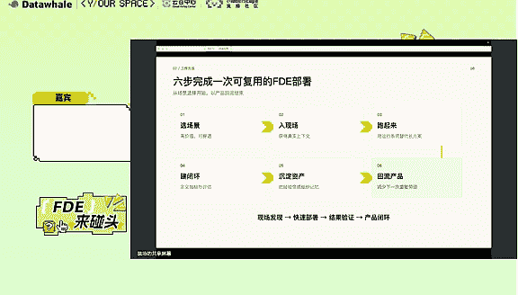
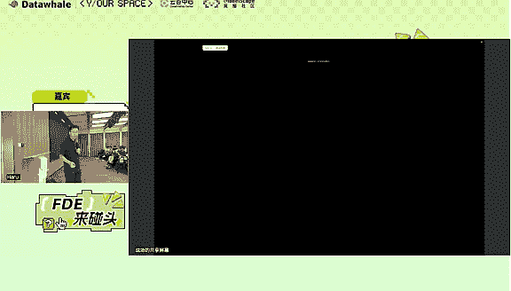

# 🚀 AI大模型落地实战：第一章：FDE系统交付的核心概念与判断标准

在本节课中，我们将学习FDE的核心概念，理解为什么FDE不应该被简单地理解为一个岗位，而是一套把技术、业务、结果与安全四个维度结合起来的系统交付体系。我们还将学习如何判断一个项目是否真的需要引入FDE，以及如何在实际项目交付之后，把零散的经验沉淀为可复用的产品能力。无论你是算法工程师、产品经理还是技术负责人，都能从中获得关于大模型企业级落地的实战参考。

## FDE的本质：不是单一岗位，而是一套系统

上一节我们做了课程概述，本节我们先来看看FDE到底是什么。在业界当中，并没有一个特别官方的FDE定义，所以我们需要从实践出发来理解这个概念。FDE的本质逻辑并不是一个单纯的岗位，它是一套系统。这套系统的目标是将技术、业务、结果以及安全这些维度，通过一个统一的体系结合起来，并落地到具体的业务场景中去。

如果把FDE仅仅当成一个岗位来理解，很容易走偏。大家可能会觉得需要招一个“超级工程师”，或者培养一个全能的技术人员来解决所有问题。但实际上，FDE在真正的交付过程中，并不是一个单纯的岗位。当我们把它看作一个系统，并围绕“从技术到业务结果”这个目标来构建时，就能更清晰地看到它的全貌。

## FDE的三个核心维度

了解了FDE的本质之后，本节我们来看看它的具体构成。以下是FDE的三个核心维度：

- 岗位维度：FDE首先是一个端到端对业务结果负责的岗位，需要对最终交付的成果承担责任。
- 能力维度：FDE人员需要懂业务语言，在理解业务的基础上，能够快速搭建出验证用的Demo，而不是先写一个庞大的解决方案，把所有规划都做完了再去落地。核心原则是短平快，先验证再迭代。
- 系统化能力：FDE需要具备系统化的能力，解决业务团队与技术团队之间的跨角色协作问题，明确业务边界和技术边界，并最终将这些能力沉淀为可复用的产品能力。

我们可以用一个简单的公式来描述FDE的能力模型：

FDE能力 = 业务语言理解 + 快速Demo验证 + 跨角色协作 + 产品化沉淀

## 如何判断项目是否需要FDE

接下来我们讨论什么样的项目需要引入FDE，什么样的项目不需要。并不是所有的AI项目都必须用FDE，我们可以从以下五个维度来判断：

- 业务价值大小：如果老板表示只愿意投入5万元或8万元，那么这个项目的业务价值很小，不需要引入FDE。比如做一个简单的HR问答助手，其实也不需要FDE。
- 实现难度：如果使用扣子等低代码工具就能快速搭出来，流程也比较简单，那么同样不需要FDE。
- 迭代频次：需要判断系统上线后是一次性的，还是要持续跟随业务发展进行迭代。比如做增长场景，不同阶段有不同的目标和新品，需要持续优化，这种情况需要FDE。
- 是否触及核心业务：如果场景没有触发到用户的核心业务，大概率也不需要FDE。早期做的很多BR项目，老板一年可能只用一两次，验完之后就再也没有人使用了，其核心业务价值关联不大。
- 经验能否沉淀：评估项目积累的经验能否成为可沉淀、可丰富的行业能力。

我们可以用下面的规则来快速决策：如果上述五个维度中有三个或更多被满足，那么建议采用深度FDE模式；如果少于三个，大概率不需要引入FDE。

## FDE落地的关键：走进业务一线

确定需要FDE之后，如何进行实际落地交付呢？最关键的一点是，必须走到业务现场，真正和业务一线的人打交道。每个行业、每个角色、每个场景都有非常强的专业性，技术同学一定要尊重这种业务专业性。

Agent一旦落地，就必须找到业务的第一线，并获得一线业务授权人的支持。授权人结合对业务的了解来做判断，知道什么时候该上线，什么时候需要调整。对前线同学的能力要求是：快速理解业务，利用技术实现圆润的Demo，速度越快越好，这样更容易和业务方达成一致。

FDE不能只是在客户处收集需求，然后回去按照固定的项目交付流程走一遍。那样基本上很难做成项目。FDE同学必须深入场景，把技术呈现到业务当中，成为该场景里最懂业务的人。以前帮客户做进出口曝光时，技术同学可能对业务完全不懂，但真正做完之后，都会成为进出口曝光领域的行家，这就是把所有时间拆解到场景里去的结果。

## 企业级交付的五个任务

在具体的交付过程中，我们将工作划分为以下五个主要任务：

- 选任务：在开始之前，先明确要做什么，定义任务的范围。
- 理清任务：选定任务后，需要去业务现场与业务团队同学沟通，把业务逻辑讲清楚。前期可能有50%的时间都花在这件事上，因为如果前期没讲清楚，后面所有的返工成本都会很高。
- 搭建A性：由技术专家来搭建A的能力，涉及知识怎么挂进来、SCL怎么开发、各种判断逻辑等，大约有30%的时间在开发阶段。
- 稳定运行：解决系统上线后的稳定运行问题。企业级的A审和个人使用的A审有很大区别，企业级讲究生产环境的确定性，准确率要求通常在90%以上，大规模上线甚至要达到95%，并且数据要稳定地输出。
- 达成价值一致：把业务价值和客户的预期对齐，形成可拆分、可落地的产品能力。

## 任务类型与流程节点拆解

不同的任务，对运行的准确性和安全性有不同的要求，因此需要把任务拆解开来分别处理。以下是常见的任务类型：

- 流程型任务：需要跨多个系统、多个团队协作，比如供运审核、商品大促审核等，这类任务的协作边界比较复杂。
- 专业问答型：在专业场景下做问答，通用模型可能只能达到60%到70%的准确率，而专业场景对准确率的要求非常苛刻，需要投入更多精力去提升。
- 运营优化型：围绕提升运营效率展开，未来可能成为很多企业中的重要方向，比如如何让人协作更高效。

在技术实践中，我们建议把一个任务拆成三个维度，用流程图来组织。可以用如下伪代码表示任务拆解：

任务 = 阶段1(材料识别) → 阶段2(字段审核) → 阶段3(结果输出)

比如做供应商审核入库，第一阶段是识别供应商提交的材料，第二阶段是逐个字段做审核，每个字段都要通过。这样做的好处是，后续如果业务规则发生变化，只需要修改对应的节点，而不需要在几百个节点之间寻找。业务同学说改哪里，就改哪里，不会牵一发而动全身。

在做准确率优化迭代时，可以让业务同学直接在这个系统里查看每个节点的输入、输出和处理规则。对于核心节点，比如图片不清晰需要人工介入的情况，运营人员可以点开节点，看到图片、表格或判断条件，实时进行确认。如果图片质量不行，就不能硬写规则，需要不断地让人工介入重新定义标准，在这个过程中帮助业务方把边界讲清楚。

最后，要把这些能力沉淀下来投入使用。企业级交付可以分为两层：一层是ASolution，用来解决具体的问题；另一层是A系统本身，用来稳定运行。这相当于一个两层架构，前面解决问题，后面保证稳定切换。

## 总结

本节课中我们一起学习了FDE系统交付的核心概念，明白了FDE不是单一岗位，而是一套把技术、业务、结果与安全结合起来的系统。我们掌握了判断项目是否需要FDE的五个维度，并了解了企业级交付的五个任务及任务拆解方法。希望这些内容能对你在大模型项目落地和产品沉淀方面提供一些启发。

