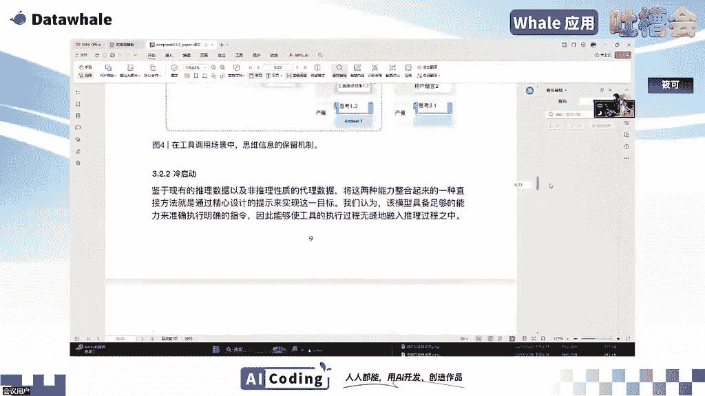
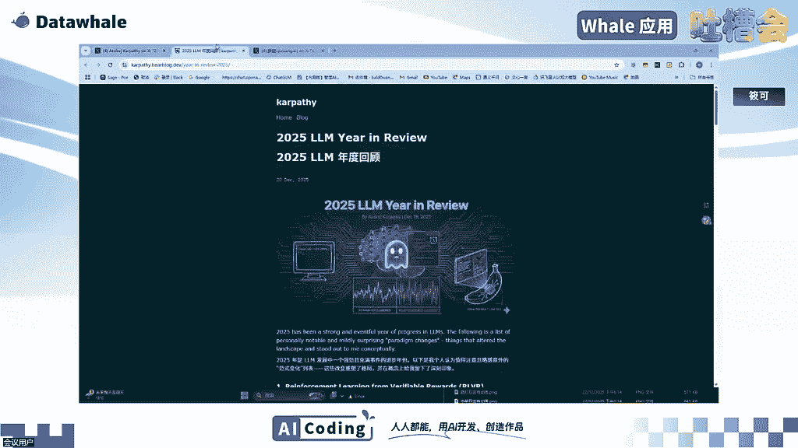
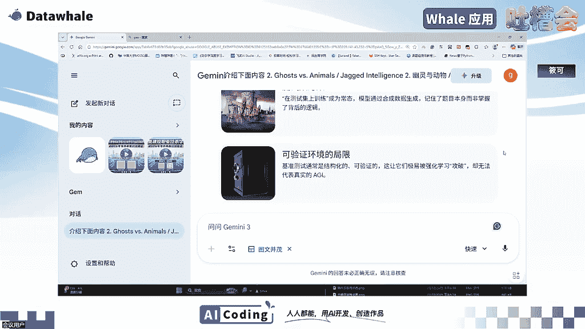
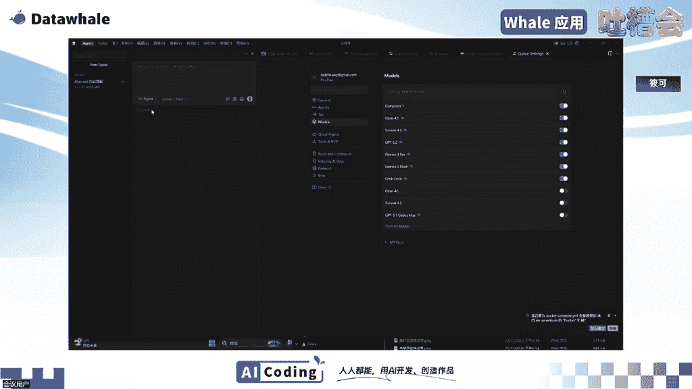
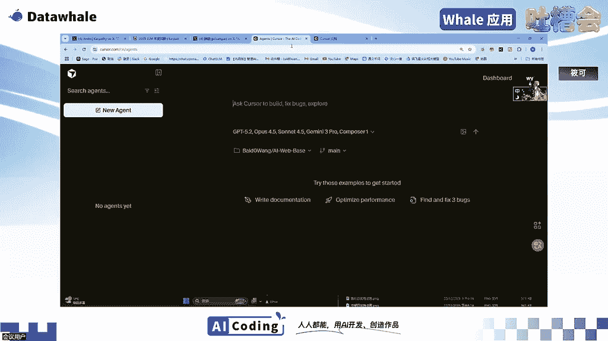
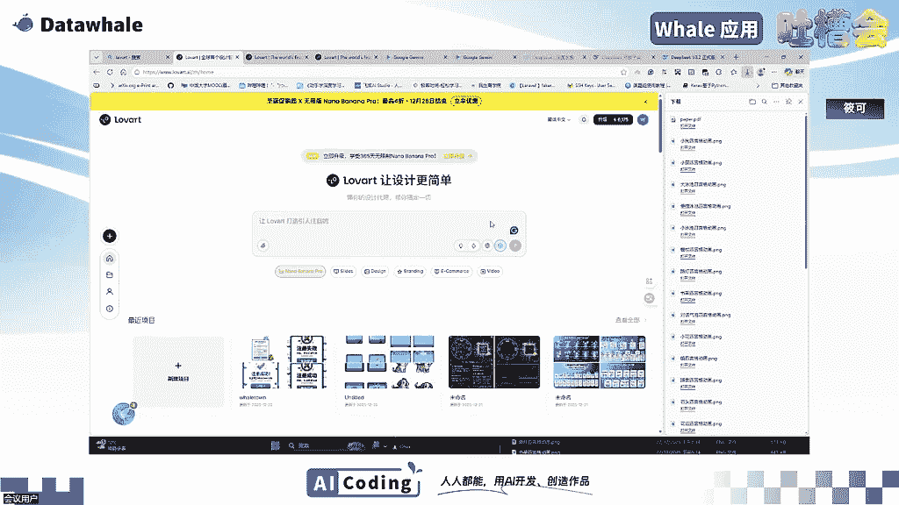

# 📚 Datawhale AI+X：01：课程概述与学习目标

各位同学大家好，欢迎参加本次课程。在本节课中，我们将一起学习Karpathy在2025年关于大模型年度总结的核心内容。这堂课适合初学者，我们会用大白话把复杂的概念讲清楚，不需要你有深厚的算法背景，只需要愿意跟着我一步步梳理即可。Karpathy分享的主题是2025年大模型领域有影响力，并且能够承上启下的工作。他原本只打算分享其中一部分，后来决定把这些内容一并介绍给大家。总体来说，Karpathy介绍的材料并不多，其中大部分大家已经比较熟悉，只有两个部分比较陌生，我们会重点展开讲解，其余内容简单带过。

以下是本节课的主要学习内容：

- 大模型训练从预训练到监督微调，再到基于人类反馈的强化学习的演进过程
- 可验证奖励强化学习RLVR的基本原理与作用
- V3.2模型在工具调用验证方面的改进
- RLVR带来的“幽灵与野兽”性能问题及其成因
- AI编程助手与云端智能体的新趋势
- Nano Banana与Lava平台的图像生成编辑能力

了解了学习目标之后，我们正式进入第一个知识点，回顾大模型训练是如何一步步演进到今天这个样子的。

# 🔄 Datawhale AI+X：02：大模型训练的三个阶段与RLVR原理

上一节我们介绍了课程的整体学习目标，本节我们来看看大模型训练是如何从早期的预训练演变到如今的可验证奖励强化学习的。

很多初学者在刚接触大模型时，容易把预训练、微调、强化学习这些概念搅在一起。其实它们就像是在学校学习的不同阶段：先是广泛阅读书本，然后是跟着老师做习题，最后是通过考试反馈不断改正。下面我把这个过程拆解开来，你看看是否容易理解。

大模型训练的发展经历了几个关键阶段。最早期的大模型训练使用的是预训练方式，例如GPT3那个时代的模型。随着技术发展，研究人员发现单纯的预训练逐渐不够用，于是开始引入监督微调，也就是SFT。这里有一个经常被提到的观点，就是工程领域的解法通常出现在大模型优化之前。也就是说，很多在模型训练中表现良好的方法，最初其实是在工程实践中被广泛使用的，之后才慢慢沉淀到模型层面。一方面，工程为模型提供了数据；另一方面，工程领域是百花齐放的平台，而模型训练只能遵循最高效的路径。当某些工程方法被证明有效后，它们也可能成为模型训练的好方法。这一阶段受到工程师的启发，形成了早期的监督微调训练优化。

在监督微调之后，大家发现强化学习可以提升大模型的推理能力。强化学习的核心思想是将推导过程放入学习过程之中，让大模型学习人的思维方式，也就是先思考，再给出回答。但基于人类反馈的强化学习，即RLHF，存在一个问题。它的奖励信号比较主观，容易导致大模型变得很容易被人控制，说话没有原则，就像墙头草一样，你说什么它就认同什么。这种训练出来的模型给人一种很聪明又很讨好人的感觉，但并不客观。更糟糕的是，当时的模型不是可推理的模型，连简单的加减法都算不出来，这让大家非常头疼。

为了解决这些问题，2025年引入了可验证奖励强化学习，也就是RLVR。这种强化学习使用更客观的评价机制来进行验证。举个例子，在做数学题时，模型输出一个答案，系统直接计算出正确答案并与之对比，这种评估方式比凭主观感受打分要好得多。下面是几个不同训练阶段的简化表示：

```text
预训练阶段：模型 = 预训练(大规模文本语料)
监督微调阶段：模型 = 监督微调(预训练模型, 标注对话数据)
RLHF阶段：策略 = 强化学习(人类偏好奖励模型)
RLVR阶段：奖励分数 = 可验证函数(模型输出, 标准正确答案)
```

下面是大家可以参考的相关论文，包括R1系列论文以及V3.2的论文。作者建议重点关注V3.2，同时也顺带介绍一下V3.2的相关内容，虽然有些偏硬核，但讲深一点大家会更容易理解。

我们来看V3.2模型的具体表现。V3.2模型是在12月1日发布的，实际上是在R1模型的基础上，对思考能力进行了增强，并做了一些很好的优化。其中比较值得关注的一点是工具调用验证。

掌握了RLVR的基本原理之后，我们继续看看V3.2模型在工具调用方面做了哪些改进。

# 🛠️ Datawhale AI+X：03：V3.2模型与工具调用验证

上一节我们介绍了RLVR的原理，本节我们来看看V3.2模型是如何把这种验证思想应用到工具调用中的。



在实际使用AI助手时，你可能会发现模型有时候会调用工具，但返回的结果并不一定可靠。V3.2模型的作者意识到这个问题，于是在模型内部增加了一层专门用来验证工具结果的机制。这样一来，模型不仅关心自己生成了什么，还会关心调用工具后拿到的数据是否真实有效。

V3.2模型在工具调用方面的主要改进如下：



- 增强了思考能力，在R1模型基础上进一步优化
- 增加了工具结果验证层，用于适配Agent工作流
- 对每一次工具调用都进行评价，为智能体协作提供更好的反馈

在Agent工作流中，我们平时使用AI证书的时候，会调用很多相关的工具。V3.2模型为了适配这种工作流，专门增加了对工具结果的验证。也就是说，在结果验证之上，又叠加了一层工具结果验证。这样一来，模型中间过程的每一步都能得到很好的评价，整体模型在Agent配合过程中也能得到更好的反馈。

下面是工具调用与验证的简化伪代码：

```python
# 工具调用与验证流程
工具结果 = 调用工具(模型请求的参数)
验证分数 = 验证器(工具结果, 预期约束条件)
反馈给模型(验证分数)
```

除了工具调用验证，V3.2模型还做了一些其他的优化，这里就不再赘述。第一个话题到这里就结束了，接下来我们继续看第二个话题。

# ⚠️ Datawhale AI+X：04：RLVR的副作用——“幽灵与野兽”现象

上一节我们介绍了V3.2模型的工具验证机制，本节我们来看看RLVR虽然强大，但也带来了一些意想不到的副作用。

RLVR这个方法训练出了一个很强大的专家模型，但由于模型的训练目标都集中在评价指标上，也带来了一些不好的影响。最明显的一个问题是，模型会出现锯齿状的性能表现。也就是说，在处理很复杂的问题时，模型做得很好，但在处理很简单的问题时，反而表现非常差。大家现在可以慢慢理解，大模型训练其实只是一种暂时的复现，表现出一定的聪明才智，但这并不是真正的智能，更像是一种表面的模仿。

产生这种情况的原因有几个方面。第一，评价指标让模型为了刷分而训练，导致难度较高的基准测试得分高，但对于日常中间的一些问题，反而比较缺失。第二，网络上存在大量通过SEO等方式推广的低质量内容。举个例子，有些公司会帮学校提升知名度，在百度上做搜索相关度优化，让一些三流学校也能被搜索到。这些质量一般的内容被推到互联网上，被夸大地包装得很好，而大模型在训练时使用了这些数据，但数据量太大，无法全部人工筛选。这就导致模型在冷门或垂直领域上的表现特别差，即使在benchmark测试上得分很高，实际的智能水平也很低下。第三，验证环境的局限性。验证方式通常很局限，比如只让模型做题、写答案，而不会像实际应用那样五花八门，比如生成图片、编写Markdown文档、写代码、创建自定义标记或语言等。这些特殊的符号数据，模型的回答也不会特别好。



下面是导致“幽灵与野兽”现象的几个主要原因：

- 过度优化评价指标：模型为了在测试集上刷高分，忽略了日常实际问题
- 低质量网络数据混入：SEO等手段产生的大量普通内容进入训练集，难以人工筛选
- 验证环境单一：训练时只做题、写答案，缺少生成图片、编写Markdown、写代码等多样化场景

综合来看，这些因素共同导致了Karpathy所说的第二个问题，也就是“幽灵与野兽”现象。

理解了RLVR的副作用之后，我们把视角转移到AI编程领域，看看现代编程工具是如何改变开发方式的。

# 💻 Datawhale AI+X：05：AI编程新范式：CoX与云端智能体

上一节我们分析了RLVR的副作用，本节我们把视角转移到AI编程领域，看看现代编程工具是如何改变开发方式的。



在传统的软件开发中，如果你想做一个小工具，通常需要写代码、配置环境、部署服务器。而现在的AI编程助手已经进化到了可以直接在云端运行、自动调用多个模型、甚至让产品经理自己动手做产品的阶段。下面我们逐一来看这些新功能分别解决了什么问题。

第三个话题是关于CoX的。这里说的CoX不仅仅是指某一个工具，而是指很多IDE的革新，以CoX为例进行说明。CoX现在拥有多智能体和云智能体功能。虽然很多朋友可能对CoX比较了解，但对它目前的最新更新可能还不太清楚。简单来说，CoX有很多新功能，现在和Tree等工具很像。例如，它支持多模型对比，可以对比不同模型的输出效果，还支持Max模型选择。

下面是当前AI编程工具的几个重要发展方向：

- 云端智能体：利用远程算力，用自然语言描述需求即可生成应用
- 多模型对比：在同一个IDE里对比不同模型的输出效果
- 子智能体并行：把复杂任务拆分给多个小智能体同时执行
- Web编程降低门槛：让非专业开发者也能参与产品构建

CoX的Agent模式可以选择使用云端环境。这对应的是ID的管理。使用云端模式时，大家在家里随便说两句话，就可以用云端的电脑去完成任务。这种体验很像使用扣子空间或M工具时的感觉。大家还可以使用多个模型进行对比。这样一来，IDE大大提升了大家的开发性能，也为未来提供了很大的想象力。比如说，如果我们假设网速足够快，模型足够智能，并且有很多云算力，那么你可能真的只需要一句话，就能得到很多应用，并帮助你完成任务。

除了云端功能，CoX还有一个在线策略页面，你可以使用它来编写自己的项目。我的很多项目已经传到了云端，CoX可以直接从我的GitHub项目中拉取代码，帮我做优化，比如随便找一个项目，它可以帮我优化，还可以帮我把代码提交回我的项目里，也就是发起PR。你甚至可以选择多个模型，一起进行对比，这一切都充满了编程的想象力。

另外，CoX还体现为本地模型的编程辅助形式，这是另一种新的形态。我前几天看到一个介绍，说Code X和Cloud Code对他们的公司帮助很大。比如说，So的安卓版本就是由Code X工程师用7天时间上线的产品。可见这种智能体已经非常先进了。大家学习智能体时，应该学习编程智能体的原理、底层逻辑和运行方式。因为最顶尖的开发能力通常掌握在最顶尖的人手中，他们正在制作帮助自己的工具，其实就是这种智能体。

Claude Code等闭源模型在某些方面比开源模型更强，大家可以适当关注。我们这边也在构思类似的事情，后面会发给大家。目前我们也在不断参考Claude Code的一些优秀技术点，大家可以在编程群里继续交流。MCP这块的优化也已经和大家分享过。Cloud Code现在正在把Agent的子智能体做并行处理，也就是用一套更快速的方案来完成大规模复杂任务，这点值得大家期待。

在Web编程方面，我们群里有Web编程相关的作者，这里就不班门弄斧了。Web编程也是一个很好的概念。如果不提Web编程，很多产品经理可能不会像雨后春笋一样都说要来做产品经理，他们可能没有这个底气。当看到编程变得如此简单之后，大家就充满了信心。但这也带来了大家一直讨论的60分或80分危机，也就是需要解决的问题。小可也提到，自己在写新方法，就是为了让60分向80分迈进，让80分的选手向90分或100分迈进，这都是我们圈子里的小伙伴们正在考虑如何解决的问题。

还有一些人从另一个角度解决了这个问题，那就是使用秒达的方案，直接不写代码了。秒达准备支持小程序开发，并支持用户付费，让用户动动手指就能完成一个产品，同时让用户获得收益。这个想法可能会带来比较不小的革命性思考，但也会带来很大的阻力，不知道这条路能否走成功，我们拭目以待。

介绍完AI编程相关内容之后，我们来看看图像生成和编辑领域的最新进展。

# 🎨 Datawhale AI+X：06：图像生成与编辑：Nano Banana与Lava平台

上一节我们介绍了AI编程的新范式，本节我们最后来看看图像生成和编辑领域的最新进展。

生成式AI不仅能写代码，还能画图。不过很多初学者在使用图像生成工具时，会遇到“画出来的图好看但不好改”的问题。Nano Banana和Lava平台的探索，正是试图让图像生成不仅好看，而且更容易被精细编辑。

Nano Banana这个话题在之前的几期中介绍过很多次。下面这张图就是由Nano Banana生成的内容。通过文生图的内容，我们可以更方便地进行更自由的创作。但现在大家更关心的问题是，怎么能用到这么好的模型，国内模型什么时候能做到这一步，以及我们的内容如何做得更好、更具可编辑性。

针对这个问题，我们看一下Lava的一个尝试。Lava是一个类似于Coser的平台，是一个第三方接入各个厂商模型的平台，可以在上面做设计。Lava做了一些比较好的尝试，下面是它在图像生成编辑方面的主要功能：



- 集成超分辨率、背景移除、擦除、元素编辑、文字提取等常用功能
- 将ComfyUI等工作流中的工具集成到统一平台，使用更方便
- 支持多种图像模型、视频模型和3D模型的整合调用
- 提供思考模式和模型选择，满足不同创作需求

举例来说，Lava可以提取图片中的文字，并支持修改。我做过一个尝试，把图片上的“注册失败”改成了“注册成功和注册失败”。这是Lava目前正在做的一些挑战。除了这些功能，Lava还整合了所有模型。在首页上，可以看到它有思考模式，还可以从大量的图像模型中选择，基本上所有常见的图像模型都在这儿，比如梦4.5、亚娜娜Banana、可林等。此外还有视频生成模型和3D模型，Lava也在尝试做3D模型。

好，这就是Karpathy 2025年总结的内容，加上我自己的一点思考，就介绍到这里。不知道大家有没有想讨论的。

# 📝 Datawhale AI+X：07：课程总结

以上就是本节课的全部内容。下面我们来回顾一下本节课我们一起学习的核心知识点。

以下是本节课我们一起学习的核心知识点：



- 大模型训练经历了预训练、SFT、RLHF到RLVR的演进
- RLVR通过可验证奖励提供更客观的训练反馈
- V3.2模型在工具调用上增加了结果验证层
- RLVR可能导致模型在复杂问题和简单问题上出现锯齿状性能
- 云端智能体和AI编程助手正在降低开发门槛
- Nano Banana与Lava平台在图像生成编辑方面进行了有益尝试

本节课中我们一起学习了Karpathy 2025大模型年度总结的主要内容，从训练范式到实际应用，希望能帮助你建立起对当前大模型技术的直观认识。如果有不明白的地方，欢迎在课程群里继续讨论。
