# 🎓 Datawhale AI+X OpenClaw吐槽大会：第1章：活动概述与Open Cloud简介

在本节课中，我们将学习OpenClaw吐槽大会的整体流程和主要内容。本次活动由Datawhale AI+X社区组织，邀请了多位嘉宾分享互联网实习经验、社区成长故事，并围绕Open Cloud项目开展吐槽讨论。活动形式为直播与腾讯会议相结合，欢迎参与者在直播间或评论区开麦交流。

本次活动包含三个主要议题。第一个议题是实习经验分享，由浩亮讲解如何从0到1获得互联网实习机会。第二个议题是社区故事分享，由孙晓祥老师讲述他与DataWhale的相识与成长。第三个议题是Open Cloud吐槽大会，由何乐和佳诺担任主吐槽官，邀请所有关注Open Cloud的用户一起分享使用体验和存在的问题。

Open Cloud是一个零基础养龙虾的教程项目，由志明老师负责，他同时也是Hello Cloybook和Easy Pocket的项目负责人。整个吐槽大会的核心目的在于，最近很多用户安装并部署了Open Cloud进行体验，但在使用过程中遇到了各种各样的问题，包括安全性疑虑、部署难度、功能应用场景不清晰等。通过本次活动，我们希望收集用户反馈，探讨Open Cloud如何在实际场景中更好地落地。

以下是本次活动的主要议程安排：

1. 浩亮分享从0到1获得互联网实习的经验，包括他在Second Me的运营实习经历。
2. 孙晓祥老师分享他在DataWhale社区的成长路径，从普通学员成长为助教。
3. 志明老师介绍Hello Cloud教程和Open Cloud的安装部署方法。
4. 何乐和佳诺主持Open Cloud吐槽大会，收集用户对安全性、应用性、Token消耗等方面的意见。
5. 自由吐槽环节，所有参与者均可开麦分享自己的使用体验和建议。

# 💼 Datawhale AI+X OpenClaw吐槽大会：第2章：从0到1获得互联网实习经验

上一节我们介绍了活动概述和整体议程。本节中我们来看看浩亮分享的从0到1获得互联网实习经验，这部分内容适合正在找实习或准备进入职场的同学参考。

浩亮是DataWhale的成员，此前在Second Me担任运营实习生。Second Me是一款全新的AI原生社交工具，可以理解为AI时代下的微信。用户可以在里面运用AI去社交，匹配极致的灵魂伴侣，寻找新朋友，并参与AI创新功能。浩亮在2050活动的11月恳谈会上认识了Second Me的运营负责人郝运哥，在听到对方关于AI时代个人成长的分享后，他鼓起勇气询问能否去Second Me实习，最终成功拿到实习Offer。

在实习过程中，浩亮主要负责运营工作。他提到自己之前有产品实习经历，但转岗做运营后发现运营工作比较有挑战。运营不仅仅是跟人聊天，它非常考验人的胆量和技巧，尤其是在面对陌生人场景时，内向的同学会觉得压力更大。同时，产品的好坏不仅取决于研发团队的功力，还很大程度上取决于运营成果。

在Second Me的实习期间，团队主要开展了以下几项业务：

- 线上社交墙：在北京AI质和min敲钟活动现场使用，帮助参会者找到想要聊天的人，缓解现场拥挤和排队问题。
- 群聊功能：让用户可以在非官方建立的墙上拉更多人进来，例如CEO与用户的A to A交流群，支持艾特特定成员进行咨询。
- A to A黑客松：全球首届黑客松，邀请各地玩家搭建Agent项目，团队负责运营工作。
- A卷小镇（Se小镇）：春节期间更新的版本，提供居民证功能，用户增长迅速，三天内突破一万注册量。

通过这段实习，浩亮总结了三点感受。第一点是运营工作并不简单，需要持续调整方向和尝试新事情。第二点是CEO在年会上多次强调库里的名言，鼓励团队成员无论是运营还是HR，都要掌握Code能力，全员标配使用AI工具快速落地创意。第三点是切记半场开箱槟，必须一步一步扎实跑完闭环，才能避免重大失误。

关于如何找到第一份实习，浩亮给出了以下几点建议：

- 学校学长学姐资源：学长学姐通常有内推码，了解学校和公司情况，能直接推到同组。
- 企业比赛：参加相关比赛是获得实习机会的有效途径。
- 线下活动：包括开发者大会、城市活动、2050恳谈会等，直接与企业高管交流并投递简历。

此外，他还强调了简历打招呼的技巧。不要只使用默认模板，建议写清楚自己的来源、身份、技能和过往经历，与目标职位的JD进行匹配。如果校园期间没有参加过比赛，也可以从现在开始准备，持之以恒地磨练技能。找工作是一件费时费心的事情，可能会经历两三个月的低谷，但要保持信心和耐心，不要被困难打倒。

第一份实习对求职者非常重要。拿到第一段实习后，心态会变得轻松，后续找实习会更顺理成章；简历上会有经验，HR更容易信任；对实习也不会再有那么大的恐惧感。很多不自信来源于缺乏第一段实习经历，一旦有了第一段，就会更有自信去争取第二段和第三段实习，甚至帮助最终就业。

# 🌱 Datawhale AI+X OpenClaw吐槽大会：第3章：DataWhale社区与助教成长之路

上一节我们介绍了从0到1获得互联网实习的方法和经验。本节中我们来看看孙晓祥老师分享的DataWhale社区与助教成长之路，这部分内容适合想要了解社区文化的新同学。

孙晓祥老师是一名中年产品从业者，之前写过C语言和Java代码，现在从事产品功能工作。2023年的一个晚上，受到ChatGPT出现的影响，他觉得AI会对行业产生变化，因此开始学习相关知识。他在社区中连接到了DataWhale，最初学习的第一个课程是李木老师的动手学深度学习。虽然最初是懵懵懂懂的状态，但社区的学习氛围让他感受非常温暖。

在学习过程中，无论是开营、做任务、打卡还是组内分享，社区助教老师都很热情地帮大家答疑，串联知识点和问题。当时他属于潜水员，默默在群里看大家的回复，解决自己的问题。课程结束时，大家开心庆祝结业，但社区并没有推销课程或常规拉群，而是纯粹的学习氛围。这让他非常喜欢这个群体和DataWhale的理念。

后来他陆续参加了更多课程，从偶尔冒泡到主动发言，再到参与小组讨论，甚至担任队长，逐渐融入这个团体。虽然有些课程因为时间协调问题没有完成，但他仍然感激马老师和浩源老师的帮助。学到的东西在后续工作中有深刻的帮助，虽然课程无法解决工作中的100%问题，但提供了继续学习和解决问题的能力。

2025年，他申请成为Hello Agents的运营助教。虽然个人能力有限，但他希望和社区里闪闪发光的小伙伴在一起，为后续想上山的小伙伴举灯。他从最初的小白，成长到现在能够帮助大家解决问题，并主动组织讨论。他觉得每个人的成长感受不同，但DataWhale给他的感觉是理解这里的精神，每个人用自己的方式贡献团队，包括写教程、改作业、答疑、整理资料等。

他认为没有人是完美的专家，大家都是学习者，每个人都愿意很好地分享。这让他觉得社区非常特别。今天是他第一次和大家见面，技术和文笔可能比较一般，但他想用自己的感受和经历帮助还在观望的小伙伴尽快加入，并希望未来能够帮助到一些人。

# 🛠️ Datawhale AI+X OpenClaw吐槽大会：第4章：Open Cloud安装与部署教程

上一节我们介绍了社区成长与助教经历。本节中我们来看看志明老师分享的Open Cloud安装与部署教程，这部分内容适合想要快速上手Open Cloud的用户。

志明老师是Hello Cloud和Easy Pocket的项目负责人，也是D社区的贡献者。他介绍的Hello Cloud教程主要分为两部分，一部分是龙虾的领养，即如何使用龙虾；另一部分是龙虾的构造，即包含哪些组件以及如何组合，适合想要开发私有定制化助手的用户。

Open Cloud的安装部署有两种主要方式。一种是云端部署，适合初学者和非硬核开发者，推荐使用腾讯云或智普的Auto Cloud。云端部署通常有一键安装包，免费提供Token，不需要复杂的本地配置。另一种是本地部署，适合有一定技术背景的用户，需要自行配置环境，容易遇到各种依赖和权限问题。

以下是本地部署的基本步骤：

1. 安装Open Clo工具，使用npm命令进行初始化。
2. 运行onboarding命令，进入quickstart模式，按提示配置模型和Channel。
3. 选择模型，例如Open Route提供的免费模型，需要先在相关网站注册账号并获取API Key。
4. 选择集成渠道，例如飞书、企业微信、QQ等，但原生支持的集成应用较为有限。
5. 配置完成后重启服务，即可开始使用。

代码示例如下：

```bash
# 安装Open Clo工具
npm install open-clo

# 启动交互式配置
open-clo onboarding
```

在配置过程中，用户需要确保模型API Key、Channel信息以及环境变量都已准备好，才能一步步完成配置。如果某一步出错，需要中断配置，上网查找解决方案，解决后再回到安装流程继续。

志明老师建议，如果不是有明确的定制化需求，初学者尽量先使用云端部署，避免本地部署带来的配置复杂性。本地部署虽然免费，但需要考虑电费、机器常开等问题，且安全性需要用户自行把关。

云端部署的好处包括硬盘快照功能和系统镜像功能，可以在版本升级失败时快照回原版本，数据不会丢失。云服务器虽然需要绑定厂商，存在一定的迁移成本，但对于大多数用户来说，便捷性更高。

# 🔒 Datawhale AI+X OpenClaw吐槽大会：第5章：Open Cloud安全性与隐私问题深度剖析

上一节我们介绍了Open Cloud的安装与部署方法。本节中我们来看看何乐和佳诺针对Open Cloud的安全性与隐私问题展开的吐槽讨论，这部分内容适合关注数据安全和隐私保护的用户。

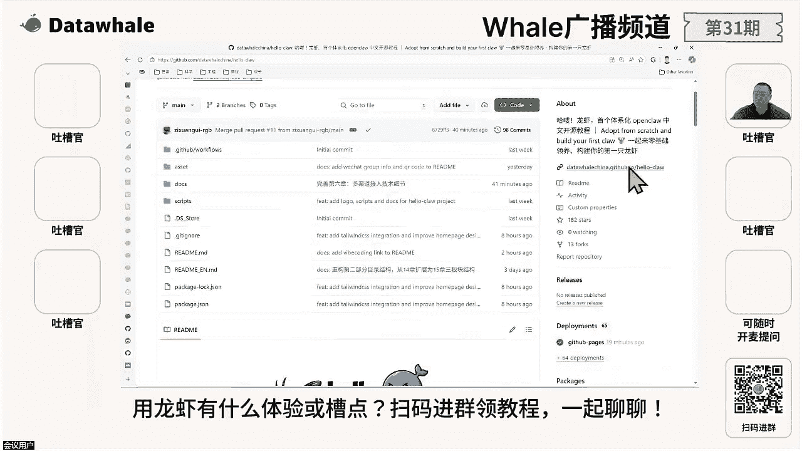

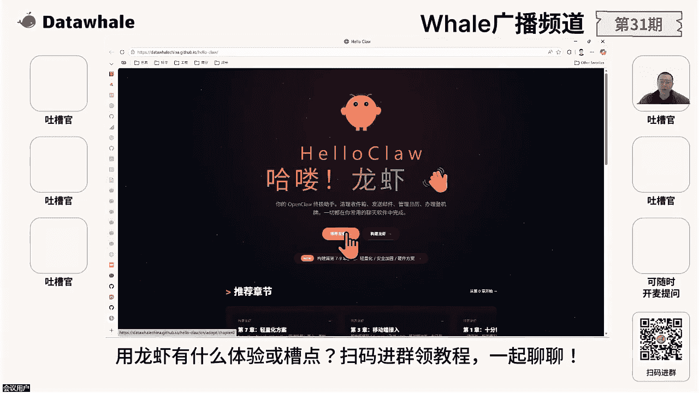

安全性是Open Cloud最基础的问题之一。如果将Open Cloud部署在个人电脑上，而电脑中还部署了其他代码或数据库资料，一旦因为主动运行方式不当导致不良Skill下载，可能引发代码泄露或API Key泄露，造成重大损失。

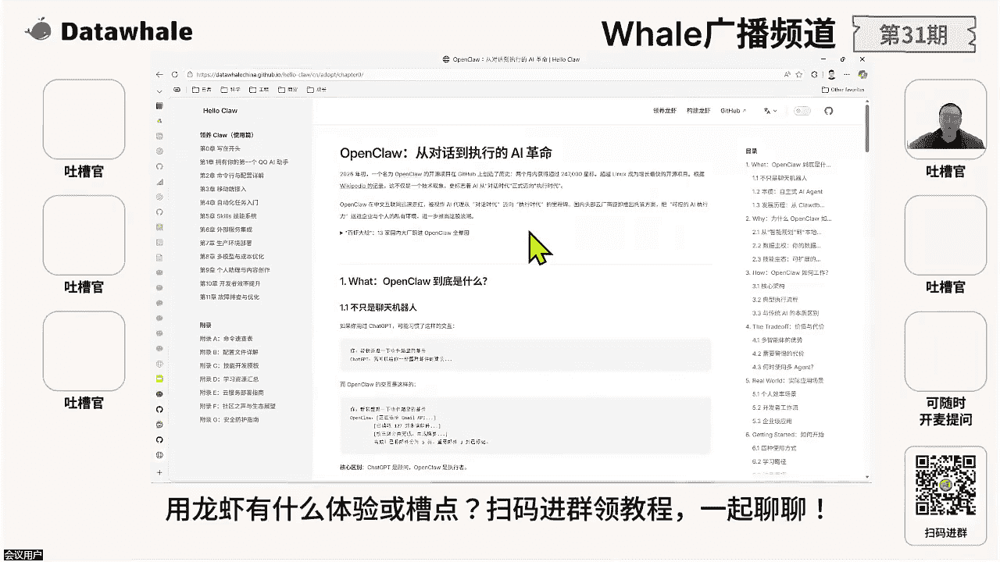

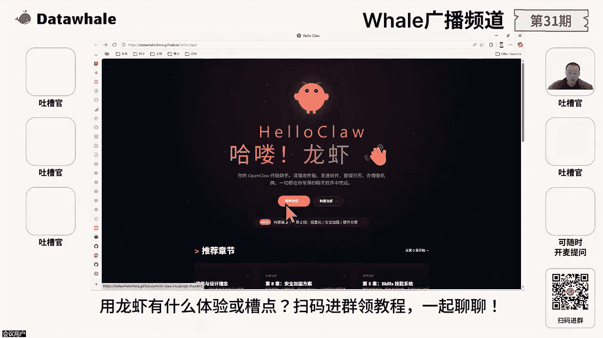

本地部署的风险可以用以下公式简单表示：

风险等级 = 本地部署 × 局域网暴露 × 权限开放大小 × 用户操作熟练度

如果将Open Cloud部署在私人电脑上，相比云服务器部署会更加困难。云服务器厂商通常提供便捷的操作方式，可以直接配置API Key和连接渠道，而在私人电脑上，用户需要自己解决部署难题。出于安全考虑，通常采用Docker或虚拟机方式，但虚拟机不太适合需要与本机文件交互的场景，Docker则面临权限开放大小、文件交互方式等多个问题。

有些用户考虑直接本地部署，不使用Docker或虚拟机，但这非常危险。如果电脑连接在局域网中，一台被攻击的电脑可能会危及整个局域网下的其他电脑；如果电脑意外暴露在公网上，或者变成发送莫名其妙内容的始发站，后果更加严重。

本地部署还面临小白用户操作难题。Open Cloud作为开发工具，目前并未达到非常成熟的状态。如果部署给非技术人员使用，小白用户可能因误操作而做到危险事情，如何规范这些操作难题是一个需要解决的问题。

何乐老师表示，无论是单独部署还是其他方式，他都无法接受本地部署，因为每种方式都可能对安全性造成冲击。同时，Open Cloud的使用场景主要是直接操作电脑，让电脑帮忙做各种事情。例如，用户希望Open Cloud分析文件夹中的合同文件，找出不合格的条款，如果仅放在Docker中，对于小白来说是累赘，与在互联网上传文件没有本质区别，这会削弱其应用场景。

在安全性吐槽环节，还有用户提到Prompt恶意攻击问题。Open Cloud可能会自动下载Skill，用户每天需要阻止其下载。有些Skill安装很快，但60多个Skill中很多无法使用，或者学会了过两天就不会了，需要对Skill进行管理。

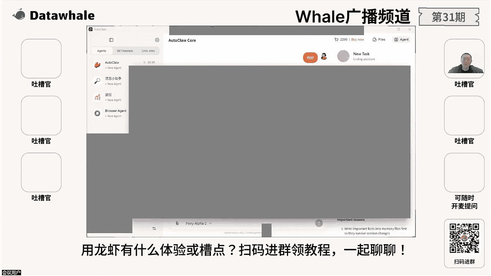

# 📂 Datawhale AI+X OpenClaw吐槽大会：第6章：Open Cloud使用场景与应用性分析

上一节我们介绍了安全性与隐私问题。本节中我们来看看Open Cloud的使用场景与应用性分析，这部分内容适合思考如何将Open Cloud应用到实际工作中的用户。

Open Cloud对于大部分人的使用场景是直接操作电脑，让电脑帮忙做各种事情。例如，用户有一系列文件，如合同或清单，不希望一个个复制粘贴到互联网上的AI中解析，而是希望Open Cloud直接读取文件夹，分析所有合同，找出不合格的条款。这是一个常见的业务场景。

对于这类场景，如果仅放在Docker中，用户需要将文件复制到只读文件夹，这与在互联网上传文件没有区别，应用场景被抹杀。Open Cloud的本质是让小白能够无脑操作，不需要费力气就能快速达到目的。如果使用过程与之前做的事情一模一样，那么这个业务场景就不成立。

在文件存储方面，本地部署可以直接读取本地文件，而Docker方式因为存储隔离，需要指定特定文件夹才能读取。如果用户希望在手机上使用飞书等应用访问文件，本地部署无法直接满足，需要考虑不同场景的解决方案。

Open Cloud与GPT接入聊天软件有明显区别。GPT接入聊天软件只是一个聊天器，只能发送正常信息，相当于将对话Token挪到了另一个聊天框中。而Open Cloud部署在用户的服务器上，有权限对服务器进行各种操作和联系，可以写文件、转发内容等。

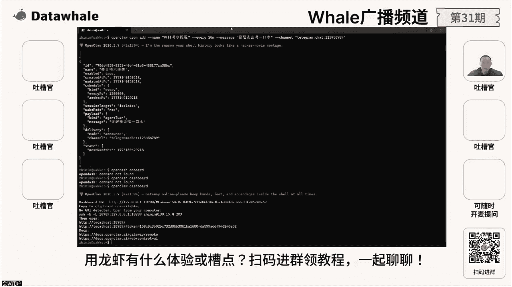

可以用以下比喻理解：Open Cloud是一个有手有脚的人，能干活，能做事情；而GPT相当于这个人的大脑，只有思考能力，本身干不了活。Open Cloud现在可以在企业微信中直接发文件、做大推送，因为各大厂商开放了对外接口，使Open Cloud具备更强的自主性和多样性。

在记忆管理方面，Open Cloud的群聊和私聊处于不同的会话中，上下文不共享。如果想让Open Cloud了解上下文，需要让它保存到接力文档中，或者开始时加载接力文档，给它一个角色，这样才能建立更个性化的功能。

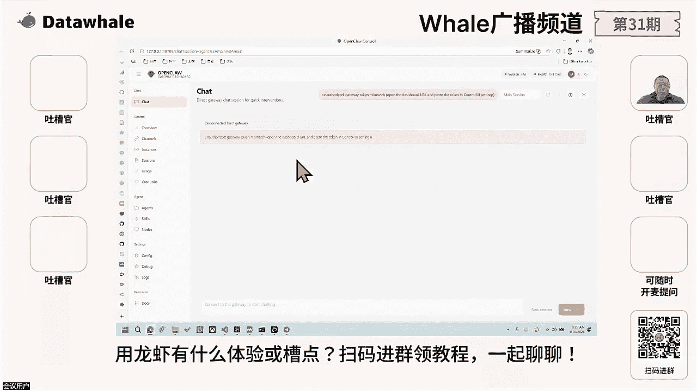

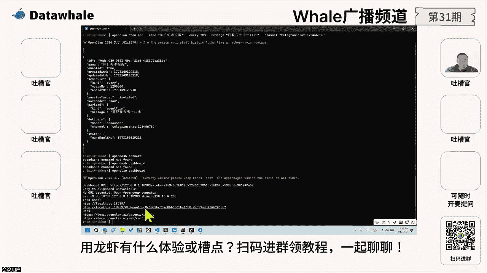

# 💰 Datawhale AI+X OpenClaw吐槽大会：第7章：Token消耗与免费模型选择建议

上一节我们介绍了使用场景与应用性分析。本节中我们来看看Token消耗问题与免费模型选择建议，这部分内容适合关注使用成本的用户。

Open Cloud在使用过程中Token消耗较大，一些用户反映单纯对话几个问题就消耗数百万Token，成本较高。例如，使用DeekSeek时一天可能跑几十块钱，使用Kimi时高强度使用一周就要用完套餐，费用恐怖。

总成本可以用以下公式估算：

总成本 = 对话次数 × 平均Token数 × 模型单价

为了降低成本，用户可以根据场景选择不同模型。简单对话可以使用便宜的小模型，复杂问题可以切换到更强的模型。火山引擎、腾讯云、阿里云等厂商都有9.9块钱的套餐，阿里云最近还限购了部分模型。Kimi K2.5模型能力不错，但回复较慢，可能在思考。7月星辰推出了免费模型，支持Reasoning和Tool Calling，是一个性价比较高的选择。

一些用户建议不要对Open Cloud有过高期望，可以将其当作陪聊或养成小游戏，期望值低一点，有一天它变得强大时就是惊喜。同时，AI发展速度很快，两个月后可能就会是全新的形态，建议保持观望态度。

# ⚙️ Datawhale AI+X OpenClaw吐槽大会：第8章：Skill开发与自动化工作流实践

上一节我们介绍了Token消耗与模型选择建议。本节中我们来看看Skill开发与自动化工作流实践，这部分内容适合想要通过Open Cloud实现自动化的用户。

Skill开发是Open Cloud使用中的一个重要话题，但也存在较多难点。Skill本质上是封装一套Workflow，如果某个东西没有写清楚，大模型不一定能搞清楚。尤其是模型能力较低时，非常容易出现问题。不同模型之间的Skill也不通用，例如用Oppo写的Skill，切换到国产模型后可能无法操作，会愣住。

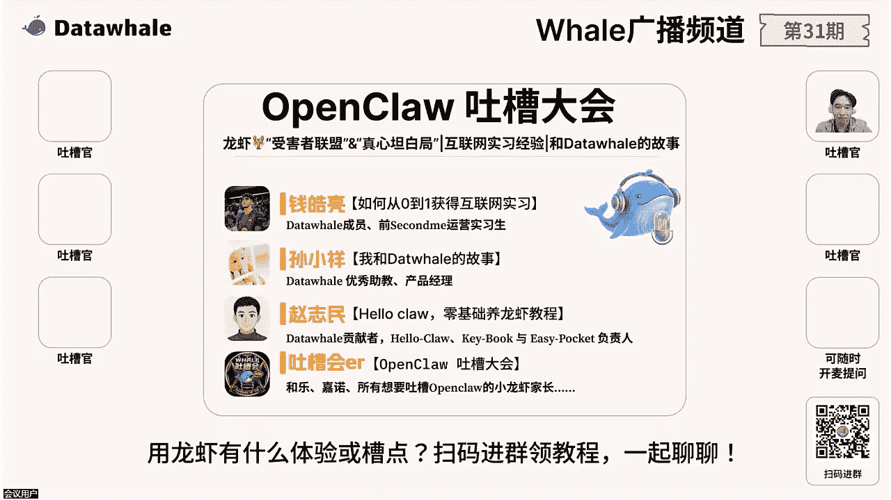

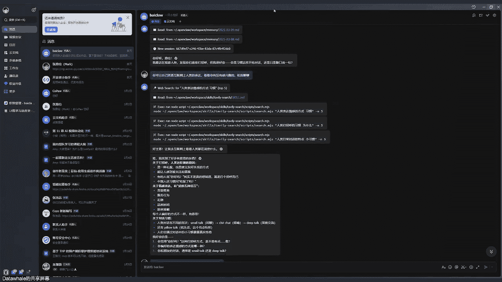

在开发Skill时，颗粒度非常关键。如果将一个复杂任务变成一个Skill，模型能做到的程度受限于该Skill的粗糙程度。有些团队在现有Skill无法完成任务时才会追加新Skill，否则不会轻易增加。Clo Code自带的Skill不超过20个，体现了对Skill的敬畏之心。

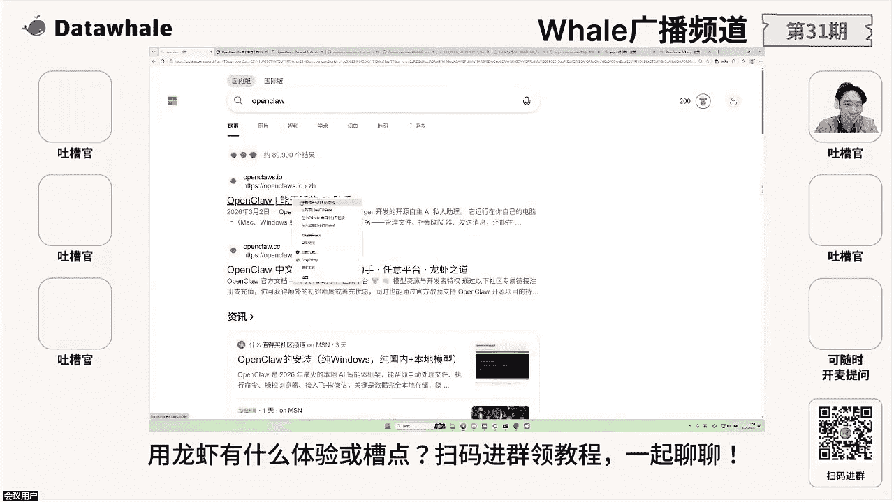

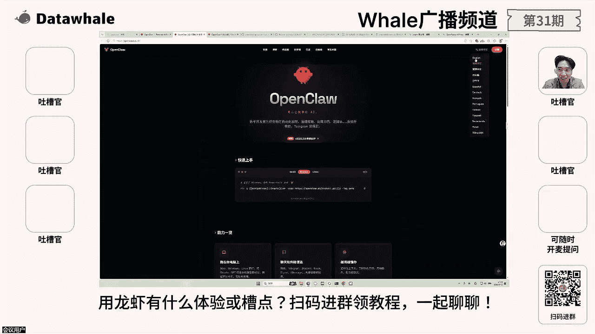

一些用户尝试通过One Panel来规范Open Cloud的行为。One Panel提供标准API，可以限制IP、固定输入输出格式，强制Open Cloud只能调用这些操作，避免其乱来。例如，用户可以让Open Cloud使用One Panel的API进行DNS解析、部署网站、创建Docker、配置反向代理等操作，所有操作都有日志可查，面板会实时可视化显示，保证安全性。

自动化工作流示例如下：

```json
{
  "automation": "deploy_website",
  "tool": "one_panel_api",
  "constraints": {
    "ports": ["80", "443", "SSH"],
    "ip_restriction": "127.0.0.1"
  },
  "workflow": [
    "获取域名解析权限",
    "创建网站",
    "申请证书",
    "生成分享链接"
  ]
}
```

通过这种方式，Open Cloud可以帮助用户部署网站、备份数据库、上传文件到私有对象存储等，用户只需要在面板上授权固定IP，无需手动点击，节省大量时间。

# 📋 Datawhale AI+X OpenClaw吐槽大会：第9章：课程总结与展望

上一节我们介绍了Skill开发与自动化工作流实践。本节中我们来看看本次OpenClaw吐槽大会的总结与展望。

本节课我们一起学习了Open Cloud的安装部署、安全性问题、使用场景、Token消耗、Skill开发等多个方面。虽然Open Cloud目前存在很多问题，包括安全性不足、部署难度高、Token消耗大、Skill不够通用等，但它代表了AI应用级的一个方向，是AI第一个可以算作真正应用级的东西，真正能干点事情。

未来，DataWhale的Well广播站将继续广播更多关于Open Cloud的内容，包括如何使用、如何安全使用、如何将其运用到日常生活流程中，并开展更有意思的事情。欢迎大家持续关注DataWhale和Well应用吐槽会，也欢迎关注Vinet的微信公众号。

如果对吐槽内容感兴趣，可以加入Open Cloud吐槽大会群或其他相关话题群继续讨论。如果对航康方法感兴趣，也可以单独开一个话题群进行深入交流。

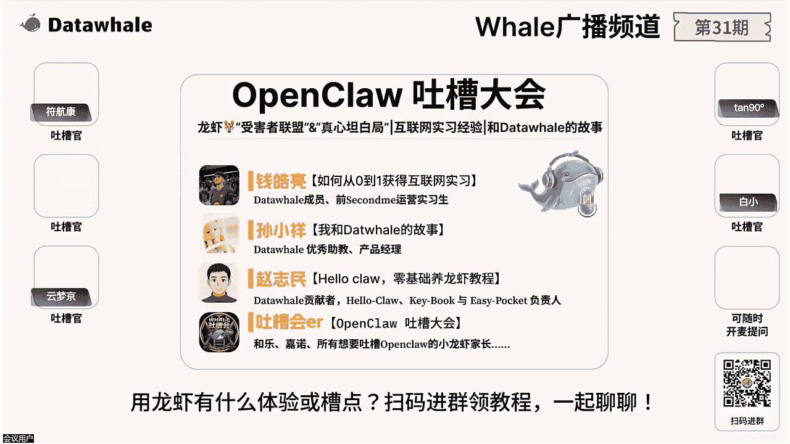

本次直播分享到此结束，感谢浩亮、小翔、志明、可乐、佳诺以及其他所有小伙伴的参与和分享。大家晚安，拜拜。

