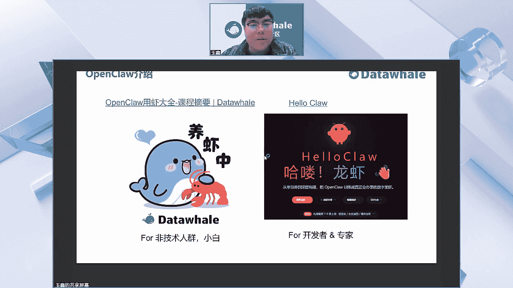
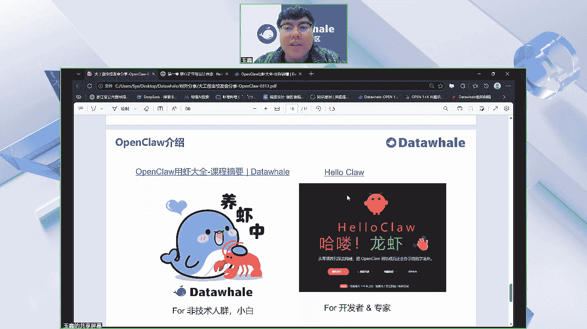

【Datawhale AI+X】OpenClaw是什么：01：项目介绍与生态现状 🦞

在本节课中，我们将学习OpenClaw是什么，了解它在全球开源社区中的地位，探讨国内各大厂商的跟进情况，并介绍适合不同人群的学习课程。无论你是完全没有接触过的小白，还是已经有一定开发经验的校友，这篇教程都能帮助你快速理清脉络，决定是否值得投入时间去尝试这个项目。

## 一、OpenClaw是什么

先简单介绍一下OpenClaw，因为可能还有20%的伙伴不清楚它是什么，或者根本没有听说过，我就快速给大家介绍一下。你可以看左边的图表，左边的图展示了GitHub上的Star增长曲线，这是所有开源项目中非常有代表性的一个样本。

这个图表最右边的分界线，显示了OpenClaw的Star增长历史。从曲线形状可以看出，它的增长不能简单称为指数型，更准确地说是火箭式增长。这说明OpenClaw基本可以说是全球范围内Star增长第一的开源项目，其受欢迎程度远超多数同类项目。

OpenClaw的代码如下所示：

```text
OpenClaw 增长模式 = 火箭式增长（非传统指数型）
```

现在OpenClaw已经达到了历史最高峰，目前是Star数量第一的开源项目。关于这个大型项目，可以看到它拥有全球范围内的贡献者，尤其是创始人Peter来自奥地利，是一名开发者。目前全球的开发者都在加入共建，创始人本人也正式加入到OpenClaw社区中。同时，OpenClaw项目还采用了开源基金会的方式进行运作。

在国外，大家可以感受到OpenClaw作为全球第一开源项目的影响力，它已经成为许多开发者关注的焦点。

## 二、国内生态的跟进情况

国内对OpenClaw的跟进也非常激进，尤其是腾讯，其出牌方式让人意外。腾讯在前不久在深圳线下，帮助所有对OpenClaw感兴趣的市民和开发者进行安装，现场气氛非常火爆，简直比抢鸡蛋还要热闹。除此之外，腾讯后续还推出了自己的组合权限产品，基本面向全类人群，各种权限产品都会有对应的Cloud适配产品。

以下是国内主要厂商的跟进情况：
- 腾讯：在深圳举办线下安装活动，并推出组合权限产品。
- 阿里：积极跟进OpenClaw生态。
- 智谱：参与OpenClaw相关建设。
- Minimax：加入OpenClaw产业链。
- 乐言：提供适配产品。
- 网易：参与OpenClaw生态建设。

除了腾讯之外，还可以看到阿里、智谱、Minimax、乐言、网易等厂商，还有各种硬件产品，基本覆盖了整个AI产业链，尤其是上游的模型厂商、云厂商、算力厂商和硬件厂，都在非常积极地跟进OpenClaw。

以下是参与跟进的AI产业链环节：
- 模型厂商
- 云厂商
- 算力厂商
- 硬件厂

## 三、搜索热度与监管并存

前面还有一个数据，OpenClaw在微信上的搜索组数已经超过了人工智能。这是之前没有预料到的，在中国各大厂疯狂投入的背景下，OpenClaw的热度竟然能超过人工智能这个大赛道。你可以想象，这一波OpenClaw的火爆程度到底有多高。

与此同时，也发现基于监管与OpenClaw的发展是并存的。因为很多人已经在使用OpenClaw，尤其是还没有使用的人，希望能够找人帮忙安装。不过在实际使用中，经常出现装了之后应用不上，或者装了之后发现烧钱太多，需要找人帮忙卸载。

同时，在使用过程中，很多人自己尝试了很多相关操作，还需要进行数据修复。对于普通人来说，想要玩OpenClaw还是比较困难的，一旦没玩转，自己卸载后还要修复回来，这会花费不少成本。

以下是普通用户面临的主要困难：
- 安装后应用不上
- 使用过程中烧钱过多
- 卸载后需要数据修复
- 整体使用成本较高

使用门槛可以用下面这个公式简单表示：

```
使用门槛 = 安装难度 + 卸载成本 + 数据修复成本
```

## 四、监管与安全风险

实际上，也能看到工信部、国家网信办等机构，会发出非常多的安全风险警告。尤其是各个大学，或者一些比较保守的单位，都会非常谨慎地提醒用户，不能在公司，或者在比较需要保密的环境中使用OpenClaw。

以下是发布安全风险警告的机构：
- 工信部
- 网信办
- 大学
- 保守单位

## 五、本地部署偏好与课程介绍

在正式开始活动之前，我们对大家进行了一调研。大部分校友中，有80%的人可能听说过OpenClaw，或者没有听说过，但都没有真正用过。因此，大家似乎更倾向于本地部署。

未使用用户比例如下所示：

```
未使用用户比例 = 80%
本地部署意向 = 80%
```

后续我们会有专门的分会场，帮助大家进行免费的安装。在群里也发布了两个课程，一个是clo音大全，另一个是opclo用大全。这些课程由会议室里的主持人艾迪老师创作，偏向小白，内容包括从本地到云端的切入，以及如何发放公牌设计人设，最终完成第一个案例。对于小白来说，基本上可以从0到1完整跑通整个流程。

另外一个课程叫hel，面向软件和计算机学院的学生，以及资深开发者和校友。这个课程相对深入，涵盖从深度案例到从零到一的全过程，包括定位、设计理念、架构等各个环节，帮助大家构建自己的数字员工。



以下是本次活动提供的课程：
- clo音大全：面向小白，从0到1完整跑通。
- opclo用大全：面向小白，包含本地到云端切入与案例实战。
- hel：面向资深开发者，深度学习架构与数字员工构建。

以下是hel课程覆盖的环节：
- 定位
- 设计理念
- 架构
- 数字员工构建

所以大家如果感兴趣，可以一起来学习和使用。好了，我这边分享先到这。



本节课中，我们一起学习了OpenClaw的基本概念，了解了它在全球和国内的发展现状，探讨了国内各大厂商的跟进情况，分析了搜索热度与监管并存的现状，并介绍了普通用户的使用困境以及适合不同人群的学习课程。希望这篇教程能帮助你快速了解OpenClaw，并决定是否开始学习。
