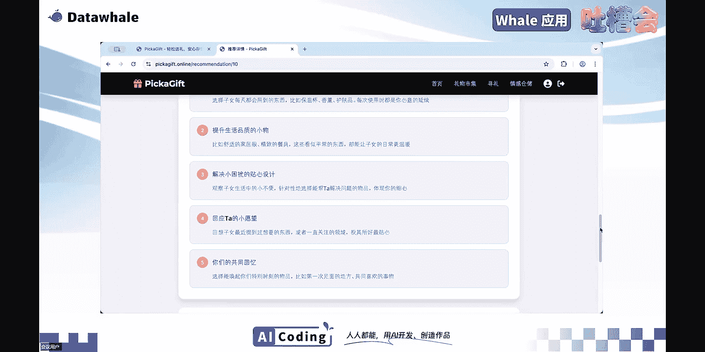

# 🎁 Datawhale AI+X PickaGift：借助kiro挑选用心礼物：01：项目背景与核心功能


在本节课中我们将要学习PickaGift项目的基本情况，包括它的诞生背景、主要功能模块，以及如何利用人工智能帮助用户挑选礼物。

PickaGift是一个在Datawhale秋季营期间开发的礼物推荐网站。项目的创始人是邱永新，大家也可以叫他雅明。这个网站已经完成了服务器上线和网站部署工作，现在正处于收集用户反馈、宣传推广以及改进功能的阶段。

这个网站的主要目的是解决大家在日常生活中挑选礼物时遇到的困难。很多人在需要送礼物的时候，往往不知道送什么合适，或者担心送的礼物不够贴心。为了解决这个问题，开发团队开发了一个基于人工智能的礼物挑选系统，让AI能够更加智能地理解用户的心意，从而挑选出更合适的礼物。

在目前的版本中，网站主要专注于礼物挑选这个功能板块，其他功能模块仍在完善之中。

核心推荐逻辑可以用如下伪代码表示：

```python
礼物推荐结果 = AI分析(用户基础信息 + 用户追问回答 + 用户选择偏好)
```

接下来我们来看系统是如何收集用户信息，并通过交互得到推荐结果的。

# 🎁 Datawhale AI+X PickaGift：借助kiro挑选用心礼物：02：信息收集与交互流程

上一节我们介绍了PickaGift的项目背景和核心功能，本节中我们来看看系统是如何收集用户信息，并在推荐礼物之前了解被送礼者的具体情况。

系统在推荐礼物之前，需要先收集用户的基本资料。信息收集分为两个部分，第一部分是6道基础题目，第二部分是3到4道追问。

以下是基础信息包含的具体字段：

- 性别
- 年龄
- 与送礼者的关系
- 送礼场合
- 预算范围

收集完基础信息后，系统会提供两种模式供用户选择，分别是深度巡礼和直接推荐。团队主要主打深度巡礼模式。在这个模式下，AI会根据前面收集到的基础信息，生成3到4道追问问题。

这些追问问题不是一次性全部生成的，而是采用递进式的方式。每一个问题都基于用户之前的回答进行分析，然后生成下一个问题，这样可以让回答的内容深度足够，获取到足够的信息，再进行最终推荐。

为了降低用户的输入成本，系统还提供了智能补充功能。如果用户不知道该如何回答某个开放性问题，可以通过点击选项的方式，让AI自动补充成用户想要表达的心意。当然，用户也可以在智能补充之后，继续手动输入自己的想法。

全部问题回答完毕之后，系统会对用户的回答进行综合分析，并给出5个推荐的礼物方向。

目前的演示版本使用的是模拟数据，因此还没有展示真实的商品链接。但是，一旦系统接入了商城的API，推荐结果页面就会直接显示商品链接，并说明为什么推荐这个商品。用户可以直接点击链接跳转到购买页面。

# 🎁 Datawhale AI+X PickaGift：借助kiro挑选用心礼物：03：情感仓储与关系网络

上一节我们介绍了信息收集和礼物推荐的交互流程，本节中我们来看看网站中的情感仓储板块，以及它是如何帮助用户管理人际关系的。

情感仓储是PickaGift的第二个主要功能板块。它的核心思想是建立一个以用户为中心的关系网络，记录用户与家人、朋友、恋人等重要人物之间的详细信息。

关系网络中的每个节点可以用如下数据结构来理解：

```python
关系节点 = {
    "姓名": "对方名字",
    "认识时间": "什么时候认识的",
    "共同经历": "一起做过什么事情",
    "喜好": "对方喜欢什么",
    "厌恶": "对方不喜欢什么",
    "潜在礼物": "平常可能会喜欢的礼物"
}
```

系统会以卫星图的方式展示这个关系网络，用户自己位于中心，周围分布着各种关系节点。通过这种可视化方式，用户可以清晰地看到自己和不同人物之间的连接，并为每个节点记录相关的礼物偏好。

除了关系网络，情感仓储板块还包含情感胶囊功能。情感胶囊其实就是给未来写封信，并且可以在信中添加礼物。用户可以指定一个未来的时间点，届时系统会以手写信加礼物的形式，把这封信和礼物寄给用户自己，或者寄给其他人。

# 🎁 Datawhale AI+X PickaGift：借助kiro挑选用心礼物：04：礼物灵感池与产品痛点分析

上一节我们介绍了情感仓储板块，本节中我们来看看礼物灵感池，以及导师和学员在讨论中提出的产品痛点。

礼物灵感池是第三个功能板块。它的设计初衷是解决一个非常常见的情况：有时候我们在聊天或者走在路上，突然想到某个朋友可能会喜欢某样东西，想着下次过节或生日要送给对方。但是这种灵感往往会一闪而逝，很容易被遗忘。

礼物灵感池的作用就是让用户在想到的时候，立刻把想法记录下来。团队计划在后续版本中，把这部分做得更加方便使用，方便快速记录。

在讨论过程中，导师从用户的角度分析了这个类型网站可能面临的痛点。第一个痛点是很多人记不住别人的生日。如果要解决这个问题，产品需要一个日历功能，或者一个联系人列表，把所有人的生日和偏好都添加进去。

第二个痛点是不知道送什么，或者已经送过类似的礼物，不想重复。针对这一点，AI可以根据用户的提示生成创意礼物方向，甚至生成礼物的创意图片，从而提高点击率和购买意愿。

除了功能痛点，还有一个非常现实的问题是用户粘性。因为大多数人一年可能只送一两次礼物，所以用户一年可能只打开这个网站一两次。这会导致网站面临流量不足的问题。导师甚至提到，做一个APP可能会相对更好一点，因为用户不需要专门去记住这个网站的网址。

为了提高打开率，导师建议可以添加用户的联系方式，比如邮箱或手机号，然后结合日历，在对方生日前几天或前一个月，主动发送短信或邮件提醒，让用户想起使用网站。

在产品开发过程中，团队需要先了解用户的真实需求和痛点，而不仅仅是实现功能。开发完成之后，还需要统计分析各个模块的使用频率，看看用户到底点开哪个功能，哪个功能更实用，然后再根据数据来优化产品。

# 🎁 Datawhale AI+X PickaGift：借助kiro挑选用心礼物：05：推荐算法优化与个性化建议

上一节我们分析了产品痛点和用户粘性问题，本节中我们来看看如何优化推荐算法，让礼物推荐更加个性化和贴心。

雅明在分享中提出了一个核心疑问：现在的推荐结果还不够个性化，比如经常推荐保温杯、护肤品、香薰这样比较普通的礼物。他想知道应该通过训练模型，还是通过提示词工程，把系统做成一个更聪明的智能体。

导师给出的建议是，不一定需要重新训练模型，可以通过提示词工程来实现。具体做法是在交互过程中设计一些选择题，让用户在选项中表达自己的偏好。用户做选择的过程中，实际上已经在无形中告诉系统自己的偏好了。系统可以把这些选择作为上下文，传给AI模型，这样生成的礼物推荐就会更加符合用户的真实需求。

用户偏好收集可以用如下公式表示：

用户偏好 = ∑ (每道选择题的选项结果)

在设计选择题的时候，建议花点心思研究礼物选择背后的心理学。也可以直接询问GPT，在这个环节需要注意哪些细节，或者有什么方法能快速获取用户的购物偏好。



除了常规的个性化因素，学员还提供了一些有趣的建议。比如可以结合星座、MBTI性格类型，甚至生辰八字等更玄学的角度来推荐礼物。可以结合运势，比如最近水逆，就建议推荐某些特定的礼物，并写出推荐理由。因为每个人的八字和MBTI都不一样，这样的推荐能够实现完全的个性化。在推荐礼物之后，还可以附上祝福语，帮助送礼者更好地解释为什么要送这样的礼物。

还有一个建议是增加手工制作礼物的推荐。除了购买成品礼物，系统可以推荐一些手工制作的礼物，并且附上手工材料的链接和制作教程。手工制作的礼物通常分量更重，更能表达心意。

# 🎁 Datawhale AI+X PickaGift：借助kiro挑选用心礼物：06：商业化与电商对接

上一节我们介绍了推荐算法优化和个性化建议，本节中我们来看看网站的商业化方向，以及如何与电商平台对接。

目前PickaGift已经在申请淘宝和京东的API，但审批流程比较严格，还在等待中。在等待的过程中，团队也在不断优化网站功能。

导师提出了一个很有意思的商业思路，叫做创意礼物集市。网站不需要直接去接复杂的电商API，也可以在平台上展示创意礼物，让用户进行预购。同时，可以接入一些手工制品的艺人和商家，把他们的产品放在网站上进行宣传和销售。这样既帮助手工艺人找到了销售渠道，又让用户能够买到更独特、更有个性的礼物。

导师还提到，可以参考一些出海网站的成功经验，把国内的手工制品卖到国外。国外用户愿意为精美的图片和独特的手工制品支付更高的价格，而国内同样的东西可能只值十几块钱，这体现了商业机会。

商业共赢模型可以用如下伪代码表示：

```python
平台收益 = 手工艺人入驻费 + 交易佣金 + 用户付费推广
```

如果网站要实现可持续化的商业运营，就需要引入商业环节，实现多方共赢。比如可以联合学生或者手工制品艺人，他们缺乏一个能够推荐创意礼物的平台。网站可以提供这样的展示渠道，把创意礼物放在上面，或者设计成随机展示一个创意礼物并支持直接内购。

团队表示会采纳这个建议，后续一定会把创意礼物集市这个板块做起来。

本节课中我们一起学习了PickaGift项目的背景、核心功能、信息收集机制、情感仓储板块、礼物灵感池、产品痛点分析、推荐算法优化，以及商业化与电商对接的相关内容。希望这些介绍能够帮助你更好地理解这个项目，并在后续的开发和使用中有所收获。

