# 🤖 AI逆向工程实战教程：第1节：REA项目原理与软件行业影响


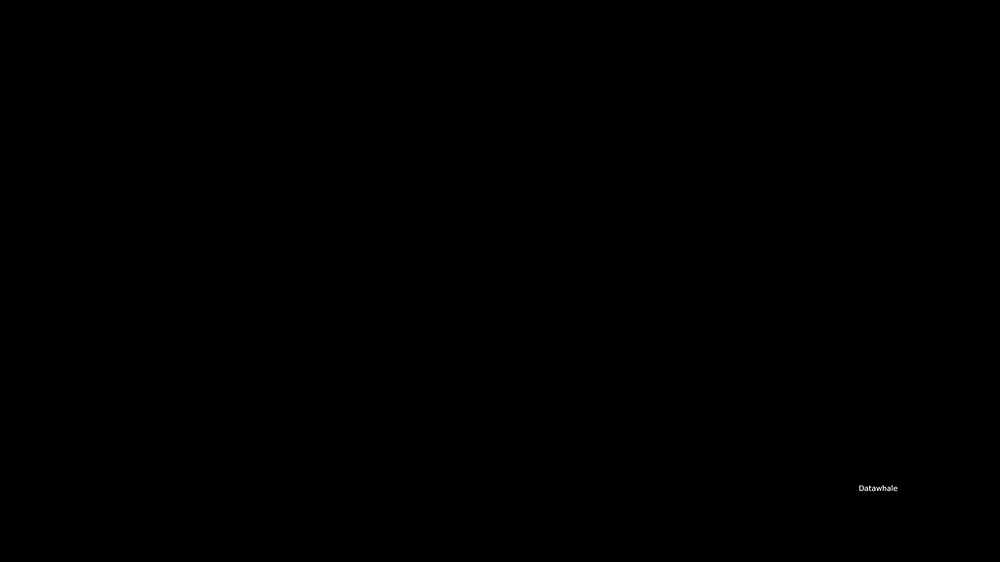

## 本节概述

在本节课中，我们将一起学习REA项目的基本概念、逆向能力实测数据、技术原理架构、实际应用案例，以及它对软件行业可能带来的影响。我们会用大白话把每一个知识点讲清楚，让初学者也能快速上手。学完本节，你将了解什么是REA，它能破解哪些保护机制，开发者该如何看待这一技术，以及如何为自己的软件做基本防护。


## 一、REA项目简介与逆向实测

上一节我们介绍了AI逆向工程的大致背景，本节中我们来看看REA项目具体是怎么回事，以及它在实际测试中的表现如何。

### 1.1 什么是REA

REA是一款围绕逆向工程能力展开的AI工具项目。它的核心思想是通过调用本地能力，结合MCP或CUI接口，让AI Agent对软件进行分析，然后把分析结果反馈给编程Agent，最后把软件功能复原出来。简单来说，REA就像是一个自动化的逆向助手，可以帮助用户在较短时间内理解并重建软件的内部逻辑。

### 1.2 逆向能力实测结果

以下是REA在不同加密与保护模式下的实测完成时间：

- 基础密码校验：1分钟即可搞定
- 升级版加密密码：2分钟即可搞定
- 深度加密（机器码加密）：3分钟即可搞定
- UPX加壳：9分钟即可搞定
- VMP加壳（复杂加密模式）：未能搞定
- 换换密码加VMP组合模式：50分钟可搞定

从整体测试来看，在D Harnessness环境下，使用D模型即可达到上述效果，也就是说基础的加密模式和加密方法基本都可以被攻破。这对软件数据获取的壁垒来说，影响是非常显著的。

### 1.3 适用场景覆盖率

以下是REA可以应用的软件场景比例：

- UPX带壳模式：在75%的软件中都能使用

也就是说，这么大规模的产品基本上都有可能被攻破。如果有一个工具能快速让我们把软件逆向，拿到核心数据或复刻核心功能，那未来用户是否都会用这类工具快速搞定功能，对于创造者来说，是否还有必要投入精力去研发、打磨和维护，这些都是我们需要思考的问题。


## 二、历史类比：2000年代游戏行业与版权意识

在讲完REA的实测数据后，本节中我们来看看历史上类似的情况，帮助大家更好地理解当前技术带来的冲击。

如果把REA的出现放到2000年左右的游戏行业来看，背景其实非常相像。那时候PC机在国内比较活跃，软件市场从90年代末开始发展，到2000年左右，大家基本上随便使用软件。QQ号盗号等现象司空见惯，游戏想玩什么就玩什么，版权意识非常淡薄。

当时的游戏行业由于版权意识淡薄，外国游戏在国内随意玩，国内独立游戏行业基本没有人做。如果形成良性循环，大家看到市场中有人努力、有人买账、能获得回报，就愿意继续做，就像现在的Steam平台一样。但如果回到那个拿来就用、看到好的就把老本吃完的时代，可能一段时间内都看不到比较好的软件。

如果把REA技术善加利用，仅从学习角度出发，不滥用技术，强化自我意识，我们依然愿意看到技术进步带来更好的作品，比如《黑神话：悟空》这样的优秀国产游戏能诞生并出现在大家面前。


## 三、REA技术原理与架构

聊完历史背景，本节中我们来看看REA具体的技术原理是怎样运作的。

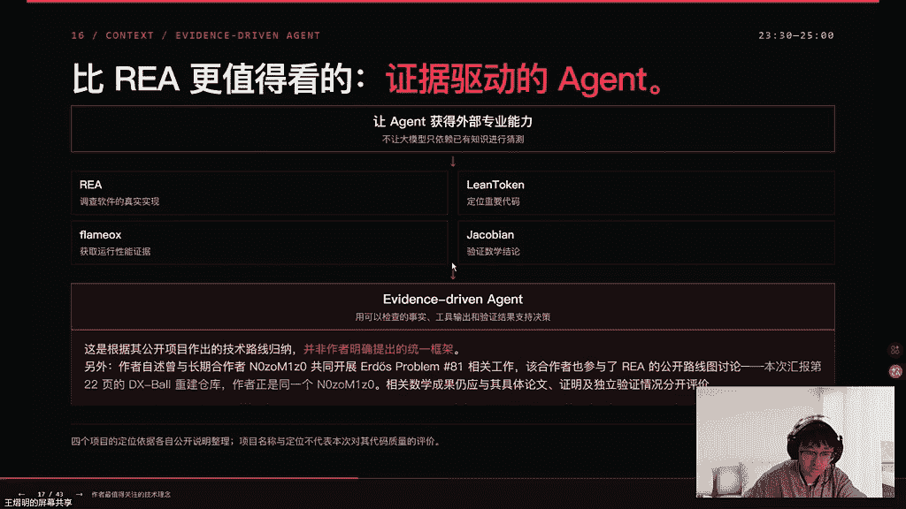

REA本质上是一套工具框架。它经MCP或CUI调用本地能力，大家根据这个框架操作，把软件拿过来进行分析，经过一套分析流程后，得到逆向任务的结果，再反馈给Coding Agent，由Coding Agent把内容复原出来。

REA的内核架构大致如下：

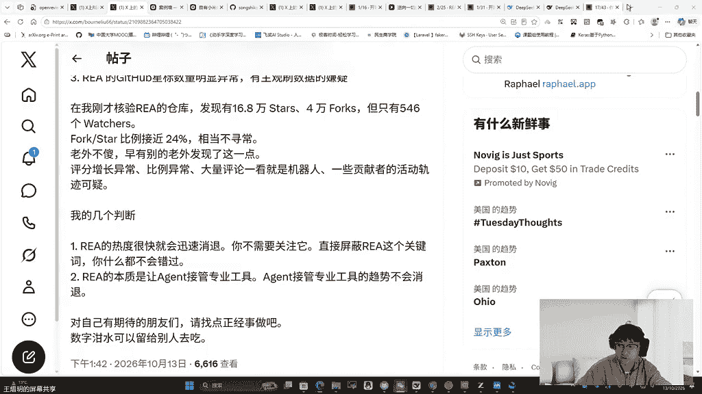

```text
输入软件 --> 数据分析包（抓取数据与能力） --> 抓包与分析 --> 结果反馈给Coding Agent --> 功能复原
```

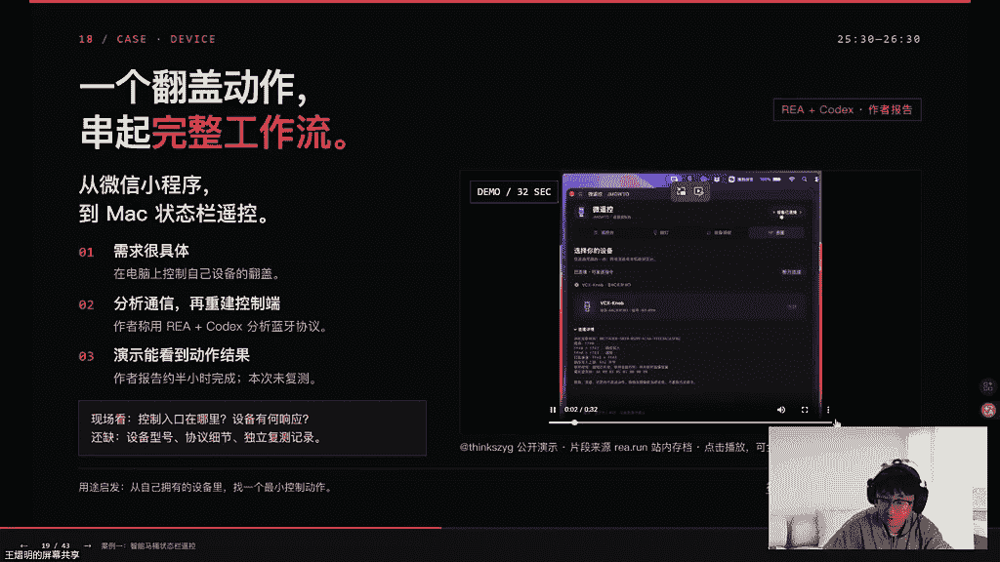

用代码形式表示这个处理流程：

```python
# REA处理流程伪代码
def rea_reverse_engineer(software_binary):
    # 第一步：通过MCP或CUI调用本地能力
    local_capabilities = call_local_interface(software_binary)
    
    # 第二步：使用数据分析包进行抓包与分析
    analysis_result = data_analysis_package(local_capabilities)
    
    # 第三步：将分析结果反馈给Coding Agent
    restored_code = coding_agent(analysis_result)
    
    return restored_code
```

可以看到，REA能被广泛使用，主要受益于大模型Agent能力的增强，而不仅仅是框架本身有多强大。所以大家应该理性看待这个项目。


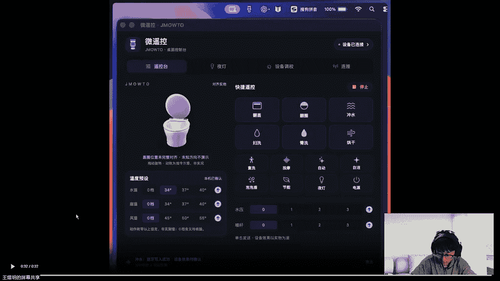

## 四、项目影响力与社区反馈

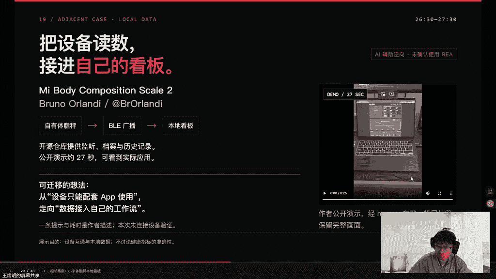

了解了原理之后，本节中我们来看看REA项目在社区中的实际影响力。

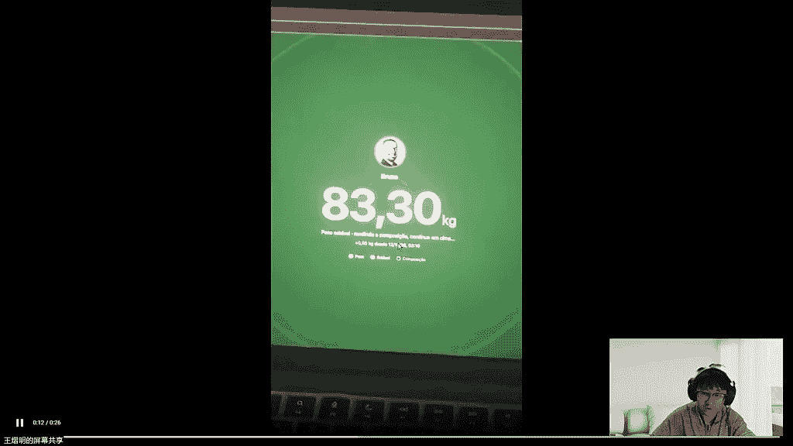

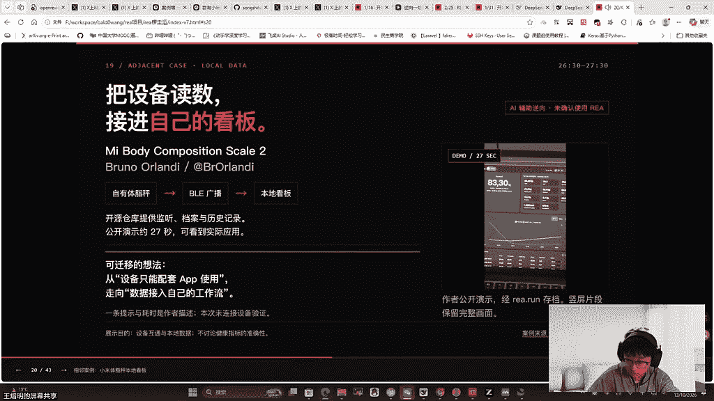

REA项目从11月11日开始就非常火爆，短短几天内星标数就突破了十几万，增长速度极快。第一天星标数就接近八万。相比之前看到的Cloud Code项目，REA的涨粉速度还要更快。这说明开发者对这个项目的喜爱程度和受益程度非常大。

项目的开发者是一位研究强化学习和数学推理的背景人员，在GitHub上推了很多相关项目，喜欢把项目拆解并做深入挖掘。基于此，他做出了这一套工具，没想到影响这么大。

当然，也有人吐槽这个项目不是新的逆向技术，星标数可能有水分，不值得浪费时间。但既然项目火了，自有其原因，不必过激批判，值得我们认真思考。


## 五、实践案例展示

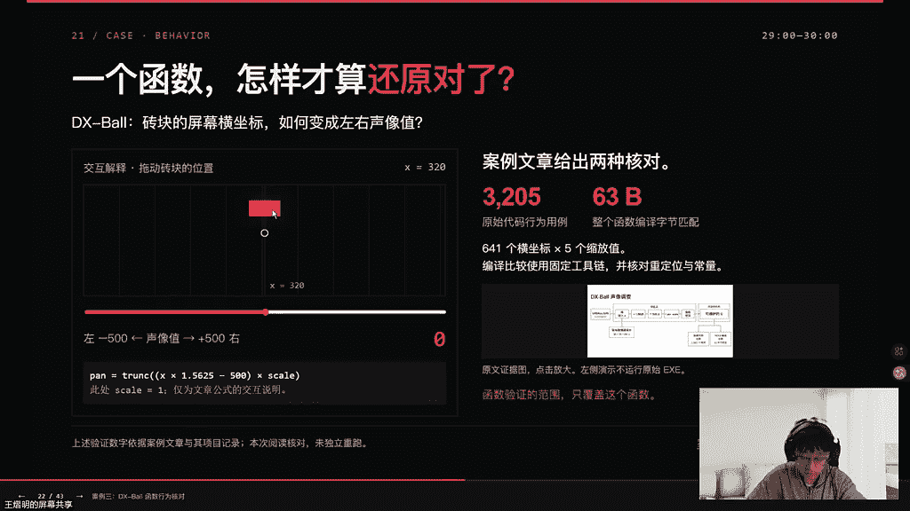

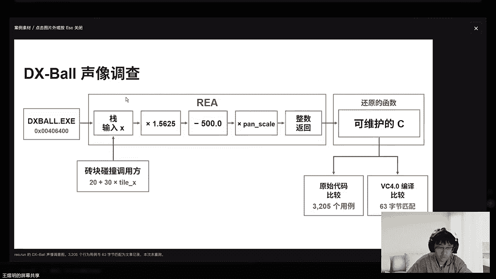

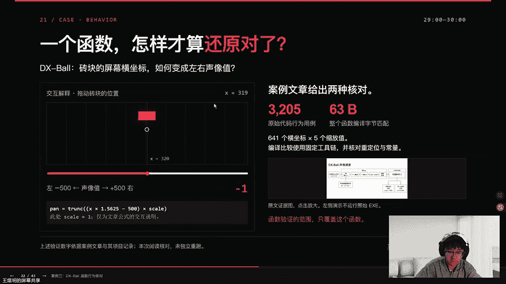

在讲完项目影响力后，本节中我们来看看REA的几个实际应用案例。

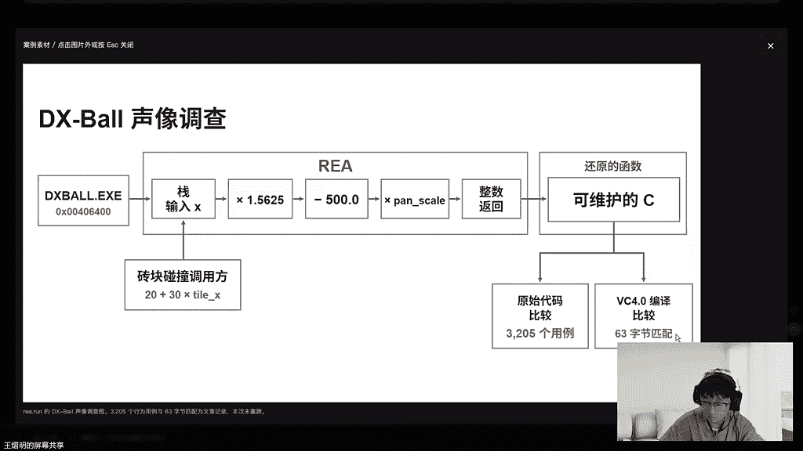

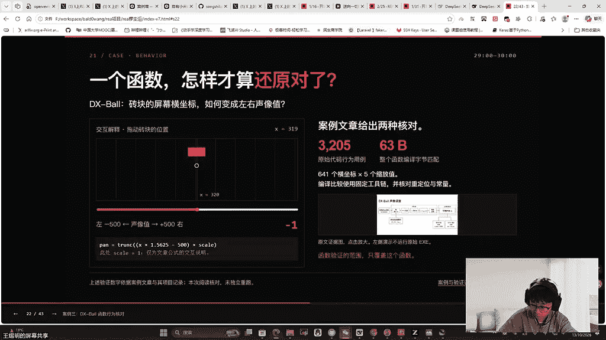

以下是已经收录的REA实践项目案例：

1. 逆向遥控器：可以控制远程马桶，调节参数、灯光等
2. 小米电子秤：直接读取设备数据到自己的界面
3. Cloud Design复刻：把Cloud Design的模块化编辑功能复刻过来，效果不错
4. 打砖块游戏复现：在复现游戏时，如果砖块位置不合适，系统会进行校验，只有完全合适时才会交付

以打砖块游戏为例，即使复现了相似内容，如果位置或内容不对，系统依然会校验，这样能保证最终交付的结果更接近原版。这是一个比较古早的游戏，通过REA完成了功能复现。


## 六、伦理讨论与原创回报

看完实际案例，本节中我们来探讨一个更深层的话题：如果一切都可以一键搞定，原创还会有回报吗？

假设你随便搞两下就能用Adobe全家桶，或者把Office全家桶做到自己电脑上，那复制就变成了捷径，原创可能会失去回报。从开发者角度来看，肯定不愿意看到这种情况；但从用户角度来看，又愿意看到。放到宏观视角，如果滥用这类技术，不建议大家直接把项目随便复刻过来。

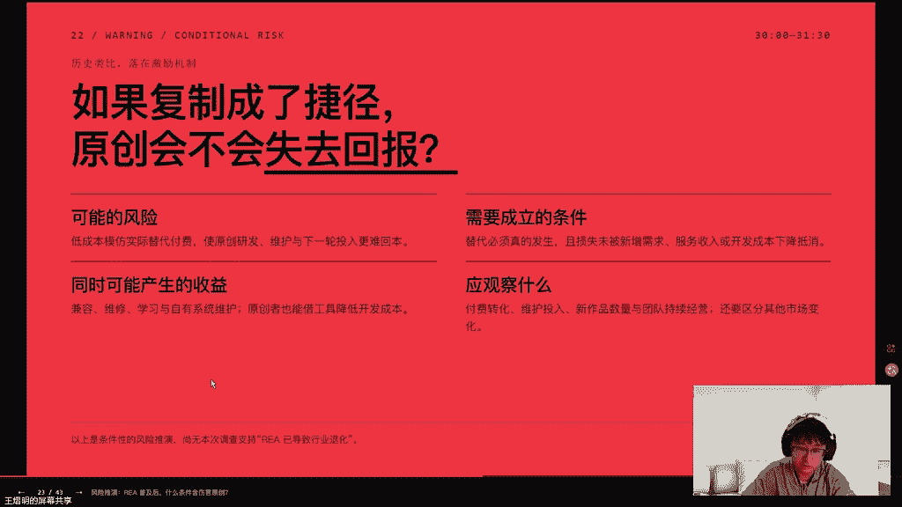

作为开发者，我们要有自己的操守和底线，不要因为这类项目砸了自己的饭碗。当然，REA也有短板，比如最难的保护机制做不到，复刻的项目也不是百分百能还原出来，所以大家保持理智即可。


## 七、法律风险与红线

在讨论完伦理问题后，本节中我们来看看法律角度怎么看逆向工程。

逆向工程本身并不违法，但以下几类行为可能违法：

- 直接侵权带来的损失，可能会面临官司和法律制裁
- 合法竞争带来的收入压力
- 安全事件和商业秘密的损失

具体的红线行为包括：

- 购买了商业软件进行分析，需要做核查
- 制作与商业软件高度相似的替代品并收费，风险较高
- 破解软件或游戏，例如GTA等曾被破解并面临法律诉讼
- 绕过技术保护措施，属于版权侵权范畴
- 辅助访问未授权系统，例如政府网站数据被删除等事件，会造成不良社会影响

从法律风险角度，中美两国对逆向的看法也有对照，例如兼容性逆向有一定要求，直接复制源码可能侵犯著作权，绕过保护措施有法律风险。


## 八、经济损失估算

了解了法律红线后，本节中我们来估算一下，如果软件被逆向，开发者大约会亏多少钱。

假设你有1000个用户，每个人付费100元，年度收益基数是10万元。如果流失比例是30%，且全部归因于竞品替代，那么年度损失将达到3万元。对于小型工作室来说，这个打击还是比较大的。

用公式表示：

年度损失 = 用户总数 × 单价 × 流失比例


## 九、软件易被逆向程度分类

算完经济损失，本节中我们来看看哪些软件最容易被逆向，哪些相对安全。

最容易被逆向（高风险）：

- 单功能工具软件
- 浏览器插件
- 垂直桌面软件
- 游戏
- 设计创意软件和办公生产力软件

相对不容易被逆向（低风险）：

- 云端SaaS服务
- 企业核心业务系统，例如银行记账软件等不可替代的系统

企业核心系统由于数据不可替代，且涉及支付等关键功能，逆向难度大，风险也高，所以压力相对较小。


## 十、开发者防护与应对策略

分完软件类型，本节中我们来看看作为开发者，该如何保护自己的软件。

防护思路主要有以下几个方向：

1. 提高逆向成本：即使能逆向，也要让对方费很大功夫，让大部分人不愿意去做
2. 提供云服务：比如提供云电脑，用户在云端使用软件，而非下载成品，基本可以避免逆向问题
3. 开放策略：如果产品是公益性质，可以把内容做得更开放，不抱私心
4. 做复杂系统工程：做通用性强、规模较大的软件，有一定市场，但随着时间流逝系统也会被稀释

对于数据开放，可以参考以下策略：

```python
# 数据开放与防护策略示例
if 产品性质 == "公益性":
    策略 = "全面开放"
elif 核心价值在数据:
    策略 = "按量付费 + 数据MCP化"
else:
    策略 = "复杂工程 + 强防护 + 云端化"
```

实际操作中，可以把模块化能力通过MCP、Scale化等方式开放出来，让其他开发者方便二次开发，同时保护核心价值。


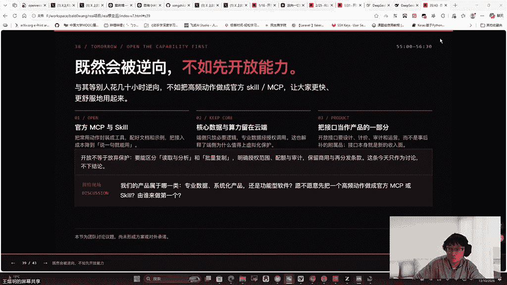

## 十一、总结

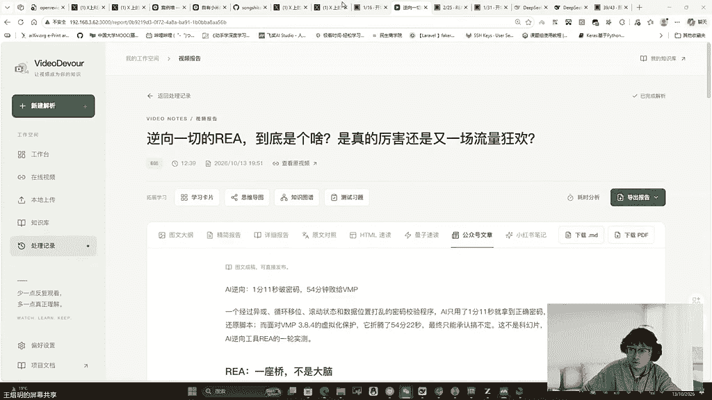

在本节课中，我们一起学习了REA项目的基本概念、逆向能力实测数据、技术原理架构、实际应用案例、伦理争议、法律风险、经济损失估算、软件易被逆向分类，以及开发者的防护策略。

总体来看，软件行业未来可能会更难，但并非完全没有机会，日子可能会过得比较艰难。希望大家在使用REA这类工具时，心里有一杆秤，保持理性，尊重原创，遵守法律红线。

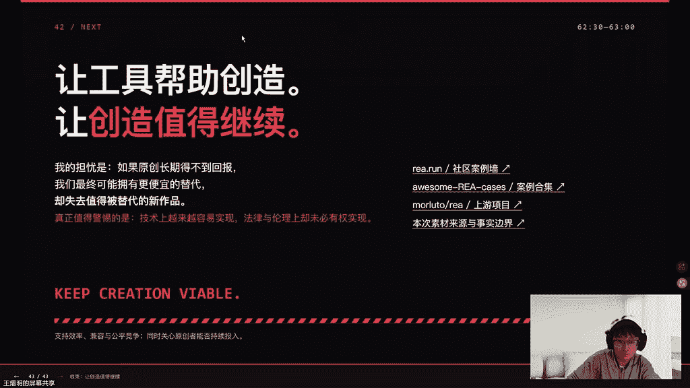

如果有问题或想讨论的内容，欢迎在讨论区继续交流。谢谢大家。

