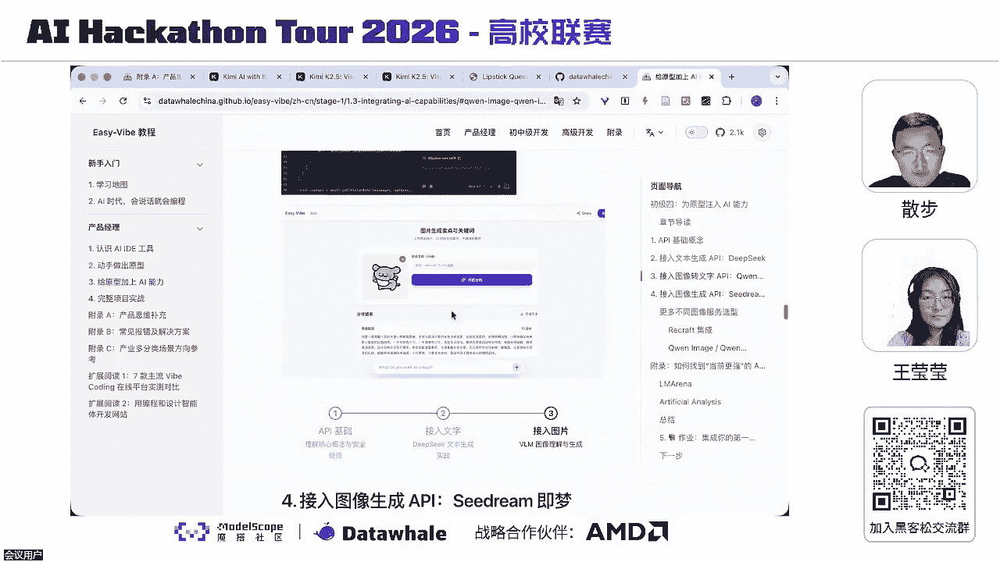
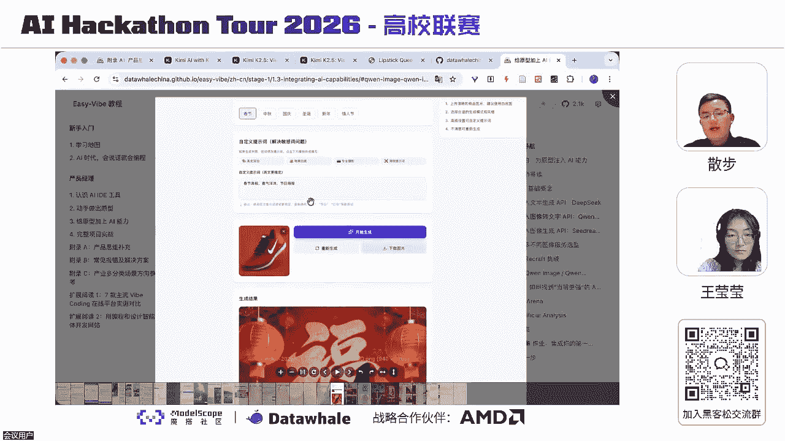
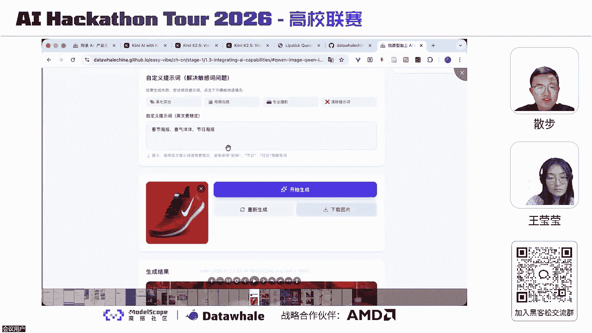
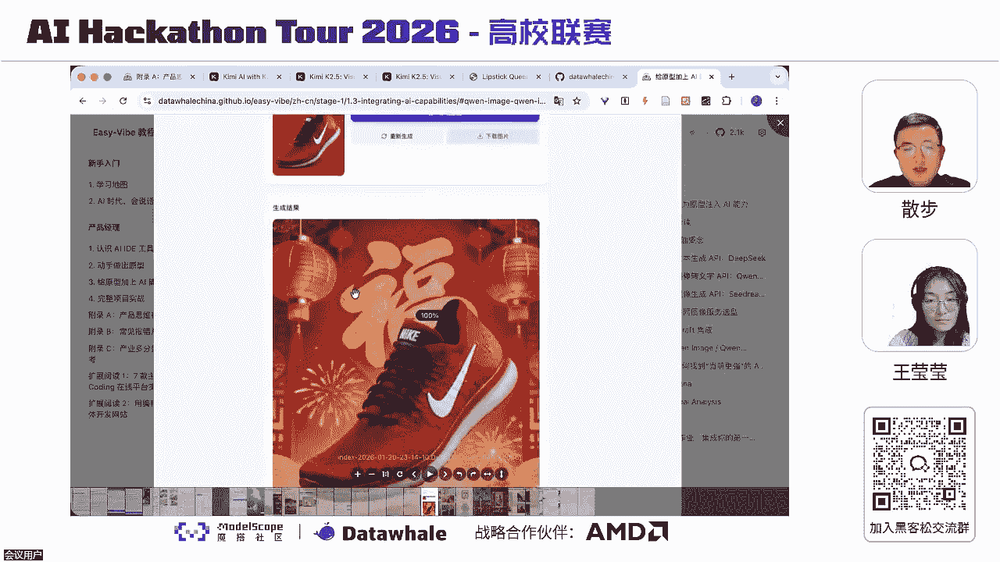
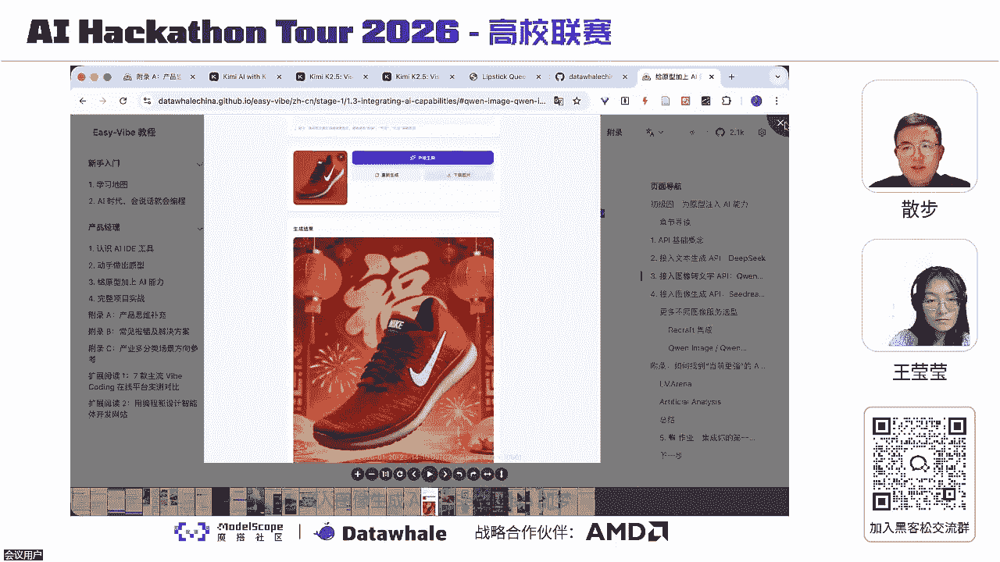
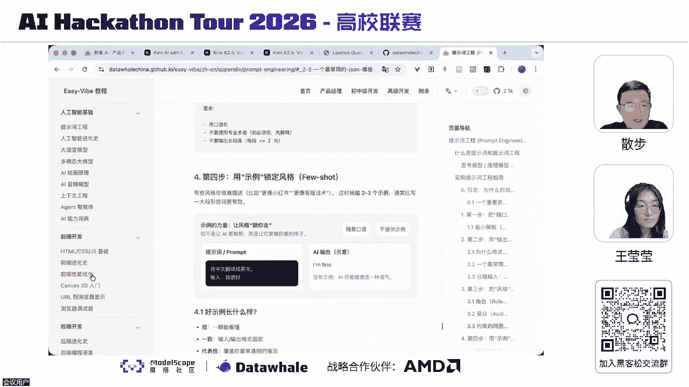
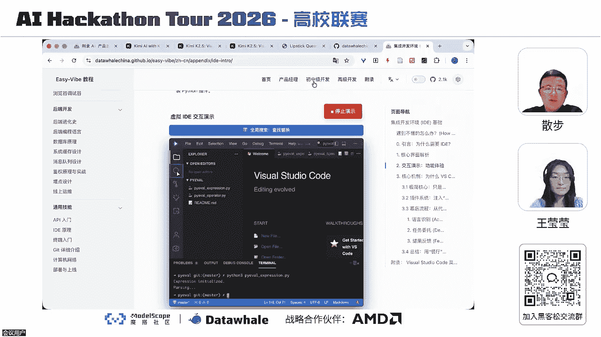
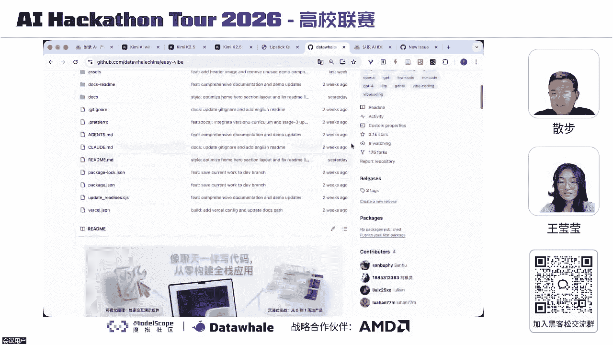

## 【Datawhale AI+X】VibeCoding从0到1：上线你的AI原生项目：01：课程概述与项目介绍 🚀

在本节课中，我们将要学习这个开源项目的整体结构，搞清楚它到底能做什么，以及你可以通过哪些方式参与进来。不管你之前是否写过代码，都可以先花几分钟在这里建立一个整体印象，后续的内容会更容易理解。

这个项目叫做 Ey web，它是一个面向 AI 原生应用开发的社区共建教程。项目目前的发展速度还不够快，因此非常欢迎大家提出问题，或者为仓库点个 star，给项目更多支持。除了 star 之外，项目也接受 pull request，已经有一些优秀的小伙伴参与了共建。特别感谢以下几位同学的支持：刘立行、刘思怡，以及另外两位尚未在列表中显示的同学，他们的名字即将更新上去。

目前这份教程主要涵盖三大模块，分别对应不同的学习人群。你可以根据自己的实际能力，选择适合自己的章节进行学习。

以下是教程涵盖的三大模块：

- 产品经理模块，适合零基础学习者，只需要会说话，就能一步步做出应用。
- 初级开发模块，适合有一定技术基础的同学，讲解如何把设计稿变成代码，并搭建后端服务。
- 高级开发模块，适合经验较丰富的开发者，讲解多客户端开发以及上架部署。

下一节我们将重点介绍产品经理模块，看看零基础用户如何在这个教程的帮助下完成第一个 AI 产品原型。

## 【Datawhale AI+X】VibeCoding从0到1：上线你的AI原生项目：02：产品经理模块：零基础搭建AI产品原型 🎨



上一节我们介绍了课程的整体概况，本节中我们来看看产品经理模块具体包含哪些内容，以及零基础用户该如何上手。

产品经理模块的核心思路非常直白，你不需要具备任何编程背景，也不需要背诵复杂的技术概念。只要你会说话，就可以按照教程的步骤，自己做出一个不错的应用。这里说的不错的应用，指的是能够真正运行并产出结果的产品原型，而不是只停留在纸面上的构思。

举几个具体的例子，你可以做一个电商素材生成网站，上传图片后直接生成卖点或者关键词；也可以做一个节日海报生成工具，上传一张鞋子的图片，再输入春节海报、喜气洋洋这样的提示词，系统就会自动为你生成对应的海报。学完这个模块之后，你就能做出一个能够调用 AI 接口并得到实际结果的产品原型。

从 AI 产品经理的角度来看，这就是目前应该能够做到并且实现的事情。掌握这些能力以后，你基本上就具备了拿下相关实习的基础，如果觉得还不够，也欢迎你提出改进建议，我们会持续优化教程内容。





产品原型的生成可以用简单的公式来描述：



产品原型 = 提示词 + AI 工具调用 + 可运行页面



除了动手做之外，教程也会帮你建立初步的产品思维。当然，这部分内容只能作为入门，如果你希望深入学习，可以参加大厂的产品思维培训，或者阅读更多相关书籍并进行实践。不过光靠这个模块，你也能达到六七十分的水平，足够应付大部分初级需求。

在实际操作中，你可能会遇到找不到好方向的问题。这时候可以参考教程里提供的产业场景分类，这些场景包括工业制造、智能客服、教育行业、医疗方向、网络安全、金融管理、保险行业等。每个方向都给出了常见的应用场景和实现参考。

你可以基于这些场景不断细化想法，把一个抽象的点子变得具体，再把具体的想法变得非常具体，最终就能落地成一个真实的应用。简单来说，教程已经把饭喂到嘴边了，你只需要参考产品经理这一栏目，就能做出很多自己想要的产品原型。

以下是产品经理模块可以参考的行业场景：

- 工业制造
- 智能客服
- 教育行业
- 医疗方向
- 网络安全
- 金融管理
- 保险行业

下一节我们将进入初级开发模块，看看如何把前端设计稿转化为代码，以及如何搭建后端服务来支撑你的应用。

## 【Datawhale AI+X】VibeCoding从0到1：上线你的AI原生项目：03：初级开发模块：前端与后端实践 💻

上一节我们介绍了产品经理模块，本节中我们来看看初级开发模块，这部分内容更适合有一定技术基础的同学。

在前端方面，以前大家可能会觉得 Figma 很难使用，但现在有很多工具可以辅助操作。教程会详细讲解如何使用 Figma 以及国产工具 Ma Go，怎么进行绘图，如何把设计稿变成组件，最后如何从组件导出成代码。虽然前面有一些拆解内容暂时还没有填进去，但核心思路已经在这一部分展现出来了，后续会根据社区反馈加速完善。

在后端方面，教程会讲解如何把前端变成可运行的代码，以及如何使用类似腾讯云 Cloud Base 的 Serverless 服务。传统的服务器可能需要每个月花费两百块钱，而把服务器功能拆解成服务形式打包出去，可以显著降低成本。

后端开发的核心目标可以用这个公式来理解：

Serverless 成本 = 传统服务器固定费用 → 按实际使用量付费

教程还会讲解如何在产品应用中实现数据库功能，并将其转换成生产环境。此外，你还会学习如何把后端业务代码中的函数级代码，变成 HTTP 函数来进行调用。部署上线的部分目前属于宝宝级别，主要是让你先把应用跑起来，让客户决定是否购买你的服务。

如果你希望把应用真正转换成拥有独立域名、通过审核备案的正式 SaaS 服务，那么还需要进行进一步的开发。这也是我们之后计划完成的工作。我们的目标是让你做出真正可上线的产品，而不是把你当成未成年人来对待，你是一个完全自主的成年人，最终目标就是把东西卖出去。如果做不出可上线的产品，那是我们的问题，我们会继续改进。

以下是初级开发模块涵盖的主要技术点：

- 使用 Figma 和 Ma Go 进行前端设计与绘图
- 将设计稿转换为组件并导出代码
- 使用 Cloud Base 等 Serverless 服务搭建后端
- 实现数据库并部署到生产环境
- 将函数级代码转换为 HTTP 函数
- 进行宝宝级应用部署与上线

下一节我们将进入高级开发模块，看看如何开发多客户端应用，并完成应用上架。

## 【Datawhale AI+X】VibeCoding从0到1：上线你的AI原生项目：04：高级开发模块：多客户端与上架部署 📱

上一节我们介绍了初级开发模块，本节中我们来看看高级开发模块，这部分内容适合已经具备一定开发经验的同学。

高级开发的要求很简单，既然你是高级开发者，就应该能够进行多客户端开发。比如，你需要知道如何开发一个微信小程序。教程里会写得非常详细，包括需要办理哪些备案，相关内容都会清晰列出。我们还在编写一篇关于如何集成 Cloud Base 和 Cloud Pay 的文章，因为 Cloud Base 是海外服务，而微信小程序是国内服务，两者需要集成才能使用。这部分内容预计会在两周内更新，最迟不会超过一周。

对于安卓和 iOS 开发，教程也有两位优秀的同学在编写内容，这里先给他们鼓个掌。你会学到如何开发一个安卓应用，以及如何开发一个 iOS App。如果你想把 App 上架到 App Store，教程也会告诉你具体需要做什么，这部分内容已经非常接近实际落地的状态。

高级开发模块的客户端矩阵可以用这个代码块来表示：

```text
多客户端开发 = 微信小程序 + 安卓应用 + iOS App + 应用商店上架
```

除了这些已有内容，后续我们还会推出连载文章，比如如何构建属于自己的个人网页和独立博客，这些内容相信大家也会非常感兴趣。后期还会覆盖所有常见的软件网站内容，甚至包括嵌入式开发等方面。

以下是高级开发模块涵盖的客户端方向：

- 微信小程序开发与备案
- 安卓应用开发
- iOS App 开发与 App Store 上架
- Cloud Base 与 Cloud Pay 集成

下一节我们将介绍 AI 基础知识与可视化教程，看看教程还为你准备了哪些特色内容。

## 【Datawhale AI+X】VibeCoding从0到1：上线你的AI原生项目：05：AI基础与可视化教程 🎓

上一节我们介绍了高级开发模块，本节中我们来看看教程中关于 AI 基础和可视化教学的部分内容。

因为这是 AI 应用的开发，所以我们一定会讲清楚什么是 AI。教程会告诉你什么是 Dify，教你怎么使用它，也会解释什么是 Re 等相关概念。后面还会把 Long Graph 和 Agent 等内容塞进来，大家可以完整地查看学习。

除了文字说明之外，教程还提供了可视化教程。也就是说，用动态演示的实际交互来重新定义技术文档。很多人讨厌看纯文字，其实我也不喜欢，但是如果你可以直接操作和玩耍，是不是就会觉得很好玩？当你在玩中学的时候，是不是就更容易爱上这门技术？学习本来就可以很好玩，只不过有些内容可能需要花更长时间去消化。

教程里还配备了非常充足的交互入口，甚至包括模拟的 IDE。如果有同学完全不懂什么是 IDE，也可以通过模拟环境先上手。有些内容甚至可以实现自动交互演示，这是为了考虑到不同同学的基础知识层次不同，所以我们提供了不同深度的内容，供大家选择学习，希望每个人都能学到自己想要的东西。

可视化教学的核心可以用这个简单的公式来表达：

可视化教学 = 动态演示 + 实际交互 + 模拟操作环境



以下是 AI 基础与可视化教程包含的内容：

- 什么是 AI 以及如何使用 Dify
- Re 等基础概念的讲解
- Long Graph 与 Agent 相关内容
- 动态演示形式的可视化技术文档
- 模拟 IDE 与自动交互演示入口

下一节我们将进行总结，并说明如何参与社区建设。

## 【Datawhale AI+X】VibeCoding从0到1：上线你的AI原生项目：06：总结与社区参与 📢



上一节我们介绍了 AI 基础与可视化教程，本节中我们来总结整篇教程，并说明接下来可以怎么做。

在这篇教程中，我们一起学习了 Ey web 项目的整体结构，了解了产品经理模块、初级开发模块和高级开发模块，也了解了 AI 基础知识和可视化教学方法。大家可以根据自己的实际能力，选择不同的章节进行学习。每个章节的开头都会有导读和预期产出，希望能帮助你明确学习目标。

如果你在学习过程中觉得有什么不懂的地方，或者有自己想要的内容没有涵盖，欢迎随时提出问题。因为把内容讲清楚是我们的责任，你是我们的客户，就这么简单。

最后，非常希望大家能给仓库点个 star，给项目一些支持。写这份教程确实非常辛苦，工作量也很大。如果大家的反响良好，我们可能会加紧进度，为每个章节都配备一个完整的课程并进行连载，这取决于大家的支持程度。



本节课中，我们一起学习了这个 AI 原生项目教程的模块划分、各模块的具体内容，以及如何参与社区共建。希望这份教程能帮助你从零开始，最终上线你自己的 AI 原生项目。

