# 🚀 【Datawhale AI+X】VibeCoding通识课：AI原生开发入门：02：AI原生开发实操与产品思维

在本节课中，我们将学习AI原生开发的实操方法与产品思维。我们会回顾上一节课的前置思维，分析为什么注册了AI工具依然做不出产品，拆解产品分析的三个核心维度，学习如何通过竞品调研构建产品架构，掌握提示词编写与MVP思维，最后通过就医地图和喝水提醒两个实战案例，了解如何将模块化思维应用到实际开发中。

---

## 01：回顾上节课与AI开发认知差距

上一节课，王真老师专门针对零基础同学，系统讲解了AI编程最关键的前置思维，强调要先理清产品需求，再动手制作，并让大家体验了秒搭等低代码工具。许多学员在社群中分享了自己的作品，证明了这些工具的初步可用性。本节课我们正式开始更深入的内容。

在直播过程中，如果你对课程内容有任何疑问，都可以随时在评论区提问。

很多学员在看完短视频或宣传资料后，会觉得用AI做东西就像呼吸一样简单，似乎AI什么都能做。但实际上，当你注册了秒达或其他平台，依然可能发现自己做不出完整产品。这个中间存在的gap，到底是缺少什么样的思维，还是缺少什么样的方法？本节课旨在帮助你打破这个认知差距，站在负责任的引导者和产品经理前辈视角，提供方法论与案例拆解。

本节课的难度会比上一节更高，内容更抽象，需要你充分运用思考能力、推理能力和洞察能力。在整个过程中，我也会讲解如何具体使用AI来完成开发任务，并通过不同案例展示Web Coding方法论的实际应用。如果你在直播中觉得有些内容一知半解，建议收藏直播链接，在以后有想法时反复观看。因为Web Coding的构思与产品拆解技能，都需要反复练习和品味，才能获得更大的收获。

---

### 上节课核心内容回顾

上一节课我们讨论了Web Coding的几个重要前提。其中最核心的一个是：不要一开始就写代码，而要先分析，再写代码。这样能够提高开发成功率。

我之所以强调这一点，是因为社群中曾收集过学员的愿望清单，很多朋友都反映，每次修改需求都会导致与AI工具沟通频次过高，积分消耗很快。起初可能只是一个小点，但随着做得越深越清楚，沟通代价也随之增加。要想有效沟通，你需要先把问题想清楚，明确要做什么功能、有什么路径、涉及哪些细节。这样AI工具（如秒达灵光、Cos编程等）才能更准确、更快速地一次成型，把你的软件做出来。

---

### 产品分析的三个核心维度

分析工作包括以下几个方面，帮助你理清产品的基本轮廓。

首先，要想清楚产品形态。你是要做一个可以在浏览器打开的H5页面，还是一个B端管理页面？是要做微信小程序，还是桌面端安装包，或者是需要安装到手机里使用的APP？不同的形态对编程能力的要求不同，产品复杂程度也不同，这是第一个需要明确的事情。

其次，要想清楚功能范围。很多初学者容易产生做一个“百万级市场”产品的冲动，但实际上我们需要判断自己的能力边界，以及如何判断一个产品的复杂性。这有点像小学一二年级学生突然遇到高中或大学难度的题目，不仅会感到懵逼，还会降低学习兴趣。我们需要先确认自己能解答什么样的题目，这也是决定Web Coding成功率的重要前提。

判断复杂性可以从以下几个维度进行：

- 功能的复杂程度；
- 用户类型：只有我一个人用，还是家人都能用，还是病友能用，甚至医生和商家也能用；
- 数据的复杂程度：是否需要获取地图数据、天然气数据、商品数据或药品数据，数据量多少以及复杂程度如何；
- 工作量和严肃程度：只是定一个吃药闹钟，还是基于上传情况进行诊断、判断处方、调整医嘱；
- 使用场景：是自己用一次就行，还是要给其他用户使用，不同用户对产品有不同需求。

你会发现，设计的点越多，产品就越复杂。一个产品越复杂，就越可能超出以小白为出发点的Web Coding创造者的当前能力范围。

---

### 需求落地与用户旅程设计

当产品形态和功能范围确定后，我们还需要思考如何将需求落地。

需求落地涉及几个核心概念，帮助你把抽象的想法转化为可执行的产品设计。

首先是用户画像，用来定义谁在使用产品；其次是用户故事，描述用户在什么场景下解决什么问题；第三是用户价值，阐述我们提供什么、带来什么结果；第四是电梯演讲，快速说明产品的核心主张；第五是用户旅程地图，描绘用户从进入产品开始，经历哪些功能、产品给出什么反馈的完整路径。

举个例子，用户首先可能经历登录或注册功能，其次可能是上传或拍照，再然后可能是填写表单，提交后产品可能会反馈记录档案或生成定时任务。这里我们需要扮演编剧的角色，把用户从进入产品到使用功能、再到接收反馈的整个画面和场景设计出来，这也是我们需要思考的重要内容。

用户旅程可以用公式表示：

用户旅程 = 入口 → 功能 → 反馈 → 结果

---

### 市场化产品考量与Web Coding段位

如果我们想做一个面向市场化的产品，除了产品本身，还需要考虑哪些问题？

对于面向市场的产品，除了功能实现，还需要考虑商业化问题，这特别适用于OPC（开放产品平台）等场景，因为OPC往往不仅仅是工具，更可能是一个业务或商业负责人需要思考更多问题的平台。这里可以使用精心发布等工具来辅助思考。

Web Coding的工具使用可以分为两个段位。第一个段位是使用自然语言进行编程；第二个段位是使用AI进行辅助代码编程。什么样的产品适合用第一个段位，什么样的产品适合用第二个段位，这里提供了一个自测表，帮助你判断可行性和规范性。

上一节课并不是为了劝退，而是通过很多工具、方法和判断逻辑，帮助大家梳理idea到底是什么样子，能不能做，自己能不能做，做好需要想清楚哪些问题，这些都属于偏思考逻辑型的内容。同时我也展示了使用秒达制作各种软件的过程，包括编写的提示词和经历的步骤。第一节课的目标是帮助大家判断如何做出真正有效且可落地的产品。

---

### 自测与承接上节课

如果你已经上完第一节课，可以在心中扪心自问：关于你的点子，这些问题你是否都有了答案？

如果你不知道自己的点子体量如何、能不能做、需要学什么，建议再看一遍第一节课的回放，或者跟AI进行讨论。稍后我也会演示我通常如何跟AI讨论。

本节课的内容依然围绕如何将心中的idea落地，但会更深入地讲解产品思维和动手技巧。我是一个比较喜欢思考和提问题的人，这里我想先抛出一个问题：对你来说，Web Coding最重要的能力是什么？

你可以花一点时间思考，不同的人可能会有不同的答案。

---

### Web Coding最重要的能力是什么

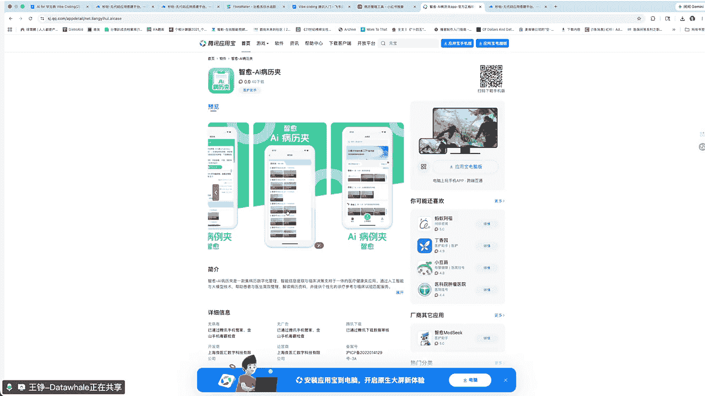

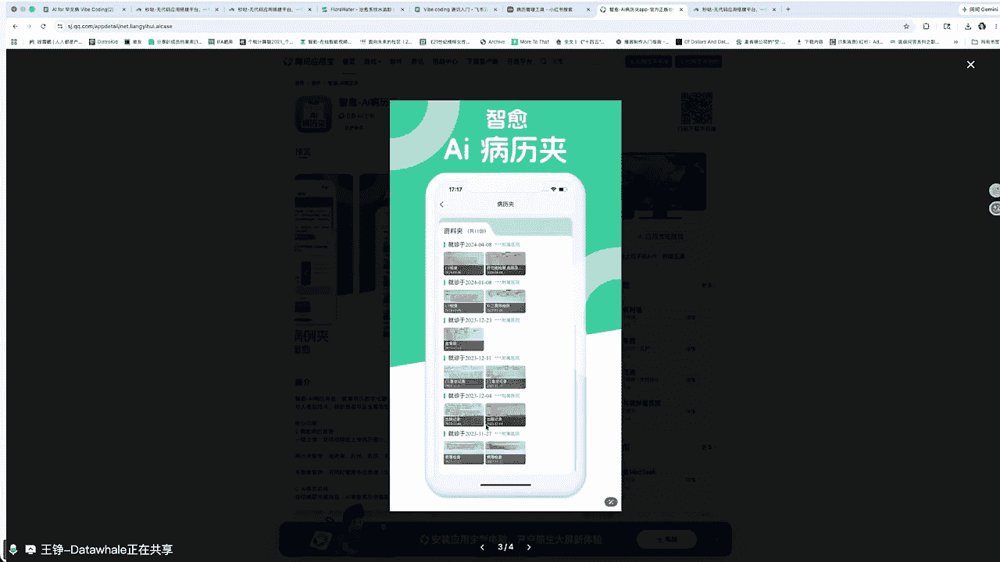

Web Coding最重要的能力可能包括理解问题、把想法拆得很细并搭建产品架构、像创业者一样快速验证，或者拥有支持产品持续迭代的团队能力。不同的人，由于能力点不同、所处技术或产品水平阶段不同，答案也不同。

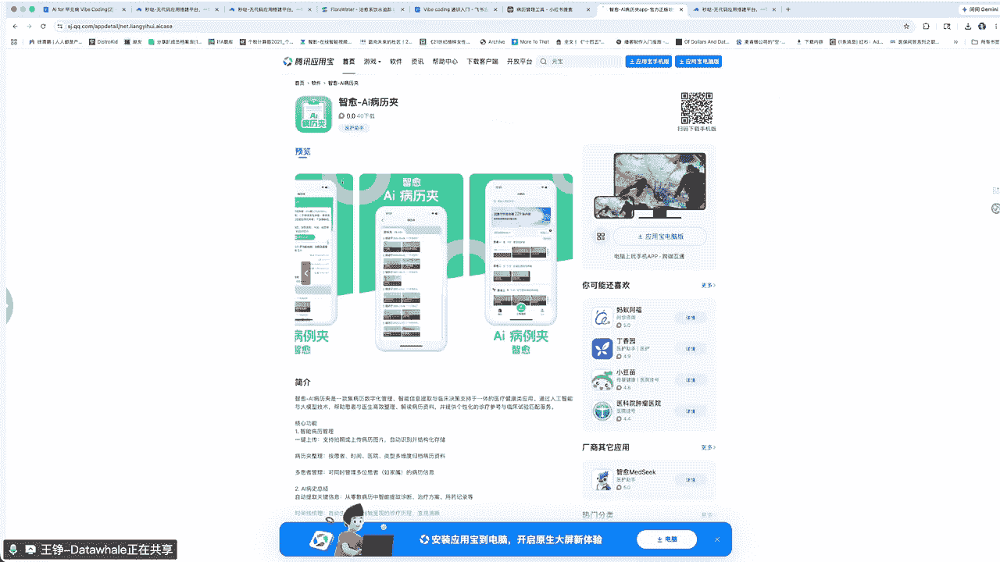

对于零基础小白，想清楚问题和范围非常重要，因为很多人的想法比较宏大，没有经过充分调研，往往只是停留在想法阶段，可实现性有待验证。

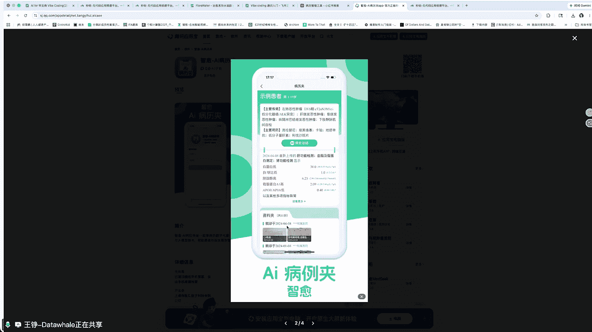

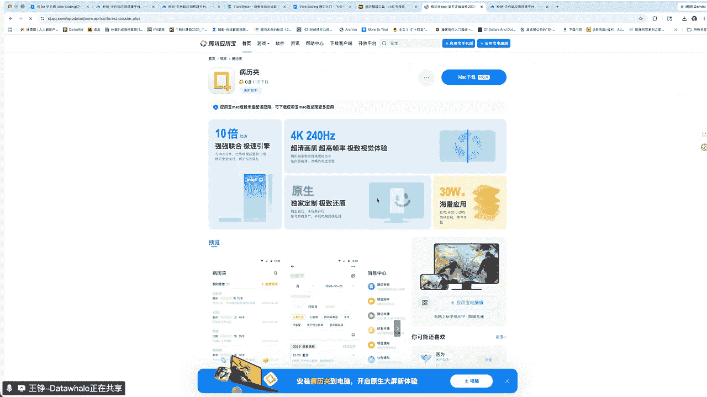

如果你已经有一个具体的点子和场景洞察，知道这是一个真实需求，并且明白AI可以实现，那么对你来说最重要的是拆解想法的能力，把想法一步一步拆解、一步一步落地。

如果你是创业者或OPC创业者，最重要的是快速验证能力，也就是构建MVP（最小可行性产品）的能力，即“快速迭代、小步快跑”。你可以从宏大愿景中抽出一部分MVP，快速落地，跑向市场，用Web Coding能力搭建一个Demo或MVP，参加黑客松，或者给可控的可靠用户使用。

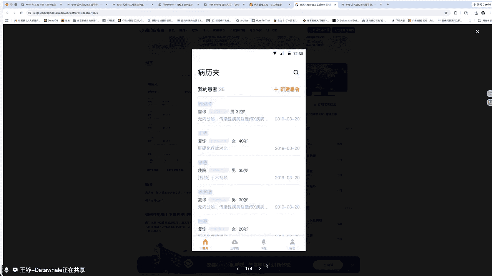

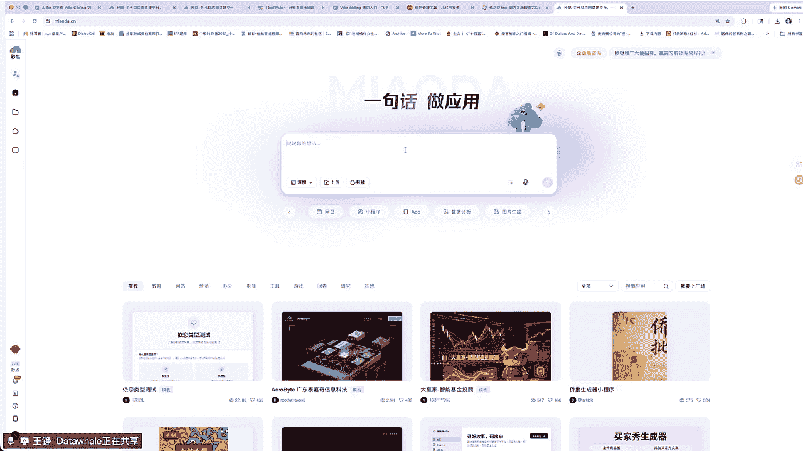

如果你已经有创业团队、运营资源或客户，那么最重要的是持续迭代和持续服务的能力，即服务更多人、触达市场的能力。

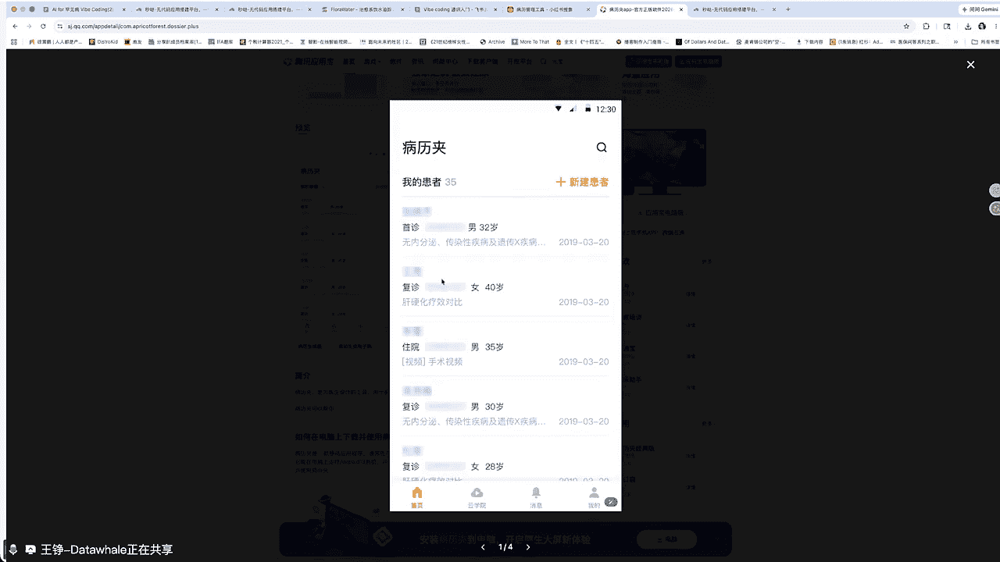

Web Coding本身不是目标，它只是达成目标的手段。最终，Web Coding和AI工具是服务于你的目标、服务于你的想法、服务于你现阶段能力的。重点不是选一个标准答案，而是匹配你当前最需要的能力和你当前拥有的资源，这些资源包括客户资源、伙伴支持、时间、精力和成本等。每个人的答案都不同。

---

### 信息获取能力与学习能力

接下来，我想分享我自己的答案。

在我看来，Web Coding最重要的两个能力是信息获取能力和学习能力，这两个能力优先于使用秒单、t、coder或cloud code等工具的能力。

我做产品经理以来，有一个明确的结论：太阳底下无新事。你想做的东西，很可能已经有人在做了。以病例管理工具为例，当我第一次想到这个idea时，脑袋一片空白，不知道做什么产品、有哪些功能、向哪里学习。这时我会先做产品调研，比如去小红书搜索“病例管理工具”。

搜索后我会发现，有很多现成的产品正在小红书上宣传。我不会恐慌，而是会点进去看：他们的功能是什么样子的？流程是什么？比如选取病例、上传、解析、展示，这是一个典型的病例管理工具流程。对应到上一节课的内容，这就是用户旅程地图：上传、分析、展示。

---

### 竞品分析实操

竞品分析不仅可以在小红书进行，还可以在应用商店和小程序中进行。

竞品分析可以使用腾讯应用宝等工具。比如搜索“病例管理”，会出现44个对应工具。点进“AI病例夹”查看截图和简介，可以看到它可以按时间线展示上传的病例，这是一个功能点。再看上传流程，上传病例后可以帮助进行病史总结，分为主要疾病、主要用药指标、病例文件管理。

我们也可以随便下载一个“病例夹”查看预览，里面会有新建患者、帮患者复盘旅程、消息通知等功能。我们看这些产品的目的不是要完全照搬，而是要判断：如果要做这样的小产品，大部分产品里会有哪些功能？不同产品有不同功能，哪些是我要的，哪些是我不要的？把想要的功能转化为提示词，参考它们的工具来写即可。

此外，还可以在小程序中搜索，比如搜“病例管理”，会看到“电子病例管家”等小程序。登录后可能只有两个页面：首页和我的。首页包含病例管理，点进去后可以添加、输入医院名称等。通过点击了解里面到底有哪些功能，以及用户旅程是什么：用户点进哪个按钮，出现什么界面，出现什么功能，在做什么，接下来又怎么样。这相当于把软件的剧本提炼出来。

---

### Web Coding的第一步——找学习对象

基于以上调研，初学者不建议直接开始写代码，而要先做好两件事。

Web Coding的第一步是找到学习对象。你可以去内容平台、腾讯应用宝商店（苹果手机可用App Store，华为手机可用华为应用市场）寻找产品，找到后逐一点击查看。

一个神奇的现象是，你可能会发现一个满足自己需求的现成软件，那样你就不需要自己做了。更重要的是，你要夯实对自己要做产品的功能理解。APP制作门槛仍然很高，需要一定的产品思维和技术背景，不像宣传中说的“一句话就做一个APP”，那更多只是体验、尝试或Demo，能力较弱。

这就像做短视频起号，需要找对标账号。做产品也是一样：万变不离其宗，首先要找到一个比较好的学习对象去分析，然后按照上一节课的分析框架进行梳理，想清楚自己的产品与学习对象有什么可以借鉴的，有什么不同。

行动清单非常简单：找找，然后学。

---

### 品鉴产品的8个问题

我们具体要学习什么？具体要研究什么？

在研究一个产品时，要先想清楚以下8个问题：

1. 谁在用？除了你自己，周围可能还有病友、家属照顾者、医生、志愿者、社群运营人员等不同角色。
2. 他为什么用？解决什么问题。
3. 用户从哪里进入？可能是微信、链接、手机桌面APP等，这也与产品形态有关。
4. 做哪些操作？界面里有哪些可点击的元素，点击后出现什么，路径和页面如何。
5. 操作对象是什么？填东西、打字、上传图片，还是接收AI判断。
6. 系统给了什么反馈？点击后页面发生了什么变化。
7. 不同人权限有什么不同？比如飞书文档可以设置“仅可阅读”或“可编辑”，分享链接后对方能否修改。
8. 最后留下了什么结果和数据？上传的病例数据是否被软件获取，是否可以查看。

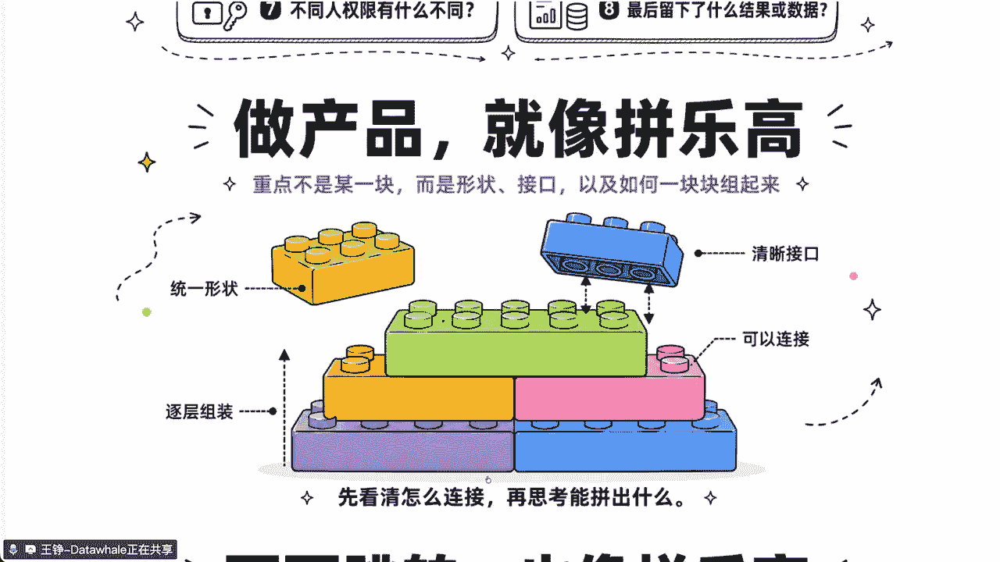

研究产品时，要往深了认。洞察能力、观察能力、记录觉察能力都要很强。这就像心理学中所说的人与人的区别在于洞察能力，有的人看问题很浅，有的人看问题很深。

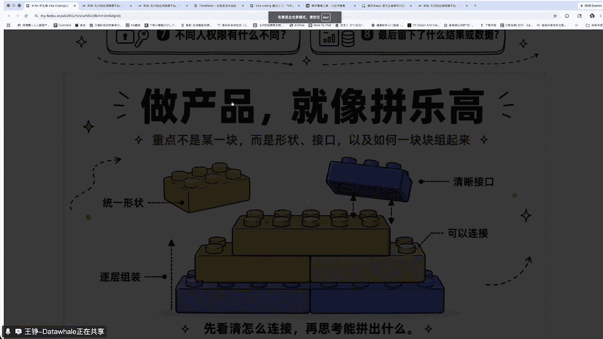

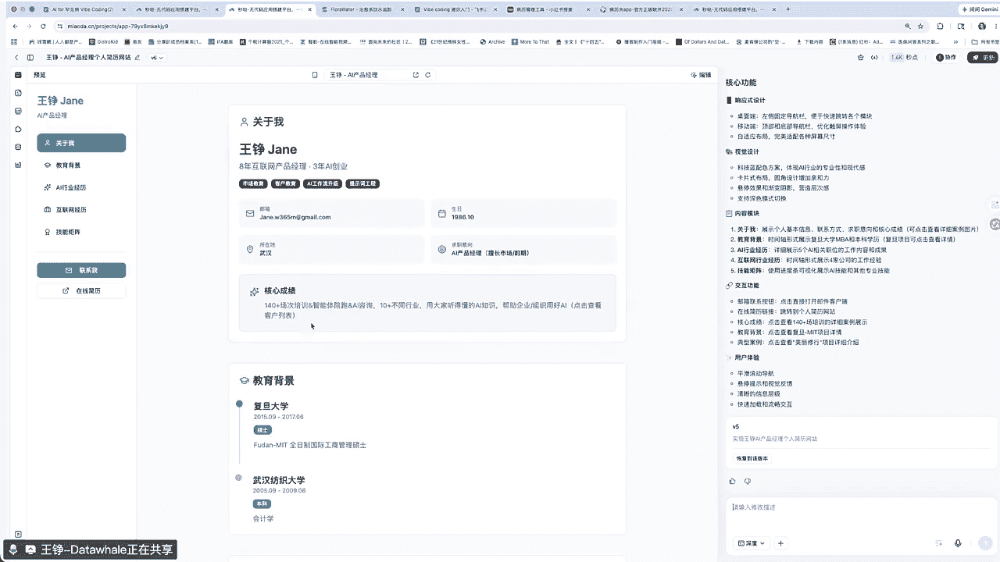

---

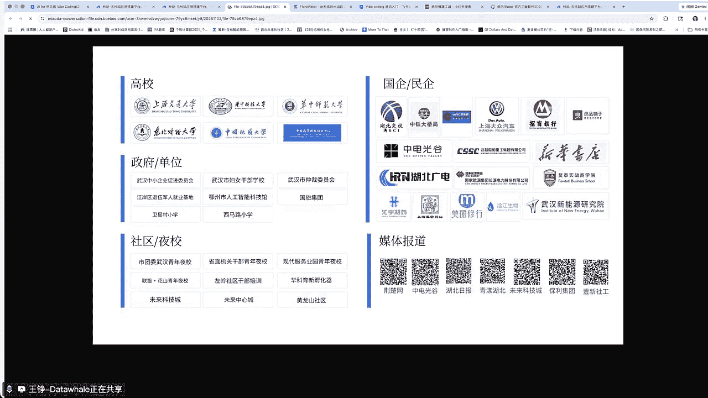

### 产品模块化思维

做产品其实就像拼乐高。

做产品就像拼乐高，大模块由小模块拼成。比如一个产品可能包含首页模块、各种报告模块、指标模块、我的模块等。模块之间有接口，就像乐高的小通用接口，把它们按进去才能稳固。做乐高时先装底座，再拼模块，最后把模块安到底座上；做产品也是同样的连接和拼接过程。

以病例管理工具为例，里面可能有首页模块（展示各种功能按钮）、添加药品模块、提醒设置模块、服药记录打卡模块。这些都是独立功能，最后拼接起来形成完整产品。我们的工具就是这样一步一步长出来的。

---

### 页面跳转与模块拼接实操

页面跳转也像拼乐高。

在秒达等平台上，当你生成一个任务时，它会一块一块地创建页面，再更新、再检查，这就是把需求一块一块做出来、拼接而成的过程。但用户常遇到的痛点是积分不够，点几下就没了。

这就涉及到如何把需求描述清楚的问题，也就是如何把产品架构画好。只有把问题想清楚，才能写清楚需求。

举个例子，我用秒达做了一个简历网站，原本是静态页面，但我想让用户点击“核心成绩”后跳转到案例页面，查看我服务过的客户。这就像在页面上拼接了一个图片模块，一点就跳转。

具体怎么做到？基于简历生成可视化网站后，点击“编辑”，选择一个模块，增加一个链接，输入目标链接，设置“点击后新开页面”。这样点击该模块就会打开链接。每个生成的模块都是可以编辑的，这就像做PPT时添加超链接跳转到视频或表单。

另一个例子是春节黑客松制作的微信红包封面生成器。点击封面后会跳转到新的智能体。后台中，每个工具（如传统仪式指南、瞬间红包小管家）都是独立的智能体。我首先让AI生成一个纯前端的主页，当作应用首页，上有几个按钮和对应文字，不需要实际功能，优先适配移动端。然后选中模块，输入该工具的访问链接，填入编辑框中。这样点击“亲属称呼指南”模块后，就能跳转到另一个秒达小程序链接。

未来我们做的各种模块，都可以拼接到首页上，形成完整产品。

专业产品研发也不是一口气做出很大东西。以Kimi为例，看起来简单，但里面有问答模块等多个功能模块。再以豆包为例，底部长条有很多不同功能，每个点进去都不同：视频生成、会议记录、编程等。豆包把很多功能和能力拼在一起，形成完整产品，每个页面要素都不一样。

这说明各种不同的产品，其实都是由不同模块拼接而成的。我们要做的就是把各种模块拆解出来，像做乐高一样先把每个模块做好，再通过技术手段拼接到一起。

---

### 产品架构图与需求描述

接下来，我们来看如何通过产品架构图来描述需求。

怎么写需求？怎么写清楚？你只有把产品架构画出来，才能写清楚。产品架构可能包括入口层、核心功能层、本地数据层、本地支撑层。页面下面的几个Tab，比如首页Tab、新建病例Tab，就是核心功能。

怎么选取对应的功能？以秒达为例，在页面中可以看到“记忆能”、“内容理解与处理”等功能模块。如果做病例管理工具，我们希望软件上传病例后能读懂里面的字，这调用了通用文字识别或图像内容理解功能，这是已经封装好的乐高模块，直接调用即可。

提示词可以这样写：帮我做一个可以在手机端使用的病例管理工具，我可以将病例和检验单图片上传给你。工具将自动调用图片识别技能，提取病例中的信息，并按照报告类型、报告时间、医嘱、化验指标、其他信息的顺序整理出来。这是一个从上传到整理的模块。

还可以添加检索模块：用户可以通过某个能力，对比不同时间段的同一指标，并进行可视化展现。

---

### 提示词专业化示例

一个好的提示词就像产品PRD文档。例如：“请帮我开发一个简单版的病例管理H5小工具，这个工具可以在微信里打开，是本地使用的小工具，不需要调用知识库，暂时不需要登录，不需要用户系统，数据可以先保存在手机或电脑浏览器中。”

接着描述产品目标、技术要求、页面结构、新病例模块、每个模块的功能、核心功能模块、交互要求、视觉风格、验收标准等。这看起来是一个很专业的文档。

如果你不清楚怎么写，可以使用豆包或秒达的“优化指令”功能，让AI自动把简单指令扩展成专业文档。当你不清楚时，可以借助工具本身的力量，帮助写出更优秀的提示词。

AI产生的提示词结构比较清晰，我们也能比较清楚地理解。

---

### MVP思维与架构拆解

做产品是一个取舍过程。脑袋里可能有很多点子，但scope越大，难度越高，越容易迷茫。这里介绍MVP概念：Must Have，即哪些功能是必须要有的，没有它东西就无法执行；哪些是辅助性的，有了是锦上添花。

架构层面拆开后，要逐个拆解。怎么知道产品架构？可以让AI（如豆包）扮演专业软件架构师，拆解工具模块，采用MVP思路，不要太复杂。拿到架构后，直接给豆包、秒单或灵光，让它们去做。

有了AI，很多点子的脑力劳动和执行都不用我们想太多，只需要知道怎么提问即可。

MVP功能集可以用代码表示：

```python
MVP = {功能 for 功能 in 所有功能 if 功能是必须的 and 没有它无法执行}
```

---

### 就医地图小工具案例拆解

接下来通过两个具体案例来拆解产品闭环。

就医地图小工具的核心闭环包含以下模块：

第一，定位模块。当用户登录后，通过IP位置识别获取当前所在位置，并加上行政区查询或地图定位。当用户输入所在位置时，能够快速定位，并在地图数据中找到当地三甲医院。这个模块在技能里对应地图出行，包含IP位置识别、地点详情查询等。

第二，找到医院后的路线生成。相当于定位和路线生成。秒达有路线规划功能，输入起点和终点，调用百度地图生成路线。

第三，查看信息。如果医院比较有名且信息公开，AI可能帮你找到，但不够准确，因为挂号、科室、医生等动态信息AI不知道，除非有相应的数据包或技能。

第四，就诊。使用地图模块进行导航。

这个最小应用闭环需要医院基础数据和地图服务，而秒达自带定位服务，可以直接使用。

---

### 喝水提醒工具案例拆解

再看一个喝水提醒工具的案例。

喝水提醒工具包含以下功能：创建水杯（名称、容量），比如小杯子、马克杯、运度水壶、蜜雪冰城超大杯850毫升；点击“喝一杯”选择杯子并记录，比如今天喝了一杯蜜雪冰城，记录850毫升；设置每天喝两升水的目标；设置喝水提醒；添加其他饮水来源，比如点了外卖；显示每天喝水报告；视觉上希望治愈小清新，参考健康记录模式，喜欢好心情的颜色，生成可视化饮水报告。

我的提示词包含了这些信息：功能模块、路径、必须功能、颜色配色等。我使用的是Google Studio，它的多模态能力很强，但需要付费。AI根据这段描述生成了软件。

Web Coding的核心能力就是能否把各个模块拆出来，拆成类似产品架构的形式。AI可以帮你拆解。拆完之后你会发现，原来想的功能这么复杂。

---

### 学习心法——不要操之过急

最后，分享一个学习心法。

求久病成医，在这个行业沉淀越久，知识越丰富。不可能花一周或两个小时就胜过专业医生。当前我们的需求范围和产品思维，实际上还是小白程度。应该抱着练习心态，先做一些小题目，就像刚开始学数学或英语时，先做非常简单的东西。

不要操之过急，Web Coding也是一样。做得越多，学习时间越长。学习是有成本的，目前没有太多免费资源，学任何东西都会有成本。在真正有需求的前提下，多学、多操作、付出一点成本。未来多总结、多复盘，就可以做出真正有市场价值、能够解决自己问题、用AI降本增效的产品。

---

### 后续资源与规划

如果你对产品思维或AI产品感兴趣，可以关注我的公众号。

未来我会把AI通识课、Web Coding课程，以及AI医疗产品测评的内容，整理成文章发布到公众号，方便大家跟踪最新的学习分享进展。

今天内容比较专业，我不确定大家的接受程度如何。正确使用这节课的方式是：一边做Web Coding，一边看我展示的架构，多看几次，总会有收获。因为今天讲的内容非常专业。

---

### 常见问题解答

接下来是Q&A环节。

关于“单一病人病例管理是否需要数据库处理”：数据存在哪里？浏览器有清理缓存的地方，微信也有清理缓存。软件越用越大，很多数据存在手机或电脑浏览器里。有些数据存在云端数据库，比如便签、微信在电脑上也能看，数据存在第三方地方。

如果只是自己用，可以告诉AI：“目前先把我的信息存放到本地。”软件就会把数据存在你的电脑浏览器缓存里。但清理缓存后数据就没了。这取决于使用场景：想在电脑和手机同时看，就需要云端第三方数据库；只在一个设备上用，可以存在本地，但缓存会丢失。你可以明确告诉Web Coding工具数据存到哪里，并询问能否实现及方案。理论上这类IDE工具应该可以实现。

关于“做成像腾讯问卷这样的数据库”：要看预算和能收集多少病例，这部分可以请其他Web Coding老师回答，因为我对不同技术的费用和容量还不特别清楚。你也可以让数据存到本地硬盘，明确告诉工具数据指定存到哪里。

关于“AI产品对传统增量业务的需求”：这个问题很大，涉及传统行业如何通过AI快速梳理并让研发顺利落地，可能需要专门的直播和多个嘉宾才能讨论清楚，可以作为后续碰头话题。

---

### 后续课程预告

最后预告一下后续课程。

后面的课程会更加实操、更加专业。越到后面，AI能帮我们做的事情意义越大，不只是写文案、生成视频，而是真正达到前5% AI应用者的水平。这是未来趋势。现在的工具迭代很快，大模型能力非常强。

今天的PPT全部是AI做的，我觉得做得不错。未来如果有机会，可以分享怎么用AI做PPT。大家应该对AI技术保有期待。AI能力越强，对普通人的挑战越大。必须在AI与人类替换矛盾达到顶峰时，尽可能掌握它，逼自己多学AI技能。虽然可能被迫学习很多东西，但这无疑增加核心竞争力。

后续课程会涉及真正的Web Coding。如果你想继续学习用AI做工具，或者希望AI在工具层面和其他层面帮到你，后续课程不能错过。大家可以关注后续课程发布。

---

## 总结

本节课我们一起学习了AI原生开发的实操方法与产品思维。我们回顾了上一节课的前置思维，分析了为什么注册AI工具依然做不出产品，拆解了产品分析的三个核心维度，学习了如何通过竞品调研构建产品架构，掌握了提示词编写与MVP思维，并通过就医地图和喝水提醒两个案例，了解了模块化思维的实际应用。

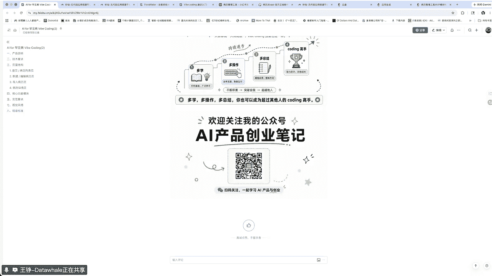

内容比较干，大家需要好好消化。希望各位小伙伴动手操作学到的小工具思路，有不懂的可以在群里继续交流。祝大家周末愉快，拜拜。

