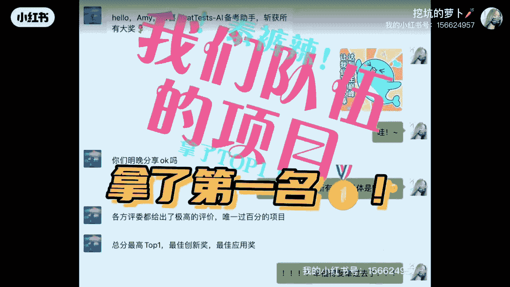

# Datawhale AI+X 🚀：01：chatTests项目夺冠分享

在本节课中，我们将一起学习Datawhale AI+X活动中chatTests项目如何获得第一名的真实经历。这个内容特别适合零基础的朋友，因为它说明了即使你之前没有编程经验，也完全有机会参与到实际项目中，并且取得不错的成绩。我们会把整个故事用大白话讲清楚，让每一个步骤都容易理解，同时也会保留原始经历中的关键信息，不遗漏任何细节。你不需要担心自己看不懂，因为我们会把专业术语都拆解成普通人都能听懂的语言。


在正式进入细节之前，我们先回顾一下视频制作阶段的场景，这能帮助你更好地理解当时的心情和背景。那时候作者正忙着处理视频素材，整个过程可能并不轻松，但正是在这个忙碌的时刻，重要的消息已经悄悄到来了。以下是当时发生的关键事件列表：

- 作者正在苦苦挣扎着剪辑视频
- 视频尚未正式发布
- 作者正在等待好消息到来


等到视频剪辑工作接近尾声的时候，最关键的消息终于传了过来。这个消息对作者和整个团队来说都是一个惊喜，因为他们之前可能并没有预料到会取得这样好的名次。以下是关于项目获奖结果的具体说明：

- 项目名称是chat test
- 该项目拿到了本期的第一名，也就是top一
- 这是唯一一个超过百分比例的项目


为了让你更直观地理解这些核心信息，我们可以用一段简单的代码把它们表示出来。这段代码并不复杂，初学者也可以轻松看懂，你可以把它当成是把文字信息整理成计算机能够识别的格式：

```
项目名称 = "chat test"
获奖名次 = "第一名"
是否超过百分比例 = True
是否为唯一项目 = True
```

如果把这些条件写成一个判断公式，就可以表示为：



```
获奖成功 = (项目名称 == "chat test") and (获奖名次 == "第一名") and (是否超过百分比例 == True) and (是否为唯一项目 == True)
```

上面的代码和公式只是帮助你整理信息，并不需要你立刻就会写程序，重点是理解项目取得好成绩的具体情况。


本节课中我们一起学习了chatTests项目在Datawhale AI+X活动中夺得第一名的完整过程。我们回顾了视频制作阶段作者正在剪视频的场景，了解了项目获奖的具体名次和独特之处，并且用代码形式梳理了核心信息。希望这个经历能给零基础的朋友们带来启发，让大家明白参与项目并没有想象中那么困难。如果你也想尝试，可以从小步骤开始，慢慢积累经验。
