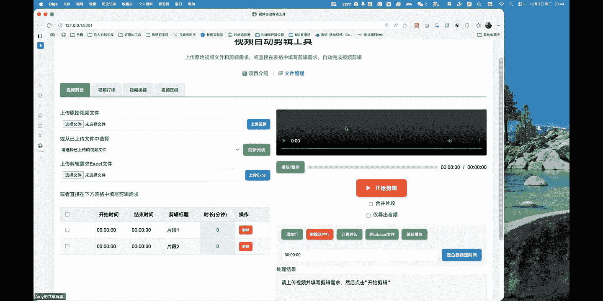
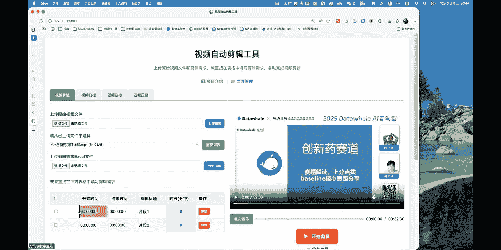
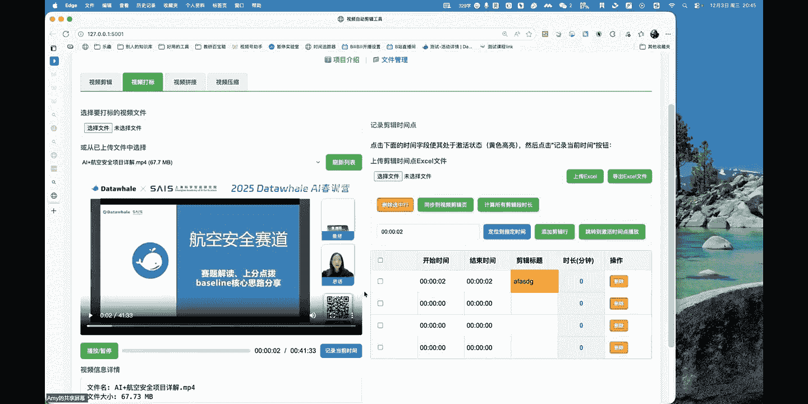
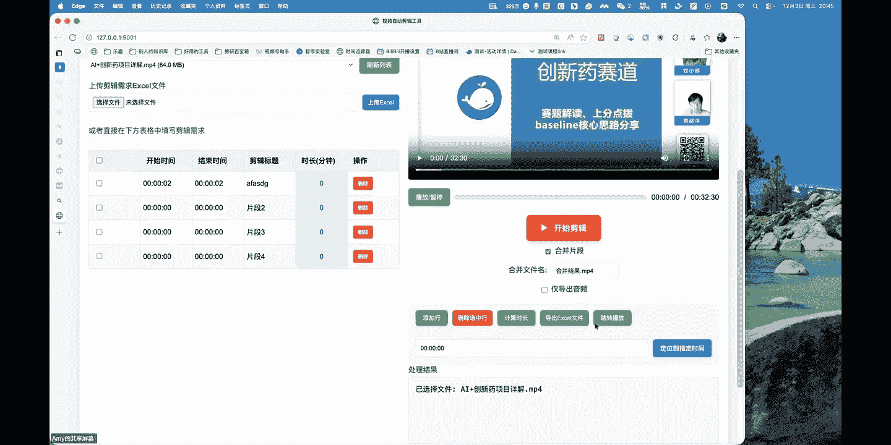
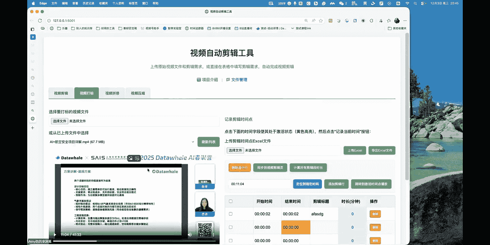
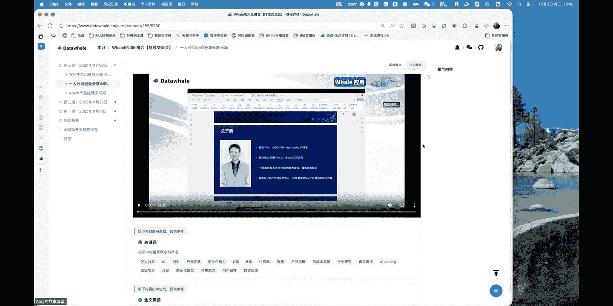
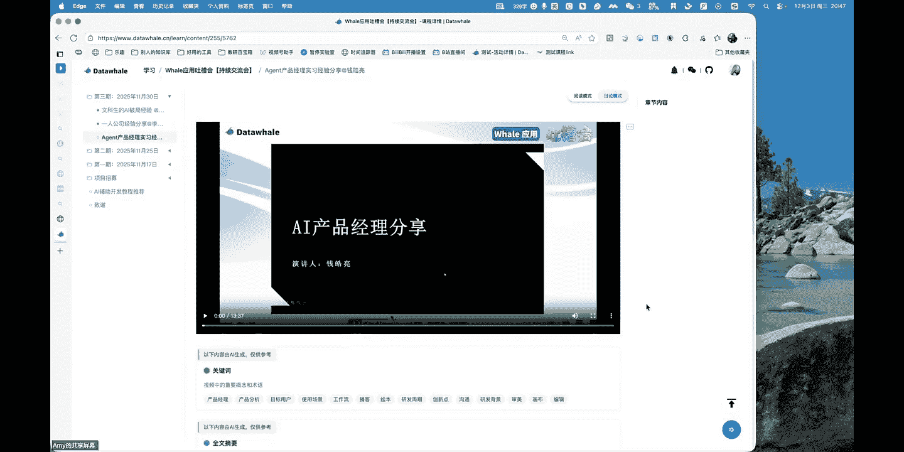
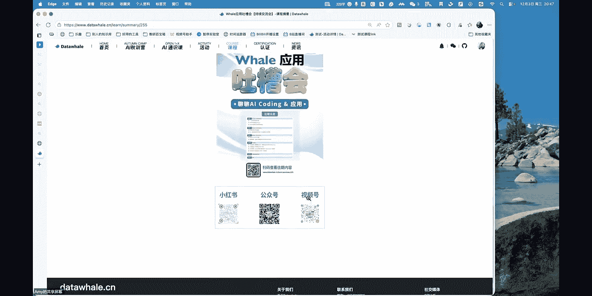
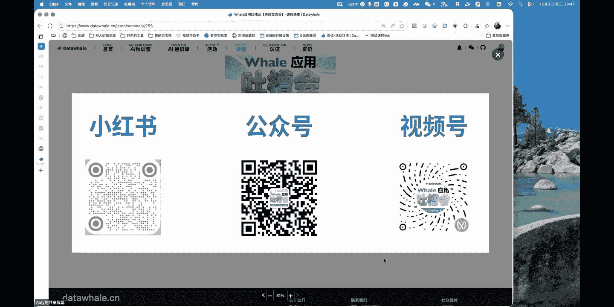
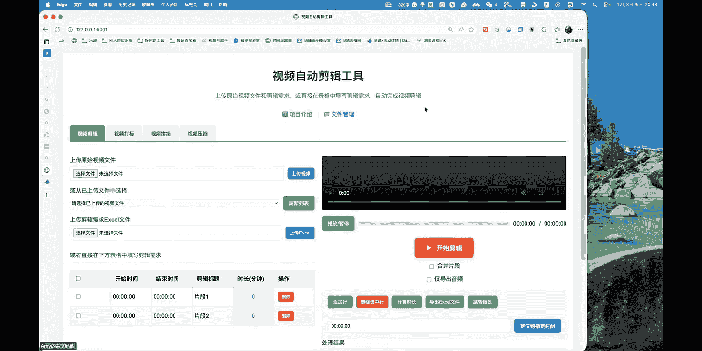

# Datawhale AI+X video_cut_helper：01：🎬 项目背景与诞生

在本节课中，我们将学习一个名为 video_cut_helper 的一秒切片应用是如何从零开始被开发出来的。这个项目的核心目标是解决课程视频剪辑渲染太慢的问题，让十分钟长度的视频在十秒钟内完成处理。我们会用大白话把整个开发过程讲清楚，哪怕你以前从未接触过视频剪辑工具，也能听懂。

这个项目完全是使用 AI 编程助手编写的。事情的起源是，我手头积累了大量需要处理的课程视频。每次录完课之后，都要花很长时间把这些视频剪辑出来。我尝试过剪映等常见的视频剪辑软件，但是剪辑和渲染的速度实在太慢，等待的过程让人非常着急。于是我向易鸣请教，希望能找到更快速的解决方案。

易鸣给我的建议非常直接，他说其实可以使用 FFmpeg 这样的开源库来处理视频。FFmpeg 能够完成很多视频剪辑相关的动作，比如切割、合并、格式转换等等。除此之外，我也尝试过一些在线的网页工具，希望能找到现成的解决方案。但是那些在线网页生成的代码质量参差不齐，很多写得乱七八糟，根本没法直接使用。

相比之下，Kimi 的表现要好得多。它直接帮我写出了一个大致的图形界面，这个界面已经能够实现基本的视频剪辑功能了。我拿到 Kimi 生成的基础代码后，把这些代码交给了 AI 编程助手，让它继续完善。

# Datawhale AI+X video_cut_helper：02：🛠️ 从需求到原型开发

上一节我们介绍了项目的诞生背景，本节中我们来看看作者是如何把最初的想法变成可运行的原型。



我让这个 AI 助手帮我写前端界面，还要实现各种各样的功能。开发过程中经历了不少调整和迭代，涉及页面布局、按钮交互、视频预览等多个方面。大概两天时间过去，这个工具就达到了基本可用的状态，可以用来剪辑视频了。

在基本可用之后，我又逐步给它增加了新功能。最初这个工具只能做简单的剪辑操作。具体的使用方式是，我先准备一张剪辑需求表，表里写明哪些片段需要保留、哪些需要去掉。工具读取这张表之后，就能按照要求把视频剪出来。



以下是剪辑需求表中需要包含的关键信息：
- 视频文件路径
- 起始时间点
- 结束时间点
- 输出文件名称

核心概念可以用伪代码表示：
```
剪辑需求表 = {
    "视频路径": "课程录制.mp4",
    "片段列表": [
        {"开始时间": "00:00:10", "结束时间": "00:00:20"},
        {"开始时间": "00:00:30", "结束时间": "00:00:45"}
    ]
}
```

# Datawhale AI+X video_cut_helper：03：▶️ 播放记录与时间表功能

上一节我们介绍了从需求到原型的开发过程，本节中我们来看看播放记录和时间表功能是如何实现的。

在剪辑需求表能用之后，我又产生了一个新想法。其实在生成时间表的同时，我们可以让工具帮助进行视频播放，这样操作会更直观，不需要在多个软件之间来回切换。

具体的操作流程是这样的：我在视频播放的过程中，随时可以点击播放或暂停。每当我想要剪切的地方出现时，我就记录下对应的时间点，并且给这个片段写一个标题。这样一来，剪辑的过程就变得非常轻松、舒适了。等我把所有需要剪辑的片段都确定好之后，就可以进入下一步。

把确定好的时间表同步回工具，让它自动帮我完成剪辑，这个过程非常方便。我不需要再手动输入时间，也不需要反复确认，直接点击一下就能开始处理。



以下是时间表生成的关键步骤：
1. 播放视频并暂停在需要切割的位置
2. 记录当前的时间戳
3. 为该片段添加标题说明
4. 重复上述步骤直到覆盖所有需要保留的内容

核心逻辑可以这样理解：
```
时间记录 = 当前播放位置
片段标记 = {
    "开始": 时间记录,
    "结束": 下一个时间记录,
    "标题": 用户输入的名称
}
```

# Datawhale AI+X video_cut_helper：04：🔗 视频拼接与合并优化

上一节我们介绍了播放记录和时间表功能，本节中我们来看看视频拼接与合并优化是如何解决实际录制中出现的问题的。

又过了大约四五天，我把剩下的所有功能都陆续加上了，其中就包括视频拼接功能。之所以要加入拼接功能，是因为实际录制视频时经常会出现意外。比如录制的时候不小心录到了桌面文件，或者出现了一些隐私信息，甚至录砸了，这些内容都不适合公开发布。如果把这些不合适的片段剪掉，视频中间就会空出一段，也就是出现了 gap，这时候就需要把剩下的片段拼接起来。





因此我又让 AI 助手在拆分视频的基础上，增加了视频拼接功能。把多个片段连接在一起，中间没有间断，效果也很好。

开发进行到后面，我又把功能推进了一步。现在视频剪辑完成之后，我可以直接让工具进行合并操作。这样一来，原本需要被剪掉的中间部分，会被自动去掉，不需要我手动再处理一遍。

以下是视频拼接与合并的处理流程：
- 第一步：识别需要剪掉的片段区间
- 第二步：剪掉这些区间，产生若干个有效片段
- 第三步：将所有有效片段按顺序拼接在一起
- 第四步：输出最终合并后的视频文件

核心代码逻辑可以用伪代码表示：
```
有效片段列表 = []
for 每个时间段 in 时间表:
    if 时间段需要保留:
        有效片段列表.append(提取该时间段的视频)

最终视频 = 拼接(有效片段列表)
```

# Datawhale AI+X video_cut_helper：05：⚡ 极速渲染与课程应用

上一节我们介绍了视频拼接与合并优化，本节中我们来看看极速渲染效果以及在课程中的实际应用。



这时候，我想知道这个工具到底能有多快，什么样的速度才算最快、最方便。实际测试下来，速度非常惊人。一个十分钟长度的视频，只需要十秒钟就能处理完毕，直接生成一个十分钟长度的切片。整个过程非常轻松、顺畅。我觉得这个工具特别适合用来处理直播录像。不仅如此，我们平时录制课程视频的时候，用这个工具进行加速处理也非常迅速，效率很高。

使用这个工具之后，感觉就像开挂一样。所以我们制作好的课程内容，放到课程平台上的时候，速度会快很多。大家可以看到我们的课程视频回放，全部都可以正常观看。



处理速度可以用下面的公式来估算：
```
处理速度比 = 视频总时长 / 实际处理时间
            ≈ 600秒 / 10秒
            = 60
```
这意味着处理速度大约是视频播放速度的 60 倍。

在实际应用中，我开完会之后，第二天上午就能把大家分享的内容全部剪好，直接发布到平台上。所以我在这里欢迎大家来参加 vivo 应用吐槽会，也欢迎大家报名成为分享者。如果你自己也想来做分享，随时可以找我联系，我会帮你把视频剪出来。以后大家需要这些切片视频，也可以直接来找我获取。

另外，如果你不喜欢视频带有边框，我也可以提供没有包框的版本，供大家选择。如果你想要自己分发这些视频，或者放到自己的课程、其他平台上，使用这个工具处理之后会比较轻松方便。



# Datawhale AI+X video_cut_helper：06：🌐 分享、部署与开源说明

上一节我们介绍了极速渲染与课程应用，本节中我们来看看项目的分享渠道、部署方式以及开源说明。

差不多就是这些情况。现在我们的账号已经在多个平台全面运营，包括小红书、公众号、视频号，欢迎大家关注。这些账号的名字都是 vivo 应用吐槽会。我们希望能把大家分享的优质内容，传播给更多的人。

如果你对这个视频剪辑工具感兴趣，可以直接访问开源地址查看代码和文档。虽然我已经在服务器上部署了一个线上版本，但实际上上传大文件的体验并不好，不太方便使用。因此，如果你有需要，建议直接在自己的电脑上本地部署。这个部署过程很简单，不需要 GPU，也不需要什么复杂的硬件配置。

下面是项目中的一些核心代码，这些代码是由 AI 生成的。不过说实话，从项目开始到现在，我还没有完全理清项目的所有细节。所以当我想要修改代码的时候，其实还是会遇到一些困难。

核心代码示例如下：
```python
# 基于 FFmpeg 的视频切割与拼接伪代码
import subprocess

def cut_video(input_file, start_time, end_time, output_file):
    command = [
        "ffmpeg",
        "-i", input_file,
        "-ss", start_time,
        "-to", end_time,
        "-c", "copy",
        output_file
    ]
    subprocess.run(command)

def merge_videos(file_list, output_file):
    with open("parts.txt", "w") as f:
        for file in file_list:
            f.write(f"file '{file}'\n")
    
    command = [
        "ffmpeg",
        "-f", "concat",
        "-safe", "0",
        "-i", "parts.txt",
        "-c", "copy",
        output_file
    ]
    subprocess.run(command)
```



之所以会觉得修改有困难，是因为我之前主要使用的是 C 语言技术栈，对这个项目所使用的技术栈不够熟悉。不过开源代码已经提供，大家可以根据自己的需要进行修改和扩展。



本节课中我们一起学习了 video_cut_helper 一秒切片应用的整个开发历程。我们了解了项目背景，知道了为什么需要一个快速的视频剪辑工具；学习了如何从需求出发开发原型，知道了如何使用 FFmpeg 进行视频处理；掌握了播放记录与时间表的使用方法，理解了视频拼接与合并的必要性；体会到了十秒钟处理十分钟视频的极速渲染效果，以及在课程录制中的实际应用；最后，我们也了解了项目的分享渠道、本地部署方法以及开源代码的使用注意事项。希望这篇教程能帮助你快速上手这个工具，提升视频处理的效率。

