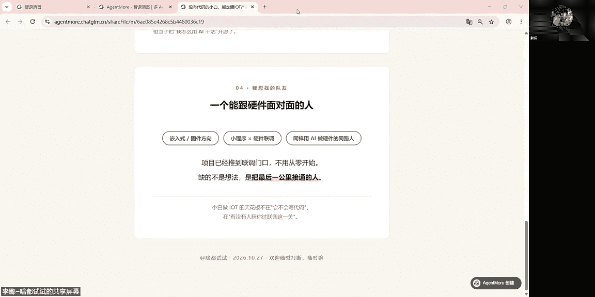

# 智能硬件产品开发：01：独居老人提醒喝水杯项目拆解 🫖


## 开篇概述

本节课我们将学习如何从零开始定义一款面向独居老人的智能提醒水杯。内容包括产品背景、核心功能、硬件开发现状、云端连接难点以及市场落地路径。我们会用大白话把物联网硬件开发中的实际问题讲清楚，适合刚接触硬件产品的初学者阅读。

## 一、项目背景与产品定义

我们先从项目的起源说起，了解这个智能水杯最初是为什么而来。

演讲者本身是硬件产品经理，之前负责过硬件产品的定义与规划。在那个时期，有开发团队配合，觉得产品定义比较简单，实现起来也顺手。后来人工智能技术普及，他尝试过一些纯软件的AB测试开发，觉得难度也不大。前几个月参加OPC比赛时，他决定做一个物联网产品，于是想到了智能水杯这个方案。他选择了ESP32芯片，理论上该芯片支持所需功能，看起来难度不大，于是就开始了开发工作。

以下是项目的初始设想：
- 针对独居老人和不爱喝水的人群，重点关注独居老人。
- 解决老人家里只有一个人，长时间不喝水容易出现健康问题的情况。
- 做出一款可以提醒喝水的智能硬件产品。

## 二、核心用户痛点与功能设计

在明确了项目方向之后，我们需要梳理用户真正面临的痛点，以及产品应该提供什么功能。

独居老人常常会忘记喝水，而且随着年龄增长，口渴感觉会退化。不喝水或喝水太少会导致血液粘稠等健康问题。这部分老人通常患有长期慢性病，需要长期服药，因此喝水和用药都是刚需。子女虽然不在家或住得很远，也希望能够了解老人的状况，并通过产品与老人建立联系。

以下是产品的核心功能需求：
- 本地提醒喝水和服药。
- 子女端可以远程查看老人的饮水和用药情况。
- 当连续若干天没有任何饮水动作时，系统需要发出提醒。

报警逻辑可以用下面的公式描述：
`如果 连续3天 未检测到喝水动作，则 触发提醒并通知子女端`

## 三、硬件开发现状

接下来我们来看看硬件方面目前完成到了什么程度。

硬件结构部分已经完成，已经打了三次手板，第三次手板基本可以使用。电池、主板等硬件模块也都搞定了。但是低功耗问题还没有解决，产品希望至少能待机半个月，避免频繁充电，目前功耗优化还卡在这个点上。

以下是当前硬件开发的完成情况：
- 结构设计：已完成，三次迭代后基本稳定。
- 硬件模块：电池、板子等已搞定。
- 低功耗优化：尚未解决，目标待机时间 ≥ 15 天。

## 四、软件与云端连接难点

硬件部分相对顺利，但真正的难点出现在软件与云端的连接上。

团队已经完成了小程序的开发，但是小程序和设备端固件之间无法打通，无法进行联调联测。负责固件的工程师之前主要做嵌入式本地控制，例如按摩椅，对联网开发没有经验。硬件本身可以通过蓝牙连接本地设备，但要接入互联网还需要额外设备，这成为了项目卡住的主要原因。

以下是主要技术难点：
- 小程序与设备端固件无法连接。
- 缺乏具备物联网开发经验的工程师。
- 设备端与云端的数据交互尚未实现。
- 目前小程序和设备端是两套独立的系统，没有打通。

## 五、技术选型与方案探索

为了解决联网问题，团队尝试过多种技术路径。

ESP32芯片本身支持WiFi和4G，演讲者也下载过官方的指导文件并尝试调试，但对于没有代码基础的人来说，难度很高。曾经尝试使用涂鸦平台，但是涂鸦对小程序的支持不够好，绕了半天也没成功。后来又考虑把设备接入涂鸦自己的APP，转来转去都不合适。国内智能家居网络经常断联，稳定的方案通常掌握在大厂手中，比如小米米家需要额外的网关模块才能变相上网。

以下是团队尝试过的技术路径：
- 直接使用ESP32官方文档进行WiFi调试，难度高，进度慢。
- 接入涂鸦平台，但小程序支持不佳，未成功。
- 接入涂鸦自有APP，方案转换多次，最终不合适。
- 参考小米米家网关方案，需要额外硬件模块。

ESP32连接WiFi的基础逻辑可以用伪代码表示：
```cpp
WiFi.begin(ssid, password);
while (WiFi.status() != WL_CONNECTED) {
    delay(500);
}
```

## 六、市场渠道与商业落地

除了技术问题，市场和渠道方面已经做了一些准备工作。

演讲者找到了线下工厂，已有基本模具，只需少量投入进行修改即可使用。在市场端，对接了一些养老产品合作伙伴，以及医院旁边药店的渠道资源，很多地方都已经沟通通了。遗憾的是，产品始终无法实现设备与云端的连接，这让项目进展受阻，演讲者对此感到非常苦恼。

以下是已对接的市场资源：
- 线下工厂及现成模具，改造成本低。
- 养老产品合作伙伴。
- 医院周边药店渠道。

## 七、产品防水与续航考量

水杯难免接触水，因此防水和充电也是需要重点考虑的问题。

关于Type-C接口，选用本身具备IPX7防水等级的接口，再在结构上加装密封圈并做结构保护，水杯洗涤时做到IP6X防水基本足够。关于充电，曾考虑过无线充电模块，类似无线充电鼠标垫，让杯子固定放在某个区域充电，也可以配合老人固定的使用习惯。模具上Type-C位置预留了类似电话手表的充电触点，后来考虑到老人操作不便，改为做无线充电杯垫，放上去即可充电。

以下是关于防水和续航的关键指标：
- 接口防水：选用IPX7防水Type-C接口。
- 结构防水：加装密封圈，整机达到IP6X。
- 待机目标：`待机时间 ≥ 15 天`。

## 八、分层迭代路线图

因为第一款产品还没有完全打通，后续的规划目前以文档形式存在，分为三个梯度。

以下是产品的三个开发梯度：
- 第一梯度：本地声光电提醒，实现基础喝水和服药提醒。
- 第二梯度：云端数据交互，实现远程提醒和子女端查看。
- 第三梯度：无线充电杯垫及更智能的交互体验。

做硬件产品确实不容易，需要考虑的点非常多，包括成本、功耗、防水、售后退货率等。杯子的售后退货率较高，7天无理由退货也是需要设计规避的风险。从构思到真正落地，绝非一天之功，需要团队认真推进每一个环节。

## 结语总结




本节课中我们一起学习了智能提醒水杯的产品定义、用户痛点、硬件开发现状、云端连接难点、技术选型方案、市场渠道资源、防水续航指标以及分层迭代路线图。希望这些内容能帮助你理解硬件物联网产品开发中的真实挑战，并在未来的项目中避免类似的问题。
