# 🤖 AI+X产业实训：第一章：AI产业全景与智能体落地实践

在本节教程中，我们将一起学习人工智能如何从前沿技术走向千行百业的实际应用。内容将涵盖AI产业的整体背景与产业价值、代表性企业的发展趋势、智能体与智能体电脑的核心概念、端侧部署与本地AI方案，以及法律、医疗、招投标等行业的落地案例。最后，我们还将探讨在智能体时代，个人和创业团队如何抓住机会。希望通过本节学习，初学者也能直观地理解AI在生产生活中的真实作用。

## 第一节 活动背景与产业价值

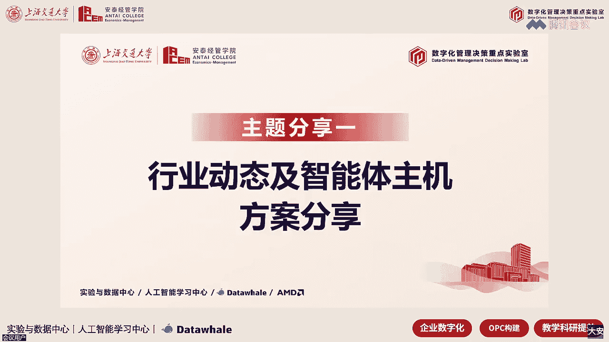

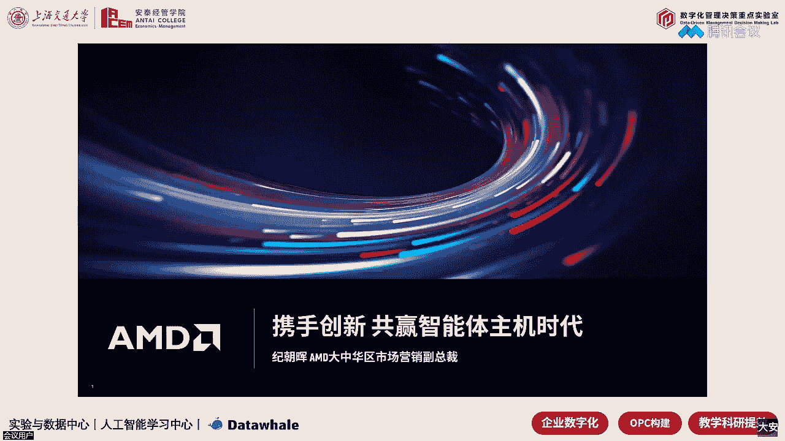

首先，我们来看看此次分享活动的背景，以及管理学科在人工智能时代的独特价值。

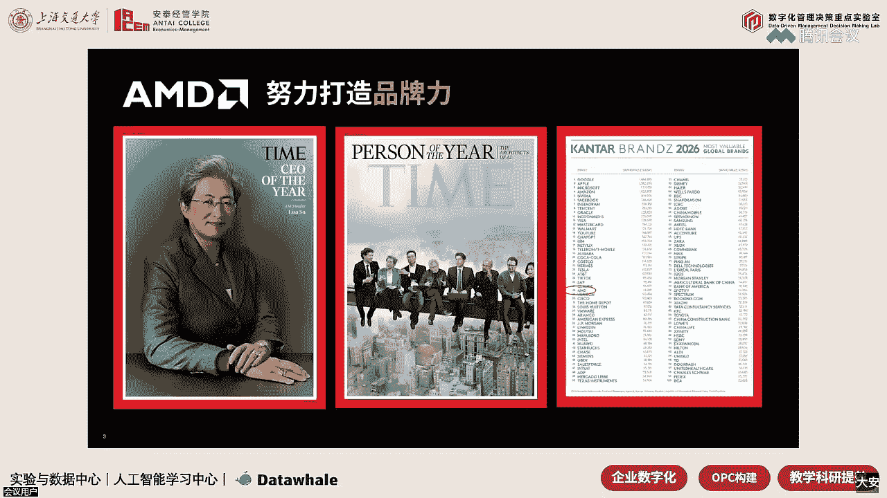

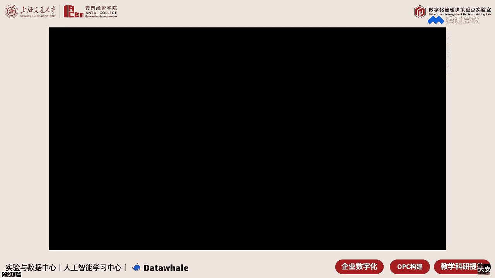


此次活动由上海交通大学安泰经济管理学院与多家生态伙伴共同发起，现场正式启动了人工智能学习中心。活动不仅回顾了AI在智能制造等领域的应用案例，更将目光聚焦在AI硬件与智能体技术的最新现状和未来趋势上。通过产业全貌的视角，与会者可以了解当前AI应用的实际状况，以及企业AI转型的典型全流程。

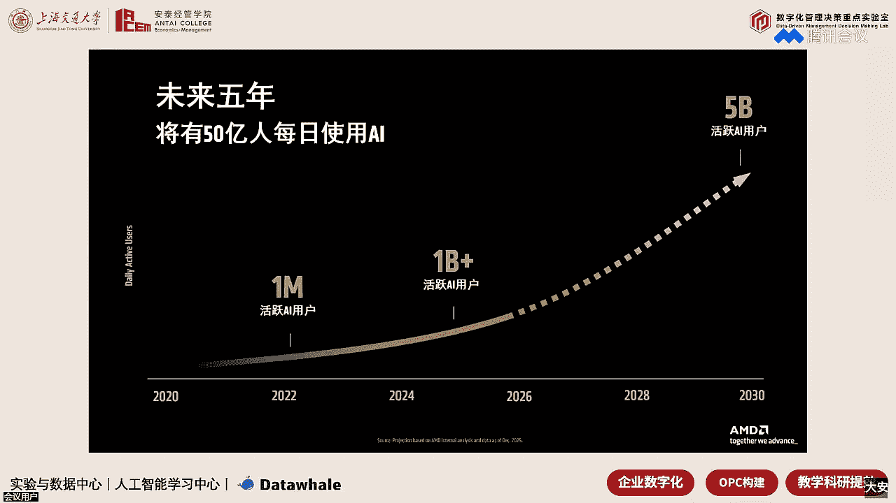

为什么一场以技术为主题的活动，会选择在经管学院、商学院举办？这是因为人工智能学院和计算机学院更多聚焦于前沿技术本身，而商学院则对接的是千行百业。无论是铁路管理时代，还是当下的人工智能、生物医药和集成电路产业，经管学科的研究始终拥有连接技术与产业的独特魅力。

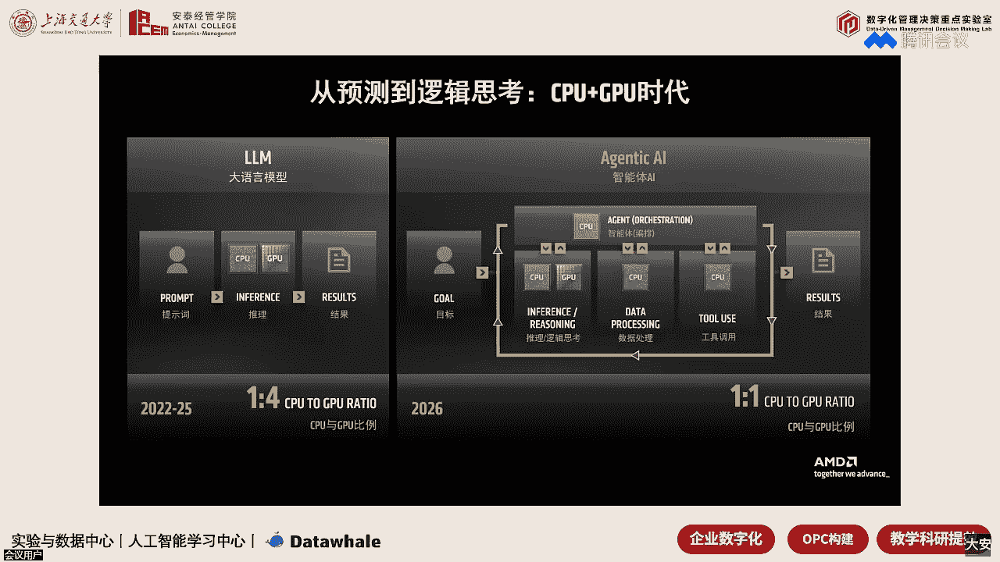

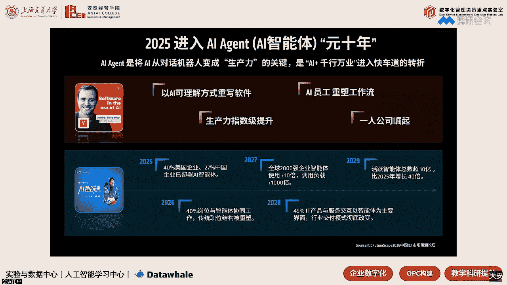

关于人才的价值，人工智能的第一个字是“人”。无论技术和产品如何发展，最终都要汇聚到人身上。AMD等行业领军企业，致力于通过前沿技术和产品赋能人，帮助每个人成为“超级个体”。与此同时，创新链正在被重构：过去的路径是从0到1，再到10和100；而现在的路径变成了从1到0，再到10和100，即先进行概念验证，再推向规模应用。

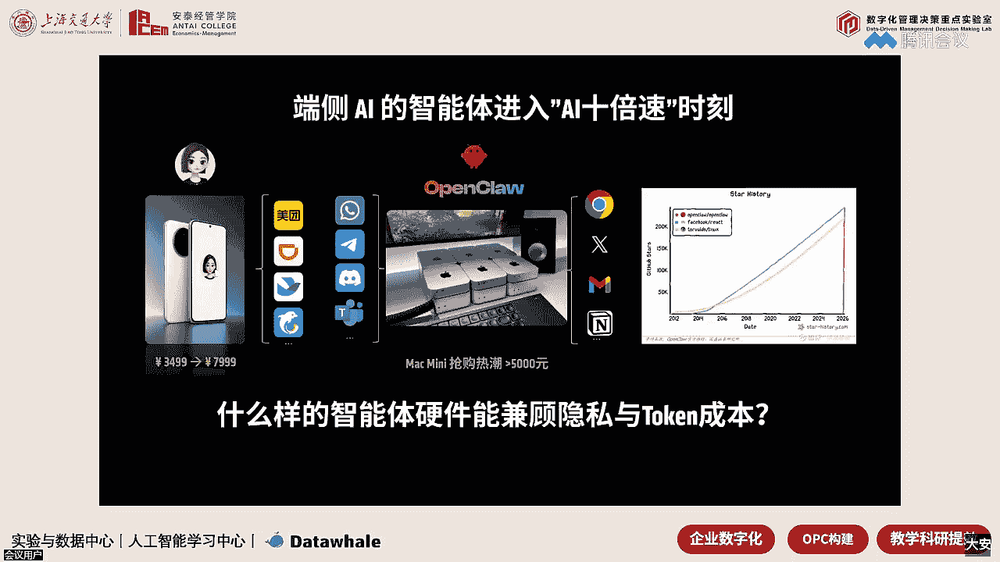

生态的价值则体现在，真正的护城河不是技术、资金或牌照，而是生态。一个开源的生态具有最强的不可替代性，能够让不同高校、企业和个人跨越原有边界，共同创造价值。

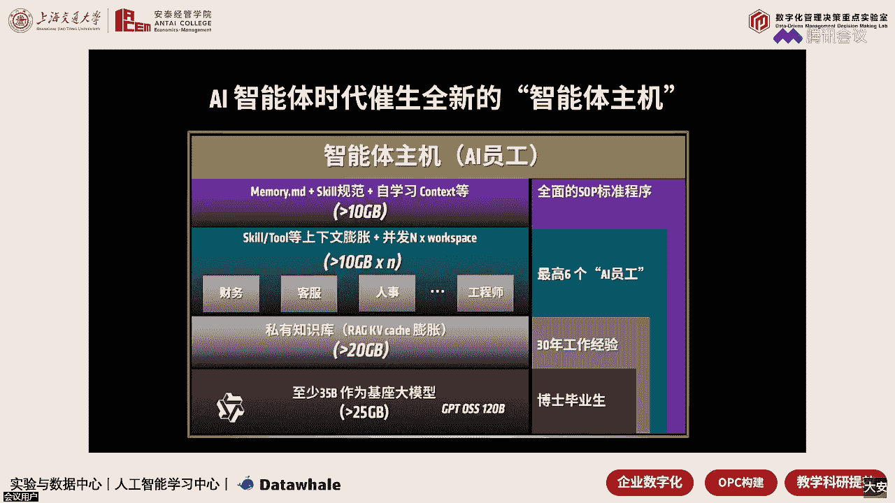

以下是本次活动强调的三个核心价值：
- 监管与事务的价值：经管学科连接产业前沿与千行百业，发挥桥梁作用。
- 人才的价值：技术最终回归到人，构建超级个体。
- 生态的价值：开源生态构筑最强的护城河。

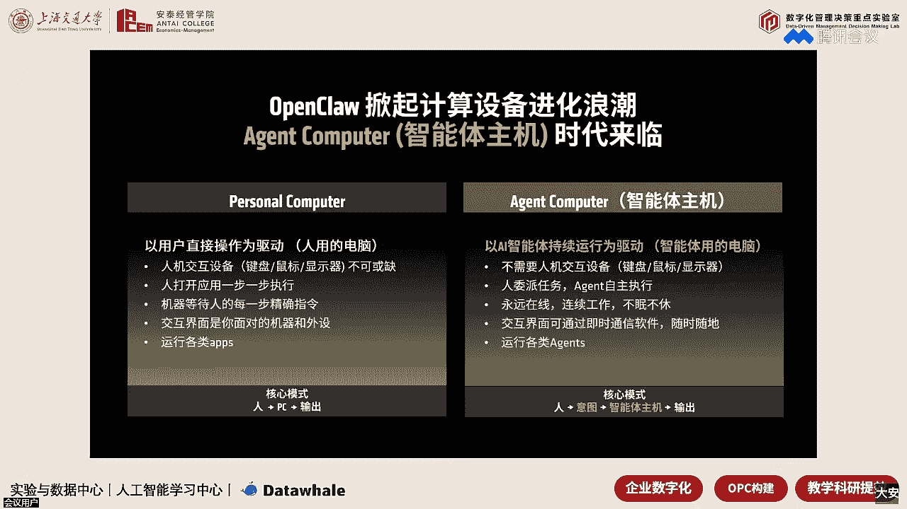

## 第二节 AI产业背景与代表性企业

接下来，我们从企业发展的角度，看看AI时代的行业趋势，以及代表性公司AMD的发展情况。

AI正在成为过去50年来最重要的技术变革，其重要性甚至超越了互联网的诞生。未来十到二十年，AI将深刻改变生产、工作、学习和生活的方方面面。AMD CEO李苏博士曾被时代杂志评为年度CEO，在她的带领下，AMD过去十年实现了年化收益率30%的成绩，股价从不足2美元上涨至超过500美元。在全球品牌价值排行榜中，AMD位列第28名，其品牌含金量甚至高于茅台等知名消费品牌。


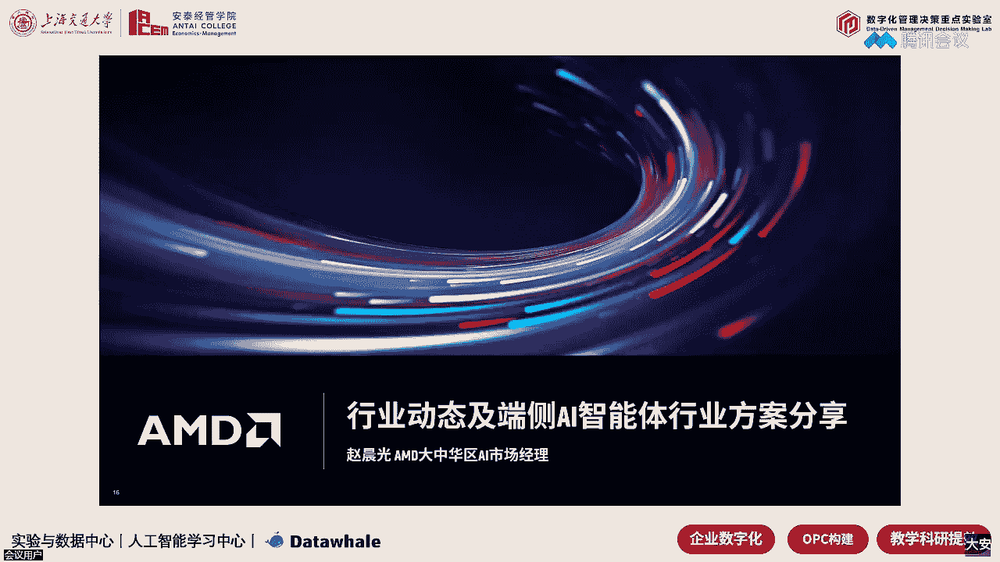

AI的发展目前正处于一个关键转折点，主要体现在三个方面。第一，AI经理和智能体推动计算需求变化，计算架构从传统的以GPU为主，转变为CPU与GPU并重。第二，企业AI部署进入深水区，大量AI应用正深入企业工作流。第三，AI不仅运行在数据中心，还广泛运行在各种终端设备上，不再局限于传统意义的电脑。

计算资源比重的变化可以用下面的公式直观地表示：
```text
CPU : GPU = 1 : 4   →   CPU : GPU = 1 : 1
```
这意味着未来CPU在AI工作负载中的重要性将显著提升，不再仅仅作为辅助角色。

## 第三节 智能体与智能体电脑概念

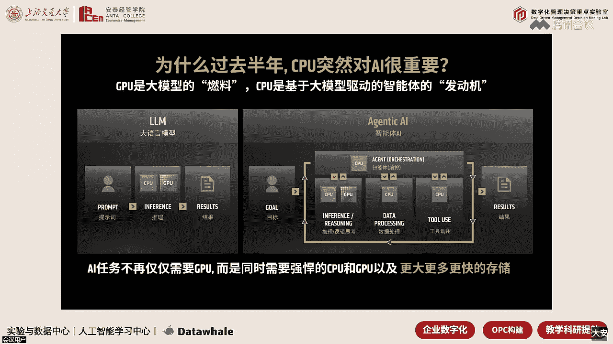

有了行业背景之后，我们需要理解什么是智能体，以及它如何改变计算设备的形态。

智能体是将AI从简单的对话机器人转变为生产力工具的关键。过去的AI大多只能回答问题，而现在的智能体可以自主执行任务、调用工具、处理文件，甚至像一名员工一样持续工作。

要在本地运行强大的智能体，设备需要满足一定的硬件条件。首先，大模型的参数量需要达到350亿、500亿甚至更高，才能作为智能体的底座。其次，千亿参数模型运行需要至少25GB的显存，此外还需要额外的空间来存储本地知识库，让AI“懂你”并持续学习你的行为。

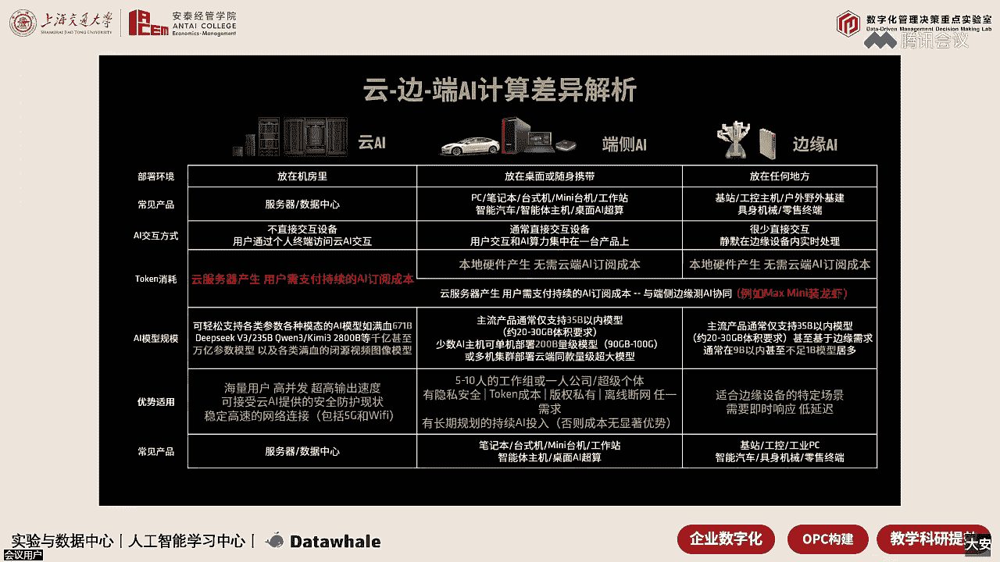

基于这些条件，行业提出了“智能体电脑”（Agent Computer）的概念。它与传统个人电脑的主要区别如下：

- 使用对象：个人电脑是给人使用的，智能体电脑是给智能体使用的。
- 交互界面：个人电脑需要键盘、鼠标和显示器，人才能看到电脑在说什么并输入指令；智能体电脑不需要这些传统I/O设备，因为智能体直接生活在电脑内部。
- 工作模式：个人电脑是人操作才动，人不动电脑就不会动；智能体电脑可以7×24小时自动运行，像AI员工或同事一样不间断工作。

简单来说，个人电脑是人用来辅助工作的工具，而智能体电脑是给AI员工用的工作站，它可以独立承担任务，极大地扩展人类的能力边界。

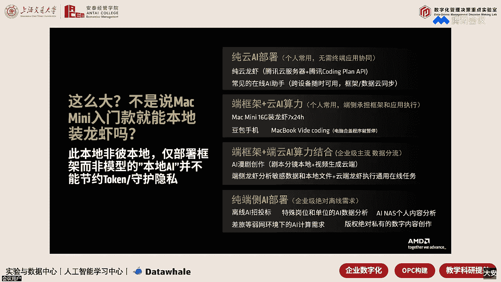

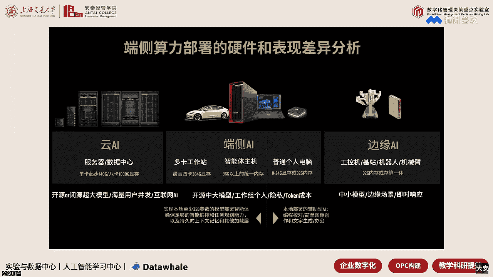

## 第四节 端侧部署与本地AI方案

理解了智能体电脑的概念后，我们来看如何在本地实际部署这些AI模型。

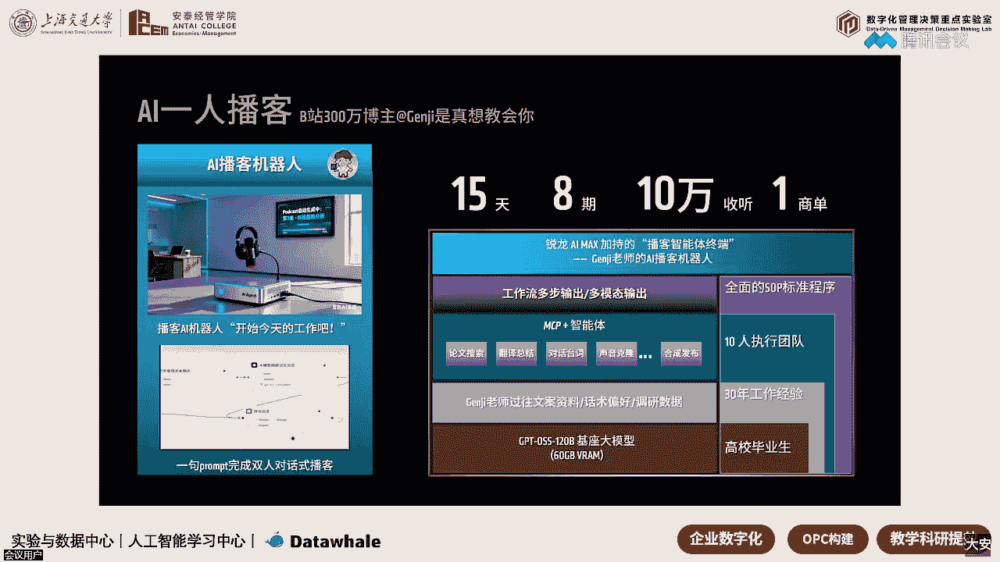

AI应用的部署主要分为云端、端侧和本地三种模式。

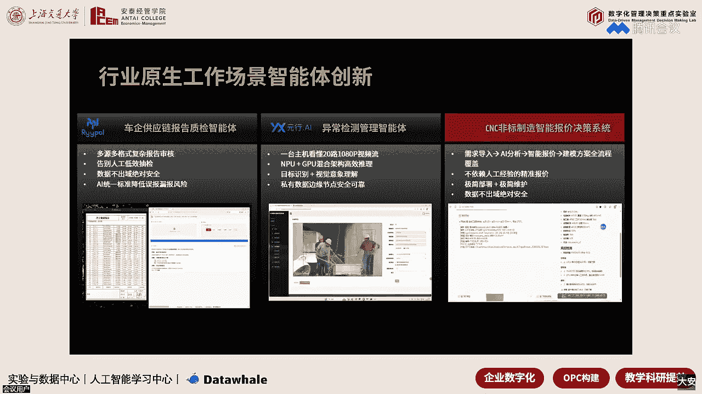

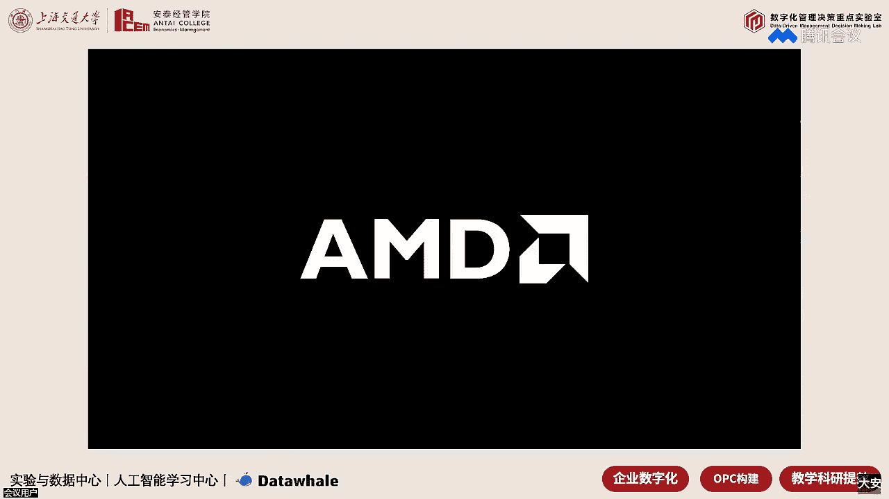

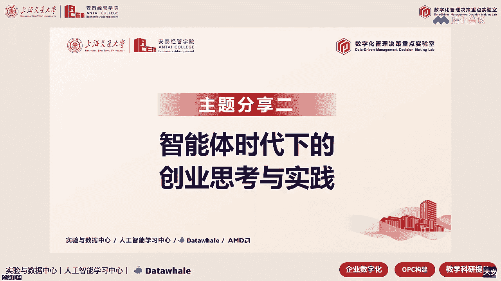

云端模式下，所有计算都在远程服务器完成，用户只需通过网络访问。这种模式的优点是能力最强、最便捷，目前大部分个人用户使用的AI应用都属于这一类。缺点是依赖持续稳定的网络，并且会产生持续的Token费用，同时存在数据隐私风险。

端侧模式则是将模型部署在本地设备上，可以离线使用，不需要时刻关注云端服务器的状态。其优点是不受网络限制，没有云端订阅成本；缺点是受限于本地硬件性能，模型规模通常低于云端。

端云结合模式则试图兼顾两者：敏感数据和隐私任务在本地处理，普通任务使用云端资源。

如果要在本地部署一个具备智能规划能力的模型，通常需要大约94.2GB的显存或统一内存。按照当前显卡价格，这可能需要四张高端消费级显卡，总成本大约在10万元人民币左右。因此，统一内存架构（例如苹果设备采用的方案）成为降低硬件成本、扩大显存容量的重要方向。

本地部署的模型需求可以用下面的代码块简单估算：
```
本地部署需求：
- 模型参数量：≥ 35B（基础能力）至 120B（智能体级能力）
- 显存/内存：≥ 25GB（模型运行）+ 20GB（知识库）+ 上下文缓存空间
- 推荐配置：96GB+ 统一内存
```

## 第五节 行业落地案例

理论和硬件方案讲完之后，最能说明问题的是实际行业案例。以下是几个典型的智能体落地场景。

第一，医疗智能体助理。某医院与企业合作，基于本地120B参数模型，加载哈佛医学院的医学课程和医疗知识库。该智能体在医学考试中可达到80到85分的水平，相当于一名住院医师或医疗实习生的能力。它可以用于患者注册管理、病情研判，甚至影像的分析。

第二，CNC非标报价智能体。某电商平台卖家接CNC切割订单，过去因为不熟悉各种机床和工艺，经常报价不准导致亏损。现在他将所有机床和工艺流程放入本地智能体，让大模型学习后自动计算成本并报价，有效避免了亏损。

第三，AI播客机器人。某自媒体博主利用智能体每天自动抓取新闻，根据预设框架分类筛选，整合内容生成发言稿，再通过语音合成和背景图生成，完成从选题到出片的全流程。这个过程几乎不需要人工干预，唯一的成本是电费和设备折旧。

第四，法律本地部署。某律所因客户数据保密需求和法规规定，无法将核心资料上传到云端。本地部署后，律所可以使用AI进行法条检索、合同翻译、邮件起草和会议纪要整理，所有数据完全留在本地，满足保密合规要求。

第五，招投标智能体。过去编制一套标书通常需要7到10天，而现在使用智能体可以在一天内完成。通过本地知识库和超长上下文能力，智能体可以处理数十万字的招标文件，显著降低废标率，提升中标质量。

第六，审计与合规。在财务报表审计、合同合规检查等场景中，本地智能体可以作为审计人员的助手，保护敏感的企业数据不外泄，并结合行业专家的经验进行主观判断。

## 第六节 智能体时代的创业思考

除了技术和案例，我们还需要思考，作为个人或创业团队，如何在这个新时代找到切实可行的机会。

目前AI技术迭代速度非常快，但各行业的实际渗透率增长较慢，技术与应用之间存在巨大的“鸿沟”。许多用户甚至连基础的AI工具都不会安装。创业的机会恰恰在于解决那些看起来不起眼、但真正能够落地的小问题。

创业团队在与用户交流中发现，用户面临的主要痛点包括：硬件成本高、门槛高；模型和应用碎片化严重，选择困难；真正落地难，缺乏最后一公里的简化方案。

因此，硬件成为AI时代落地的核心载体。AI时代的硬件保值率很高，不再像过去电脑那样使用一两年就贬值殆尽。对于有高频真实需求的用户，硬件可以被视为一种长期资产，建议以3到5年的维度来衡量其贬值标准。

在软件方面，可以将复杂的环境和依赖打包成“一键部署”方案，降低普通用户的使用门槛。同时，开发垂直行业的小模型，并与大模型形成互补，能够在细分领域建立自己的护城河。

借鉴小米早期MIUI的经验：从基础的小功能做起，建立用户社区，每周迭代，先积累种子用户，再推出硬件产品。智能体时代也是如此，产品体验和与用户的持续迭代，比单纯堆砌硬件参数更为重要。

## 总结

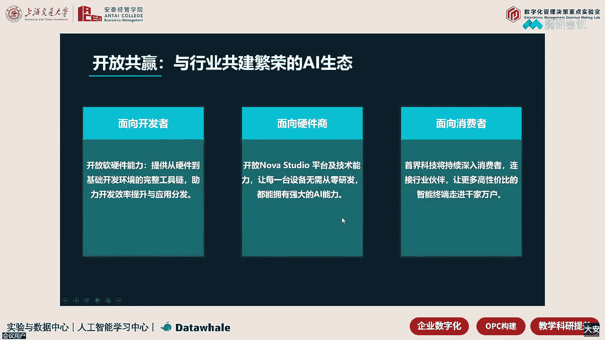

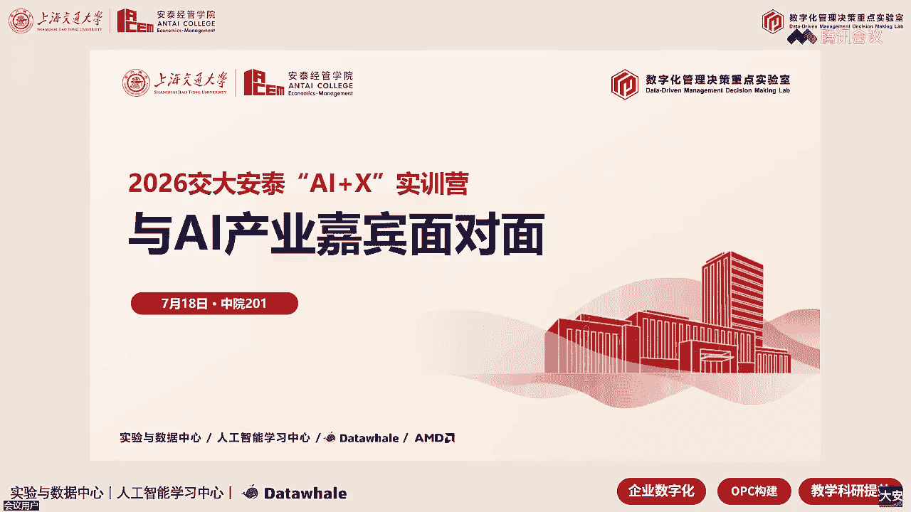

在本节教程中，我们一起学习了AI+X产业的背景与产业价值、代表性企业的发展趋势、智能体及智能体电脑的核心概念、端侧部署与本地AI方案，以及医疗、法律、招投标等多个行业的落地案例。同时，我们也探讨了智能体时代下创业与产品思考。希望这些内容能帮助初学者更直观地理解AI如何进入实际生产，并为未来的学习与实践提供参考。
