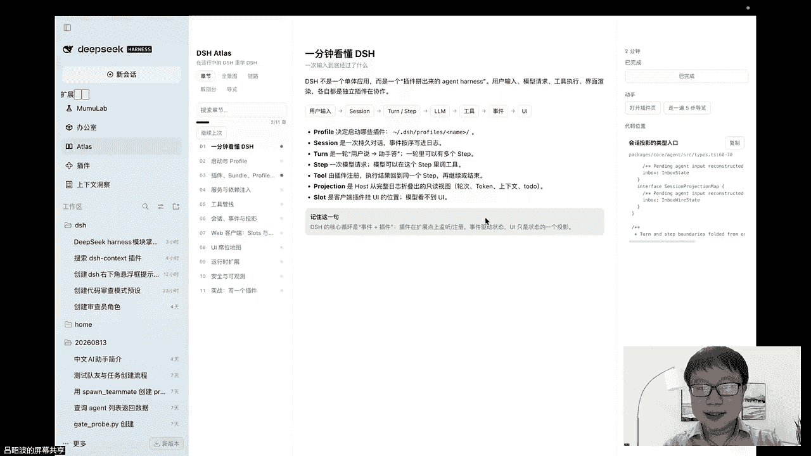

# 【Datawhale AI+X】个人智能体vs企业智能体：工作流设计实践：第1章：个人智能体与企业智能体的核心差异🤖

在本节课中，我们将学习个人智能体与企业智能体在实际工作中的核心区别。讲师吕兆波此前出版过云计算架构方面的著作，近期围绕智能体主题又撰写了新书。尽管外界曾质疑进入2026年后智能体是否仍然火热，但在企业场景中，这一技术依然被大规模使用，因此有必要将相关设计经验整理成书。课程内容将涵盖个人智能体与企业智能体的不同之处、不同客户的实际反馈，以及当前基于Dify等平台搭建智能体的最新趋势。

接下来我们先来看看什么是个人智能体，以及它与企业智能体在使用频率上的本质区别。

个人智能体通常以对话问答为主要交互方式，用户通过对话框提出问题，智能体返回回答。这类场景下，个人使用扣子等平台搭建工作流即可满足日常需求，不需要考虑高频调用和大规模部署问题。

企业智能体则存在显著不同。在企业场景中，一个工作流可能需要运行一千次、一万次甚至几十万次。此时不能仅依赖简单的个人智能体，而需要使用Dify或类似平台搭建企业级工作流。两者的核心差异可以用下式表示：

个人智能体调用次数 = 低频，交互模式 = 问答对话
企业智能体调用次数 = 高频（10³ ~ 10⁵次），交互模式 = 后端API服务

以下是企业智能体与个人智能体的主要对比维度：
- 个人智能体：偶尔使用，对话框交互，单次任务处理
- 企业智能体：高频运行，API后端服务，批量任务处理
- 个人智能体：适合个人学习和轻量任务
- 企业智能体：适合企业业务流程和自动化运营

说完基础差异，我们再看看企业智能体在具体业务场景中是如何设计工作流的。

在金融场景中，企业智能体通常需要与驾驶舱系统集成，通过API获取后端数据，再进行客户分群、客户分析和客户画像等操作。这些环节都需要将智能体发布为API，供前端系统调用。过去的做法更多是基于对话框的问答，而现在的做法是把智能体作为后端服务。如果需要10个API，就需要构建10个智能体，两者之间存在一一对应关系。这种使用方式与个人场景下的对话模式完全不同。

除了金融场景，智能营销任务、物料管理和文案生成也是常见的企业应用。具体流程如下：根据客户当前场景，或者爬取网络热点，加载现有业务数据，然后点击按钮触发后端的Dify智能体。当然，也可以使用LangGraph等框架进行开发，借助Cloud Code、Coder等工具生成代码。目前的核心目标是收集业务需求和市场热点，直接交给后端的API，而后端本身就是智能体。

以下是企业智能体在金融场景中的典型工作流步骤：
1. 获取驾驶舱数据，通过API接口读取后端信息
2. 进行客户分群分析，生成客户画像
3. 将智能体发布为API，供前端系统调用
4. 根据热点和数据，一键触发智能体执行营销任务
5. 支持带按钮的手动触发，以及不带按钮的7×24小时自动运行

我们刚刚介绍了企业智能体的工作流设计，接下来讨论如何通过网关统一管理多个模型和智能体。

在实际开发中，不需要过度关注具体使用的是DeepSeek、Kimi还是其他模型。可以在平台中加入多个模型，并实现自动选择或自动路由编排。LightRAG等工具可用于辅助编排，也可以使用Ollama在本地运行DeepSeek 7B或8B模型。尽管本地模型效果可能不如云端模型理想，但仍可作为备选方案。

将这些能力封装为一个网关，即Agent Gateway。除了网关封装，还可以将应用发布为Dify应用。在公网环境下可使用扣子，在企业内部环境下可使用Dify。部分客户采用字节的私有化部署方案，有些企业使用百炼平台，还有些企业使用浪潮平台的内部智能体。通过网关，应用层与后端智能体API实现解耦，前端页面保持不变，只需在列表中持续增加所需的后端能力。

Agent Gateway的核心架构如下：

```text
应用层（前端页面）
    ↓
Agent Gateway（模型路由与智能体调度）
    ↓
后端智能体API（DeepSeek / Kimi / Ollama / 私有化模型）
```

以下是网关封装后的优势：
- 支持多模型自动路由与选择
- 应用层与后端模型解耦，前端页面无需修改
- 可持续扩展新的模型和智能体能力
- 支持私有化部署与公网模型混合使用

说完网关与模型封装，我们再来看看如何将智能体能力扩展到代码编写和多智能体编排。

除了调用现有模型，还可以增加Agent能力，甚至让智能体自己编写代码。例如搭建LangChain智能体或LangGraph智能体，同样通过API方式提供服务。整个接口的设计原则是：前端需要什么能力，就调用什么能力。

在VS Code中，可以开发插件来实现多智能体的编排。将Spark Coding、Harness等工具的约束加载进来，开发专属插件，在向客户讲解方案时先展示成果，再进行具体实现。这种“先有东西，再讲故事”的方式在实际演示中效果很好。

多智能体编排的核心逻辑如下：

```python
# 伪代码示例：多智能体调度
def route_task(task_type):
    if task_type == "marketing":
        return call_marketing_agent()
    elif task_type == "analysis":
        return call_analysis_agent()
    else:
        return call_default_agent()
```

当单个智能体不足以满足需求时，可以演变为多智能体系统。通过前端界面将编排过程可视化，虽然DeepSeek Harness等新技术不断涌现，但核心思路是将技术学习与实际应用相结合，避免因技术更新过快而产生焦虑。

讲完多智能体编排，我们继续探讨书籍内容及相关工具生态。

这本书由两位作者共同完成，吕兆波为第二作者，蒋叶为第一作者。书籍由Datawhale社区推荐，内容涵盖智能体、Codes、飞书多维表格、Dify、N8N等工具。无论具体使用什么工具，核心思想都是“换汤不换药”，即页面逻辑不变，仅更换外部壳体，实现大量复用。

以下是书中涉及的核心工具与平台：
- 智能体开发平台：Dify、扣子
- 数据协作工具：飞书多维表格
- 自动化流程工具：N8N
- 代码开发工具：Cloud Code、Coder、VS Code插件

说完工具生态，我们来看看如何将同样的逻辑复用到不同行业场景中。

面对运营商客户时，可以基于金融场景的页面逻辑进行复用。左侧保留大屏看板和数据分析模块，右侧保留背景逻辑和AI助手，只需更换行业标签，即可快速适配运营商、教育、电商、制造等不同客户。多智能体可以使用Python编排，也可以使用LangGraph，网关保持一致，实现内部能力的大规模复用。

在可观测性和评测方面，可以引入人工干预和人在环路机制，将效果展示给客户。虽然Web Coding的可视化能力与底层Dify智能体关系不大，但动画和直观的信息展示能帮助客户更好地理解系统能力。

跨场景复用的核心思路可以总结为：

```text
基础逻辑层（不变） → 行业壳体层（可更换） → 客户场景层（运营商/教育/电商/制造）
```

以下是可复用的场景示例：
- 教育：生成学习素材，在学校教育系统中高频运行
- 电商：分析订单数据，支持营销活动自动化
- 制造：分析告警信息，支持生产线异常诊断
- 运营商：智能客服与信息处理，支持多智能体编排

对于企业级场景，智能体必须能够支撑流程运行成百上千次，而不仅仅是一问一答。Workato、纤文办公、豆包工作等工具适合简单场景，但企业级流程仍需要使用HaAgent、百炼、Dify、M8N等平台。

个人与企业智能体的差异可以进一步细化为四层：
1. 应用层：使用智能体，底层可选，开发无门槛
2. 开发层：AI Coding必然是SDD模式
3. 交付层：FDE负责业务开发，使用AI Coding和SDD
4. 管理层：引入AI项目管理流程方式

说完场景复用，最后分享几个关于智能体搭建的实践细节。

整个智能体架构可以分为六层：底层资源、模型层、数据库层、工作流层、指令和安全护栏层，以及应用层（与钉钉、企业微信、飞书打通）。企业AI中台需要考虑所有这些层面，而不仅仅是将模型嵌入到AI Coding平台中。

需求文档可以从废书文档、钉钉文档或计算系统中编写完成，通过Open Spike自定义规则拆分文档，再调用各种API、CI或模型生成代码，进行校验与发布，部署到ECS或其他云平台。模型还可以用于快速判断任务成功与否，失败时返回至特定节点重新执行。

以下是需求到代码的自动化流程：

```text
需求文档 → Open Spike拆解 → API/CI/模型生成代码 → 代码校验 → 发布部署（ECS/CLO等）
```

尽管许多客户对这些方案非常感兴趣，但实际落地仍存在困难。客户认为这是当前的热点和发展方向，因此保持高度关注。本书正是希望通过这些内容，与大家进行更深入的交流。



在本节课中，我们一起学习了个人智能体与企业智能体的核心差异、企业级工作流设计模式、Agent Gateway网关封装、多智能体编排方法、跨场景复用策略，以及六层架构与自动化部署流程。希望这些内容能帮助你更好地理解企业智能体在实际业务中的应用方式。

