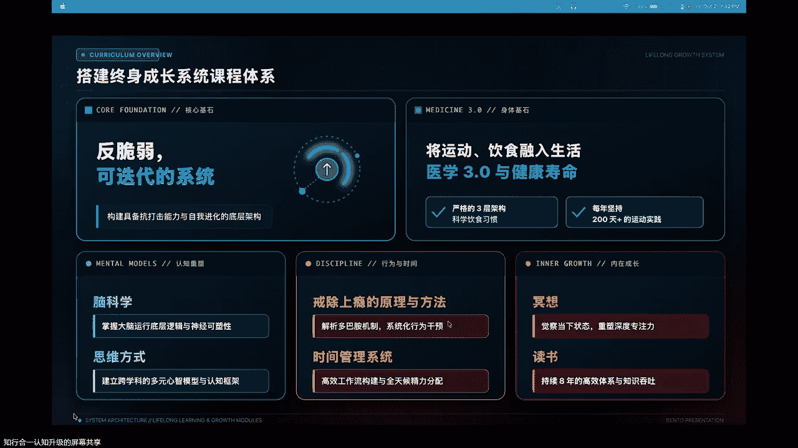

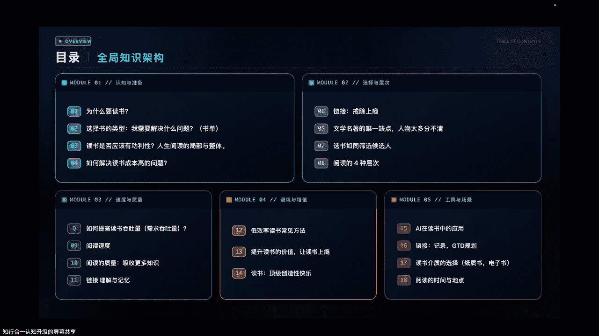

Datawhale AI+X：01：为什么要读书？读书的核心价值 📚

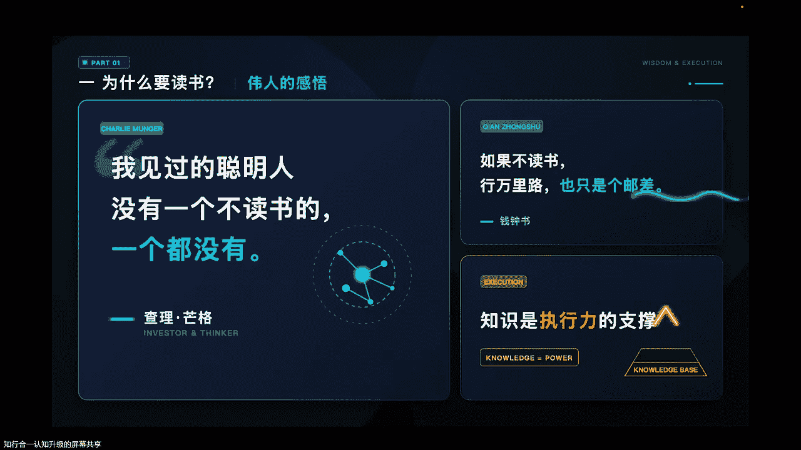

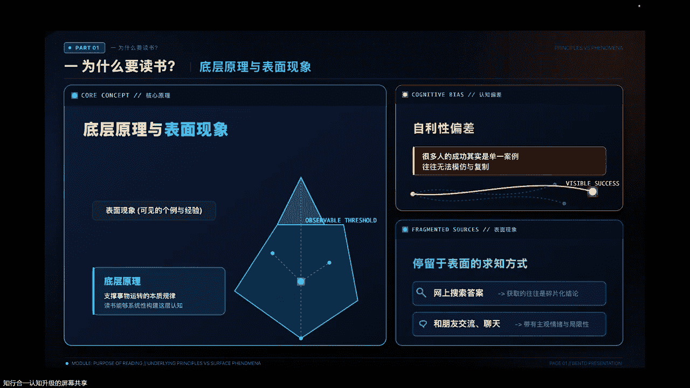

在本节课中，我们将一起学习为什么要读书，以及读书到底能给我们带来什么实际好处。很多初学者可能觉得读书只是一种负担，但实际上它是提升认知、解决问题的重要手段。

在互联网公司工作，经常会遇到代码需求和团队沟通的问题，这种并行差的问题其实就是如何处理信息和时间关联的问题。在高压的工作环境下，大家可能还要面对高强度的任务。比如拼多多、小红书这些公司的工作强度非常大，其次是京东，它们的强度不仅体现在时间上，也体现在压力上，会对人的内心造成很强的冲击。有时候在朋友圈看到一张图片，就会思考：在高强度工作三个月的情况下，如何保持心理健康？这其实就是一个明显的问题。而读书是应对这些问题的重要方面之一。

以下是读书的几个核心优势：

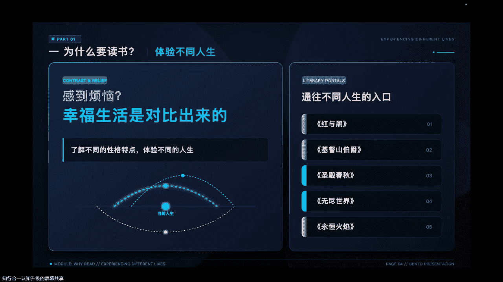

- 性价比高。查理·芒格、钱钟书等伟人都说过，读书是性价比非常高的事情。一本书基本上是作者几年甚至几十年总结的知识，通过读书我们可以了解很多底层原理。
- 信息密度大，沟通效率高。平时和朋友聊天、打字询问问题，效率很低，而且每个人的经历不同，得到的答案受到很强的条件限制。而书整理的知识体系比较完整，信息密度也很大。打字聊天一来一回效率最低，开会说话虽然比打字快，但当会议人数很多，比如三到五个团队时，效率又会很低，每个人只关注跟自己相关的一小部分。最高效的方式是使用成熟的文档，就像百度邀请陆琪加盟时，陆琪要求高管在开会前先发文档，他提前阅读，这样在会上就能重点讨论，效率最高。文字可以跳着读，只抓重点，快速了解核心内容。
- 心理幸福与包容性。现在物质非常丰富，但很多人仍然有抑郁和焦虑。关键问题在于对比。本来心里挺高兴，看到同学父母买了豪车豪宅，就因为对比而不高兴。看一些文学名著，比如《基督山伯爵》《红与黑》、中世纪故事、二战冷战故事等，读完后会发现我们的生活其实已经非常好了。如果和名著里的人物对比，心情会好很多，包容性也会增强，不会因为地铁里一点小事就特别愤怒。

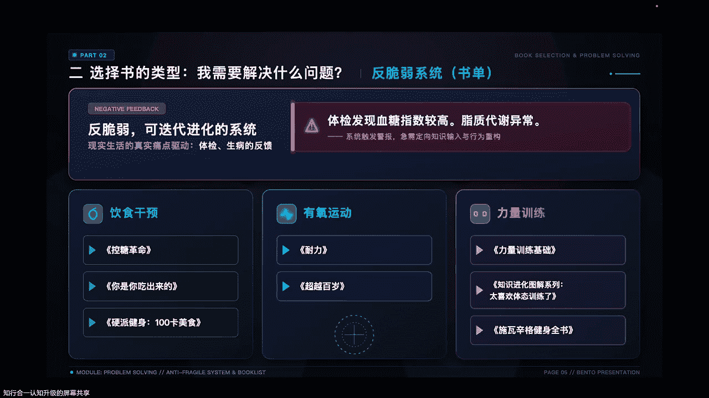

了解了读书的好处，接下来我们看看怎么根据自己的需求来选书。

Datawhale AI+X：02：如何根据需求选书，并降低阅读成本 🔍

上一节我们介绍了读书的核心价值，包括性价比、信息密度和心理幸福感。本节中我们来看看如何选择适合自己的书，以及如何克服读书成本高的问题。

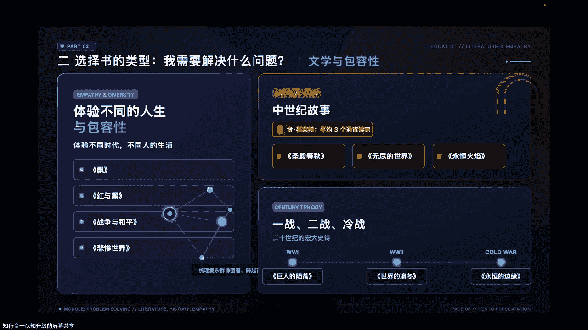

选书应该根据自己需要解决什么问题。比如体检发现血糖、血脂增高或脂肪肝，就应该看相关的饮食、运动书籍，而不是抱着侥幸心理等几个月再复查。要把问题当成成长的机会，建立一套可迭代的系统。除了健康，还有认知、投资、经济运行规律等方面。很多人想用AI做软件赚钱，但软件只是技术手段，不是商业流程，没有完整的商业体系照样赚不到钱。了解经济运行规律才知道市场怎么运营。另外，从历史规律看问题，看历史书比看宫斗电视剧信息密度大得多。投资基金股票如果不看理论知识，纯靠运气可能短期赚点钱，但长期很难盈利，还耗费大量精力，心情会变差。

关于读书是否应该有功利性。局部来说，读书需要有一定的功利性，也就是解决具体问题，才能建立局部热爱，知道读书的重要性和性价比，从而读更多。但从整个几年甚至一生的角度看，读书不应该有功利性，应该成为一种无意识的行为习惯，就像无意识刷短视频一样。把读书当成无意识行为，比如吃饭时、去机场时随手从书包里拿一本书来看，就不需要明确目的。

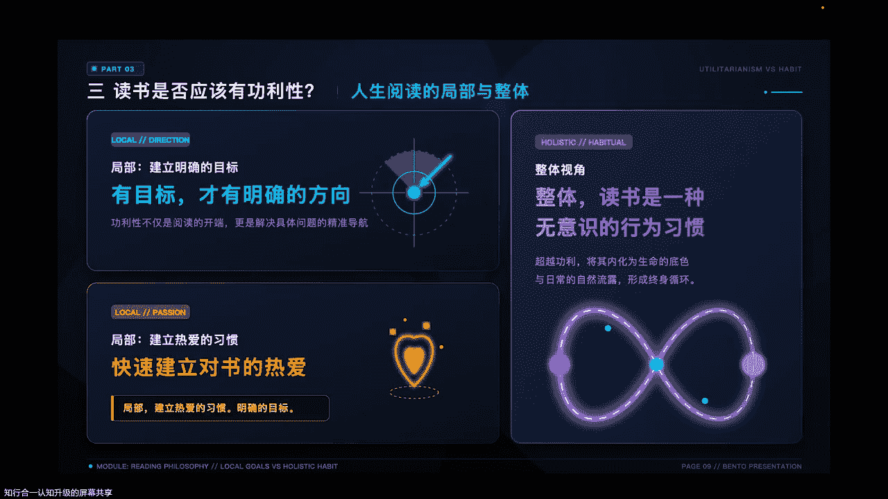

以下是降低读书成本的具体方法：

- 拆解阅读目标。很多人毕业后读书变少，一个重要原因是成本太高。读一本完整的书需要几个小时，工作后很难抽出连续几个小时。不要把一整本书当成一个目标，要像上学一样，一个学期读一本书，一次只读一个章节，这样比较容易实现，不容易放弃。
- 6分钟阅读法。英国萨塞克斯大学的研究发现，只要读书能达到6分钟，就能很好地释放压力并获得收获。没必要把目标定成读完10万或20万字的书，或者连续读几个小时。只要读6分钟，就算达成最小目标，算完成了。随着阅读速度增加、收获增多，再逐渐把6分钟增加到半小时、一小时，就很轻松了。

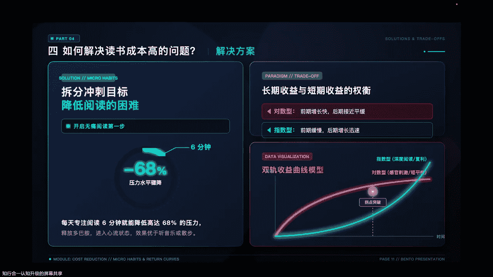

除了普通书籍，文学名著往往人物多、名字拗口，容易让人绕懵而放弃。下一部分我们聊聊文学名著的阅读辅助方法。

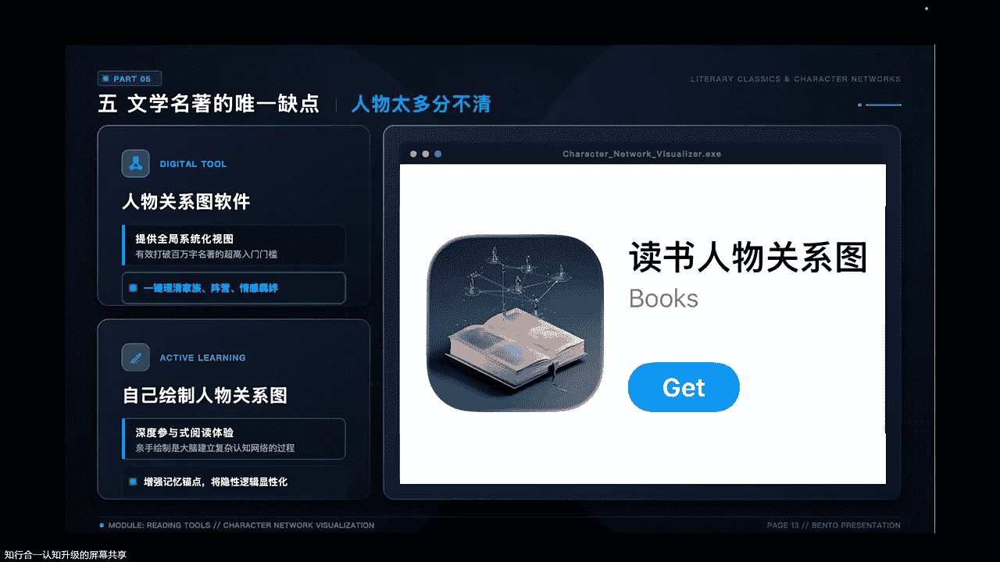

Datawhale AI+X：03：阅读的四种层次与选书技巧 📖

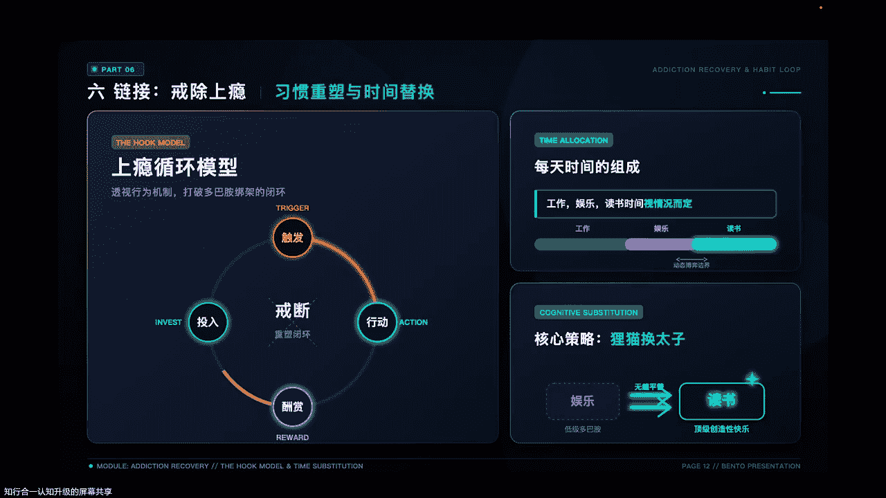

上一节我们聊了怎么选书和降低读书成本。本节中我们来看看阅读的四种层次，以及像选人一样选书的技巧。

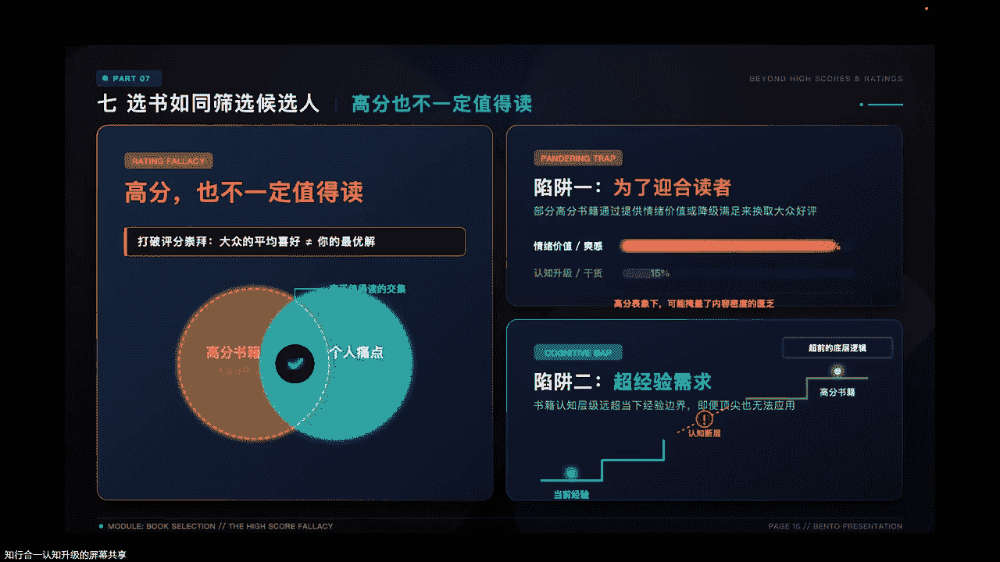

文学名著比如100万字的作品，人物特别多，国外人名读起来拗口，读一会儿就被5到10个名字绕懵，容易放弃。除了用软件辅助，自己画人物关系图也可以，只要能把人物关系画出来，就能很好理解。看别人的总结只是输入，真正理解还需要自己输出，把人物关系画下来，才能让大脑更好地理解。

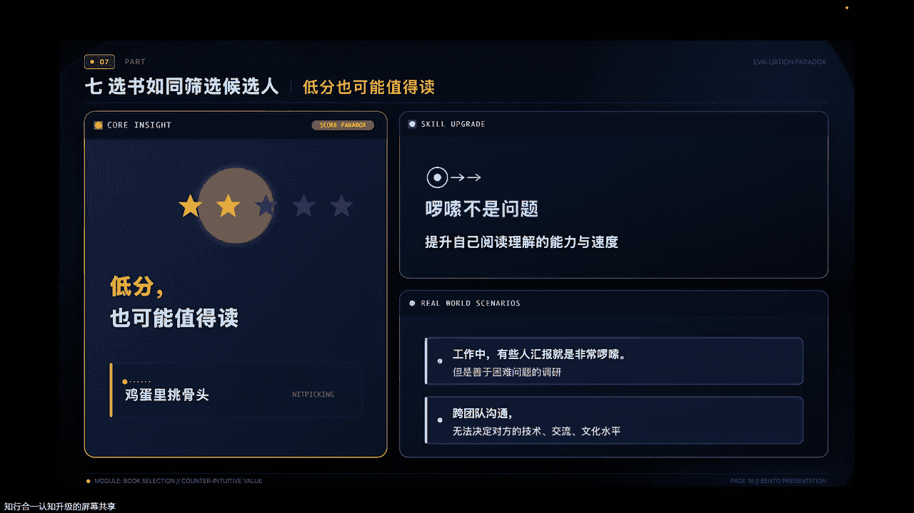

阅读可以分为以下四种递进的层次：

- 基础阅读。对文字的理解。对于简体中文通常没有问题，但对于文言文，如《资治通鉴》，或外国文学名著，需要相应的基础。如果要深入研究俄国、法国文学，最好学俄语或法语，否则很难理解意境。但如果只是普通人了解一下，读翻译版也够了。
- 解释阅读。就像公司面试筛选候选人一样，选书时只阅读目录、序言和个别感兴趣的章节，然后根据这些章节判断这本书是否值得读。目录和序言十分钟就能读完，十分钟就能判断是否适合自己。难度太大不适合，或者水平达不到就不读了。如果适合，再进行下一层。
- 分析阅读。也就是精读细读，深入理解内容，并且要输出。
- 主题阅读。比如写毕业论文或研究一个课题方向，需要阅读相关论文和书籍，找到相关体系，在此基础上做出一点改进，就成了一篇论文。还包括专题分享，比如风险投资人看创业者时，对从未接触过的行业需要主题阅读，快速短时间内了解行业知识。AI时代的前端部署工程师也是，需要了解企业上下游业务流程，基于需求做定制化AI改进，这类似于专题阅读。

选书就像选人，没有完美的人，也没有完美的书，要根据自己的需要选择适合自己的。豆瓣、微信读书等排行榜分数高不一定适合自己。有些书是迎合读者的，比如短视频风格的爽文，没什么价值意义。分数低的书也不一定不好。有些书作者写得啰嗦，是因为要面对各种读者，习惯不同。不能因为书啰嗦就否定它，可以通过跳读、读重点内容来筛选对自己有用的内容。

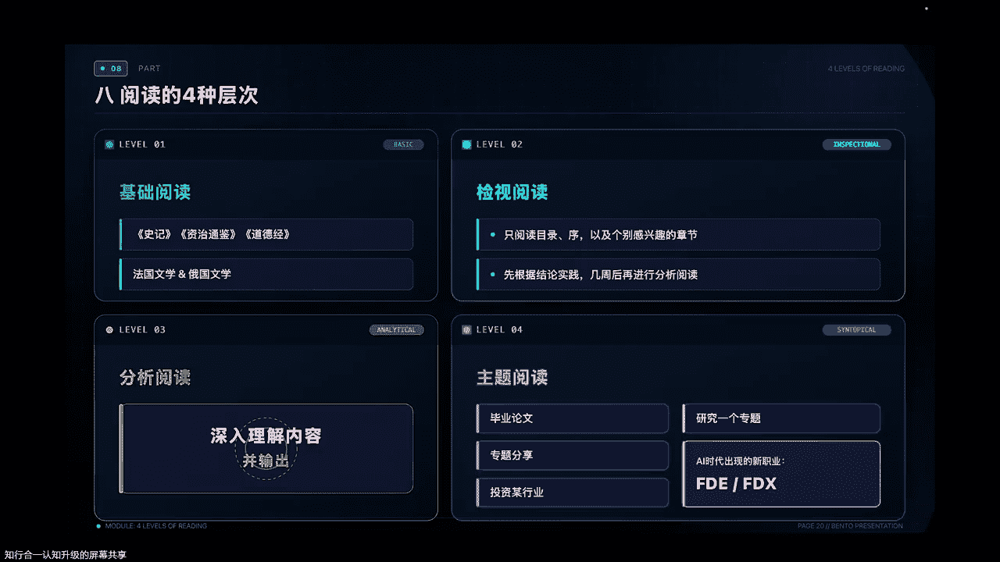

选好了书，接下来我们看看怎么提高阅读的速度和质量。

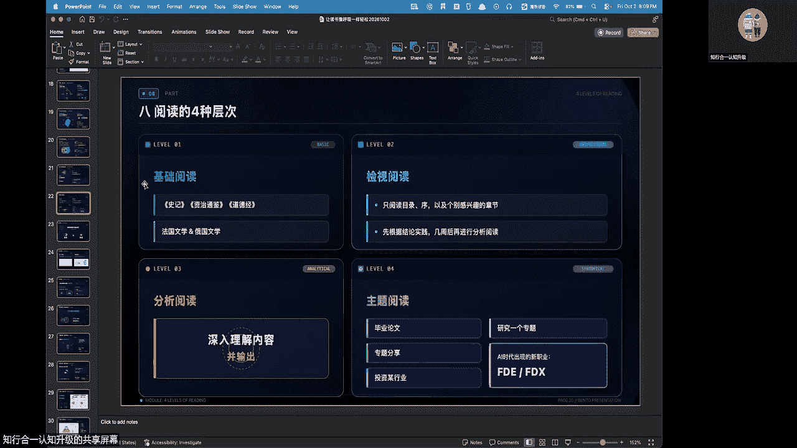

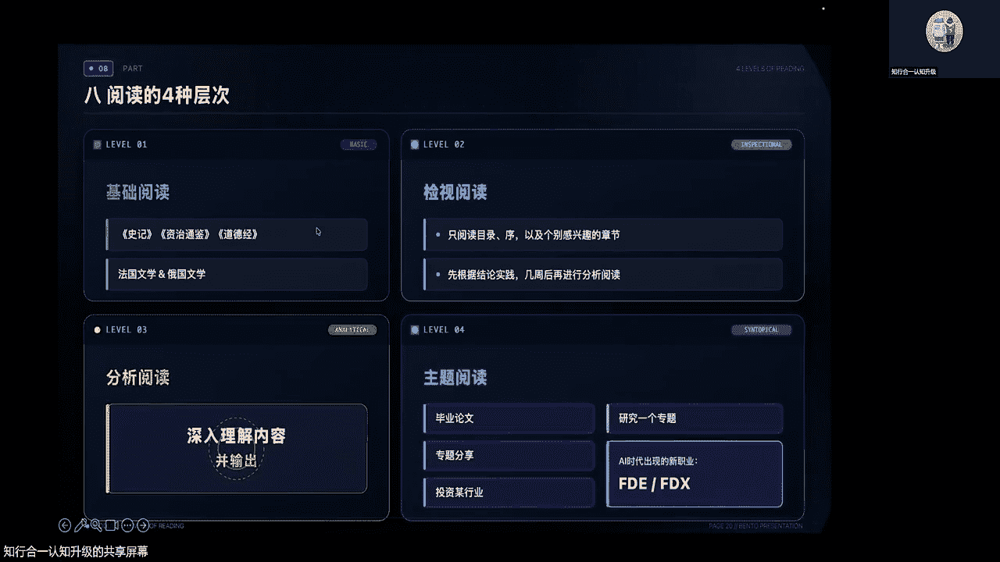

Datawhale AI+X：04：提高阅读速度与质量的方法 ⚡

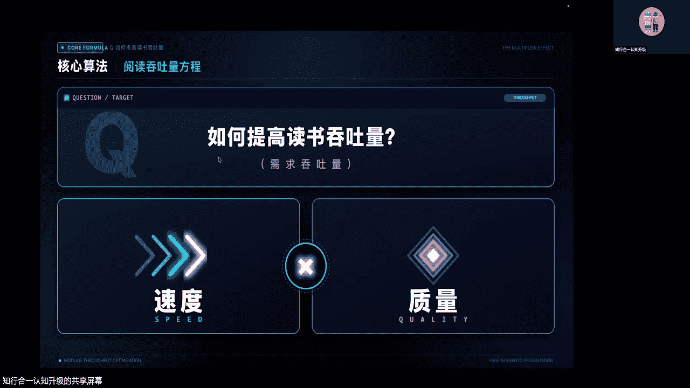

上一节我们介绍了阅读的四种层次和选书技巧。本节中我们来看看如何提高阅读速度和质量，从而提升整体阅读效果。

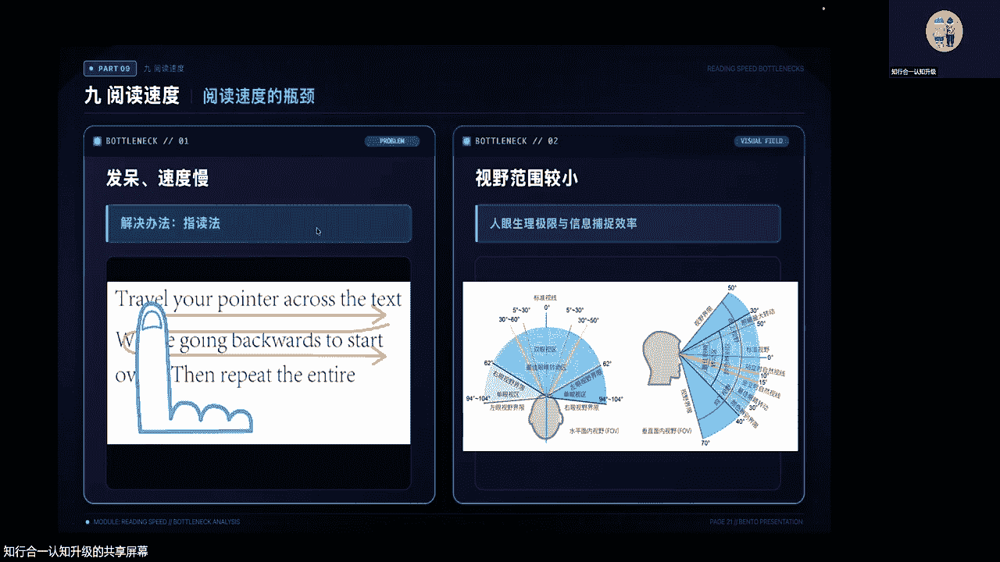

在公司里，团队的需求吞吐量很重要，比如10个人的团队能接多少需求。读书也是一样，在指定时间内读几本书是速度问题，但还要有质量问题，比如读了多少书、理解了多少、能应用多少。速度和质量相乘才是阅读吞吐量的结果。

阅读吞吐量 = 阅读速度 × 阅读质量

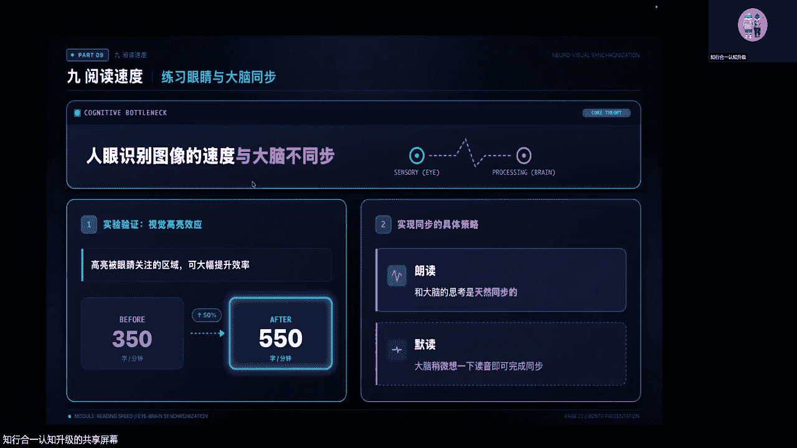

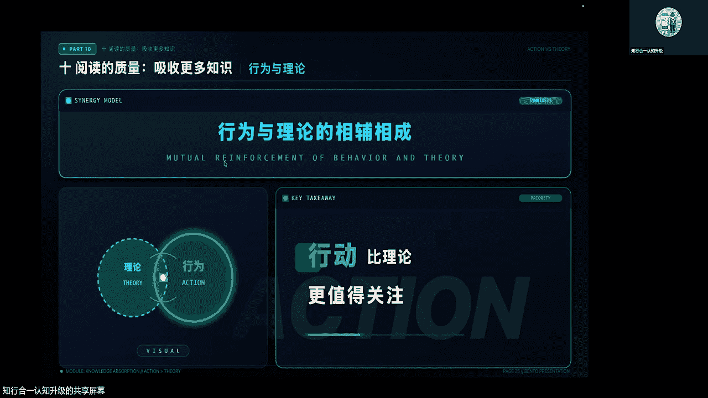

阅读速度的瓶颈主要有以下两点，分别有相应的解决方法：

- 容易发呆，速度慢。读书时可以记录时间，比如9:05开始读一页，过10分钟后看时间，如果还停留在这一页，几分钟甚至几十分钟只读了一页，这就是发呆问题。解决办法是止读法：强迫手指移动，眼睛被迫跟着手指移动，就能一直读下去，避免发呆。
- 视野狭窄。人眼视野范围其实很窄，感觉余光能看到左右180度，实际上只有中间大约5度的范围是看得清的，旁边都是视觉合成的。表演魔术时就会用到这一点，魔术师让你盯着右手看，左手做动作，因为左右手离得超过一定角度后，视觉就是大脑合成的，做得快就看不出来。

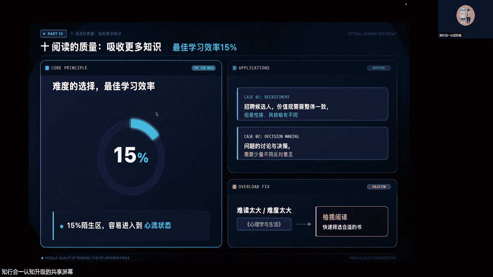

另外还有一个速度提升的问题：识别图像的速度和大脑理解不同步。眼睛看图像的速度是一方面，大脑理解速度是另一方，如果不一致，就会成为瓶颈。有实验发现，用灯光照射高亮区域，能提高大约50%的速度。在实际应用中，默读比朗读快，因为朗读速度慢，而默读能解决读起来不顺或不常见词语句子的慢速问题。

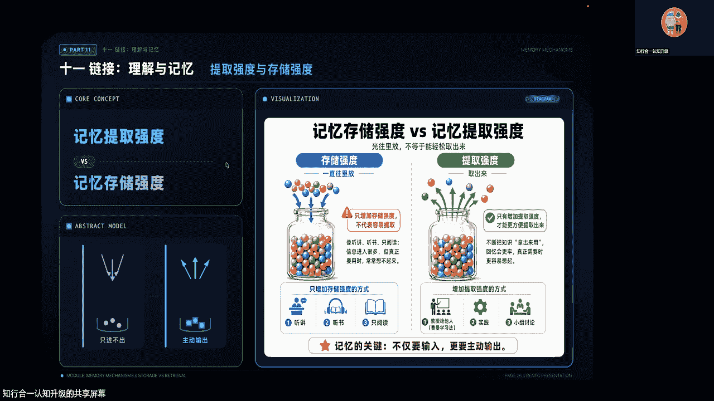

关于质量，怎么吸收更多知识？大脑的理解其实就是神经元的连接。有时候在洗澡或跑步时非常放松，突然想到棘手问题的解决方案，是因为这些知识已经在大脑里，只是神经元不连接，想不到。如果能把它们连接起来，就能找到好的解决方案。读书时也是一样，读新知识体系要融入大脑，需要进行联想。如果知识是独立的，后续应用很难。有一个技巧：读到一句话，突然想到一件有点关联的事情，就把它写下来，记下来，这就是大脑神经元连接的一种方式。

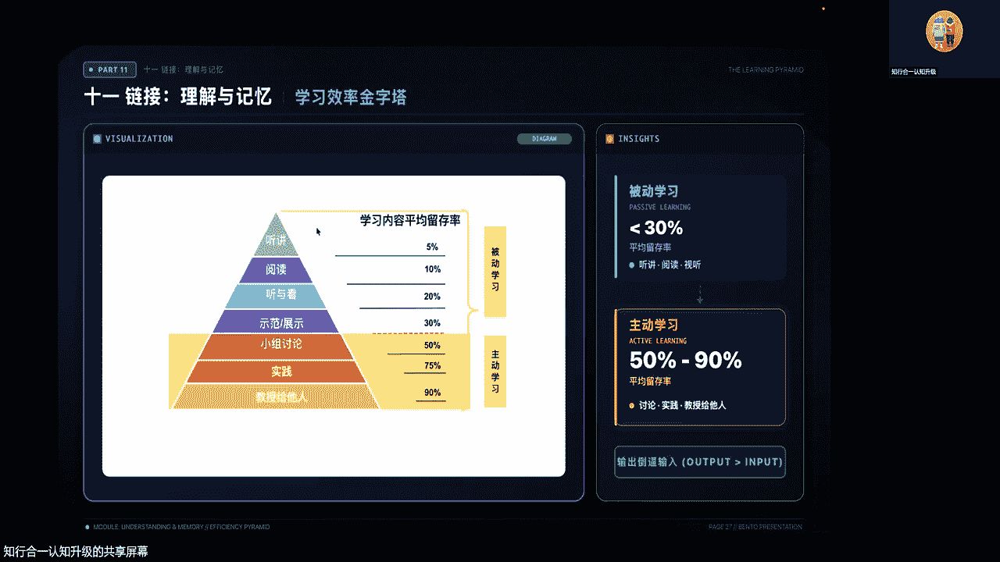

最佳学习难度是15%。读书的难度不要太大，也不要太低，最好是15%。这是基于机器学习实验得出的。比如大一学高数，难度大于15%，如果错了一两节课，后边就完全听不懂，想听懂只能课下花3到5个小时看和做习题。看书也是如此，陌生知识既不要太多也不要太少，太多不好理解，太少效率低。陌生知识1%或2%也可以，但效率不算特别高。

提高了速度，我们还要知道怎么记住和运用所读内容，下一节聊聊记忆和输出。

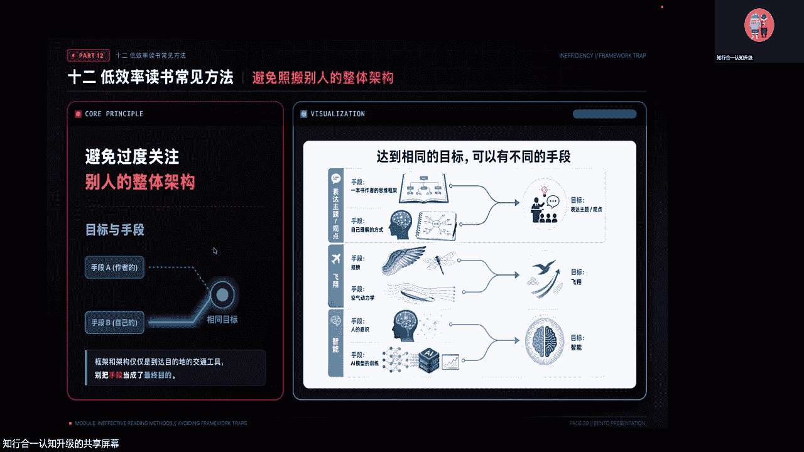

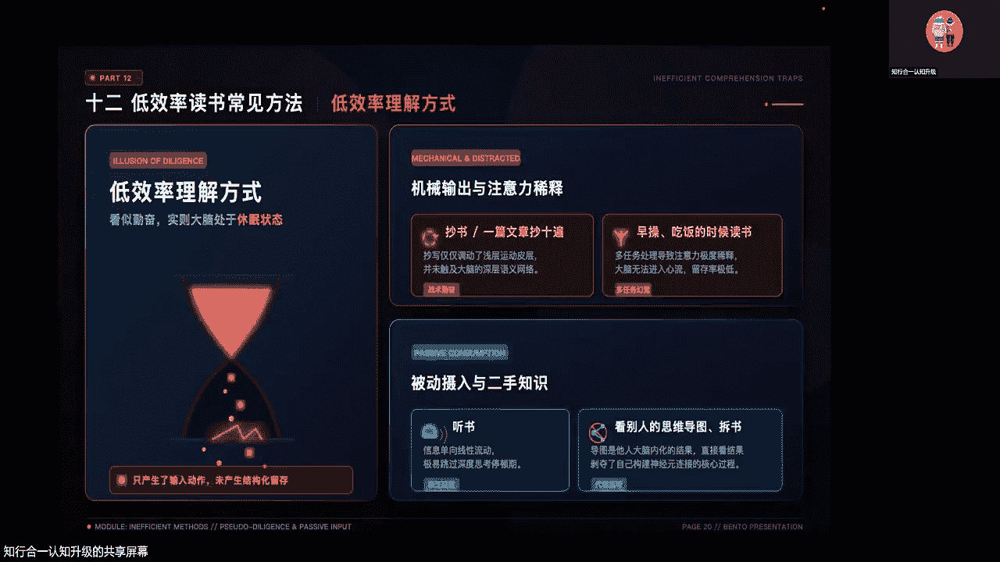

Datawhale AI+X：05：记忆机制、输出学习与阅读习惯 🧠

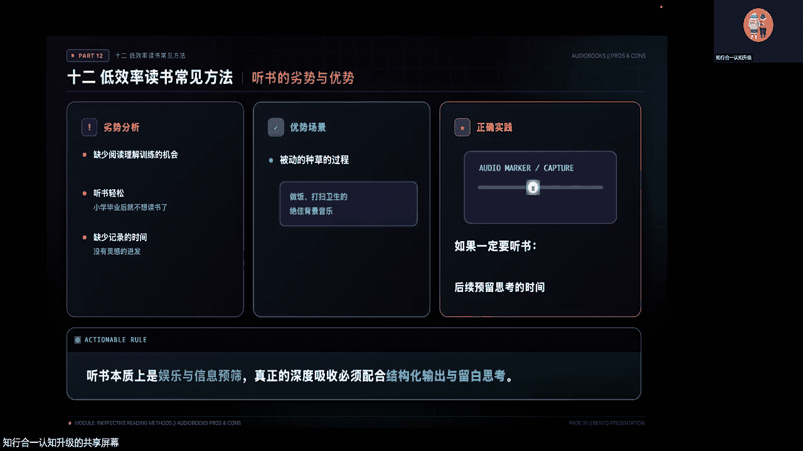

上一节我们介绍了提高阅读速度和质量的方法，包括止读法、默读和15%难度原则。本节中我们来看看记忆是如何工作的，以及如何通过输出让阅读变成习惯。

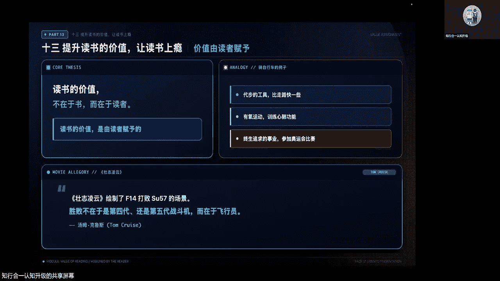

关于理解和记忆，有一个概念叫做记忆的提取强度和存储强度。阅读、看视频、听课都是记忆的存储，就像往瓶子里一直放球。但需要应用、考试、开发软件、做技术设计或方案时，就需要提取，把球提出来。存储和提取是两种独立的能力。读得再多只增加了存储强度，需要用的时候还是提取不出来。想提取出来，就需要多输出。

学习效率金字塔如下：

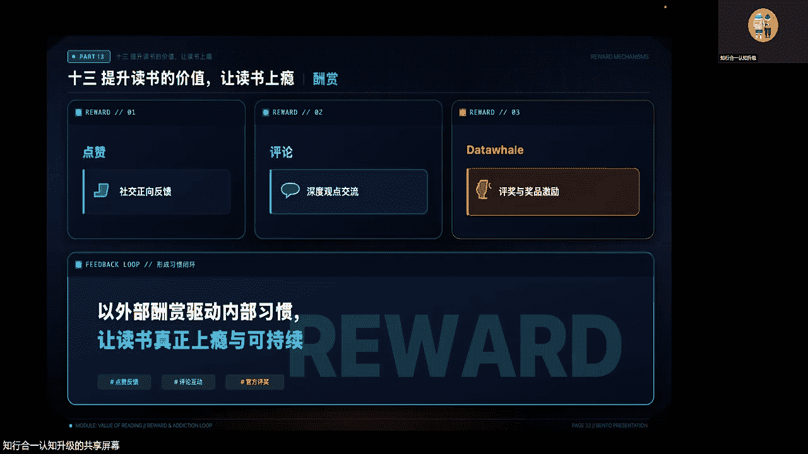

```
学习效率金字塔（从高到低）：
1. 教授给他人（费曼学习法）
2. 实践
3. 小组讨论
4. 阅读
5. 听课
```

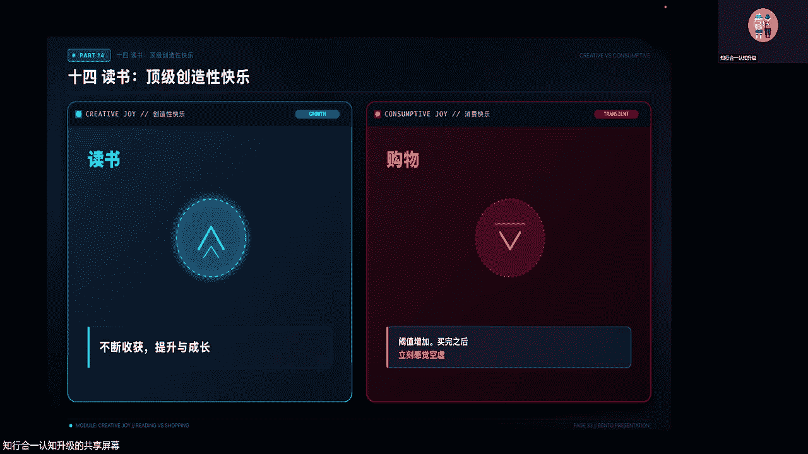

只听课或阅读，留存率可能只有10%，根据艾宾浩斯遗忘曲线，几个小时、几天、十天后就会忘掉很多。主动学习包括小组讨论、实践，最高效率是教授给他人，这就是费曼学习法，给别人讲一遍。上学时成绩好的同学往往乐意给别人讲，别人问他都会讲，给别人讲一遍等于自己又复习了一遍。

基于这些，我们知道一些读书误区。比如老师让抄文章十遍二十遍，效率特别低，因为全是输入。有些学生吃饭排队、跑步时一直读书，也是纯粹输入，留存率低，反而有害。听书方面，如果大量时间花在听书上，留存率低，而且是一种行为习惯的危害。毕业后把听书当背景可以，但小学生一二年级就开始听书，会导致后续阅读困难，因为听比较轻松但记不住，以后阅读就会很困难。

关于思维导图和听书，需要注意以下几点：

- 思维导图。看你怎么用。上学时辅导资料里有别人总结的思维导图，效果很好，但前提是需要自己画，而不是看别人画的。别人画的思维导图只是输入，和看书、阅读、操练区别不大。真正理解还需要自己输出、自己画。思维导图只是手段，不必完全按照作者的架构，只需知道每一部分哪些是自己需要的。
- 听书。听书并不是完全不能听。做饭、打扫卫生时可以当背景音乐。但不能当成精读方式，听书可以当成重草过程，听一下介绍知道大概讲什么，如果感兴趣后续还是要精读。长时间坐车看书晕，如果一定要听，需要手机截图记录时间点，比如音频播到1分50秒，后续还要整理，因为仅仅听不记录不思考，留存率低。

除了读书本身，还要考虑时间被什么占用。如果看短视频或玩游戏上瘾，就没有那么多时间读书。怎么解决呢？其实就要把这些上瘾的活动戒除掉。有一本关于上瘾的理论书，叫做《上瘾：让用户养成使用习惯的四大产品逻辑》。它讲的是怎么设计短视频和游戏，通过不断的触发、行动、可变奖励、投入，利用大脑最底层的抽奖机制让人对这些活动上瘾。知道这个原理之后，就明白自己为什么会花那么多时间在无意识地看短视频或玩游戏中。从而可以用一些替代活动，比如运动、跑步、骑行，或者看书，来取代它们。对于大脑来说，其实都是一种抽奖活动，至于是玩游戏还是看书，其实是一样的。通过狸猫换猪的思路，把娱乐活动替换成有益的读书或运动。

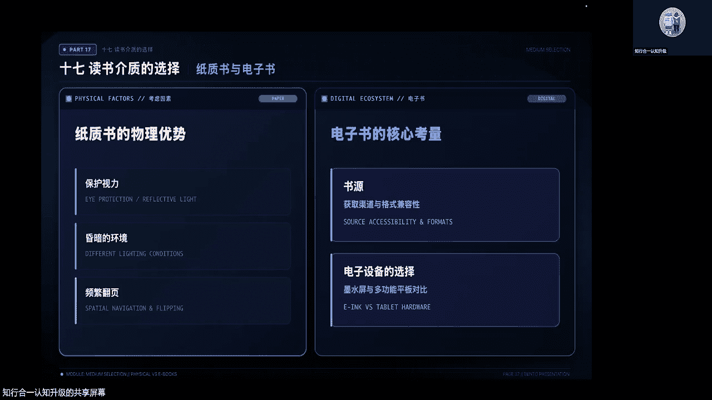

读书的价值和书本身没有关系，关键在于读书怎么赋予它价值。就像骑自行车，最简单是代步工具，比走路快。有些人骑10到20公里上班，当成有氧运动，提高心肺功能。有些人把比赛当成事业，如环意、奥运会。电影《壮志凌空》讲第四代战机打败第五代战机，和战机代数关系不大，关键在于飞行员。读书也是一样，书就在那里，国内书很便宜，真正能发挥价值不在于数量，而在于怎么用。

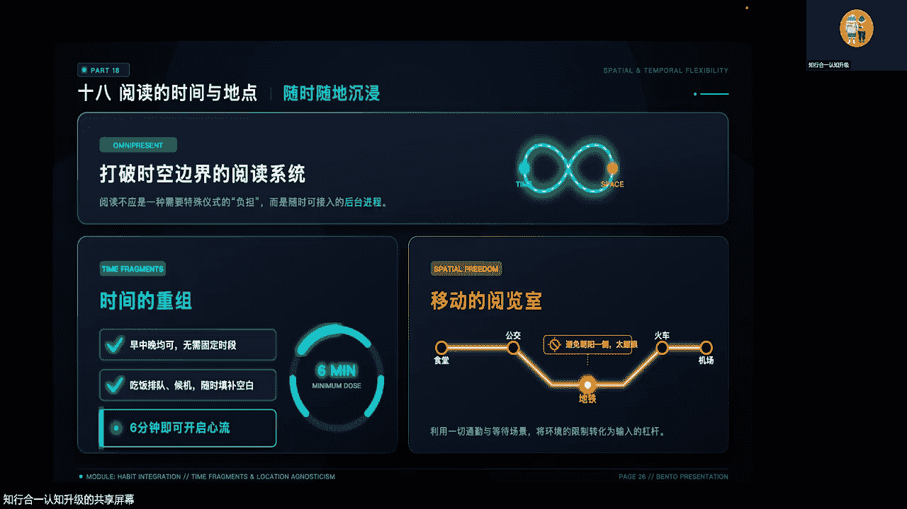

知道了记忆和输出的重要性，接下来看看如何让读书成为无意识的行为习惯，以及分享输出的具体方法。

将读书变成习惯并产生长期价值，可以通过以下方式实现：

- 分享输出。写文章、公众号、博客，或者写几百条朋友圈都可以。Datawill社群的分享活动也是一次机会。在公司内部或学校里，三五个人一个小团队也可以分享。
- 实践。把理论行为应用到实际中，改变和优化行为习惯，这是一个长期计划。
- 善的原理。玩游戏本来快要输了，翻盘后最后点赞，会特别高兴。如果一直顺利，反而没意思。分享文章或视频，别人点赞或评论，和玩游戏的抽奖感觉一样。唯一区别是过程更长，玩游戏30分钟一把就结束，读书分享可能需要几小时，但长期来看有更多价值和意义。

人生幸福快乐方面，读书像游戏一样有抽奖感，能带来快乐。购物的快乐是物质满足，但维持时间很短，阈值还在增加。小时候买100元的书很高兴，长大后100元书没感觉，要买500元鞋，后来500元鞋也没感觉，要买几千甚至几万元的车或房子。但买完后没有意义。读书能读的东西几乎无穷无尽，读不完。

Datawhale AI+X：06：AI时代的阅读与终身成长总结 🤖

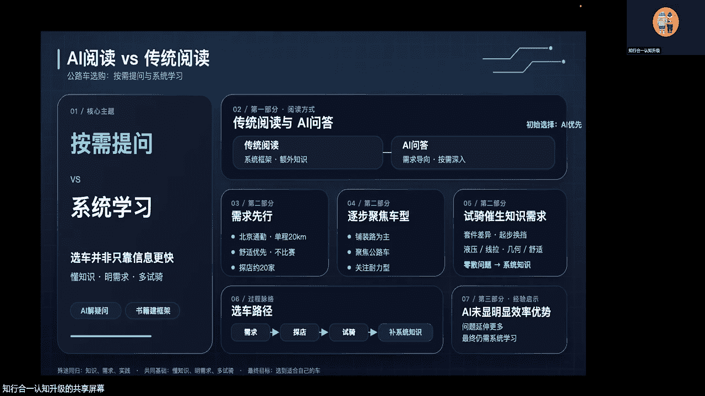

上一节我们介绍了记忆机制、输出学习和阅读习惯的建立方法。本节中我们来看看AI在阅读中的应用，以及在AI时代我们还需要储备什么。

AI在阅读中的应用。从去年AI模型出来后，大家发现AI能做很多软件，最近半年到一年大家非常兴奋。但过了几个月，有些人每月买200美元会员，甚至买两个账号每月400美元，做了很多软件，却发现入不敷出。软件确实做出来了，可能是过去几年就有的想法实现了，但和赚钱没有直接必然关系。AI的本质是降本增效，但前提是你有一套完整的、成熟的商业化体系流程，找到其中的瓶颈。如果之前没有赚钱的商业化流程，不知道怎么营销、怎么销售，纯粹把软件做出来还是不能赚钱。读书也是一样，如果以前自己都没读过书，纯粹用AI把大纲总结出来，确实AI很快就能读完一本书。但过几天、过几个月再问你这本书讲了什么，你怎么在工作、学校或行为习惯中有什么改善，你会发现还是不会。因为神经元的连接没有建立，你自己的体系和AI给出的结果没有关系，所以对你的提升没有效果。

当然，AI在你有疑问时能给很大帮助。比如读一本书，有些结论从书的角度很简单，但从你的角度可能不理解，这时候用AI提问是很好的帮助。但完全替代还有很强局限性，就像自己以前没赚过钱，有了AI之后也不能立刻赚钱。另外，有些能力需要自己独立训练，读书和沟通就是很重要的技能，AI只能辅助，不能让你不训练。在AI大量普及、不需要这么多人工作之后，这些技能更加重要。

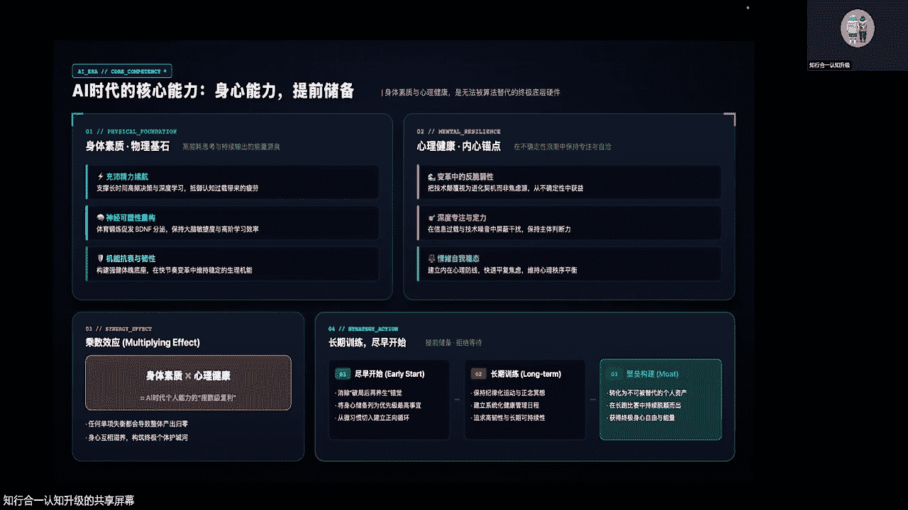

关于AI与商业化的关系，可以这样理解。去年的时候，一些公司为了隐私合规和对自己模型的保护，禁止员工使用国外大模型。但当oppo4.5出来之后，隐私合规也不说了，因为效率实在太高。高管原本以为能达到两倍甚至三倍的效率提升，于是直接放开。一年2月的时候，基本上各公司都开始可以使用国外模型了。刚开始大家想着效率提升这么多，是不是会变轻松。但过了半年之后，大家都会有一个感受：有了AI之后，它更累了。这就是预期和实际的差别，可能真的预期它能提效百分之百，但实际上还是有一定的瓶颈。

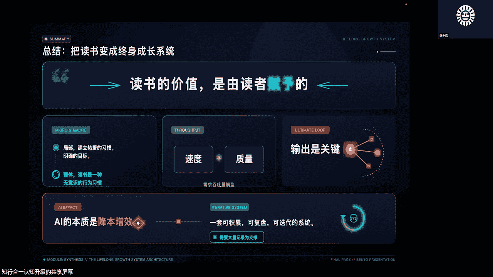

AI时代阅读与时间管理的关键点包括以下几点：

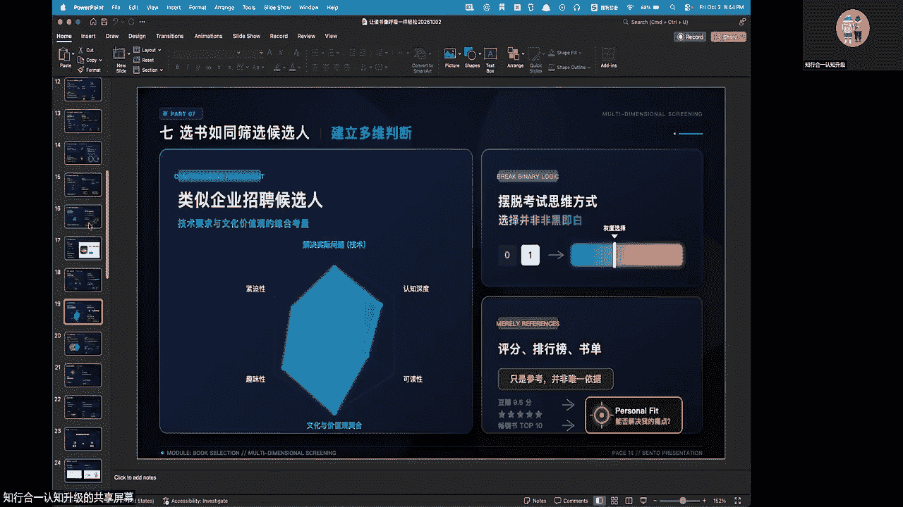

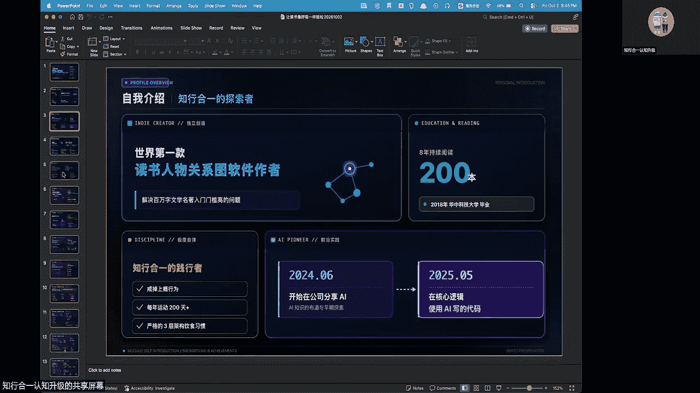

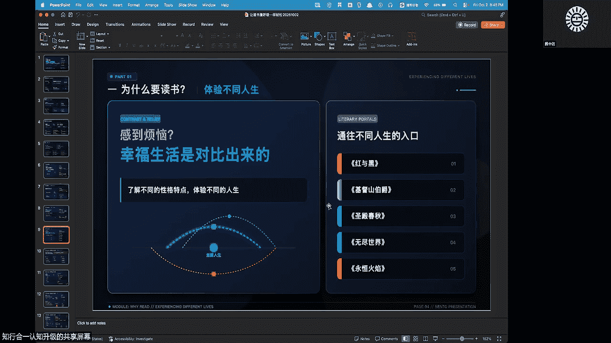

- AI与时间管理。有了AI之后，你可以把自己看成一个团队管理者，去管理AI。就像传统团队管理者能带多少人，取决于并行和委托任务的天花板能力。你能掌控多少AI窗口，也需要时间管理规划。开5个甚至10个窗口同时让AI做软件，特别是做不同需求，开得多就会懵，尤其是涉及复杂交互逻辑时。很多决策选择不是让AI自己做就行了，需要根据不同用户场景、不同需求目的做决策，很多时候没有最好的方案，要根据不同维度因素做优先级排序，这需要花大量精力思考。每个AI窗口都需要你思考，思考太多就控制不了，这就是你能力的天花板，和管理团队一样，能力上限是多少，就能带多少人，能开多少个AI窗口。
- 纸质书 vs 电子书。电子书不占体积，但需要自己解决溯源问题，世界最大的电子书网站其实都可以免费下载，但如果不知道的话，就有微信读书会员，一个月49.5元。纸质书的好处是刚开始读的时候质感强，不容易被打扰。如果用墨水屏设备可能还好，但如果用手机微信读书软件，很容易被通知打断，特别是开了娱乐软件通知，读了几分钟就被一条消息打断，纸质书就没有这个问题。
- 阅读时间与地点。如果真的想读，不需要纠结什么时间，任何时间都可以。只要能读6分钟以上，就能获得心情宁静和一定收获。地点方面，安静地点最好，但刚开始在地铁或公交读不进去，觉得太吵，特别是地铁。刚开始可能带降噪耳机，后来读多了习惯了就无所谓了，现在坐地铁不带降噪耳机也能看书。刚开始环境要求高，读多了之后就发现没什么要求，任何地点都可以。

除了学AI，还有两点很重要，一是身体素质，二是心理健康。身体素质年轻时没感觉，但涉及长期储备，比如感冒、新冠，不同人反应不同，有些人三天就好，有些人会有并发症。身体素质不仅为未来身体更好做技术储备，也能提高精力。精力和身体素质有关，身体素质不一样，精力也不一样。心理健康方面，最近几年可能有明显感受，大家对一件事情反应过于激烈，比如地铁碰一下就特别愤怒，开车时别人稍慢一点就路怒，从理性角度说其实只耽误一两分钟，没什么问题，但有些人就特别暴躁。企业里跨部门沟通时，有些人稍微说了几句就特别激动，因为一点小事就很焦虑。焦虑抑郁现在还没占特别多人，但会随着AI发展越来越严重。因为过个三五年，工作岗位会越来越少，大家会有很多时间，有很多时间之后要干什么？如果没有强大的精神支撑，不知道干什么，很容易出现心理问题。焦虑抑郁不是一两年形成的，是长期影响过程。幸福的孩子用童年治愈一生，不幸的孩子用一生治愈童年，你这一两年引起的心理问题，最后会影响很多年。这属于拓展话题，但在AI发展时代，我们需要提前储备心理健康。

AI能降本增效，但关键还是我们需要提升自己，选择一个对人生有长期意义的活动。不管是读书、运动，还是自己认为有益的爱好，都可以。这就是今天的分享。

Datawhale AI+X：07：常见问题与实践建议 💡

在实际阅读中，初学者常会遇到一些具体问题。以下是常见问题的解答与实践建议。

有学员反映，从小说转向文学作品后，看技术类工具书时难以沉浸投入，容易走神，进入一种无法专注的状态。电子书使用止读法也不太好操作，不知道如何把握15%的阅读难度。针对这种情况，可以先从入门的文学名著开始，比如肯弗莱特写的《基督山伯爵》《三种火枪手》。这些书被称为西方的金庸，比金庸更早写武侠小说，属于文学名著但层次更高，结合了当时的时代背景，有更深层次的启示，涉及人与人之间的利益冲突、协调沟通，以及逆境环境下的解决方法。相比爽文小说，这些书更适合作为过渡，读完之后会有更多耐心去读50万字或100万字的书，再去看技术书时也会更有耐心。此外，《红与黑》《生死春秋无尽世界和永火焰》等关于中世纪欧洲、一战二战和冷战的故事，也可以作为入门选择。

关于数字化记录，学员关注用Notion、微信读书等工具记录阅读，但发现数据源分散，有些书在微信读书上没有出版，需要去外部来源找，导致无法统计。关于这一点，量化阅读时间不应作为最终目的，它只是一种衡量手段，是一个过程。比如做年终总结或发朋友圈说今年读了多少本书、多少小时，这能像玩游戏一样提供动力，是一种展现或秀肌肉的感觉，但不能算作非常关注的最终目标。如果真的没法统计，也就算了，没必要把全部都统计，然后去找很多软件。每个软件都有自己的特色和缺点，就像租房子买房子，每个房子都有特点，但没有一个能满足所有需求。如果把精力都花在选软件上，选来选去还是没有完美的。可以把它当成参考记录的指标，但关键还是要输出。

关于阅读后的记录和输出流程，可以从小范围开始逐步扩大。刚开始看到一个知识点有感悟，可以先记在备忘录里，吃饭时和同学或同事聊一聊，办公一分钟就说出来，这就是最小范围的输出，也是费曼学习法。再扩大范围，可以发朋友圈、写公众号或博客，写1000字也算简短的分享。再大范围的话，可以在学校、小组或工作中做一个正式的专题分享，20分钟或30分钟。总之，从小往大逐步扩大范围，看你自己的熟悉程度。刚开始准备10到20分钟的简短分享可能比较快，后来分享多了之后，也会有耐心花几天甚至几周去整理一个更大范围的分享。

另外，可以降低边际交付成本。比如关于读书话题做一个PPT，分享一次可能整理了5到10个小时，讲一个小时就结束了，效率不高。可以在公司分享一遍，然后在Datawill社群再分享一遍，再在自媒体发一遍，视频算一遍，再把文稿发到博客和微信。这样一来，做了一次分享整理了一次，就能在多个地方发布，文章和视频发多遍，就降低了平均成本。

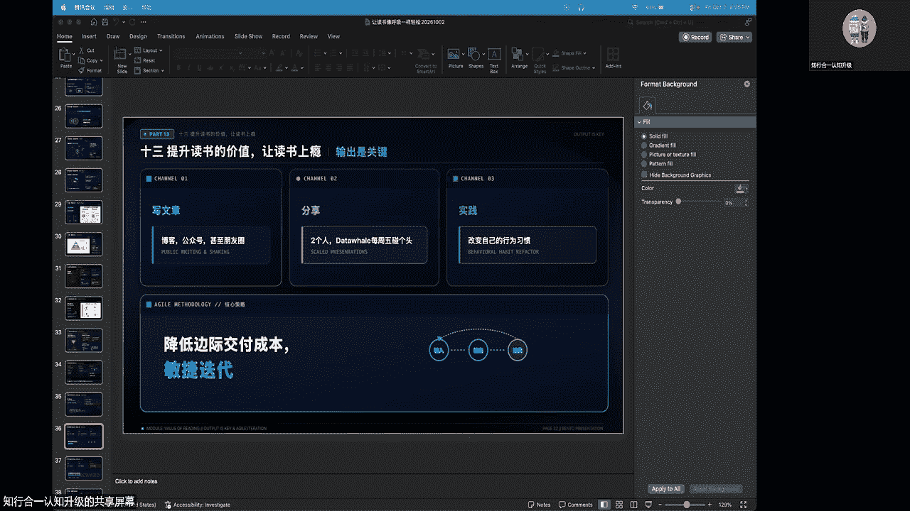

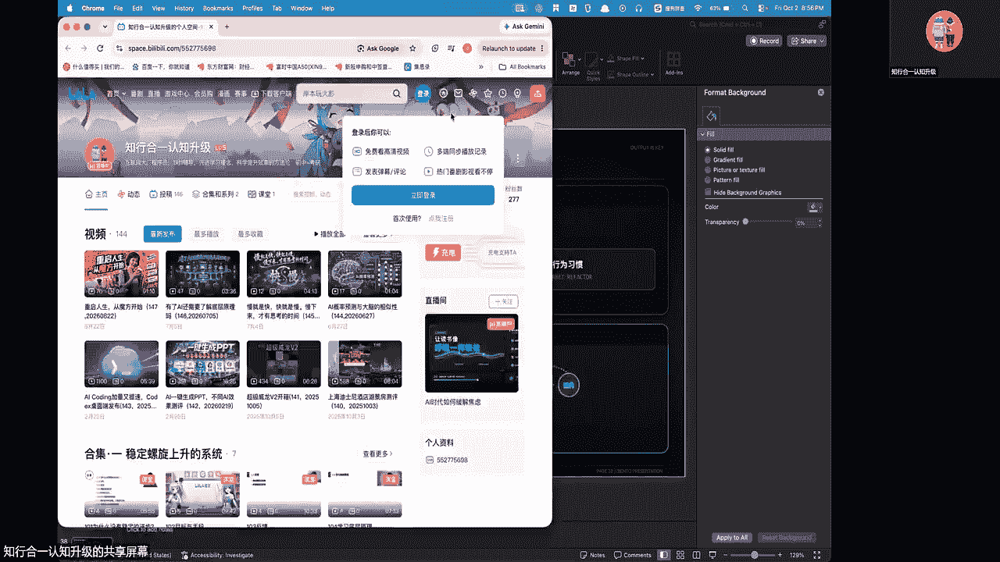

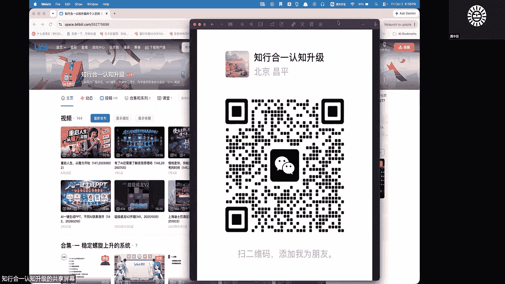

本节课中，我们一起学习了为什么要读书、如何选书、阅读的四种层次、提高速度和质量的方法、记忆机制与输出学习、AI时代的阅读应用，以及常见问题的解决方法。希望这些内容能帮助你建立起高效的阅读系统，让读书成为一种长期的习惯。

