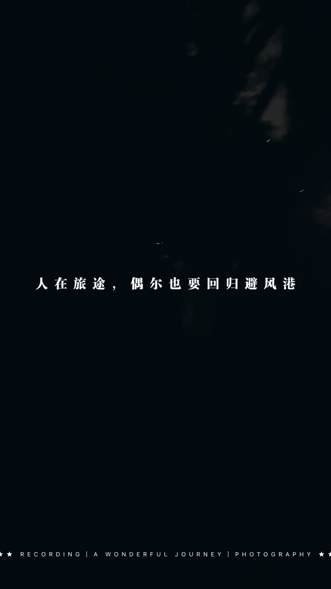
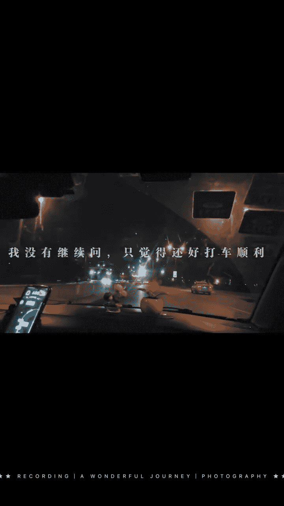
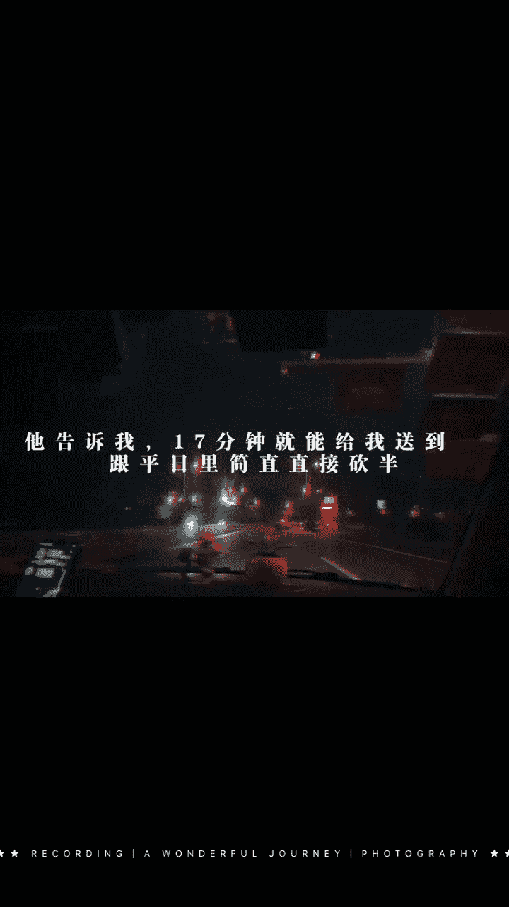

【Datawhale AI+X】：01：五一愉快·我要回家啦Vlog 🎬


在本节课中我们将要学习如何使用Datawhale AI+X工具制作一段关于五一回家的Vlog。Vlog就是视频日记的意思，我们可以把回家路上的所见所得记录下来，分享给亲朋好友。这篇教程适合完全没有基础的初学者，所有的步骤都会用大白话来讲解，不需要你提前懂什么专业的剪辑知识。我们会一步一步地把素材准备好，再把视频拍出来，最后剪辑成一部可以发布的短视频。如果你跟着这个教程做，最后一定能够拿出一份属于自己的回家Vlog作品。


接下来我们先来看看第一部分的内容，这里对应原文中的第一句歌词片段“I was on alone with the love”。这句话可以理解为独自带着爱出发，也就是我们制作Vlog的第一个核心概念，即确定拍摄主题和情感基调。


核心公式如下：

```python
Vlog主题 = 回家目的地 + 个人情感 + 记录重点
```

以下是确定Vlog主题的具体步骤：
- 首先想清楚你要去哪个城市或哪个村庄；
- 然后决定你想表达什么样的心情，比如开心、思念或者放松；
- 最后列出你想拍摄的具体场景，比如火车站、家乡路口、家里的饭菜。




上一节我们介绍了如何确定Vlog的主题，本节中我们来看看拍摄前的准备工作。原文中的“She's got clear of for skin， my Brad”以及“あまら”这两处片段，我们可以把它们当作画面清晰度和音频素材的代号，提醒大家在拍摄前检查设备状态。

核心代码如下：

```python
设备检查清单 = {
    "手机电量": "充满电",
    "存储空间": "留出足够空间",
    "镜头清洁": "擦拭干净",
    "麦克风": "测试录音效果"
}
```

以下是拍摄前需要准备的物品：
- 一部摄像头正常的手机或相机；
- 充电宝和充电线；
- 足够的存储空间，建议预留50GB以上；
- 三脚架或稳定器，用来防止画面抖动。




本节我们接着看拍摄过程中的几点建议，对应原文中的“箱に乗ら。🎼To。🎼。🎼下。🎼的着。🎼不。I was on alone”。这段内容比较碎片化，我们可以把它理解为拍摄时的动作要领，比如上下移动、保持平稳等。

拍摄时请记住以下几点：
- 手持设备时双手握住，手肘贴近身体，这样画面更稳；
- 拍摄人物时眼睛保持与镜头齐平，避免仰拍或俯拍；
- 每个场景拍摄时间不要太短，建议至少录制10秒钟；
- 多拍几个不同角度的同一场景，方便后期剪辑选择。


接下来我们进入剪辑环节，对应原文中的“She's got cleared up for skin， my bray and be the love”。这句话虽然读起来不通顺，但我们可以把它理解为让画面更清晰、让表达更完整，也就是剪辑的核心目的。

视频剪辑的基本逻辑可以用下面的公式表示：



```text
最终视频 = 素材筛选 + 片段拼接 + 字幕添加 + 音乐配乐 + 输出导出
```

以下是剪辑时的操作顺序：
1. 把拍摄好的所有视频导入到剪辑软件；
2. 把不需要的片段删掉，只保留精彩部分；
3. 把片段按时间顺序拼接在一起；
4. 为每个场景添加适当的字幕，说明地点和人物；
5. 选择一段轻快的背景音乐，调整音量不要盖过人的说话声。


本节最后一部分，我们来看看如何给Vlog添加结尾和分享设置，对应原文中的“🎼あに乗ら。🎼Do。🎼想。🎼爱着。🎼不”。这里的“想”和“爱着”可以理解为表达对家乡的思念与热爱，也就是Vlog结尾要传递的情感。


以下是结尾处理的建议：
- 留出5秒钟的黑屏或淡出画面；
- 添加一句简单的告白，比如“回家了，很开心”；
- 设置视频封面，选一张最好看的画面作为缩略图；
- 选择合适的话题标签，方便更多人看到你的作品。


本节课中我们一起学习了如何从零开始制作一段五一回家Vlog。我们先确定了主题，然后准备了拍摄设备，接着掌握了拍摄技巧，最后学会了剪辑和分享。希望你能够按照这个流程，拍出属于自己的回家之路。祝你五一愉快，顺利回家。
